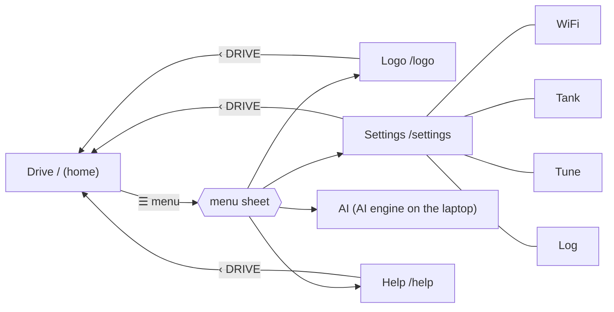

# Bridge UX — the tank app (living document)

Status: **DRAFT for owner review** · Date: 2026-10-18 · Decisions: `docs/design-notes.md` §79 (single tank, no hub), §80 (this structure)
Supersedes `docs/design/hub-ux.md` for the single-tank setup. That file stays for history; its **drive-stick rules** ("Drive stick — what the user expects", "RC two-hand mode", "Screen 7b — Cockpit-lite") still apply to the Drive screen.

## Principles
- **One tank app, served by the ESP32 bridge.** One look (Stitch "Phosphor" green style, Lucide icons, bracketed card titles), one header, one way back to Drive. It installs on the phone's home screen as one app (the manifest the drive page already has).
- **Drive is home.** It opens first, stays full screen and uncluttered; everything else is one tap away through the menu.
- **Full screen** = a place you stay and work (Drive, Logo, Settings, AI). **Sheet / dialog** = a short task with an end (sounds, max speed, confirmations, checklists).
- **STOP is on every screen that can move the tank** (Drive, Logo) and only there. Settings and Help cannot move the tank and have no STOP (owner, design-notes §72).
- **Plain HTML / CSS / JavaScript**, no framework, no build tools; each section stays a small file, gzipped into the firmware at build time (`scripts/pack_web.py`, a size budget per file).
- **A hidden page holds no link** (design-notes §77): switching apps or locking the phone closes the connection and the video; it reconnects when shown again.
- **No logins.** Home network only (the bridge has no authentication); changes that matter are confirmed with the **tank's own button** (Plan M), never only on screen.

## Users
| User | Uses |
|---|---|
| Owner / adult | everything |
| Child | Drive and Logo, only while **child-play mode** is on (later, its own design) |
| AI engine (a program on the laptop) | the same WebSocket as the pages; its own page lives on the laptop |

## Screens (5)
| # | Screen | Path | State | Purpose |
|---|---|---|---|---|
| 1 | **Drive** | `/` | built (Plan F/G, §44–51) | drive, look, stop |
| 2 | **Logo** | `/logo` | **new — next to design** | write, run and step Tank Logo programs |
| 3 | **Settings** | `/settings` | built with 2 tabs (Plan M) → **4 tabs** | everything about the tank that is not driving |
| 4 | **AI** | on the laptop (AI engine) | later, with the AI work | what the AI sees and does |
| 5 | **Help** | `/help` | built | facts, how-to, API list |

`/info` stays a data endpoint for tools (JSON), not a screen.

## Navigation

- On Drive the **⚙ SET** chip becomes **☰ MENU**; the menu sheet lists Logo, Settings, AI, Help (AI greyed out with "not set up" until its address is saved in Settings).
- Design: `docs/design/stitch/17-drive-menu-v1.png` (drawn on the real drive page; STOP stays bright above the dimmed screen).
- Every other screen has the same header: **‹ DRIVE**, the screen title, and the status chips (battery, WiFi mode, Uno online) as on `/settings` today.
- The AI page opens in a new tab at the address saved in Settings (it is served by the laptop, not the tank).

## 1. Drive (built)
As today: live video, drive stick or RC two-hand mode, camera stick / drag-to-look, LOCK / HOME, STOP, battery and distance bars, heading tape, speed / turn readout, SNAP, SOUNDS sheet (24 sounds incl. horn), MAX speed sheet, mute, banners (stall, fault, encoder off, "stopped by another device"). Change: ⚙ SET → ☰ MENU; a camera chip (`▣ VGA · 14 fps`) whose sheet sets picture size and frame-rate limit (design-notes §94).
Not added here (owner, 2026-10-18): a moves panel (Logo does it), deep diagnostics (Settings → Tank).

## 2. Logo (new — v2 screens for owner review)
Designs: `docs/design/stitch/15-tank-logo-desktop-v2.png` (laptop: programs · editor · path side by side) and `16-tank-logo-mobile-v2.png` (phone portrait: PROGRAM / PATH tabs, run bar at the bottom); HTML in `docs/design/stitch/html/`. Generated in Stitch (Phosphor), then corrected by hand: invented labels removed (interpreter names, memory, baud, RPM, "E-STOP OVERRIDE" link), heading sign fixed (right turn = −90°), ☰ MENU added. Shown state: `square` running, line 3, round 2 of 4.
- **Editor:** the program text with line numbers, word help / autocomplete from `logo/spec/words.yaml`, child-friendly error messages (Spec 5).
- **Run controls:** RUN, STOP (the big red one, always visible), STEP (pause after each line), speed limit.
- **While running:** the current line highlighted; the **planned path** (turtle preview, Spec 5 §10) and the **driven path** from the encoders and heading.
- **Programs:** saved programs and examples; new / rename / delete.
- **Phone and laptop:** laptop = editor and path side by side; phone = editor and path as two panes you swipe or tab between, run bar at the bottom.
- **Decided (owner, 2026-10-18, design-notes §81):** programs are **saved on the tank** (every device sees the same list); a running program **stops** when its page is hidden or disconnects, or when another device takes control — the same as driving by hand (a hidden page holds no link, one driver at a time). STOP from any device still ends it at once.

## 3. Settings — 4 tabs (WiFi and Tank built; Tune and Log new)
| Tab | Contents |
|---|---|
| **WiFi** | as built: connection, saved networks (3 slots), scan + add, own WiFi |
| **Tank** | what the tank is and does: 01 Bridge · 02 Uno body · **03 Live sensors** (distance ahead, heading, tilt, turn rate, encoder counts, track speeds, IMU temperature; 10 Hz) · **04 Self-test** (last result per check, run again — tank standing still) · **05 Camera** (live picture while the tab is open, §93; viewers, picture size QVGA/VGA/SVGA/HD, frame-rate limit, brightness, contrast, low light, quality, flip, mirror; saved on the tank) · **06 Child play** (OFF/ON, limits, adult checklist, on and off with the tank's button — numbers and rules from the child-play design, later) · 07 Safety (read only) · 08 Track model · 09 Maintenance. Design: `docs/design/stitch/20-bridge-settings-tank-mobile-v2.png` |
| **Tune** | the **Distance** (counts per metre, roll-on, resets) and **Straight driving** (track balance stepper) cards move here from Tank — everything you adjust lives on Tune; **calibration wizard** (counts per metre, track balance, roll-on — guided steps replacing the laptop `move.py` routine; after the left road-wheel repair) and **live graphs** (speed per track, heading, track balance over the last minute, next to the value being tuned) |
| **Log** | recent events, newest first: stops and why (stall, obstacle, link lost, STOP from another device, battery), WiFi mode changes, restarts; from a small ring buffer on the bridge; CSV download |

Designs: **Tune** `docs/design/stitch/18-bridge-settings-tune-mobile-v1.png` — live graph (left / right track speed, last 60 s, HOLD, CSV), calibration status (distance 7514 · balance 19 ‰ · roll-on 27 mm learned, RE-RUN / RESET), the active wizard step with its own DRIVE 1 m and STOP (the only place on Settings that moves the tank) and the measured-distance input that shows the new value before saving (tank-button confirm); **Log** `docs/design/stitch/19-bridge-settings-log-mobile-v2.png` — filters ALL / STOPS / WIFI / SYSTEM, CSV, events newest first with a plain reason, last 200 kept, cleared on restart. Both drawn in the Phosphor style; the Tune screen was built by hand from the Log frame after two failed Stitch runs.

## 4. AI (later)
Served by the AI engine on the laptop (its local FastAPI page, Spec 4): what the camera sees with detections, what the AI is doing and why (decision log), the command box (text / voice). The tank app only links to it; Drive shows "AI driving" in the owner chip and STOP always wins.

## 5. Help (built)
As today; updated as screens are added.

## Shared elements
Header with ‹ DRIVE and status chips · bracketed card titles with corner marks · toast · confirm box with the tank-button countdown (Plan M) · badges (CONNECTED, STANDBY, READ ONLY …) · the menu sheet.

## Mapping from the old hub UX
| `hub-ux.md` | Now |
|---|---|
| Login, Fleet, Add tank, Hub settings | dropped (one tank, home network) |
| Cockpit / Cockpit-lite | Drive |
| Tank settings | Settings → Tank |
| Calibration stepper | Settings → Tune (wizard) |
| Child-play checklist | Settings → Tank (child-play card) |
| Timeline | Settings → Log |
| Media viewer, AI page | AI screen (on the laptop) |
| — | Logo (new) |

## Next steps
1. Owner reviews this document.
2. Stitch screens: **Logo** (phone + laptop), then the menu sheet, then Settings → Tune and Log.
3. Spec 5 (IDE section) and the bridge LLD for each new screen; then a plan per screen.
