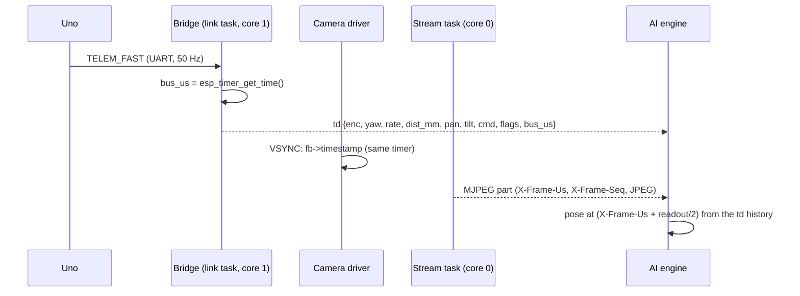
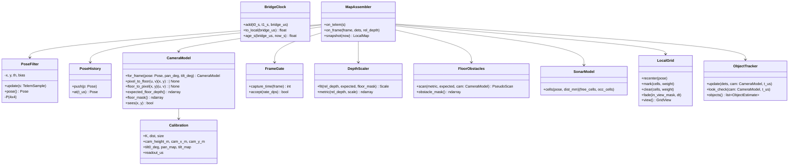
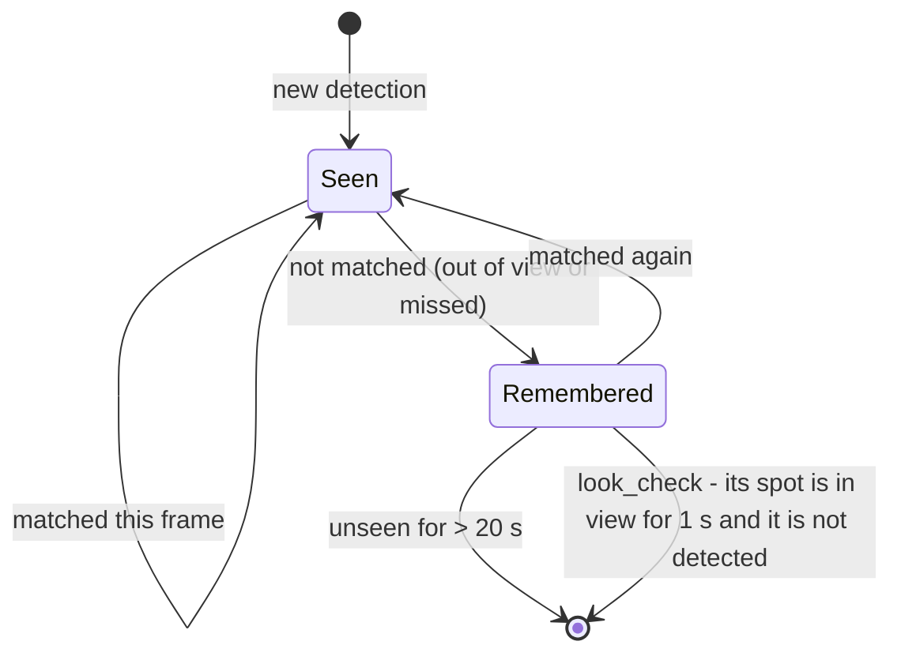
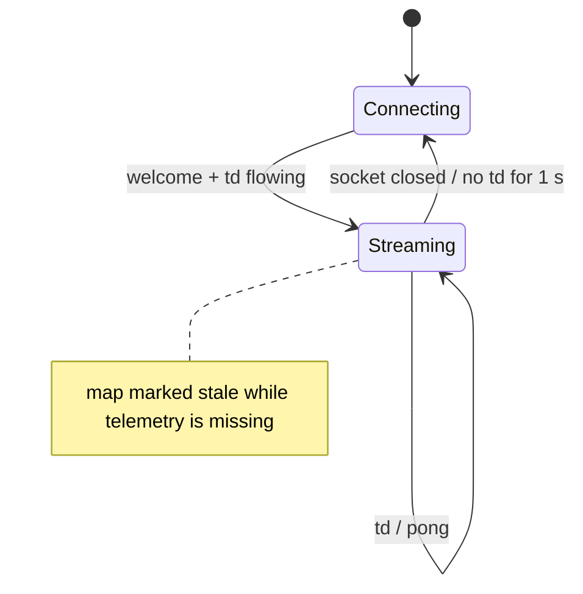

# AI Engine — Low-Level Design (module 1: sensor fusion and the space map)

Status: APPROVED (owner, 2026-10-20) · Date: 2026-10-20 · Spec: `docs/superpowers/specs/2026-10-20-07-ai-module1-map-design.md` (Spec 7, approved 2026-10-20) · Decisions: design-notes §107 · Research: `docs/research/2026-10-20-module1-mapping.md`

Module 1 only **watches**: it never sends a motion command. Modules 2 (drive) and 3 (plan) get their own sections when they are designed.

## 1. Where it lives

```
ai-engine/                              # new top-level project (uv, Python 3.12)
├── pyproject.toml                      # ruff, pyright strict, pytest; extras [mac] (coremltools, ultralytics, rerun-sdk)
├── config/
│   ├── engine.yaml                     # bridge address, frame size, rates, map parameters (§9)
│   └── calibration.yaml                # written by the calibration tool (§8); the engine refuses to map without it
├── src/conqueror_ai/
│   ├── domain/                         # pure: no I/O, no models, no clocks - host-tested
│   │   ├── types.py                    # TelemSample, Frame, Pose, Detection, ... (§3)
│   │   ├── clock.py                    # BridgeClock
│   │   ├── pose.py                     # PoseFilter, PoseHistory
│   │   ├── camera.py                   # CameraModel, Calibration
│   │   ├── gate.py                     # FrameGate
│   │   ├── depth.py                    # DepthScaler, FloorObstacles, PseudoScan
│   │   ├── sonar.py                    # SonarModel
│   │   ├── grid.py                     # LocalGrid
│   │   ├── objects.py                  # ObjectTracker (room-frame Kalman), ImageTracker port use
│   │   └── localmap.py                 # LocalMap, MapAssembler
│   ├── ports/                          # typing.Protocol: TelemetrySource, FrameSourcePort, Detector, DepthModel, ImageTracker, MapSink
│   ├── adapters/
│   │   ├── bridge_ws.py                # BridgeLink (websockets): hello, debug 50 Hz, ping; parses td / pong
│   │   ├── mjpeg.py                    # MjpegSource (httpx stream): parts with X-Frame-Us / X-Frame-Seq
│   │   ├── yolo_coreml.py              # YoloDetector (Ultralytics CoreML export)
│   │   ├── depth_coreml.py             # DepthAnythingCoreml (Apple's DA V2 Small)
│   │   ├── bytetrack.py                # ByteTrackAdapter (image-space IDs)
│   │   ├── recorder.py                 # SessionRecorder / SessionReplay (§10)
│   │   └── rerun_view.py               # RerunView (live view + .rrd)
│   ├── app/
│   │   ├── map_service.py              # MapService: the async pipeline (§6)
│   │   └── calibrate.py                # the calibration tool (§8)
│   └── main.py                         # composition root: `uv run cq-map` / `cq-replay` / `cq-calibrate`
└── tests/                              # pytest; domain tests need no models, no tank
```
Coding standards apply (Python: type hints everywhere, ruff + pyright strict clean, asyncio without blocking the event loop — models run in a worker thread).

## 2. Bridge changes (bridge LLD revision R17, same branch as the engine's first plan)
- **Telemetry stamp:** `BodyLink::onFrame` records `bus_us = esp_timer_get_time()` (µs since boot, 64-bit) when a complete `TELEM_FAST` frame is parsed (the link task runs every 2 ms, so the stamp is within ~2 ms of arrival); `TankSnapshot` gains `uint64_t fast_bus_us`. `td` and `tf` gain `"bus_us":<n>`.
- **Frame stamp:** the MJPEG part header gains `X-Frame-Us: <fb->timestamp in µs>` (esp32-camera stamps the frame at VSYNC with the same timer) and `X-Frame-Seq: <n>` (per viewer, from 1). `/capture` gains the same headers.
- **Pong:** `{"t":"pong","t0":…,"tank_ms":…,"bridge_us":<n>}`.
- Host tests: the JSON writers (`td`, `tf`, `pong` with `bus_us` / `bridge_us`); the part-header writer as a pure function. No change to the Uno, the Uno protocol or any safety rule.



## 3. Data types (`domain/types.py`, frozen dataclasses)

| Type | Fields |
|---|---|
| `TelemSample` | `bus_us: int`, `uno_ms: int`, `enc_l: int`, `enc_r: int`, `yaw_deg: float`, `rate_dps: float`, `dist_mm: int \| None` (None = no echo / fault), `pan_deg: float`, `tilt_deg: float`, `cmd_l: int`, `cmd_r: int`, `flags: int` |
| `Frame` | `seq: int`, `cap_us: int` (VSYNC), `recv_s: float` (laptop monotonic), `jpeg: bytes`, `w: int`, `h: int` |
| `Pose` | `t_us: int`, `x_m: float`, `y_m: float`, `th_rad: float` (room frame: start = 0, 0, 0; x forward at start, y left, θ counter-clockwise — ROS REP 103 like the bridge's arcs) , `v_mps: float`, `w_rps: float` |
| `Detection` | `cls: str`, `score: float`, `box: tuple[float, float, float, float]` (pixels x1 y1 x2 y2), `track_id: int \| None` |
| `ObjectEstimate` | `oid: int`, `cls: str`, `x_m`, `y_m`, `vx`, `vy`, `cov: ndarray (4×4)`, `last_seen_us: int`, `state: Seen \| Remembered` |
| `PseudoScan` | `t_us`, `bearings_rad: ndarray`, `ranges_m: ndarray` (`inf` = nothing seen in that column) |
| `LocalMap` | `t_us`, `pose: Pose`, `grid: GridView` (origin, 5 cm, log-odds array, `known` mask), `objects: list[ObjectEstimate]`, `scan: PseudoScan \| None`, `frame_age_s`, `telem_age_s`, `stale: bool` |

## 4. Classes




## 5. Algorithms

### 5.1 BridgeClock
Each ping: laptop send `t0`, receive `t1`, the pong's `bridge_us`. Keep the 8 samples with the smallest round trip `t1 − t0` from the last 60 s; offset = median of `bridge_us/1e6 − (t0 + t1)/2`. `to_local(bus_us)` = `bus_us/1e6 − offset`. Used for ages and latency only — pairing frames with poses uses bridge time directly.

### 5.2 PoseFilter (50 Hz, one `TelemSample` each)
- State `x, y, θ, b` (gyro bias, °/s) and covariance `P`.
- **Predict:** `dt` from `bus_us`; distance `d = (Δenc_l + Δenc_r) / 2 / counts_per_m` (sign from `cmd` per side, since the encoders have one channel; `counts_per_m` from the bridge's `calib` reply); `θ += (rate − b)·dt`; `x += d·cos θ_mid`, `y += d·sin θ_mid`. Process noise grows with `|d|` and with `|rate|` (slip in turns).
- **Heading check (weak):** the encoder difference gives a turn estimate; used only when both tracks move the same way and slowly (no pivot), with a large variance — tracks slip.
- **Standstill:** both `Δenc` = 0 and `cmd` = 0 for > 0.3 s → measurement "rate − b = 0" with small variance: `b` is re-learned; `θ` frozen.
- Heading starts from the first sample's `yaw_deg` for the map's θ = 0; the Uno's own `yaw` is logged for comparison, not fused (it is the same gyro).
- `PoseHistory`: a ring of the last 2 s (100 poses); `at(t_us)` interpolates linearly (θ on the circle); outside the window → `None` (the frame is dropped).

### 5.3 CameraModel (pinhole + distortion)
- Camera pose in the room = tank pose ∘ mount (`cam_x_m`, `cam_y_m`, `cam_height_m`) ∘ pan (`pan_map(pan_deg)`) ∘ tilt (`tilt0_deg + tilt_map(tilt_deg)`).
- `pixel_to_floor(u, v)`: undistort → ray → intersect the plane z = 0; rays at or above the horizon → `None`.
- `expected_floor_depth()`: for every pixel, the distance along its ray to the floor (∞ above the horizon) — cached per (calibration, pan, tilt) because pan / tilt change rarely.
- `floor_mask()`: pixels whose expected floor depth is within 0.25–2.5 m (where the floor fit is trusted).
- `sees(x, y)`: the floor point projects inside the image and its expected depth ≤ 2.5 m (for "fade only in view" and the object look-check).

### 5.4 FrameGate
`capture_time = cap_us + readout_us / 2`; `accept` is false when `|rate| > gate_dps` (default 45 °/s, tuned in phase 0) or when the pose at `capture_time` is outside the history.

### 5.5 DepthScaler and FloorObstacles
- Depth Anything gives relative **inverse** depth `r` (larger = nearer). On floor pixels where `r` agrees with being floor, fit `1/d_expected ≈ a·r + c` by least squares, then re-fit on the 70 % with the smallest residuals (robust). `d_metric = 1 / (a·r + c)`. If fewer than 500 floor pixels or `a ≤ 0` → the frame's depth is **not used** for the grid (objects and sonar still are).
- Ultrasonic cross-check: the median metric depth in the image patch straight ahead vs `dist_mm` when it is valid and < 2 m; the ratio is logged (and shown) — a drift beyond ±20 % marks the frame's depth `doubtful` (not used for clearing).
- **Obstacle test:** pixel `p` is an obstacle when `d_metric(p) < d_expected(p) − max(0.05 m, 0.08·d_expected(p))`, its floor-projected height is 0.02–0.25 m (tank height), and it is within 2.0 m.
- **Pseudo-scan:** for every image column the nearest obstacle pixel → (bearing, range); columns with none → `inf` up to the floor-visible range.

### 5.6 SonarModel
- Beam: half-angle 12° (to confirm in phase 0); inner free cone half-angle 4°.
- Valid echo `d`: cells on the arc at `d ± 3 cm` within the beam → **occupied** (weight `+0.85`); cells in the inner cone with range `< d − 5 cm` → free (weight `−0.2`, low).
- `None` (no echo, fault) or ≥ 4 m → **no update at all**.

### 5.7 LocalGrid
- 60 × 60 cells of 5 cm, centred on the tank; `recenter` shifts the array by whole cells when the tank moves more than one cell (new cells unknown).
- Log-odds `L` per cell, clamped to ±4; occupied above `+0.85`, free below `−0.85`, unknown between; a `known` mask.
- Camera pseudo-scan: Bresenham ray from the camera's floor point to each column's obstacle: cells on the ray → `−0.4` up to `min(range, 3.0 m)`; the end cell → `+0.85` if `range ≤ 2.0 m`.
- **Fade** (`fade(in_view, dt)`): cells the camera sees now move toward 0 by `0.5·dt`; cells out of view keep their value for 10 s, then fade at `0.1·dt` (the blind zone keeps its memory).

### 5.8 ObjectTracker
- `ImageTracker` (ByteTrack) gives frame-to-frame IDs.
- Each detection's **floor contact** = the bottom-centre of the box → `pixel_to_floor` → room point (things not on the floor are rejected by class: only `person`, `sports ball`, `chair`, `cat`, `dog`, `backpack`, `bottle`, `cup`, `teddy bear`, … — a list in the config).
- One constant-velocity Kalman filter per object (`x, y, vx, vy`); matching: same image track ID first, else nearest of the same class within a 3σ gate.
- States:



### 5.9 MapAssembler and the stale rule
`snapshot(now)`: frame age = `now − to_local(last accepted capture)`, telemetry age = `now − to_local(last bus_us)`; `stale = frame_age > 0.5 s or telem_age > 0.2 s`. Module 2 must stop on a stale map (its spec).

## 6. Concurrency (`app/map_service.py`)

```mermaid
sequenceDiagram
  participant BL as BridgeLink (task)
  participant FS as MjpegSource (task)
  participant W as Inference worker (1 thread)
  participant MA as MapAssembler (event loop)
  participant OUT as MapSink (Rerun / module 2)
  BL->>MA: TelemSample (50 Hz) -> PoseFilter, SonarModel, grid
  FS->>MA: newest Frame (older frames dropped)
  MA->>MA: FrameGate: capture pose ok and turn slow enough?
  MA->>W: decode + YOLO + depth (newest only; busy -> skip)
  W-->>MA: detections + relative depth
  MA->>MA: camera model, scaler, obstacles, grid, objects
  MA->>OUT: LocalMap (every frame processed, 10-20 Hz)
```
- One inference worker thread: YOLO and depth on the Neural Engine run one after the other (they share it); if the worker is busy when a new frame arrives, the frame waits as "newest" and older ones are dropped — **latest frame wins**, nothing queues.
- BridgeLink: `hello` (client `ai-map`), `debug {on:true, hz:50}`, a `calib` request at start (counts per metre), a ping every 1 s; reconnects with back-off; **sends nothing that moves the tank**.



## 7. Config (`config/engine.yaml`, pydantic-settings)
`bridge.host`, `bridge.ws_port` 80, `bridge.stream_port` 81, `camera.size` (QVGA | VGA), `gate_dps` 45, `grid.size_m` 3.0, `grid.cell_m` 0.05, `grid.mark_max_m` 2.0, `grid.clear_max_m` 3.0, log-odds weights (§5.6–§5.7), `objects.classes`, `objects.forget_s` 20, `depth.every_n` 1 (2 if the M1 cannot keep 10 Hz), `stale.frame_s` 0.5, `stale.telem_s` 0.2.

## 8. Calibration tool (`uv run cq-calibrate`)
1. **Lens:** the tool shows the live stream; the owner holds a printed checkerboard (9 × 6, 25 mm) in ~20 poses; OpenCV `calibrateCamera` per frame size → `K`, `dist`, RMS error (accept < 0.5 px).
2. **Mount:** the owner types the measured camera height and position; the tool checks it on an empty floor with a tape-measured mark at 50 cm and 100 cm (the floor trick must hit within 2 cm) and adjusts `tilt0_deg`.
3. **Servos:** the tool moves pan / tilt to 3 positions each (through the bridge's camera command — the only command the tool sends; it never drives) and the owner aligns a mark → `pan_map`, `tilt_map` (linear).
4. **Readout:** from phase 0's measurement.
Writes `config/calibration.yaml` with the date and the frame size.

**Amended (owner, 2026-10-23, design-notes §123):**
- **Lens:** the checkerboard is shown full-screen on the laptop; the owner measures one square and types its size.
- **Mount:** adds a laser-level line on a wall at exactly the lens height. Its row in the picture is the horizon, so `tilt0_deg` = atan((row − cy) / fy) at the servo's centre. The floor marks then check it.
- **Frame size:** QVGA first.
- **Driving tilt:** a tilt study. For a few tilt values the tool reports the blind zone (the nearest floor point in view, from the tracks' front) and the farthest floor point in view, and the owner chooses.

**Settled by the final review of Plan Q2 (2026-10-23):**
- **The lens's fold:** past it, a pixel has no floor point and a floor point no pixel. With strong barrel distortion, the formula stops growing near the picture's corners. `pixel_to_floor` → None, depth → ∞, `sees` → False, so no map cell is faded from outside the real view.
- **The depth map is cached** per (calibration, pan, tilt).
- **The laser finder** answers only for one narrow peak: at most 20 px wide at a quarter of its height, and no second peak half as strong. The profile is smoothed first, so a burnt-out line with a red halo still counts. Otherwise None, never a wrong row.
- **Servo points are chosen from the current tilt0 and lens** so the line stays within 10-90 % of the picture. A missed point is skipped; at least 3 make the fit.
- **tilt0 is never counted twice:** the tilt fit's offset becomes `tilt0` (`tilt_map` offset 0), and the mount step stores `measured − tilt_map offset`.
- **Every picture must be 320 × 240**, else a plain refusal (set the camera to QVGA).
- **The camera is set to the centre again just before each picture**, because released servos may sag.
- **The tilt study** also reports the blind zone at the picture's bottom corner.
- **Plain messages and no hangs:**
  - no connection within 10 s;
  - a refused camera move (NOT_OWNER: release the phone's stick);
  - the picture window closed;
  - Ctrl-C at a prompt.
- **A failed floor-mark check asks before saving.**

## 9. Recording and replay
- **Session folder** `recordings/<date-time>/`: `telemetry.jsonl` (raw `td` / `pong` lines with the laptop receive time), `frames.bin` (per frame: a JSON header line `{seq, cap_us, recv_s, len}` then the JPEG), `session.json` (calibration copy, engine config, bridge build), and a Rerun `.rrd` of the map outputs.
- `SessionReplay` implements both sources from a folder, at recorded speed or as fast as possible; the pipeline is the same, so replays are deterministic (one worker, frames processed in order).
- Recordings stay on the laptop (they show the home); `recordings/` is git-ignored.

## 10. Tests (spec §8)
| Test file | Covers |
|---|---|
| `test_clock.py` | offset from min-round-trip pairs; jitter; ages |
| `test_pose.py` | straight 1 m; 90° turn; slip (encoders move, gyro does not → little heading change); standstill bias re-learn; history interpolation; out-of-window → None |
| `test_camera.py` | pixel ↔ floor round trip; horizon → None; expected floor depth vs analytic; pan / tilt; `sees` |
| `test_gate.py` | capture time = VSYNC + readout/2; turn-rate gate |
| `test_depth.py` | synthetic scene (floor + box): scale fit recovers a known `a, c`; too few floor pixels → unused; obstacle mask and pseudo-scan ranges within 2 cm |
| `test_sonar.py` | arc marked; inner cone freed; **no echo never frees**; ≥ 4 m ignored |
| `test_grid.py` | ray clearing to 3 m, marking to 2 m; fade only in view; blind-zone memory 10 s; recenter keeps cells |
| `test_objects.py` | floor contact → room point; out of view → Remembered; back → Seen with the same id; expiry 20 s; look-check removal |
| `test_localmap.py` | stale rule; snapshot contents |
| `test_replay.py` | a short committed synthetic session replays to the same map twice |
| bridge (C++) | `td` / `tf` with `bus_us`, `pong` with `bridge_us`, the MJPEG part header with `X-Frame-Us` / `X-Frame-Seq` |

## 11. Phase 0 tools (measurement, throwaway: `tools/measure/`, kept only as scripts + results)
`latency.py` (a millisecond clock on the screen filmed by the tank → frame age; frames per second per size), `ne_budget.py` (YOLO + depth together on the M1, frames per second), `depth_tape.py` (depth vs tape at 0.3 / 0.6 / 1 / 2 m on wood and rug), `sonar_fabric.py` (no-echo rate on fabric and angled walls), `gyro_drift.py` (bias at rest per minute). Results go to design-notes; the numbers set `gate_dps`, `readout_us`, `camera.size`, `depth.every_n` and confirm or adjust spec 7 §7.

## 12. As built (Plan Q1, 2026-10-20; design-notes §110)
- **Files:** `ai-engine/` (Python 3.12, uv): `domain/{types, telemetry, clock, mjpeg, http}.py` (pure), `adapters/{bridge_ws, mjpeg_source, session, rerun_view}.py`, `app/{record, replay}.py` (`cq-record`, `cq-replay`); tests `tests/{test_domain, test_record}.py` with `tests/fake_bridge.py` (a stand-in bridge speaking the real wire: chunked MJPEG with `X-Frame-Us`, `td` with `bus_us`, `pong` with `bridge_us`). 26 tests.
- **As designed (§2-§3, §5.1, §6, §9),** with these additions:
  - the camera stream is HTTP **chunked** — `domain/http.Dechunker` removes it before the part parser (found by the final review: every picture would have been broken);
  - parts over 2 MB or with a non-ASCII length are skipped; the reader resyncs to the next part;
  - **a new or dropped WebSocket connection forgets the clock**, and `app/record.Ages` drops it the moment a picture's capture time jumps back by more than 1 s (a restarted bridge — found on the tank: the camera came back 1.5 s before the WebSocket, ages of 12.7 s); ages outside 0-5 s are "unknown";
  - a link with no telemetry for 3 s is opened again (watchdog); helper tasks are gathered after a drop;
  - saving and drawing run in a worker thread (batches taken on the event loop); replay merges the two in-order files lazily; Ctrl-C (a signal handler) ends a recording cleanly with its summary.
- **On the tank (owner, 2026-10-20):** standing: 13.8 pictures/s, 50 telemetry/s, every picture a whole JPEG, picture age (engine clock) median 96 ms (91-172); driving (the phone also viewing): **8.2 pictures/s**; across a bridge restart: recording rides through, max age 336 ms after the fix.
- **For the map plans:** the Uno's GyroZeroLite already re-learns the gyro bias at rest and holds the heading (Plan Q0) — the pose filter's own bias state (§5.2) is optional. `cq-record`'s live view spawns the Rerun viewer, which keeps the terminal's output pipe open until the viewer window is closed (`--no-view` for scripted runs).

## 13. As built (Plan Q2, 2026-10-23; design-notes §127)
- **Files:**
  - pure: `domain/camera.py` (`Calibration`, `CameraModel`, `from_servo`), `domain/calib_math.py` (laser finder, horizon, linear fit, floor-mark error, servo points, `tilt_study`);
  - adapters: `adapters/calibration_store.py` (YAML), `adapters/lens_opencv.py` (checkerboard picture, corners, `calibrateCamera`), `BridgeLink.cam_set` in `adapters/bridge_ws.py` (`CommandRefused` on a nack);
  - app: `app/calibrate.py` → `cq-calibrate lens | mount | servos | study`;
  - tests: `test_camera`, `test_calib_math`, `test_calibration_files`, `test_calibrate_tool`, `test_cam_set` — 66 tests in all with Q1's.
  - Packages added: opencv-python 4.11, pyyaml.
- **As designed (§5.3, §8 with its amendments),** plus:
  - **undistortion by Newton's method:** a radial Newton step, then a 2-D Newton step for the small tangential part, then a back-check of 1e-7. The tank session found that the first fixed-point iteration did not settle at the picture's corners for the real lens (k3 0.251), so the tilt study's corner column came out empty;
  - the checkerboard picture creates its folder (`cv2.imwrite` fails silently otherwise).
- **The saved calibration (`ai-engine/config/calibration.yaml`, QVGA 320 × 240):**
  - lens fx 182.55, fy 181.84, cx 157.42, cy 118.26 (about 82° across), distortion (−0.0914, −0.0315, 0.0011, −0.0015, 0.2511);
  - mount: lens 17.8 cm high, 8.5 cm ahead of the centre, on the centre line, tracks' front 13 cm; `tilt0_deg` −0.15;
  - servos: `pan_map` (1, −5) by eye, `tilt_map` (1, 0) — **the laser servo step is still to do** (no laser level yet). **Since Plan S (design-notes §129) `pan_map` is (1, 0):** the Uno's saved camera centre carries the 5°, and telemetry reports the true centre as 90°; **Since design-notes §130: `tilt_map` (0.91, 0), `pan_map` (0.94, 0)** from a laser cross-line sweep (gains only; slack ±0.8° tilt / ±0.4° pan, open for module 2);
  - `readout_us` 0.
  - How each number was measured: design-notes §127.
- **Driving tilt:** 15° down (design-notes §126).
- **Picture size:** the tool needs QVGA (`{"t":"camera_set","size":"QVGA"}`, upper case). Set the camera back to the usual VGA after a session.
