# AI Engine — Low-Level Design (module 1: sensor fusion and the space map)

Status: APPROVED (owner, 2026-10-20) · Date: 2026-10-20 · Spec: `docs/superpowers/specs/2026-10-20-07-ai-module1-map-design.md` (Spec 7, approved 2026-10-20) · Decisions: design-notes §107 · Research: `docs/research/2026-10-20-module1-mapping.md`

Module 1 only **watches**: it never sends a motion command. Modules 2 (drive) and 3 (plan) get their own sections when they are designed.

## 1. Where it lives

```
ai-engine/                              # new top-level project (uv, Python 3.12)
├── pyproject.toml                      # ruff, pyright strict, pytest; extras [mac] (coremltools, ultralytics, rerun-sdk)
├── config/
│   ├── engine.yaml                     # bridge address, frame size, rates, map parameters (§9)
│   └── calibration.yaml                # written by the calibration tool (§8); the engine refuses to map without it
├── src/conqueror_ai/
│   ├── domain/                         # pure: no I/O, no models, no clocks - host-tested
│   │   ├── types.py                    # TelemSample, Frame, Pose, Detection, ... (§3)
│   │   ├── clock.py                    # BridgeClock
│   │   ├── pose.py                     # PoseFilter, PoseHistory
│   │   ├── camera.py                   # CameraModel, Calibration
│   │   ├── gate.py                     # FrameGate
│   │   ├── depth.py                    # DepthScaler, FloorObstacles, PseudoScan
│   │   ├── sonar.py                    # SonarModel
│   │   ├── grid.py                     # LocalGrid
│   │   ├── objects.py                  # ObjectTracker (room-frame Kalman), ImageTracker port use
│   │   └── localmap.py                 # LocalMap, MapAssembler
│   ├── ports/                          # typing.Protocol: TelemetrySource, FrameSourcePort, Detector, DepthModel, ImageTracker, MapSink
│   ├── adapters/
│   │   ├── bridge_ws.py                # BridgeLink (websockets): hello, debug 50 Hz, ping; parses td / pong
│   │   ├── mjpeg.py                    # MjpegSource (httpx stream): parts with X-Frame-Us / X-Frame-Seq
│   │   ├── yolo_coreml.py              # YoloDetector (Ultralytics CoreML export)
│   │   ├── depth_coreml.py             # DepthAnythingCoreml (Apple's DA V2 Small)
│   │   ├── bytetrack.py                # ByteTrackAdapter (image-space IDs)
│   │   ├── recorder.py                 # SessionRecorder / SessionReplay (§10)
│   │   └── rerun_view.py               # RerunView (live view + .rrd)
│   ├── app/
│   │   ├── map_service.py              # MapService: the async pipeline (§6)
│   │   └── calibrate.py                # the calibration tool (§8)
│   └── main.py                         # composition root: `uv run cq-map` / `cq-replay` / `cq-calibrate`
└── tests/                              # pytest; domain tests need no models, no tank
```
Coding standards apply (Python: type hints everywhere, ruff + pyright strict clean, asyncio without blocking the event loop — models run in a worker thread).

## 2. Bridge changes (bridge LLD revision R17, same branch as the engine's first plan)
- **Telemetry stamp:** `BodyLink::onFrame` records `bus_us = esp_timer_get_time()` (µs since boot, 64-bit) when a complete `TELEM_FAST` frame is parsed (the link task runs every 2 ms, so the stamp is within ~2 ms of arrival); `TankSnapshot` gains `uint64_t fast_bus_us`. `td` and `tf` gain `"bus_us":<n>`.
- **Frame stamp:** the MJPEG part header gains `X-Frame-Us: <fb->timestamp in µs>` (esp32-camera stamps the frame at VSYNC with the same timer) and `X-Frame-Seq: <n>` (per viewer, from 1). `/capture` gains the same headers.
- **Pong:** `{"t":"pong","t0":…,"tank_ms":…,"bridge_us":<n>}`.
- Host tests: the JSON writers (`td`, `tf`, `pong` with `bus_us` / `bridge_us`); the part-header writer as a pure function. No change to the Uno, the Uno protocol or any safety rule.

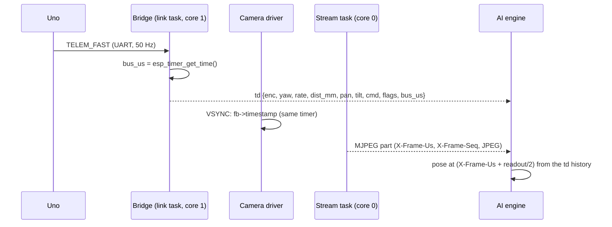

## 3. Data types (`domain/types.py`, frozen dataclasses)

| Type | Fields |
|---|---|
| `TelemSample` | `bus_us: int`, `uno_ms: int`, `enc_l: int`, `enc_r: int`, `yaw_deg: float`, `rate_dps: float`, `dist_mm: int \| None` (None = no echo / fault), `pan_deg: float`, `tilt_deg: float`, `cmd_l: int`, `cmd_r: int`, `flags: int` |
| `Frame` | `seq: int`, `cap_us: int` (VSYNC), `recv_s: float` (laptop monotonic), `jpeg: bytes`, `w: int`, `h: int` |
| `Pose` | `t_us: int`, `x_m: float`, `y_m: float`, `th_rad: float` (room frame: start = 0, 0, 0; x forward at start, y left, θ counter-clockwise — ROS REP 103 like the bridge's arcs) , `v_mps: float`, `w_rps: float` |
| `Detection` | `cls: str`, `score: float`, `box: tuple[float, float, float, float]` (pixels x1 y1 x2 y2), `track_id: int \| None` |
| `ObjectEstimate` | `oid: int`, `cls: str`, `x_m`, `y_m`, `vx`, `vy`, `cov: ndarray (4×4)`, `last_seen_us: int`, `state: Seen \| Remembered` |
| `PseudoScan` | `t_us`, `bearings_rad: ndarray`, `ranges_m: ndarray` (`inf` = nothing seen in that column) |
| `LocalMap` | `t_us`, `pose: Pose`, `grid: GridView` (origin, 5 cm, log-odds array, `known` mask), `objects: list[ObjectEstimate]`, `scan: PseudoScan \| None`, `frame_age_s`, `telem_age_s`, `stale: bool` |

## 4. Classes

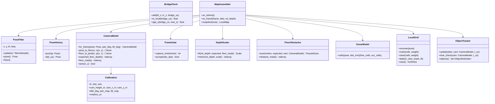

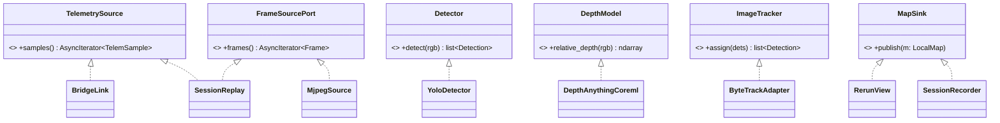

## 5. Algorithms

### 5.1 BridgeClock
Each ping: laptop send `t0`, receive `t1`, the pong's `bridge_us`. Keep the 8 samples with the smallest round trip `t1 − t0` from the last 60 s; offset = median of `bridge_us/1e6 − (t0 + t1)/2`. `to_local(bus_us)` = `bus_us/1e6 − offset`. Used for ages and latency only — pairing frames with poses uses bridge time directly.

### 5.2 PoseFilter (50 Hz, one `TelemSample` each)
> **Superseded by §14 (owner, 2026-10-23, design-notes §132):** the heading comes from the tank's corrected heading, not from our own bias estimate. The text below is the first design.
- State `x, y, θ, b` (gyro bias, °/s) and covariance `P`.
- **Predict:** `dt` from `bus_us`; distance `d = (Δenc_l + Δenc_r) / 2 / counts_per_m` (sign from `cmd` per side, since the encoders have one channel; `counts_per_m` from the bridge's `calib` reply); `θ += (rate − b)·dt`; `x += d·cos θ_mid`, `y += d·sin θ_mid`. Process noise grows with `|d|` and with `|rate|` (slip in turns).
- **Heading check (weak):** the encoder difference gives a turn estimate; used only when both tracks move the same way and slowly (no pivot), with a large variance — tracks slip.
- **Standstill:** both `Δenc` = 0 and `cmd` = 0 for > 0.3 s → measurement "rate − b = 0" with small variance: `b` is re-learned; `θ` frozen.
- Heading starts from the first sample's `yaw_deg` for the map's θ = 0; the Uno's own `yaw` is logged for comparison, not fused (it is the same gyro).
- `PoseHistory`: a ring of the last 2 s (100 poses); `at(t_us)` interpolates linearly (θ on the circle); outside the window → `None` (the frame is dropped).

### 5.3 CameraModel (pinhole + distortion)
- Camera pose in the room = tank pose ∘ mount (`cam_x_m`, `cam_y_m`, `cam_height_m`) ∘ pan (`pan_map(pan_deg)`) ∘ tilt (`tilt0_deg + tilt_map(tilt_deg)`).
- `pixel_to_floor(u, v)`: undistort → ray → intersect the plane z = 0; rays at or above the horizon → `None`.
- `expected_floor_depth()`: for every pixel, the distance along its ray to the floor (∞ above the horizon) — cached per (calibration, pan, tilt) because pan / tilt change rarely.
- `floor_mask()`: pixels whose expected floor depth is within 0.25–2.5 m (where the floor fit is trusted).
- `sees(x, y)`: the floor point projects inside the image and its expected depth ≤ 2.5 m (for "fade only in view" and the object look-check).

### 5.4 FrameGate
`capture_time = cap_us + readout_us / 2`; `accept` is false when `|rate| > gate_dps` (default 45 °/s, tuned in phase 0) or when the pose at `capture_time` is outside the history.

### 5.5 DepthScaler and FloorObstacles
- Depth Anything gives relative **inverse** depth `r` (larger = nearer). On floor pixels where `r` agrees with being floor, fit `1/d_expected ≈ a·r + c` by least squares, then re-fit on the 70 % with the smallest residuals (robust). `d_metric = 1 / (a·r + c)`. If fewer than 500 floor pixels or `a ≤ 0` → the frame's depth is **not used** for the grid (objects and sonar still are).
- Ultrasonic cross-check: the median metric depth in the image patch straight ahead vs `dist_mm` when it is valid and < 2 m; the ratio is logged (and shown) — a drift beyond ±20 % marks the frame's depth `doubtful` (not used for clearing).
- **Obstacle test:** pixel `p` is an obstacle when `d_metric(p) < d_expected(p) − max(0.05 m, 0.08·d_expected(p))`, its floor-projected height is 0.02–0.25 m (tank height), and it is within 2.0 m.
- **Pseudo-scan:** for every image column the nearest obstacle pixel → (bearing, range); columns with none → `inf` up to the floor-visible range.

### 5.6 SonarModel
- Beam: half-angle 12° (to confirm in phase 0); inner free cone half-angle 4°.
- Valid echo `d`: cells on the arc at `d ± 3 cm` within the beam → **occupied**, one hit (`+0.85`) shared by the arc's cells (design-notes §167; was a full hit each); cells in the inner cone with range `< d − 5 cm` → free (weight `−0.2`, low).
- `None` (no echo, fault) or ≥ 4 m → **no update at all**.

### 5.7 LocalGrid
- 60 × 60 cells of 5 cm, centred on the tank; `recenter` shifts the array by whole cells when the tank moves more than one cell (new cells unknown).
- Log-odds `L` per cell, clamped to ±4; occupied above `+0.85`, free below `−0.85`, unknown between; a `known` mask.
- Camera pseudo-scan: Bresenham ray from the camera's floor point to each column's obstacle: cells on the ray → `−0.4` up to `min(range, 3.0 m)`; the end cell → `+0.85` if `range ≤ 2.0 m`.
- **Fade** (`fade(in_view, dt)`): cells the camera sees now move toward 0 by `0.5·dt`; cells out of view keep their value for 10 s, then fade at `0.1·dt` (the blind zone keeps its memory).

### 5.8 ObjectTracker
> **Revised by §15 (owner, 2026-10-23, design-notes §134):** objects are matched in room positions; there is no image tracker (ByteTrack) unless replays show identity swaps.
- `ImageTracker` (ByteTrack) gives frame-to-frame IDs.
- Each detection's **floor contact** = the bottom-centre of the box → `pixel_to_floor` → room point (things not on the floor are rejected by class: only `person`, `sports ball`, `chair`, `cat`, `dog`, `backpack`, `bottle`, `cup`, `teddy bear`, … — a list in the config).
- One constant-velocity Kalman filter per object (`x, y, vx, vy`); matching: same image track ID first, else nearest of the same class within a 3σ gate.
- States:

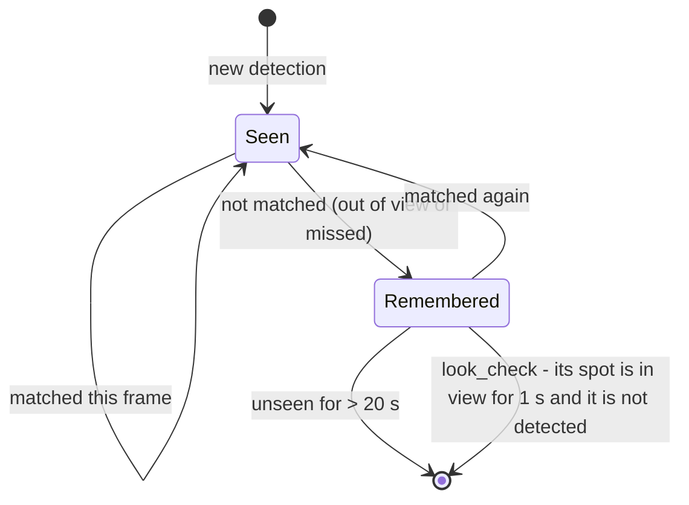

### 5.9 MapAssembler and the stale rule
`snapshot(now)`: frame age = `now − to_local(last accepted capture)`, telemetry age = `now − to_local(last bus_us)`; `stale = frame_age > 0.5 s or telem_age > 0.2 s`. Module 2 must stop on a stale map (its spec).

## 6. Concurrency (`app/map_service.py`)

```mermaid
sequenceDiagram
  participant BL as BridgeLink (task)
  participant FS as MjpegSource (task)
  participant W as Inference worker (1 thread)
  participant MA as MapAssembler (event loop)
  participant OUT as MapSink (Rerun / module 2)
  BL->>MA: TelemSample (50 Hz) -> PoseFilter, SonarModel, grid
  FS->>MA: newest Frame (older frames dropped)
  MA->>MA: FrameGate: capture pose ok and turn slow enough?
  MA->>W: decode + YOLO + depth (newest only; busy -> skip)
  W-->>MA: detections + relative depth
  MA->>MA: camera model, scaler, obstacles, grid, objects
  MA->>OUT: LocalMap (every frame processed, 10-20 Hz)
```
- One inference worker thread: YOLO and depth on the Neural Engine run one after the other (they share it); if the worker is busy when a new frame arrives, the frame waits as "newest" and older ones are dropped — **latest frame wins**, nothing queues.
- BridgeLink: `hello` (client `ai-map`), `debug {on:true, hz:50}`, a `calib` request at start (counts per metre), a ping every 1 s; reconnects with back-off; **sends nothing that moves the tank**.

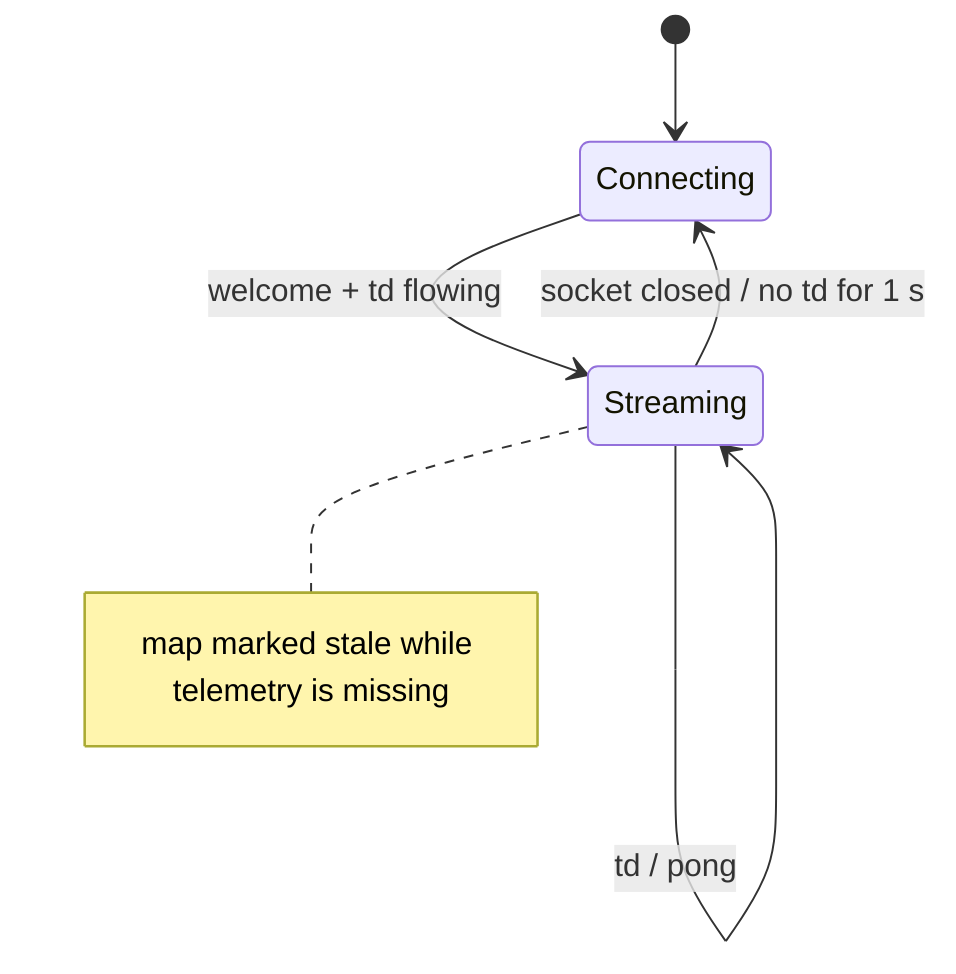

## 7. Config (`config/engine.yaml`, pydantic-settings)
`bridge.host`, `bridge.ws_port` 80, `bridge.stream_port` 81, `camera.size` (QVGA | VGA), `gate_dps` 45, `grid.size_m` 3.0, `grid.cell_m` 0.05, `grid.mark_max_m` 2.0, `grid.clear_max_m` 3.0, log-odds weights (§5.6–§5.7), `objects.classes`, `objects.forget_s` 20, `depth.every_n` 1 (2 if the M1 cannot keep 10 Hz), `stale.frame_s` 0.5, `stale.telem_s` 0.2.

## 8. Calibration tool (`uv run cq-calibrate`)
1. **Lens:** the tool shows the live stream; the owner holds a printed checkerboard (9 × 6, 25 mm) in ~20 poses; OpenCV `calibrateCamera` per frame size → `K`, `dist`, RMS error (accept < 0.5 px).
2. **Mount:** the owner types the measured camera height and position; the tool checks it on an empty floor with a tape-measured mark at 50 cm and 100 cm (the floor trick must hit within 2 cm) and adjusts `tilt0_deg`.
3. **Servos:** the tool moves pan / tilt to 3 positions each (through the bridge's camera command — the only command the tool sends; it never drives) and the owner aligns a mark → `pan_map`, `tilt_map` (linear).
4. **Readout:** from phase 0's measurement.
Writes `config/calibration.yaml` with the date and the frame size.

**Amended (owner, 2026-10-23, design-notes §123):**
- **Lens:** the checkerboard is shown full-screen on the laptop; the owner measures one square and types its size.
- **Mount:** adds a laser-level line on a wall at exactly the lens height. Its row in the picture is the horizon, so `tilt0_deg` = atan((row − cy) / fy) at the servo's centre. The floor marks then check it.
- **Frame size:** QVGA first.
- **Driving tilt:** a tilt study. For a few tilt values the tool reports the blind zone (the nearest floor point in view, from the tracks' front) and the farthest floor point in view, and the owner chooses.

**Settled by the final review of Plan Q2 (2026-10-23):**
- **The lens's fold:** past it, a pixel has no floor point and a floor point no pixel. With strong barrel distortion, the formula stops growing near the picture's corners. `pixel_to_floor` → None, depth → ∞, `sees` → False, so no map cell is faded from outside the real view.
- **The depth map is cached** per (calibration, pan, tilt).
- **The laser finder** answers only for one narrow peak: at most 20 px wide at a quarter of its height, and no second peak half as strong. The profile is smoothed first, so a burnt-out line with a red halo still counts. Otherwise None, never a wrong row.
- **Servo points are chosen from the current tilt0 and lens** so the line stays within 10-90 % of the picture. A missed point is skipped; at least 3 make the fit.
- **tilt0 is never counted twice:** the tilt fit's offset becomes `tilt0` (`tilt_map` offset 0), and the mount step stores `measured − tilt_map offset`.
- **Every picture must be 320 × 240**, else a plain refusal (set the camera to QVGA).
- **The camera is set to the centre again just before each picture**, because released servos may sag.
- **The tilt study** also reports the blind zone at the picture's bottom corner.
- **Plain messages and no hangs:**
  - no connection within 10 s;
  - a refused camera move (NOT_OWNER: release the phone's stick);
  - the picture window closed;
  - Ctrl-C at a prompt.
- **A failed floor-mark check asks before saving.**

**Amended (owner, 2026-10-23, design-notes §130) — the servo step without an exact laser height (approved: owner chose native; built as Plan T, see "As built" below):**
- **Why:** the owner has no stand to put the laser line exactly at lens height. A gain only uses the change between pictures, so a line a few cm off lens height (or not straight ahead) gives the right gain. Only the offset would be wrong, and the offset comes from elsewhere: tilt0 from the mount step or the tape marks, the pan centre from the Uno's camera centre (Uno Lite LLD §22).
- **A line of any colour** (`laser_row` / `laser_col`):
  - three measures: redness R − max(G, B), greenness G − max(R, B), and brightness (mean of R, G, B), for a line burnt out to near-white like the owner's green laser;
  - each measure must pass the same rules on its own: at least `MIN_LINE_SCORE`, at most 20 px wide at a quarter height, no second peak half as strong;
  - the strongest one that passes wins.
- **Servo points follow the line:**
  - `tilt_points(cal, line_deg)` / `pan_points(cal, line_deg)` take where the line looks at command 0 (from a first picture at the centre), so it stays within 10–90 % of the picture.
  - Without `line_deg`: as before (a line at lens height / straight ahead).
- **Both ways, gains only** (`servo_tilt`, `servo_pan`):
  - a prompt first: "the horizontal line … roughly at the lens height (±5 cm)" / "the vertical line … roughly straight ahead";
  - a sweep down from just above the top point (every point reached from above or the right), then back up;
  - a straight-line fit per direction. **gain** = the mean of the two; **slack** = half the gap between their offsets, printed.
  - Saved: `tilt_map` = (gain, 0) with **tilt0 kept**; `pan_map` = (gain, 0) (the Uno's centre).
  - Fewer than 3 points in either direction → a plain refusal. So is no line in the first picture.

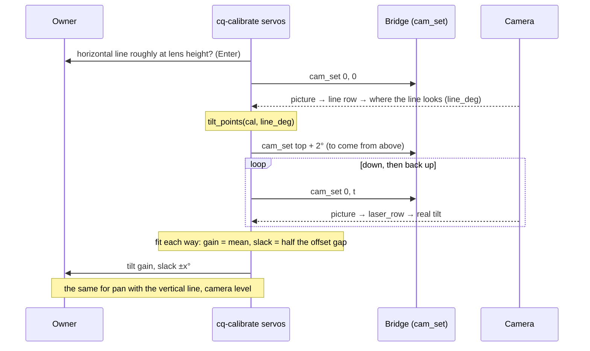

**As built (Plan T, 2026-10-23; design-notes §131), with the final review's fixes:**
- **The finder's background is local:** a grey opening 41 px wide (`BASELINE_PX`), not one median for the whole profile. The floor filling most of the picture at low tilts, a wall, or any step is background; only peaks narrower than 41 px stand out. The width rule (≤ 20 px) and the second-peak rule still apply.
- **Brightness is not smoothed;** the colours are, over 5 px. A 1-px burnt-out core keeps its full height.
- **Never a wrong line:**
  - measures that find lines more than 3 px apart give no answer (`AGREE_PX`);
  - in the sweep, a picture more than 1.5° off its way's straight line ends the step with a plain refusal (`MAX_FIT_ERROR_DEG`): "something else bright or red in the picture?".
- **Both ways use every point:** a move to just above the top before the way down, and a dip to just below the lowest before the way up. At a servo limit with no room, the point next to it is left out of that way.
- **Slack:** measured at the middle of the points and printed with its direction ("lands 0.8 deg higher arriving from above").
- **Gains only:** the maps keep their existing offsets (0 in today's file), and tilt0 is kept. The camera returns to the centre afterwards, also on a refusal.
- **Accepted:** averaging over the middle half of the picture lets the lens's leftover distortion move the gain by about 0.5 % (tilt) / 0.2 % (pan), against a 6–9 % effect.
- **Not run on the tank** (owner: the calibration is done, §130). The tool's maths matches the session script that measured 0.91 / 0.94.
- **Tests:** AI engine 83/83.

## 9. Recording and replay
- **Session folder** `recordings/<date-time>/`: `telemetry.jsonl` (raw `td` / `pong` lines with the laptop receive time), `frames.bin` (per frame: a JSON header line `{seq, cap_us, recv_s, len}` then the JPEG), `session.json` (calibration copy, engine config, bridge build), and a Rerun `.rrd` of the map outputs.
- `SessionReplay` implements both sources from a folder, at recorded speed or as fast as possible; the pipeline is the same, so replays are deterministic (one worker, frames processed in order).
- Recordings stay on the laptop (they show the home); `recordings/` is git-ignored.

## 10. Tests (spec §8)
| Test file | Covers |
|---|---|
| `test_clock.py` | offset from min-round-trip pairs; jitter; ages |
| `test_pose.py` | straight 1 m; 90° turn; slip (encoders move, gyro does not → little heading change); standstill bias re-learn; history interpolation; out-of-window → None |
| `test_camera.py` | pixel ↔ floor round trip; horizon → None; expected floor depth vs analytic; pan / tilt; `sees` |
| `test_gate.py` | capture time = VSYNC + readout/2; turn-rate gate |
| `test_depth.py` | synthetic scene (floor + box): scale fit recovers a known `a, c`; too few floor pixels → unused; obstacle mask and pseudo-scan ranges within 2 cm |
| `test_sonar.py` | arc marked; inner cone freed; **no echo never frees**; ≥ 4 m ignored |
| `test_grid.py` | ray clearing to 3 m, marking to 2 m; fade only in view; blind-zone memory 10 s; recenter keeps cells |
| `test_objects.py` | floor contact → room point; out of view → Remembered; back → Seen with the same id; expiry 20 s; look-check removal |
| `test_localmap.py` | stale rule; snapshot contents |
| `test_replay.py` | a short committed synthetic session replays to the same map twice |
| bridge (C++) | `td` / `tf` with `bus_us`, `pong` with `bridge_us`, the MJPEG part header with `X-Frame-Us` / `X-Frame-Seq` |

## 11. Phase 0 tools (measurement, throwaway: `tools/measure/`, kept only as scripts + results)
`latency.py` (a millisecond clock on the screen filmed by the tank → frame age; frames per second per size), `ne_budget.py` (YOLO + depth together on the M1, frames per second), `depth_tape.py` (depth vs tape at 0.3 / 0.6 / 1 / 2 m on wood and rug), `sonar_fabric.py` (no-echo rate on fabric and angled walls), `gyro_drift.py` (bias at rest per minute). Results go to design-notes; the numbers set `gate_dps`, `readout_us`, `camera.size`, `depth.every_n` and confirm or adjust spec 7 §7.

## 12. As built (Plan Q1, 2026-10-20; design-notes §110)
- **Files:** `ai-engine/` (Python 3.12, uv): `domain/{types, telemetry, clock, mjpeg, http}.py` (pure), `adapters/{bridge_ws, mjpeg_source, session, rerun_view}.py`, `app/{record, replay}.py` (`cq-record`, `cq-replay`); tests `tests/{test_domain, test_record}.py` with `tests/fake_bridge.py` (a stand-in bridge speaking the real wire: chunked MJPEG with `X-Frame-Us`, `td` with `bus_us`, `pong` with `bridge_us`). 26 tests.
- **As designed (§2-§3, §5.1, §6, §9),** with these additions:
  - the camera stream is HTTP **chunked** — `domain/http.Dechunker` removes it before the part parser (found by the final review: every picture would have been broken);
  - parts over 2 MB or with a non-ASCII length are skipped; the reader resyncs to the next part;
  - **a new or dropped WebSocket connection forgets the clock**, and `app/record.Ages` drops it the moment a picture's capture time jumps back by more than 1 s (a restarted bridge — found on the tank: the camera came back 1.5 s before the WebSocket, ages of 12.7 s); ages outside 0-5 s are "unknown";
  - a link with no telemetry for 3 s is opened again (watchdog); helper tasks are gathered after a drop;
  - saving and drawing run in a worker thread (batches taken on the event loop); replay merges the two in-order files lazily; Ctrl-C (a signal handler) ends a recording cleanly with its summary.
- **On the tank (owner, 2026-10-20):** standing: 13.8 pictures/s, 50 telemetry/s, every picture a whole JPEG, picture age (engine clock) median 96 ms (91-172); driving (the phone also viewing): **8.2 pictures/s**; across a bridge restart: recording rides through, max age 336 ms after the fix.
- **For the map plans:** the Uno's GyroZeroLite already re-learns the gyro bias at rest and holds the heading (Plan Q0) — the pose filter's own bias state (§5.2) is optional. `cq-record`'s live view spawns the Rerun viewer, which keeps the terminal's output pipe open until the viewer window is closed (`--no-view` for scripted runs).

## 13. As built (Plan Q2, 2026-10-23; design-notes §127)
- **Files:**
  - pure: `domain/camera.py` (`Calibration`, `CameraModel`, `from_servo`), `domain/calib_math.py` (laser finder, horizon, linear fit, floor-mark error, servo points, `tilt_study`);
  - adapters: `adapters/calibration_store.py` (YAML), `adapters/lens_opencv.py` (checkerboard picture, corners, `calibrateCamera`), `BridgeLink.cam_set` in `adapters/bridge_ws.py` (`CommandRefused` on a nack);
  - app: `app/calibrate.py` → `cq-calibrate lens | mount | servos | study`;
  - tests: `test_camera`, `test_calib_math`, `test_calibration_files`, `test_calibrate_tool`, `test_cam_set` — 66 tests in all with Q1's.
  - Packages added: opencv-python 4.11, pyyaml.
- **As designed (§5.3, §8 with its amendments),** plus:
  - **undistortion by Newton's method:** a radial Newton step, then a 2-D Newton step for the small tangential part, then a back-check of 1e-7. The tank session found that the first fixed-point iteration did not settle at the picture's corners for the real lens (k3 0.251), so the tilt study's corner column came out empty;
  - the checkerboard picture creates its folder (`cv2.imwrite` fails silently otherwise).
- **The saved calibration (`ai-engine/config/calibration.yaml`, QVGA 320 × 240):**
  - lens fx 182.55, fy 181.84, cx 157.42, cy 118.26 (about 82° across), distortion (−0.0914, −0.0315, 0.0011, −0.0015, 0.2511);
  - mount: lens 17.8 cm high, 8.5 cm ahead of the centre, on the centre line, tracks' front 13 cm; `tilt0_deg` −0.15;
  - servos: `pan_map` (1, −5) by eye, `tilt_map` (1, 0) — **the laser servo step is still to do** (no laser level yet). **Since Plan S (design-notes §129) `pan_map` is (1, 0):** the Uno's saved camera centre carries the 5°, and telemetry reports the true centre as 90°; **Since design-notes §130: `tilt_map` (0.91, 0), `pan_map` (0.94, 0)** from a laser cross-line sweep (gains only; slack ±0.8° tilt / ±0.4° pan, open for module 2);
  - `readout_us` 0.
  - How each number was measured: design-notes §127.
- **Driving tilt:** 15° down (design-notes §126).
- **Picture size:** the tool needs QVGA (`{"t":"camera_set","size":"QVGA"}`, upper case). Set the camera back to the usual VGA after a session.

## 14. PoseFilter, revision 2 (owner, 2026-10-23, design-notes §132 — approved 2026-10-23; replaces §5.2)

### 14.0 Why it changed
§5.2 was written before three things existed:
- **the Uno re-learns the gyro bias** whenever the tank stands still (GyroZeroLite, Plan Q0);
- **the bridge applies the gyro scale** ×1.031 (`gyro_scale` 10310, bridge LLD R19) to the heading in `tf` / `td`;
- **`counts_per_m` 7514** is calibrated and saved on the bridge (Plan K, the O wizard).

A second bias estimate in the engine, on the same gyro, would fight the Uno's. So the filter takes the corrected heading as it comes and adds the distance from the encoders.

### 14.1 What it does (50 Hz, one `TelemSample` each)
1. **Heading:**
   - `td.yaw` (0…360°, corrected) is unwrapped: each step adds the shortest signed difference to the last value.
   - The room's θ = 0 is the first sample's heading. θ is counter-clockwise (+ = left), the room frame of §3.
   - `yaw` is counter-clockwise positive (protocol spec 01: TELEM_FAST `yaw` "CCW positive"; `turn by` + = left), the same sense as θ, so θ = unwrapped yaw − the start's yaw. It's checked on the floor too, turning left → θ grows.
2. **Distance per track:**
   - Δcount = the count's change since the last sample. Counts only go up (one channel per encoder).
   - Its sign comes from that track's **PWM output** (`td.pwm`): + forward, − back. It's the **previous sample's** output, because a sample's count change happened during the 20 ms before it (found while drafting the plan: with the new sample's sign, every change of direction lost a step).
   - With the PWM at 0 while the track still coasts, the **last non-zero sign** is kept.
3. **Stall:** if `STALL_L` or `STALL_R` (FastFlagBit 3 / 4) is set, that track adds nothing; spinning tracks don't move the tank.
4. **Step:**
   - d = (Δl + Δr) / 2 / `counts_per_m`;
   - θ_mid = the mean of the previous and the new θ;
   - x += d·cos θ_mid, y += d·sin θ_mid.
   - A pivot gives d ≈ 0.
5. **Speed:**
   - v = d / dt, smoothed over the last 0.2 s;
   - ω from `td.rate` (°/s → rad/s, + = left).
6. **Uncertainty** (`drift_m`, `drift_deg`): grows by 3 % of |d| and by 1° per 360° turned. It's reported, not fused, until a second position source exists (wall markers, later).
7. **Restarts:**
   - **The Uno's clock goes back** (`uno_ms` smaller than before): its counts and its heading started again. Keep x, y, θ, and re-anchor the count baselines and the heading offset to the new sample. The pose does not jump.
   - **The bridge or the link restarts** (`bus_us` goes back, or the first sample after a reconnect): the same re-anchor, without a step.
   - **A gap over 0.5 s:** no step across it, and `drift_m` grows by that gap's worst case (0.3 m/s × gap).
8. **`counts_per_m`** comes from the bridge's `calib` reply (`{"t":"calib"}` → `"counts_per_m"`), asked for on connect. Until it arrives there's no distance (the pose holds x, y).

### 14.2 Classes
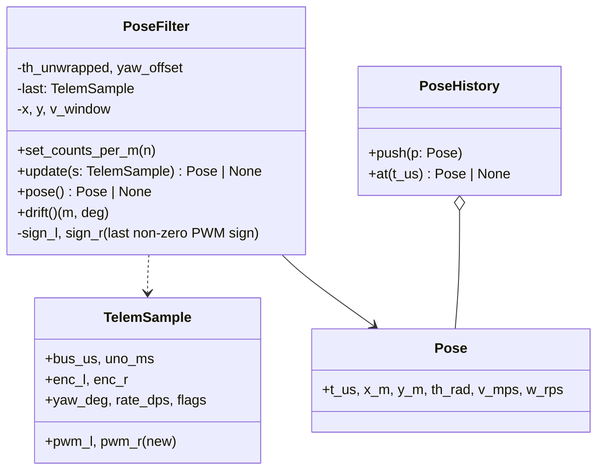
- `PoseHistory`: a ring of the last 2 s (100 poses). `at(t_us)` interpolates linearly, θ on the circle; outside the window → `None` (as §5.2).
- **Parser:** `parse_td` also reads `pwm` into `pwm_l` / `pwm_r`. The recordings from Plan Q1 already carry `pwm`.

### 14.3 One sample
```mermaid
sequenceDiagram
  participant B as BridgeLink / Replay
  participant F as PoseFilter
  participant H as PoseHistory
  B->>F: update(td sample)
  alt first sample, or uno_ms / bus_us went back
    F->>F: re-anchor counts and heading offset (no step)
  else gap > 0.5 s
    F->>F: re-anchor; drift += 0.3 m/s x gap
  else normal
    F->>F: θ = unwrap(yaw) - offset
    F->>F: Δl, Δr with the PWM sign (last sign while coasting; 0 if stalled)
    F->>F: x, y += d at θ_mid; v, ω; drift grows
  end
  F->>H: push(pose)
```

### 14.4 Tests (`tests/test_pose.py`)
- straight 1 m (7514 counts on each track, PWM +) → x 1.000, y 0;
- backwards (PWM −) → x −1;
- a 90° left turn while driving → θ +90°, the path bends left;
- pivot (PWM + / −, equal counts) → d 0;
- coasting (PWM 0 after +, counts still rising) → the distance is still forward;
- a stalled track adds nothing;
- heading across 359° → 1°: θ +2°, no jump;
- Uno restart (`uno_ms` back, counts and yaw from 0) → x, y, θ unchanged, then continues;
- a 1 s gap → no step, drift grows;
- no `counts_per_m` yet → x, y held;
- drift: 5 m driven → 0.15 m;
- `PoseHistory`: interpolation, θ across ±180°, outside the window → None;
- the parser reads `pwm`.

### 14.5 On the floor (owner present, the phone or Logo drives; the engine only records)
- Record a Logo 50 cm square and a 2 m out-and-back with `cq-record`, then replay them through the filter.
- Compare the pose's end to the tape: the square's end against its start; the out-and-back's far point at 2.00 m.
- Targets (Spec 7 §7): ≤ 3 % of the distance; ≤ 3° per 360° turned.

### 14.6 As built (Plan U, 2026-10-23; design-notes §133)
- **Files:**
  - `domain/pose.py` (`PoseFilter`, `PoseHistory`);
  - `TelemSample.pwm_l` / `pwm_r` read by `parse_td`;
  - `app/pose_replay.py` → **`cq-pose <recording>`**, which prints the end position and heading, the end's distance from the start, the farthest point, the distance driven, the degrees turned, and how far off it could be;
  - tests `test_pose.py` (22), `test_pose_replay.py` (5). AI engine 110 tests.
- **As designed, plus what drafting and the final review changed:**
  - **The encoder sign is the previous sample's PWM** (a sample's counts happened in the 20 ms before it). With the new sample's sign, every change of direction lost a step.
  - **A gap over 0.5 s keeps the turn made in it.** The heading is absolute within one Uno run, so θ takes the wrapped yaw change; only the distance is unknown (drift += 0.3 m/s × gap). If |rate| × gap > 180°, the wrap could hide a whole turn, so `drift_deg` += 360. This **replaces §14.1.7's "re-anchor" for gaps**; restarts still re-anchor.
  - **A bridge restart** (`bus_us` back) clears the speed window and `PoseHistory`, because their old stamps were from another clock.
  - **`Pose.th_rad` is always within −π…π;** the total turning lives in the drift and in `cq-pose`'s "turned".
  - `counts_per_m` ≤ 0 is ignored.
  - `cq-pose` takes the recording's `calib` reply for the whole session, even when it came after the first samples.
- **Known limit (one-channel encoders):** pushing the tank by hand after a stop counts in the last motor direction.
- **Floor check (§14.5): passed 2026-10-24** (design-notes §144). Each run was recorded with `cq-record`, replayed with `cq-pose` and compared with the owner's tape and eye:

  | Run | `cq-pose` end | Tape end | Pose vs tape | Target |
  |---|---|---|---|---|
  | Logo 50 cm square (2.0 m driven) | 2.0 cm right, +0.6° | 6 cm right, about −2° | 4 cm, ~2.6° | 6 cm (3 %), 3° |
  | `FORWARD 200 RIGHT 180 FORWARD 200` (4.0 m) | 0.5 cm left, 179.9° | 5 cm left, about 178° | 4.5 cm, ~2° | 12 cm (3 %), 3° |

## 15. Phase 4: the detector and the object tracker (owner, 2026-10-23, design-notes §134 — approved 2026-10-23)

### 15.0 What it does
For each picture the engine finds things (a person, a ball, a chair, a cat, …) and works out where each one stands in the room. It keeps a list of them: what, where, how sure, last seen.
- Things stay on the list when the camera looks away (Spec 7 §7: a ball for ≥ 10 s).
- They drop off after `forget_s` (20 s) unseen, or when the camera looks at their spot for 1 s and they're not there.
- The drive module and later Logo words read the list. Phase 4 only shows it (live view) and prints it (replay).
- It never drives.

### 15.1 The detector (`Detector` port, `YoloCoreml` adapter)
- **The model:** `ai-engine/models/yolo26n-320.mlpackage` (git-ignored, about 5 MB, AGPL). It's made once by `tools/measure/export_yolo.py`, whose environment has Ultralytics + torch 2.7, writing into `ai-engine/models/`. The engine needs only **coremltools + Pillow** at run time.
  - With no model file, a plain refusal: "no detector model - run tools/measure/export_yolo.py".
- **In:** the decoded QVGA picture (320 × 240 RGB), **letterboxed** to 320 × 320: 40 rows of grey (114) above and below, as Ultralytics does. Passed as a PIL image to the model's `image` input, with compute units ALL (Neural Engine).
- **Out:** `[1, 300, 6]` = x1, y1, x2, y2, score, class, in the 320 × 320 input's pixels (end-to-end, no NMS needed).
  - Kept: score ≥ `CONF` (0.35).
  - Boxes moved back to the picture (y − 40), clamped to 320 × 240.
  - The class index → name from the model's `names` metadata.
- **`Detection(cls, score, box)`** (LLD §3; `track_id` unused).
- **Tests** use a `FakeDetector` (boxes given by the test). The adapter has one test that runs only when the model file exists (skipped otherwise), on a synthetic picture: it returns a list and the boxes lie inside the picture.

### 15.2 Which pictures are used (`FrameGate`, `CameraAngles`)
- **Capture time** t = `X-Frame-Us` + `readout_us` / 2 (0 until measured; Calibration).
- **The pose at t** from `PoseHistory.at(t)`. If it's None (no pose yet, or older than 2 s), the picture is skipped.
- **`CameraAngles`:** the last 2 s of (`bus_us`, `pan`, `tilt`, `flags`) from `td`. `at(t)` gives the nearest sample within 40 ms, else None (skipped).
- **Skipped while:**
  - the tank turns faster than `GATE_DPS` (45°/s, `|pose.w|`), because of blur;
  - the camera itself moves (FastFlagBit **CAM_MOVING**, bit 5).
- **The camera model for the picture:** `CameraModel(cal).for_frame(pose, *from_servo(pan, tilt))`.
- Every skip is counted with its reason (shown in the replay summary).

### 15.3 Where a thing is (`ObjectLocator`, the floor trick)
- **Only floor classes** (`FLOOR_CLASSES`): person, cat, dog, sports ball, teddy bear, chair, couch, backpack, suitcase, potted plant.
  - Things that sit on tables (cup, bottle, laptop, …) would get a wrong position and are ignored.
- **Contact pixel** = the box's bottom middle (u = (x1 + x2) / 2, v = y2) → `pixel_to_floor(u, v)` → the room point (x, y).
- **The box touches the picture's bottom edge** (y2 ≥ 238): the thing is cut off, too near or partly in the blind zone. It's listed as **near** with its direction only (the room bearing of the box's centre ray, from `pixel_ray`), not tracked.
- **Not on the floor in view** (the contact pixel above the horizon, `pixel_to_floor` → None) or **farther than `MAX_RANGE_M`** (4 m): ignored.
- **Measurement noise** σ(d) = 0.02 m + 0.03 m × d² (d = the distance from the camera), matching Spec 7 §7: ≈ 5 cm at 1 m, ≈ 14 cm at 2 m.

### 15.4 The list (`ObjectTracker`)
- One constant-velocity Kalman filter per thing: state (x, y, vx, vy); process noise from an acceleration σ of 1 m/s².
- **Each used picture:**
  1. Predict every thing to t.
  2. **Match** each located detection to a thing of the same class, by the smallest Mahalanobis distance d² ≤ 9.21 (the 99 % gate for 2 numbers). Greedy, smallest first; each thing and each detection is used once.
  3. Matched → update, state **Seen**, `last_seen_us` = t.
  4. An unmatched detection → a new thing (a new `oid`), Seen.
  5. An unmatched thing whose spot the camera sees now (`cam.sees(x, y)`): it should have been seen. After **1 s** of that it's dropped (the look check). Otherwise it's **Remembered**.
- **Remembered:** its velocity fades with a 1 s time constant, because the thing has probably stopped and we don't follow it out of view. Its uncertainty grows. It's dropped after `FORGET_S` (20 s) unseen.

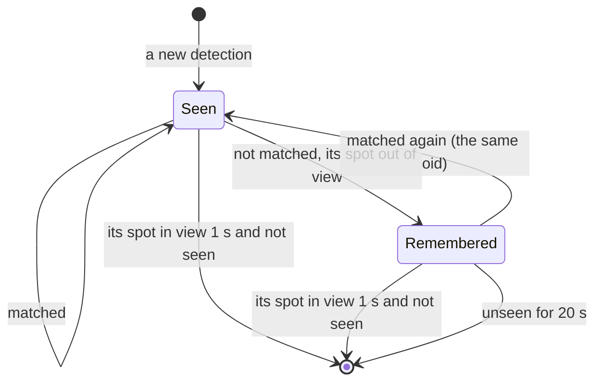

- **`ObjectEstimate(oid, cls, x_m, y_m, vx, vy, cov, last_seen_us, state)`** (LLD §3).
- **Near** things (§15.3) are a separate list: (cls, bearing, t).

### 15.5 Classes
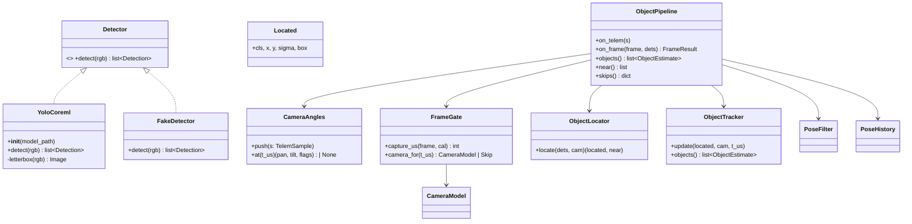
- **Files:** `domain/objects.py` (CameraAngles, FrameGate, ObjectLocator, ObjectTracker, ObjectPipeline, all pure), `adapters/yolo_coreml.py`, `app/objects.py` (`cq-objects`).
- **`ObjectPipeline` is pure:** the detector is called outside it, in the worker thread, and its result is handed in.

### 15.6 Running it (`cq-objects`)
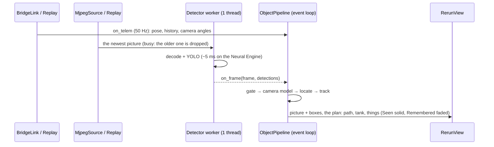
- **`cq-objects --live`:** connects to the tank and shows the live view.
- **`cq-objects <recording>`:** replays a session. In replay every picture is used, in order (no dropping), so the result is the same each time. It prints each thing found (oid, class, first and last seen, last position) and the skips.
- **Latest picture wins (live):** while the worker is busy, only the newest picture waits; nothing queues (LLD §6).

### 15.7 Tests
- **`test_objects.py`** (no model, no tank):
  - the floor trick against the camera model (a box whose contact pixel is the projection of a known floor point → that point);
  - a cut box → near, with the right bearing;
  - above the horizon / beyond 4 m → ignored; a cup → ignored;
  - σ(d);
  - gate skips: no pose, the turn rate, CAM_MOVING, no camera angles;
  - tracking: one ball seen in 10 pictures → one thing, near its true spot; two balls → two things; a person walking → one thing with its velocity;
  - leaving the view → Remembered, back → Seen with the same oid; Remembered 20 s → dropped; its spot in view 1 s with no detection → dropped;
  - pipeline replay is deterministic (twice the same).
- **`test_yolo_coreml.py`:** letterbox and box mapping (pure parts). The model run is skipped without the file.
- **`test_objects_app.py`:** `cq-objects <recording>` on a synthetic session with a fake detector prints the expected thing.

### 15.8 On the floor (owner present; the phone drives slowly or the tank stands; the engine only watches)
- **Distance:** a ball on tape marks at 50 cm, 1 m and 2 m ahead of the lens, the tank standing still. Targets (Spec 7 §7): within 5 cm up to 1 m, within 15 cm at 2 m.
- **Memory:** the ball at 1 m. Turn the camera (or the tank) away for 12 s, then back. The ball must stay listed (Remembered) and come back as the same thing.
- **A person** walking across the view: one thing, which follows.

### 15.9 As built (Plan V, 2026-10-23..24; design-notes §151)
- **Files:**
  - `domain/objects.py`: `CameraAngles`, `FrameGate`, `ObjectLocator`, `ObjectTracker`, `ObjectPipeline`;
  - `adapters/yolo_coreml.py`: `YoloCoreml`, `CONF` 0.35, letterbox to 320;
  - `app/objects.py`: `cq-objects`, replay and `--live`;
  - `tools/measure/export_yolo.py`: the model is git-ignored in `ai-engine/models/`.
  - AI engine 142 tests; ruff, format and pyright clean.
- **Changed by the final review** (no Critical):
  - **remembered things:** their uncertainty fades in through F, with a 5 cm/s position walk, σ capped at 0.5 m, and ranking by d² + ln det S;
  - **the camera-moving skip:** also on the Uno Lite (`rate_dps` > 20°/s);
  - **confirmation:** 3 hits within 0.5 s; one missed new thing is dropped;
  - **the look check:** reaches `MAX_RANGE_M` (4 m);
  - **`CUT_ROWS`:** 6;
  - **a clock going back** starts the list again.
- **Class-diagram details (review M8):** `ObjectEstimate` carries `sigma_m` (the larger axis of the position's standard deviation) and `first_seen_us` beside `last_seen_us`. "From the start" in `cq-objects`' report is the room origin, the tank's centre at the start of the recording (M9).
- **The mount tilt `tilt0` +2.55°** was fitted at the driving tilt, arriving from above, from a floor object at 50 cm and 1 m: it read 49.6 / 99.9 cm. Before that it was −0.15°.
- **On the floor (Task 4), the code works but the detector is weak from 18 cm:**
  - **The floor trick:** a person at 1 m was placed 99.5 cm from the lens.
  - **Detection scores:**
    - the owner's plush is "fire hydrant" 0.77–0.92 near;
    - a person at 1 m scores median 0.0–0.08 in a dark room;
    - an office chair at ~2.8 m scores 0.09;
    - a green patterned ball at 1–3 m isn't found, even doubled in size.
  - **The adapter is right:** on standard pictures (Ultralytics bus / zidane, COCO 139 / 39769) it finds a chair 0.75, a TV 0.89, cats 0.79, a bus and people 0.81–0.94, even shrunk to 320 × 240. The pictures are the problem: things are small and pale, and seen from floor level.
- **Owner (2026-10-24): "go with what we have"** — YOLO26n (COCO) stays. Floor-level naming is a later design (design-notes §151): a detector trained on the tank's own pictures, or YOLO-World; obstacles from the floor plane + depth + sonar.
- **Not checked on the tank:** the memory test (a thing kept while the camera looks away; host tests only), a person walking across, and `--live` (review M5).

## 16. What spots things: YOLO-World and a colour ball finder (owner, 2026-10-24, design-notes §152 — approved 2026-10-24: "write")

### 16.0 Why
- From 18 cm, YOLO26n (COCO) is too unsure to list things (§15.9, design-notes §151–§152):
  - the chair scores 0.09;
  - the ball at most 0.37 even with twice the pixels;
  - a 120 px bottle stays under 0.25.
- **YOLO-World**, asked by name, found the same chair in 20 of 20 pictures (0.82), and "green ball" on the ball in 8 of 20 (≤ 0.36).
- **A plain colour finder** found the ball in 187 of 194 pictures, steady to ±1.6 px, and placed it 97 cm from the lens (owner ~1 m), in 1.1 ms.
- **This section replaces the detector under §15. The rest of §15 doesn't change:** the gate, the floor trick, the tracker and `cq-objects`.

### 16.1 What changes
1. **`YoloWorld`** (adapter, the `Detector` port of §15.1) replaces `YoloCoreml`.
   - **The model:** `ai-engine/models/yoloworld-s-640.mlpackage` (git-ignored, GPL-3.0).
     - It's made by `tools/measure/export_world.py`, which loads `yolov8s-worldv2.pt`, calls `set_classes(<the words>)`, and exports CoreML at 640.
     - The words are baked into the model (YOLO-World's "offline vocabulary"), so each picture runs only the detector.
     - A model made for other words is refused: its baked-in names must equal the vocabulary file's, in order.
   - **In:** the VGA picture, letterboxed to 640 × 640 the same way as §15.1.
   - **Out:** `Detection(cls, score, box)` for each box at or above its word's own threshold.
2. **`config/vocabulary.yaml`**, the words: a list of `{word, floor, min_score}`.
   - `floor: true` marks things that stand on the floor, which replaces the hard-coded `FLOOR_CLASSES`.
   - `min_score` is 0.25 unless set.
   - **Starting list:** person, chair, table, bed, sofa, door, bottle, shoe, box, toy. All `floor: true`, except door (`false`: it's in the wall).
   - **Changing the words:** edit the file, then run `export_world.py`, about a minute. `cq-objects` refuses a model whose words differ ("re-export: the words changed").
3. **`ColourBallFinder`** (adapter, also a `Detector`) finds round blobs of known colours below the horizon.
   - **Each ball** in `config/balls.yaml`: `{name, h: [lo, hi], s_min, v_max, r_min_px}`. For example, green: `h [45, 90]`, `s_min 65`, `v_max 200`, `r_min_px 6` (design-notes §152).
   - **Per picture:**
     - blur 5 × 5;
     - an HSV mask per ball, with rows above the horizon cleared (the horizon row comes from the camera model of that picture);
     - open 3 × 3;
     - the largest contour with roundness `area / (π r²)` ≥ 0.55 and `r ≥ r_min_px`.
   - **Out:** `Detection("ball:<name>", score = min(1, roundness × 1.4), box = the enclosing circle's square)`. The floor trick uses the box's bottom, as for any thing.
   - **No ball** gives no detection, and never a guess.
4. **`MultiDetector`** (domain) runs the two detectors on the same picture and joins their lists. That one list goes to the tracker, so a ball can come from either.
   - A YOLO-World "ball" box that overlaps a colour ball's box (IoU ≥ 0.5) is dropped, so one ball is one thing. The colour finder wins, because it's steadier.
5. **`cq-calibrate ball <name>`:** you put the ball about 1 m ahead in the middle of the view. It records 3 s, takes the most saturated round blob below the horizon, and writes its range to `balls.yaml`:
   - hue p5–p95 widened by 5;
   - `s_min` = p10 − 10;
   - `v_max` = p90 + 15.
6. **VGA:**
   - `calibration_store.load(path, (640, 480))` scales the QVGA file: the lens matrix `k` (fx, fy, cx, cy) × 2, distortion unchanged. This assumes the same field of view at both sizes, so the file says `size: [320, 240]` and VGA is derived.
   - **One check on the tank:** a checkerboard picture at VGA, whose corners must land within 1 px of the scaled model.
   - The gate's picture-size skip (§15.2) expects 640 × 480.
7. **Camera setting B** (brightness −1, contrast +2, low light on, white balance "sunny") is the setting the colour ranges were measured at. `cq-objects` prints a warning when the tank's camera block differs.

### 16.2 Classes
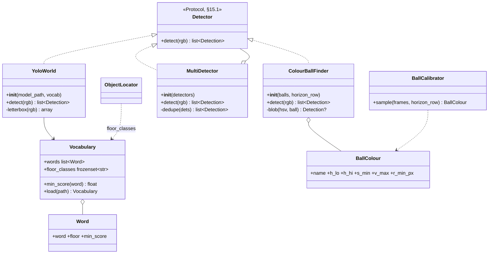
- **Pure (domain, host-tested):** `MultiDetector`, `Vocabulary`, `BallColour`, and the blob step of `ColourBallFinder` (OpenCV on arrays; no files, no clock).
- **Adapters:** `YoloWorld` (CoreML), the YAML loaders, `BallCalibrator`'s recording.
- **`horizon_row`** is a function of the picture's camera angles. `ObjectPipeline` hands the finder the row from that picture's `CameraModel`, so the finder never looks at the ceiling. When the horizon is off the picture (camera tilted far down), the whole picture is searched.

### 16.3 One picture
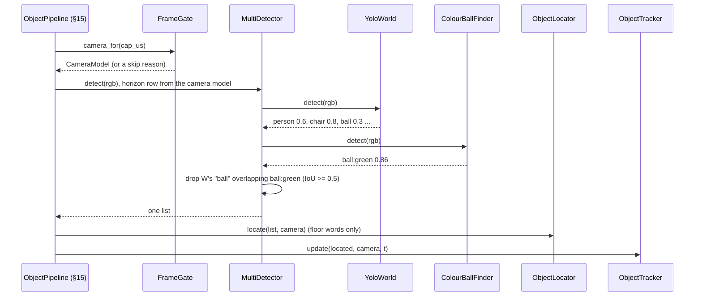

### 16.4 Budget
- YOLO-World-S at 640 on the Neural Engine: target ≤ 30 ms; measured in the plan's first task.
  - If it's over, export at 480, then re-measure the chair and the ball.
- The colour finder: ~1 ms at VGA.
- **Together ≤ 40 ms a picture**, so ≥ 25 pictures a second with the camera's ~24.

### 16.5 Tests
- **`tests/test_detectors.py`:**
  - the colour finder on drawn pictures:
    - a green disc on a pale floor is found, with its box;
    - a green disc above the horizon is ignored;
    - a green square (not round) is ignored;
    - a pale green-tinted floor with no ball gives nothing;
    - two balls of different colours give one each;
  - the `MultiDetector` join and the IoU drop;
  - `Vocabulary`: floor classes, default and own thresholds, a duplicate word refused, and the model-words-differ refusal;
  - the scaled VGA calibration: k × 2, `pixel_to_floor` at (2u, 2v) VGA equals (u, v) QVGA.
- **`tests/test_ball_calibrator.py`:** drawn frames with a known HSV → the written range holds the sample with the stated margins.
- **Replay:** a VGA recording through `cq-objects` with a fake YOLO-World and the real colour finder → one `ball:green` thing.
- **On the floor** (owner; nothing moves except the camera in step 3):
  1. the VGA checkerboard check (§16.1 item 6);
  2. the ball at 1 m and 2 m: one `ball:green`, its distance within 5 / 15 cm of the tape;
  3. the memory test (§15.8): the camera looks away for 12 s and back, and the ball keeps its `#oid`;
  4. the chair and a person listed;
  5. `cq-objects --live` shows the boxes and the plan;
  6. the time per picture.

### 16.6 Not in this section
- Obstacles from the floor plane + depth + sonar (map phase 5).
- Training a detector on the tank's own pictures, unless YOLO-World proves too weak.
- More than one ball of the same colour being told apart; the tracker separates them by place.

### 16.7 As built (Plan Y, 2026-10-24; design-notes §154)
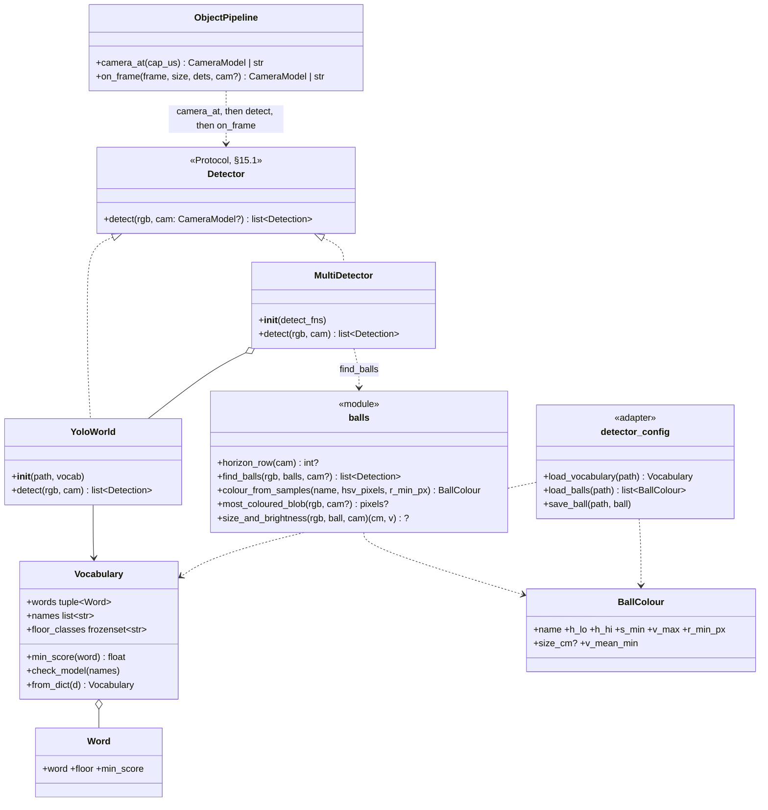
- **Files:**
  - `domain/vocabulary.py`, `domain/balls.py` (a module of functions, not a `ColourBallFinder` class), `domain/detectors.py`;
  - `adapters/yolo_world.py`, `adapters/detector_config.py`;
  - `config/vocabulary.yaml` (10 words, door `floor: false`), `config/balls.yaml`;
  - `tools/measure/export_world.py` (bakes the words into `ai-engine/models/yoloworld-s-640.mlpackage`, git-ignored, ~24 MB, GPL-3.0);
  - changed: `domain/objects.py`, `adapters/calibration_store.py` (VGA from the QVGA file), `app/objects.py`, `app/calibrate.py`.
  - AI engine 194 tests (1 skipped: the old YOLO26n model file is absent); ruff, format and pyright clean.
- **The plug is `detect(rgb, cam)`**, where `cam` is the picture's `CameraModel` (or None for a picture the gate skips). This supersedes the plan's `detect(rgb, horizon_row)`.
  - The app asks `ObjectPipeline.camera_at` first. It gets the camera or the skip reason, and hands that same camera to `on_frame`, so the horizon and the map use one camera (review m8).
  - Skipped pictures are still searched without a horizon, so the live view shows their boxes, but they are never placed.
- **YOLO-World:**
  - each candidate is only its best word, kept if that word's own threshold is met (review I1: one cabinet was "bed" and "sofa" at once);
  - overlap removal per word at IoU 0.7, as Ultralytics;
  - a box wholly in the letterbox bar is dropped;
  - the output is taken by name;
  - a model without a word list, or made for other words, is refused.
  - Matches Ultralytics on COCO 139 (person 0.83, chairs 0.76 / 0.58 / 0.54 / 0.34, boxes within 1 px). Ours also lists table 0.26, a half-precision effect at the 0.25 line. 6.7 ms a picture.
- **The colour finder:**
  - HSV of a 5 × 5 blur; the mask is the ball's range (a red range wraps through hue 0, `h_lo > h_hi`), below the horizon, opened 3 × 3;
  - round blobs: convex-hull roundness ≥ 0.66 and r ≥ `r_min_px`;
  - **bright enough and the right size for the distance** (Task 5, the steel bin):
    - the blob's mean value must be ≥ `v_mean_min`;
    - its size, `2 r × floor distance / fx`, must be within 0.6–1.5 × `size_cm`;
    - on the floor recording this keeps 236 of 243 sightings of the ball and drops all 48 reflections on a steel bin;
    - a ball resting on a chair seat is (rightly) not a floor ball;
  - then the largest of those wins.
  - `horizon_row`: None when the horizon is above the picture (all floor); the picture height when it is below it (camera tilted up: no floor).
- **`cq-calibrate ball <name>`:**
  - sets the camera level and centred first (review I3);
  - VGA only;
  - takes the coloured round blob nearest the middle in 15 pictures;
  - hue p5–p95 on the hue circle, widened by 5; a spread over 60 is refused as "not one colour";
  - then size (median) and brightness (0.8 × the median mean value).
  - No picture or a broken one is a plain refusal.
- **One ball is one thing** (review I2), in the tracker:
  - a word box (say "toy") at a listed ball's place updates that ball when nothing of its own class takes it (the finder missed it: at the picture's edge, half hidden);
  - when the finder sees a listed ball, a word thing at its place not seen in that picture is dropped.
- **Remembered from the last sighting** (Task 5 memory test):
  - a thing not seen for 0.5 s (`REMEMBER_AFTER_S`) is rewound to its last sighting and predicted with the remembered rule (5 cm/s walk), not the walking-person rule;
  - before this, a ball unseen for 1.3 s had grown to the 0.5 m cap, and its gate took a reflection 1.5 m away.
- **Config errors** name the file and the row: a missing field, bad YAML, `floor: "false"` as text, values out of range.
- **On the floor (Task 5; play tolerances agreed during the checks, design-notes §153):**
  - **VGA lens:** the doubled QVGA lens fits a screen checkerboard to 0.20 px median (max 0.93). A fresh VGA fit (fx 383.8) fits just as well, so the tape decides: the doubled lens wins (the ball at 2 m, before the tilt refit, from the lens: fresh 166 cm, doubled 175).
  - **tilt0** refit after the mount fix: +2.55° → **+3.3°**, from the ball at 1 m and 2 m (−1 / +2 cm).
  - **The ball:** 1 m → +3 cm; 1.5 m → +10 cm (finder 84 % of pictures); 2 m → +2 cm (finder 35 of 177; YOLO-World "toy" covers it).
  - **Memory:** the ball kept its number through a 12 s look-away (after both fixes); the cabinet too.
  - **Chair and person** listed (person at ~2.3 m by tape).
  - **The live view** showed chair, person, ball and bottle; Ctrl-C ends it cleanly.
- **Known limits:**
  - **The camera's real tilt drifts between sessions.** After a battery change, distances read ~1.3–1.4 × long, level and tilted; after panning away and back, ~1° (SG90 slack). Owner: a general fix, a camera angle estimator from the picture (design-notes §153), not hand refits.
  - **The colour finder reaches ~1.5 m.**
  - **At the driving tilt (15° down) the chair's top is cut** and YOLO-World scores it 0.23 (< 0.25); level it scores ~0.85.
  - **The cabinet flips between "bed" and "sofa"**, so it can show twice or come back as a new thing.
  - **Not built:** the camera-setting warning (ruling 6); other balls not yet calibrated.

## 17. Module 2: drive while thinking, slice 1 "chase the ball" (owner, 2026-10-25, spec 8, design-notes §156 — draft for review)

### 17.0 Scope
- **Built here:** the drive-while-thinking loop (spec 8 §3) and the chase-the-ball skill (spec 8 §4), on the laptop. Two ways to run it:
  - **`cq-drive find ball`** (was `goto`, §18.13.22): standalone, for testing. It drives like the phone does, as the owner, through plain `drive_rate`.
  - **`cq-drive serve`:** the skill server for Tank Logo's `SEE?`, `HOWFAR`, `FIND` and `GOTO`, driving under the runner's drive lease (bridge LLD R26).
- **The existing `BridgeLink` stays motion-free** (§6: "never sends anything that moves the tank"). Everything that moves the tank goes through one new, separate adapter, `DriveLink`.

### 17.1 Files
| File | What |
|---|---|
| `domain/drive/limits.py` | `Limits`: the tank's measured envelope (spec 8 §2) and the slice-1 caps |
| `domain/drive/curves.py` | `Command`, `Curve`, `ramp()`, `roll_out()` (where a curve takes the tank) |
| `domain/drive/planner.py` | `Planner`: the fan of curves, scored |
| `domain/drive/goal.py` | `Goal`: which thing is the target and where it is now; `KINDS` (the kind "ball") |
| `domain/drive/chase.py` | `ChaseSkill`: the state machine of spec 8 §4.2 (looking / approaching / arrived / lost) |
| `domain/drive/sim.py` | `SimTank`: a simulated tank following commands, for tests |
| `adapters/drive_link.py` | `DriveLink`: `drive_rate` (standalone) or `skill_drive` (lease), `cam_set`, the skill messages; cm/s → % |
| `app/drive.py` | `cq-drive find ball` (was `goto`, §18.13.22) and `cq-drive serve` |
| `config/drive.yaml` | the limits and score weights (plain values, loaded into `Limits`) |

### 17.2 Classes
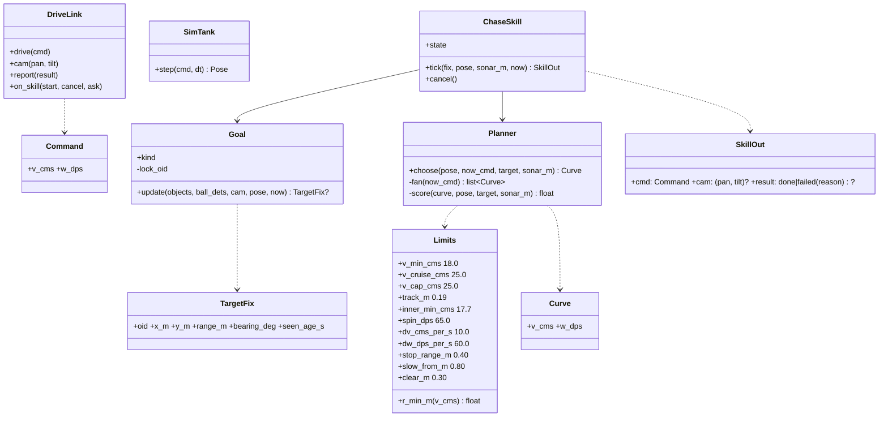
- **Pure, host-tested without a tank:** everything in `domain/drive/`. `SimTank` lets whole chases run in tests.

### 17.3 The loop (one tick, ~10 Hz)
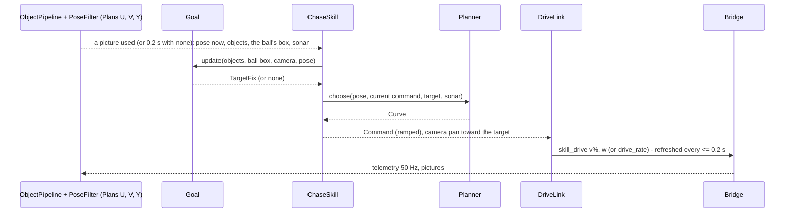
- **Ticks:** the loop ticks on each picture the pipeline uses, and at least every 0.2 s. The command is resent every 0.2 s even without a new tick, so the bridge's 0.3 s deadman only fires when the engine itself stalls.
- **The pose "now":** the newest pose from the filter (≤ 20 ms old). The target's room position is already lag-corrected by the pipeline (each picture is placed with the pose at its capture time, Plan V).

### 17.4 The planner
- **The fan, built from the current command:**
  - speeds `{v_cruise, v_min, 0}`, capped by `v_cap` and by distance: from `slow_from` the top speed falls linearly to `v_min` at `stop_range + 0.10`;
  - for each speed, turn rates from the radii `{∞, 1.5, 0.8, 0.5, r_min(v)}` m on each side: `w = v / r`;
  - a target more than 35° off (or inside the tightest circle) gets only a spin `(0, ±spin_dps)`: the tank turns on the spot first, from standing or by slowing out of a drive (floor chase 5, design-notes §157: a 50 cm curve at cruise swept past a ball 40° off at 80 cm). It was "offered beyond 70°" before. Once spinning it goes on until the target is within 15° (`SPIN_UNTIL_DEG`; the tank coasts on and the pose lags: with 8° floor chase 6 turned 55° for a ball 40° off), and the drive's arc aims the rest;
  - `r_min(v) = max(0.31, (track/2) · v / (v − inner_min))` m (design-notes §71: the inner track can't go slower than ~17.7 cm/s, and no arc under ~31 cm is smooth). A speed whose `r_min` comes out over 1.5 m (near `v_min`) offers only straight on.
- **`roll_out`:** a constant-(v, w) arc for 1.5 s in 0.1 s steps, starting from the ramp-limited command, so the predicted path is the one the tank will really drive.
- **Score** (higher is better; weights in `config/drive.yaml`):
  - **progress:** `(d0 − d_end) / 0.3 m − |bearing_end| / 90°`;
  - **clearance:** if the sonar shows something (not the target, §17.5) at `s` m straight ahead, any roll-out point within 15° of straight ahead that comes nearer than `s − clear_m` scores −10. In slice 1 the sonar is the only clearance; slice 2 swaps it for the local grid;
  - **smoothness:** `−(|Δv| / 10 cm/s + |Δw| / 30 °/s)` against the current command;
  - **stop** scores 0 progress. It wins only when every moving curve is cleared out, or when the target is reached.
- **The ramp** (`ramp(now_cmd, curve, dt)`): v changes by at most `dv · dt`, w by at most `dw · dt`. Spec 8 §3 step 5: whatever is chosen, the tank never jerks.

### 17.5 The goal
- **The kind "ball":** classes starting `ball:`, plus `ball` and `toy` (YOLO-World words).
- **Choosing the target:** the nearest confirmed thing of the kind; then **locked** to its `oid` while it's listed (no hopping between balls). If it's dropped from the list, the nearest again.
- **Range, the better of two:**
  - **from size**, when the colour finder saw that ball in this picture: `range = size_cm · fx / (2 r) / 100` along the box centre's ray. This is tilt-free. It's used when `r ≥ 8 px`.
  - **otherwise** the tracker's room position.
  - Spec 8 §4.1; the camera tilt drift (design-notes §153) doesn't affect the size range.
- **Bearing:** from the room position and the pose now.
- **The sonar and the target:** an echo within ±15 cm of the target's range, with the target within ±12° of straight ahead, *is* the target, not an obstacle.

### 17.6 The chase skill
```mermaid
stateDiagram-v2
  [*] --> looking : no target
  [*] --> approaching : target
  state looking {
    [*] --> sweep : camera pan 0, -45, 45, -90, 90 at tilt -15 (0.8 s of still pictures each, 2.5 s at most)
    sweep --> spin : not found, first time
    spin --> sweep2 : half a turn (180 deg timed at spin_dps), camera ahead
    sweep2 --> [*] : not found
  }
  looking --> approaching : target confirmed
  looking --> lost : not found after the second sweep (reason not_found, ~11 s)
  approaching --> arrived : range <= stop_range + 0.05 and |bearing| <= 10 deg, then the ramp brings v, w to 0
  approaching --> looking : target not seen for 3 s and its spot in view
  approaching --> lost : sonar < clear_m and not the target (reason blocked)
  approaching --> lost : every curve blocked for 3 s, standing (reason blocked; going around is slice 2, design-notes §157.5)
  approaching --> held : map stale (no picture 0.5 s / telemetry 0.2 s) or no pose: STOP at once (no ramp)
  held --> approaching : map fresh again (the ramp starts from standing)
  held --> lost : stale for 2 s (reason stale; design-notes §157.2)
  arrived --> [*] : done
  lost --> [*] : failed(reason)
```
- **While approaching, the camera pans toward the target's bearing** (clamped to ±60°, at the driving tilt). It's sent only when the bearing moves more than 8° from the last pan sent, so the pan moves in small steps, not constantly (spec 8 §9).
- **`cancel()`** gives command 0/0 at once. It's used for STOP, a lease end, or Ctrl-C.
- **Slice-1 refusals** (spec 8 §5): no driving with a stale map or without a pose; speed capped at 25 cm/s.

### 17.7 `DriveLink` and speed
- **cm/s → `v` %:** from the measured table (design-notes §69–§71): 0 → 0; 17.7 → 15 %; 22 → 40 %; 33.5 → 100 %, linear in between. **The plan measures it again on the floor** (spec 8 §9) and writes `config/drive.yaml`.
- **Turn rate:** sent as `yaw_rate` in °/s, + = left (bridge R4; the bridge reads no other key - final review C1).
- **Standalone (`find`, was `goto`):** `drive_rate` as the owner. A NOT_OWNER or STOPPED nack ends the run with a plain message.
- **Lease (`serve`):** `skill_drive` with the skill id (bridge R26). A `skill_end` from the bridge cancels at once.

### 17.8 `cq-drive`
- **`cq-drive find ball [--host]`** (was `goto`):
  - prints the states and the result;
  - Ctrl-C stops the tank (0/0, then `release`);
  - records the session like `cq-record`, for replay.
- **`cq-drive serve [--host]`:**
  - connects with hello `client: "ai-skills"` and stays connected;
  - answers `skill_ask` (`see?` / `howfar` for a thing);
  - runs `skill_start` (`find`; `goto` removed, §18.13.22);
  - reports `skill_done` or `skill_failed {reason}`.
- **Reasons:** `not_found`, `lost`, `blocked`, `stale`, `unknown_thing`, `cancelled`.

### 17.9 Tests
- **Limits:**
  - `r_min` at 20 / 25 / 33 cm/s matches design-notes §71 (≈ 0.83 / 0.33 / 0.20 → clamped to the 0.31 m smooth floor);
  - the fan never offers a curve under `r_min`, nor a speed under `v_min` except stop.
- **Ramp:** steps never exceed `dv · dt` / `dw · dt`.
- **Planner (drawn scenes):**
  - a target straight ahead → straight at cruise;
  - 40° left → a left arc;
  - behind → a spin;
  - close → slow;
  - at `stop_range` → stop;
  - a sonar echo ahead that isn't the target → a curve away, or stop.
- **Goal:**
  - the lock holds when a second ball appears farther away;
  - the size range wins when the ball's radius is ≥ 8 px;
  - the sonar echo at the target's range is the target.
- **ChaseSkill:** every transition of §17.6, with fake fixes and clocks.
- **Simulated chases (`SimTank`):**
  - the ball at 1.5 m ahead, 45° left, 90° right and behind → arrives at 40 ± 15 cm, facing it within 10°;
  - the commanded speed never reaches 0 between start and arrival, except for the behind case's spin, which keeps turning;
  - |Δw| per tick ≤ `dw · dt`;
  - a ball moved mid-way → arrives at the new place without a stop.
- **`DriveLink`:** the % table; the refresh every 0.2 s; a nack ends the run (fake socket).

### 17.10 As built (Plan Z1, 2026-10-27; design-notes §157)
- **Files** (all in `ai-engine/`):
  - `domain/drive/limits.py` (`Limits`), `curves.py` (`Command`, `ramp`, `roll_out`), `planner.py` (`Planner`, `bearing_deg`), `goal.py` (`Goal`, `TargetFix`, `size_positions`, `kind_of`, `echo_is_target`), `chase.py` (`ChaseSkill`, `SkillOut`), `sim.py` (`SimTank`);
  - `adapters/drive_link.py` (`DriveLink`, `to_percent`, `drive_msg`), `adapters/drive_config.py` (`load_drive`);
  - `app/drive.py` (`cq-drive find <thing> [--host] [--record]`, was `goto`), `config/drive.yaml`;
  - tests `test_drive_{limits,planner,goal,chase,sim,link,app}.py`; the AI engine suite is 266 tests.
  - **Not built here:** `cq-drive serve` and the drive lease (Plan Z2, with the Tank Logo words).
- **The bridge changed too** (inside Plan Z1, owner: yes): `drive_rate` didn't pass "moving" to the §72 STOP hold, so the phone's STOP didn't end a `drive_rate` run. `MotionController::Hooks::claim(fd, now, moving)`; host tests 674.

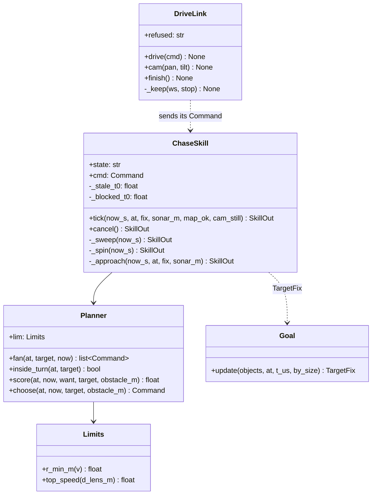

- **What changed from the draft above, and why:**

| Draft | As built | Why |
|---|---|---|
| turn rate key `rate` | `yaw_rate`; any nack without an `id` ends the run | the bridge reads no other key and refused every drive, unnoticed (final review C1) |
| resend every 0.2 s | resend only 0.5 s after the last command (`FRESH_FOR_S`), commands spaced ≥ 0.08 s (`MIN_GAP_S`), STOP at once | a stalled engine is left to the bridge's deadman; floor chase 1 hit the bridge's 25/s limit (39/s) |
| `ramp` on a fixed 0.1 s | the real time between ticks (≤ 0.3 s), and `w` clamped to `r_min(v)` | the loop ticks once per picture (~5-10 Hz) |
| search: sweep, one blind turn | sweep 0, −45, 45, −90, 90 (0.8 s of still pictures each), half a turn, sweep again, `not_found` | the map drops pictures while the camera moves or the tank turns > 45 °/s |
| spin offered beyond 70° | **only** a spin beyond 35°, until 15° left (`SPIN_FROM_DEG`, `SPIN_UNTIL_DEG`) | chase 5 swept past a ball 40° off (a slower tank curves *wider*); chase 6 overshot 15° (§157.1-§157.2) |
| arrival only when facing it | close but > 10° off: turn on the spot to face it | driving on would pass it |
| keep-clear from the tank's centre | from its front (the sonar) | the echo is measured there |
| a stale map ends the run | STOP at once, drive on when fresh, end after 2 s (`STALE_GIVE_UP_S`) | WiFi gaps of 0.12-0.32 s; chase 6 ended a second before arriving (§157.2) |
| — | standing with every curve blocked for 3 s ends `blocked` (`BLOCKED_GIVE_UP_S`) | chase 11 stood 4 minutes before a box (§157.5); going around is slice 2 |
| `goto ball` | `goto <thing>`: "ball" or any floor word, never `person` | no ball to hand; YOLO-World named a bottle "person" 31 times in chase 2 |
| `config/drive.yaml` any values | limits may only be made more careful (`AT_MOST` / `AT_LEAST`) | safety never traded |

- **Floor results** (design-notes §157): ball 40° right at 78 cm, 90° right, behind, rolled away (followed it 3.4 m), all `done`, ending 37-58 cm from the ball (sonar); a box in the path ends `blocked` without touching it; the phone STOP ends the run (`STOPPED`); Ctrl-C stops the tracks in 0.20 s and exits cleanly; the speed table is within ±1.5 cm/s.
- **Known, not fixed:** the half turn is timed (spun ~210°); the first fix of a ball seen at the picture's edge while the camera turns can be off (chase 7 spun to 69° for a ball at 40°); going around obstacles is slice 2.


## 18. Module 2 slice 2: explore without bumping (owner, 2026-10-27, spec 9, design-notes §159 — approved 2026-10-27: "implement")

### 18.0 Scope and plans
- **Spec 9**, in three plans built and floor-checked in order:
  - **Z3 (seeing):** `DepthCoreml`, `CameraAngle`, `DepthScaler`, `HeightPoints`, the camera's tilt fix in `CameraModel`, the live view's depth;
  - **Z4 (the room map):** `SonarModel`, `RoomMap`, `MapSnapshot`, `cq-map`;
  - **Z5 (driving on the map):** `ClearanceMap`, `RoutePlanner`, the fan on the map, the goals, `RoamSkill`, the chase with routes, `cq-drive wander | explore | find`.
- **Nothing new to install:** the depth model is Apple's CoreML build already downloaded for Q0 (`tools/measure/models/da2s/DepthAnythingV2SmallF16.mlpackage`, copied to the git-ignored `ai-engine/models/`); distance transforms come from OpenCV (already a dependency); no scipy.
- **Frames as now** (§13): room x forward, y left, z up, origin where the tank started.

### 18.1 Files
| File | What | Plan |
|---|---|---|
| `adapters/depth_coreml.py` | `DepthCoreml`: the model, 518 × 392 in and out, resized back to the picture | Z3 |
| `domain/depth.py` | `CameraAngle`, `DepthScaler`, `HeightPoints`, `Marks` | Z3 |
| `domain/camera.py` | `CameraModel.tilt_fix_deg` (new field, 0 by default) | Z3 |
| `domain/objects.py` | `FrameGate` applies the current tilt fix to every picture's camera | Z3 |
| `domain/sonar_model.py` | `SonarModel` | Z4 |
| `domain/room_map.py` | `RoomMap`, `MapSnapshot` | Z4 |
| `app/map.py` | `cq-map [--host] [--record] [--replay]`: watch the map fill while the phone drives | Z4 |
| `domain/drive/clearance.py` | `ClearanceMap` (distance to the nearest obstacle, per cell) | Z5 |
| `domain/drive/route.py` | `RoutePlanner`, `aim_point` | Z5 |
| `domain/drive/goals.py` | `WanderGoal`, `ExploreGoal`, `FindGoal` | Z5 |
| `domain/drive/roam.py` | `RoamSkill` (wander / explore / find), shares the chase's stale / blocked rules | Z5 |
| `domain/drive/planner.py`, `chase.py` | the fan checks the clearance map; the chase aims along a route | Z5 |
| `domain/drive/sim.py` | `SimRoom` (boxes, an overhang) for simulated drives | Z5 |
| `app/drive.py` | `cq-drive wander [seconds] | explore | find <thing>` (`goto` removed, §18.13.22) | Z5 |
| `config/map.yaml` | heights, ranges, log-odds steps, costs (§18.9) | Z3-Z5 |

### 18.2 Classes
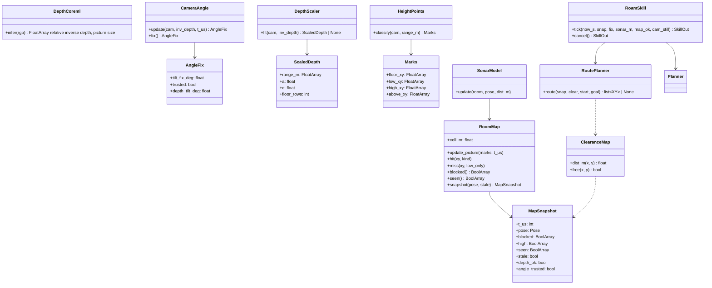

### 18.3 One picture (Z3 + Z4)
```mermaid
sequenceDiagram
  participant A as app loop
  participant G as FrameGate
  participant D as DepthCoreml
  participant C as CameraAngle
  participant S as DepthScaler
  participant H as HeightPoints
  participant M as RoomMap
  A->>G: camera_for(cap_us)
  G-->>A: CameraModel with the current tilt fix (or a skip reason)
  par in threads
    A->>D: infer(rgb)
    A->>A: detect(rgb)
  end
  D-->>A: inv_depth
  A->>C: update(cam, inv_depth, t_us)
  C-->>A: AngleFix (applied from the next picture; this one is re-made with it)
  A->>S: fit(cam fixed, inv_depth)
  S-->>A: ScaledDepth (or None: no floor in view)
  A->>H: classify(cam fixed, range_m)
  H-->>A: Marks
  A->>M: update_picture(Marks, t_us)
  Note over A,M: telemetry (50 Hz) also calls SonarModel.update(room, pose, dist_m)
```

### 18.4 Seeing (Z3)
- **`DepthCoreml(path)`:** `ct.models.MLModel(path, compute_units=ALL)` like the detectors; the picture is resized to 518 × 392 (the model's size; 4:3 within 1 %), the output resized back to the picture's size (`cv2.INTER_LINEAR`). It runs in a thread beside the detector (§17.3's loop); measured in the plan: depth + YOLO-World at VGA together must keep ≥ 5 pictures/s used (the driving loop's rate); if not, depth every second picture (`depth.every_n`).
- **`CameraAngle`** (design-notes §155):
  - **floor rows:** the bottom band of the picture between `NEAR_M` and `FAR_M` by the current camera, columns in the middle half; per row the median inverse depth;
  - a straight line `inv = p·row + q` is fitted (least squares, rows with a residual over 3σ dropped once); its zero row `row0 = −q/p` is the horizon;
  - the depth tilt: `atan((cy − row0) / fy)` (pinhole, undistorted), **plus `DEPTH_TILT_OFFSET_DEG` = 4.1°** (§155);
  - a picture's estimate counts only when the line fits (R² ≥ 0.98, ≥ 20 rows, `p` < 0); the fix is the **median over the last 1 s** of `depth_tilt − real_tilt_deg(servo)`;
  - **trusted** when |fix| ≤ **3°**; otherwise `tilt_fix_deg = 0` and `trusted = False` (spec 9 §5: the servo is used and the drive slows to 18 cm/s);
  - no good picture for 2 s: the fix stays, `trusted` stays as it was.
- **`CameraModel.tilt_fix_deg`:** added in `real_tilt_deg()`; `FrameGate` builds every picture's camera with the current fix, so the object tracker's floor trick (the ball) uses it too.
- **`DepthScaler.fit(cam, inv)`** (spec 7): on `cam.floor_mask()` pixels, `1 / expected_floor_depth = a·inv + c` by least squares (one 3σ trim); fails (None) with fewer than 500 floor pixels or `a ≤ 0`. `range_m = 1 / (a·inv + c)`, `inf` where `a·inv + c ≤ 0`.
- **`HeightPoints.classify(cam, range_m)`:** every 4th pixel in both directions (160 × 120 at VGA); point = lens + ray (unit) × range;
  - `z < FLOOR_M` (0.02): **floor**, out to `FREE_MAX_M` (3.0 m);
  - `FLOOR_M ≤ z < LOW_TOP_M` (0.10): **low** obstacle, out to `MARK_MAX_M` (2.0 m);
  - `LOW_TOP_M ≤ z ≤ CLEAR_M` (0.20, the owner's 20 cm): **high** obstacle, out to 2.0 m;
  - `z > CLEAR_M`: **above** (seen; passable under), out to 3.0 m;
  - points under the floor (z < −0.05) are dropped (bad depth).
  - **Low / high by height:** the sonar's beam is low on the front, so it can only vouch for what's under `LOW_TOP_M`; a box 15 cm tall gives low and high points, and the sonar never clears its high part.

### 18.5 The room map (Z4)
- **`RoomMap(size_m=8.0, cell_m=0.05)`:** 160 × 160 cells, the start at the centre, heading 0 along +x. Arrays: `low`, `high` (log-odds, float32), `seen` (bool).
- **`update_picture(marks)`:**
  - floor points: a **miss** on both `low` and `high` in their cell, `seen` = true;
  - low / high points: a **hit** on that layer, `seen` = true;
  - above points: `seen` = true only (a miss on `high`: the space up to 20 cm under them is open only if floor points say so).
  - **Fading only in view** follows from this: a cell is lowered only by a floor point seen in it now; cells out of view, in the blind zone or behind an obstacle get nothing.
- **Log-odds** (config): hit +0.85, miss −0.4, clamped to ±4; **blocked** when `low > 0.7` or `high > 0.7`.
- **`SonarModel.update(room, pose, dist_m)`** (each telemetry sample, at most 10 Hz used):
  - the sonar point = pose + `sonar_x_m` ahead; beam half-angle 12° (Q0);
  - an echo `d` < 4.0 m: a **low hit** on the arc at `d` (±12°, cells along the arc), **shared: each cell 1 / (cells on the arc)** (design-notes §167), and a **low miss** in the narrow cone (±4°) from 0.10 m to `d − 0.10`;
  - **never touches `high`**; no echo or `d ≥ 4.0` does nothing (spec 9 §5).
- **Edges:** cells outside the 8 × 8 m count as blocked (a soft fence).
- **`snapshot(pose, stale)`** → `MapSnapshot`: copies of `blocked`, `high` (for the view), `seen`, plus the pose, the stale flag (spec 7 §4), `depth_ok` (a depth picture in the last 1 s) and `angle_trusted`.
- **`cq-map`:** the map pipeline only (no driving); live view of the map as an image (blocked low red, blocked high orange, seen grey, unseen black) with the tank's pose; `--record` / `--replay` like `cq-record`.

### 18.6 Routes and the fan (Z5)
- **`ClearanceMap(snap)`:** `cv2.distanceTransform` on the free cells (unseen counts as free here) at 5 cm → metres to the nearest blocked cell; computed once per snapshot (~1 ms).
- **`RoutePlanner.route(snap, clear, start, goal)`:** A* on a **10 cm grid** (each cell = the worst of its 2 × 2), 8-connected:
  - **not allowed:** clearance < `ROBOT_R_M` (0.15: half the tank's width + a margin);
  - **cost** per step: length × (1 + `NEAR_W` · max(0, 0.35 − clearance) / 0.20 + `UNSEEN_W` if unseen) with `NEAR_W` 3, `UNSEEN_W` 1;
  - the start cell is always allowed (the tank may be near a wall), and so is the goal's cell for the chase (the ball sits on the floor);
  - none → `None`. Budget: ≤ 20 ms in Python on 80 × 80 (measured in the plan; if over, the route is kept and re-planned every second tick).
- **`aim_point(route, at, ahead_m=0.5)`:** the point 0.5 m along the route from the nearest route point; the last point when the route is shorter.
- **The fan on the map:** `Planner.choose(at, now, target, obstacle_m, clear)`: every rolled-out pose whose clearance (from `clear`) is under `ROBOT_R_M − 0.03` scores `blocked` (−10). The sonar's `obstacle_m` check and the 30 cm hard stop stay as in slice 1.

### 18.7 Goals and the skill (Z5)
- **`WanderGoal(seconds | None, rng)`:** a destination 1.5–2.0 m away among cells with clearance ≥ 0.30 and seen-free, scored by `cos(bearing) + 0.5·openness + noise(0.3)`; a new one when within 0.4 m, every 6 s, or when no route; done when `seconds` have passed.
- **`ExploreGoal`:** frontier cells = seen-free cells next to unseen ones (10 cm grid), grouped (8-connected); groups under 30 cm (3 cells) dropped; the destination is the group point with the cheapest route; none reachable → done. Refuses to start without depth (`depth_ok` false).
- **`FindGoal(thing, inner)`:** `inner` is wander or explore; each tick the slice-1 `Goal` (§17.5) is asked for `thing`; a fix → hand over to the chase.
- **`RoamSkill`:**
```mermaid
stateDiagram-v2
  [*] --> look : start (camera ahead, map filling)
  look --> drive : a destination with a route
  look --> done : explore, nothing reachable
  drive --> drive : new destination / route every tick
  drive --> look : no route (a turn on the spot, 360 deg in 90 deg steps, camera ahead)
  look --> drive : a route after the look
  look --> other : wander, still no route: a new destination
  other --> drive
  drive --> chase : find - the thing confirmed (the chase from slice 1, aiming along routes)
  drive --> done : wander time up
  drive --> held : stale map (STOP at once)
  held --> drive : fresh
  held --> failed : stale 2 s
  drive --> failed : sonar < 30 cm, not the target (blocked); STOP; Ctrl-C
  chase --> done : arrived
  done --> [*]
  failed --> [*]
```
- **Speeds:** the slice-1 cap (25 cm/s); **18 cm/s** while `angle_trusted` is false or `depth_ok` is false (spec 9 §5).
- **The chase with routes:** when a map is given, `ChaseSkill` aims at `aim_point(route to the ball)` instead of the ball; arrival, the arrival turn and the sonar's echo-is-target test still use the ball itself. No route → the slice-1 rule (`blocked` after 3 s standing).

### 18.8 Safety (spec 9 §5)
- Unchanged: the Uno brake, the deadman, STOP, Ctrl-C, Plan R3, the 25 cm/s cap.
- **The sonar has the last word:** an echo under `clear_m` (0.30) that isn't the target ends the run `blocked`, whatever the map says (slice 1's rule, kept in `RoamSkill`).
- **No invented free space:** no echo clears nothing; the sonar never lowers `high`; unseen is never "known free" (routes may cross it only at extra cost, and only the camera turns it into seen).
- **Depth down:** marks from the sonar only, 18 cm/s, explore refuses, a printed reason.

### 18.9 `config/map.yaml` (defaults)
```yaml
heights: {floor_m: 0.02, low_top_m: 0.10, clear_m: 0.20}   # owner: 20 cm (design-notes §159)
ranges: {mark_max_m: 2.0, free_max_m: 3.0, sonar_max_m: 4.0}
depth: {every_n: 1, tilt_offset_deg: 3.0, trust_deg: 3.0}   # 4.1 in the design; 3.0 measured (§18.11)
map: {size_m: 8.0, cell_m: 0.05, hit: 0.85, miss: -0.4, clamp: 4.0, blocked: 0.7}
route: {cell_m: 0.10, robot_r_m: 0.15, near_w: 3.0, unseen_w: 1.0, aim_m: 0.5}
```
`clear_m` and `robot_r_m` may only be made larger (the "more careful only" rule, §17.10); for the map (Plan Z4, §18.12): `hit` and `clamp` only larger, `miss` only less negative, `blocked` only smaller (above 0), `sonar_max_m` only smaller.

### 18.10 Tests
- **Z3:** a made-up depth picture from `expected_floor_depth()` with a known tilt (and a −4.1° model shift) → `CameraAngle` within 0.2°; a fix over 3° → untrusted; `DepthScaler` recovers `a`, `c`; `HeightPoints` on a scene with a 10 cm box (low + high) and a board at 18 cm (high) and one at 30 cm (above); the ball's floor position moves with the tilt fix.
- **Z4:** an echo marks the arc low and clears the cone's low only; no echo changes nothing; a high mark survives a sonar sweep; a floor point lowers a mark, a cell out of view keeps it; the edge counts as blocked; a replayed recording rebuilds the same map.
- **Z5:** routes on drawn maps (around a box, out of a U, none); the clearance; the fan never picks a curve into the clearance; wander keeps moving for 60 s in `SimRoom`; explore ends with ≥ 80 % of the reachable floor seen; find hands over to the chase; simulated drives never come closer than 15 cm (centre to obstacle edge minus half-width); depth down → 18 cm/s and explore refuses.
- **Floor (spec 9 §6):** the angle within 1°; no obstacle ≥ 10 cm wrongly free within 1 m incl. a board at ~18 cm; wander 2 min without a touch; explore ≥ 80 %; the chase around a box; find the ball out of sight.

### 18.11 As built (Plan Z3, 2026-10-28; design-notes §161)
- **Files** (all in `ai-engine/`):
  - `domain/depth.py` (`Heights`, `Ranges`, `DepthSettings`, `MapConfig`, `depth_tilt_deg`, `AngleFix`, `CameraAngle`, `DepthScaler`, `ScaledDepth`, `HeightPoints`, `Marks`, `Seeing`, `Seen`);
  - `domain/camera.py`: `CameraModel.tilt_fix_deg`, `undistorted_grid(cal)` (cached per calibration, under a lock), `ray_norms()`, `unit_rays(stride)`; `domain/objects.py`: `FrameGate.tilt_fix_deg`, `ObjectPipeline.set_tilt_fix`;
  - `adapters/depth_coreml.py` (`DepthCoreml`), `adapters/map_config.py` (`load_map_config`), `adapters/rerun_view.py` (`depth`, `marks`, `angle`);
  - `app/objects.py` (`cq-objects` with depth: `load_depth`, `depth_due`, `see_off_loop`; `--depth-model`, `--no-depth`), `app/drive.py` (`cq-drive` keeps the camera angle up to date; `--no-depth`); `config/map.yaml`;
  - the model `models/DepthAnythingV2SmallF16.mlpackage` (git-ignored; copied from `tools/measure/models/da2s/`);
  - tests `test_depth.py`, `test_map_config.py`, `test_depth_coreml.py` (skipped without the model), additions to `test_camera.py`, `test_objects.py`, `test_objects_app.py`; the AI engine suite is 310 tests.
- **Changes from §18.4, with the reason:**
  - **The model gives depth along the camera's axis**, not along each pixel's ray: `DepthScaler` fits `1 / axis depth` and `range = ray_norm / (a·inv + c)` (`ray_norms()`).
  - **The floor line is fitted in the undistorted image height `y_n`**, not the pixel row (the lens bends rows); the horizon is `y_n0 = −q/p`, the tilt `atan(y_n0) − offset`, and inverse depth grows toward the bottom of the picture, so the check is `p > 0`.
  - **The correction is 3.0°, not 4.1°**, measured against a taped ball in five recordings (design-notes §161.2), and **tilt0 0.7°, not 3.3°** (owner): the camera sits 0.7-4.0° lower than the servo says and changes between power-ons, so the 3° trust window is centred on where it really sits.
  - **A fix needs 3 estimates** in the window (`MIN_ESTIMATES`) and comes in 0.05° steps (`FIX_STEP_DEG`), so one odd picture cannot move it and the depth cache is not rebuilt for noise.
  - **`DepthScaler`** uses every 3rd floor pixel (speed) and refuses a fit with R² < 0.9 or with no spread in the floor's depth (a wall filling the picture gave nonsense marks).
  - **Seeing runs off the event loop** (`see_off_loop`, `asyncio.to_thread`; ~25 ms a picture on the M1), so telemetry and the drive keep ticking; `cq-drive` works out only the angle for now (no map until Z4).
  - **`config/map.yaml` is checked:** unknown keys refused; `clear_m` only larger, `floor_m` and `trust_deg` only smaller; `low_top_m` ≤ `clear_m`; `every_n` a whole number ≥ 1.
  - **A missing or damaged model file:** a plain message and the run carries on without depth.
- **Measured on the floor** (design-notes §161): 18.8 pictures / s with depth (`every_n` stays 1); the depth tilt within 0.62° of the truth in five recordings; the 1 m ball at 93 / 101 cm and the 2 m ball at 223 cm; the bed's lower edge (15 cm up) marked high and a 10 cm box low, neither shown as floor within 1 m; depth puts things ~10 cm near (the safe side).
- **Known limit found:** the ball finder's roundness (0.55-0.66 against 0.66, the ball's blue spots) missed the ball in two recordings at the right tilt: a follow-up after Plan Z3.

```mermaid
classDiagram
  class Seeing {
    +angle: CameraAngle
    +scaler: DepthScaler
    +heights: HeightPoints
    +see(cam, inv, t_us) Seen
    +angle_only(cam, inv, t_us) AngleFix
  }
  class CameraAngle {
    +update(cam, inv, t_us) AngleFix
    +fix() AngleFix
  }
  class DepthScaler {
    +fit(cam, inv) ScaledDepth
  }
  class HeightPoints {
    +classify(cam, range_m) Marks
  }
  class AngleFix {
    +tilt_fix_deg: float
    +trusted: bool
    +depth_tilt_deg: float
    +n: int
  }
  class Seen {
    +fix: AngleFix
    +cam: CameraModel
    +scaled: ScaledDepth
    +marks: Marks
  }
  class DepthCoreml {
    +infer(rgb) inv
  }
  class ObjectPipeline {
    +set_tilt_fix(deg)
  }
  Seeing --> CameraAngle
  Seeing --> DepthScaler
  Seeing --> HeightPoints
  Seeing ..> Seen
  CameraAngle ..> AngleFix
  DepthCoreml ..> Seeing : inverse depth
  Seen ..> ObjectPipeline : tilt fix (see_off_loop)
```

### 18.12 As built (Plan Z4, 2026-10-29; design-notes §162)
- **Files** (all in `ai-engine/`):
  - `domain/room_map.py` (`RoomMap`, `MapSnapshot`, `map_image`), `domain/sonar_model.py` (`SonarModel`);
  - `domain/depth.py`: `MapSettings` and `Ranges.sonar_max_m`; `adapters/map_config.py` reads the `map:` section; `config/map.yaml`;
  - `app/map.py` (`cq-map <recording> | --live [--record DIR] [--no-depth] [--no-view]`: `MapRun`, `run_replay`, `run_live`, `report`, `status`); `adapters/rerun_view.py` `room_map`;
  - tests `test_room_map.py`, `test_sonar_model.py`, `test_map_app.py`, additions to `test_map_config.py`; `tests/fake_bridge.py` streams a real picture, stops pictures after a time, and reports the servos; the AI engine suite is 362 tests.
- **Changes from §18.5, with the reason:**
  - **One step per cell per picture**, however many points fall in it (a near cell gets thousands), and **a hit beats a miss** in the same cell in the same picture (a box's foot): one picture can't saturate the map, and the map never invents free space (owner-approved with the plan).
  - **The sensor never marks seen** (spec 9 §5: only the camera turns unseen into seen), and an echo under 20 cm marks only its arc (no cone).
  - **`MapSnapshot.cell_m`** (the picture needs it to place the tank); the tank's marker is left out when it is off the map.
  - **"More careful only" the right way round** (final review): the plan had `blocked` "not lower"; a higher level makes fewer obstacles, so it may only go down; `clamp` only up, `sonar_max_m` only down.
  - **`MapRun`** holds the pipeline (pose from `ObjectPipeline` with no detector, `Seeing`, `RoomMap`, `SonarModel`); the live loop runs the depth model and `Seeing` in worker threads and `update_picture` (< 10 ms) and the sensor on the event loop, so the map has one writer.
- **Measured on the floor** (design-notes §162): 10-22 map updates a second; a 10 cm box marked low and remembered after the tank moved and turned; the bed's 15 cm edge marked high, settled where the owner's tape put it (1.22 m) and never cleared by the sensor; replays give the same map.
- **Left for Plan Z5** (final review minors): work out stale when the snapshot is taken (and on picture timeouts); report a crashed link or camera task; refuse a positive `miss`.

```mermaid
classDiagram
  class MapRun {
    +p: ObjectPipeline
    +room: RoomMap
    +sonar: SonarModel
    +seeing: Seeing
    +on_telem(s)
    +on_text(text)
    +gate(frame, rgb) CameraModel
    +apply(seen, t_us)
    +snapshot(t_us, stale) MapSnapshot
  }
  class RoomMap {
    +n: int
    +low: float32[n,n]
    +high: float32[n,n]
    +seen: bool[n,n]
    +cells(xy) intp[]
    +hit(cells, layer)
    +miss(cells, layer)
    +update_picture(marks, t_us)
    +blocked() bool[n,n]
    +is_blocked(x, y) bool
    +snapshot(t_us, pose, stale, angle_trusted) MapSnapshot
  }
  class SonarModel {
    +update(room, pose, dist_m, t_us) bool
  }
  class MapSnapshot {
    +t_us: int
    +pose: Pose
    +cell_m: float
    +blocked: bool[n,n]
    +high: bool[n,n]
    +seen: bool[n,n]
    +stale: bool
    +depth_ok: bool
    +angle_trusted: bool
  }
  MapRun --> RoomMap
  MapRun --> SonarModel
  MapRun --> Seeing
  SonarModel ..> RoomMap : low only
  RoomMap ..> MapSnapshot
```

### 18.13 Revision 2: driving on a cost map (owner, 2026-10-30, design-notes §166 — approved 2026-10-30, Plan Z6)

**Why.** Plan Z5's floor runs 1-3 each found a case the driving rules got wrong, and each fix was another rule (unseen space grown 30 cm round marks, the escape exception, "no part deeper in" sums on two maps, a 4× weight for narrow places, the reverse's track rules); each broke another case (design-notes §164-§165.2). Spec 0 §1.1 principle 3: general before special. This revision replaces those rules with the standard model real robots use (ROS 2 Nav2: a cost map, a footprint check, a local planner scoring moves by cost, and recovery behaviours). It replaces §18.6, §18.7's "look" and the §164-§165 additions; §18.3-§18.5 (seeing, the room map) stay.

**One idea for a child:** every 5 cm square of the floor has a price. Things the tank has seen are walls it can't drive into; near them the price rises; floor it has never seen costs something, so it goes there slowly and head-first, where its eyes are. It picks the cheapest good move, and when every move is too dear it tries the standard ways out, then says `blocked`.

#### 18.13.1 The costs (`CostMap`, replaces `ClearanceMap`)
Per 5 cm cell, from one `MapSnapshot`:

| Cell | Cost | Moves |
|---|---|---|
| **lethal:** `blocked` (low or high above the log-odds level) or outside the map | 1 | the body keeps `KEEP_OUT_M` from it (§18.13.2) |
| **near:** free, near a lethal cell | the near cost below, at most `NEAR_COST` (0.8) | allowed, dearer the closer |
| **unknown:** never seen and never driven over | + `UNKNOWN_COST` (0.3) | allowed forward and turning; **never backward** (§18.13.4) |
| **free:** seen or driven over, far from anything | 0 | allowed |

- `d` = distance from a point to the centre of the nearest lethal cell (`cv2.distanceTransform`, once per snapshot, as today).
- **The near cost has two readers** (one meaning each):
  - **the fan, at the body's outline points:** `NEAR_COST` × (`NEAR_OUT_M` − d) / (`NEAR_OUT_M` − `KEEP_OUT_M`), clipped to 0..`NEAR_COST`, with `NEAR_OUT_M` 0.20 - zero 20 cm from the outline, full at the keep-out;
  - **routes, at the tank's centre:** `NEAR_COST` × (`NEAR_C_M` − d) / (`NEAR_C_M` − `body_half_w_m`), clipped the same, with `NEAR_C_M` 0.40.
- **A cell's cost** = min(0.95, near + unknown); lethal is 1.
- **Nothing is grown into unknown space.** A box's hidden back is unknown: dearer, slower, never forbidden until seen. The trade-off is the owner's (§166): something never seen can be touched, slowly and never head-on (the sonar, `clear_m` 10 cm, and the Uno's 15 cm brake look forward).
- **The body is a sensor too:** the cells under the tank's footprint (shrunk 2 cm all round for pose drift) get a floor observation in `RoomMap` - a miss on low and high, `seen` true - at most 10 times a second and one step per cell per update, like the sonar (Z4's evidence rule): the floor the tank stands or drove on is free. `RoomMap.body_over(pose, footprint)`.

#### 18.13.2 One body check (`Footprint`)
> **Superseded by §18.13.14 (2026-10-31, design-notes §171-§172):** the body as a whole, exact gaps from its rectangle; the per-point rule below froze beside one mark (5 cm rounding). The objection to a body-wide rule below is answered there.

- The outline of `Limits`' rectangle (front 13, rear 9, half-width 11.5 cm, design-notes §163), a point every 2.5 cm, posed along a move at most 5° / 2.5 cm apart (as §164 built).
- **The one rule: no point of the body's outline comes nearer than `KEEP_OUT_M` (7.5 cm, about one cell, to the obstacle cell's centre) to a known obstacle; a point already nearer may not come any nearer.** Each outline point is checked against its own start (the points move with the body, so "this point" is well defined).
  - Why 7.5 cm: the map's cells are 5 cm, so a free cell next to an obstacle cell can be 0-5 cm from the real surface. Checking only "inside an obstacle cell" would have allowed run 2's left turn by the bed (the rear corner swings to 14.6 cm, the panel's cell started at 15 cm).
  - Why per point: a body-wide rule ("the nearest point never nearer", or a sum) let one part move in while another moved out; per point, run 2's left and right turns and driving on are refused, as they should be.
  - Everything else about nearness is cost, so a tank near something moves away by choice, with no escape exception.
- The same check for every move: curves, a turn on the spot (only the way it turns), backing up, and the chase's last turn.

#### 18.13.3 Choosing a move (`Planner`, the fan)
- The fan as today (slice 1's curves, turns on the spot beyond 35°, the ramps), each rolled out 1.5 s.
- **Score** = progress toward the aim point − heading still off − steering change (slice 1, §17.4) − `COST_W` (4) × the **mean over the move of the highest cost the outline meets at each pose** (as built: the highest alone is met at the start of every move beside a wall, so it couldn't tell moving away); forbidden moves are left out.
- **Speed from cost:** `c` = the highest cost the outline points meet over the first 0.5 m of the chosen move's roll-out; the top speed = `v_top` − (`v_top` − `v_min`) × `c` - 25 cm/s on open seen floor, toward 18 cm/s near things or on unknown floor, never a crawl below `v_min`. The 18 cm/s for an untrusted angle or no depth stays (spec 9 §5).
- **Routes (`RoutePlanner`)** use the same costs: A* on the 10 cm grid (each cell the dearest of its 2 × 2), step cost = length × (1 + `ROUTE_COST_W` (6) × cell cost); a cell is closed only when its centre is nearer than `body_half_w_m` to a lethal cell (the body would overlap going straight); the start cell is always open. Room to turn round comes from the near cost, not from a rule; doorways stay open.
- **Goals** as §18.7: wander picks free, seen spots 1.5-2 m away; explore picks the cheapest reachable frontier (seen free cells next to unknown, groups ≥ 30 cm); find hands over to the chase.

#### 18.13.4 When nothing is possible: recovery (standard, in order)
Triggered when no move is allowed or no move makes progress for `STUCK_S` (3 s), or there is no route:
1. **look** - stand, pan the camera to −90°, −45°, 45°, 90° (1 s each) and back: the map learns the floor beside the tank; then plan again.
2. **turn** - turn on the spot (90°, the way the footprint check allows, cheaper way first), then plan again.
3. **back up** - straight back at `v_min`, at most 20 cm, **only over known-free cells** (seen or driven over): nothing senses behind the tank, so it never backs onto floor it doesn't know. Re-checked every tick.
4. **give up** - `blocked`.
- A recovery that ends in a move that makes progress (the tank 0.3 m from where recovery began) resets the sequence; recovery starting again within 0.3 m of the last one continues the sequence where it left off. One rule set for wander, explore, find and the chase's routes.

```mermaid
stateDiagram-v2
  [*] --> start_look : camera ahead 1 s
  start_look --> drive
  drive --> drive : cheapest allowed move along the route
  drive --> look : stuck (no allowed move / no progress 3 s / no route)
  look --> drive : a move found
  look --> turn : still stuck
  turn --> drive : a move found
  turn --> back : still stuck (or no turn allowed)
  back --> drive : a move found
  back --> blocked : still stuck (or no known-free floor behind)
  drive --> chase : find - the thing confirmed
  drive --> done : wander time up / explore nothing left
  drive --> held : stale map (STOP at once)
  held --> drive : fresh
  held --> failed : stale 2 s
  drive --> failed : sonar echo < clear_m not the target; STOP; Ctrl-C
  chase --> done : arrived
```

#### 18.13.5 Classes (as built, Z6 review 2026-10-31)
```mermaid
classDiagram
  class RoomMap {
    +update_picture(marks, t_us)
    +body_over(pose, front_m, rear_m, half_w_m, t_us) bool
    +snapshot(t_us, pose, stale, angle_trusted) MapSnapshot
  }
  class CostSettings {
    +keep_out_m, near_out_m, near_c_m, near_cost, unknown_cost
    +cost_w, route_cost_w, stuck_s, back_m
  }
  class CostMap {
    +lethal, seen, known_free: bool[n,n]
    +dist: float[n,n]
    +cell_of(x, y) / centre(ix, iy)
    +dist_m(x, y) / dist_many(xy) / seen_at(x, y)
    +marks_within(x0, y0, x1, y1) FloatArray
    +outline_cost(xy) FloatArray
    +centre_cost(half_w) FloatArray
  }
  class Footprint {
    +outline, body: FloatArray
    +world(p, pts) FloatArray
    +dense(at, poses) list~XYTh~
    +allowed(cost, at, poses) bool
    +gaps(poses, marks) FloatArray
    +highest_cost(cost, at, poses, ahead_m) float
    +mean_cost(cost, at, poses) float
    +spin_poses(at, left, deg)$ / back_poses(at, length_m)$
  }
  class Planner {
    +fan(at, target, now, far_m, cost) list~Command~
    +choose(at, now, aim, obstacle_m, cost, far_m) Command
    +can_spin(at, cost, left, deg) bool
    +speed_cap(cost, at, cmd) float
  }
  class RoutePlanner {
    +route(cost, start, goal) list~XY~
    +costs(cost, start) FloatArray
    +grid_of(x, y) / nearest(...)
  }
  class Recovery {
    +step: look | turn | back | blocked
    +start(now_s, at)
    +progress(at)
    +tick(now_s, at, cost) Out | None
  }
  class ProgressWatch {
    +reset()
    +ok(now_s, at) bool
  }
  class TurnMeter {
    +deg: float
    +reset()
    +update(th_rad) float
  }
  class WanderGoal {
    +destination(now_s, at, cost, planner) XY | None
    +drop()
  }
  class ExploreGoal
  class RoamSkill {
    +tick(now_s, at, snap, fix, sonar_m, map_ok, cam_still) SkillOut
  }
  class ChaseSkill {
    +tick(now_s, at, fix, sonar_m, map_ok, cam_still, snap) SkillOut
  }
  RoomMap ..> CostMap : snapshot
  CostMap --> CostSettings
  Planner --> Footprint
  Recovery --> Footprint
  Recovery --> TurnMeter
  ProgressWatch --> Recovery : progress
  RoamSkill --> Planner
  RoamSkill --> RoutePlanner
  RoamSkill --> Recovery
  RoamSkill --> ProgressWatch
  RoamSkill --> WanderGoal
  RoamSkill --> ExploreGoal
  RoamSkill --> ChaseSkill : find
  ChaseSkill --> Planner
  ChaseSkill --> RoutePlanner
  ChaseSkill --> Recovery
  ChaseSkill --> ProgressWatch
  ChaseSkill --> TurnMeter : the search turn
  Planner ..> CostMap
  RoutePlanner ..> CostMap
  Footprint ..> CostMap : gaps to marks_within
```

#### 18.13.6 One tick
```mermaid
sequenceDiagram
  participant L as drive loop
  participant M as RoomMap
  participant C as CostMap
  participant S as RoamSkill
  participant R as RoutePlanner
  participant P as Planner
  participant F as Footprint
  L->>M: body_over(pose) (each telemetry)
  L->>M: snapshot()
  L->>S: tick(at, snap, sonar, ...) (asyncio.to_thread: off the event loop)
  S->>C: CostMap(snap) (once per snapshot)
  S->>R: route(cost, at, goal)
  R-->>S: route (or none: recovery)
  S->>P: choose(at, now, aim, echo, cost)
  P->>F: allowed / mean_cost per move
  F-->>P: scores
  P-->>S: best move (or STOP: recovery)
  S-->>L: Command (+ camera)
```

#### 18.13.7 Removed
`GROW_UNSEEN_M` and the grown map; `MAP_CLEAR_M` / `FRONT_CLEAR_M` / `BODY_CLEAR_M` / `SIDE_MARGIN_M` (one `KEEP_OUT_M` instead); the escape exception (`ESCAPE_M`); the "no deeper in" sums and the two-map check; `TIGHT_W` / `turn_room_m`; the look's camera pans as a special case, `STUCK_LOOKS`, `LOOK_ROUNDS`; the reverse's track and "not twice" rules. Kept: the sonar's stop (`clear_m`), the stale rule, 18 cm/s when unsure, the ramps, the measured body, reverse only at `v_min`.

#### 18.13.8 Config (`config/map.yaml`, `cost:`)
```yaml
cost: {keep_out_m: 0.075, near_out_m: 0.20, near_c_m: 0.40, near_cost: 0.8, unknown_cost: 0.3, cost_w: 4.0, route_cost_w: 6.0, stuck_s: 3.0, back_m: 0.20}
```
More careful only (§17.10): `keep_out_m`, `near_out_m`, `near_c_m`, `near_cost`, `unknown_cost` may only be raised; `back_m` only lowered.

#### 18.13.9 Tests
- **Costs:** lethal / near / unknown / free values on drawn maps; the body over cells clears them (and not beyond its shrunk footprint).
- **Footprint:** a move into a lethal cell is forbidden, next to it allowed but dear; a turn on the spot checked only its own way.
- **The three floor runs as drawn maps:** run 2 (bed panel right, leg ahead-right, the way on behind-left), run 3 (one small mark ahead-left, unknown round the tank) and the wall beside the tank: none ends `blocked` while a way exists; no outline point ever enters a lethal cell.
- **Recovery:** the order look → turn → back → `blocked`; backing only over known-free cells; progress resets it.
- **Simulated rooms** (`SimRoom`): all of today's (wander, explore ≥ 80 %, doorways 46 / 60 / 80 cm, the ball by the sofa, the box on the route) plus the three floor-run layouts, with **today's bar unchanged: the body never nearer than 5 mm to any box**. If a case fails only on a box the tank never saw, it is reported to the owner, not passed by lowering the bar.
- **Floor (spec 9 §6):** wander 2 min, explore, goto ball round a box, find the ball - as Plan Z5 Task 9.

#### 18.13.10 Checked on the floor-run recordings (scratch script, the rules above, 2026-10-30)
- **Run 1 (wander, 2 min):** the speed from cost along the path it drove: median 25 cm/s, the lowest tenth 23.8, never 18 - smooth driving stays.
- **Run 3 (stuck 12 s, blind zone):** both turns on the spot allowed (outline cost 0.70: unknown floor round it); straight on refused (the small mark ahead) - it would turn and go on.
- **Run 2 (beside the bed):** every move refused, backing up included - the map has the leg's cell overlapping the tank's side (the 5 cm cells), so no point may move. With the keep-out the tank wouldn't have driven in there (the bed was seen ~4 s before it did); if it happens anyway it ends `blocked`, the safe answer.

#### 18.13.11 Plan
Owner (2026-10-30): a new plan, **Z6 - the cost map**, on branch `plan-z6` from `plan-z5`: replaces the rules above, keeps the rest of Z5; Z5's floor checks folded into Z6's; both merge to `main` together after Z6's floor checks.

#### 18.13.12 Wander that explores; obstacles marked to 1.5 m (owner, 2026-10-30, design-notes §169 - approved: "do both a and b")
**Found on Z6 floor run 1 (wander, 70 s, replayed through the code):** the tank drove 12.5 m but stayed in a 2 × 3 m strip beside the bed, turning back at its ends. Two causes:
1. **Wander only aimed at seen floor** (§18.7), so the far side of the bed - never seen - was never a destination; at the bed's edge every candidate lay behind or beside it.
2. **The map shrank the room:** 6.5 m² marked as obstacles; 86 of 108 wander candidates at the end were within 30 cm of a mark. One picture's own marks against the sonar's echo at the same moment (283 pictures): distance ratio 1.07 at 0.8-1.2 m, **0.97 at 1.2-1.6 m, 0.87 at 1.6-2.2 m** (about 25 cm too near at 2 m), and ~2/3 of the final marks were made from 1.5-2 m away, speckled.

**A - obstacles trusted to 1.5 m** (`ranges.mark_max_m` 2.0 → **1.5**, in `config/map.yaml` and the `Ranges` default). Floor and "above" stay at 3.0 m, so far floor is still seen (and far unseen floor still becomes known). Safety: anything is marked once it is within 1.5 m - 6 s ahead at 25 cm/s - and the sonar's echo, its 10 cm stop and the Uno's brake are unchanged. The simulated camera (`SimRoom.marks`, exact) is unchanged.

**B - wander explores** (`WanderGoal`): the same candidates (1.5 / 1.75 / 2.0 m every 10°), but
- **seen floor only, as before** - *changed while building:* with unseen floor allowed, the simulated tank 15 cm from a wall, facing along it, picked a spot **behind the wall** (the wall was beside it, out of the camera's view, so not yet on the map), turned towards it and touched the wall within 0.2 s (`test_no_turn_on_the_spot_scrapes_a_wall`). Seen floor plus the preference below does the same job the safe way, as explore does: the edge of what it has seen is new, driving there shows the next bit, and so on;
- **reachable only** - the route cost to the candidate's 10 cm grid cell (`RoutePlanner.costs`, one Dijkstra per pick) is finite; spots behind a wall are skipped rather than tried and dropped;
- **prefers places it hasn't been lately** - the goal remembers when the tank was last in each 25 cm cell (`VISIT_CELL_M`); a spot's novelty comes from the latest visit within 0.5 m of it (`VISIT_NEAR_M`): 1 if none, else min(1, age / `VISIT_FORGET_S` 60 s);
- score = `cos(bearing) + 0.5·min(clearance, 1) + NOVEL_W·novelty + noise(0.3)`, **`NOVEL_W` 2.0** - enough for an unvisited spot behind (−1 + 2) to beat a visited one ahead (+1), so it turns round to new places, and among new places it still prefers ahead (smooth driving).

Wander stays different from explore: explore goes to the cheapest frontier until none is left and ends `done`; wander drifts towards new places for its seconds, never ends early, and goes back to old places once they're forgotten (60 s).

```mermaid
classDiagram
  class WanderGoal {
    +seconds: float | None
    +rng: Random
    -_visits: dict[(int,int), float]  25 cm cells
    +destination(now_s, at, cost: CostMap, planner: RoutePlanner) XY | None
    +drop()
    +done(now_s) bool
    -_novelty(p, now_s) float
  }
  class RoutePlanner {
    +costs(cost, start) FloatArray
    +grid_of(x, y) (int, int)
  }
  WanderGoal ..> RoutePlanner : reachable spots
  WanderGoal ..> CostMap : clearance
  RoamSkill --> WanderGoal
```

**Tests:** wander needs seen open floor (nothing seen → `None`); skips spots it can't reach (walled in → `None`); after driving 2 m ahead and back it picks a spot > 0.5 m from that strip (old code: 0.35 m); a forgotten strip (200 s) is ahead again; obstacles 3 cm up at ~1.8 m are not marked but their floor is, at ~1.05 m they are; the wall-scrape case above. Suite 507 passed, 1 expected failure (§168).

**Measured (2026-10-30):**
- **A on floor run 1's recording:** obstacle area 6.5 → **2.1 m²**; usable wander spots at the end 22 → **42** of 108; the speckled ring round the start mostly gone.
- **B in simulated rooms** (the simulated camera sees exactly, 2 m all round): 5 × 5 m with a bed, 120 s - 0.5 m cells visited 40-44 (old 40-48), the drive's ~25 m allows only ~50; 7 × 7 m with a bed and two boxes, 240 s - 73-93, mean 85 (old 79-84, mean 82). **No real difference in simulation**: the perfect camera already shows the old wander the way round. The test that counts is the floor.

#### 18.13.13 Backing off a mark on the tank's own corner (owner, 2026-10-30, design-notes §170)
`Recovery._back_ok`: the outline's cells along the reverse must be known-free **or under the body at the start of backing** (its outline and whole-body grid cells at `at`); `Footprint.allowed` still applies, so no point gets nearer to a mark than it is. Floor run 2 ended `blocked` with a mark on the front-right corner and clear floor behind; now it backs off. Tests: `test_backs_off_a_mark_touching_its_front_corner` (was blocked), `test_never_backs_over_a_mark_behind` (guard). Replaces §18.13.10's run-2 outcome when the floor behind is known clear.

#### 18.13.14 The body as a whole, exact gaps (owner, 2026-10-31, design-notes §171, §172 - as built after the Z6 review)
Floor run 3 froze beside one false mark: each body point kept its own distance, read from 5 cm cell centres, so any slide past a mark read as "nearer". A first fix (body points measured exactly, a 5 mm allowance, an outline check) worked but was three rules and let the body creep 5 mm a decision (Z6 review 1-2); as built now it is one rule:

```mermaid
classDiagram
    class CostMap {
        +marks_within(x0, y0, x1, y1) FloatArray
        -_pad: BoolArray  the lethal cells, the map's edge lethal
    }
    class Footprint {
        +front_m, rear_m, half_w_m, lim_reach
        +allowed(cost, at, poses) bool
        +gaps(poses, marks) FloatArray
    }
    Footprint --> CostMap : marks_within (reach + keep_out round the move)
```

- `Footprint.gaps(poses, marks)`: per pose, the exact distance from the body's rectangle to the nearest mark (an obstacle cell's centre, or the map's edge); a mark inside the rectangle reads minus its depth (deeper is nearer).
- `Footprint.allowed(cost, at, poses)`: with `g0` = the gap at `at` and the marks within `sweep_r_m + keep_out_m` of the move:
  1. at every dense pose the gap stays `>= min(keep_out_m, g0)` - never into the keep-out from outside, never nearer than now from inside it; a mark entering the outline is a gap below 0, so review I1 (a leg under the front edge) is the same rule;
  2. if `g0 < SLIDE_MIN_M` (3 cm, owner) the last pose's gap must be larger than `g0` - no sliding along a thing whose cell overlaps the track.
- **The §18.13.2 objection** (a body-wide rule "let one part move in while another moved out"): from outside the keep-out nothing may enter it, as before; inside it, another part may come only as near as the nearest part already is - the body is never nearer anything than now. Run 2's turns by the bed stay refused (`test_run_2_beside_the_bed`).
- Exact, so no allowance: sliding along a wall or past a mark reads the same gap; a turn whose corner would pass 4 mm from a wall reads 0.4 cm, not 5. The look-out distance follows `keep_out_m` (raised keep-outs kept exactly).
- **B (obstacles only from 35 cm) was built and dropped** (owner, §172): with the simulator seeing like the real camera, a box's side seen only from closer than 35 cm stayed off the map and the body passed 3.6 mm from it; A alone unfreezes run 3.
- Tests: `test_one_mark_beside_the_body_never_freezes_it`, `test_beside_a_mark_still_never_nearer_than_now`, `test_no_creeping_nearer_a_little_at_a_time`, `test_a_raised_keep_out_is_kept_exactly`, `test_a_turn_is_checked_its_own_way` (clear margins: 9.1 / 6.4 cm), `test_no_sliding_along_a_wall_over_the_track`; the 46 cm doorway passes; `test_no_turn_on_the_spot_scrapes_a_wall[π/2, 0.15]` a strict known failure (the next design).

#### 18.13.15 Z6 review fixes (2026-10-31, design-notes §172)
- `Recovery._back_ok`: only **lethal** cells the body covers at the start count as passable (run 2's corner mark); unseen floor behind the tail does not.
- `ProgressWatch` (one "stuck" check for roam and chase) and `TurnMeter` (a turn measured from the pose, for recovery's turn and the chase's search turn) in `recovery.py`; `MOVED_M`, `TURNED_DEG` moved there.
- `WanderGoal(rng, lim)`: a destination needs `sweep_r_m + keep_out_m` (~25 cm) of room - a spot it can stand and turn on - in place of a separate 30 cm; `ROOM_W` 0.5 named; `NOVEL_W` 2's reason stated (to the side beats visited ahead by more than the noise; behind ties with ahead); `done()` removed (the skill keeps the time).
- `Recovery.tick` lost its unused `dt_s`; `PLAN_TRIES` 3, `BODY_GRID` 9 named.
- `SimRoom.marks(ranges=)`: obstacles only to `Ranges.mark_max_m` (1.5 m), as the real depth; `load_map_config` refuses a smaller `mark_max_m` (fewer camera obstacles).
- `cq-drive`: the skill's tick runs in `asyncio.to_thread` (6-21 ms of planning off the event loop; the snapshot is a copy).

#### 18.13.16 The play area, only when asked (owner, 2026-10-31, design-notes §174)
- **Command:** `cq-drive wander|explore|find ... --area M`. Without it nothing changes: the tank goes wherever it can reach, other rooms too (owner). M must be more than 0 (`goto` took no area; removed, §18.13.22).
- **One rule, in the cost map:** `CostMap(snap, s, ignore=None, area=(x, y, r))` - every cell whose centre is further than r from (x, y) is lethal, a wall like any other. Destinations, routes, the fan, the body's gap and the ways out all respect it with no change of their own. `RoamSkill(..., area_m=)` fixes (x, y) at the pose of its first tick with a fresh map and hands the same circle to its chase (`ChaseSkill.area`).
- **Wander:** spots are looked for 1.5-2 m away as before; only when none of those is open, seen and reachable, 0.5-1.25 m away (`WANDER_NEAR_RADII_M`) - a small play area or a small room. Wander without an area behaves as before.
- **The chase:** a target whose cell is lethal even with its own marks set aside (outside the area, inside a wall, under a high edge) can't be reached: the chase ends `blocked` at once (before: seen, stuck, lost, seen again - forever).
- **Not safety:** STOP, the deadman, the sonar stop and the body's keep-out are unchanged.

```mermaid
classDiagram
    class CostMap {
        +lethal: BoolArray
        +__init__(snap, s, ignore, area)
    }
    class RoamSkill {
        +area_m: float | None
        -_area: tuple | None
    }
    class ChaseSkill {
        +area: tuple | None
    }
    class WanderGoal {
        +destination(now_s, at, cost, planner) XY | None
        -_best(now_s, at, cost, planner, reach, radii)
    }
    RoamSkill --> CostMap : area=_area
    RoamSkill --> ChaseSkill : area
    ChaseSkill --> CostMap : area
    RoamSkill --> WanderGoal
```

#### 18.13.17 Turns on the spot over seen floor, unseen only as a last resort (owner, 2026-10-31, design-notes §176)
- `Footprint.turn_ok(cost, at, left, deg=90, seen=True)`: the body's rule (`allowed` over `spin_poses`) and, with `seen`, every cell the outline sweeps that the body doesn't cover now is seen on the map (outside the map: refused). `seen=False` is the body's rule alone.
- `Planner.can_spin(..., seen=True)` and the fan's / `_score`'s turn on the spot use `seen=True`: over unseen floor the fan offers only its forward curves.
- `Recovery._turn` uses `seen=False` (the last resort: nothing else was allowed - §166, unseen costs but is never forbidden).
- `ChaseSkill._spin` (the search turn): refused with `seen=True`, `planner.choose` toward a point 1 m off at heading + min(rest, `SEARCH_AIM_DEG` 170°) - curving round, the `TurnMeter` counting it; no curve allowed: the turn on the spot with `seen=False`; neither: sweep from here. Turning to face the ball at the end: `seen=False`.

```mermaid
sequenceDiagram
    participant Fan as Planner.fan / _score
    participant Rec as Recovery._turn
    participant Foot as Footprint.turn_ok
    Fan->>Foot: turn_ok(seen=True)
    alt sweep over seen floor
        Foot-->>Fan: allowed: offer the turn on the spot
    else unseen floor in the sweep
        Foot-->>Fan: refused: forward curves only
    end
    Note over Fan,Rec: every move refused for stuck_s: the ways out
    Rec->>Foot: turn_ok(seen=False)
    Foot-->>Rec: the body's rule alone (last resort)
```

#### 18.13.18 Find: look again at a maybe (owner, 2026-11-01, design-notes §179)
- `Detection.sure` (default True). `to_detections(..., maybe_score=None)` / `YoloWorld(model, vocab, maybe_score)`: candidates from min(`maybe_score`, the word's threshold) up are kept, `sure` = at or over the word's threshold. `detectors()` passes `MAYBE_SCORE` 0.15 (`domain/objects.py`).
- `ObjectPipeline.on_frame` locates sure detections for the tracker (unchanged); `maybes()` is every sighting of the newest used picture, sure and unsure (cleared every picture) - a single sure sighting the tracker hasn't listed is a maybe too (design-notes §181).
- `app/drive.py`: `nearest_maybe(maybes, goal.kind, at)`; `_tick` hands it to `RoamSkill.tick(..., maybe=)` in find only.
- `RoamSkill`: state `"check"` from `"drive"` when `_worth_checking` (≤ `CHECK_MAX_M` 3 m, cell not lethal - the area included - and not within `CHECKED_R_M` 0.5 m of a spot checked in `CHECKED_FORGET_S` 60 s). `_checking`: phase look - the camera to the spot (pan ±60°), halted, until `cam_still` pictures for `CHECK_LOOK_S` 1.5 s; phase closer - the route to within `CHECK_CLOSE_M` 1.0 m, the planner as in `_drive`, stuck or no route ends the check; then look once more. `CHECK_MAX_S` 15 s for the whole check. A confirmed fix takes over at any time (the existing find → chase branch runs first). `_end_check` remembers the spot.

```mermaid
classDiagram
    class Detection {
        +cls: str
        +score: float
        +box
        +sure: bool
    }
    class ObjectPipeline {
        +on_frame(f, size, dets, cam)
        +objects() list~ObjectEstimate~
        +maybes() list~Located~
    }
    class RoamSkill {
        +tick(now_s, at, snap, fix, sonar_m, map_ok, cam_still, maybe)
        -_worth_checking(now_s, at, spot, cost) bool
        -_checking(now_s, at, cost, planner, sonar_m, cam_still) SkillOut
        -_end_check(now_s) SkillOut
        -_check: _Check
        -_checked: list
    }
    class _Check {
        +spot: XY
        +t0: float
        +phase: look | closer
        +closer: bool
        +aimed: bool
        +still_t0: float
    }
    ObjectPipeline --> Detection : sure to the tracker, unsure to maybes
    RoamSkill --> _Check
```

```mermaid
stateDiagram-v2
    [*] --> drive
    drive --> check: maybe worth checking (find)
    check --> chase: tracker confirms (3 sightings)
    state check {
        [*] --> look
        look --> closer: still 1.5 s, not confirmed, > 1 m
        closer --> look: within 1 m
    }
    check --> drive: not confirmed / 15 s / stuck - spot remembered
```

#### 18.13.19 The planner's last resort: a small turn on the spot (owner, 2026-11-01, design-notes §184)
- `Planner.choose`: no allowed move and a map → `_turn_out(at, target, obstacle_m, cost, far_m)`: for each side, `can_spin(at, cost, left, TURN_OUT_DEG 30, seen=False)`; from the pose turned that far, the best-scoring allowed forward move of `fan`; the side with the better one gives `Command(0, ±spin_dps)`; neither → STOP. Next tick the fan's "finish the turn" or its forward curves take over.

```mermaid
sequenceDiagram
    participant Skill as Chase / Roam
    participant P as Planner.choose
    participant T as Planner._turn_out
    participant F as Footprint.turn_ok
    Skill->>P: choose(at, now, aim, obstacle, cost)
    P->>P: score the fan (forward curves)
    alt some move allowed
        P-->>Skill: best move
    else every move forbidden
        P->>T: _turn_out(...)
        T->>F: turn_ok(30 deg, seen=False) each side
        T->>P: from the turned pose: best allowed forward move
        T-->>Skill: turn on the spot toward the better side, or STOP
    end
```

#### 18.13.20 Stop distance 0.28 m (owner, 2026-11-01, design-notes §185)
- `Limits.stop_range_m` 0.40 → **0.28** (`config/drive.yaml` the same): the chase arrives within `stop_range_m + 0.05` of the lens; the route's `near_m` and the speed's slow-down follow it. Still an "at least" limit for the settings file.

#### 18.13.21 Naming and searching (owner, 2026-11-02, design-notes §187)
- **Wordings.** `Word.also: tuple[str, ...]` (`vocabulary.yaml`: `also: [toy car]`). `Vocabulary.prompts` - what the model is asked, each word then its wordings, in the model's column order; `Vocabulary.name_of` - the word each column reports as; `check_model` compares the model's baked-in names with `prompts`. A wording used twice (as a word or another word's wording) is refused. `tools/measure/export_world.py` bakes in every wording.
- **`to_detections`:** a word's score is the max over its columns; then as before (the best word per candidate, its threshold or the maybe bar, NMS per word); last `_one_name`: the same greedy NMS (IoU ≥ `NMS_IOU` 0.7) over all the detections regardless of word - the stronger box keeps its name, the weaker is dropped.
- **Lost only when looked at (`ChaseSkill`).** `_cam_pan` (where this skill last sent the camera), `_seen_at` (when the target was last seen), `_away_s` (since then, time the camera was moving or pointed more than `VIEW_DEG` 30° from the target's bearing). `_watch` runs each approach tick; `_lost(fix)`: `fix.seen_age_s − _away_s > LOST_AFTER_S` (3 s). With the camera on the target all along this is the old rule.
- **The ways out's turn toward the target:** `Recovery.tick(now_s, at, cost, toward=None)`; when both turn directions are allowed and `toward` is given, the turn goes to the target's side (else the cheaper, as before). The chase passes its target; roam passes none.
- **goto = find.** `make_skill`: both make `RoamSkill("wander", find=True, area_m=...)`; `--area` allowed for both. `RoamSkill.tick` in find hands over to the chase from `"start"` too, so a run begins with the chase's look round (sweep, half a turn, sweep); `not_found` returns to wandering (as §179), a sighting starts a fresh chase. `ChaseSkill` stays the approach and look-round part inside it.

```mermaid
classDiagram
    class Word { word: str; floor: bool; min_score: float; also: tuple~str~ }
    class Vocabulary { words; names; prompts; name_of; check_model(model_names) }
    class ChaseSkill { _cam_pan; _seen_at; _away_s; _watch(now_s, at, fix); _lost(fix) bool }
    class Recovery { tick(now_s, at, cost, toward) }
    class RoamSkill { find: bool; chase: ChaseSkill }
    Vocabulary *-- Word
    RoamSkill *-- ChaseSkill
    ChaseSkill *-- Recovery
```

```mermaid
stateDiagram-v2
    [*] --> LookRound: goto / find
    LookRound --> Approach: seen
    LookRound --> Search: not_found (sweep, half turn, sweep)
    Search --> Check: a maybe (§179)
    Check --> Search: not confirmed
    Check --> Approach: confirmed
    Search --> Approach: seen
    Approach --> WaysOut: stuck
    WaysOut --> Approach: a step done (camera back on the thing)
    Approach --> Search: lost (3 s looking at its spot unseen)
    Approach --> [*]: done / blocked
```
- **Results changed:** a cq-drive `goto` / `find` no longer ends `not_found` - a fruitless look round goes back to searching, and the search has no end of its own: it runs until done, blocked, stale or STOP (`--area` keeps it near). The ChaseSkill still ends `not_found` inside it (§17.6 above, unchanged), and the Tank Logo words (Tank Logo LLD §24, 7050) and the bridge's `skill_failed` (bridge LLD R26) still list it - when Plan Z2 wires the Logo words to this skill, the search needs an end (open question, design-notes §187).

#### 18.13.22 One word, find; a search that ends (owner, 2026-11-02, design-notes §188)
- **`goto` dropped.** `Action` = `find | wander | explore`; `goto` is an unknown word like any other ("cq-drive does: find, wander, explore"; owner: remove it altogether). The §17 / §18 text above that says `goto` is history; the Logo word will be `FIND` (Plan Z2).
- **Find searches what it hasn't looked at from near (owner: option A).** `make_skill`: `find` makes `RoamSkill("search", find=True, area_m=...)`. `SearchGoal` (`goals.py`): `look(at, pan_deg, cam_x_m)` marks the 30 cm cells (`LOOKED_M`) within `LOOK_M` 1.0 m of the lens and `LOOK_HALF_DEG` 35° of the camera's axis (measured: a toy in view is named in 58-68 % of pictures under 1 m, 16 % at 1-1.5 m); `destination` - the nearest reachable seen floor not looked at, **or edge of unseen floor (`ExploreGoal._frontier`) not yet reached** (amended §189, floor run c2: a corner behind furniture was never seen) (`RoutePlanner.nearest`), kept `EXPLORE_NEW_S` while still wanted (an edge until reached, other floor until looked at); a reached spot and cells at the tank count as looked; None and `done` when none is left. `RoamSkill.tick` wraps `_tick`: in a search each still picture (`cam_still`) marks the view at `_look_pan`, the pan of the last camera command any part sent (start, roam, check, recovery, chase). `_drive`: no route and `search.done` ends `not_found`; explore still ends `done`. A chase that loses the thing returns to the same search. Loose: the view is not cut by obstacles (a thing hidden behind another counts as looked at); `RoutePlanner.nearest` offers only cells the tank can stand on, so floor within about half its width of a wall, the area's edge or a mark is searched only if the camera sweeps it on the way.
- **`refusal`:** `find` without the depth model is refused like `explore` ("find needs the depth model …"): without depth only the sonar's arc is seen, and the search picks only seen floor.
- This replaces 18.13.21's "Results changed": a find ends `done` (reached), `not_found` (every reachable spot looked at from near, never seen), `blocked`, `stale` or `cancelled`.

```mermaid
classDiagram
    class SearchGoal { done: bool; look(at, pan_deg, cam_x_m); looked(p) bool; destination(now_s, at, cost, planner) XY; drop() }
    class RoamSkill { mode: wander|explore|search; find: bool; search: SearchGoal; _look_pan; tick(); _tick() }
    RoamSkill *-- SearchGoal
    RoamSkill *-- ChaseSkill
```

```mermaid
stateDiagram-v2
    [*] --> LookRound: find
    LookRound --> Approach: seen
    LookRound --> Search: not seen
    Search --> Check: a maybe (§179)
    Check --> Search: not confirmed
    Check --> Approach: confirmed
    Search --> Approach: seen
    Approach --> Search: lost
    Search --> [*]: every reachable spot looked at from within 1 m - not_found
    Approach --> [*]: done / blocked
```

#### 18.13.23 Candidates and a memory of things (owner, 2026-11-02, design-notes §189) - approved, built
- **`ThingMemory`** (`domain/memory.py`, new): `Remembered(word, x_m, y_m, last_seen_s, gone)`. `update(objects, now_s)` - each sure object the tracker lists (floor words, never `person`) updates the remembered thing of that word within `MERGE_M` 0.5 m (spot, last seen, `gone` cleared) or adds one; nothing is dropped by time. `of_kind(kind) -> list[Remembered]` - present ones, most recent first; `mark_gone(r)`. Owned by the drive session (one per process: `cq-drive serve` will keep it across skills; step 2 saves it).
- **`Candidates`** (`domain/drive/candidates.py`, new): `Candidate(x_m, y_m, state: pending|ruled_out, remembered: Remembered | None)` (as built: no score - nothing decides by it). `add(spot)` - within `MERGE_M` of a candidate: its spot becomes the newest; within `MERGE_M` of a ruled-out one: ignored; else a new pending one. `seed(remembered)` - pending candidates from memory. `route(c, at, snap, routes, area, settings)` - a way to within `CLOSE_M` 1.0 m, on a cost map with the marks within `TARGET_R_M` 12 cm of the spot set aside (the chase's rule - this clears the spot's own cell, so a thing against furniture is taken too); outside the play area: None. `next(at, snap, routes, area, settings) -> Candidate | None` - the pending one with the shortest such way. `rule_out(c)`.
- **`RoamSkill` in find:** `tick(..., maybes: Sequence[XY])` replaces the single `maybe`; each tick `candidates.add` for each. At the start, `candidates.seed(memory.of_kind(kind))`: with any, the first state is `check` (no look round first); otherwise the look round as now. In `drive` (search): a pending candidate with a way to it → `check` it (§179's `_Check`, now holding its `Candidate`; `CHECK_MAX_M` and the 60 s re-check rule dropped; going closer follows `Candidates.route`, the fan still keeps off every mark); none reachable → tried again after `CANDIDATE_RETRY_S` 1 s; meanwhile `SearchGoal`. `_end_check` (not confirmed) → `candidates.rule_out`, and `memory.mark_gone` when it came from memory. `not_found` when `SearchGoal.done` and no candidate is pending.
- **App:** `drive_session` keeps one `ThingMemory`, updates it from `run.p.objects()` each tick, hands it to `make_skill(m, lim, cost, memory)`; `nearest_maybe` gave way to `maybes_of(maybes, kind)` - all of the kind, sure or not.

```mermaid
classDiagram
    class Remembered { word: str; x_m; y_m; last_seen_s; gone: bool }
    class ThingMemory { update(objects, now_s); of_kind(kind) list~Remembered~; mark_gone(r) }
    class Candidate { x_m; y_m; state: pending|ruled_out; remembered: Remembered? }
    class Candidates { add(spot); seed(remembered); pending(); route(c, at, snap, routes, area); next(at, snap, routes, area) Candidate?; rule_out(c) }
    class RoamSkill { candidates: Candidates; search: SearchGoal; memory: ThingMemory }
    ThingMemory *-- Remembered
    Candidates *-- Candidate
    Candidate --> Remembered
    RoamSkill *-- Candidates
    RoamSkill *-- SearchGoal
    RoamSkill --> ThingMemory
```

```mermaid
stateDiagram-v2
    [*] --> Check: find, remembered spots of the word
    [*] --> LookRound: find, none remembered
    LookRound --> Approach: seen for sure
    LookRound --> Search: not seen
    Search --> Check: a pending candidate (a sighting >= 0.15, or remembered)
    Check --> Approach: sure from near
    Check --> Search: not sure from 1 m - ruled out (remembered: gone)
    Search --> Approach: seen for sure
    Approach --> Search: lost
    Search --> [*]: no pending candidate, no unlooked floor - not_found
    Approach --> [*]: done / blocked
```
- **The list's confirm rule (amends §15, floor run c1):** `ObjectTracker.update` keeps a new (unconfirmed) thing until `CONFIRM_S` 0.5 s after its first sighting whether or not later pictures match it, and lists it at `CONFIRM_HITS` 3; before, a new thing missing from one picture was dropped, so a thing scoring about its word's bar (sure, missed, sure, ...) was never listed.
- **Tests (to write first):** candidates merge within 0.5 m and keep the best score; a sighting by a ruled-out one is ignored; `next` skips one outside the area and takes one whose only marks are its own (within 12 cm); a find with a candidate checks it before unlooked floor; a not-confirmed check rules it out and the search goes on; `not_found` waits for pending candidates; memory keeps a thing beyond the tracker's 20 s, merges by word within 0.5 m, never keeps `person`; a find with a remembered spot goes there first, and a gone one is marked.

### 18.14 As built (Plan Z6, 2026-10-30 - 2026-11-02; design-notes §166-§189)
§18.13 is the design; its subsections .12-.23 record each change the floor runs brought, with the owner's decision. This section is the map of what stands at the end of the plan.

**Replaced:** §18.6-§18.7's per-case rules (the clearance map's fixed margins, the "wall ahead" / "pocket" special cases, §164-§165's turn-room and reverse rules) - by one cost map (`CostMap`), one body rule (`Footprint`), the fan scored and slowed by cost, routes on costs, and the standard ways out (`Recovery`). `clearance.py` is gone. `goto` is gone (§18.13.22): `find` looks round, searches and goes to the thing.

**Files (ai-engine/src/conqueror_ai):**

| File | What |
|---|---|
| `domain/drive/cost_settings.py`, `costmap.py` | `CostSettings` (`config/map.yaml` `cost:`), `CostMap` (lethal = marks and the play area's outside, costs near marks, unseen costs a little; `ignore` sets a thing's own marks aside) |
| `domain/drive/footprint.py` | `Footprint`: the body as a whole against the keep-out, the outline's cost along a move, spin / back poses |
| `domain/drive/planner.py` | the fan on the cost map; the last resort a small turn on the spot (§18.13.19) |
| `domain/drive/route.py` | `RoutePlanner`: A* on costs, `nearest` (outward search) |
| `domain/drive/recovery.py` | `Recovery`: look, turn (toward the target when both ways are allowed), back over known floor, blocked; `ProgressWatch` |
| `domain/drive/goals.py` | `WanderGoal`, `ExploreGoal`, `SearchGoal` (looked at from within 1 m, plus unseen floor's edges) |
| `domain/drive/candidates.py` | `Candidates`: find's sightings and remembered spots, checked from near |
| `domain/drive/chase.py` | `ChaseSkill`: the look round, the approach, lost only when looked at, the ways out |
| `domain/drive/roam.py` | `RoamSkill`: wander / explore / search, find's chase and checks |
| `domain/memory.py` | `ThingMemory`: what the run confirmed, any word but a person |
| `domain/room_map.py`, `sonar_model.py` | the body as a floor sensor (`body_over`); the sonar's echo shared along its arc |
| `domain/objects.py` | maybes (unsure sightings) handed out; a new thing listed after 3 sightings within 0.5 s, misses between or not |
| `domain/vocabulary.py`, `adapters/yolo_world.py` | wordings (`also`), one thing one name |
| `app/drive.py` | `cq-drive find <thing> | wander [s] | explore [--area M] [--record DIR]` |

```mermaid
classDiagram
    class RoamSkill { mode: wander|explore|search; find: bool; tick(now_s, at, snap, fix, sonar_m, map_ok, cam_still, maybes) SkillOut }
    class ChaseSkill { tick(now_s, at, fix, sonar_m, map_ok, cam_still, snap) SkillOut }
    class Planner { choose(at, cmd, aim, obstacle, cost) Command; foot: Footprint }
    class RoutePlanner { route(cost, start, goal, goal_ok, near_m); nearest(cost, start, accept) }
    class Recovery { start(now_s, at); tick(now_s, at, cost, toward) }
    class WanderGoal
    class ExploreGoal
    class SearchGoal { look(at, pan_deg, cam_x_m); destination(...) }
    class Candidates { add(spot); seed(remembered); next(...); route(...); rule_out(c) }
    class ThingMemory { update(objects); of_kind(kind); mark_gone(r) }
    class CostMap
    RoamSkill *-- ChaseSkill
    RoamSkill *-- Recovery
    RoamSkill *-- WanderGoal
    RoamSkill *-- ExploreGoal
    RoamSkill *-- SearchGoal
    RoamSkill *-- Candidates
    RoamSkill --> ThingMemory
    RoamSkill --> Planner
    RoamSkill --> RoutePlanner
    ChaseSkill *-- Recovery
    Planner ..> CostMap
    RoutePlanner ..> CostMap
```

```mermaid
stateDiagram-v2
    [*] --> start
    start --> drive: wander / explore (stand 1 s, camera ahead)
    start --> chase: find (the look round), nothing remembered
    start --> check: find, a remembered spot
    drive --> check: find, a pending candidate with a way to it
    check --> chase: seen for sure
    check --> drive: not sure from 1 m (ruled out; remembered: gone)
    drive --> chase: find, seen for sure
    chase --> drive: lost / not found in the look round
    drive --> recover: stuck (no allowed move, no progress, no route)
    recover --> drive: a step done
    recover --> [*]: blocked
    drive --> [*]: wander's seconds (done) / explore all seen (done) / search all looked at (not_found)
    chase --> [*]: done / blocked
    drive --> [*]: stale 2 s / echo under 10 cm (blocked)
```

**Deviations from §18.13, each with its reason:** obstacles marked only to 1.5 m and wander drifting to unvisited places (§18.13.12, floor run 1); backing off a mark on the tank's own corner (§18.13.13); the body as a whole with exact gaps (§18.13.14, run 3); the review fixes (§18.13.15); `--area` (§18.13.16); turns on the spot over seen floor (§18.13.17); look again at a maybe, then candidates (§18.13.18, §18.13.23); the small turn as the planner's last resort (§18.13.19); stop 0.28 m from the lens (§18.13.20); wordings, one name, lost only when looked at, the turn toward the target (§18.13.21); one word `find` and a search that ends (§18.13.22); the tracker's confirm rule (§18.13.23). Fan scoring by the mean of the outline's cost over the move (ledger, Task 4).

**Second final review fixes (design-notes §190):** the look round ends `blocked` on an echo under `clear_m` and its curve heeds the echo (`ChaseSkill.tick`, `_spin(..., sonar_m)`); `RoamSkill.tick(..., used)` - only a picture used this tick marks the search's view; `_Check.cap_s` = `CHECK_MAX_S` + `CHECK_S_PER_M` 10 s per metre to drive, near = within `CHECK_CLOSE_M` + `CHECK_NEAR_TOL_M` 0.05, `_end_check(now_s, near)` - only a near look rules out (and marks gone), else `Candidate.tries` (ruled out at `CHECK_TRIES` 3, never gone); a chase that loses the thing rules its candidate out; `not_found` waits for a pending candidate's retry; candidates only inside the play area; `_one_name` keeps sure boxes first; `ObjectTracker` starts no new thing within `SAME_THING_M` 0.5 m of a listed one of the same word.

**Known limits (accepted):** the view is not cut by obstacles (a thing behind another counts as looked at); a thing boxed in out of the detector's ~1 m reach is not found (§189, run c3); the 46 cm doorway (owner: 50 cm for now, §168); memory lasts one run (a home spot next, §189 step 2).


## 19. Revision 3: the engine's structure (owner, 2026-11-02, design-notes §191, review `docs/reviews/2026-11-02-ai-engine-architecture-review.md` — approved, built in Plan Z7; §19.11 as built)

**Goal:** the glue around the skills gets the same shape as the domain: one perception loop for every tool, one pure `World` that turns telemetry and pictures into a `SkillInput`, one `Skill` interface with fixed result kinds, a `Driver` port, and every run's decisions logged and replayable. No behaviour change on the floor except where named (§19.8). The home spot (Plan Z8) and the skill server (Plan Z2) then build on it.

### 19.1 What changes and what stays
| Stays | Changes |
|---|---|
| `PoseFilter`, `RoomMap`, `CostMap`, `Footprint`, `Planner`, `RoutePlanner`, `Recovery`, the goals, `ObjectTracker`, the detectors, `Seeing` | `MapRun` moves from `app/map.py` to `app/world.py`, wrapped by `World` |
| the skills' driving logic (RoamSkill, ChaseSkill) | their inputs (`SkillInput`), outputs (`SkillOut.result` a `Result`), cost maps (`CostMaps` from the input), no `find` flag, the chase's no-map path deleted |
| `DriveLink`, `BridgeLink`, `MjpegSource`, `SessionRecorder` | `DriveLink` behind a `Driver` port; a `DecisionLog` beside the recorder |
| `cq-map`, `cq-objects`, `cq-drive` commands and options | their loops: one `Perception` runner; `cq-drive --replay DIR` new |

### 19.2 Shared names (F5)
- `Limits.slow_cms` 18.0 (spec 9 §5's slow speed) - the one definition; `roam.SLOW_CMS`, `chase.SLOW_CMS` and `drive_config.SLOW_CMS` read it.
- `Limits.drive_tilt_deg` -15.0 (§125's driving tilt) replaces `chase.DRIVE_TILT`.
- `domain/reach.py`: `SAME_SPOT_M` 0.5 (one thing's floor points scatter this much: the memory's merge, the candidates' merge, the tracker's no-second-thing) and `SURE_REACH_M` 1.0 (the detector names a toy for sure from this near, §188: the search's `LOOK_M`, the candidates' `CLOSE_M`). Other radii (`REACHED_M`, `TARGET_R_M`, `VISIT_*`) are different ideas and stay.

### 19.3 Cost maps per snapshot (F6)
- `CostMaps(snap, settings, area)` (`domain/drive/costmaps.py`): `base() -> CostMap` and `ignoring(x, y, r) -> CostMap`, each built once per snapshot and cached (key: the rounded point). The play area lives here, so no skill can forget it; `ChaseSkill.area` and roam's two hand-overs go.
- `Candidates.next`: pending candidates sorted by straight-line distance, A* only for the nearest `ROUTE_TRIES` 3; the rest wait for the next try.

### 19.4 The skill interface (F3)
```python
@dataclass(frozen=True)
class SkillInput:
    at: XYTh | None
    snap: MapSnapshot | None
    costs: CostMaps | None          # None with no snapshot
    fix: TargetFix | None           # the thing sought (find only)
    sonar_m: float | None
    map_ok: bool                    # pictures and telemetry fresh
    cam_still: bool                 # the newest picture wasn't skipped for the camera moving
    used: bool                      # a picture arrived this tick and was used
    maybes: tuple[XY, ...] = ()     # this picture's sightings of the thing sought (find only)

class Result(StrEnum): DONE, NOT_FOUND, LOST, BLOCKED, STALE, CANCELLED, REFUSED, FAILED

@dataclass(frozen=True)
class SkillOut:
    cmd: Command
    cam: tuple[float, float] | None = None
    result: Result | None = None
    detail: str = ""                # e.g. what failed, for the CLI and later skill_failed

class Skill(Protocol):
    state: str
    def tick(self, now_s: float, inp: SkillInput) -> SkillOut: ...
    def cancel(self) -> SkillOut: ...
    def debug(self) -> dict[str, object]: ...   # destination, route length, candidates, check phase - for the log
```
- `RoamSkill(planner, mode: "wander" | "explore" | "find", ...)` - the `find` flag goes; `mode == "find"` means search + candidates + chase. Its three mode branches become one `DestinationGoal` protocol (`destination(now_s, at, cost, routes)`, `drop()`, `done`) chosen once in `__init__` (Wander / Explore / Search goals already have these).
- `ChaseSkill.tick(now_s, inp)`; its no-map path (`snap is None`, `BLOCKED_GIVE_UP_S`, `fan is None` branches) is deleted - every skill drives on the map (no GOTO, §191). Both skills keep their logic otherwise.
- `Mission.action` is `find | wander | explore`; `make_skill` returns a `Skill`.

### 19.5 World and Perception (F1, F2)
- **`World`** (`app/world.py`, pure: no I/O, no clock): owns `MapRun` (pose, map, objects, seeing), the `Goal`, the `ThingMemory` and the play area. `World(cal, cfg, depth, floor, sizes, lim, kind, room=None, memory=None, area_m=None)` - room and memory may be handed in (Plan Z8 loads them). `on_calib`, `on_telem(s)` (pose, the sonar onto the map, the newest echo), `on_picture(f, rgb, dets, cam, inv) -> CameraModel | str` (the gate, `by_size`, seeing; returns used or the skip reason), `input(now_s, wall_s, map_ok) -> SkillInput` (pose, snapshot, `CostMaps`, goal fix, memory update with wall time and run id, maybes of the kind, the flags; `used` is true once after a used picture). Inputs are assembled in one place, `make_input(...)` (`domain/drive/skill.py`), which the sims use too.
- **`Perception`** (`app/perception.py`, async): the links' tasks, the telemetry task, the frame loop (decode, detect and depth off the event loop, the gate on it), staleness (`map_state`), task failures, recording. `Perception(link, cam, world, det, depth, rec)`; `async run(stop)`; `next_picture(timeout) -> bool` (one picture processed); `state(now) -> str | None` (stale reason). `cq-map` and `cq-objects` use it with `World` and no skill; `cq-drive` adds a runner.
- **`SkillRunner`** (`app/runner.py`): `run(skill, world, perception, driver, log, on_status) -> (Result, detail)`: each picture or `TICK_S` 0.2 s - `inp = world.input(now, map_ok)`, `out = skill.tick` off the loop, `driver.drive(out.cmd)`, `driver.cam(*out.cam)`, `log.tick(now, inp, out, skill.state, skill.debug())`, `on_status(...)`; refusals and failures end it as `REFUSED` / `FAILED`.
- **`Driver`** port (`domain/ports.py` or `adapters/driver.py`): `connected`, `refused`, `run(stop)`, `drive(cmd)`, `cam(pan, tilt)`, `finish()` - `DriveLink` implements it; Plan Z2 adds a `LeaseDriver`.
- **Status:** `on_status(state, cmd, seen_m2)`; the CLI prints it (the line it prints today).

### 19.6 The decisions log and replay (F8)
- `DecisionLog` (`adapters/decisions.py`): `decisions.jsonl` in the session folder, one line a tick: `now_s`, the `SkillInput` (pose, fix, sonar, flags, maybes; the snapshot's layers `np.packbits` + base64, its pose and flags; the play area), `SkillOut`, `state`, `debug()`. ~7 KB a tick, ~11 MB for a 90 s run (local, like the recordings).
- `cq-drive --replay DIR`: rebuilds each tick's `SkillInput` from the log (snapshot unpacked, `CostMaps` rebuilt), feeds a fresh skill made from the logged mission (the same rng seed), and prints where the outputs differ (none expected) and the state timeline. It is how a floor run is analysed from now on (not by hand, as in §189).
- `Mission` and the seed are logged in the first line.

### 19.7 Memory ready for runs to come (F7.2)
- `Remembered` gains `seen_wall_s` (wall clock) and `run_id`; `ThingMemory.update(objects, wall_s, run_id)`; `of_kind` orders by wall time. Saving, loading, the seen-before layer and pruning are Plan Z8's.

### 19.8 Behaviour changes (all small, named)
- The chase's no-map path is gone (unused since Z5).
- Candidates beyond the nearest three wait a try (§19.3).
- Everything else: the same commands for the same inputs - checked by replaying the floor recordings' first ticks through old and new skills where possible, and by the sims.

### 19.9 Classes
```mermaid
classDiagram
    direction LR
    class Perception { <<app, async>> +run(stop); +next_picture(timeout) bool; +state(now) str? }
    class World { <<app, pure>> +on_calib(n); +on_telem(s); +on_picture(f, rgb, dets, cam, inv); +input(now_s, wall_s, map_ok) SkillInput; map_run; goal; memory; area }
    class SkillInput { <<frozen>> at; snap; costs; fix; sonar_m; map_ok; cam_still; used; maybes }
    class CostMaps { +base() CostMap; +ignoring(x, y, r) CostMap }
    class Skill { <<protocol>> +state; +tick(now_s, inp) SkillOut; +cancel() SkillOut; +debug() dict }
    class SkillOut { cmd; cam; result: Result?; detail }
    class SkillRunner { <<app>> +run(skill, world, perception, driver, log, on_status) }
    class Driver { <<port>> +drive(cmd); +cam(pan, tilt); +finish(); refused; connected }
    class DriveLink { <<adapter>> }
    class DecisionLog { <<adapter>> +tick(now_s, inp, out, state, debug) }
    class RoamSkill { mode: wander|explore|find; goal: DestinationGoal }
    class ChaseSkill
    Perception --> World
    World --> SkillInput
    SkillInput --> CostMaps
    SkillRunner --> Skill
    SkillRunner --> World
    SkillRunner --> Driver
    SkillRunner --> DecisionLog
    Driver <|.. DriveLink
    Skill <|.. RoamSkill
    Skill <|.. ChaseSkill
    RoamSkill *-- ChaseSkill
```

```mermaid
sequenceDiagram
    participant P as Perception
    participant W as World
    participant R as SkillRunner
    participant S as Skill
    participant D as Driver
    participant L as DecisionLog
    P->>W: on_telem(s) (each sample)
    P->>W: on_picture(f, rgb, dets, cam, inv) (each picture, detect and depth off the loop)
    R->>P: next_picture(TICK_S)
    R->>W: input(now_s, wall_s, map_ok)
    W-->>R: SkillInput
    R->>S: tick(now_s, inp) (off the loop)
    S-->>R: SkillOut
    R->>D: drive(cmd), cam(pan, tilt)
    R->>L: tick(now_s, inp, out, state, debug)
```

### 19.10 Tests
- Every existing test keeps passing (skills' tests move to `SkillInput`; their checks unchanged).
- `World`: a recording's first seconds through `World` give the same snapshots and object lists as `MapRun` did; `input()`'s `used` is true once per used picture; a handed-in room and memory are the ones used.
- `CostMaps`: one build per snapshot and key; the area always applied (a chase made anywhere can't leave it).
- `Candidates.next`: 20 pending spots cost at most 3 routes a try.
- `SkillRunner` with a fake driver and a scripted world: refusals → `REFUSED`, task failure → `FAILED`, results passed through, a log line per tick.
- `DecisionLog` → replay: a sim run logged, replayed, identical outputs; a changed skill shows the first differing tick.
- The sim harness builds its inputs with the same `make_input` as `World` (the sims mark the map directly, not from pictures, so they don't go through `World.on_picture`).
- The tools: `cq-map --live`, `cq-objects --live` and `cq-drive` keep their outputs (fake-bridge tests as today).

### 19.11 As built (Plan Z7, 2026-11-02; design-notes §191-§192)
**Files (ai-engine/src/conqueror_ai):**

| File | What |
|---|---|
| `domain/reach.py` | `SAME_SPOT_M` 0.5, `SURE_REACH_M` 1.0 |
| `domain/drive/limits.py` | `slow_cms` 18.0 (may only go down in `drive.yaml`), `drive_tilt_deg` -15.0 |
| `domain/drive/costmaps.py` | `CostMaps(snap, settings, area)`: `base()`, `ignoring(x, y, r)`, cached; the play area in every map |
| `domain/drive/skill.py` | `SkillInput`, `Result`, `SkillOut(cmd, cam, result, detail)`, `Skill` protocol, `make_input(...)` |
| `domain/drive/goals.py` | `DestinationGoal` protocol (Wander / Explore / Search) |
| `domain/drive/candidates.py` | `route(c, at, costs, routes)`, `next(at, costs, routes, limit=ROUTE_TRIES)` |
| `domain/drive/chase.py`, `roam.py` | `tick(now_s, inp)`, `debug()`; roam's mode `wander | explore | find`; the chase's no-map path gone |
| `domain/memory.py` | `Remembered(word, x_m, y_m, seen_wall_s, run_id, gone)`; `ThingMemory(things)`, `update(objects, wall_s, run_id)`, `things()` |
| `domain/ports.py` | `Driver` protocol |
| `app/world.py` | `MapRun` (moved from app/map.py, `room` may be handed in), `World`, `maybes_of` |
| `app/perception.py` | `Perception`, the staleness rule (`map_state`, `task_failure`, `picture_counts`) |
| `app/runner.py` | `SkillRunner`, `TICK_S` |
| `adapters/decisions.py` | `DecisionLog`, `read_decisions`, `replay`, `pack` / `unpack` |
| `app/drive.py` | wiring; `said(result, detail)`; `replay_text`; `cq-drive --replay DIR`; `--record` also writes `decisions.jsonl` |

**Deviations from §19.1-§19.10, each with its reason (ledger rulings):**
- `World.on_picture(f, rgb, dets, cam, inv=None, with_depth=False)` plus `World.see` / `World.apply`: live, seeing stays off the event loop (the C1 rule); a replay sees inline.
- `World.around(run)` wraps a `MapRun` made elsewhere (cq-map's live tests hand one in); `World` keeps `last_frame` for the tools' views.
- `Perception.start(stop, *more)` + `next_picture` / `state` / `failure` / `close` (not one `run(stop)`): the tools keep their own loops round `next_picture`. An undecodable picture is no picture (None).
- The staleness rule moved to `app/perception.py` (an import cycle otherwise); cq-map now counts a picture as "camera alive" by `picture_counts`, as cq-drive does - one rule for all tools.
- `RoamSkill` keeps `area_m` (the mission's play area, set at the first pose) and reuses the input's `CostMaps` only when their area and settings match its own - production builds once, tests without an area stay correct.
- `SkillRunner(world, perception, driver, log, on_status(state, cmd), tick_s)`; a driver exception ends `FAILED`; a failed finish is kept as `finish_error` (the CLI prints the old deadman line).
- `Driver.connected` / `refused` are read-only properties, `cam(pan_deg, tilt_deg)` (as `DriveLink`); `Skill.state` a read-only property.
- The log's first line: mission, seed, limits, cost settings and the memory at the start (`remembered`), so `--replay` rebuilds the skill exactly even after config changes and with remembered spots. cq-drive picks a random seed per run for wander (unseeded before) and logs it.
- **Size:** about 13 KB a tick (the three map layers packed, base64) - about 22 MB for a 90 s run at ~18 ticks/s; kept on the laptop like the recordings (it shows the home). (§19.6 said ~7 KB.)
- Final review I1: before a find ends `not_found`, every pending candidate is routed once (`next(..., limit=None)`) - the nearest-3 window alone let three walled-in sightings hide a reachable one.
- Tests changed by decisions, not loosened: the no-map path's blocked test deleted; `"search"` → `"find"`; the false-maybe sim asserts "checked once, never done" (find no longer runs inside wander's 60 s).

```mermaid
classDiagram
    direction LR
    class Perception { +start(stop, more); +next_picture(timeout_s); +state(now); +failure(); +close() }
    class World { +on_calib; +on_telem; +on_text; +on_picture(f, rgb, dets, cam, inv, with_depth); +see; +apply; +input(now_s, wall_s, map_ok) SkillInput; map_run; memory; goal; area; last_frame }
    class SkillRunner { +run(skill) (Result, detail); finish_error }
    class Driver { <<port>> connected; refused; run; drive; cam; finish }
    class DecisionLog { +head(**more); +tick(now_s, inp, out, state, debug); +close() }
    class Skill { <<protocol>> state; tick(now_s, inp); cancel(); debug() }
    class CostMaps { +base(); +ignoring(x, y, r); area }
    Perception --> World
    SkillRunner --> World
    SkillRunner --> Perception
    SkillRunner --> Driver
    SkillRunner --> DecisionLog
    SkillRunner --> Skill
    World ..> CostMaps : make_input
    Driver <|.. DriveLink
```

**Floor checks:** Task 9, design-notes §192 (to come).

## 20. The home spot: the map and the remembered things last between runs (owner, 2026-11-02, design-notes §189 step 2, §191 decision 1, §193 — approved with fade A, Plan Z8)

**Goal:** a run started from the home spot (a tape mark on the floor, the tank facing the same way each time) begins with what earlier runs learned - where the obstacles were and where things were seen - so `find ball` goes straight to where a ball was last seen, and explore / wander don't drive into furniture they mapped before. Loose: wheel slip and the owner's placing put the frames a few cm apart; everything loaded is a hint the run checks, never a fact it drives on.

### 20.1 How it is used
- `cq-drive find ball --home` (or `--home kitchen`: a named home; default `home`). At the start it says *"Put the tank on the home mark, facing the way it faced last time."*, loads `ai-engine/homes/<name>/` if it exists (else starts fresh and says so), and at the end - whatever the result, Ctrl-C too - saves there. Without `--home` nothing changes.
- `cq-map --live --home NAME` shows the loaded map before driving (the owner sees what the tank believes).
- `ai-engine/homes/` is git-ignored (it shows the home); deleting a folder forgets that home.

### 20.2 What is saved and how it comes back (§191 decision 1: safety)
| Layer | Saved | Loaded as |
|---|---|---|
| obstacle marks (`low`, `high` log-odds above the blocked level 0.7) | the value | **weakened**: `min(value, blocked + |miss|)` = 1.1, then the fade (§20.3) - still an obstacle, cleared by two looks at free floor (two misses of 0.4) |
| below-blocked evidence, free floor (misses) | no | never: each run sees floor again before it drives or backs over it |
| `seen` | yes | a separate **`seen_before`** layer: no cost map, goal or the recovery's "known free" reads it (explore / search behave as on a fresh map; `MapSnapshot` doesn't carry it); shown dim blue-grey in `cq-map --live --home` (the owner's look before driving) |
| remembered things | `ThingMemory.things()` | as they were, pruned (§20.4); find checks them first (§18.13.23) |

### 20.3 Obstacles never seen again fade (owner: A)
- **A (recommended):** each load lowers a loaded obstacle by 0.2: 1.1 → 0.9 (still an obstacle) → 0.7 (not). An obstacle not seen again for two runs is gone; seen again, it is fresh. A moved chair stops blocking after two runs even where the tank never looks.
- **B:** no fade: a loaded obstacle stays until looked at as free floor. Safer for things the tank rarely sees, but a moved piece of furniture blocks a way for ever until the tank happens to look there.

### 20.4 The memory between runs
- Pruned at save: gone things dropped; things not seen in the last 5 runs dropped; at most 5 per word (the most recent). Each thing keeps its `seen_wall_s` and `run_id` (Plan Z7).
- A remembered spot is checked like a candidate (go within 1 m, look 1.5 s); not there: gone (§18.13.23).

### 20.5 The file and the frame
- `homes/<name>/map.npz` (`low`, `high`, `seen`, as saved), `homes/<name>/home.json`: `{"version": 1, "frame": {"kind": "home", "pose_offset": [0, 0, 0], "cell_m": 0.05, "size_m": 8.0}, "runs": [run ids], "things": [...]}`. The frame block is where later localization fills in an offset; today it is the identity (each run's pose starts at the home mark).
- A file of another version, cell size or map size is refused with a plain message (start fresh or delete the folder).

### 20.6 Classes
- `HomeStore` (`adapters/home_store.py`): `load(name) -> Home | None`, `save(name, home: Home)` (atomic); the app makes the `Home` with `Home.from_run(room, memory, earlier, run_id)`.
- `Home` (`domain/home.py`, pure): `room_for_run(settings) -> RoomMap` (weakened, faded obstacles; `seen_before`), `memory() -> ThingMemory`; `Home.from_run(room, memory, earlier, run_id)` (pruned; the run list).
- `RoomMap.seen_before` (new, read by nothing that drives); `World(..., room=home.room_for_run(...), memory=home.memory())` (Plan Z7's injection points).
- The decisions log's first line already keeps the memory at the start (Plan Z7), so `--replay` of a home run is exact; it also keeps the loaded obstacles (the first snapshot holds them).

```mermaid
classDiagram
    class HomeStore { <<adapter>> +load(name) Home?; +save(name, home) }
    class Home { <<pure>> version; frame; runs; +room_for_run(settings) RoomMap; +memory() ThingMemory; +from_run(room, memory, earlier, run_id) Home }
    class RoomMap { low; high; seen; seen_before }
    class ThingMemory
    class World
    HomeStore ..> Home
    Home ..> RoomMap
    Home ..> ThingMemory
    World --> RoomMap
    World --> ThingMemory
```

```mermaid
sequenceDiagram
    participant C as cq-drive --home
    participant S as HomeStore
    participant H as Home
    participant W as World
    participant R as SkillRunner
    C->>S: load(name)
    S-->>C: Home (or none: fresh)
    C->>H: room_for_run(settings), memory()
    C->>W: World(..., room, memory)
    C->>R: run(skill)
    R-->>C: result (or Ctrl-C)
    C->>H: from_run(room, memory, earlier, run_id)
    C->>S: save(name, home)
```

### 20.7 Seeing what the engine thinks (owner, design-notes §194)
- `RoamSkill.debug()` grows `route` (its points), `ruled_out` (spots), `check` (the spot being checked) and `looked` (the search's looked-at 30 cm cells, as cell centres); `ChaseSkill.debug()` `target`.
- `RerunView.skill(t_us, at, debug)`: the route as a line, the destination and the check spot as points, pending candidates yellow, ruled-out grey, looked-at floor a faint green layer, the state as text - on the same map view as `room_map` / `plan`.
- `cq-drive ... --view`: the live view (camera, map, pose, things, the skill's notes) while driving. `cq-drive --replay DIR --view`: the same drawn from `decisions.jsonl` (the logged snapshot each tick), at its own pace.

### 20.8 Tests (to write first)
- A saved obstacle comes back as an obstacle at 1.1 (A: 0.9 on the next load), never higher; two misses clear it; below-blocked evidence and free floor never come back.
- `seen_before` loaded; `seen` empty at the start; explore's frontier and the recovery's known-free floor the same as on a fresh map.
- Memory pruning (gone, 5 runs, 5 per word); a find with a remembered spot checks it first (existing test, now through a load).
- Another version / cell size / map size refused; a missing home starts fresh.
- Ctrl-C mid-run still saves; a replay of a home run is identical.
- `RoamSkill.debug()` carries the route, ruled-out spots and the looked-at cells; `RerunView.skill` draws them (a fake recording stream); `--replay DIR --view` draws every logged tick.
- Floor (owner): explore a room with `--home` (>= 80 % covered, then stops: spec 9 §6.4); a second run starts with the furniture marked (`--view`) and goes round it; a find after a run that saw the ball goes to it first; spec 9 §6.2 the overhang (~18 cm board across two boxes) never driven under; §6.5 the chase with a box between ends `done` round it.

### 20.9 As built (Plan Z8, 2026-11-03; design-notes §193-§196)
**Files (ai-engine/src/conqueror_ai):** `domain/home.py` (`Home`, `HOME_VERSION`, `FADE_PER_LOAD`, `FADE_EPS`, `KEEP_RUNS`, `KEEP_PER_WORD`); `adapters/home_store.py` (`HomeStore`, `HomeError`); `domain/room_map.py` (`RoomMap.seen_before`, `map_image(snap, seen_before)`, `skill_image(snap, debug, seen_before)`, the note colours); `adapters/rerun_view.py` (`RerunView.skill`, `SkillView`); `app/runner.py` (`TickView`, `view=`); `adapters/decisions.py` (`replay(..., view)`); `app/drive.py` (`--home [NAME]`, `--view`, `start_home`, `end_home`, `HOMES`); `app/map.py` (`--live --home [NAME]`, `home_run_map`); `domain/drive/roam.py` (`debug()` notes, `_inside` §196); `ai-engine/.gitignore` (`homes/`).

**Deviations from §20.1-§20.8, each with its reason:**
- One file `homes/<name>/home.npz` (the layers and the JSON description together), replaced with one fsynced `os.replace` - two files can't be replaced together (a power cut could pair a new map with an old description).
- The load rule is `min(saved - FADE_PER_LOAD, blocked + |miss|)`: 1.1 -> 0.9 -> 0.7 (§20.3, owner: A); a value within `FADE_EPS` 1e-3 of the blocked level counts as faded (float32 kept 0.7 at 0.70000005, above it).
- Only a run that connected saves (final review I1: with the tank off every retry faded the home).
- `seen_before` is drawn (dim blue-grey) in `cq-map --live --home`, not in `cq-drive --view`; `MapSnapshot` doesn't carry it.
- The skill's notes are asked once a tick; the looked-at cells stay out of the decisions log (the viewer gets them live, a replay recomputes them).
- A thing seen outside the play area isn't chased: its edge is checked, `not_found` says so (§196).
- A viewer that won't start never stops cq-drive; a viewer error never ends a run (counted, said).

**Floor checks:** design-notes §195 - all pass (explore, the remembered map, wander, find from memory in 22 s instead of 40 s, round a box, the bed's overhang).


## 21. The skill server: `cq-drive serve` (Plan Z2a; spec 8 Revision 2 §4.3-§4.4, Tank Logo LLD §24, bridge LLD R26, design-notes §197 — built and floor-checked 2026-11-04, §21.8)

### 21.1 What it is
- **One long-running session on the laptop** that the tank's Logo runner uses as its eyes and careful driver: `uv run cq-drive serve [--home NAME] [--record DIR]`.
- **Between words** perception and the map run all the time (one `Perception` loop, §19), so a question is answered from a fresh `World` and a skill starts from the map built so far.
- **Each action word** (`skill_start`) runs one skill through Z7's `SkillRunner` with a **`LeaseDriver`** (the `Driver` port, §19) instead of `DriveLink`. When it ends, the result goes back as `skill_done` / `skill_failed`, and with `--home` the home is saved (as at the end of a `cq-drive` run, §20).
- **It never drives outside a lease.** `cq-drive find / wander / explore` stay for testing without Logo.
- Ctrl-C ends it: a running skill is cancelled (`skill_failed stale` is not sent; the bridge's close rule ends the program with 7052), the home is saved, the link closes.

### 21.2 The words and the skills
| `skill_start` | Skill | Notes |
|---|---|---|
| `find` + thing | `RoamSkill(mode="find", kind=…, memory=…)` | as `cq-drive find` (§18.13-§20): looks round, candidates, search, memory first |
| `wander` + s | `RoamSkill(mode="wander", seconds=s)` | |
| `explore` | `RoamSkill(mode="explore")` | |
| `setxy` + to | **`RoamSkill(mode="point", point=…)`** (new mode) | a route to the point on the cost map with wander's safety; done within 0.15 m of it; no route for 5 s → `no_way` |
| any + area | `area_m` and an **area centre** | the centre is given relative to the tank, not "where the run starts" |

- **Point mode details (Task 8 review):** within `POINT_SLOW_M` = 0.5 m of the point the slow planner (18 cm/s) is used, so the tank stops where it was sent. Unseen floor is passable to the route planner, so a point behind a wall the map hasn't seen yet is explored toward, not refused; a **progress watchdog** ends `no_way` when the nearest distance to the point has not improved by `POINT_PROGRESS_M` = 0.3 m for `POINT_PATIENCE_S` = 40 s. The 5 s no-route rule (`NO_ROUTE_S`) stays for a point the map knows is blocked or outside the play area.
- **Places relative to the tank → map frame:** `to_map(pose, fwd_cm, left_cm) = pose.xy + R(pose.heading) · (fwd, left) / 100`, with the pose at the moment `skill_start` arrives. The bridge's odometry and the engine's pose differ by a few cm over a program (play tolerance, spec 0 §1.1).
- **`RoamSkill` gains `centre: tuple[float, float] | None`**: the play area is a circle round it (today: round the run's first pose). `None` keeps today's behaviour for the CLI.
- **`Result` gains** `OUTSIDE_AREA` (find ended not_found with "seen outside the play area", §196 - now its own result), `NO_WAY` (setxy) and `UNKNOWN_THING`. `REFUSED` / `FAILED` / `CANCELLED` / `STALE` map to `stale` (7052) on the wire; `CANCELLED` by `skill_end` sends nothing (the tank already ended it).

### 21.3 Questions
- `SEE? thing` → TRUE when the tracker lists the word and it was seen within 0.5 s.
- `HOWFAR thing` → the nearest such thing's distance from the lens in cm (rounded), −1 if none.
- Answered on the event loop from the latest `World` snapshot, in well under 300 ms (no model run per question).

### 21.4 Loose names and never a person
- **`config/vocabulary.yaml` gains `names:`** per word (`{word: toy, floor: true, also: [toy car], names: [car, racing car, toy car]}`); `also` stays the model's wordings, `names` are what a child may write. `ball` (the colour finder) gets names too (`balls.yaml`).
- **`Names`** (domain, pure): `resolve(name) -> word | None` over word + names, lower case, spaces squeezed; `wire() -> [{word, names}]` for the hello, within the bridge's bounds, sent in parts after the hello (≤ 48 words, ≤ 8 names, ≤ 24 bytes; a longer list is refused at start with a plain error).
- **`person` is never offered** (not in `wire()`), and an asked `person` (or a name of it) is `unknown_thing`.
- **The person guard (design-notes §197):** the detector always asks for `person`. **`PersonGuard.clear(detections) -> detections`** drops any non-person box whose overlap with a person box is ≥ 0.3 of its own area, before the tracker. So a person is never chased, checked as a candidate or remembered, whatever word was asked.

- **Amended 2026-11-04 (design-notes §203):** the detector makes a `person` box wherever `person`'s own score clears its bar, whatever word wins that box, and a person box is never removed by another word's box (`_one_name`); teaching also refuses a short list of person words (`PERSON_WORDS`).

### 21.5 Classes
```mermaid
classDiagram
  class ServeApp {
    +main(argv)
    -on_ask(id, q, thing)
    -on_start(id, SkillCall)
    -on_end(id, why)
    -run_skill(id, SkillCall) async
  }
  class SkillLink {
    <<adapter: bridge /ws>>
    +connect(things)
    +answer(id, value)
    +done(id) / failed(id, reason, thing)
    +drive(id, v, yaw_rate)
    +events() AsyncIterator~SkillEvent~
  }
  class LeaseDriver {
    <<Driver port>>
    +connected
    +refused
    +run(stop)
    +drive(cmd)
    +cam(pan, tilt)
    +finish()
    -m_id
    -m_ended_why
  }
  class SkillCall { +skill +thing +seconds +to_fwd_cm +to_left_cm +area }
  class Names { +resolve(name) +wire() }
  class PersonGuard { +clear(detections) }
  class Questions { +see(world, word, now) bool +howfar(world, word, now) int }
  class SkillRunner
  class World
  class Perception
  class RoamSkill { +mode: find|wander|explore|point +centre +point }
  class Result { <<StrEnum>> ... OUTSIDE_AREA NO_WAY UNKNOWN_THING }
  ServeApp --> SkillLink
  ServeApp --> Perception
  ServeApp --> World
  ServeApp --> Questions
  ServeApp --> Names
  ServeApp ..> SkillRunner : one per action word
  SkillRunner --> LeaseDriver
  SkillRunner ..> RoamSkill
  LeaseDriver --> SkillLink
  Perception --> PersonGuard
  RoamSkill ..> Result
```
- **`LeaseDriver`:** `drive()` sends `skill_drive` with its id (the same `drive_msg` speed table as `DriveLink`); `refused` becomes the `skill_end` reason when the bridge ends the lease, so `SkillRunner` returns at once and nothing more is sent; `finish()` sends one `v 0` and leaves the stop to the bridge (`endSkill`).
- **`SkillLink`:** the `/ws` client with `hello ai-skills` (no things in the hello), then `skill_things` in parts (`{part, of, things:[{word, names}]}`, each frame ≤ 190 B because the bridge's WS path holds 200-byte messages; a word may repeat in a later part to add names; sent again when the list changes); it answers the bridge's pings (the 3 s silent-client rule, §142), and hands `skill_ask` / `skill_start` / `skill_end` to `ServeApp` as events. The camera and telemetry still come from the existing `Perception` sources.

### 21.6 One word, and its states
```mermaid
sequenceDiagram
  participant B as Bridge (SkillHub)
  participant S as ServeApp
  participant W as World / Perception
  participant R as SkillRunner + LeaseDriver
  B->>S: skill_ask id 3 see? toy
  S->>W: Questions.see(toy)
  S-->>B: skill_answer id 3 false
  B->>S: skill_start id 4 find toy area {2, 0, 0}
  S->>S: centre = to_map(pose, 0, 0)
  S->>R: run(RoamSkill find toy, centre, 2 m)
  loop each tick
    R->>B: skill_drive id 4 v w
  end
  R-->>S: Result.DONE
  S-->>B: skill_done id 4
  S->>S: home saved (--home)
```

```mermaid
stateDiagram-v2
  [*] --> Connecting
  Connecting --> Idle : hello accepted (things sent)
  Connecting --> [*] : nack BUSY at the first connect (another server: plain error)
  Connecting --> Connecting : BUSY on a reconnect, or any link error (retry every 2 s)
  Idle --> Idle : skill_ask / answer
  Idle --> Driving : skill_start (lease)
  Driving --> Idle : skill_done / skill_failed sent
  Driving --> Idle : skill_end from the bridge (stop at once, nothing sent)
  Idle --> Connecting : link lost (retry every 2 s)
  Driving --> Connecting : link lost (the bridge's deadman stops the tank)
```

- **As built (Plan Z2a Task 10, rulings):**
  - **BUSY on a reconnect is retried**, every `RECONNECT_S` = 2 s: after a lost link the bridge holds the old session's place until its 3 s silent-client reap, so the first reconnect can be refused by our own old session. BUSY at the very first connect stays a plain error (another `cq-drive serve` is running).
  - **Every link failure is one error type:** `SkillLink.connect` turns websockets' own errors (a refused handshake, a socket closed during the hello) into `ConnectionError`, so serve retries on flaky WiFi instead of ending with a traceback.
  - **Refused before any frame** (`skill_failed`, no lease frame): an unknown thing or a person → `unknown_thing`; a second start while driving, an unknown skill, setxy or an area (r > 0) with no pose yet to place it from → `stale`; **find / explore without the depth model → `stale`** (printed reason), as `cq-drive`'s refusal (§188) - without depth find would end at once and explore has nowhere to go; wander and setxy still run.
  - A word the bridge ends (`skill_end`), a lost link and Ctrl-C send nothing back - no frame, not the finish's stop, no `skill_failed`; the bridge stops the tank (its close rule ends the program with 7052).
  - **The home save runs on the event loop**, right after `skill_done` / `skill_failed`: `HomeStore.save` writes and fsyncs the home (~2.5 ms on a 160 x 160 map, measured) - well inside the next word's 300 ms first frame. One session is one run of the home (one run id, the home as loaded passed to every save); Ctrl-C saves it once, at the end.
  - `--record DIR` keeps each word's decisions in `DIR/word-<seq>-<id>/decisions.jsonl` (the session's own number first: a restarted bridge reuses ids); the head carries setxy's `point` and the area `centre`, so `cq-drive --replay` rebuilds a serve word exactly.

### 21.7 Tests (to write first)
- **`Names`:** resolve by word and by name, case and spaces; `person` never in `wire()` and unresolvable; bounds refused.
- **`PersonGuard`:** a toy box inside a person box dropped; a toy beside one kept; the person itself kept (the tracker still sees people for later).
- **`to_map`:** heading 0 / 90° / −90°, the area centre and the setxy point.
- **`RoamSkill` point mode:** reaches a free point and ends DONE within 0.15 m; a walled-off point ends NO_WAY after 5 s; the area centre given moves the circle.
- **`Questions`:** see within 0.5 s / not after; howfar nearest, −1.
- **`LeaseDriver` + a fake `SkillLink`:** drive frames carry the id; `skill_end` → `refused`, and the runner stops without another frame; `finish` sends v 0 once.
- **`ServeApp` with fakes** (no tank): ask → answer; start find → frames → done; unknown thing → `failed unknown_thing` with no frames; a second start during a skill refused; link lost mid-skill → no more frames, reconnect, idle.
- **The result mapping** to wire reasons, one test per `Result`.
- **Floor (owner, Plan Z2a):** with the tank and `/logo` (Tank Logo LLD §24.3).

### 21.8 As built and floor-checked (Plan Z2a, 2026-11-04, design-notes §202)
- **Floor checks passed** (owner present): `WANDER` ends on time with no touches; the phone's STOP → 7040; the engine killed mid-skill → 7052 within ~1 s and a clean reconnect; `AREA 2  FIND "car` → ~30 cm from the car after a look round; `SETXY 0 0` back ~10 cm from the mark (target 0.15 m); the car seen 1.5 m out with `AREA 1` → 7054. How each was measured: design-notes §202.
- **Rulings that change this section** (from the plan's ledger, all on the safe side):
  - the lease's deadman (no `skill_drive` for 300 ms) ends the word **7052**, not 7034 - a laptop or WiFi loss is only ever seen as that deadman;
  - the keep-alive repeats STOP while the link and lease live; a moving command only while fresh (< 0.5 s), so a picture gap holds the tank still until the engine's own stale rule (2 s);
  - setxy also ends **no_way** when the best distance has not improved by 0.3 m for 40 s (besides 5 s with no route);
  - `ball` means the ball only (the colour finder's `ball:<name>`); `toy` is its own word with the names car, toy car, ...; HOWFAR answers only for a thing seen within 0.5 s, else -1;
  - find / explore without the depth model end `stale` (7052) before any frame.
- **Known limits seen on the floor:** a toy car ~2 m away is only a weak maybe, so `FIND` with a small area says 7050 rather than 7054; one unrecorded `FIND` ended "found" after 4 s beside the bed (most likely a false sighting; watch with `--record`).

## 22. The AI feed for the `/ai` page, and teach it a word (Plan Z2b; spec 8 Revision 2 §4.5, bridge LLD R27, design-notes §197-§200 — approved 2026-11-04)

> **[Z2b-1]** first (the camera with boxes and depth, status, why, things, teach a word); **[Z2b-2]** the map and the Room / Inside lists on the same feed. The first draft (2026-11-03: uploads to the tank's port 82) is replaced (design-notes §199).

### 22.1 What it is
- The `/ai` page lives on the tank (bridge LLD R27); **its AI data comes straight from the engine.** `cq-drive serve` (§21) gains a **`FeedServer`**: one WebSocket on the laptop, `ws://0.0.0.0:8770/feed` (`--page-port`), that any number of pages (≤ 4) open.
- The engine's hello to the bridge carries `"page": {"port": 8770, "proto": 1}`; the bridge tells the page the address (`ai_at`).
- **Nothing on the feed can drive the tank.** STOP and the programs go from the page to the tank. A slow or gone page costs only its own frames: each page has a newest-wins outbox, and the skill never waits on it.
- Work is done only while a page is connected; with none, the feed costs nothing.
- macOS asks once to allow incoming connections for Python (the owner clicks Allow).

### 22.2 The feed's messages
| Direction | Message | When |
|---|---|---|
| engine → page | `{"t":"hello","proto":1}` | on connect |
| engine → page | **binary frame**: 4-byte header length, header JSON `{"seq":n,"t_ms":…,"boxes":[["toy",0.91,x,y,w,h],…],"cam":len,"depth":len}`, the camera JPEG, the depth JPEG (or none) | with each picture `Perception` handles (≤ 14 / s) |
| engine → page | `{"t":"status","state":"searching","mood":"curious","say":"I'm looking for the toy.","word":"toy","id":7,"pose":{"x":1.2,"y":-0.4,"h":87},"health":"ok","learning":false}` | ~10 Hz |
| engine → page | `{"t":"why","lines":["…","…","…"]}` / `{"t":"things","list":[{"word":"toy","names":[…],"measured":true},…]}` | on change, and on connect |
| page → engine | `{"t":"teach","id":n,"word":"cup","names":["mug"]}` | [Z2b-1] |
| engine → page | `{"t":"rep","id":n,"ok":true,"msg":"I know cup now."}` | the answer |
| engine → page | `map` (binary PNG + its frame), `memory`, `homes`, `achieve`, `health`, `timeline`; page → engine `home`, `forget`, `on_mark` | [Z2b-2] |

- **The frame's details (design-notes §200):** the header length is big-endian; `t_ms` is the bridge's clock of the picture (R17); boxes are sure ones only (maybes left out), `ball:<name>` shown as `ball`. **Depth comes with each picture the map used** (`depth.every_n: 1`); a skipped picture has `depth: 0` and the page keeps the last depth.
- **One frame, one message:** the picture, its boxes and its depth travel together, so the page's two views always show the same moment.
- **Picture sizes:** the camera shrunk to 320 × 240, JPEG quality 70 (~10-15 KB); the depth 160 × 120, near bright, green (the page's palette), JPEG (~3 KB). ~0.2-0.3 MB/s per page on the home WiFi.
- Boxes are positions 0..1000 of the picture, ≤ 8, with the words the child knows. People are shown as `person` boxes; a person is never a thing to find (§21.4).

### 22.3 What it says (a child's words)
- **`Thinking`** (domain, pure) turns the skill's phase and result into `(state, mood, say)`:

| Phase / result | state | mood | say (example) |
|---|---|---|---|
| between words | `ready` | `happy` | "Ready to play!" |
| find: looking round | `looking` | `curious` | "I'm looking round for the toy." |
| find: searching | `searching` | `curious` | "I'm searching for the toy." |
| find: checking a maybe | `checking` | `puzzled` | "Is that the toy? Let me check." |
| find: chasing | `chasing` | `excited` | "I see the toy! Going to it." |
| wander / explore | `exploring` | `curious` | "I'm exploring the room." |
| setxy | `going` | `busy` | "I'm going there." |
| any: recover (getting unstuck) | `unsticking` | `puzzled` | "Oops - I'm getting myself unstuck." |
| done | `done` | `happy` | "I found the toy!" / "Done!" |
| not found / lost / no way / outside / blocked | `failed` | `sad` | the error's own words (7050 ...) |
| learning | `learning` | `thinking` | "I'm learning what a cup is." |
| battery low (telemetry) | (kept) | `tired` | (kept) |

  - `say` changes only when the state or the thing changes, so the phone's voice says each sentence once.
- **`why`** - the last decision in three short lines (purpose / process / performance), from the skill's notes (§20.7): "I want the toy." / "That box-shaped thing 1.2 m ahead might be it so I'm going to look closer." / "I've checked 2 of 3 maybes in 14 s."

### 22.4 Teach it a word [Z2b-1]
- **Where things live:**
  - `config/vocabulary.yaml` (in git) keeps only measured words;
  - **`taught/vocabulary.yaml`** (git-ignored, new `ai-engine/taught/`): `{word, floor: true, names: [...], measured: false, taught: <date>}` per word;
  - **`taught/yoloworld-s-640.mlpackage`** and `taught/words.txt` (the exact list it was made with). The detector loads the taught model when `words.txt` matches both files merged, else the one in `models/` - a worktree whose `models/` points at the main checkout never has its model overwritten.
- **`export_world.py` gains** `--extra PATH` (merged after the measured words) and `--out DIR`.
- **`Teacher.teach(word, names)`** (from the feed):
  1. **checks:** letters, spaces and `-` only, ≤ 24 bytes, ≤ 8 names; never `person` (the person guard is the real rule, §21.4); already known as a word or a name → `ok` "I already know cup.";
  2. refused while a skill runs (the page also refuses while its program runs);
  3. `skill_learning on` to the bridge; writes `taught/vocabulary.yaml`;
  4. runs `uv run --project tools/measure python export_world.py --extra … --out <temp>` as a child process (`asyncio.create_subprocess_exec`; the event loop goes on; 200 s limit; the first run downloads the weights, ~25 MB);
  5. moves the new model into `taught/`, reloads the detector between two pictures, updates `Names`, sends the things list to the bridge (parts, §21) and to the pages;
  6. `skill_learning off`; `rep ok "I know cup now."`.
  - A failure at any step: the taught entry removed, the old model kept, `skill_learning off`, `rep ok:false` with the reason in plain words.
- **A taught word is not measured:** the page says so ("I'll try - I've never seen one"); measuring it on the tank's camera and moving it into `config/` stays the owner's step.

### 22.5 Classes
```mermaid
classDiagram
  class ServeApp {
    -on_teach(page, id, word, names)
  }
  class FeedServer {
    <<adapter: ws :8770/feed>>
    +run(stop) async
    +pages() int
    +frame(header, cam, depth)
    +send(msg)
    +requests() AsyncIterator
    -outbox per page : newest wins per kind
  }
  class FeedPublisher {
    +on_frame(frame, dets, depth) : only with pages
    +tick(now) : status 10 Hz, why / things on change
  }
  class Thinking {
    <<domain, pure>>
    +update(phase, result, thing, battery) Thought
    +why(notes) list~str~
  }
  class Thought { +state +mood +say +changed }
  class Pictures {
    <<domain>>
    +cam_jpeg(frame) bytes
    +depth_jpeg(depth) bytes
    +map_png(room, pose) bytes, meta
  }
  class Teacher {
    +teach(word, names) Reply async
    -export() async : child process
  }
  class TaughtWords { <<file: taught/vocabulary.yaml>> +add() +remove() +merged() }
  class SkillLink { +hello(page port) +learning(on) +set_things() }
  class Names
  class Perception { +reload_detector(path) }
  ServeApp --> FeedServer
  ServeApp --> FeedPublisher
  ServeApp --> Teacher
  FeedPublisher --> FeedServer
  FeedPublisher --> Thinking
  FeedPublisher --> Pictures
  Teacher --> TaughtWords
  Teacher --> Perception
  Teacher --> Names
  Teacher --> SkillLink
```
- **`FeedServer`** uses the `websockets` server the engine already depends on (nothing new to install). Each page has a small outbox: one frame, one status and one of each other kind, newest wins; a page whose send stalls for 5 s is closed. ≤ 4 pages; a fifth is refused.
- **`FeedPublisher`** uses the pictures, detections, depth, `World` snapshot and skill notes `Perception` and the skill already make; it does no model work of its own (only JPEG encoding, ~1-2 ms a frame on the M1).

### 22.6 One frame to the page, and a teach
```mermaid
sequenceDiagram
  participant T as Tank (bridge)
  participant E as Engine (Perception, FeedPublisher, FeedServer)
  participant P as /ai page (from the tank)
  P->>T: hello ai-page
  T-->>P: ai_at ws://laptop:8770/feed
  P->>E: open /feed
  E-->>P: hello proto 1, things, why
  loop each picture
    E->>E: detections + depth (as today)
    E-->>P: frame {seq, boxes, cam jpeg, depth jpeg}
  end
  P->>E: teach cup [mug]
  E->>T: skill_learning on
  E->>E: export (~1 min, its own process)
  E->>T: skill_things (parts), skill_learning off
  E-->>P: rep ok "I know cup now.", things
```
```mermaid
stateDiagram-v2
  [*] --> Idle
  Idle --> Idle : teach a known word (ok, nothing to do)
  Idle --> Exporting : teach (no skill running): learning on
  Exporting --> Swapping : export ok
  Exporting --> Failed : error / 200 s
  Swapping --> Idle : model reloaded, things sent, learning off, ok
  Failed --> Idle : taught entry removed, old model kept, learning off, not ok
```

### 22.7 Tests (to write first)
- **`Thinking`:** each row of §22.3; `changed` only on a new state or thing; low battery → `tired`.
- **`Pictures`:** the camera at 320 × 240 and the depth at 160 × 120 from recorded frames; the depth colours (near bright).
- **`FeedServer` + a test client:** hello on connect; a frame message splits back into header, camera and depth; a slow page gets the newest frame, never a growing queue, and is closed after 5 s stalled; a fifth page refused; nothing is done with no page.
- **`FeedPublisher`:** status at ~10 Hz; `why` / `things` only on change and on connect.
- **`Teacher`** (the export replaced by a fake process): a bad word refused; a known one `ok` with no export; success swaps the model, adds the word to `Names` and both things lists, learning on → off; a failing export keeps the old model and removes the entry; refused while a skill runs.
- **`TaughtWords`** + the model choice: `words.txt` matching → taught model; else `models/`.
- **`SkillLink`:** the hello carries `page`; `skill_learning` sent.
- **`export_world.py --extra --out`:** run by hand (it downloads weights).

## 23. The Room tab's data on the AI feed, and names on the map (Plan Z2b-2; design-notes §211, bridge LLD R32 — draft)

> Replaces §22.2's [Z2b-2] row (`map`, `memory`, `homes`, `achieve`, `health`, `timeline`; `home`, `forget`, `on_mark`): the Inside tab is dropped and there are no achievements (§211). Only what the ROOM tab draws is sent.

### 23.1 What it is
- The ROOM tab on the `/ai` page (bridge LLD R32) draws the engine's room map with the tank, its trail, home, the play area, the remembered things, names the owner gives the big things, and why. **All of it comes from the feed (§22); the page draws it in its own look.**
- **Nothing here drives the tank.** FIND from the map is the page's one-line Logo program through the tank, as on the Play tab (R27). Names are labels only; there is no word that drives to a name (no GOTO, §191).
- **Work only for a page that shows ROOM:** each page says `room on` / `room off`; with no page on ROOM the engine builds and sends nothing of this section.

### 23.2 Messages (added to §22.2)
| Direction | Message | When |
|---|---|---|
| page → engine | `{"t":"room","on":true}` / `false` | on the tab switch and on connect (a new connection starts off) |
| engine → page | **binary map frame**: the §22.2 binary layout, header `{"kind":"map","seq":n,"cell_m":0.05,"x0":…,"y0":…,"w":…,"h":…,"png":len}`, then the PNG | to a page with room on: at once, then at most 1 / s **when the map changed** |
| engine → page | `{"t":"room", "trail":[[x,y],…], "home":"room2"/null, "area":{"x":…,"y":…,"r":…}/null, "things":[{"word":"ball","x":…,"y":…,"ago_s":120,"where":"near the bed"}], "names":[{"id":3,"name":"bed","x":…,"y":…,"go":[x,y]/null}], "why":{"route":[[x,y],…],"pending":[[x,y],…],"check":[x,y]/null,"looked":[[x,y],…]}, "seen_m2":4.2}` | to a page with room on: at once, then at most 2 / s **when any part changed** |
| engine → page | `status` (§22.2) gains `"pan":-12` (the camera's pan in whole degrees from straight ahead, **left +** like the heading: the pan servo − 90; for the camera view on the map; left out before the first telemetry) | ~10 Hz as now |
| page → engine | `{"t":"name","id":n,"x":…,"y":…,"name":"bed"}` (a new name at a tapped point) / `{"t":"name","id":n,"place":3,"name":"cot"}` (rename) / `{"t":"unname","id":n,"place":3}` | the owner's taps |
| engine → page | `{"t":"rep","id":n,"ok":true,"msg":"Named it bed."}` / `ok:false` with the reason | the answer; the next `room` carries the change |

- **Frames without `kind` are camera frames** (§22.2, unchanged); the page reads `kind` first.
- **Coordinates** are the map's (§18.5): metres, x ahead at the start (home's forward with `--home`), y left. The page turns them: up = +x, right = −y (as `map_image`).
- **The map picture** is one byte per 5 cm cell, a grey PNG of cell **kinds**: 0 unknown, 1 seen before (Plan Z8, shown only), 2 floor seen, 3 low, 4 high. Cropped to the cells that are not unknown plus 0.5 m round them (`x0, y0` = the room point of the crop's corner with the smallest x and y; `w` along x, `h` along y). An 8 × 8 m room fully seen is 160 × 160 = 25.6 KB raw, ~2-4 KB as PNG. No pose on it: the tank comes in `status`.
- **The trail** is the tank's path since `cq-drive serve` started (a point each 5 cm moved, at most 2000 - the oldest dropped), whether or not a word ran. **The play area** is the running word's `AREA` (else the last word's; none: `null`, "anywhere"). **why** is the running skill's notes (§20.7: route, pending candidates, the check, looked-at floor), empty between words. `seen_m2` = cells seen × 0.0025.
- `things`: `ThingMemory.of_kind(all)` (never a person, never gone), newest first, at most 20; `ago_s` from the wall clock.
- **`word` is the Logo word** the page's FIND sends (builder check, my call): the colour finder's `ball:<name>` is sent as `ball` (as `page_boxes` does for boxes), and a thing whose word is no longer in the things list is left out. FIND looks for the **word**, not the pin: with two balls it starts at the newest remembered one (§18.13.23), as `FIND "ball` does today - a pin is never a target of its own (no message on the feed names a spot to drive to).

### 23.3 Names on the map
- **A tap names a block:** `Places.name_at(x, y, name)` takes the blocked cell nearest the tap within 15 cm (none: `ok:false` "Tap a red or amber block to name it."), then that block - the blocked cells joined to it (8 neighbours, at most 4000 cells) - and puts the name at the block's middle (the mean of its cells, moved to the nearest of its cells when the mean falls outside it, as for an L-shaped sofa).
- **A name is a point and a word** `Place(id, name, x_m, y_m)`; it is not tied to the cells, so a block that fades or grows keeps its name where it was. Rename and unname by `id`.
- **Name rules** (as teaching a word, §22.4): letters, spaces and `-`, 1-24 bytes, trimmed, lower case; at most 50 names; the same name twice allowed. A name is never `person`. No skill reads names (they never drive), so names may be changed while a word runs.
- **Kept:** with `--home NAME` saved in the home file with the rest (§20; `about.places`, `HOME_VERSION` 2 - a version-1 file loads with no names); without a home, for as long as `cq-drive serve` runs.
- **GO THERE (§211):** each name carries `go`, a spot to drive to next to its block, or `null`. `Places.go_spot(snap, place, pose)`: the block is the blocked cells joined to the cell nearest the name's point (within 15 cm; none - the block faded - → `null`); the candidates are floor cells **seen this run** (never `seen_before`), not blocked, whose distance to the nearest cell of that block is **0.30-0.45 m** and to any other blocked cell at least 0.30 m; the one nearest the tank's pose (no pose: nearest the name's point) wins; none → `null`. numpy only (no new dependency). Worked out again for each `room` message (a name or the map changed, or the tank moved 0.2 m).
- **Where words** (`where_words(thing, places, things, home)`, domain, pure): the nearest name or other remembered thing within 1.0 m → "near the bed"; else the distance from the origin → "1.2 m from home" (`--home`) or "1.2 m from the start"; rounded to 0.1 m.

### 23.4 Classes
```mermaid
classDiagram
  class FeedPublisher {
    +on_frame(frame, dets, depth)
    +tick(now)
    +room_on(page, on)
    -room : RoomFeed
  }
  class RoomFeed {
    <<app: only while a page has room on>>
    +tick(now, snap, world, notes, area) : map at most 1/s, room at most 2/s, on change
    +on_name(page, msg) Reply
  }
  class RoomPicture {
    <<domain, pure>>
    +kinds(snap, seen_before) uint8 array
    +crop(kinds, cell_m) Crop
    +png(crop) bytes
  }
  class Crop { +x0 +y0 +w +h +cells }
  class Trail {
    <<domain, pure>>
    +add(x, y) bool : every 5 cm, at most 2000
    +points() list
  }
  class Places {
    <<domain, pure>>
    +name_at(snap, x, y, name) Place | Refusal
    +rename(id, name) Place | Refusal
    +unname(id) bool
    +all() list~Place~
    +go_spot(snap, place, pose) xy | None
  }
  class Place { +id +name +x_m +y_m }
  class WhereWords { <<domain, pure>> +where(thing, places, things, home) str }
  class FeedServer { +frame(bytes) +send(msg) +rooms() set }
  class HomeStore { +save(name, home) +load(name) }
  class Home { +places : tuple~Place~ }
  FeedPublisher --> RoomFeed
  RoomFeed --> RoomPicture
  RoomFeed --> Trail
  RoomFeed --> Places
  RoomFeed --> WhereWords
  RoomFeed --> FeedServer
  Places --> Place
  Home --> Place
  HomeStore --> Home
```
- `FeedServer` keeps which pages have room on; the map frame and `room` go only to those (the newest-wins outbox per kind, §22.5, gains `map` and `room`).
- **`RoomFeed.tick` runs in `FeedPublisher.run`'s ~10 Hz loop** (builder check: `FeedPublisher.tick` is the runner's view, called only while a word runs). The trail is fed there from the pose always; the map work is done only when `rooms()` is not empty; it compares the kinds array and the `room` dict with what it sent last, so a still room costs a comparison. `FeedPublisher` keeps the **last word's area** itself (the world's is cleared when a word ends) and the why notes (empty between words). **`pan`** comes from the latest telemetry: the `Telemetry` callable gains it.
- **Replies:** the outbox slot for `rep` is keyed by the request's `id`, so a name answer never replaces a waiting teach answer (builder check).
- `Home.from_run(…, places=None)` copies the live `Places`; with none (a plain `cq-drive --home` run, which has no feed) it **carries the earlier home's names through**, so a run never wipes them (builder check); `room_for_run` leaves them to `Places` at start. `serve` saves the home after each word as now (§21), now with the names; a name change marks the home to save at the next save point.

### 23.5 A page opens ROOM and names the bed
```mermaid
sequenceDiagram
  participant P as /ai page (ROOM)
  participant E as Engine (FeedServer, RoomFeed)
  participant H as homes/room2/home.npz
  P->>E: room on
  E-->>P: map frame (kinds PNG, crop)
  E-->>P: room {trail, home, area, things, names, why, seen_m2}
  loop while on
    E-->>P: status 10 Hz (pose, pan)
    E-->>P: map frame when changed (<= 1/s)
    E-->>P: room when changed (<= 2/s)
  end
  P->>E: name {x, y, "bed"}
  E->>E: Places.name_at: nearest blocked cell, its block, the middle
  E-->>P: rep ok "Named it bed."
  E-->>P: room {names: [... bed]}
  Note over E,H: saved with the home after the next word, and at Ctrl-C
  P->>E: room off (tab PLAY)
```
```mermaid
stateDiagram-v2
  [*] --> Off
  Off --> On : a page sends room on
  On --> On : tick: send map / room if changed
  On --> Off : the last page sends room off or goes
```

### 23.6 Tests (to write first)
- **`RoomPicture`:** kinds from a snapshot (unknown 0, seen before 1, floor 2, low 3, high 4 - high wins over low); the crop has 0.5 m round the known cells and the right `x0, y0, w, h`; an empty map → an empty crop (`w = h = 0`, no PNG sent); the PNG decodes back to the same cells.
- **`Trail`:** a point only after 5 cm; the 2001st drops the oldest.
- **`Places`:** a tap 10 cm from a block names it, 20 cm away refused; the name sits at the block's middle, and on an L-shaped block on one of its cells; bad names refused (empty, 25 bytes, digits, `person`); rename and unname by id; 51st name refused; the same name twice allowed.
- **`Places.go_spot`:** a 40 × 40 cm block in open floor → a spot 0.30-0.45 m from it on the tank's side; a block against unseen floor on the tank's side → the seen side; a block with no seen floor round it → `None`; a spot never nearer than 0.30 m to another block; a faded block → `None`.
- **`WhereWords`:** near a name, near a thing, the nearest of two, beyond 1 m → "x m from home" / "from the start".
- **`RoomFeed`:** nothing built with no page on room; at once on `room on`; the map at most 1 / s and only when changed; `room` at most 2 / s and only on change; a page with room off gets neither; the person never in `things`.
- **`HomeStore`:** names saved and loaded; a version-1 home loads with none.
- **`FeedServer` + test client:** `room on/off` kept per page; `name` / `unname` answered with `rep`; a map frame splits back with `kind: map`.

### 23.7 As built (Plan Z2b-2, 2026-11-05; tank checks pending)
- `domain/room_picture.py` (kinds, crop, PNG, `Trail`), `domain/places.py` (`Places`, `name_check`, `go_spot`, `where_words`), `app/room_feed.py` (`RoomFeed`, `RoomWorld`, `word_of`, `ago_step`), `FeedServer.rooms()` / `room_wanted()` / `room_frame()` / `send_rooms()`, `encode_map` / `decode_map`, `Home.places` (`HOME_VERSION` 2, reads 1 and 2).
- **Changes from §23.2-§23.4:** `RoomFeed.tick(now, pose, area, notes)` reads the rest through a `RoomWorld` callable; the room message (and the GO THERE spots in it) is built only when it may be sent (≤ 2 / s), the spots worked out again when a map frame went out, a name changed or the tank moved 0.2 m (final review I1: ~11 ms for a bed's spot, on the drive's event loop); `ago_s` in the page's steps (0 / whole minutes / 3600 / 86400) so an idle room is not resent; `status.pan` is the camera's **real** pan (the calibration's `pan_map`) from straight ahead, left +; names that fail `name_check` are dropped when a home loads.
- Tests: engine suite 857 passed, 3 skipped (after the final review fixes); ruff + pyright strict clean.

## 24. FIND looks from near and gives a maybe another chance (Plan Z9; design-notes §215 — draft for review)

### 24.1 Why
The room3 floor run (2026-11-06, recorded) showed FIND dropping the real thing. A maybe of the toy at ~1.03 m was
looked at for 1.5 s; the detector flickers at that distance, the tracker's confirm rule (3 sightings within
0.5 s, `objects.py`) was not met, so the spot was **ruled out** - and every later sighting near it was **ignored**
(`Candidates.add`). It was found 65 s later by chance. A chair, confirmed and chased, was lost at 1.3 m when the
camera at the driving tilt saw only its wheeled base; the chase swept from there, gave up, and its candidate was
ruled out. Owner: "even if a single frame captures an object it should trigger a maybe and an investigation";
"to look should be at least 40-50 cm, its camera is not good and only at this distance one can be sure".

### 24.2 What changes (owner: C, then A + B + D)
| | Rule | Today | New |
|---|---|---|---|
| C | **A check looks from near** | from within `SURE_REACH_M` 1.0 m of the spot (tank centre) | from within **`CHECK_CLOSE_M` 0.5 m** of the spot, tank centre (the lens 0.42-0.5 m away, with the pan on the spot: the owner's 40-50 cm); the way to it ends there |
| A | **A ruled-out spot opens again when seen again** | a sighting within `SAME_SPOT_M` of a ruled-out candidate is ignored | it makes the candidate **pending** again (spot moved to the sighting), at most **`REOPEN_MAX` 2** times per candidate; then ignored |
| B | **A close look confirms on 2 sightings** | only the tracker's confirm (3 within 0.5 s) hands over to the chase | during a check's look, **2 pictures with a maybe within `SAME_SPOT_M` of the spot**, any time in the look, confirm it: the chase takes over with a fix made from the newest such maybe |
| D | **A chase that loses the thing leaves a candidate** | lost: the candidate it came from is ruled out, nothing is left | lost: the thing's **last seen spot becomes a pending candidate** (a new one, or the nearby one reopened under A's limit), checked from near like any other |

Unchanged: `MAYBE_SCORE` 0.15 (a single picture already makes a maybe); the tracker's own confirm rule for things
seen in passing; the search's "floor looked at" radius `SURE_REACH_M` 1.0 (my call: one glimpse now always gets
a close look, so the search itself need not crawl at 0.5 m); the chase's stop 0.28 m from the lens; FIND never
targets a person (a person is never a maybe of a find word); the play area (maybes outside it are never
candidates); `CHECK_TRIES` 3 for checks that could not get near; `CHECK_LOOK_S` 1.5.

### 24.3 Classes
```mermaid
classDiagram
    class Candidate {
        +x_m: float
        +y_m: float
        +state: pending | ruled_out
        +remembered: Remembered | None
        +tries: int
        +reopens: int  %% new: times opened again (A)
        +spot() XY
    }
    class Candidates {
        +add(spot) %% A: near a ruled-out one -> reopened while reopens < REOPEN_MAX
        +seed(remembered)
        +pending() list~Candidate~
        +ruled_out() list~XY~
        +rule_out(c)
        +route(c, at, costs, routes) %% near_m = CHECK_CLOSE_M (C)
        +next(at, costs, routes) Candidate | None
    }
    class _Check {
        +cand: Candidate
        +phase: look | closer
        +hits: int  %% new: pictures in this look with a maybe at the spot (B)
        +last_maybe: XY | None  %% new (B)
    }
    class RoamSkill {
        -_checking(...) %% C: CHECK_CLOSE_M 0.5; B: 2 hits -> confirmed
        -_chase(...) %% D: lost -> candidate at the last seen spot
        -_maybe_fix: TargetFix | None  %% new (B): the fix made from maybes while the tracker has none
    }
    Candidates "1" o-- "*" Candidate
    RoamSkill --> Candidates
    RoamSkill --> _Check
    _Check --> Candidate
```

### 24.4 A candidate's life
```mermaid
stateDiagram-v2
    [*] --> pending: a maybe (one picture is enough) / a remembered spot / a chase lost it (D)
    pending --> checking: next() - the nearest with a way to within 0.5 m
    checking --> chase: the tracker confirms, or 2 pictures in the look show it (B)
    checking --> ruled_out: looked at from within 0.5 m, not confirmed
    checking --> pending: could not get near (tries < 3)
    checking --> ruled_out: could not get near 3 times
    ruled_out --> pending: seen again near it (A), reopens < 2
    chase --> pending: lost (D) - its last seen spot
    chase --> [*]: arrived, done (0.28 m from the lens)
```

### 24.5 The close look (B), one tick
```mermaid
sequenceDiagram
    participant P as Perception (maybes, fix)
    participant R as RoamSkill
    participant C as Candidates
    participant H as ChaseSkill
    P->>R: SkillInput(maybes, fix=None)
    R->>C: add(each maybe) (A: may reopen)
    alt check, phase look, pictures still
        R->>R: a maybe within SAME_SPOT_M of the spot in this picture? hits += 1, last_maybe = it
        alt hits >= 2
            R->>R: _maybe_fix = TargetFix(oid -1, last_maybe, age 0); state chase
            R->>H: tick(fix = tracker fix or _maybe_fix)
        else look over (1.5 s still), within 0.5 m
            R->>C: rule_out(cand)
        end
    end
```
- **The made-up fix (B):** `TargetFix(oid=-1, x, y, seen_age_s)`, refreshed by each later maybe within
  `SAME_SPOT_M` of it (age 0 then, growing by the tick's time otherwise); the tracker's own fix, when there is
  one, always wins. The chase's lost rule (`LOST_AFTER_S` 3 s unseen while the camera looks at the spot) applies
  to it unchanged, so a flicker of the thing keeps the chase going and nothing for 3 s ends it (then D).
- `hits` counts **pictures** (`inp.used`), not ticks, so one picture read on several ticks counts once.
- **Ruled out and the memory:** a remembered thing whose spot is ruled out from near is still marked gone (as
  today); a later confirm of it lists it again (the memory's own rule).

### 24.6 Tests (pytest, `ai-engine/tests/`)
- `test_candidates.py`: a sighting near a ruled-out candidate reopens it, spot moved, `reopens` 1; a third
  reopen is ignored (`REOPEN_MAX` 2); the route ends within 0.5 m (`near_m`).
- `test_roam_find.py` (or the find tests): from 1.0 m a check drives to within 0.5 m before its look (C); a look
  with maybes at the spot in 2 pictures hands over to the chase with the made-up fix (B), one picture does not;
  the same picture on two ticks counts once; a ruled-out spot seen again is checked again (A); a chase lost
  leaves a pending candidate at the last seen spot (D); a person never becomes a candidate (unchanged, kept).
- Replay: `cq-drive --replay` of the room3 recording runs (decisions differ from the recorded ones - expected).
- **Floor check (owner present):** the room3 runs again - FIND toy with the toy ~1 m off the first look; FIND a
  chair; each: what moves, steps, floor confirmed, camera check before.

### 24.7 As built (Plan Z9, 2026-11-06; design-notes §215)
- **Constants:** `reach.CHECK_CLOSE_M` 0.5 (tank centre; roam's check and the candidates' route both use it -
  the search's `SURE_REACH_M` 1.0 untouched); `candidates.REOPEN_MAX` 2 (`Candidate.reopens`); `roam.CHECK_HITS` 2
  (`_Check.hits`, `_Check.last_maybe`).
- **B as built:** a hit is counted on a tick with a new picture (`inp.used`), the camera still and not being sent
  this tick, and a maybe within `SAME_SPOT_M` of the check's spot. At 2 hits `RoamSkill._maybe_fix` =
  `TargetFix(-1, last maybe, 0)` and the chase takes over; each later maybe within `SAME_SPOT_M` of it moves it
  (age 0), else its age is the time since; a tracker fix clears it. Cleared when the chase is lost.
- **D as built:** `ChaseSkill.last_seen` (the target last approached); on `lost` / `not_found` the check's
  candidate is ruled out as before, then the last seen spot goes through `RoamSkill._sighting` (the play-area
  test the maybes use) into `Candidates.add` - so it reopens the ruled-out one under `REOPEN_MAX`. A thing lost
  again and again is chased 1 + `REOPEN_MAX` times, then left (Z6 review M1 kept).
- **A consequence to watch on the floor:** a maybe that shows at one spot in every still picture from 0.5 m now
  ends FIND `done` beside it (sim `test_a_maybe_in_every_close_picture_is_taken_as_the_thing`; before §24 it was
  ruled out once). That is B as approved - a steady false detection at 50 cm would be taken for the thing.
- **Tests changed because §24 changes what they pin:** `test_a_ruled_out_spot_ignores_later_sightings` →
  `..._seen_again_opens_again_at_most_twice`; `test_a_candidate_whose_chase_gives_up_is_ruled_out` → the two D
  tests; the sim's "checked once" false maybe → taken as the thing; two 1.05 m bounds → `CHECK_CLOSE_M` + 0.05.
  New: `test_a_route_to_a_candidate_ends_within_half_a_metre`, `test_a_check_from_one_metre_drives_to_half_a_metre_before_its_look`,
  five close-look tests (two pictures, one picture, same picture twice, a sighting away, the tracker's fix wins).
- **Checks:** engine suite 864 passed, 3 skipped (the wall-clock tests `test_route_is_quick` /
  `test_explore_picks_quickly_by_searching_outward` each failed once under the full run's load and pass alone;
  their code is untouched); ruff and pyright clean. `cq-drive --replay rec_room3/word-4-5` runs to the end and
  departs from the recorded decisions at tick 230 (expected: the check now drives closer).
- **Final review (opus) fixes:** I1 hits count only in a look from near (`d <= CHECK_CLOSE_M + CHECK_NEAR_TOL_M`):
  two pictures from 1 m drive it closer; I2 only a new picture's maybes make or reopen candidates; M1 only a new
  picture refreshes the made-up fix; M2 (re-graded Important - the find ended `blocked`) a made-up fix outside the
  play area is never chased (`_inside`, §196: its edge is checked, the find may end `outside_area`). M3 noted: a
  pending candidate follows each new sighting within `SAME_SPOT_M`, so the looked-at spot can drift during a
  look - watch on the floor. M4: the tests live in `test_drive_candidates.py`, `test_drive_roam.py`,
  `test_drive_roam_sim.py` (not the §24.6 names). Tests: `test_two_pictures_from_one_metre_do_not_confirm_it_drives_closer`,
  `test_the_same_picture_again_does_not_reopen_a_ruled_out_spot`, `test_the_made_up_fix_is_not_refreshed_by_a_re_read_picture`,
  `test_close_sightings_outside_the_play_area_are_never_chased`.
- **Floor check:** pending (owner present) - FIND toy with the first look from ~1 m, FIND a chair.

## 25. FIND uses sightings from turning pictures, takes a second look at a glimpse while the camera moves, checks the nearest maybe first, and a lost chase checks from near (Plan Z10; design-notes §217 — approved 2026-11-06)

### 25.1 Why (floor run 2026-11-06, room4, `FIND "box`, recording `rec_room4/word-5-5`)
- **Glimpses are thrown away.** 347 of 659 ticks had no usable picture: pictures taken while the tank turns (> `GATE_DPS` 45°/s) or the camera moves (> `CAM_RATE_DPS` 20°/s) are skipped by the picture gate (`FrameGate.camera_for` → "turning" / "camera moving"). Their detections never reach FIND, though the `/ai` feed draws them - the owner saw the box flash "many times" and FIND did nothing.
- **Why they are skipped (§15.2):** turning - **blur** (not the pose: the gyro gives the heading, and a picture's capture time is on the one clock, R17); the camera moving - the SG90 servo has no sensor, so mid-move its real angle lags the angle it was sent to by an unknown amount. Both rules were made for the **room map**, where a wrong mark can block a route; FIND inherited them.
- **The far check goes first.** FIND began by checking a box remembered 3 m away; a new sighting 0.5 m away at 6 s became a pending candidate but waited until the far check ended.
- **A lost chase searches in place.** At 16 s the detector stopped reporting the box 0.9 m ahead; the chase swept the camera (9 s), turned half round, swept again - 20 s - and ignored 25 unsure sightings of the box meanwhile (the chase only follows the tracker's fix). 7052 ended it (§25.6).
- **Owner (2026-11-06):** "if one flash, it should investigate"; "why throw away pictures while turning - we know the tank angle or camera angle"; for the camera moving: "stop the camera, with a margin of error ... deduce at what angle the camera may be". Decided: **A1** turning pictures' sightings are used, **A2** a second look at a glimpse while the camera moves (its angle between where the move started and where it was sent), **B** the nearest maybe first, and the lost chase handed to the near check.

### 25.2 What changes
- **A1 - turning pictures count for FIND.** For a picture skipped only for "turning", the object pipeline places its detections (sure and unsure, ≥ `MAYBE_SCORE`) with the camera at the capture time as for a still picture (`FrameGate.camera_turning(cap_us)`: the same model without the turning gate) and lists them as **maybes** of that picture. The tracker and the room map do not use them (blur and the map's strict rules stay). A timing error of 30 ms at 65°/s is 2°, ~7 cm at 2 m - fine for a spot that is checked from 50 cm anyway.
  - `SkillInput` gains `fresh: bool`: the maybes come from a new picture (used, or turning). `used` keeps its meaning (the search's "looked at" marks only from used pictures). Roam's sightings take maybes when `fresh` (today: when `used`).
- **A2 - the second look, while the camera moves.**
  - For a picture skipped for "camera moving" (pose and servo angles known), each detection of the thing's kind ≥ `MAYBE_SCORE` becomes a **`Glimpse`**: its class, where the tank was, and a **bearing range** on the map: heading at capture − (pan) − `atan((u - cx) / fx)` for every pan between **A** = the pan of the last still sample before the picture (where the move started) and **B** = the pan the tank reported at the capture time (where it was being sent; the servo lags behind it, never ahead).
  - `SkillInput` gains `glimpses: tuple[Glimpse, ...]`: the thing sought's, since the last tick (find only).
  - `RoamSkill`, while it drives, looks round or drives to a check (not during the close look, the chase or a way out), takes a glimpse as a **second look**: stop; camera to the middle of the range - one look when the range is at most `ONE_LOOK_DEG` 50° wide (the lens sees ~82°), else one look at each end; a look beyond ±90° pan first turns the tank on the spot (on the map's rules, like every turn); `SECOND_LOOK_S` 1.5 s of still pictures each. Sightings there are maybes as today → candidates (a sure one the tracker confirms → the chase). Then back to what it was doing.
  - **Not over and over:** a glimpse whose range's middle is within `GLIMPSE_SAME_DEG` 20° of a bearing already looked at from within `SAME_SPOT_M` 0.5 m in the last `GLIMPSE_FORGET_S` 15 s is ignored; at most one second look per `SECOND_LOOK_GAP_S` 3 s.
  - **Not chosen:** a slower camera (≤ 20°/s every move: a 90° swing 4.5 s instead of < 1 s); predicting the servo's real angle from the Uno's smoothing (Plan W) - kept for later if second looks are too many.
- **B - the nearest first.** While driving to a check (phase "closer"), a pending candidate whose route-free distance is less than 0.6 × the current one's **and** at least 0.5 m less takes over; the current one stays pending (not ruled out, no reopen counted).
- **The lost chase checks from near (C).** Inside FIND the chase does not search in place: when it loses the thing (no fix, or `LOST_AFTER_S`), it ends `lost` at once; roam's §24 D rule makes the last seen spot a pending candidate, checked from 50 cm with the close look (§24 B: 2 maybes confirm). `ChaseSkill(search_when_lost=False)`; the plain chase keeps its sweep.
- **7052 watch (§25.6):** the skill link logs a line when two of its sends are more than 250 ms apart, and the bridge's 300 ms deadman stays as it is.

### 25.3 Classes
```mermaid
classDiagram
  class Glimpse {
    +str cls
    +XY at
    +float lo_rad
    +float hi_rad
    +int t_us
  }
  class FrameGate {
    +camera_for(cap_us) CameraModel|str
    +camera_turning(cap_us) CameraModel|None  new (A1)
  }
  class ObjectPipeline {
    +on_frame(f, size, dets, cam) CameraModel|str
    +maybes() list~Located~
    +maybes() list~Located~  also from turning pictures (A1)
    +glimpses() list~Glimpse~  new: skipped "camera moving" (A2)
    +fresh() bool  new
  }
  class World {
    +input() SkillInput  glimpses of the goal's kind since the last tick
  }
  class SkillInput {
    +maybes tuple~XY~
    +fresh bool  new
    +glimpses tuple~Glimpse~  new
  }
  class RoamSkill {
    -_second: _SecondLook|None  new
    -_looked: list~(XY, bearing, t)~  new
    +tick(now, inp) SkillOut
    -_second_look(now, at, ...) SkillOut  new
    -_nearer(at, current) Candidate|None  new (B)
  }
  class _SecondLook {
    +list~float~ bearings
    +int i
    +float t0
  }
  class ChaseSkill {
    +search_when_lost: bool  new (False inside FIND)
  }
  ObjectPipeline --> Glimpse
  ObjectPipeline --> FrameGate
  World --> ObjectPipeline
  World --> SkillInput
  RoamSkill --> SkillInput
  RoamSkill --> _SecondLook
  RoamSkill --> ChaseSkill
```

### 25.4 A glimpse, in time
```mermaid
sequenceDiagram
  participant P as ObjectPipeline
  participant W as World
  participant R as RoamSkill
  participant T as Tank
  P->>P: picture skipped "camera moving" (pan from A to B), a box at pixel u
  P->>W: Glimpse(box, at, bearings for pan A..B)
  W->>R: SkillInput.glimpses = [box glimpse]
  R->>R: not looked at near this bearing in 15 s?
  R->>T: stop; camera to the range's middle (two looks if wider than 50°; turn first if beyond 90°)
  loop 1.5 s of still pictures
    P->>W: used picture, box maybe (x, y)
    W->>R: maybes
    R->>R: candidate added (or the tracker confirms: chase)
  end
  R->>R: back to what it was doing (B: the nearest candidate first)
```

### 25.5 Tests (pytest, `ai-engine/tests/`)
- **Turning pictures (A1):** a picture skipped "turning" with a box → a maybe at the same floor spot a still picture would give; `fresh` true, `used` false; the tracker's list unchanged; roam makes it a candidate.
- **Glimpse range (A2):** a "camera moving" picture, heading 90°, the last still pan 0, the reported pan +30° (right), a box at the image centre → range 60°-90°; at the right edge → both ends less by the half lens angle; "no pose" → no glimpse; a person → never.
- **Second look:** driving, a glimpse range 30°-60° left → stop, camera pan −45°, 1.5 s still; a maybe there → pending candidate; then back to driving. A range 80° wide → two looks. A range behind (150°) → a turn on the spot first. The same middle again within 15 s → ignored; another 30° away → looked at.
- **Not during:** the close look, the chase, a way out → glimpse ignored.
- **Nearest first:** checking a candidate 3 m away, a new one 0.6 m away → it becomes the check, the far one stays pending; one 2.5 m away → no switch.
- **Lost chase:** a chase that loses its fix ends `lost` at once (no sweep), the last seen spot is the next check; the plain chase still sweeps.
- **Sim (`test_drive_roam_sim.py`):** the box seen only on turning pictures → found (today: not found), if the sim world can give turning pictures; else a roam-level test with `fresh` maybes.
- **Floor (owner):** `FIND "box` from where the box flashes while it turns; a box 0.5 m away while a remembered one is 3 m away; a box lost in the chase.

### 25.6 The 7052 in that run
The engine ticked every ~66 ms to the end (longest gap 0.15 s) and the tank's telemetry kept coming (longest gap 0.29 s); the bridge ended the skill on its 300 ms deadman. The skill link's sends are not recorded, so where the gap was (laptop, WiFi, bridge) is not known: Z10 logs send gaps over 250 ms to find it next time. The deadman is a safety rule and is not loosened.

### 25.7 As built (Plan Z10, 2026-11-07; floor check pending)
- **A1:** `FrameGate.camera_turning`; `ObjectPipeline` lists a turning picture's sightings as maybes (never the tracker, never the map) and says so with `fresh()`; `SkillInput.fresh` (`make_input` defaults it to `used`; old logs read it as `used`); roam's sightings take maybes when `fresh`. A person is listed like in a still picture (find never seeks people), and a box over a person is cleared as before.
- **A2:** `Glimpse(cls, at, lo_rad, hi_rad, t_us)`; `CameraAngles.still_pan_before` = the newest sample whose ±40 ms rate is ≤ `CAM_RATE_DPS` (a reported pan that has arrived is not "still" while the servo lags); bearings through `CameraModel.pixel_ray` at the start pan and at the reported pan. `World` collects the goal's glimpses until the next input; the decisions log keeps them (old logs: none).
- **The second look:** roam state `"second"`; `SECOND_LOOK_MAX_S` 4 s per look (my call, as the chase's sweep cap); a check's time pauses while it looks elsewhere; the chase hand-over clears it.
- **B:** `NEARER_FACTOR` 0.6, `NEARER_BY_M` 0.5; the far check stays pending with no try counted.
- **C:** `ChaseSkill(search_when_lost=False)` inside find: `lost` at once; a chase that starts with nothing seen still looks round.
- **§25.6:** `LeaseDriver(note=print)` prints "skill link: N ms between drive frames" over 250 ms.
- **Not done:** a sim test with sightings only while turning (the sim gives none while turning; a roam test covers it).
- **Final review fixes (Opus, 2026-11-07):**
  - I1: a glimpse pointing at the spot being checked, or at a candidate (pending or ruled out) within `GLIMPSE_KNOWN_M` 4 m, is that one - no second look (the camera following a spot in 8° steps makes moving pictures of it).
  - I2: the second look comes after the stop rules (an echo nearer than `clear_m` ends the run `blocked` in it too); its turn gives up after `SECOND_TURN_S` 3 s (a slipping track) and looks as far as the camera goes.
  - Nearest-first takes only a candidate with a way to it. A turning picture's maybe makes candidates but does not refresh a fix made from maybes (only still pictures do).
  - **Replays:** an old FIND recording replays its inputs unchanged, but its decisions differ where the old chase was lost (now it ends at once) or a much nearer candidate was waiting - a `--replay` mismatch there is this plan, not a bug.
  - Tests for a refused turn, no second look while chasing, and a second look from a check that goes back to it with its time paused.

### 25.8 A sighting ends the opening look round (Plan Z10b; design-notes §217 — approved and built 2026-11-07)
- **Why (floor run 2026-11-07, room5, `FIND "box`, `rec_room5/word-1-6`):** the box was seen in a turning picture at 15.4 s and five times more from still pictures at 19.0-19.5 s - a pending candidate from 15.4 s - but the opening look round (the chase's sweep, half turn, sweep) ran on to 24.4 s before the check began. Done at 30.3 s; it could have been ~21 s. Its 3 glimpses (camera moving) were ignored too: no second look during the chase.
- **Change:** inside FIND, while the chase is still in its opening look round (nothing seen by the tracker yet: chase state `start` / `sweep` / `spin`):
  - a **new pending candidate** (a maybe from this run - remembered spots already skip the look round, §20) ends the look round at once: the chase is put aside quietly (no result, the tank stops), roam goes to `drive`, and the candidate is checked as usual (look, closer, the close look, §24);
  - a **glimpse** ends it the same way and takes the second look (§25.2 A2) first;
  - a thing the tracker confirms still goes straight into the chase's approach, as today.
- **Not changed:** the look round when nothing is seen; the chase's approach; the close look; every stop rule.
- **Classes:** `RoamSkill._chase` checks `self.chase.state in ("start", "sweep", "spin")` and the pending list / this tick's glimpses before ticking the chase; a fresh `ChaseSkill` replaces the put-aside one (as after a lost chase).
- **Tests:** a look round with a maybe at 1.5 m → state `check` within one tick, the camera on the spot; a glimpse during the look round → `second`, then `drive`; a remembered spot → no look round (unchanged); a tracker fix during the look round → the approach (unchanged).
- **Floor:** `FIND "box` from where the box flashes during the look round: the check starts within a tick of the first sighting.
- **As built:** in `RoamSkill._chase`, the look round (chase `start` / `sweep` / `spin`, nothing seen) ends on any pending candidate (the next tick checks it) or a new glimpse (its second look, then `drive`); a fresh chase replaces the put-aside one. Tests: the three above; roam, sim and replay tests pass.

### 25.9 SEE? and HOWFAR count single sightings too (Plan Z10c; design-notes §217 — approved 2026-11-07)
- **Why (lesson 5 with LAUNCH, room9, 2026-11-07):** the tank wandered 2 min / 21.9 m; the launched part asked HOWFAR "toy" ~220 times and was told "not seen" every time, while the owner saw the toy recognised on the `/ai` feed. `Questions` (§21.3) answers only from the tracker's **confirmed** things (3 sightings within 0.5 s); a weakly seen toy while driving is never confirmed. FIND acts on single sightings since Z9/Z10; the questions did not.
- **Change:** `World` keeps the last `SEEN_S` 0.5 s of **sightings** - every fresh picture's located detections (used, or taken while turning, §25.2 A1; `ObjectPipeline.maybes()`, any class), with their capture time. `SEE?` is true for a confirmed thing seen within 0.5 s **or** a sighting of the word within 0.5 s; `HOWFAR` is the nearest of both, from the lens. Persons are never sought (the vocabulary), unchanged.
- **Cost (owner accepted):** a false sighting can make SEE? true or HOWFAR answer for a moment.
- **Classes:** `World.recent_sightings(now_us) -> list[Located]` (a deque of `(cap_us, list[Located])`, trimmed to 0.5 s); `Questions._near(world, word, now_s) -> list[tuple[float, float]]` = the confirmed things' and the sightings' places.
- **Tests (`test_questions.py`, `test_world.py`):** a single sighting 0.3 s ago → SEE? true, HOWFAR its distance; 0.6 s ago → false / -1; a confirmed thing nearer than a sighting → its distance; another word's sighting → no; the World keeps fresh pictures' sightings for 0.5 s and drops older ones.

### 25.10 Where the tank's body has been, nothing stands (Plan Z10d; design-notes §217 — approved and built 2026-11-07)
- **Why (lesson 1, room8, 2026-11-07, `rec_room8/word-1-1`):** `FORWARD 60  RIGHT 90  FORWARD 40` then `SETXY 0 0`. At the corner the depth picture marked **low obstacles on clear marble** along the next 40 cm (reflections or the floor stripe - not known); the plain `FORWARD 40` drove over them. `RoomMap.body_over` clears what the body covers only one miss (-0.4) per cell per 100 ms and only cells wholly inside the footprint shrunk 2 cm, so marks at full strength (+4) along the path and at the body's edges stayed. Replayed: **the tank's own pose was not allowed** (marks 7-12 cm behind its centre and at its sides), so every spin, every back-up (even 5 cm) and every fan curve was refused; the ways out stood 12.5 s and SETXY ended `blocked` (7024). From open floor the same lesson passed.
- **Change:**
  - **A - the driven trail is free.** `body_over` **clears** the cells the shrunk footprint covers wholly - both layers set to the free side (`-clamp`), seen - instead of one miss: the tank's body was there, nothing stands there. Marks only partly under the body keep today's rule (pose drift).
  - **B - a way out of marks the body already covers.** Marks under the tank's own outline now cannot be real. In the ways out, a turn or a back-up is judged with the cells the body covers now **set aside** (as `_back_ok` already does for unseen floor, design-notes §170): it may leave them, never enter new ones; backing still only over known-free floor.
- **Not changed:** real obstacles (the tank cannot drive through them, so A never clears one it did not cross); the fan's own rule while driving; the sonar stop; why the depth picture marks shiny floor (a later question).
- **Classes:** `RoomMap.body_over` (clear, not miss, for wholly covered cells); `Footprint.allowed(cost, at, poses, ignore=frozenset())` and `turn_ok(..., ignore=...)`; `Recovery._turn` / `_back_ok` pass `ignore` = the cells the body covers at the step's start.
- **Tests:** a mark at +4 under the shrunk body is gone after one `body_over`; a mark only partly under it is not touched (as before); a tank with marks under its rear and sides (the room8 layout, synthetic): before - turn and back refused; after - backing over its known-free trail allowed, a spin allowed when it meets only covered marks, a spin into a new mark still refused; the stuck SETXY replayed locally (not committed: the recording is the owner's room) moves within 2 s.
- **As built:** B became a **driven record**: `RoomMap.driven` - every cell the tank's **whole** body touches (sampled ~1 cm, edges included), cleared again when a mark is seen there afterwards (`hit`); in the snapshot and the decisions log (old logs: none). Setting aside only "marks under the body now" was not enough: the false marks lay along both edges of the track, so backing would meet the next ones. The ways out (`Recovery._turn`, `_back_ok`) set driven marks aside and count driven cells as known floor; the fan and every other move keep the rule as it was. A as designed (`-clamp`, wholly under the shrunk body). `body_over` 0.34 ms at 10 Hz. Tests: 2 room map, 4 ways out (backs out along its track; marks it never drove over still stop it; a spin meeting only driven marks allowed; a spin into a new mark refused), the log round trip; the full suite 920 passed. The stuck room8 run could not be replayed with the fix (its log has no driven record) - the room8-layout test stands in.
- **Review fixes (Opus, 2026-11-07):**
  - **I1:** the driven record reaches up to ~5 cm past the body's sides, and a turn's corners sweep wider than the track - a chair leg passed close could be set aside and hit. Now **turns** set aside only the **low** marks **inside the outline now** (`ignore_under`); **backing** keeps the driven track (it retraces its own width) but never a **high** mark (`marks_within` keeps high cells; the known-floor exemption too). Tests: a spin into a low or high mark 2 cm beside the track refused; a spin meeting only marks under the body allowed; backing never sets a high mark aside; the room8 layout still backs out.
  - **Minors:** the sightings list clears when the bridge's clock goes back and is trimmed on every picture; sightings are timed at the readout's middle (as the tracker); the look round's glimpse starts its second look on the next tick (the stop rules in force); this section's text. Noted (no change): a real mark that drift puts wholly under the shrunk body is wiped and needs ~6 hits to come back - play tolerance.

## 27. A quicker route planner (Plan Z12; design-notes §222 — draft for review)

### 27.1 Why
`RoutePlanner.route` (§18.13.3) takes 2.1 ms median and 13.1 ms at worst on the M1 under load (20 routes on a
random 8 m room of 30 boxes); `test_route_is_quick` allows 20 ms and failed at 23.7 ms on a busier machine (§220).
While driving, the depth model and the detector share the CPU, so routes slow down there too. The time is all in
the search loop: `dict.get` for `best`, a bounds check per neighbour, `divmod`, and the heuristic as a function call.

### 27.2 What changes (`domain/drive/route.py` only)
- `_Grid` gains a **padded** copy of the factors: a flat `list[float]` of `(g + 2)²` cells, the border closed
  (`inf`), so a neighbour can never fall off the grid and the bounds check goes; `nbrs: list[tuple[int, float]]`
  - the eight steps as (index offset `di * (g + 2) + dj`, length × cell size), in today's `STEPS` order.
- `_Grid.search_from(s) -> list[float]`: the padded factors with the start cell open (today's `factors_from`).
- `best` becomes a flat `list[float]` (inf = not reached) and `came` a flat `list[int]` over the padded grid.
- `route`, `nearest` and `costs` keep their signatures and results. The heuristic and `arrived` are written inline
  with today's formulas (the same floats).
- Cell numbers on the padded grid keep today's order (row, then column), the heap entries keep today's shape
  (`(f, so_far, cell)` / `(so_far, cell)`) and the neighbours today's order, so ties break as today and the costs
  add up in the same order: **the same results exactly**, not just equally cheap ones.
- No new library; numpy builds the padded list once per cost map (as today's grid).

### 27.3 Classes
```mermaid
classDiagram
    class RoutePlanner {
      +half_w: float
      +route(cost, start, goal, goal_ok, near_m) list~XY~ | None
      +nearest(cost, start, accept) tuple~int,int~ | None
      +costs(cost, start) FloatArray
      +grid_of(x, y) tuple~int,int~
      +grid_centre(i, j) XY
      -_grid_for(cost) _Grid
    }
    class _Grid {
      +g: int
      +cell_m: float
      +factor: FloatArray
      +padded: list~float~  «new: (g+2)² cells, border inf»
      +nbrs: list~tuple~int,float~~  «new: offset, step length»
      +search_from(s) list~float~  «replaces factors_from»
      +pad(i, j) int  «new»
      +unpad(k) tuple~int,int~  «new»
      +of(x, y) tuple~int,int~ | None
      +centre(i, j) XY
    }
    class CostMap
    RoutePlanner --> _Grid : one per cost map
    _Grid --> CostMap : built from
```

### 27.4 Tests
- `test_the_quick_planner_gives_todays_routes`: today's planner kept as a test-only reference
  (`tests/route_reference.py`); on 30 random maps (boxes, walls, the start in a closed cell, ends off the map,
  `goal_ok`, `near_m` 0 / 0.4) `route`, `nearest` and `costs` give identical results.
- `test_the_quick_planner_is_at_least_twice_as_quick`: on the same maps and the same machine, at least 2× quicker
  than the reference (a ratio, so a busy machine does not fail it).
- `test_route_is_quick` (20 ms) stays as it is.
