# AI Engine — Low-Level Design (module 1: sensor fusion and the space map)

Status: APPROVED (owner, 2026-10-20) · Date: 2026-10-20 · Spec: `docs/superpowers/specs/2026-10-20-07-ai-module1-map-design.md` (Spec 7, approved 2026-10-20) · Decisions: design-notes §107 · Research: `docs/research/2026-10-20-module1-mapping.md`

Module 1 only **watches**: it never sends a motion command. Modules 2 (drive) and 3 (plan) get their own sections when they are designed.

## 1. Where it lives

```
ai-engine/                              # new top-level project (uv, Python 3.12)
├── pyproject.toml                      # ruff, pyright strict, pytest; extras [mac] (coremltools, ultralytics, rerun-sdk)
├── config/
│   ├── engine.yaml                     # bridge address, frame size, rates, map parameters (§9)
│   └── calibration.yaml                # written by the calibration tool (§8); the engine refuses to map without it
├── src/conqueror_ai/
│   ├── domain/                         # pure: no I/O, no models, no clocks - host-tested
│   │   ├── types.py                    # TelemSample, Frame, Pose, Detection, ... (§3)
│   │   ├── clock.py                    # BridgeClock
│   │   ├── pose.py                     # PoseFilter, PoseHistory
│   │   ├── camera.py                   # CameraModel, Calibration
│   │   ├── gate.py                     # FrameGate
│   │   ├── depth.py                    # DepthScaler, FloorObstacles, PseudoScan
│   │   ├── sonar.py                    # SonarModel
│   │   ├── grid.py                     # LocalGrid
│   │   ├── objects.py                  # ObjectTracker (room-frame Kalman), ImageTracker port use
│   │   └── localmap.py                 # LocalMap, MapAssembler
│   ├── ports/                          # typing.Protocol: TelemetrySource, FrameSourcePort, Detector, DepthModel, ImageTracker, MapSink
│   ├── adapters/
│   │   ├── bridge_ws.py                # BridgeLink (websockets): hello, debug 50 Hz, ping; parses td / pong
│   │   ├── mjpeg.py                    # MjpegSource (httpx stream): parts with X-Frame-Us / X-Frame-Seq
│   │   ├── yolo_coreml.py              # YoloDetector (Ultralytics CoreML export)
│   │   ├── depth_coreml.py             # DepthAnythingCoreml (Apple's DA V2 Small)
│   │   ├── bytetrack.py                # ByteTrackAdapter (image-space IDs)
│   │   ├── recorder.py                 # SessionRecorder / SessionReplay (§10)
│   │   └── rerun_view.py               # RerunView (live view + .rrd)
│   ├── app/
│   │   ├── map_service.py              # MapService: the async pipeline (§6)
│   │   └── calibrate.py                # the calibration tool (§8)
│   └── main.py                         # composition root: `uv run cq-map` / `cq-replay` / `cq-calibrate`
└── tests/                              # pytest; domain tests need no models, no tank
```
Coding standards apply (Python: type hints everywhere, ruff + pyright strict clean, asyncio without blocking the event loop — models run in a worker thread).

## 2. Bridge changes (bridge LLD revision R17, same branch as the engine's first plan)
- **Telemetry stamp:** `BodyLink::onFrame` records `bus_us = esp_timer_get_time()` (µs since boot, 64-bit) when a complete `TELEM_FAST` frame is parsed (the link task runs every 2 ms, so the stamp is within ~2 ms of arrival); `TankSnapshot` gains `uint64_t fast_bus_us`. `td` and `tf` gain `"bus_us":<n>`.
- **Frame stamp:** the MJPEG part header gains `X-Frame-Us: <fb->timestamp in µs>` (esp32-camera stamps the frame at VSYNC with the same timer) and `X-Frame-Seq: <n>` (per viewer, from 1). `/capture` gains the same headers.
- **Pong:** `{"t":"pong","t0":…,"tank_ms":…,"bridge_us":<n>}`.
- Host tests: the JSON writers (`td`, `tf`, `pong` with `bus_us` / `bridge_us`); the part-header writer as a pure function. No change to the Uno, the Uno protocol or any safety rule.

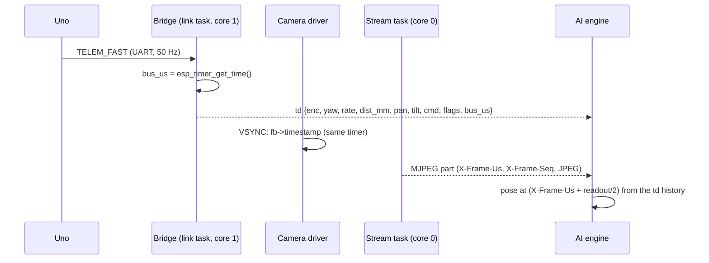

## 3. Data types (`domain/types.py`, frozen dataclasses)

| Type | Fields |
|---|---|
| `TelemSample` | `bus_us: int`, `uno_ms: int`, `enc_l: int`, `enc_r: int`, `yaw_deg: float`, `rate_dps: float`, `dist_mm: int \| None` (None = no echo / fault), `pan_deg: float`, `tilt_deg: float`, `cmd_l: int`, `cmd_r: int`, `flags: int` |
| `Frame` | `seq: int`, `cap_us: int` (VSYNC), `recv_s: float` (laptop monotonic), `jpeg: bytes`, `w: int`, `h: int` |
| `Pose` | `t_us: int`, `x_m: float`, `y_m: float`, `th_rad: float` (room frame: start = 0, 0, 0; x forward at start, y left, θ counter-clockwise — ROS REP 103 like the bridge's arcs) , `v_mps: float`, `w_rps: float` |
| `Detection` | `cls: str`, `score: float`, `box: tuple[float, float, float, float]` (pixels x1 y1 x2 y2), `track_id: int \| None` |
| `ObjectEstimate` | `oid: int`, `cls: str`, `x_m`, `y_m`, `vx`, `vy`, `cov: ndarray (4×4)`, `last_seen_us: int`, `state: Seen \| Remembered` |
| `PseudoScan` | `t_us`, `bearings_rad: ndarray`, `ranges_m: ndarray` (`inf` = nothing seen in that column) |
| `LocalMap` | `t_us`, `pose: Pose`, `grid: GridView` (origin, 5 cm, log-odds array, `known` mask), `objects: list[ObjectEstimate]`, `scan: PseudoScan \| None`, `frame_age_s`, `telem_age_s`, `stale: bool` |

## 4. Classes


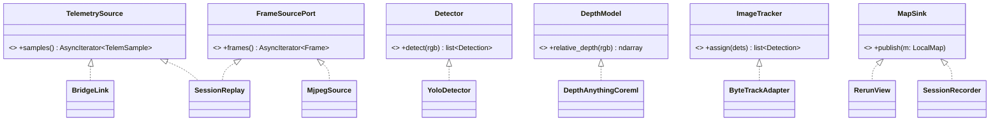

## 5. Algorithms

### 5.1 BridgeClock
Each ping: laptop send `t0`, receive `t1`, the pong's `bridge_us`. Keep the 8 samples with the smallest round trip `t1 − t0` from the last 60 s; offset = median of `bridge_us/1e6 − (t0 + t1)/2`. `to_local(bus_us)` = `bus_us/1e6 − offset`. Used for ages and latency only — pairing frames with poses uses bridge time directly.

### 5.2 PoseFilter (50 Hz, one `TelemSample` each)
> **Superseded by §14 (owner, 2026-10-23, design-notes §132):** the heading comes from the tank's corrected heading, not from our own bias estimate. The text below is the first design.
- State `x, y, θ, b` (gyro bias, °/s) and covariance `P`.
- **Predict:** `dt` from `bus_us`; distance `d = (Δenc_l + Δenc_r) / 2 / counts_per_m` (sign from `cmd` per side, since the encoders have one channel; `counts_per_m` from the bridge's `calib` reply); `θ += (rate − b)·dt`; `x += d·cos θ_mid`, `y += d·sin θ_mid`. Process noise grows with `|d|` and with `|rate|` (slip in turns).
- **Heading check (weak):** the encoder difference gives a turn estimate; used only when both tracks move the same way and slowly (no pivot), with a large variance — tracks slip.
- **Standstill:** both `Δenc` = 0 and `cmd` = 0 for > 0.3 s → measurement "rate − b = 0" with small variance: `b` is re-learned; `θ` frozen.
- Heading starts from the first sample's `yaw_deg` for the map's θ = 0; the Uno's own `yaw` is logged for comparison, not fused (it is the same gyro).
- `PoseHistory`: a ring of the last 2 s (100 poses); `at(t_us)` interpolates linearly (θ on the circle); outside the window → `None` (the frame is dropped).

### 5.3 CameraModel (pinhole + distortion)
- Camera pose in the room = tank pose ∘ mount (`cam_x_m`, `cam_y_m`, `cam_height_m`) ∘ pan (`pan_map(pan_deg)`) ∘ tilt (`tilt0_deg + tilt_map(tilt_deg)`).
- `pixel_to_floor(u, v)`: undistort → ray → intersect the plane z = 0; rays at or above the horizon → `None`.
- `expected_floor_depth()`: for every pixel, the distance along its ray to the floor (∞ above the horizon) — cached per (calibration, pan, tilt) because pan / tilt change rarely.
- `floor_mask()`: pixels whose expected floor depth is within 0.25–2.5 m (where the floor fit is trusted).
- `sees(x, y)`: the floor point projects inside the image and its expected depth ≤ 2.5 m (for "fade only in view" and the object look-check).

### 5.4 FrameGate
`capture_time = cap_us + readout_us / 2`; `accept` is false when `|rate| > gate_dps` (default 45 °/s, tuned in phase 0) or when the pose at `capture_time` is outside the history.

### 5.5 DepthScaler and FloorObstacles
- Depth Anything gives relative **inverse** depth `r` (larger = nearer). On floor pixels where `r` agrees with being floor, fit `1/d_expected ≈ a·r + c` by least squares, then re-fit on the 70 % with the smallest residuals (robust). `d_metric = 1 / (a·r + c)`. If fewer than 500 floor pixels or `a ≤ 0` → the frame's depth is **not used** for the grid (objects and sonar still are).
- Ultrasonic cross-check: the median metric depth in the image patch straight ahead vs `dist_mm` when it is valid and < 2 m; the ratio is logged (and shown) — a drift beyond ±20 % marks the frame's depth `doubtful` (not used for clearing).
- **Obstacle test:** pixel `p` is an obstacle when `d_metric(p) < d_expected(p) − max(0.05 m, 0.08·d_expected(p))`, its floor-projected height is 0.02–0.25 m (tank height), and it is within 2.0 m.
- **Pseudo-scan:** for every image column the nearest obstacle pixel → (bearing, range); columns with none → `inf` up to the floor-visible range.

### 5.6 SonarModel
- Beam: half-angle 12° (to confirm in phase 0); inner free cone half-angle 4°.
- Valid echo `d`: cells on the arc at `d ± 3 cm` within the beam → **occupied** (weight `+0.85`); cells in the inner cone with range `< d − 5 cm` → free (weight `−0.2`, low).
- `None` (no echo, fault) or ≥ 4 m → **no update at all**.

### 5.7 LocalGrid
- 60 × 60 cells of 5 cm, centred on the tank; `recenter` shifts the array by whole cells when the tank moves more than one cell (new cells unknown).
- Log-odds `L` per cell, clamped to ±4; occupied above `+0.85`, free below `−0.85`, unknown between; a `known` mask.
- Camera pseudo-scan: Bresenham ray from the camera's floor point to each column's obstacle: cells on the ray → `−0.4` up to `min(range, 3.0 m)`; the end cell → `+0.85` if `range ≤ 2.0 m`.
- **Fade** (`fade(in_view, dt)`): cells the camera sees now move toward 0 by `0.5·dt`; cells out of view keep their value for 10 s, then fade at `0.1·dt` (the blind zone keeps its memory).

### 5.8 ObjectTracker
> **Revised by §15 (owner, 2026-10-23, design-notes §134):** objects are matched in room positions; there is no image tracker (ByteTrack) unless replays show identity swaps.
- `ImageTracker` (ByteTrack) gives frame-to-frame IDs.
- Each detection's **floor contact** = the bottom-centre of the box → `pixel_to_floor` → room point (things not on the floor are rejected by class: only `person`, `sports ball`, `chair`, `cat`, `dog`, `backpack`, `bottle`, `cup`, `teddy bear`, … — a list in the config).
- One constant-velocity Kalman filter per object (`x, y, vx, vy`); matching: same image track ID first, else nearest of the same class within a 3σ gate.
- States:

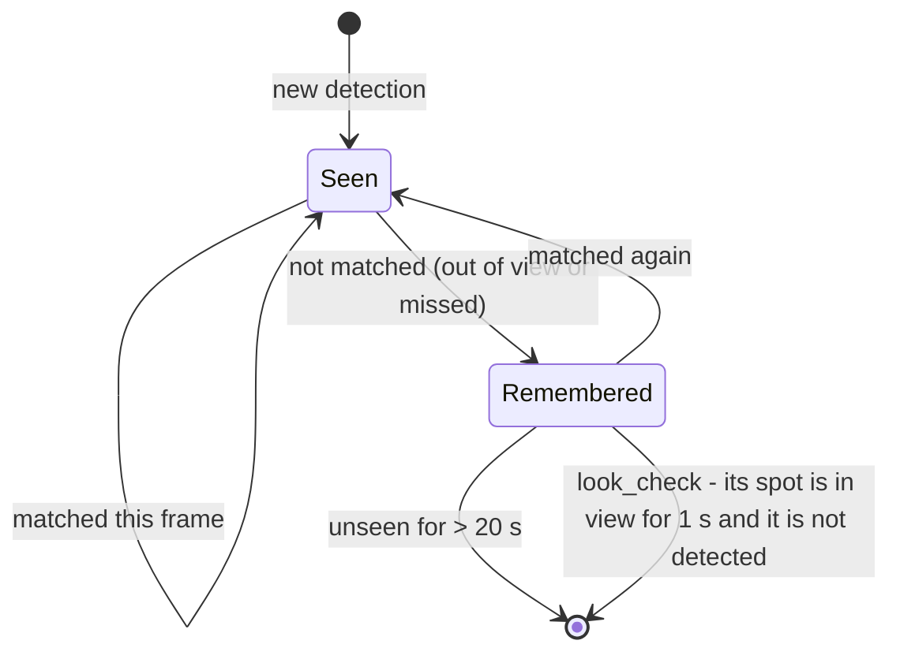

### 5.9 MapAssembler and the stale rule
`snapshot(now)`: frame age = `now − to_local(last accepted capture)`, telemetry age = `now − to_local(last bus_us)`; `stale = frame_age > 0.5 s or telem_age > 0.2 s`. Module 2 must stop on a stale map (its spec).

## 6. Concurrency (`app/map_service.py`)

```mermaid
sequenceDiagram
  participant BL as BridgeLink (task)
  participant FS as MjpegSource (task)
  participant W as Inference worker (1 thread)
  participant MA as MapAssembler (event loop)
  participant OUT as MapSink (Rerun / module 2)
  BL->>MA: TelemSample (50 Hz) -> PoseFilter, SonarModel, grid
  FS->>MA: newest Frame (older frames dropped)
  MA->>MA: FrameGate: capture pose ok and turn slow enough?
  MA->>W: decode + YOLO + depth (newest only; busy -> skip)
  W-->>MA: detections + relative depth
  MA->>MA: camera model, scaler, obstacles, grid, objects
  MA->>OUT: LocalMap (every frame processed, 10-20 Hz)
```
- One inference worker thread: YOLO and depth on the Neural Engine run one after the other (they share it); if the worker is busy when a new frame arrives, the frame waits as "newest" and older ones are dropped — **latest frame wins**, nothing queues.
- BridgeLink: `hello` (client `ai-map`), `debug {on:true, hz:50}`, a `calib` request at start (counts per metre), a ping every 1 s; reconnects with back-off; **sends nothing that moves the tank**.

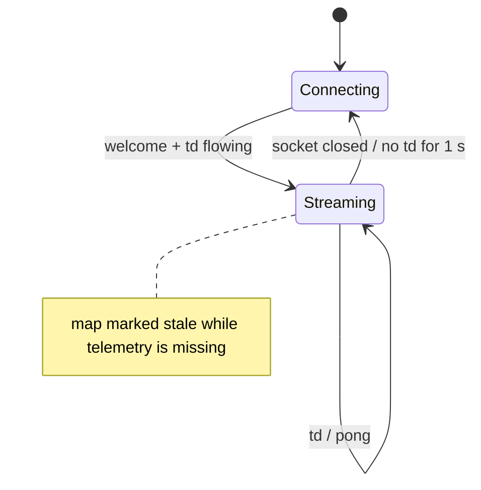

## 7. Config (`config/engine.yaml`, pydantic-settings)
`bridge.host`, `bridge.ws_port` 80, `bridge.stream_port` 81, `camera.size` (QVGA | VGA), `gate_dps` 45, `grid.size_m` 3.0, `grid.cell_m` 0.05, `grid.mark_max_m` 2.0, `grid.clear_max_m` 3.0, log-odds weights (§5.6–§5.7), `objects.classes`, `objects.forget_s` 20, `depth.every_n` 1 (2 if the M1 cannot keep 10 Hz), `stale.frame_s` 0.5, `stale.telem_s` 0.2.

## 8. Calibration tool (`uv run cq-calibrate`)
1. **Lens:** the tool shows the live stream; the owner holds a printed checkerboard (9 × 6, 25 mm) in ~20 poses; OpenCV `calibrateCamera` per frame size → `K`, `dist`, RMS error (accept < 0.5 px).
2. **Mount:** the owner types the measured camera height and position; the tool checks it on an empty floor with a tape-measured mark at 50 cm and 100 cm (the floor trick must hit within 2 cm) and adjusts `tilt0_deg`.
3. **Servos:** the tool moves pan / tilt to 3 positions each (through the bridge's camera command — the only command the tool sends; it never drives) and the owner aligns a mark → `pan_map`, `tilt_map` (linear).
4. **Readout:** from phase 0's measurement.
Writes `config/calibration.yaml` with the date and the frame size.

**Amended (owner, 2026-10-23, design-notes §123):**
- **Lens:** the checkerboard is shown full-screen on the laptop; the owner measures one square and types its size.
- **Mount:** adds a laser-level line on a wall at exactly the lens height. Its row in the picture is the horizon, so `tilt0_deg` = atan((row − cy) / fy) at the servo's centre. The floor marks then check it.
- **Frame size:** QVGA first.
- **Driving tilt:** a tilt study. For a few tilt values the tool reports the blind zone (the nearest floor point in view, from the tracks' front) and the farthest floor point in view, and the owner chooses.

**Settled by the final review of Plan Q2 (2026-10-23):**
- **The lens's fold:** past it, a pixel has no floor point and a floor point no pixel. With strong barrel distortion, the formula stops growing near the picture's corners. `pixel_to_floor` → None, depth → ∞, `sees` → False, so no map cell is faded from outside the real view.
- **The depth map is cached** per (calibration, pan, tilt).
- **The laser finder** answers only for one narrow peak: at most 20 px wide at a quarter of its height, and no second peak half as strong. The profile is smoothed first, so a burnt-out line with a red halo still counts. Otherwise None, never a wrong row.
- **Servo points are chosen from the current tilt0 and lens** so the line stays within 10-90 % of the picture. A missed point is skipped; at least 3 make the fit.
- **tilt0 is never counted twice:** the tilt fit's offset becomes `tilt0` (`tilt_map` offset 0), and the mount step stores `measured − tilt_map offset`.
- **Every picture must be 320 × 240**, else a plain refusal (set the camera to QVGA).
- **The camera is set to the centre again just before each picture**, because released servos may sag.
- **The tilt study** also reports the blind zone at the picture's bottom corner.
- **Plain messages and no hangs:**
  - no connection within 10 s;
  - a refused camera move (NOT_OWNER: release the phone's stick);
  - the picture window closed;
  - Ctrl-C at a prompt.
- **A failed floor-mark check asks before saving.**

**Amended (owner, 2026-10-23, design-notes §130) — the servo step without an exact laser height (approved: owner chose native; built as Plan T, see "As built" below):**
- **Why:** the owner has no stand to put the laser line exactly at lens height. A gain only uses the change between pictures, so a line a few cm off lens height (or not straight ahead) gives the right gain. Only the offset would be wrong, and the offset comes from elsewhere: tilt0 from the mount step or the tape marks, the pan centre from the Uno's camera centre (Uno Lite LLD §22).
- **A line of any colour** (`laser_row` / `laser_col`):
  - three measures: redness R − max(G, B), greenness G − max(R, B), and brightness (mean of R, G, B), for a line burnt out to near-white like the owner's green laser;
  - each measure must pass the same rules on its own: at least `MIN_LINE_SCORE`, at most 20 px wide at a quarter height, no second peak half as strong;
  - the strongest one that passes wins.
- **Servo points follow the line:**
  - `tilt_points(cal, line_deg)` / `pan_points(cal, line_deg)` take where the line looks at command 0 (from a first picture at the centre), so it stays within 10–90 % of the picture.
  - Without `line_deg`: as before (a line at lens height / straight ahead).
- **Both ways, gains only** (`servo_tilt`, `servo_pan`):
  - a prompt first: "the horizontal line … roughly at the lens height (±5 cm)" / "the vertical line … roughly straight ahead";
  - a sweep down from just above the top point (every point reached from above or the right), then back up;
  - a straight-line fit per direction. **gain** = the mean of the two; **slack** = half the gap between their offsets, printed.
  - Saved: `tilt_map` = (gain, 0) with **tilt0 kept**; `pan_map` = (gain, 0) (the Uno's centre).
  - Fewer than 3 points in either direction → a plain refusal. So is no line in the first picture.

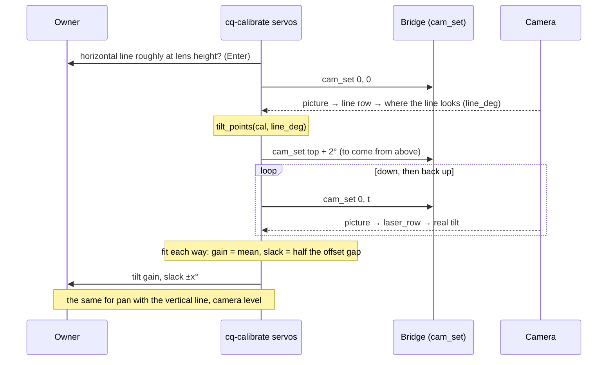

**As built (Plan T, 2026-10-23; design-notes §131), with the final review's fixes:**
- **The finder's background is local:** a grey opening 41 px wide (`BASELINE_PX`), not one median for the whole profile. The floor filling most of the picture at low tilts, a wall, or any step is background; only peaks narrower than 41 px stand out. The width rule (≤ 20 px) and the second-peak rule still apply.
- **Brightness is not smoothed;** the colours are, over 5 px. A 1-px burnt-out core keeps its full height.
- **Never a wrong line:**
  - measures that find lines more than 3 px apart give no answer (`AGREE_PX`);
  - in the sweep, a picture more than 1.5° off its way's straight line ends the step with a plain refusal (`MAX_FIT_ERROR_DEG`): "something else bright or red in the picture?".
- **Both ways use every point:** a move to just above the top before the way down, and a dip to just below the lowest before the way up. At a servo limit with no room, the point next to it is left out of that way.
- **Slack:** measured at the middle of the points and printed with its direction ("lands 0.8 deg higher arriving from above").
- **Gains only:** the maps keep their existing offsets (0 in today's file), and tilt0 is kept. The camera returns to the centre afterwards, also on a refusal.
- **Accepted:** averaging over the middle half of the picture lets the lens's leftover distortion move the gain by about 0.5 % (tilt) / 0.2 % (pan), against a 6–9 % effect.
- **Not run on the tank** (owner: the calibration is done, §130). The tool's maths matches the session script that measured 0.91 / 0.94.
- **Tests:** AI engine 83/83.

## 9. Recording and replay
- **Session folder** `recordings/<date-time>/`: `telemetry.jsonl` (raw `td` / `pong` lines with the laptop receive time), `frames.bin` (per frame: a JSON header line `{seq, cap_us, recv_s, len}` then the JPEG), `session.json` (calibration copy, engine config, bridge build), and a Rerun `.rrd` of the map outputs.
- `SessionReplay` implements both sources from a folder, at recorded speed or as fast as possible; the pipeline is the same, so replays are deterministic (one worker, frames processed in order).
- Recordings stay on the laptop (they show the home); `recordings/` is git-ignored.

## 10. Tests (spec §8)
| Test file | Covers |
|---|---|
| `test_clock.py` | offset from min-round-trip pairs; jitter; ages |
| `test_pose.py` | straight 1 m; 90° turn; slip (encoders move, gyro does not → little heading change); standstill bias re-learn; history interpolation; out-of-window → None |
| `test_camera.py` | pixel ↔ floor round trip; horizon → None; expected floor depth vs analytic; pan / tilt; `sees` |
| `test_gate.py` | capture time = VSYNC + readout/2; turn-rate gate |
| `test_depth.py` | synthetic scene (floor + box): scale fit recovers a known `a, c`; too few floor pixels → unused; obstacle mask and pseudo-scan ranges within 2 cm |
| `test_sonar.py` | arc marked; inner cone freed; **no echo never frees**; ≥ 4 m ignored |
| `test_grid.py` | ray clearing to 3 m, marking to 2 m; fade only in view; blind-zone memory 10 s; recenter keeps cells |
| `test_objects.py` | floor contact → room point; out of view → Remembered; back → Seen with the same id; expiry 20 s; look-check removal |
| `test_localmap.py` | stale rule; snapshot contents |
| `test_replay.py` | a short committed synthetic session replays to the same map twice |
| bridge (C++) | `td` / `tf` with `bus_us`, `pong` with `bridge_us`, the MJPEG part header with `X-Frame-Us` / `X-Frame-Seq` |

## 11. Phase 0 tools (measurement, throwaway: `tools/measure/`, kept only as scripts + results)
`latency.py` (a millisecond clock on the screen filmed by the tank → frame age; frames per second per size), `ne_budget.py` (YOLO + depth together on the M1, frames per second), `depth_tape.py` (depth vs tape at 0.3 / 0.6 / 1 / 2 m on wood and rug), `sonar_fabric.py` (no-echo rate on fabric and angled walls), `gyro_drift.py` (bias at rest per minute). Results go to design-notes; the numbers set `gate_dps`, `readout_us`, `camera.size`, `depth.every_n` and confirm or adjust spec 7 §7.

## 12. As built (Plan Q1, 2026-10-20; design-notes §110)
- **Files:** `ai-engine/` (Python 3.12, uv): `domain/{types, telemetry, clock, mjpeg, http}.py` (pure), `adapters/{bridge_ws, mjpeg_source, session, rerun_view}.py`, `app/{record, replay}.py` (`cq-record`, `cq-replay`); tests `tests/{test_domain, test_record}.py` with `tests/fake_bridge.py` (a stand-in bridge speaking the real wire: chunked MJPEG with `X-Frame-Us`, `td` with `bus_us`, `pong` with `bridge_us`). 26 tests.
- **As designed (§2-§3, §5.1, §6, §9),** with these additions:
  - the camera stream is HTTP **chunked** — `domain/http.Dechunker` removes it before the part parser (found by the final review: every picture would have been broken);
  - parts over 2 MB or with a non-ASCII length are skipped; the reader resyncs to the next part;
  - **a new or dropped WebSocket connection forgets the clock**, and `app/record.Ages` drops it the moment a picture's capture time jumps back by more than 1 s (a restarted bridge — found on the tank: the camera came back 1.5 s before the WebSocket, ages of 12.7 s); ages outside 0-5 s are "unknown";
  - a link with no telemetry for 3 s is opened again (watchdog); helper tasks are gathered after a drop;
  - saving and drawing run in a worker thread (batches taken on the event loop); replay merges the two in-order files lazily; Ctrl-C (a signal handler) ends a recording cleanly with its summary.
- **On the tank (owner, 2026-10-20):** standing: 13.8 pictures/s, 50 telemetry/s, every picture a whole JPEG, picture age (engine clock) median 96 ms (91-172); driving (the phone also viewing): **8.2 pictures/s**; across a bridge restart: recording rides through, max age 336 ms after the fix.
- **For the map plans:** the Uno's GyroZeroLite already re-learns the gyro bias at rest and holds the heading (Plan Q0) — the pose filter's own bias state (§5.2) is optional. `cq-record`'s live view spawns the Rerun viewer, which keeps the terminal's output pipe open until the viewer window is closed (`--no-view` for scripted runs).

## 13. As built (Plan Q2, 2026-10-23; design-notes §127)
- **Files:**
  - pure: `domain/camera.py` (`Calibration`, `CameraModel`, `from_servo`), `domain/calib_math.py` (laser finder, horizon, linear fit, floor-mark error, servo points, `tilt_study`);
  - adapters: `adapters/calibration_store.py` (YAML), `adapters/lens_opencv.py` (checkerboard picture, corners, `calibrateCamera`), `BridgeLink.cam_set` in `adapters/bridge_ws.py` (`CommandRefused` on a nack);
  - app: `app/calibrate.py` → `cq-calibrate lens | mount | servos | study`;
  - tests: `test_camera`, `test_calib_math`, `test_calibration_files`, `test_calibrate_tool`, `test_cam_set` — 66 tests in all with Q1's.
  - Packages added: opencv-python 4.11, pyyaml.
- **As designed (§5.3, §8 with its amendments),** plus:
  - **undistortion by Newton's method:** a radial Newton step, then a 2-D Newton step for the small tangential part, then a back-check of 1e-7. The tank session found that the first fixed-point iteration did not settle at the picture's corners for the real lens (k3 0.251), so the tilt study's corner column came out empty;
  - the checkerboard picture creates its folder (`cv2.imwrite` fails silently otherwise).
- **The saved calibration (`ai-engine/config/calibration.yaml`, QVGA 320 × 240):**
  - lens fx 182.55, fy 181.84, cx 157.42, cy 118.26 (about 82° across), distortion (−0.0914, −0.0315, 0.0011, −0.0015, 0.2511);
  - mount: lens 17.8 cm high, 8.5 cm ahead of the centre, on the centre line, tracks' front 13 cm; `tilt0_deg` −0.15;
  - servos: `pan_map` (1, −5) by eye, `tilt_map` (1, 0) — **the laser servo step is still to do** (no laser level yet). **Since Plan S (design-notes §129) `pan_map` is (1, 0):** the Uno's saved camera centre carries the 5°, and telemetry reports the true centre as 90°; **Since design-notes §130: `tilt_map` (0.91, 0), `pan_map` (0.94, 0)** from a laser cross-line sweep (gains only; slack ±0.8° tilt / ±0.4° pan, open for module 2);
  - `readout_us` 0.
  - How each number was measured: design-notes §127.
- **Driving tilt:** 15° down (design-notes §126).
- **Picture size:** the tool needs QVGA (`{"t":"camera_set","size":"QVGA"}`, upper case). Set the camera back to the usual VGA after a session.

## 14. PoseFilter, revision 2 (owner, 2026-10-23, design-notes §132 — approved 2026-10-23; replaces §5.2)

### 14.0 Why it changed
§5.2 was written before three things existed:
- **the Uno re-learns the gyro bias** whenever the tank stands still (GyroZeroLite, Plan Q0);
- **the bridge applies the gyro scale** ×1.031 (`gyro_scale` 10310, bridge LLD R19) to the heading in `tf` / `td`;
- **`counts_per_m` 7514** is calibrated and saved on the bridge (Plan K, the O wizard).

A second bias estimate in the engine, on the same gyro, would fight the Uno's. So the filter takes the corrected heading as it comes and adds the distance from the encoders.

### 14.1 What it does (50 Hz, one `TelemSample` each)
1. **Heading:**
   - `td.yaw` (0…360°, corrected) is unwrapped: each step adds the shortest signed difference to the last value.
   - The room's θ = 0 is the first sample's heading. θ is counter-clockwise (+ = left), the room frame of §3.
   - `yaw` is counter-clockwise positive (protocol spec 01: TELEM_FAST `yaw` "CCW positive"; `turn by` + = left), the same sense as θ, so θ = unwrapped yaw − the start's yaw. It's checked on the floor too, turning left → θ grows.
2. **Distance per track:**
   - Δcount = the count's change since the last sample. Counts only go up (one channel per encoder).
   - Its sign comes from that track's **PWM output** (`td.pwm`): + forward, − back. It's the **previous sample's** output, because a sample's count change happened during the 20 ms before it (found while drafting the plan: with the new sample's sign, every change of direction lost a step).
   - With the PWM at 0 while the track still coasts, the **last non-zero sign** is kept.
3. **Stall:** if `STALL_L` or `STALL_R` (FastFlagBit 3 / 4) is set, that track adds nothing; spinning tracks don't move the tank.
4. **Step:**
   - d = (Δl + Δr) / 2 / `counts_per_m`;
   - θ_mid = the mean of the previous and the new θ;
   - x += d·cos θ_mid, y += d·sin θ_mid.
   - A pivot gives d ≈ 0.
5. **Speed:**
   - v = d / dt, smoothed over the last 0.2 s;
   - ω from `td.rate` (°/s → rad/s, + = left).
6. **Uncertainty** (`drift_m`, `drift_deg`): grows by 3 % of |d| and by 1° per 360° turned. It's reported, not fused, until a second position source exists (wall markers, later).
7. **Restarts:**
   - **The Uno's clock goes back** (`uno_ms` smaller than before): its counts and its heading started again. Keep x, y, θ, and re-anchor the count baselines and the heading offset to the new sample. The pose does not jump.
   - **The bridge or the link restarts** (`bus_us` goes back, or the first sample after a reconnect): the same re-anchor, without a step.
   - **A gap over 0.5 s:** no step across it, and `drift_m` grows by that gap's worst case (0.3 m/s × gap).
8. **`counts_per_m`** comes from the bridge's `calib` reply (`{"t":"calib"}` → `"counts_per_m"`), asked for on connect. Until it arrives there's no distance (the pose holds x, y).

### 14.2 Classes
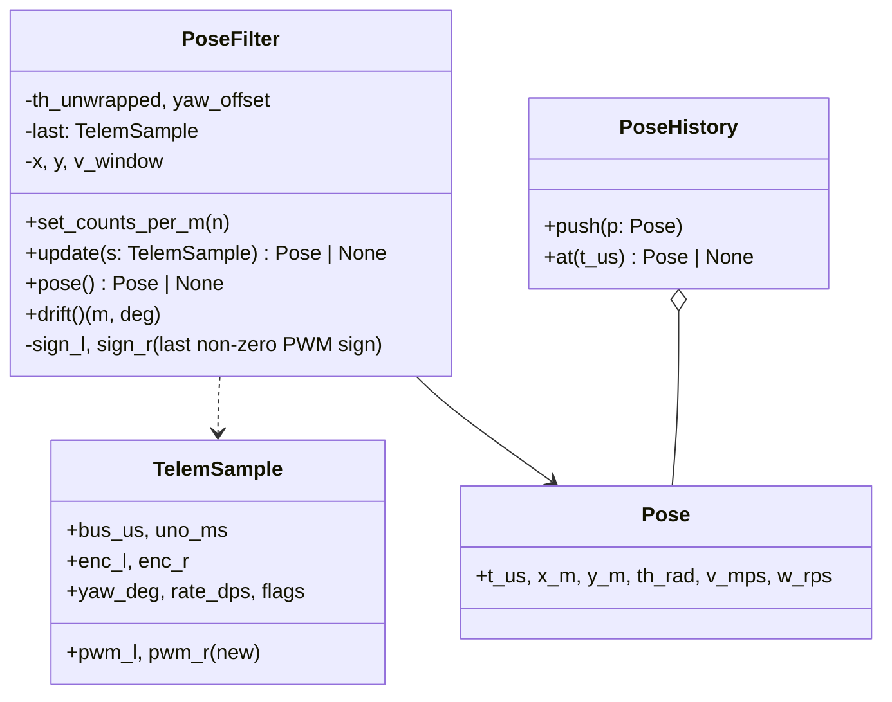
- `PoseHistory`: a ring of the last 2 s (100 poses). `at(t_us)` interpolates linearly, θ on the circle; outside the window → `None` (as §5.2).
- **Parser:** `parse_td` also reads `pwm` into `pwm_l` / `pwm_r`. The recordings from Plan Q1 already carry `pwm`.

### 14.3 One sample
```mermaid
sequenceDiagram
  participant B as BridgeLink / Replay
  participant F as PoseFilter
  participant H as PoseHistory
  B->>F: update(td sample)
  alt first sample, or uno_ms / bus_us went back
    F->>F: re-anchor counts and heading offset (no step)
  else gap > 0.5 s
    F->>F: re-anchor; drift += 0.3 m/s x gap
  else normal
    F->>F: θ = unwrap(yaw) - offset
    F->>F: Δl, Δr with the PWM sign (last sign while coasting; 0 if stalled)
    F->>F: x, y += d at θ_mid; v, ω; drift grows
  end
  F->>H: push(pose)
```

### 14.4 Tests (`tests/test_pose.py`)
- straight 1 m (7514 counts on each track, PWM +) → x 1.000, y 0;
- backwards (PWM −) → x −1;
- a 90° left turn while driving → θ +90°, the path bends left;
- pivot (PWM + / −, equal counts) → d 0;
- coasting (PWM 0 after +, counts still rising) → the distance is still forward;
- a stalled track adds nothing;
- heading across 359° → 1°: θ +2°, no jump;
- Uno restart (`uno_ms` back, counts and yaw from 0) → x, y, θ unchanged, then continues;
- a 1 s gap → no step, drift grows;
- no `counts_per_m` yet → x, y held;
- drift: 5 m driven → 0.15 m;
- `PoseHistory`: interpolation, θ across ±180°, outside the window → None;
- the parser reads `pwm`.

### 14.5 On the floor (owner present, the phone or Logo drives; the engine only records)
- Record a Logo 50 cm square and a 2 m out-and-back with `cq-record`, then replay them through the filter.
- Compare the pose's end to the tape: the square's end against its start; the out-and-back's far point at 2.00 m.
- Targets (Spec 7 §7): ≤ 3 % of the distance; ≤ 3° per 360° turned.

### 14.6 As built (Plan U, 2026-10-23; design-notes §133)
- **Files:**
  - `domain/pose.py` (`PoseFilter`, `PoseHistory`);
  - `TelemSample.pwm_l` / `pwm_r` read by `parse_td`;
  - `app/pose_replay.py` → **`cq-pose <recording>`**, which prints the end position and heading, the end's distance from the start, the farthest point, the distance driven, the degrees turned, and how far off it could be;
  - tests `test_pose.py` (22), `test_pose_replay.py` (5). AI engine 110 tests.
- **As designed, plus what drafting and the final review changed:**
  - **The encoder sign is the previous sample's PWM** (a sample's counts happened in the 20 ms before it). With the new sample's sign, every change of direction lost a step.
  - **A gap over 0.5 s keeps the turn made in it.** The heading is absolute within one Uno run, so θ takes the wrapped yaw change; only the distance is unknown (drift += 0.3 m/s × gap). If |rate| × gap > 180°, the wrap could hide a whole turn, so `drift_deg` += 360. This **replaces §14.1.7's "re-anchor" for gaps**; restarts still re-anchor.
  - **A bridge restart** (`bus_us` back) clears the speed window and `PoseHistory`, because their old stamps were from another clock.
  - **`Pose.th_rad` is always within −π…π;** the total turning lives in the drift and in `cq-pose`'s "turned".
  - `counts_per_m` ≤ 0 is ignored.
  - `cq-pose` takes the recording's `calib` reply for the whole session, even when it came after the first samples.
- **Known limit (one-channel encoders):** pushing the tank by hand after a stop counts in the last motor direction.
- **Floor check (§14.5): passed 2026-10-24** (design-notes §144). Each run was recorded with `cq-record`, replayed with `cq-pose` and compared with the owner's tape and eye:

  | Run | `cq-pose` end | Tape end | Pose vs tape | Target |
  |---|---|---|---|---|
  | Logo 50 cm square (2.0 m driven) | 2.0 cm right, +0.6° | 6 cm right, about −2° | 4 cm, ~2.6° | 6 cm (3 %), 3° |
  | `FORWARD 200 RIGHT 180 FORWARD 200` (4.0 m) | 0.5 cm left, 179.9° | 5 cm left, about 178° | 4.5 cm, ~2° | 12 cm (3 %), 3° |

## 15. Phase 4: the detector and the object tracker (owner, 2026-10-23, design-notes §134 — approved 2026-10-23)

### 15.0 What it does
For each picture the engine finds things (a person, a ball, a chair, a cat, …) and works out where each one stands in the room. It keeps a list of them: what, where, how sure, last seen.
- Things stay on the list when the camera looks away (Spec 7 §7: a ball for ≥ 10 s).
- They drop off after `forget_s` (20 s) unseen, or when the camera looks at their spot for 1 s and they're not there.
- The drive module and later Logo words read the list. Phase 4 only shows it (live view) and prints it (replay).
- It never drives.

### 15.1 The detector (`Detector` port, `YoloCoreml` adapter)
- **The model:** `ai-engine/models/yolo26n-320.mlpackage` (git-ignored, about 5 MB, AGPL). It's made once by `tools/measure/export_yolo.py`, whose environment has Ultralytics + torch 2.7, writing into `ai-engine/models/`. The engine needs only **coremltools + Pillow** at run time.
  - With no model file, a plain refusal: "no detector model - run tools/measure/export_yolo.py".
- **In:** the decoded QVGA picture (320 × 240 RGB), **letterboxed** to 320 × 320: 40 rows of grey (114) above and below, as Ultralytics does. Passed as a PIL image to the model's `image` input, with compute units ALL (Neural Engine).
- **Out:** `[1, 300, 6]` = x1, y1, x2, y2, score, class, in the 320 × 320 input's pixels (end-to-end, no NMS needed).
  - Kept: score ≥ `CONF` (0.35).
  - Boxes moved back to the picture (y − 40), clamped to 320 × 240.
  - The class index → name from the model's `names` metadata.
- **`Detection(cls, score, box)`** (LLD §3; `track_id` unused).
- **Tests** use a `FakeDetector` (boxes given by the test). The adapter has one test that runs only when the model file exists (skipped otherwise), on a synthetic picture: it returns a list and the boxes lie inside the picture.

### 15.2 Which pictures are used (`FrameGate`, `CameraAngles`)
- **Capture time** t = `X-Frame-Us` + `readout_us` / 2 (0 until measured; Calibration).
- **The pose at t** from `PoseHistory.at(t)`. If it's None (no pose yet, or older than 2 s), the picture is skipped.
- **`CameraAngles`:** the last 2 s of (`bus_us`, `pan`, `tilt`, `flags`) from `td`. `at(t)` gives the nearest sample within 40 ms, else None (skipped).
- **Skipped while:**
  - the tank turns faster than `GATE_DPS` (45°/s, `|pose.w|`), because of blur;
  - the camera itself moves (FastFlagBit **CAM_MOVING**, bit 5).
- **The camera model for the picture:** `CameraModel(cal).for_frame(pose, *from_servo(pan, tilt))`.
- Every skip is counted with its reason (shown in the replay summary).

### 15.3 Where a thing is (`ObjectLocator`, the floor trick)
- **Only floor classes** (`FLOOR_CLASSES`): person, cat, dog, sports ball, teddy bear, chair, couch, backpack, suitcase, potted plant.
  - Things that sit on tables (cup, bottle, laptop, …) would get a wrong position and are ignored.
- **Contact pixel** = the box's bottom middle (u = (x1 + x2) / 2, v = y2) → `pixel_to_floor(u, v)` → the room point (x, y).
- **The box touches the picture's bottom edge** (y2 ≥ 238): the thing is cut off, too near or partly in the blind zone. It's listed as **near** with its direction only (the room bearing of the box's centre ray, from `pixel_ray`), not tracked.
- **Not on the floor in view** (the contact pixel above the horizon, `pixel_to_floor` → None) or **farther than `MAX_RANGE_M`** (4 m): ignored.
- **Measurement noise** σ(d) = 0.02 m + 0.03 m × d² (d = the distance from the camera), matching Spec 7 §7: ≈ 5 cm at 1 m, ≈ 14 cm at 2 m.

### 15.4 The list (`ObjectTracker`)
- One constant-velocity Kalman filter per thing: state (x, y, vx, vy); process noise from an acceleration σ of 1 m/s².
- **Each used picture:**
  1. Predict every thing to t.
  2. **Match** each located detection to a thing of the same class, by the smallest Mahalanobis distance d² ≤ 9.21 (the 99 % gate for 2 numbers). Greedy, smallest first; each thing and each detection is used once.
  3. Matched → update, state **Seen**, `last_seen_us` = t.
  4. An unmatched detection → a new thing (a new `oid`), Seen.
  5. An unmatched thing whose spot the camera sees now (`cam.sees(x, y)`): it should have been seen. After **1 s** of that it's dropped (the look check). Otherwise it's **Remembered**.
- **Remembered:** its velocity fades with a 1 s time constant, because the thing has probably stopped and we don't follow it out of view. Its uncertainty grows. It's dropped after `FORGET_S` (20 s) unseen.

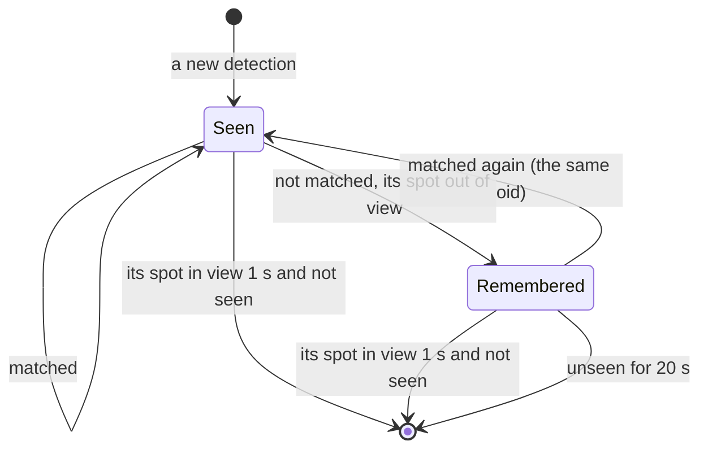

- **`ObjectEstimate(oid, cls, x_m, y_m, vx, vy, cov, last_seen_us, state)`** (LLD §3).
- **Near** things (§15.3) are a separate list: (cls, bearing, t).

### 15.5 Classes
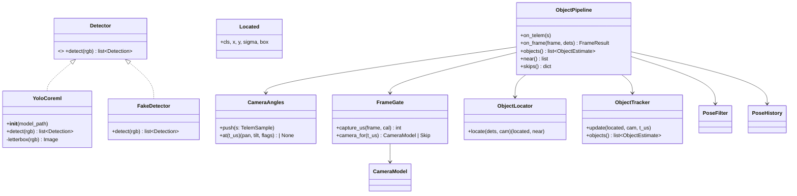
- **Files:** `domain/objects.py` (CameraAngles, FrameGate, ObjectLocator, ObjectTracker, ObjectPipeline, all pure), `adapters/yolo_coreml.py`, `app/objects.py` (`cq-objects`).
- **`ObjectPipeline` is pure:** the detector is called outside it, in the worker thread, and its result is handed in.

### 15.6 Running it (`cq-objects`)
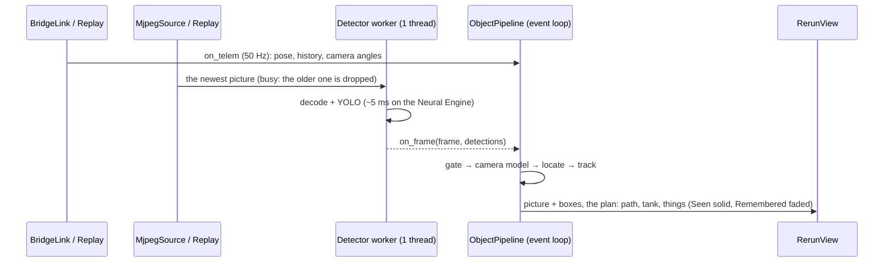
- **`cq-objects --live`:** connects to the tank and shows the live view.
- **`cq-objects <recording>`:** replays a session. In replay every picture is used, in order (no dropping), so the result is the same each time. It prints each thing found (oid, class, first and last seen, last position) and the skips.
- **Latest picture wins (live):** while the worker is busy, only the newest picture waits; nothing queues (LLD §6).

### 15.7 Tests
- **`test_objects.py`** (no model, no tank):
  - the floor trick against the camera model (a box whose contact pixel is the projection of a known floor point → that point);
  - a cut box → near, with the right bearing;
  - above the horizon / beyond 4 m → ignored; a cup → ignored;
  - σ(d);
  - gate skips: no pose, the turn rate, CAM_MOVING, no camera angles;
  - tracking: one ball seen in 10 pictures → one thing, near its true spot; two balls → two things; a person walking → one thing with its velocity;
  - leaving the view → Remembered, back → Seen with the same oid; Remembered 20 s → dropped; its spot in view 1 s with no detection → dropped;
  - pipeline replay is deterministic (twice the same).
- **`test_yolo_coreml.py`:** letterbox and box mapping (pure parts). The model run is skipped without the file.
- **`test_objects_app.py`:** `cq-objects <recording>` on a synthetic session with a fake detector prints the expected thing.

### 15.8 On the floor (owner present; the phone drives slowly or the tank stands; the engine only watches)
- **Distance:** a ball on tape marks at 50 cm, 1 m and 2 m ahead of the lens, the tank standing still. Targets (Spec 7 §7): within 5 cm up to 1 m, within 15 cm at 2 m.
- **Memory:** the ball at 1 m. Turn the camera (or the tank) away for 12 s, then back. The ball must stay listed (Remembered) and come back as the same thing.
- **A person** walking across the view: one thing, which follows.

### 15.9 As built (Plan V, 2026-10-23..24; design-notes §151)
- **Files:**
  - `domain/objects.py`: `CameraAngles`, `FrameGate`, `ObjectLocator`, `ObjectTracker`, `ObjectPipeline`;
  - `adapters/yolo_coreml.py`: `YoloCoreml`, `CONF` 0.35, letterbox to 320;
  - `app/objects.py`: `cq-objects`, replay and `--live`;
  - `tools/measure/export_yolo.py`: the model is git-ignored in `ai-engine/models/`.
  - AI engine 142 tests; ruff, format and pyright clean.
- **Changed by the final review** (no Critical):
  - **remembered things:** their uncertainty fades in through F, with a 5 cm/s position walk, σ capped at 0.5 m, and ranking by d² + ln det S;
  - **the camera-moving skip:** also on the Uno Lite (`rate_dps` > 20°/s);
  - **confirmation:** 3 hits within 0.5 s; one missed new thing is dropped;
  - **the look check:** reaches `MAX_RANGE_M` (4 m);
  - **`CUT_ROWS`:** 6;
  - **a clock going back** starts the list again.
- **Class-diagram details (review M8):** `ObjectEstimate` carries `sigma_m` (the larger axis of the position's standard deviation) and `first_seen_us` beside `last_seen_us`. "From the start" in `cq-objects`' report is the room origin, the tank's centre at the start of the recording (M9).
- **The mount tilt `tilt0` +2.55°** was fitted at the driving tilt, arriving from above, from a floor object at 50 cm and 1 m: it read 49.6 / 99.9 cm. Before that it was −0.15°.
- **On the floor (Task 4), the code works but the detector is weak from 18 cm:**
  - **The floor trick:** a person at 1 m was placed 99.5 cm from the lens.
  - **Detection scores:**
    - the owner's plush is "fire hydrant" 0.77–0.92 near;
    - a person at 1 m scores median 0.0–0.08 in a dark room;
    - an office chair at ~2.8 m scores 0.09;
    - a green patterned ball at 1–3 m isn't found, even doubled in size.
  - **The adapter is right:** on standard pictures (Ultralytics bus / zidane, COCO 139 / 39769) it finds a chair 0.75, a TV 0.89, cats 0.79, a bus and people 0.81–0.94, even shrunk to 320 × 240. The pictures are the problem: things are small and pale, and seen from floor level.
- **Owner (2026-10-24): "go with what we have"** — YOLO26n (COCO) stays. Floor-level naming is a later design (design-notes §151): a detector trained on the tank's own pictures, or YOLO-World; obstacles from the floor plane + depth + sonar.
- **Not checked on the tank:** the memory test (a thing kept while the camera looks away; host tests only), a person walking across, and `--live` (review M5).

## 16. What spots things: YOLO-World and a colour ball finder (owner, 2026-10-24, design-notes §152 — approved 2026-10-24: "write")

### 16.0 Why
- From 18 cm, YOLO26n (COCO) is too unsure to list things (§15.9, design-notes §151–§152):
  - the chair scores 0.09;
  - the ball at most 0.37 even with twice the pixels;
  - a 120 px bottle stays under 0.25.
- **YOLO-World**, asked by name, found the same chair in 20 of 20 pictures (0.82), and "green ball" on the ball in 8 of 20 (≤ 0.36).
- **A plain colour finder** found the ball in 187 of 194 pictures, steady to ±1.6 px, and placed it 97 cm from the lens (owner ~1 m), in 1.1 ms.
- **This section replaces the detector under §15. The rest of §15 doesn't change:** the gate, the floor trick, the tracker and `cq-objects`.

### 16.1 What changes
1. **`YoloWorld`** (adapter, the `Detector` port of §15.1) replaces `YoloCoreml`.
   - **The model:** `ai-engine/models/yoloworld-s-640.mlpackage` (git-ignored, GPL-3.0).
     - It's made by `tools/measure/export_world.py`, which loads `yolov8s-worldv2.pt`, calls `set_classes(<the words>)`, and exports CoreML at 640.
     - The words are baked into the model (YOLO-World's "offline vocabulary"), so each picture runs only the detector.
     - A model made for other words is refused: its baked-in names must equal the vocabulary file's, in order.
   - **In:** the VGA picture, letterboxed to 640 × 640 the same way as §15.1.
   - **Out:** `Detection(cls, score, box)` for each box at or above its word's own threshold.
2. **`config/vocabulary.yaml`**, the words: a list of `{word, floor, min_score}`.
   - `floor: true` marks things that stand on the floor, which replaces the hard-coded `FLOOR_CLASSES`.
   - `min_score` is 0.25 unless set.
   - **Starting list:** person, chair, table, bed, sofa, door, bottle, shoe, box, toy. All `floor: true`, except door (`false`: it's in the wall).
   - **Changing the words:** edit the file, then run `export_world.py`, about a minute. `cq-objects` refuses a model whose words differ ("re-export: the words changed").
3. **`ColourBallFinder`** (adapter, also a `Detector`) finds round blobs of known colours below the horizon.
   - **Each ball** in `config/balls.yaml`: `{name, h: [lo, hi], s_min, v_max, r_min_px}`. For example, green: `h [45, 90]`, `s_min 65`, `v_max 200`, `r_min_px 6` (design-notes §152).
   - **Per picture:**
     - blur 5 × 5;
     - an HSV mask per ball, with rows above the horizon cleared (the horizon row comes from the camera model of that picture);
     - open 3 × 3;
     - the largest contour with roundness `area / (π r²)` ≥ 0.55 and `r ≥ r_min_px`.
   - **Out:** `Detection("ball:<name>", score = min(1, roundness × 1.4), box = the enclosing circle's square)`. The floor trick uses the box's bottom, as for any thing.
   - **No ball** gives no detection, and never a guess.
4. **`MultiDetector`** (domain) runs the two detectors on the same picture and joins their lists. That one list goes to the tracker, so a ball can come from either.
   - A YOLO-World "ball" box that overlaps a colour ball's box (IoU ≥ 0.5) is dropped, so one ball is one thing. The colour finder wins, because it's steadier.
5. **`cq-calibrate ball <name>`:** you put the ball about 1 m ahead in the middle of the view. It records 3 s, takes the most saturated round blob below the horizon, and writes its range to `balls.yaml`:
   - hue p5–p95 widened by 5;
   - `s_min` = p10 − 10;
   - `v_max` = p90 + 15.
6. **VGA:**
   - `calibration_store.load(path, (640, 480))` scales the QVGA file: the lens matrix `k` (fx, fy, cx, cy) × 2, distortion unchanged. This assumes the same field of view at both sizes, so the file says `size: [320, 240]` and VGA is derived.
   - **One check on the tank:** a checkerboard picture at VGA, whose corners must land within 1 px of the scaled model.
   - The gate's picture-size skip (§15.2) expects 640 × 480.
7. **Camera setting B** (brightness −1, contrast +2, low light on, white balance "sunny") is the setting the colour ranges were measured at. `cq-objects` prints a warning when the tank's camera block differs.

### 16.2 Classes
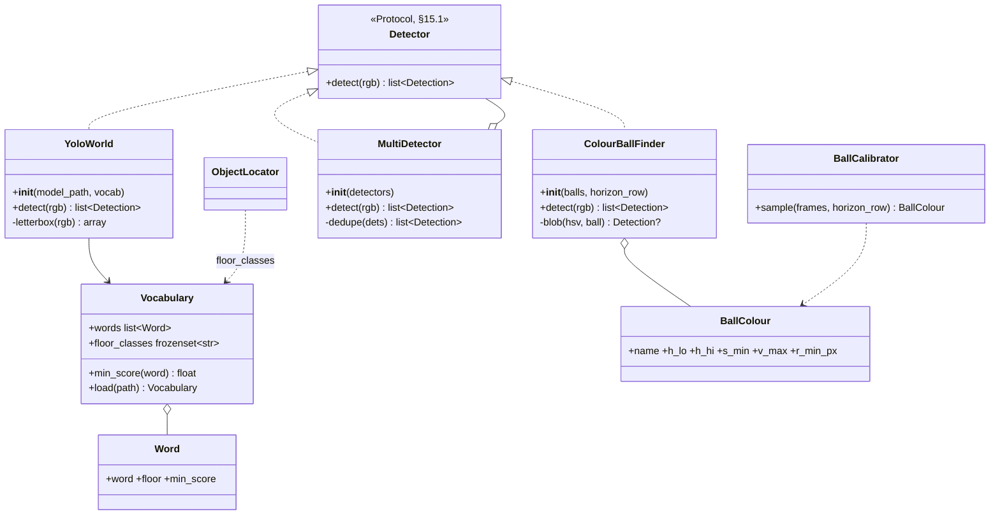
- **Pure (domain, host-tested):** `MultiDetector`, `Vocabulary`, `BallColour`, and the blob step of `ColourBallFinder` (OpenCV on arrays; no files, no clock).
- **Adapters:** `YoloWorld` (CoreML), the YAML loaders, `BallCalibrator`'s recording.
- **`horizon_row`** is a function of the picture's camera angles. `ObjectPipeline` hands the finder the row from that picture's `CameraModel`, so the finder never looks at the ceiling. When the horizon is off the picture (camera tilted far down), the whole picture is searched.

### 16.3 One picture
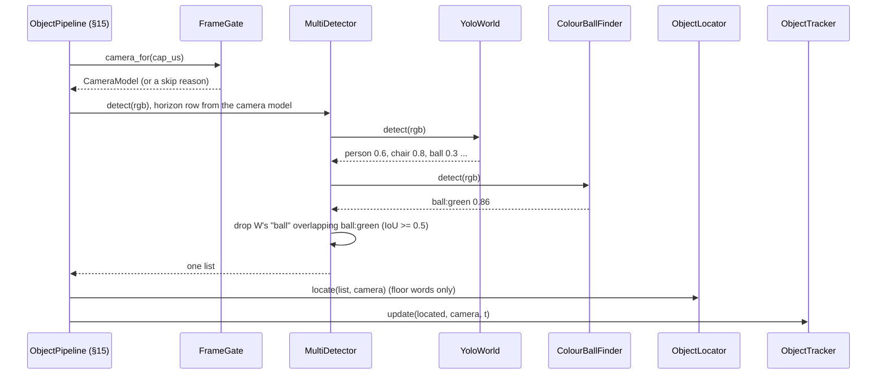

### 16.4 Budget
- YOLO-World-S at 640 on the Neural Engine: target ≤ 30 ms; measured in the plan's first task.
  - If it's over, export at 480, then re-measure the chair and the ball.
- The colour finder: ~1 ms at VGA.
- **Together ≤ 40 ms a picture**, so ≥ 25 pictures a second with the camera's ~24.

### 16.5 Tests
- **`tests/test_detectors.py`:**
  - the colour finder on drawn pictures:
    - a green disc on a pale floor is found, with its box;
    - a green disc above the horizon is ignored;
    - a green square (not round) is ignored;
    - a pale green-tinted floor with no ball gives nothing;
    - two balls of different colours give one each;
  - the `MultiDetector` join and the IoU drop;
  - `Vocabulary`: floor classes, default and own thresholds, a duplicate word refused, and the model-words-differ refusal;
  - the scaled VGA calibration: k × 2, `pixel_to_floor` at (2u, 2v) VGA equals (u, v) QVGA.
- **`tests/test_ball_calibrator.py`:** drawn frames with a known HSV → the written range holds the sample with the stated margins.
- **Replay:** a VGA recording through `cq-objects` with a fake YOLO-World and the real colour finder → one `ball:green` thing.
- **On the floor** (owner; nothing moves except the camera in step 3):
  1. the VGA checkerboard check (§16.1 item 6);
  2. the ball at 1 m and 2 m: one `ball:green`, its distance within 5 / 15 cm of the tape;
  3. the memory test (§15.8): the camera looks away for 12 s and back, and the ball keeps its `#oid`;
  4. the chair and a person listed;
  5. `cq-objects --live` shows the boxes and the plan;
  6. the time per picture.

### 16.6 Not in this section
- Obstacles from the floor plane + depth + sonar (map phase 5).
- Training a detector on the tank's own pictures, unless YOLO-World proves too weak.
- More than one ball of the same colour being told apart; the tracker separates them by place.

### 16.7 As built (Plan Y, 2026-10-24; design-notes §154)
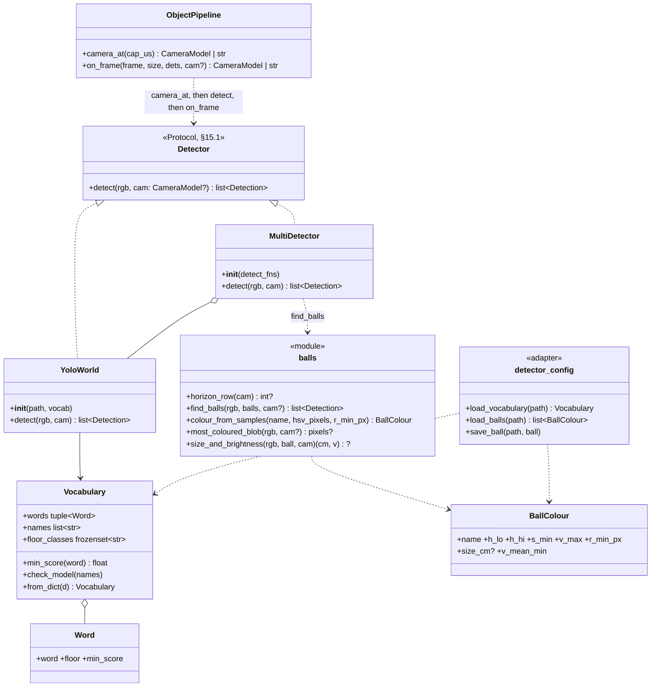
- **Files:**
  - `domain/vocabulary.py`, `domain/balls.py` (a module of functions, not a `ColourBallFinder` class), `domain/detectors.py`;
  - `adapters/yolo_world.py`, `adapters/detector_config.py`;
  - `config/vocabulary.yaml` (10 words, door `floor: false`), `config/balls.yaml`;
  - `tools/measure/export_world.py` (bakes the words into `ai-engine/models/yoloworld-s-640.mlpackage`, git-ignored, ~24 MB, GPL-3.0);
  - changed: `domain/objects.py`, `adapters/calibration_store.py` (VGA from the QVGA file), `app/objects.py`, `app/calibrate.py`.
  - AI engine 194 tests (1 skipped: the old YOLO26n model file is absent); ruff, format and pyright clean.
- **The plug is `detect(rgb, cam)`**, where `cam` is the picture's `CameraModel` (or None for a picture the gate skips). This supersedes the plan's `detect(rgb, horizon_row)`.
  - The app asks `ObjectPipeline.camera_at` first. It gets the camera or the skip reason, and hands that same camera to `on_frame`, so the horizon and the map use one camera (review m8).
  - Skipped pictures are still searched without a horizon, so the live view shows their boxes, but they are never placed.
- **YOLO-World:**
  - each candidate is only its best word, kept if that word's own threshold is met (review I1: one cabinet was "bed" and "sofa" at once);
  - overlap removal per word at IoU 0.7, as Ultralytics;
  - a box wholly in the letterbox bar is dropped;
  - the output is taken by name;
  - a model without a word list, or made for other words, is refused.
  - Matches Ultralytics on COCO 139 (person 0.83, chairs 0.76 / 0.58 / 0.54 / 0.34, boxes within 1 px). Ours also lists table 0.26, a half-precision effect at the 0.25 line. 6.7 ms a picture.
- **The colour finder:**
  - HSV of a 5 × 5 blur; the mask is the ball's range (a red range wraps through hue 0, `h_lo > h_hi`), below the horizon, opened 3 × 3;
  - round blobs: convex-hull roundness ≥ 0.66 and r ≥ `r_min_px`;
  - **bright enough and the right size for the distance** (Task 5, the steel bin):
    - the blob's mean value must be ≥ `v_mean_min`;
    - its size, `2 r × floor distance / fx`, must be within 0.6–1.5 × `size_cm`;
    - on the floor recording this keeps 236 of 243 sightings of the ball and drops all 48 reflections on a steel bin;
    - a ball resting on a chair seat is (rightly) not a floor ball;
  - then the largest of those wins.
  - `horizon_row`: None when the horizon is above the picture (all floor); the picture height when it is below it (camera tilted up: no floor).
- **`cq-calibrate ball <name>`:**
  - sets the camera level and centred first (review I3);
  - VGA only;
  - takes the coloured round blob nearest the middle in 15 pictures;
  - hue p5–p95 on the hue circle, widened by 5; a spread over 60 is refused as "not one colour";
  - then size (median) and brightness (0.8 × the median mean value).
  - No picture or a broken one is a plain refusal.
- **One ball is one thing** (review I2), in the tracker:
  - a word box (say "toy") at a listed ball's place updates that ball when nothing of its own class takes it (the finder missed it: at the picture's edge, half hidden);
  - when the finder sees a listed ball, a word thing at its place not seen in that picture is dropped.
- **Remembered from the last sighting** (Task 5 memory test):
  - a thing not seen for 0.5 s (`REMEMBER_AFTER_S`) is rewound to its last sighting and predicted with the remembered rule (5 cm/s walk), not the walking-person rule;
  - before this, a ball unseen for 1.3 s had grown to the 0.5 m cap, and its gate took a reflection 1.5 m away.
- **Config errors** name the file and the row: a missing field, bad YAML, `floor: "false"` as text, values out of range.
- **On the floor (Task 5; play tolerances agreed during the checks, design-notes §153):**
  - **VGA lens:** the doubled QVGA lens fits a screen checkerboard to 0.20 px median (max 0.93). A fresh VGA fit (fx 383.8) fits just as well, so the tape decides: the doubled lens wins (the ball at 2 m, before the tilt refit, from the lens: fresh 166 cm, doubled 175).
  - **tilt0** refit after the mount fix: +2.55° → **+3.3°**, from the ball at 1 m and 2 m (−1 / +2 cm).
  - **The ball:** 1 m → +3 cm; 1.5 m → +10 cm (finder 84 % of pictures); 2 m → +2 cm (finder 35 of 177; YOLO-World "toy" covers it).
  - **Memory:** the ball kept its number through a 12 s look-away (after both fixes); the cabinet too.
  - **Chair and person** listed (person at ~2.3 m by tape).
  - **The live view** showed chair, person, ball and bottle; Ctrl-C ends it cleanly.
- **Known limits:**
  - **The camera's real tilt drifts between sessions.** After a battery change, distances read ~1.3–1.4 × long, level and tilted; after panning away and back, ~1° (SG90 slack). Owner: a general fix, a camera angle estimator from the picture (design-notes §153), not hand refits.
  - **The colour finder reaches ~1.5 m.**
  - **At the driving tilt (15° down) the chair's top is cut** and YOLO-World scores it 0.23 (< 0.25); level it scores ~0.85.
  - **The cabinet flips between "bed" and "sofa"**, so it can show twice or come back as a new thing.
  - **Not built:** the camera-setting warning (ruling 6); other balls not yet calibrated.

## 17. Module 2: drive while thinking, slice 1 "chase the ball" (owner, 2026-10-25, spec 8, design-notes §156 — draft for review)

### 17.0 Scope
- **Built here:** the drive-while-thinking loop (spec 8 §3) and the chase-the-ball skill (spec 8 §4), on the laptop. Two ways to run it:
  - **`cq-drive goto ball`:** standalone, for testing. It drives like the phone does, as the owner, through plain `drive_rate`.
  - **`cq-drive serve`:** the skill server for Tank Logo's `SEE?`, `HOWFAR`, `FIND` and `GOTO`, driving under the runner's drive lease (bridge LLD R26).
- **The existing `BridgeLink` stays motion-free** (§6: "never sends anything that moves the tank"). Everything that moves the tank goes through one new, separate adapter, `DriveLink`.

### 17.1 Files
| File | What |
|---|---|
| `domain/drive/limits.py` | `Limits`: the tank's measured envelope (spec 8 §2) and the slice-1 caps |
| `domain/drive/curves.py` | `Command`, `Curve`, `ramp()`, `roll_out()` (where a curve takes the tank) |
| `domain/drive/planner.py` | `Planner`: the fan of curves, scored |
| `domain/drive/goal.py` | `Goal`: which thing is the target and where it is now; `KINDS` (the kind "ball") |
| `domain/drive/chase.py` | `ChaseSkill`: the state machine of spec 8 §4.2 (looking / approaching / arrived / lost) |
| `domain/drive/sim.py` | `SimTank`: a simulated tank following commands, for tests |
| `adapters/drive_link.py` | `DriveLink`: `drive_rate` (standalone) or `skill_drive` (lease), `cam_set`, the skill messages; cm/s → % |
| `app/drive.py` | `cq-drive goto ball` and `cq-drive serve` |
| `config/drive.yaml` | the limits and score weights (plain values, loaded into `Limits`) |

### 17.2 Classes
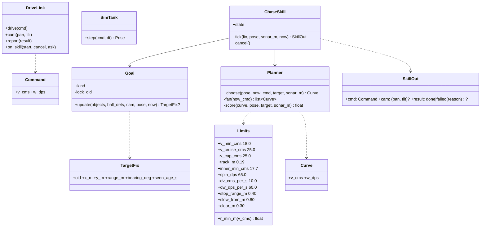
- **Pure, host-tested without a tank:** everything in `domain/drive/`. `SimTank` lets whole chases run in tests.

### 17.3 The loop (one tick, ~10 Hz)
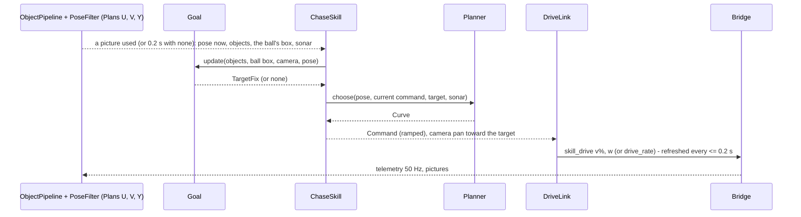
- **Ticks:** the loop ticks on each picture the pipeline uses, and at least every 0.2 s. The command is resent every 0.2 s even without a new tick, so the bridge's 0.3 s deadman only fires when the engine itself stalls.
- **The pose "now":** the newest pose from the filter (≤ 20 ms old). The target's room position is already lag-corrected by the pipeline (each picture is placed with the pose at its capture time, Plan V).

### 17.4 The planner
- **The fan, built from the current command:**
  - speeds `{v_cruise, v_min, 0}`, capped by `v_cap` and by distance: from `slow_from` the top speed falls linearly to `v_min` at `stop_range + 0.10`;
  - for each speed, turn rates from the radii `{∞, 1.5, 0.8, 0.5, r_min(v)}` m on each side: `w = v / r`;
  - a target more than 35° off (or inside the tightest circle) gets only a spin `(0, ±spin_dps)`: the tank turns on the spot first, from standing or by slowing out of a drive (floor chase 5, design-notes §157: a 50 cm curve at cruise swept past a ball 40° off at 80 cm). It was "offered beyond 70°" before. Once spinning it goes on until the target is within 15° (`SPIN_UNTIL_DEG`; the tank coasts on and the pose lags: with 8° floor chase 6 turned 55° for a ball 40° off), and the drive's arc aims the rest;
  - `r_min(v) = max(0.31, (track/2) · v / (v − inner_min))` m (design-notes §71: the inner track can't go slower than ~17.7 cm/s, and no arc under ~31 cm is smooth). A speed whose `r_min` comes out over 1.5 m (near `v_min`) offers only straight on.
- **`roll_out`:** a constant-(v, w) arc for 1.5 s in 0.1 s steps, starting from the ramp-limited command, so the predicted path is the one the tank will really drive.
- **Score** (higher is better; weights in `config/drive.yaml`):
  - **progress:** `(d0 − d_end) / 0.3 m − |bearing_end| / 90°`;
  - **clearance:** if the sonar shows something (not the target, §17.5) at `s` m straight ahead, any roll-out point within 15° of straight ahead that comes nearer than `s − clear_m` scores −10. In slice 1 the sonar is the only clearance; slice 2 swaps it for the local grid;
  - **smoothness:** `−(|Δv| / 10 cm/s + |Δw| / 30 °/s)` against the current command;
  - **stop** scores 0 progress. It wins only when every moving curve is cleared out, or when the target is reached.
- **The ramp** (`ramp(now_cmd, curve, dt)`): v changes by at most `dv · dt`, w by at most `dw · dt`. Spec 8 §3 step 5: whatever is chosen, the tank never jerks.

### 17.5 The goal
- **The kind "ball":** classes starting `ball:`, plus `ball` and `toy` (YOLO-World words).
- **Choosing the target:** the nearest confirmed thing of the kind; then **locked** to its `oid` while it's listed (no hopping between balls). If it's dropped from the list, the nearest again.
- **Range, the better of two:**
  - **from size**, when the colour finder saw that ball in this picture: `range = size_cm · fx / (2 r) / 100` along the box centre's ray. This is tilt-free. It's used when `r ≥ 8 px`.
  - **otherwise** the tracker's room position.
  - Spec 8 §4.1; the camera tilt drift (design-notes §153) doesn't affect the size range.
- **Bearing:** from the room position and the pose now.
- **The sonar and the target:** an echo within ±15 cm of the target's range, with the target within ±12° of straight ahead, *is* the target, not an obstacle.

### 17.6 The chase skill
```mermaid
stateDiagram-v2
  [*] --> looking : no target
  [*] --> approaching : target
  state looking {
    [*] --> sweep : camera pan 0, -45, 45, -90, 90 at tilt -15 (0.8 s of still pictures each, 2.5 s at most)
    sweep --> spin : not found, first time
    spin --> sweep2 : half a turn (180 deg timed at spin_dps), camera ahead
    sweep2 --> [*] : not found
  }
  looking --> approaching : target confirmed
  looking --> lost : not found after the second sweep (reason not_found, ~11 s)
  approaching --> arrived : range <= stop_range + 0.05 and |bearing| <= 10 deg, then the ramp brings v, w to 0
  approaching --> looking : target not seen for 3 s and its spot in view
  approaching --> lost : sonar < clear_m and not the target (reason blocked)
  approaching --> lost : every curve blocked for 3 s, standing (reason blocked; going around is slice 2, design-notes §157.5)
  approaching --> held : map stale (no picture 0.5 s / telemetry 0.2 s) or no pose: STOP at once (no ramp)
  held --> approaching : map fresh again (the ramp starts from standing)
  held --> lost : stale for 2 s (reason stale; design-notes §157.2)
  arrived --> [*] : done
  lost --> [*] : failed(reason)
```
- **While approaching, the camera pans toward the target's bearing** (clamped to ±60°, at the driving tilt). It's sent only when the bearing moves more than 8° from the last pan sent, so the pan moves in small steps, not constantly (spec 8 §9).
- **`cancel()`** gives command 0/0 at once. It's used for STOP, a lease end, or Ctrl-C.
- **Slice-1 refusals** (spec 8 §5): no driving with a stale map or without a pose; speed capped at 25 cm/s.

### 17.7 `DriveLink` and speed
- **cm/s → `v` %:** from the measured table (design-notes §69–§71): 0 → 0; 17.7 → 15 %; 22 → 40 %; 33.5 → 100 %, linear in between. **The plan measures it again on the floor** (spec 8 §9) and writes `config/drive.yaml`.
- **Turn rate:** sent as `yaw_rate` in °/s, + = left (bridge R4; the bridge reads no other key - final review C1).
- **Standalone (`goto`):** `drive_rate` as the owner. A NOT_OWNER or STOPPED nack ends the run with a plain message.
- **Lease (`serve`):** `skill_drive` with the skill id (bridge R26). A `skill_end` from the bridge cancels at once.

### 17.8 `cq-drive`
- **`cq-drive goto ball [--host]`:**
  - prints the states and the result;
  - Ctrl-C stops the tank (0/0, then `release`);
  - records the session like `cq-record`, for replay.
- **`cq-drive serve [--host]`:**
  - connects with hello `client: "ai-skills"` and stays connected;
  - answers `skill_ask` (`see?` / `howfar` for a thing);
  - runs `skill_start` (`find` / `goto`);
  - reports `skill_done` or `skill_failed {reason}`.
- **Reasons:** `not_found`, `lost`, `blocked`, `stale`, `unknown_thing`, `cancelled`.

### 17.9 Tests
- **Limits:**
  - `r_min` at 20 / 25 / 33 cm/s matches design-notes §71 (≈ 0.83 / 0.33 / 0.20 → clamped to the 0.31 m smooth floor);
  - the fan never offers a curve under `r_min`, nor a speed under `v_min` except stop.
- **Ramp:** steps never exceed `dv · dt` / `dw · dt`.
- **Planner (drawn scenes):**
  - a target straight ahead → straight at cruise;
  - 40° left → a left arc;
  - behind → a spin;
  - close → slow;
  - at `stop_range` → stop;
  - a sonar echo ahead that isn't the target → a curve away, or stop.
- **Goal:**
  - the lock holds when a second ball appears farther away;
  - the size range wins when the ball's radius is ≥ 8 px;
  - the sonar echo at the target's range is the target.
- **ChaseSkill:** every transition of §17.6, with fake fixes and clocks.
- **Simulated chases (`SimTank`):**
  - the ball at 1.5 m ahead, 45° left, 90° right and behind → arrives at 40 ± 15 cm, facing it within 10°;
  - the commanded speed never reaches 0 between start and arrival, except for the behind case's spin, which keeps turning;
  - |Δw| per tick ≤ `dw · dt`;
  - a ball moved mid-way → arrives at the new place without a stop.
- **`DriveLink`:** the % table; the refresh every 0.2 s; a nack ends the run (fake socket).

### 17.10 As built (Plan Z1, 2026-10-27; design-notes §157)
- **Files** (all in `ai-engine/`):
  - `domain/drive/limits.py` (`Limits`), `curves.py` (`Command`, `ramp`, `roll_out`), `planner.py` (`Planner`, `bearing_deg`), `goal.py` (`Goal`, `TargetFix`, `size_positions`, `kind_of`, `echo_is_target`), `chase.py` (`ChaseSkill`, `SkillOut`), `sim.py` (`SimTank`);
  - `adapters/drive_link.py` (`DriveLink`, `to_percent`, `drive_msg`), `adapters/drive_config.py` (`load_drive`);
  - `app/drive.py` (`cq-drive goto <thing> [--host] [--record]`), `config/drive.yaml`;
  - tests `test_drive_{limits,planner,goal,chase,sim,link,app}.py`; the AI engine suite is 266 tests.
  - **Not built here:** `cq-drive serve` and the drive lease (Plan Z2, with the Tank Logo words).
- **The bridge changed too** (inside Plan Z1, owner: yes): `drive_rate` didn't pass "moving" to the §72 STOP hold, so the phone's STOP didn't end a `drive_rate` run. `MotionController::Hooks::claim(fd, now, moving)`; host tests 674.

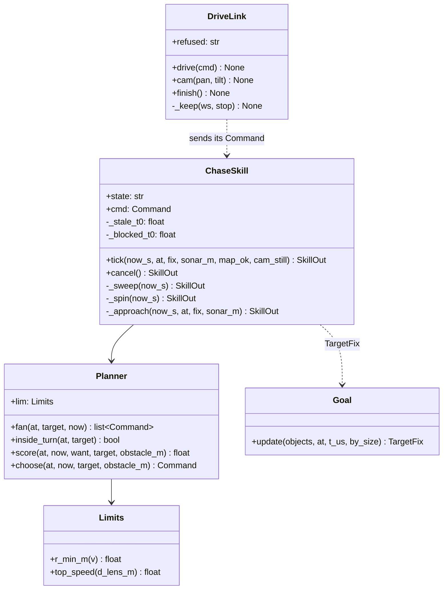

- **What changed from the draft above, and why:**

| Draft | As built | Why |
|---|---|---|
| turn rate key `rate` | `yaw_rate`; any nack without an `id` ends the run | the bridge reads no other key and refused every drive, unnoticed (final review C1) |
| resend every 0.2 s | resend only 0.5 s after the last command (`FRESH_FOR_S`), commands spaced ≥ 0.08 s (`MIN_GAP_S`), STOP at once | a stalled engine is left to the bridge's deadman; floor chase 1 hit the bridge's 25/s limit (39/s) |
| `ramp` on a fixed 0.1 s | the real time between ticks (≤ 0.3 s), and `w` clamped to `r_min(v)` | the loop ticks once per picture (~5-10 Hz) |
| search: sweep, one blind turn | sweep 0, −45, 45, −90, 90 (0.8 s of still pictures each), half a turn, sweep again, `not_found` | the map drops pictures while the camera moves or the tank turns > 45 °/s |
| spin offered beyond 70° | **only** a spin beyond 35°, until 15° left (`SPIN_FROM_DEG`, `SPIN_UNTIL_DEG`) | chase 5 swept past a ball 40° off (a slower tank curves *wider*); chase 6 overshot 15° (§157.1-§157.2) |
| arrival only when facing it | close but > 10° off: turn on the spot to face it | driving on would pass it |
| keep-clear from the tank's centre | from its front (the sonar) | the echo is measured there |
| a stale map ends the run | STOP at once, drive on when fresh, end after 2 s (`STALE_GIVE_UP_S`) | WiFi gaps of 0.12-0.32 s; chase 6 ended a second before arriving (§157.2) |
| — | standing with every curve blocked for 3 s ends `blocked` (`BLOCKED_GIVE_UP_S`) | chase 11 stood 4 minutes before a box (§157.5); going around is slice 2 |
| `goto ball` | `goto <thing>`: "ball" or any floor word, never `person` | no ball to hand; YOLO-World named a bottle "person" 31 times in chase 2 |
| `config/drive.yaml` any values | limits may only be made more careful (`AT_MOST` / `AT_LEAST`) | safety never traded |

- **Floor results** (design-notes §157): ball 40° right at 78 cm, 90° right, behind, rolled away (followed it 3.4 m), all `done`, ending 37-58 cm from the ball (sonar); a box in the path ends `blocked` without touching it; the phone STOP ends the run (`STOPPED`); Ctrl-C stops the tracks in 0.20 s and exits cleanly; the speed table is within ±1.5 cm/s.
- **Known, not fixed:** the half turn is timed (spun ~210°); the first fix of a ball seen at the picture's edge while the camera turns can be off (chase 7 spun to 69° for a ball at 40°); going around obstacles is slice 2.


## 18. Module 2 slice 2: explore without bumping (owner, 2026-10-27, spec 9, design-notes §159 — approved 2026-10-27: "implement")

### 18.0 Scope and plans
- **Spec 9**, in three plans built and floor-checked in order:
  - **Z3 (seeing):** `DepthCoreml`, `CameraAngle`, `DepthScaler`, `HeightPoints`, the camera's tilt fix in `CameraModel`, the live view's depth;
  - **Z4 (the room map):** `SonarModel`, `RoomMap`, `MapSnapshot`, `cq-map`;
  - **Z5 (driving on the map):** `ClearanceMap`, `RoutePlanner`, the fan on the map, the goals, `RoamSkill`, the chase with routes, `cq-drive wander | explore | find`.
- **Nothing new to install:** the depth model is Apple's CoreML build already downloaded for Q0 (`tools/measure/models/da2s/DepthAnythingV2SmallF16.mlpackage`, copied to the git-ignored `ai-engine/models/`); distance transforms come from OpenCV (already a dependency); no scipy.
- **Frames as now** (§13): room x forward, y left, z up, origin where the tank started.

### 18.1 Files
| File | What | Plan |
|---|---|---|
| `adapters/depth_coreml.py` | `DepthCoreml`: the model, 518 × 392 in and out, resized back to the picture | Z3 |
| `domain/depth.py` | `CameraAngle`, `DepthScaler`, `HeightPoints`, `Marks` | Z3 |
| `domain/camera.py` | `CameraModel.tilt_fix_deg` (new field, 0 by default) | Z3 |
| `domain/objects.py` | `FrameGate` applies the current tilt fix to every picture's camera | Z3 |
| `domain/sonar_model.py` | `SonarModel` | Z4 |
| `domain/room_map.py` | `RoomMap`, `MapSnapshot` | Z4 |
| `app/map.py` | `cq-map [--host] [--record] [--replay]`: watch the map fill while the phone drives | Z4 |
| `domain/drive/clearance.py` | `ClearanceMap` (distance to the nearest obstacle, per cell) | Z5 |
| `domain/drive/route.py` | `RoutePlanner`, `aim_point` | Z5 |
| `domain/drive/goals.py` | `WanderGoal`, `ExploreGoal`, `FindGoal` | Z5 |
| `domain/drive/roam.py` | `RoamSkill` (wander / explore / find), shares the chase's stale / blocked rules | Z5 |
| `domain/drive/planner.py`, `chase.py` | the fan checks the clearance map; the chase aims along a route | Z5 |
| `domain/drive/sim.py` | `SimRoom` (boxes, an overhang) for simulated drives | Z5 |
| `app/drive.py` | `cq-drive wander [seconds] | explore | find <thing> | goto <thing>` | Z5 |
| `config/map.yaml` | heights, ranges, log-odds steps, costs (§18.9) | Z3-Z5 |

### 18.2 Classes
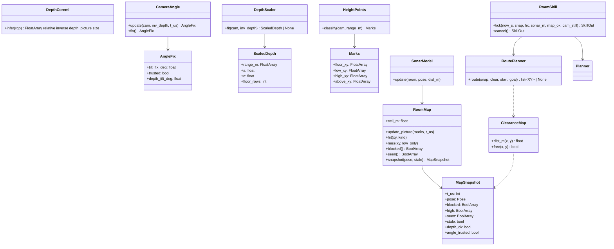

### 18.3 One picture (Z3 + Z4)
```mermaid
sequenceDiagram
  participant A as app loop
  participant G as FrameGate
  participant D as DepthCoreml
  participant C as CameraAngle
  participant S as DepthScaler
  participant H as HeightPoints
  participant M as RoomMap
  A->>G: camera_for(cap_us)
  G-->>A: CameraModel with the current tilt fix (or a skip reason)
  par in threads
    A->>D: infer(rgb)
    A->>A: detect(rgb)
  end
  D-->>A: inv_depth
  A->>C: update(cam, inv_depth, t_us)
  C-->>A: AngleFix (applied from the next picture; this one is re-made with it)
  A->>S: fit(cam fixed, inv_depth)
  S-->>A: ScaledDepth (or None: no floor in view)
  A->>H: classify(cam fixed, range_m)
  H-->>A: Marks
  A->>M: update_picture(Marks, t_us)
  Note over A,M: telemetry (50 Hz) also calls SonarModel.update(room, pose, dist_m)
```

### 18.4 Seeing (Z3)
- **`DepthCoreml(path)`:** `ct.models.MLModel(path, compute_units=ALL)` like the detectors; the picture is resized to 518 × 392 (the model's size; 4:3 within 1 %), the output resized back to the picture's size (`cv2.INTER_LINEAR`). It runs in a thread beside the detector (§17.3's loop); measured in the plan: depth + YOLO-World at VGA together must keep ≥ 5 pictures/s used (the driving loop's rate); if not, depth every second picture (`depth.every_n`).
- **`CameraAngle`** (design-notes §155):
  - **floor rows:** the bottom band of the picture between `NEAR_M` and `FAR_M` by the current camera, columns in the middle half; per row the median inverse depth;
  - a straight line `inv = p·row + q` is fitted (least squares, rows with a residual over 3σ dropped once); its zero row `row0 = −q/p` is the horizon;
  - the depth tilt: `atan((cy − row0) / fy)` (pinhole, undistorted), **plus `DEPTH_TILT_OFFSET_DEG` = 4.1°** (§155);
  - a picture's estimate counts only when the line fits (R² ≥ 0.98, ≥ 20 rows, `p` < 0); the fix is the **median over the last 1 s** of `depth_tilt − real_tilt_deg(servo)`;
  - **trusted** when |fix| ≤ **3°**; otherwise `tilt_fix_deg = 0` and `trusted = False` (spec 9 §5: the servo is used and the drive slows to 18 cm/s);
  - no good picture for 2 s: the fix stays, `trusted` stays as it was.
- **`CameraModel.tilt_fix_deg`:** added in `real_tilt_deg()`; `FrameGate` builds every picture's camera with the current fix, so the object tracker's floor trick (the ball) uses it too.
- **`DepthScaler.fit(cam, inv)`** (spec 7): on `cam.floor_mask()` pixels, `1 / expected_floor_depth = a·inv + c` by least squares (one 3σ trim); fails (None) with fewer than 500 floor pixels or `a ≤ 0`. `range_m = 1 / (a·inv + c)`, `inf` where `a·inv + c ≤ 0`.
- **`HeightPoints.classify(cam, range_m)`:** every 4th pixel in both directions (160 × 120 at VGA); point = lens + ray (unit) × range;
  - `z < FLOOR_M` (0.02): **floor**, out to `FREE_MAX_M` (3.0 m);
  - `FLOOR_M ≤ z < LOW_TOP_M` (0.10): **low** obstacle, out to `MARK_MAX_M` (2.0 m);
  - `LOW_TOP_M ≤ z ≤ CLEAR_M` (0.20, the owner's 20 cm): **high** obstacle, out to 2.0 m;
  - `z > CLEAR_M`: **above** (seen; passable under), out to 3.0 m;
  - points under the floor (z < −0.05) are dropped (bad depth).
  - **Low / high by height:** the sonar's beam is low on the front, so it can only vouch for what's under `LOW_TOP_M`; a box 15 cm tall gives low and high points, and the sonar never clears its high part.

### 18.5 The room map (Z4)
- **`RoomMap(size_m=8.0, cell_m=0.05)`:** 160 × 160 cells, the start at the centre, heading 0 along +x. Arrays: `low`, `high` (log-odds, float32), `seen` (bool).
- **`update_picture(marks)`:**
  - floor points: a **miss** on both `low` and `high` in their cell, `seen` = true;
  - low / high points: a **hit** on that layer, `seen` = true;
  - above points: `seen` = true only (a miss on `high`: the space up to 20 cm under them is open only if floor points say so).
  - **Fading only in view** follows from this: a cell is lowered only by a floor point seen in it now; cells out of view, in the blind zone or behind an obstacle get nothing.
- **Log-odds** (config): hit +0.85, miss −0.4, clamped to ±4; **blocked** when `low > 0.7` or `high > 0.7`.
- **`SonarModel.update(room, pose, dist_m)`** (each telemetry sample, at most 10 Hz used):
  - the sonar point = pose + `sonar_x_m` ahead; beam half-angle 12° (Q0);
  - an echo `d` < 4.0 m: a **low hit** on the arc at `d` (±12°, cells along the arc), and a **low miss** in the narrow cone (±4°) from 0.10 m to `d − 0.10`;
  - **never touches `high`**; no echo or `d ≥ 4.0` does nothing (spec 9 §5).
- **Edges:** cells outside the 8 × 8 m count as blocked (a soft fence).
- **`snapshot(pose, stale)`** → `MapSnapshot`: copies of `blocked`, `high` (for the view), `seen`, plus the pose, the stale flag (spec 7 §4), `depth_ok` (a depth picture in the last 1 s) and `angle_trusted`.
- **`cq-map`:** the map pipeline only (no driving); live view of the map as an image (blocked low red, blocked high orange, seen grey, unseen black) with the tank's pose; `--record` / `--replay` like `cq-record`.

### 18.6 Routes and the fan (Z5)
- **`ClearanceMap(snap)`:** `cv2.distanceTransform` on the free cells (unseen counts as free here) at 5 cm → metres to the nearest blocked cell; computed once per snapshot (~1 ms).
- **`RoutePlanner.route(snap, clear, start, goal)`:** A* on a **10 cm grid** (each cell = the worst of its 2 × 2), 8-connected:
  - **not allowed:** clearance < `ROBOT_R_M` (0.15: half the tank's width + a margin);
  - **cost** per step: length × (1 + `NEAR_W` · max(0, 0.35 − clearance) / 0.20 + `UNSEEN_W` if unseen) with `NEAR_W` 3, `UNSEEN_W` 1;
  - the start cell is always allowed (the tank may be near a wall), and so is the goal's cell for the chase (the ball sits on the floor);
  - none → `None`. Budget: ≤ 20 ms in Python on 80 × 80 (measured in the plan; if over, the route is kept and re-planned every second tick).
- **`aim_point(route, at, ahead_m=0.5)`:** the point 0.5 m along the route from the nearest route point; the last point when the route is shorter.
- **The fan on the map:** `Planner.choose(at, now, target, obstacle_m, clear)`: every rolled-out pose whose clearance (from `clear`) is under `ROBOT_R_M − 0.03` scores `blocked` (−10). The sonar's `obstacle_m` check and the 30 cm hard stop stay as in slice 1.

### 18.7 Goals and the skill (Z5)
- **`WanderGoal(seconds | None, rng)`:** a destination 1.5–2.0 m away among cells with clearance ≥ 0.30 and seen-free, scored by `cos(bearing) + 0.5·openness + noise(0.3)`; a new one when within 0.4 m, every 6 s, or when no route; done when `seconds` have passed.
- **`ExploreGoal`:** frontier cells = seen-free cells next to unseen ones (10 cm grid), grouped (8-connected); groups under 30 cm (3 cells) dropped; the destination is the group point with the cheapest route; none reachable → done. Refuses to start without depth (`depth_ok` false).
- **`FindGoal(thing, inner)`:** `inner` is wander or explore; each tick the slice-1 `Goal` (§17.5) is asked for `thing`; a fix → hand over to the chase.
- **`RoamSkill`:**
```mermaid
stateDiagram-v2
  [*] --> look : start (camera ahead, map filling)
  look --> drive : a destination with a route
  look --> done : explore, nothing reachable
  drive --> drive : new destination / route every tick
  drive --> look : no route (a turn on the spot, 360 deg in 90 deg steps, camera ahead)
  look --> drive : a route after the look
  look --> other : wander, still no route: a new destination
  other --> drive
  drive --> chase : find - the thing confirmed (the chase from slice 1, aiming along routes)
  drive --> done : wander time up
  drive --> held : stale map (STOP at once)
  held --> drive : fresh
  held --> failed : stale 2 s
  drive --> failed : sonar < 30 cm, not the target (blocked); STOP; Ctrl-C
  chase --> done : arrived
  done --> [*]
  failed --> [*]
```
- **Speeds:** the slice-1 cap (25 cm/s); **18 cm/s** while `angle_trusted` is false or `depth_ok` is false (spec 9 §5).
- **The chase with routes:** when a map is given, `ChaseSkill` aims at `aim_point(route to the ball)` instead of the ball; arrival, the arrival turn and the sonar's echo-is-target test still use the ball itself. No route → the slice-1 rule (`blocked` after 3 s standing).

### 18.8 Safety (spec 9 §5)
- Unchanged: the Uno brake, the deadman, STOP, Ctrl-C, Plan R3, the 25 cm/s cap.
- **The sonar has the last word:** an echo under `clear_m` (0.30) that isn't the target ends the run `blocked`, whatever the map says (slice 1's rule, kept in `RoamSkill`).
- **No invented free space:** no echo clears nothing; the sonar never lowers `high`; unseen is never "known free" (routes may cross it only at extra cost, and only the camera turns it into seen).
- **Depth down:** marks from the sonar only, 18 cm/s, explore refuses, a printed reason.

### 18.9 `config/map.yaml` (defaults)
```yaml
heights: {floor_m: 0.02, low_top_m: 0.10, clear_m: 0.20}   # owner: 20 cm (design-notes §159)
ranges: {mark_max_m: 2.0, free_max_m: 3.0, sonar_max_m: 4.0}
depth: {every_n: 1, tilt_offset_deg: 3.0, trust_deg: 3.0}   # 4.1 in the design; 3.0 measured (§18.11)
map: {size_m: 8.0, cell_m: 0.05, hit: 0.85, miss: -0.4, clamp: 4.0, blocked: 0.7}
route: {cell_m: 0.10, robot_r_m: 0.15, near_w: 3.0, unseen_w: 1.0, aim_m: 0.5}
```
`clear_m` and `robot_r_m` may only be made larger (the "more careful only" rule, §17.10); for the map (Plan Z4, §18.12): `hit` and `clamp` only larger, `miss` only less negative, `blocked` only smaller (above 0), `sonar_max_m` only smaller.

### 18.10 Tests
- **Z3:** a made-up depth picture from `expected_floor_depth()` with a known tilt (and a −4.1° model shift) → `CameraAngle` within 0.2°; a fix over 3° → untrusted; `DepthScaler` recovers `a`, `c`; `HeightPoints` on a scene with a 10 cm box (low + high) and a board at 18 cm (high) and one at 30 cm (above); the ball's floor position moves with the tilt fix.
- **Z4:** an echo marks the arc low and clears the cone's low only; no echo changes nothing; a high mark survives a sonar sweep; a floor point lowers a mark, a cell out of view keeps it; the edge counts as blocked; a replayed recording rebuilds the same map.
- **Z5:** routes on drawn maps (around a box, out of a U, none); the clearance; the fan never picks a curve into the clearance; wander keeps moving for 60 s in `SimRoom`; explore ends with ≥ 80 % of the reachable floor seen; find hands over to the chase; simulated drives never come closer than 15 cm (centre to obstacle edge minus half-width); depth down → 18 cm/s and explore refuses.
- **Floor (spec 9 §6):** the angle within 1°; no obstacle ≥ 10 cm wrongly free within 1 m incl. a board at ~18 cm; wander 2 min without a touch; explore ≥ 80 %; the chase around a box; find the ball out of sight.

### 18.11 As built (Plan Z3, 2026-10-28; design-notes §161)
- **Files** (all in `ai-engine/`):
  - `domain/depth.py` (`Heights`, `Ranges`, `DepthSettings`, `MapConfig`, `depth_tilt_deg`, `AngleFix`, `CameraAngle`, `DepthScaler`, `ScaledDepth`, `HeightPoints`, `Marks`, `Seeing`, `Seen`);
  - `domain/camera.py`: `CameraModel.tilt_fix_deg`, `undistorted_grid(cal)` (cached per calibration, under a lock), `ray_norms()`, `unit_rays(stride)`; `domain/objects.py`: `FrameGate.tilt_fix_deg`, `ObjectPipeline.set_tilt_fix`;
  - `adapters/depth_coreml.py` (`DepthCoreml`), `adapters/map_config.py` (`load_map_config`), `adapters/rerun_view.py` (`depth`, `marks`, `angle`);
  - `app/objects.py` (`cq-objects` with depth: `load_depth`, `depth_due`, `see_off_loop`; `--depth-model`, `--no-depth`), `app/drive.py` (`cq-drive` keeps the camera angle up to date; `--no-depth`); `config/map.yaml`;
  - the model `models/DepthAnythingV2SmallF16.mlpackage` (git-ignored; copied from `tools/measure/models/da2s/`);
  - tests `test_depth.py`, `test_map_config.py`, `test_depth_coreml.py` (skipped without the model), additions to `test_camera.py`, `test_objects.py`, `test_objects_app.py`; the AI engine suite is 310 tests.
- **Changes from §18.4, with the reason:**
  - **The model gives depth along the camera's axis**, not along each pixel's ray: `DepthScaler` fits `1 / axis depth` and `range = ray_norm / (a·inv + c)` (`ray_norms()`).
  - **The floor line is fitted in the undistorted image height `y_n`**, not the pixel row (the lens bends rows); the horizon is `y_n0 = −q/p`, the tilt `atan(y_n0) − offset`, and inverse depth grows toward the bottom of the picture, so the check is `p > 0`.
  - **The correction is 3.0°, not 4.1°**, measured against a taped ball in five recordings (design-notes §161.2), and **tilt0 0.7°, not 3.3°** (owner): the camera sits 0.7-4.0° lower than the servo says and changes between power-ons, so the 3° trust window is centred on where it really sits.
  - **A fix needs 3 estimates** in the window (`MIN_ESTIMATES`) and comes in 0.05° steps (`FIX_STEP_DEG`), so one odd picture cannot move it and the depth cache is not rebuilt for noise.
  - **`DepthScaler`** uses every 3rd floor pixel (speed) and refuses a fit with R² < 0.9 or with no spread in the floor's depth (a wall filling the picture gave nonsense marks).
  - **Seeing runs off the event loop** (`see_off_loop`, `asyncio.to_thread`; ~25 ms a picture on the M1), so telemetry and the drive keep ticking; `cq-drive` works out only the angle for now (no map until Z4).
  - **`config/map.yaml` is checked:** unknown keys refused; `clear_m` only larger, `floor_m` and `trust_deg` only smaller; `low_top_m` ≤ `clear_m`; `every_n` a whole number ≥ 1.
  - **A missing or damaged model file:** a plain message and the run carries on without depth.
- **Measured on the floor** (design-notes §161): 18.8 pictures / s with depth (`every_n` stays 1); the depth tilt within 0.62° of the truth in five recordings; the 1 m ball at 93 / 101 cm and the 2 m ball at 223 cm; the bed's lower edge (15 cm up) marked high and a 10 cm box low, neither shown as floor within 1 m; depth puts things ~10 cm near (the safe side).
- **Known limit found:** the ball finder's roundness (0.55-0.66 against 0.66, the ball's blue spots) missed the ball in two recordings at the right tilt: a follow-up after Plan Z3.

```mermaid
classDiagram
  class Seeing {
    +angle: CameraAngle
    +scaler: DepthScaler
    +heights: HeightPoints
    +see(cam, inv, t_us) Seen
    +angle_only(cam, inv, t_us) AngleFix
  }
  class CameraAngle {
    +update(cam, inv, t_us) AngleFix
    +fix() AngleFix
  }
  class DepthScaler {
    +fit(cam, inv) ScaledDepth
  }
  class HeightPoints {
    +classify(cam, range_m) Marks
  }
  class AngleFix {
    +tilt_fix_deg: float
    +trusted: bool
    +depth_tilt_deg: float
    +n: int
  }
  class Seen {
    +fix: AngleFix
    +cam: CameraModel
    +scaled: ScaledDepth
    +marks: Marks
  }
  class DepthCoreml {
    +infer(rgb) inv
  }
  class ObjectPipeline {
    +set_tilt_fix(deg)
  }
  Seeing --> CameraAngle
  Seeing --> DepthScaler
  Seeing --> HeightPoints
  Seeing ..> Seen
  CameraAngle ..> AngleFix
  DepthCoreml ..> Seeing : inverse depth
  Seen ..> ObjectPipeline : tilt fix (see_off_loop)
```

### 18.12 As built (Plan Z4, 2026-10-29; design-notes §162)
- **Files** (all in `ai-engine/`):
  - `domain/room_map.py` (`RoomMap`, `MapSnapshot`, `map_image`), `domain/sonar_model.py` (`SonarModel`);
  - `domain/depth.py`: `MapSettings` and `Ranges.sonar_max_m`; `adapters/map_config.py` reads the `map:` section; `config/map.yaml`;
  - `app/map.py` (`cq-map <recording> | --live [--record DIR] [--no-depth] [--no-view]`: `MapRun`, `run_replay`, `run_live`, `report`, `status`); `adapters/rerun_view.py` `room_map`;
  - tests `test_room_map.py`, `test_sonar_model.py`, `test_map_app.py`, additions to `test_map_config.py`; `tests/fake_bridge.py` streams a real picture, stops pictures after a time, and reports the servos; the AI engine suite is 362 tests.
- **Changes from §18.5, with the reason:**
  - **One step per cell per picture**, however many points fall in it (a near cell gets thousands), and **a hit beats a miss** in the same cell in the same picture (a box's foot): one picture can't saturate the map, and the map never invents free space (owner-approved with the plan).
  - **The sensor never marks seen** (spec 9 §5: only the camera turns unseen into seen), and an echo under 20 cm marks only its arc (no cone).
  - **`MapSnapshot.cell_m`** (the picture needs it to place the tank); the tank's marker is left out when it is off the map.
  - **"More careful only" the right way round** (final review): the plan had `blocked` "not lower"; a higher level makes fewer obstacles, so it may only go down; `clamp` only up, `sonar_max_m` only down.
  - **`MapRun`** holds the pipeline (pose from `ObjectPipeline` with no detector, `Seeing`, `RoomMap`, `SonarModel`); the live loop runs the depth model and `Seeing` in worker threads and `update_picture` (< 10 ms) and the sensor on the event loop, so the map has one writer.
- **Measured on the floor** (design-notes §162): 10-22 map updates a second; a 10 cm box marked low and remembered after the tank moved and turned; the bed's 15 cm edge marked high, settled where the owner's tape put it (1.22 m) and never cleared by the sensor; replays give the same map.
- **Left for Plan Z5** (final review minors): work out stale when the snapshot is taken (and on picture timeouts); report a crashed link or camera task; refuse a positive `miss`.

```mermaid
classDiagram
  class MapRun {
    +p: ObjectPipeline
    +room: RoomMap
    +sonar: SonarModel
    +seeing: Seeing
    +on_telem(s)
    +on_text(text)
    +gate(frame, rgb) CameraModel
    +apply(seen, t_us)
    +snapshot(t_us, stale) MapSnapshot
  }
  class RoomMap {
    +n: int
    +low: float32[n,n]
    +high: float32[n,n]
    +seen: bool[n,n]
    +cells(xy) intp[]
    +hit(cells, layer)
    +miss(cells, layer)
    +update_picture(marks, t_us)
    +blocked() bool[n,n]
    +is_blocked(x, y) bool
    +snapshot(t_us, pose, stale, angle_trusted) MapSnapshot
  }
  class SonarModel {
    +update(room, pose, dist_m, t_us) bool
  }
  class MapSnapshot {
    +t_us: int
    +pose: Pose
    +cell_m: float
    +blocked: bool[n,n]
    +high: bool[n,n]
    +seen: bool[n,n]
    +stale: bool
    +depth_ok: bool
    +angle_trusted: bool
  }
  MapRun --> RoomMap
  MapRun --> SonarModel
  MapRun --> Seeing
  SonarModel ..> RoomMap : low only
  RoomMap ..> MapSnapshot
```

### 18.13 Revision 2: driving on a cost map (owner, 2026-10-30, design-notes §166 — draft for review)

**Why.** Plan Z5's floor runs 1-3 each found a case the driving rules got wrong, and each fix was another rule (unseen space grown 30 cm round marks, the escape exception, "no part deeper in" sums on two maps, a 4× weight for narrow places, the reverse's track rules); each broke another case (design-notes §164-§165.2). Spec 0 §1.1 principle 3: general before special. This revision replaces those rules with the standard model real robots use (ROS 2 Nav2: a cost map, a footprint check, a local planner scoring moves by cost, and recovery behaviours). It replaces §18.6, §18.7's "look" and the §164-§165 additions; §18.3-§18.5 (seeing, the room map) stay.

**One idea for a child:** every 5 cm square of the floor has a price. Things the tank has seen are walls it can't drive into; near them the price rises; floor it has never seen costs something, so it goes there slowly and head-first, where its eyes are. It picks the cheapest good move, and when every move is too dear it tries the standard ways out, then says `blocked`.

#### 18.13.1 The costs (`CostMap`, replaces `ClearanceMap`)
Per 5 cm cell, from one `MapSnapshot`:

| Cell | Cost | Moves |
|---|---|---|
| **lethal:** `blocked` (low or high above the log-odds level) or outside the map | 1 (∞ for moves) | the body may never overlap it |
| **near:** free, within `NEAR_M` (0.40 m) of a lethal cell | `NEAR_COST` × (`NEAR_M` − d) / (`NEAR_M` − `body_half_w_m`), capped at `NEAR_COST` (0.8) | allowed, dearer the closer |
| **unknown:** never seen and never driven over | + `UNKNOWN_COST` (0.3) | allowed forward and turning; **never backward** (§18.13.4) |
| **free:** seen or driven over, far from anything | 0 | allowed |

- `d` = distance to the nearest lethal cell (`cv2.distanceTransform`, once per snapshot, as today).
- **Nothing is grown into unknown space.** A box's hidden back is unknown: dearer, slower, never forbidden until seen. The trade-off is the owner's (§166): something never seen can be touched, slowly and never head-on (the sonar, `clear_m` 10 cm, and the Uno's 15 cm brake look forward).
- **The body is a sensor too:** every telemetry pose, the cells under the tank's footprint (shrunk 2 cm all round for pose drift) get a floor observation in `RoomMap` (a miss on low and high, `seen` true) - the floor the tank stands or drove on is free. `RoomMap.body_over(pose, footprint)`; this is why a tank can never stand inside its own marks.

#### 18.13.2 One body check (`Footprint`)
- The outline of `Limits`' rectangle (front 13, rear 9, half-width 11.5 cm, design-notes §163), a point every 2.5 cm, posed along a move at most 5° / 2.5 cm apart (as §164 built).
- **A move is forbidden only if an outline point lands in a lethal cell.** No margins as rules: nearness is cost. A tank close to something can always move away (the cost falls), so no escape exception is needed.
- The same check for every move: curves, a turn on the spot (only the way it turns), backing up, and the chase's last turn.

#### 18.13.3 Choosing a move (`Planner`, the fan)
- The fan as today (slice 1's curves, turns on the spot beyond 35°, the ramps), each rolled out 1.5 s.
- **Score** = progress toward the aim point − heading still off − steering change (slice 1, §17.4) − `COST_W` (4) × the **highest** cost the outline meets along the move; forbidden moves are left out.
- **Speed from cost:** the top speed is scaled by (1 − the highest cost within 0.5 m ahead), never under `v_min` (18 cm/s) - near things or unknown floor it slows; the 18 cm/s for an untrusted angle or no depth stays (spec 9 §5).
- **Routes (`RoutePlanner`)** use the same costs: A* on the 10 cm grid (each cell the dearest of its 2 × 2), step cost = length × (1 + `ROUTE_COST_W` (6) × cell cost); a cell is closed only when its centre is nearer than `body_half_w_m` to a lethal cell (the body would overlap going straight); the start cell is always open. Room to turn round comes from the near cost, not from a rule; doorways stay open.
- **Goals** as §18.7: wander picks free, seen spots 1.5-2 m away; explore picks the cheapest reachable frontier (seen free cells next to unknown, groups ≥ 30 cm); find hands over to the chase.

#### 18.13.4 When nothing is possible: recovery (standard, in order)
Triggered when no move is allowed or no move makes progress for `STUCK_S` (3 s), or there is no route:
1. **look** - stand, pan the camera to −90°, −45°, 45°, 90° (1 s each) and back: the map learns the floor beside the tank; then plan again.
2. **turn** - turn on the spot (90°, the way the footprint check allows, cheaper way first), then plan again.
3. **back up** - straight back at `v_min`, at most 20 cm, **only over known-free cells** (seen or driven over): nothing senses behind the tank, so it never backs onto floor it doesn't know. Re-checked every tick.
4. **give up** - `blocked`.
- A recovery that ends in a move that makes progress (the tank 0.3 m from where recovery began) resets the sequence; recovery starting again within 0.3 m of the last one continues the sequence where it left off. One rule set for wander, explore, find and the chase's routes.

```mermaid
stateDiagram-v2
  [*] --> start_look : camera ahead 1 s
  start_look --> drive
  drive --> drive : cheapest allowed move along the route
  drive --> look : stuck (no allowed move / no progress 3 s / no route)
  look --> drive : a move found
  look --> turn : still stuck
  turn --> drive : a move found
  turn --> back : still stuck (or no turn allowed)
  back --> drive : a move found
  back --> blocked : still stuck (or no known-free floor behind)
  drive --> chase : find - the thing confirmed
  drive --> done : wander time up / explore nothing left
  drive --> held : stale map (STOP at once)
  held --> drive : fresh
  held --> failed : stale 2 s
  drive --> failed : sonar echo < clear_m not the target; STOP; Ctrl-C
  chase --> done : arrived
```

#### 18.13.5 Classes
```mermaid
classDiagram
  class RoomMap {
    +update_picture(marks, t_us)
    +body_over(pose, footprint)
    +snapshot(t_us, pose, stale, trusted) MapSnapshot
  }
  class CostMap {
    +cost: float[n,n]
    +lethal: bool[n,n]
    +known_free: bool[n,n]
    +dist_m(x, y) float
    +cost_at(xy) FloatArray
  }
  class Footprint {
    +outline: FloatArray
    +sweep(at, poses) FloatArray  outline points along a move
    +allowed(cost, at, poses) bool
    +highest_cost(cost, at, poses) float
  }
  class Planner {
    +choose(at, now, aim, obstacle_m, cost, far_m) Command
  }
  class RoutePlanner {
    +route(cost, start, goal) list~XY~
    +costs(cost, start) FloatArray
  }
  class Recovery {
    +step(now_s, at, cost) SkillOut | None
    +reset(at)
  }
  class RoamSkill {
    +tick(now_s, at, snap, fix, sonar_m, map_ok) SkillOut
  }
  class ChaseSkill
  RoomMap ..> CostMap : snapshot
  Planner --> Footprint
  Recovery --> Footprint
  RoamSkill --> Planner
  RoamSkill --> RoutePlanner
  RoamSkill --> Recovery
  ChaseSkill --> Planner
  ChaseSkill --> RoutePlanner
  Planner ..> CostMap
  RoutePlanner ..> CostMap
```

#### 18.13.6 One tick
```mermaid
sequenceDiagram
  participant L as drive loop
  participant M as RoomMap
  participant C as CostMap
  participant S as RoamSkill
  participant R as RoutePlanner
  participant P as Planner
  participant F as Footprint
  L->>M: body_over(pose) (each telemetry)
  L->>M: snapshot()
  L->>S: tick(at, snap, sonar, ...)
  S->>C: CostMap(snap) (once per snapshot)
  S->>R: route(cost, at, goal)
  R-->>S: route (or none: recovery)
  S->>P: choose(at, now, aim, echo, cost)
  P->>F: allowed / highest_cost per move
  F-->>P: scores
  P-->>S: best move (or STOP: recovery)
  S-->>L: Command (+ camera)
```

#### 18.13.7 Removed
`GROW_UNSEEN_M` and the grown map; `MAP_CLEAR_M` / `FRONT_CLEAR_M` / `BODY_CLEAR_M` / `SIDE_MARGIN_M` as hard margins; the escape exception (`ESCAPE_M`); the "no deeper in" sums and the two-map check; `TIGHT_W` / `turn_room_m`; the look's camera pans as a special case, `STUCK_LOOKS`, `LOOK_ROUNDS`; the reverse's track and "not twice" rules. Kept: the sonar's stop (`clear_m`), the stale rule, 18 cm/s when unsure, the ramps, the measured body, reverse only at `v_min`.

#### 18.13.8 Config (`config/map.yaml`, `cost:`)
```yaml
cost: {near_m: 0.40, near_cost: 0.8, unknown_cost: 0.3, cost_w: 4.0, route_cost_w: 6.0, stuck_s: 3.0, back_m: 0.20}
```
More careful only (§17.10): `near_m`, `near_cost`, `unknown_cost` may only be raised; `back_m` only lowered.

#### 18.13.9 Tests
- **Costs:** lethal / near / unknown / free values on drawn maps; the body over cells clears them (and not beyond its shrunk footprint).
- **Footprint:** a move into a lethal cell is forbidden, next to it allowed but dear; a turn on the spot checked only its own way.
- **The three floor runs as drawn maps:** run 2 (bed panel right, leg ahead-right, the way on behind-left), run 3 (one small mark ahead-left, unknown round the tank) and the wall beside the tank: none ends `blocked` while a way exists; no outline point ever enters a lethal cell.
- **Recovery:** the order look → turn → back → `blocked`; backing only over known-free cells; progress resets it.
- **Simulated rooms** (`SimRoom`): all of today's (wander, explore ≥ 80 %, doorways 46 / 60 / 80 cm, the ball by the sofa, the box on the route) plus the three floor-run layouts; the body never inside a box; touches of never-seen things counted and reported (not failed - the accepted trade-off), head-on touches failed.
- **Floor (spec 9 §6):** wander 2 min, explore, goto ball round a box, find the ball - as Plan Z5 Task 9.

#### 18.13.10 Plan
A new plan, **Z6 - the cost map**, on branch `plan-z6` from `plan-z5`: replaces the rules above, keeps the rest of Z5. Z5's own floor checks are folded into Z6's; both merge to `main` together after Z6's floor checks.
