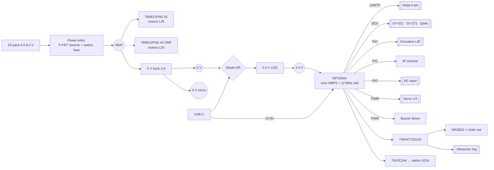
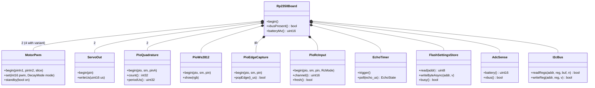
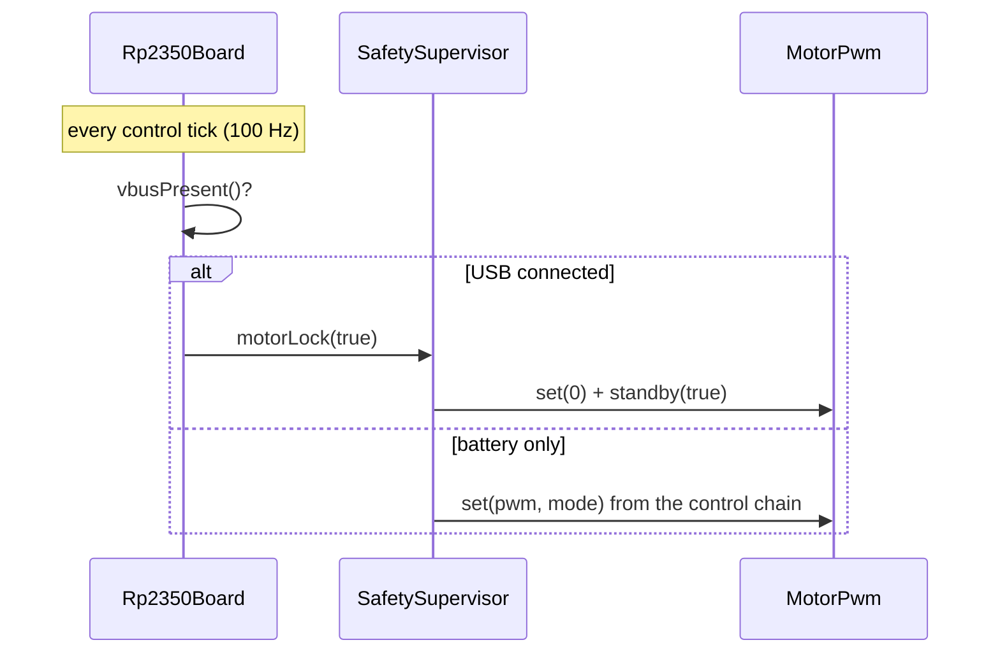

# Base board — Low-Level Design (draft)

Status: **draft for review** (2026-10-14). Implements `docs/superpowers/specs/2026-10-14-06-base-board-design.md` (spec 06). Scope: the electrical design of the RP2350A base board — parts, pin map, power, connectors, layout rules — plus the firmware driver layer the board needs. The current tank (Mega + shield + ESP32 bridge) is not affected.

Primary reference for the MCU core: Raspberry Pi **"Hardware design with RP2350"** and its KiCad minimal design ([PDF](https://datasheets.raspberrypi.com/rp2350/hardware-design-with-rp2350.pdf)), and the **RP2350 datasheet** ([PDF](https://datasheets.raspberrypi.com/rp2350/rp2350-datasheet.pdf)). **Rule: the MCU core (power, core regulator, crystal, flash, USB, RUN/BOOT) copies the reference design exactly** — the reference says deviations need extensive testing.

Part numbers below are manufacturer part numbers (MPN). **LCSC/JLCPCB numbers and stock are checked when the schematic is drawn** (step after this LLD) — none are quoted here to avoid unverified numbers.

---

## 1. Facts this design relies on (verified 2026-10-14)

| Fact | Consequence | Source |
|---|---|---|
| RP2350 GPIO **0-25** tolerate up to 5.5 V **only while IOVDD (3.3 V) is powered**; **GPIO 26-29 (ADC) are not 5 V-tolerant** | 5 V signals only on GPIO 0-25, each through a 1 kΩ series resistor; ADC pins only behind dividers | [RPi A4 announcement](https://www.raspberrypi.com/news/rp2350-a4-rp2354-and-a-new-hacking-challenge/), [forum](https://forums.raspberrypi.com/viewtopic.php?t=375118), [piers.rocks](https://piers.rocks/2025/08/25/rp2350-5v-gpios.html) |
| A4 stepping fixes erratum E9 (GPIO latching with pull-downs) and adds **RP2354A** = RP2350A with **2 MB stacked flash** | Prefer RP2354A (no external flash, smaller layout); fallback RP2350A0A4 + W25Q16JV | [CNX Software](https://www.cnx-software.com/2025/page/51/?amp=1), [Hackaday](https://hackaday.com/2024/09/04/the-worsening-raspberry-pi-rp2350-e9-erratum-situation/) |
| Core supply = on-chip switching regulator with a **specific inductor** (Abracon AOTA-B201610S3R3-101-T in the reference) and careful layout; 12 MHz crystal | Copy the reference circuit and placement | [Hardware design with RP2350](https://datasheets.raspberrypi.com/rp2350/hardware-design-with-rp2350.pdf), [NextPCB](https://www.nextpcb.com/blog/designing-custom-rp2350-pcbs-kicad), [JLCPCB layout guide](https://jlcpcb.com/blog/how-to-design-layout-with-rp2350) |

## 2. Block diagram

## 3. MCU subsystem

| Item | Choice | Notes |
|---|---|---|
| MCU | **RP2354A** (A4, 2 MB internal flash); fallback **RP2350A0A4** + **W25Q16JVUXIQ** (2 MB QSPI) | Firmware estimate 300-600 KB (Arduino-Pico core + our code) + settings area — 2 MB is enough |
| Core regulator | On-chip SMPS, inductor **AOTA-B201610S3R3-101-T** + caps exactly as the reference | Placement and loop area per reference |
| Clock | 12 MHz crystal as the reference (ABM8-272-T3 class), load caps + 1 kΩ XOUT series resistor per reference | |
| Decoupling | Per reference (100 nF per IOVDD/DVDD pin, bulk on 3.3 V) | |
| RESET | Right-angle tactile switch RUN → GND, 10 kΩ pull-up per reference | Service edge |
| BOOT | Recessed right-angle switch: QSPI_SS → 1 kΩ → GND per reference | Recovery only |
| USB | USB-C 16-pin receptacle (USB 2.0), **CC1/CC2 5.1 kΩ to GND** (so C-to-C cables supply 5 V), **USBLC6-2SC6** ESD, D+/D- series resistors per reference | Service edge |

## 4. Final pin map

GPIO 0-25 are 5 V-tolerant (IOVDD powered); 26-29 are 3.3 V only.

| GPIO | Function | Electrical | Peripheral |
|---|---|---|---|
| 0 | Head UART TX | 3.3 V out | UART0 TX |
| 1 | Head UART RX | 3.3 V in (ESP32 is 3.3 V) | UART0 RX |
| 2 / 3 | Motor L IN1 / IN2 | → TB6612 #1 AIN1/AIN2 | PWM slice 1 A/B, 20 kHz |
| 4 / 5 | I2C SDA / SCL | 2.2 kΩ pull-ups to 3.3 V on the board | I2C0, 400 kHz |
| 6 / 7 | Motor R IN1 / IN2 | → TB6612 #1 BIN1/BIN2 | PWM slice 3 A/B |
| 8 / 9 | Motor C IN1 / IN2 | → TB6612 #2 (DNP) | PWM slice 4 |
| 10 / 11 | Motor D IN1 / IN2 | → TB6612 #2 (DNP) | PWM slice 5 |
| 12 / 13 | Servo 1 (pan) / 2 (tilt) | 100 Ω series | PWM slice 6, 50 Hz |
| 14 | Buzzer | → MOSFET gate | PWM slice 7 A (tone) |
| 15 | WS2812 data | → 74AHCT2G125 A | PIO0 |
| 16 / 17 | Encoder L A / B | 5 V in, 1 kΩ series, 10 kΩ pull-up to 3.3 V | PIO1 quadrature |
| 18 / 19 | Encoder R A / B | same | PIO1 quadrature |
| 20 | Motor STBY (both drivers) | 100 kΩ pull-down → motors coast at reset | GPIO |
| 21 | Ultrasonic trig | → 74AHCT2G125 B (5 V out) | GPIO |
| 22 | Ultrasonic echo | 5 V in, 1 kΩ series | PIO2 (pulse width) |
| 23 | IR receiver | 3.3 V on-board receiver / off-board via 1 kΩ | PIO2 (NEC edges) |
| 24 / 25 | RC input 1 / 2 | 5 V in, 1 kΩ series | PIO2 (PPM, SBUS via pad inversion, digital) |
| 26 | Battery voltage | divider 100 kΩ / 39 kΩ + 100 nF (8.4 V → 2.36 V; 9.5 V → 2.67 V) | ADC0 |
| 27 | USB VBUS sense | divider 100 kΩ / 100 kΩ (5 V → 2.5 V) | ADC1 |
| 28 | MODE button | 10 kΩ pull-up to 3.3 V, 100 nF, switch to GND | GPIO |
| 29 | Spare | 3.3 V only — test pad | ADC3 |

TB6612 PWMA/PWMB are tied high (3.3 V); each channel is driven by its two IN pins. Both decay modes stay available: **drive/coast** = PWM on IN1 with IN2 low; **drive/brake** = IN1 high with an inverted PWM on IN2. TB6612 logic VCC = 3.3 V.

PIO budget: PIO0 = WS2812; PIO1 = 2 quadrature counters (2 state machines); PIO2 = echo, IR, RC1, RC2 (4 state machines). All within RP2350's 3 x 4 state machines.

## 5. Power design

### 5.1 Power entry (reverse protection + main switch in one P-FET)
- Battery connector **JST-XH 2-pin** (B2B-XH-A), marked + / -.
- **P-channel MOSFET** high-side (AO4407A class: 30 V, ≥ 10 A, low R_DS(on), SO-8): drain to battery +, source to VBAT, gate to GND **through the main slide switch**, 100 kΩ gate-source pull-up, **12 V zener** gate-source clamp. Switch open → FET off; battery reversed → FET stays off. A tiny slide switch carries only gate current — no high-current switch needed.
- **Fuse** 5 A after the FET (NANO2 0451005 class or a 1812 PTC sized after the current budget).
- **Bulk:** 220 µF / 16 V low-ESR on VBAT at the driver + 100 nF per driver VM pin.

### 5.2 Rails
| Rail | Source | Part (class) | Load |
|---|---|---|---|
| VBAT 6.0-8.4 V | pack | — | motors (TB6612 VM), 5 V buck, battery divider |
| 5 V, 3 A | buck from VBAT | **TPS563201** class (4.5-17 V in, 3 A, SOT-23-6) | head (ESP32 + camera ~0.5 A peaks), sensor connectors, GY-521/GY-271, WS2812, buzzer |
| 5 V servo | same buck, **separate trace** from the output cap, 470 µF bulk at the servo headers | — | 2 servos (bursts ~1 A each) |
| 3.3 V | LDO from diode-OR of 5 V and USB VBUS | **AP2112K-3.3** class (600 mA) + 2 Schottky diodes (B5819W class) | RP2354A, 74LVC244, IR receiver, Qwiic, I2C pull-ups |

- **USB-only (no battery):** VBUS → diode → LDO → 3.3 V. The RP2354A runs and can be programmed; the 5 V rail, motors and head stay off. The diodes stop USB back-feeding the 5 V rail.
- **Battery 6.0 V minimum:** the buck needs headroom; the firmware already cuts motors at battery-critical, and the pack's protection cuts below ~6.0 V.
- **5 V-tolerance rule (§1):** 3.3 V exists whenever 5 V exists (the LDO runs from 5 V); the 1 kΩ series resistors on all 5 V inputs limit current during the LDO start-up window.

### 5.3 Current budget (estimate, to confirm on the prototype)
| Load | Typical | Peak |
|---|---|---|
| 2 TT motors (2S) | 0.3-0.6 A each | ~1.5-2 A each at stall |
| 2 servos (SG90/MG90S) | 0.1 A | ~0.7-1 A each |
| Head ESP32-S3 + camera + WiFi | 0.25 A | 0.5 A |
| RP2354A + logic + LEDs | 0.05 A | 0.1 A |
| GY-521, ultrasonic, IR, Qwiic sensors | 0.05 A | 0.1 A |
| **5 V buck output** | ~0.5 A | **~2.6 A** (both servos stalling + head) |
| **VBAT total** | ~1.5 A | **~5 A** (motor stall + buck peak) |

## 6. Motor drivers
- **TB6612FNG** (SSOP-24): VM 2.5-13.5 V, 1.2 A continuous / 3.2 A peak per channel, built-in thermal shutdown. #1 fitted (L/R); **#2 footprint DNP** (C/D, mecanum variant).
- Per driver: 10 µF + 100 nF on VM close to the pins; motor outputs to **JST-XH 2-pin** per motor (M+, M-).
- Recommended in the user guide: 100 nF across each motor's terminals (noise).

## 7. Connectors (all JST-XH 2.54 mm unless stated)

| Connector | Pins (in order) | Notes |
|---|---|---|
| Battery | +, - | XH 2-pin |
| Motor L / R (C / D DNP) | M+, M- | XH 2-pin each |
| Encoder L / R | 5V, GND, A, B | XH 4-pin |
| Servo 1 / 2 | GND, 5V-servo, SIG | 3-pin 2.54 male header (standard servo plug) |
| Ultrasonic | 5V, TRIG, ECHO, GND | XH 4-pin |
| IR (off-board) | 5V, GND, OUT | XH 3-pin; solder jumper selects on-board or off-board receiver (never both) |
| RC input | 5V, GND, CH1, CH2 | XH 4-pin |
| Head link | 5V, GND, TX, RX | XH 4-pin (TX/RX named from the base) |
| WS2812 chain out | 5V, DOUT, GND | XH 3-pin (headlights) |
| GY-521 socket | VCC(5V) GND SCL SDA XDA XCL AD0 INT | 1x8 female 2.54 header; XDA/XCL/INT not connected; AD0 to GND (0x68) |
| GY-271 socket | VCC(5V) GND SCL SDA DRDY | 1x5 female 2.54 header, board edge far from motors; DRDY not connected |
| Qwiic | GND, 3.3V, SDA, SCL | JST-SH 4-pin (SM04B-SRSS-TB), standard pin order |
| USB-C | — | service edge |

I2C addresses: MPU6050 0x68, QMC5883L 0x0D (HMC5883L 0x1E), VL53L0X 0x29 — no clash.

## 8. Other circuits
- **Level buffer:** **SN74AHCT2G125** powered from 5 V: channel A = WS2812 data (3.3 V in → 5 V out), channel B = ultrasonic TRIG (clone HC-SR04s may need > 3 V).
- **WS2812:** WS2812B-2020 (or 5050) on the board at an edge, DOUT to the chain-out connector; 100 nF at the LED; 330 Ω series on data.
- **Buzzer:** passive magnetic buzzer (12 mm, 5 V), low-side **AO3400** N-MOSFET from GPIO14 (100 Ω gate, 100 kΩ gate pull-down), flyback diode across the buzzer.
- **Status LEDs:** **SN74LVC244** (8 buffers, 3.3 V) watching: head TX, head RX, IR, encoder L A, encoder R A, ultrasonic echo, RC1, motor STBY — each drives a 0603 LED + 1 kΩ. Inputs are high-impedance, so the LEDs never load the signals. Placement: one board edge, side-view LEDs where possible (open item L3). Plus a 5 V power LED.
- **IR receiver:** VS1838B class at the front edge, powered from 3.3 V (output is then 3.3 V), 100 Ω + 4.7 µF supply filter.

## 9. Power modes

```mermaid
stateDiagram-v2
    [*] --> Off
    Off --> UsbOnly : USB in, switch off
    UsbOnly --> Off : USB out
    Off --> Battery : switch on
    Battery --> Off : switch off / pack protection
    Battery --> BatteryUsb : USB in
    BatteryUsb --> Battery : USB out
    UsbOnly --> BatteryUsb : switch on
    BatteryUsb --> UsbOnly : switch off
    note right of UsbOnly : 3.3 V only - MCU runs, programmable; 5 V rail, head, motors off
    note right of BatteryUsb : everything on, firmware blocks the motors (VBUS present)
```

## 10. Firmware driver layer (RP2350 board port)

The body firmware keeps its `domain/` and `app/` layers and the `ports/` interfaces; the board adds a new `drivers/` set for RP2350 (Arduino-Pico core). Class view (C++ classes, no `virtual`, statically allocated — same coding rules as the Mega firmware):

These implement the existing `ports/` interfaces (`motor`, `encoders`, `ir`, `ultrasonic`, `eeprom`, `imu`, `battery`, `servo`, `led`, `tone`), so the domain code and its host tests are reused unchanged. New behaviour (domain level): `UsbMotorLock` (VBUS present → motors blocked, reported in telemetry) and an RC input source mapped like the IR remote under the arbitrator. Settings: EEPROM emulation in the last flash sectors with wear levelling (writes stay one byte per pass, as on the Mega).

## 11. Board outline and layout rules

- **Outline:** 68.58 x 53.34 mm (Uno). **Mounting holes** (3.2 mm, from the lower-left corner, USB/power edge on the left like an Uno): (13.97, 2.54), (15.24, 50.80), (66.04, 7.62), (66.04, 35.56) mm — **verify against the official Arduino Uno drawing** before layout.
- **Layers:** 4-layer (signal / GND / power / signal) — solid ground under the RP2354A, crystal and USB; JLCPCB 4-layer prototypes are cheap.
- **Service edge** (one side): USB-C, main switch, RESET, MODE, BOOT (recessed). IR receiver and WS2812 at the front edge; status LEDs along an edge.
- **Motor power:** VBAT → FET → fuse → drivers → motor connectors on short, wide copper (≥ 2 mm on outer layers, or pours); motor ground returns straight to the battery connector (star point), never under the MCU.
- **Buck:** copy the datasheet layout (tight input cap / switch node / inductor loop); switch node away from the crystal, I2C and the compass socket.
- **MCU core:** copy the reference placement for the core-regulator inductor, crystal, flash (if external) and USB pair (90 Ω differential, short).
- **Compass socket** at the edge farthest from the motor drivers, motor connectors and the buck inductor.
- **Servo rail:** separate trace from the buck output capacitor to the servo headers, 470 µF at the headers.
- **Test pads:** 3.3 V, 5 V, VBAT, GND, SWD (SWDIO/SWCLK), UART0, GPIO29.

## 12. Preliminary BOM (main parts, estimate)

| Part | MPN (class) | Qty | Est. USD @100 |
|---|---|---|---|
| MCU | RP2354A (or RP2350A0A4 + W25Q16JV) | 1 | 1.1-1.4 |
| Core inductor | AOTA-B201610S3R3-101-T | 1 | 0.10 |
| Crystal 12 MHz | ABM8-272-T3 class | 1 | 0.15 |
| Motor driver | TB6612FNG | 1 (+1 DNP) | 0.8-1.2 |
| 5 V buck | TPS563201 + inductor + caps | 1 | 0.5 |
| 3.3 V LDO | AP2112K-3.3 | 1 | 0.08 |
| P-FET | AO4407A | 1 | 0.10 |
| Fuse | 5 A NANO2 / PTC | 1 | 0.15 |
| USB-C + ESD | 16-pin receptacle + USBLC6-2SC6 | 1 | 0.20 |
| Level buffer | SN74AHCT2G125 | 1 | 0.10 |
| Status buffer | SN74LVC244 | 1 | 0.10 |
| WS2812B | 2020 or 5050 | 1 | 0.05 |
| IR receiver | VS1838B class | 1 | 0.05 |
| Buzzer + MOSFET | 12 mm passive + AO3400 | 1 | 0.15 |
| Connectors | JST-XH (≈12), JST-SH 1, headers, sockets | — | 0.8-1.2 |
| Switches | slide switch + 3 right-angle tactile | 4 | 0.15 |
| Passives, LEDs | — | ~70 | 0.5 |
| PCB 4-layer + assembly | per board at 100 | 1 | 3-5 |
| **Total** | | | **~US$9-13** (≈ INR 750-1,100) |

Estimates only — confirmed from LCSC pricing when the schematic is drawn.

## 13. Open items

| # | Item | Decide when |
|---|---|---|
| L1 | RP2354A availability at LCSC/JLCPCB; else RP2350A0A4 + W25Q16JV | schematic |
| L2 | Buck part final (TPS563201 vs alternatives in stock) and a second servo buck yes/no | schematic + prototype current test |
| L3 | Status LED placement (edge / side-view) and which 8 signals | layout |
| L4 | Exact Uno hole coordinates checked against the Arduino drawing | before layout |
| L5 | Head-side adapter lead for the chosen camera board | after choosing the head board |
| L6 | 4 encoders for the mecanum variant → RP2350B (open question O1 in spec 06) | owner |
| L7 | Fuse type (NANO2 vs PTC) after the stall-current test | prototype |
| L8 | Validation plan | when we get there (owner) |

## Sources
- [Hardware design with RP2350 (Raspberry Pi)](https://datasheets.raspberrypi.com/rp2350/hardware-design-with-rp2350.pdf)
- [RP2350 datasheet](https://datasheets.raspberrypi.com/rp2350/rp2350-datasheet.pdf)
- [RP2350 A4, RP2354 announcement](https://www.raspberrypi.com/news/rp2350-a4-rp2354-and-a-new-hacking-challenge/)
- [RP2350 5V tolerance clarification (forum)](https://forums.raspberrypi.com/viewtopic.php?t=375118)
- [RP2350 5V tolerant GPIOs (piers.rocks)](https://piers.rocks/2025/08/25/rp2350-5v-gpios.html)
- [CNX Software: A4 fixes E9, 2 MB flash variants](https://www.cnx-software.com/2025/page/51/?amp=1)
- [Hackaday: RP2350 E9 erratum](https://hackaday.com/2024/09/04/the-worsening-raspberry-pi-rp2350-e9-erratum-situation/)
- [NextPCB: custom RP2350 PCBs in KiCad](https://www.nextpcb.com/blog/designing-custom-rp2350-pcbs-kicad)
- [JLCPCB: how to design layout with RP2350](https://jlcpcb.com/blog/how-to-design-layout-with-rp2350)
- [DeepBlueEmbedded: RP2350 hardware PCB design in KiCad](https://deepbluembedded.com/rp2350-hardware-pcb-design-in-kicad-rp2350-schematic/)
