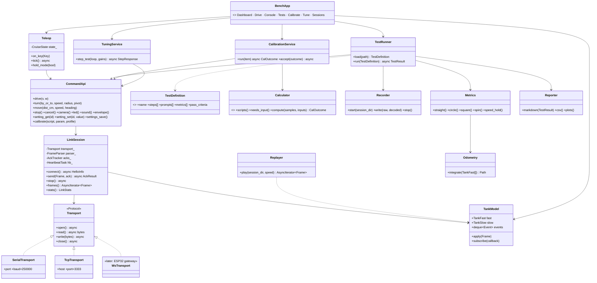
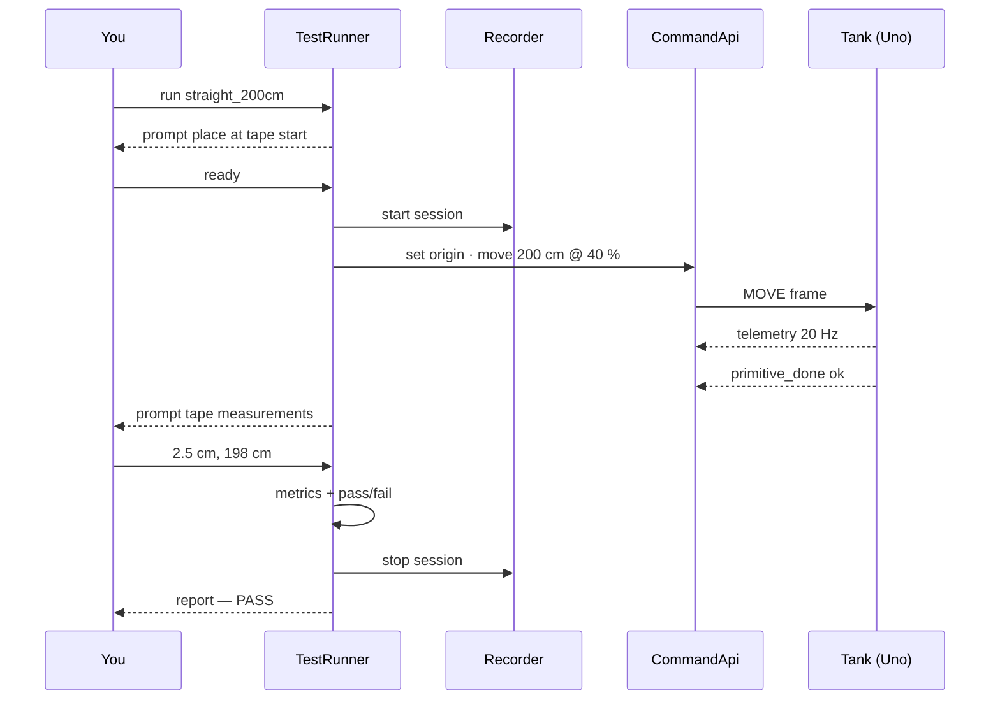

# Bench Tool — Low-Level Design

Status: APPROVED · Date: 2026-10-11 · Roadmap phase 3 · Plays the ESP32's role on the body link (USB or WiFi bridge; later the gateway WS API)

## Class diagram


## Key behaviour
- All asyncio; **heartbeat (100 ms) is its own task**; heavy analysis in a worker thread.
- Transport is the only difference between USB (`--port`), WiFi bridge (`--host conqueror-bridge.local`) and later the gateway (`--ws`).
- **STOP** (Space / `bench stop`) resent every 50 ms until acked.
- Quit, Ctrl-C or crash → STOP first; if the process dies, heartbeats stop and the Uno halts.
- `Odometry` = same algorithm as ESP32 `PoseEstimator`; `Calculator`s = **reference maths** the ESP32 C++ port must match on recorded sessions.
- Driving: cruise control by default (W/S ±10 %, A/D steer, C centre, Q/E spin, Space STOP, arrows camera, H home, 1–9 quick tests); optional `--hold` via pynput.

## Test definition (YAML)
```yaml
name: straight_200cm
description: Drive 200 cm straight at 40 %
setup:
  prompt: "Place the tank at the tape start, facing along the tape."
steps:
  - set_origin
  - move: { dist_cm: 200, speed: 40 }
  - wait_done: { timeout_s: 15 }
inputs:
  - { id: lateral_cm,  prompt: "Sideways offset from the tape line (cm, left +)" }
  - { id: distance_cm, prompt: "Distance travelled along the tape (cm)" }
metrics:
  - heading_error_deg: final_yaw - start_yaw
  - drift_cm: input.lateral_cm
  - distance_error_pct: (input.distance_cm - 200) / 200 * 100
  - odometry_vs_tape_pct: (path.length - input.distance_cm) / input.distance_cm * 100
pass:
  drift_cm: "< 5"
  heading_error_deg: "< 2"
  distance_error_pct: "< 3"
```
Circle: least-squares circle fit on odometry (radius error, closure); square: closure distance; spin: final heading error.

## Test run sequence


## Sessions on disk
```
sessions/<date>_<time>_<test>/
├── raw.bin         every frame with timestamps (replay)
├── telemetry.csv   decoded fast + slow
├── events.jsonl
├── inputs.json     tape measurements
├── result.json     metrics + pass/fail
├── report.md
└── plots/          speed.png · heading.png · path_xy.png
```

## Commands
`bench discover` · `bench connect` · `bench dash` · `bench drive [--hold]` · `bench test <name|all>` · `bench compare <A> <B>` · `bench calibrate <item|wizard>` · `bench tune <loop>` · `bench replay <session>` · `bench stop`

## Dependencies & standards
Python 3.12, uv, `conqueror_protocol` (generated), pyserial-asyncio, Textual, Typer, pydantic, numpy/scipy, matplotlib, pynput (optional). Ruff, pyright strict, ports & adapters.
