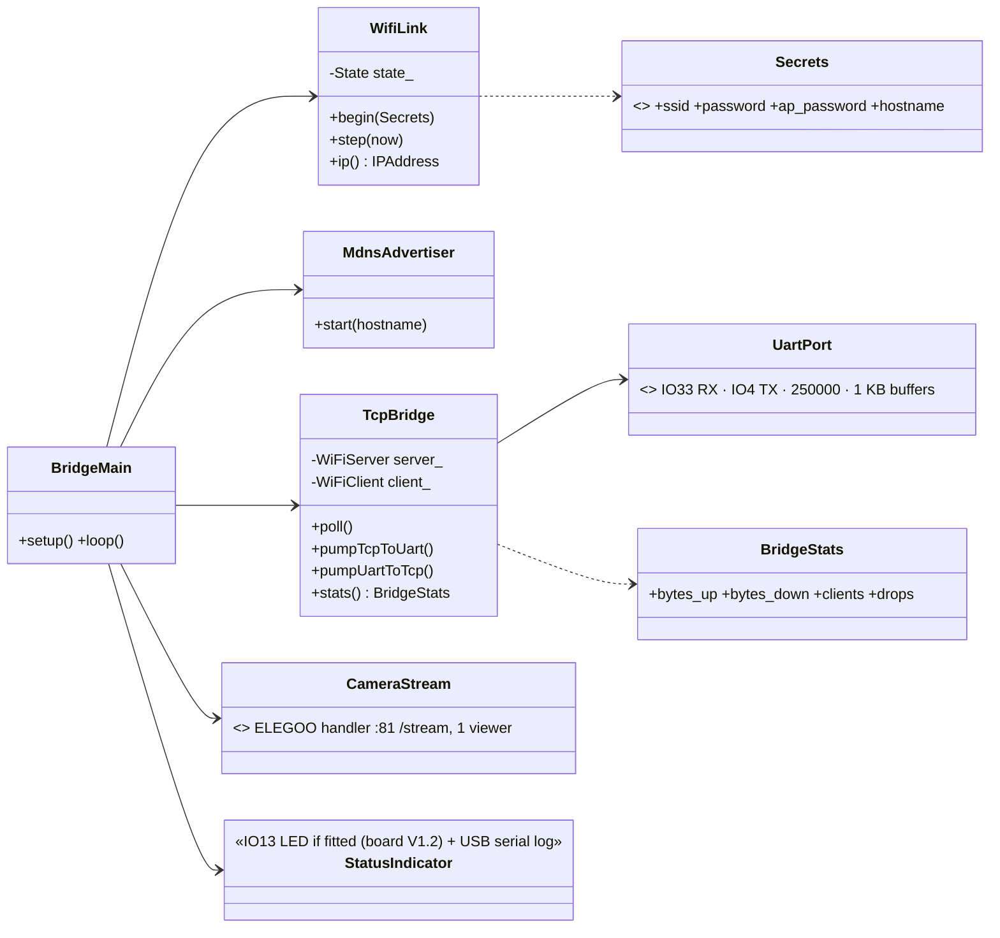
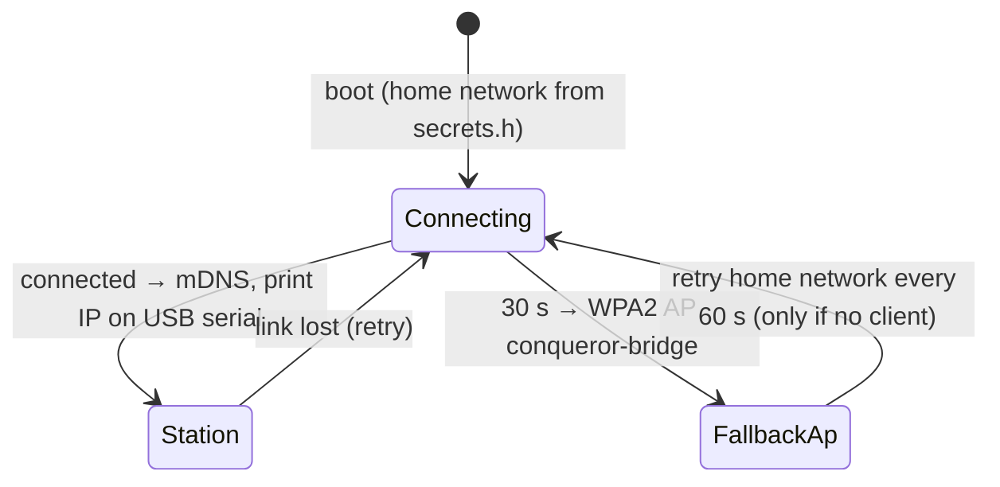
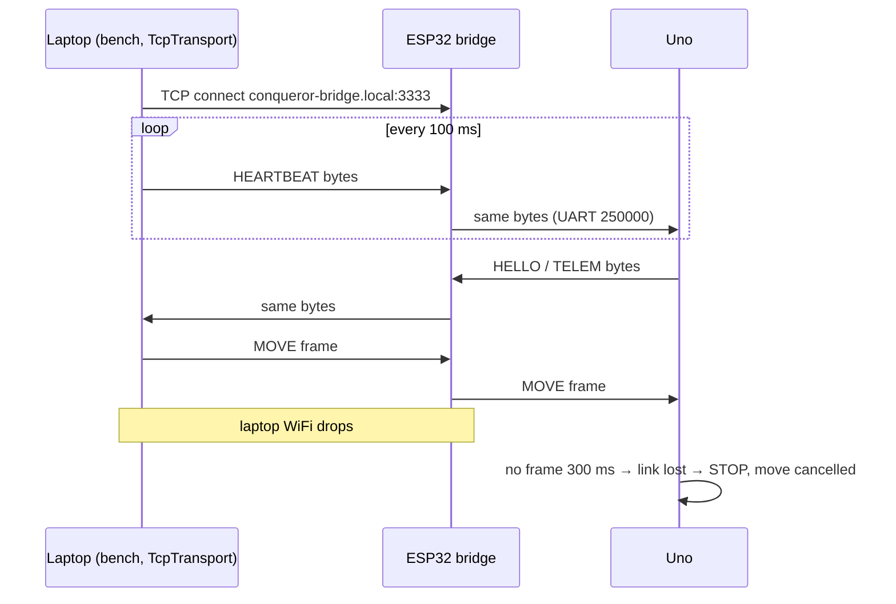

# ESP32 WiFi Bridge (developer firmware) — Low-Level Design

Status: APPROVED · Date: 2026-10-11 · Roadmap phase 3 · `firmware/esp32` → `env:bridge` (Arduino-ESP32 3.x); later only in gateway debug builds (`-D CQ_DEV_BRIDGE`)

## Class diagram

`WifiLink.State {Connecting, Station, FallbackAp}`; mDNS `conqueror-bridge.local`, service `_conqueror-bridge._tcp`; TCP port 3333 with TCP_NODELAY.

## WiFi behaviour

Status: always logged on ESP32 USB serial and shown by the bench tool; **IO13 green LED only on board V1.2** (V1.0 has no LED there): fast blink connecting · solid station · slow blink fallback AP · flicker on traffic.

## Byte pump
- Transparent both ways; frames not parsed (protocol + CRC end to end).
- One client; a new connection replaces the old (logged).
- TCP_NODELAY, immediate flush (~5–20 ms latency on home WiFi).
- **Never generates heartbeats or commands** → laptop/WiFi loss = heartbeats stop = Uno halts within 300 ms.
- Uno bytes with no client are discarded.

## Optional camera
ELEGOO's stream handler on :81 `/stream` (single viewer) for watching tests; proper multi-viewer camera comes with the gateway.

## Security
No authentication — developer use on the home network only; stated in README and boot log; never in release firmware.

## Hardware notes (verified from schematics)
- ESP32 board revisions V1.0 and V1.2: identical UART (IO33 RX, IO4 TX on connector P1), camera connector and power; only V1.2 fits the IO13 green LED.
- Uno shield = Conqueror **tank** shield (DRV8835, PWM D5/D6, PH D8/D7, MODE high) — not the Smart Robot Car V4 shield (TB6612, STBY D8, AIN1 D9; those pins are the commented-out block in the ELEGOO firmware).
