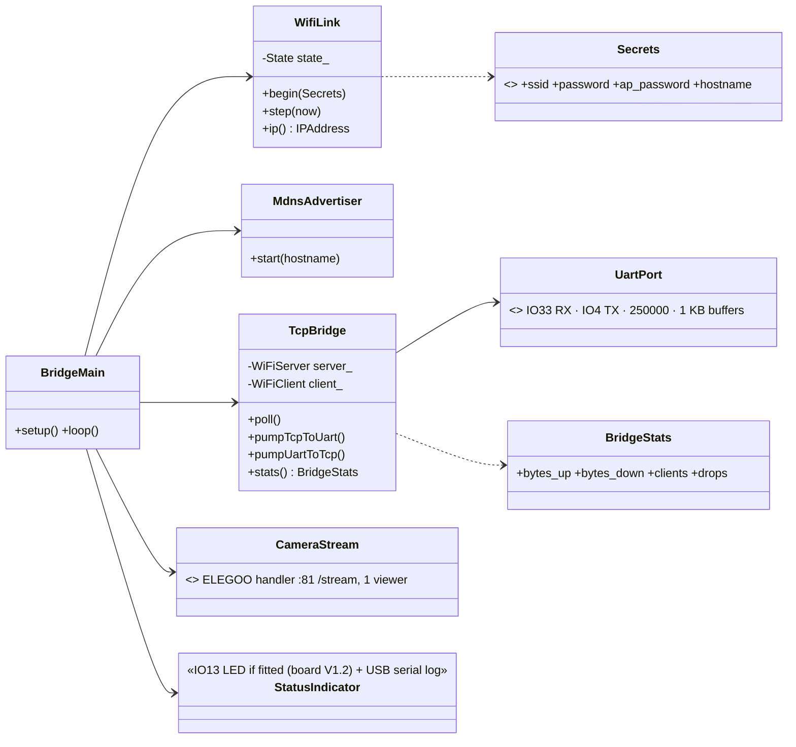
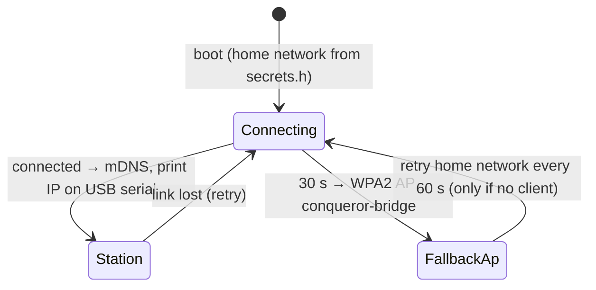
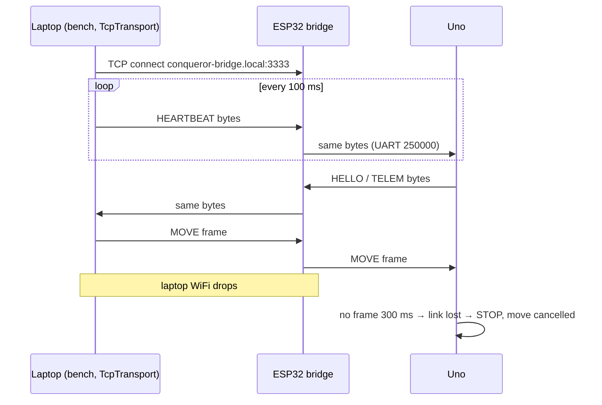
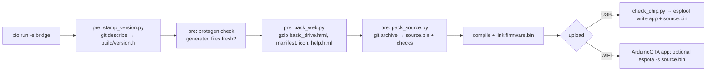
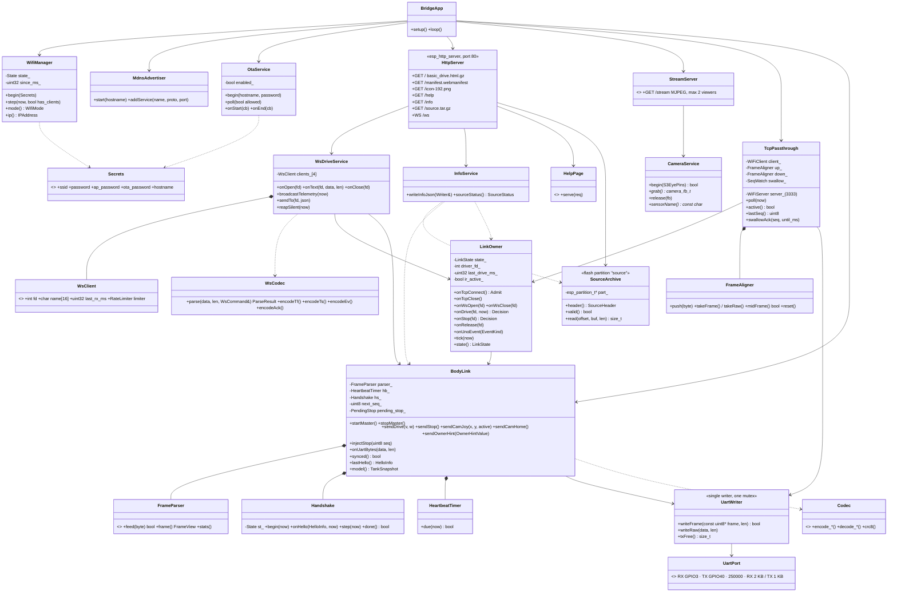
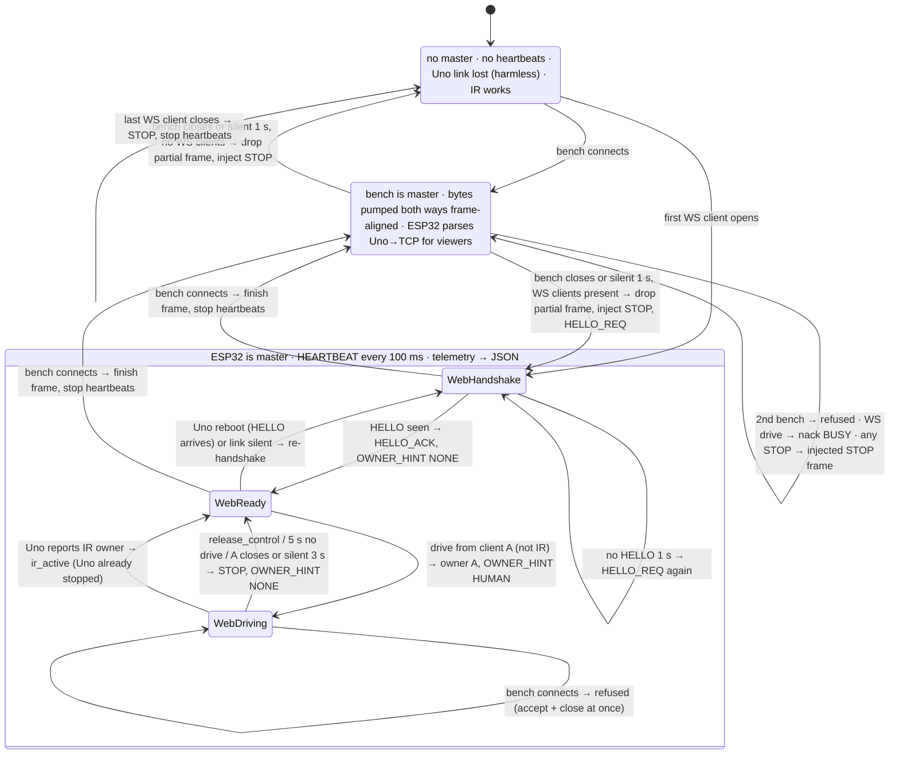
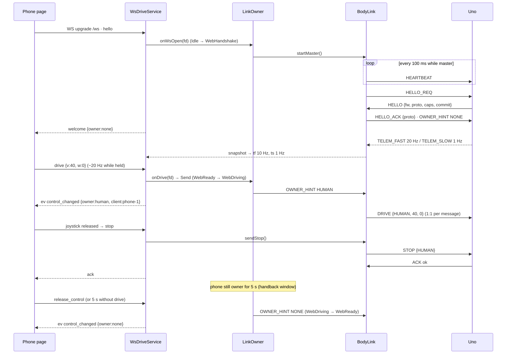
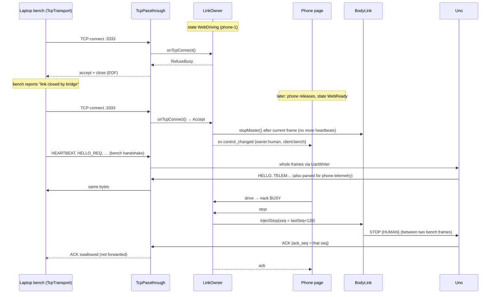
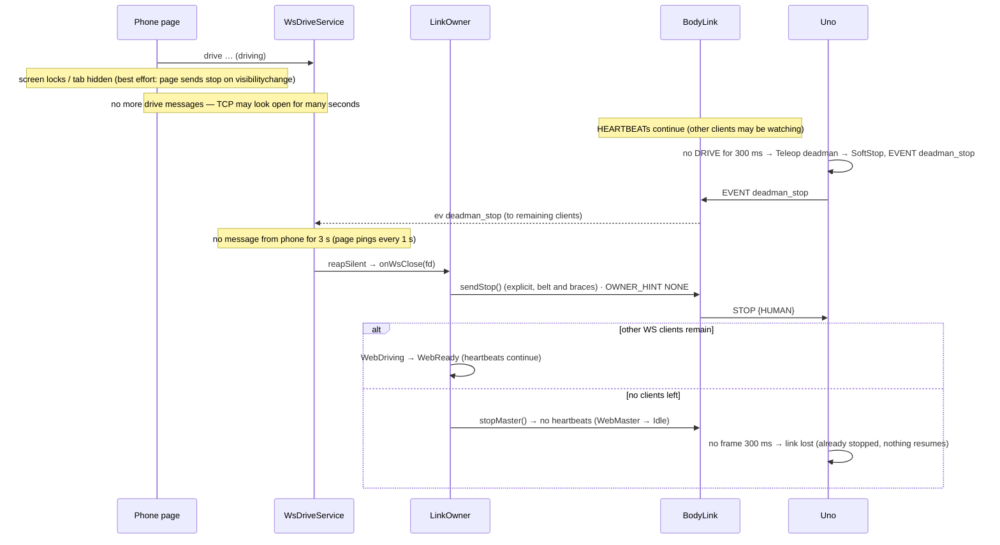

# ESP32 WiFi Bridge (developer firmware) — Low-Level Design

Status: APPROVED (Revision 1) · **Revision 2 (2026-10-12) at the end of this file supersedes earlier text where they differ** (ESP32-S3 board, Basic Drive page, link owner, OTA, `/help`) · Date: 2026-10-11 · Roadmap phase 3 · `firmware/esp32` → `env:bridge` (Arduino-ESP32 3.x); later only in gateway debug builds (`-D CQ_DEV_BRIDGE`)

## Class diagram

`WifiLink.State {Connecting, Station, FallbackAp}`; mDNS `conqueror-bridge.local`, service `_conqueror-bridge._tcp`; TCP port 3333 with TCP_NODELAY.

## WiFi behaviour

Status: always logged on ESP32 USB serial and shown by the bench tool; **IO13 green LED only on board V1.2** (V1.0 has no LED there): fast blink connecting · solid station · slow blink fallback AP · flicker on traffic.

## Byte pump
- Transparent both ways; frames not parsed (protocol + CRC end to end).
- One client; a new connection replaces the old (logged).
- TCP_NODELAY, immediate flush (~5–20 ms latency on home WiFi).
- **Never generates heartbeats or commands** → laptop/WiFi loss = heartbeats stop = Uno halts within 300 ms.
- Uno bytes with no client are discarded.



## Optional camera
ELEGOO's stream handler on :81 `/stream` (single viewer) for watching tests; proper multi-viewer camera comes with the gateway.

## Security
No authentication — developer use on the home network only; stated in README and boot log; never in release firmware.

## Hardware notes (verified from schematics)
- ESP32 board revisions V1.0 and V1.2: identical UART (IO33 RX, IO4 TX on connector P1), camera connector and power; only V1.2 fits the IO13 green LED.
- Uno shield = **SmartCar Shield V1.1** (user-confirmed); motor driver **TB6612FNG (confirmed)** (Uno LLD hardware revision). ESP32 board = **V1.0** (no IO13 LED → status via USB serial + bench tool).

---

## Revision 2 (2026-10-12)

Status: PROPOSED for owner review · supersedes the sections above where they differ.
Drivers: design-notes §22 (board is an ESP32-S3), §24 (pin map, flash/PSRAM, USB), §27 (self-describing firmware), §28 (Basic Drive page) and the phase-3 roadmap decisions (station mode, AP fallback after 30 s, mDNS, TCP 3333 ⇄ UART for the bench tool). New in this revision: OTA over WiFi and a chip check before flashing.

What changes in one paragraph: the bridge is no longer only a byte pump. It now has **two kinds of clients** — the bench tool on TCP 3333 (which speaks the body-link protocol itself, unchanged from Plan D) and the Basic Drive phone page on a WebSocket (for which the ESP32 itself must be the body-link master). A small **link owner** arbiter decides who is the master of the Uno link at any moment, and one **frame-aligned UART writer** makes sure frames from different sources never mix mid-frame. The Uno firmware is not changed.

### R2.1 Hardware (supersedes "Hardware notes" and the WROVER pins above)
| Item | Value | Source |
|---|---|---|
| Board | ELEGOO **ESP32S3-Camera-V1.0**, module ESP32-S3-WROOM-1, USB-C | §22 |
| Chip | ESP32-S3 (QFN56) rev v0.2, **8 MB flash** (GigaDevice), **8 MB embedded octal PSRAM** | §24 (esptool) |
| UART to the Uno | `Serial1`, **RX GPIO3, TX GPIO40**, **250000** 8N1 (old firmware used 115200) | §24 |
| Camera | ESP32-S3-EYE map: PWDN −1, RESET −1, XCLK 15, SDA 4, SCL 5, D7..D0 = 16, 17, 18, 12, 10, 8, 9, 11, VSYNC 6, HREF 7, PCLK 13; XCLK 20 MHz, JPEG. Sensor: driver auto-detects (OV3660 expected, logged at boot) | §24 |
| USB | native USB-Serial/JTAG (GPIO19/20), `303a:1001` → `/dev/ttyACM0` (Linux), `/dev/cu.usbmodem*` (macOS); used for flashing and the boot log | §24 |
| Status LED | none (no IO13 LED) → status on USB serial log, `/info` and the bench tool | §22 |
- GPIO3 is a strapping pin (JTAG source select, sampled at reset). It is only an input (UART RX) after boot, so it is fine; the Uno's TX idles high, which matches the default strap. Do not add a pull-down on it.
- GPIO 26–37 are used by flash and octal PSRAM — never touch them.
- PlatformIO board: `esp32-s3-devkitc-1` with `board_build.flash_size = 8MB`, `board_build.arduino.memory_type = qio_opi`, `board_build.partitions = partitions_cq8m.csv`, build flags `-D BOARD_HAS_PSRAM -D ARDUINO_USB_CDC_ON_BOOT=1` (same as the old firmware's `esp32s3:CDCOnBoot=cdc,PSRAM=opi`).

### R2.2 Partition table (8 MB flash)
`firmware/esp32/partitions_cq8m.csv`:

| Name | Type / subtype | Offset | Size | Purpose |
|---|---|---|---|---|
| `nvs` | data / nvs | 0x9000 | 0x5000 (20 KB) | WiFi + small settings (no secrets beyond what Arduino WiFi stores) |
| `otadata` | data / ota | 0xE000 | 0x2000 (8 KB) | which app slot boots |
| `app0` | app / ota_0 | 0x10000 | 0x300000 (3 MB) | firmware slot A |
| `app1` | app / ota_1 | 0x310000 | 0x300000 (3 MB) | firmware slot B (OTA writes the idle slot) |
| `source` | data / spiffs (0x82) | 0x610000 | 0x1E0000 (1.875 MB) | embedded source archive (raw blob, **not** a file system) |
| `coredump` | data / coredump | 0x7F0000 | 0x10000 (64 KB) | crash dump for debugging |
- Today's bridge app is expected at ~1.3–1.6 MB (WiFi + httpd + camera); 3 MB slots leave room for the phase-4 gateway in the same layout, so the table never has to change (changing it needs a USB flash).
- The source partition uses subtype `spiffs` only so that ArduinoOTA's "file system" upload (`espota -s`) can rewrite it over WiFi too (R2.5). The content is our own blob, not SPIFFS.
- Measured on 2026-10-12: `git archive HEAD | gzip -9` = **9.5 MB**, of which `docs/design/stitch/` PNGs are 9.0 MB; **without them 0.48 MB**. So the archive **excludes the Stitch images** (R2.3 step 6) and fits with ~4× headroom.

### R2.3 Build and flash procedure

1. **Version stamp** (`firmware/esp32/scripts/stamp_version.py`, PlatformIO `extra_scripts = pre:`): writes the git-ignored `build/version.h` with `CQ_FW_NAME "conqueror-bridge"`, `CQ_FW_VERSION` (from `git describe --tags --match 'bridge-v*' --always --dirty`), `CQ_GIT_COMMIT` (full hash), `CQ_GIT_DIRTY` (0/1), `CQ_BUILD_DATE` (UTC ISO), `CQ_REPO_URL "https://github.com/mannuray/conqueror"`.
2. **Protocol freshness**: runs `uv run protogen check` in `protocol/`; the build fails if generated files are stale.
3. **Protocol code for the ESP32**: the ESP32 build includes the **same generated** `cq_protocol.h` via `build_flags = -I ../uno/src/generated` (one file, no copy; the header already compiles off-AVR — `PROGMEM` is shimmed). No hand edits, as for every generated file.
4. **Help cheat-sheet**: a **new protogen output** `firmware/esp32/src/generated/help_protocol.html` (an HTML fragment: frame format `AA len type seq payload crc8(poly 0x07)`, baud, the main commands with example bytes taken from `golden.yaml` — HEARTBEAT, HELLO/HELLO_ACK, DRIVE, STOP, CAM_JOY — and the error/ack-status codes). This is a small **Plan A generator addition** (template + golden test), done as a Plan C task; `protogen check` then covers it. The Tank Logo quick reference is a hand-written fragment `firmware/esp32/web/help_logo.html` (words, limits, how to upload/run/stop a program), kept in step with spec 05.
5. **Web assets** (`pack_web.py`): gzips `web/basic_drive.html` (one file, inline CSS + plain JS), `web/manifest.webmanifest`, `web/icon-192.png`, and the assembled `/help` page into C arrays in `build/web_assets.h` (served with `Content-Encoding: gzip`). Budget: page ≤ 25 KB gzipped (R2.12).
6. **Source archive** (`pack_source.py`):
   - `git archive --format=tar HEAD` honouring `.gitattributes` `export-ignore` (new lines: `docs/design/stitch/** export-ignore`, `*.png export-ignore`, `firmware/esp32/web/icon-192.png -export-ignore`) → `gzip -9`. `git archive` reads `.gitattributes` from the archived tree, so these lines only take effect once committed.
   - Prepends a 64-byte header: magic `CQSRC1\0\0`, git commit (40 hex), dirty flag, payload length u32, CRC32 u32 → `build/source.bin`.
   - **Checks (build fails):** payload > partition size − 64 B; any path named `secrets.h` in the tar; the **values** of `CQ_WIFI_PASSWORD`, `CQ_AP_PASSWORD` and `CQ_OTA_PASSWORD` from the local `secrets.h` appear anywhere in the uncompressed tar.
   - `git archive` packs **HEAD**, not the working tree: a dirty build sets the dirty flag in both `version.h` and the header, `/info` shows `"dirty": true`, and release builds (`-e bridge_release`, see 7) refuse a dirty tree.
   - `secrets.h` is never tracked: Plan C Task 1 adds `firmware/esp32/include/secrets.h` to `.gitignore` (today `.gitignore` has no such line), so `git archive` cannot contain it even by mistake; the value check above is the second guard.
7. **Releases**: every flashed release is tagged `bridge-vX.Y.Z` (Uno: `uno-vX.Y.Z`) and published with `gh release create` carrying `bootloader.bin`, `partitions.bin`, `firmware.bin`, `source.bin` and a `flash.sh` with the exact esptool command. `env:bridge_release` = `env:bridge` + refuse dirty tree.
8. **Chip check before any USB flash** (`scripts/check_chip.py`, hooked as a PlatformIO pre-upload action and also runnable alone): runs `esptool.py --port <port> flash_id` and refuses to flash unless the output says **`Chip is ESP32-S3`**, **`Detected flash size: 8MB`** and the chip features list **embedded PSRAM 8MB**. Prints the MAC (expected `48:ca:43:9e:74:b4` on the owner's board; a different MAC is a warning, not an error).
9. **USB flash (first time and recovery)**: shield switch S1 position does not matter for the ESP32's own USB-C; hold BOOT while plugging in if the port does not enumerate. `pio run -e bridge -t upload` writes bootloader + partitions + app; `pio run -e bridge -t upload_source` (custom target) writes `source.bin` at 0x610000. Note §23: the USB-C link was not detected on macOS with some cables — `/dev/ttyACM0` on Linux is confirmed (§24).

### R2.4 Self-describing pages: `/info`, `/help`, `/source.tar.gz`
All three are **read-only**: no control, no settings, no secrets. Port 80.

`/info` (JSON, `Cache-Control: no-store`):
```json
{"fw":{"name":"conqueror-bridge","version":"bridge-v0.2.0","commit":"98f7200…","dirty":false,"built":"2026-10-12T10:00:00Z","repo":"https://github.com/mannuray/conqueror"},
 "source":{"url":"/source.tar.gz","commit":"98f7200…","matches_fw":true,"bytes":481000},
 "hw":{"board":"ESP32S3-Camera-V1.0","chip":"ESP32-S3 rev v0.2","flash_mb":8,"psram_mb":8,"mac":"48:ca:43:9e:74:b4","camera":"OV3660",
       "pins":{"uno_rx":3,"uno_tx":40,"camera":"ESP32-S3-EYE map"}},
 "net":{"mode":"station","ssid":"home","ip":"192.168.1.42","rssi":-58,"mdns":"conqueror-bridge.local",
        "ports":{"http":80,"ws":"/ws","stream":81,"bench_tcp":3333,"ota":3232}},
 "uno":{"baud":250000,"synced":true,"fw":"1.0","commit":"1a2b3c4d","proto":2,"reset_reason":"power_on"},
 "link":{"owner":"web","driver":"phone-2","clients":{"ws":2,"tcp":0,"stream":1},"frames_tx":1234,"frames_rx":5678,"bad_crc":0},
 "uptime_s":321,"free_heap":182000,"free_psram":7900000}
```
- `uno.*` comes from the last HELLO seen (in either mode). `uno.commit` is HELLO `commit` (u32, protocol v2) printed as 8 lower-case hex digits; HELLO `commit` = 0 (Uno built outside git) → `null`; no HELLO seen yet → all `uno.*` except `baud` are `null`.
- `source.matches_fw` is false when the app was updated over OTA without the source image (R2.5); `/help` shows a warning then.

`/help` (one static HTML page, gzipped, ~10 KB): what this firmware is + version/commit/repo · how to connect (mDNS, IP, ports, AP fallback name) · how to drive (Basic Drive page at `/`, bench `bench --host conqueror-bridge.local`) · **protocol cheat-sheet** (generated, R2.3 step 4) · **Tank Logo quick reference** (R2.3 step 4) · hardware facts (board, chip, pin map, flash/PSRAM) · how to reflash (ESP32: chip check + esptool/pio commands, OTA command; Uno: USB only, Optiboot 115200, **S1 switch** to disconnect the ESP32 during uploads) · the security note (no authentication, home network only). Live values (IP, Uno version) are filled in by a few lines of JS from `/info`, so the page itself stays static.

`/source.tar.gz`: streams the partition payload (after the 64-byte header) in 4 KB chunks with `Content-Type: application/gzip`; 404 if the header magic or CRC is wrong (e.g. never written).

### R2.5 OTA updates over WiFi (new)
**Choice: ArduinoOTA** (simplest: built into Arduino-ESP32, PlatformIO uploads with `upload_protocol = espota`, no web upload page to write). Rejected: an HTTP upload handler (`esp_https_ota`/`Update` behind a POST route) — more code, and a password check we would write ourselves.
- Password: `CQ_OTA_PASSWORD` in git-ignored `secrets.h` (template in `secrets.example.h`); the build fails if it is missing or still `change-me`. ArduinoOTA uses an MD5 challenge — fine for "fun, not ultra secure", not real security (owner confirmation 3).
- Port 3232; announced by mDNS as `_arduino._tcp` with hostname `conqueror-bridge`.
- Commands: `pio run -e bridge_ota -t upload` (app; `upload_port = conqueror-bridge.local`, `upload_flags = --auth=${sysenv.CQ_OTA_PASSWORD}`) and `pio run -e bridge_ota -t upload_source_ota` (wraps `espota.py -s` to write `source.bin` into the `source` partition). The Plan C helper `scripts/ota.sh` runs both, so app and source stay in step; if only the app is sent, `/info` reports `matches_fw: false`.
- **Safety:** `ArduinoOTA.handle()` is only polled while **nobody is driving** (link owner not `WebDriving` and not `TcpPassthrough`); otherwise espota times out and the developer retries. `onStart`: inject STOP, close WS/TCP/stream clients, stop the camera, stop heartbeats (Uno link-loss → SoftStop is harmless at standstill). `onEnd`: reboot into the new slot. `onError`: log, reboot into the old slot.
- No automatic rollback (the stock Arduino bootloader has app rollback disabled): a bad image that boots but misbehaves is fixed by another OTA or a USB flash. An image that fails verification is never activated (the OTA library checks it before switching `otadata`).
- The phase-4 gateway's OTA (ESP32 LLD §8/§10.9, signed + admin key) replaces this; the bridge's OTA is developer-only like the rest of the bridge.

### R2.6 Class diagram (supersedes the Revision 1 class diagram)

Enums: `LinkState {Idle, WebHandshake, WebReady, WebDriving, TcpPassthrough}` · `WifiMode {Connecting, Station, FallbackAp}` (behaviour unchanged from Revision 1; "only if no client" now counts WS, TCP and stream clients) · `Admit {Accept, RefuseBusy}` · `Decision {Send, NackNotOwner, NackBusy, NackBodyOffline, NackRateLimited}`.
- `FrameParser` is the ESP32's own C++ class (the Uno parser lives in Uno app code and is budget-resumable for AVR; the ESP32 does not need that). Same frames, order and counters as Plan A's `conqueror_protocol.framing.FrameParser`, proven by the same `protocol/vectors/` tests in a native (host) PlatformIO test env.
- `FrameAligner` is a light parser used only to find frame boundaries in the passthrough byte streams (sync, length, CRC). It never changes or drops bytes, except the one ACK frame swallowed in R2.8.

### R2.7 Link owner — who is the body-link master
The Uno accepts one master at a time (one heartbeat stream, one handshake). Rules:
- **The bench owns the link from TCP connect** (it handshakes and heartbeats at once), not from its first drive.
- **A phone owns driving from its first `drive`** until `release_control`, 5 s without a drive message (gateway `human_handback_ms`), or its WebSocket closes. Other phones get `nack NOT_OWNER`.
- **STOP is accepted from anyone, in every state**; in passthrough it is injected as a proper STOP frame (R2.8).
- **IR on the Uno beats all**: on EVENT `ir_override` / `control_changed` (owner IR) the ESP32 marks `ir_active`, drops the web driver (no STOP needed — the Uno already stopped) and nacks web motion `NOT_OWNER` until the Uno reports owner ≠ IR. In passthrough the bench sees the same frames and handles IR itself.
- **The ESP32 never drives on anyone's behalf.** It only originates HEARTBEAT, HELLO_REQ, HELLO_ACK, STOP, OWNER_HINT and CAM_HOME; every DRIVE / CAM_JOY is sent 1:1 for a received client message, never repeated or invented. So a silent client means a silent DRIVE stream → Uno deadman.
- **No ENVELOPE from the bridge** (it has no envelope store in phase 3). An envelope set by the bench stays on the Uno as the Uno keeps it; the bridge does not restore one after a Uno reboot (owner confirmation 5).


Notes on the transitions:
- **Re-establishing the Uno session when the master changes.** Web → bench: the ESP32 stops heartbeats right after a frame boundary; the bench starts its own handshake. If the gap is < 300 ms the Uno is still synced and sends no HELLO — Plan D already handles that with HELLO_REQ (`test_handshake_with_already_synced_uno`). Bench → web: the ESP32 always starts with `HELLO_REQ` (works whether the Uno is synced or, after > 300 ms of silence, lost and unsynced — Uno LLD §9.2/R2: link loss clears `synced`), waits for HELLO, checks `proto == kProtocolVersion` (mismatch → stays in WebHandshake, page shows `body_offline` with reason), then sends `HELLO_ACK`. Web motion before that → `nack BODY_OFFLINE`.
- **Refusing a bench (BUSY).** The bench speaks only binary frames, so it cannot read a JSON BUSY. The bridge **accepts and closes at once** (bench sees EOF → "bridge busy / closed" — Plan D's TcpTransport reports a closed link) and logs `tcp refused: phone-2 is driving` on USB serial and in `/info`. This **supersedes Revision 1's "a new connection replaces the old"**: a second bench is refused too. A half-dead bench connection is dropped after **1 s without any byte** (the bench heartbeats every 100 ms), so a crashed laptop cannot block the tank.
- **Client disconnect.** Any master/driver loss sends an explicit STOP (src HUMAN) — belt and braces, because the Uno's own deadman/link-loss stop already covers it.
- **The Uno is not changed**: deadman 300 ms on streamed DRIVE, link-loss after 300 ms without any valid frame, `synced` gate, IR owner — all exactly as Uno LLD §9.2, §9.4 and Revision R2.

### R2.8 Frame-aligned UART writer and STOP injection
One `UartWriter` owns `Serial1` TX behind one mutex. **Every writer hands it whole frames**, so frames never interleave mid-frame:
- `BodyLink` (ESP32-originated frames) encodes a full frame with the generated codec and calls `writeFrame()`.
- `TcpPassthrough` runs TCP bytes through `FrameAligner up_`: complete frames (CRC good **or bad** — passthrough stays transparent for tests that send broken frames) go out with `writeFrame()`; bytes outside any frame go out with `writeRaw()` at once. A partial frame waits for its remaining bytes; if they do not arrive within **50 ms** the partial bytes are flushed raw (keeps odd bench tests transparent; the Uno parser resyncs). On TCP close the partial frame is **discarded**, then STOP is injected.
- `writeFrame()` only writes if `txFree()` fits the whole frame (≤ 53 B), else it blocks for at most 2 ms (UART drains 25 B/ms at 250000 baud).

**STOP injected during passthrough** (only from a WS `stop` or an OTA start):
1. Seq = `TcpPassthrough.lastSeq() + 128` (mod 256). The bench increments its seq on every frame (≥ 10 frames/s), so it needs ≥ 12.8 s to reach that value, while its own ACK waits time out after 200 ms → no collision with a pending bench command.
2. `BodyLink.injectStop(seq)` → `UartWriter.writeFrame()` (waits for the current bench frame to finish).
3. `TcpPassthrough.swallowAck(seq, now + 500 ms)`: the Uno's ACK with that `ack_seq` is **not forwarded** to the bench (its `LinkSession` would ignore it anyway, but a stray ACK must never resolve a bench future). The phone gets `ack` when the Uno ACK arrives, or a resend every 50 ms up to 10 times (same rule as the bench STOP).
4. The bench sees the effect in telemetry/EVENT frames (motion stopped) like an IR stop.

### R2.9 WebSocket API — the first slice of the phase-4 gateway API
Endpoint `ws://conqueror-bridge.local/ws`, text frames, JSON, names and fields **exactly as spec 01 §4–6** (phase-4 gateway), so Cockpit-lite and the hub can reuse them. The slice drops what the bridge does not have: keys/roles (every client is `human`), subscribe options, nav, settings.

Client → tank:
| WS message | Body-link frame(s) | Gateway name | Notes |
|---|---|---|---|
| `{"t":"hello","client":"basic-drive","proto":1}` | — (handshake is the ESP32's) | `hello` (no `key` in the slice; a `key` field is ignored) | → `welcome` |
| `{"t":"drive","v":-100..100,"w":-100..100}` | `DRIVE {src=HUMAN, v, w}` (w > 0 = turn left) | `drive` | stream ≤ 20 Hz while held (rate limit 25 Hz); first drive takes ownership; joystick and tilt steering both send this. Page mapping (stick x right +, y up +): **v = y, w = −x** (pushing right sends a negative w) |
| `{"t":"stop"}` | `STOP {src=HUMAN}` (acked; injected in passthrough) | `stop` | accepted from every client in every state; the page also sends it on joystick release and on `visibilitychange` → hidden |
| `{"t":"cam_joy","x":-100..100,"y":-100..100,"active":true/false}` | `CAM_JOY {x, y, active}` | `cam_joy` | `active:false` on release → Uno glides home after `cam_return_delay_ms` |
| `{"t":"cam_home"}` | `CAM_HOME` | `cam_home` | |
| `{"t":"release_control"}` | `OWNER_HINT {NONE}` (+ STOP if moving) | `release_control` | |
| `{"t":"ping","t0":…}` | — | `ping` | page sends every 1 s; any message counts as alive |
- **Speed slider = client-side only**: the page scales `v` and `w` by the slider before sending (no `speed` message; the gateway API has none, and the owner chose no extra cap). Camera pan/tilt also uses only `cam_joy` (absolute stick), matching the page's small second joystick.
- Not in the slice (rejected `nack INVALID_COMMAND`): `turn`, `move`, `led`, `sound`, `safety_override`, `envelope`, settings, calibration — Basic Drive has no horn/LED buttons and no Override (§28).

Tank → client:
| WS message | From | Content (subset of spec 01 §6) |
|---|---|---|
| `{"t":"welcome","role":"human","tank":{"name":"conqueror-bridge","fw":{"esp32":"bridge-v0.2.0","uno":"1.0"},"proto":2,"caps":{"encoders":false,"sensor":"OV3660"}},"owner":"none"}` | HELLO + build stamp | after `hello` |
| `{"t":"tf","seq","tank_ms","yaw","pitch","roll","dist_cm","pan","tilt","spd_cmd":[l,r],"cam_moving"}` | TELEM_FAST | 10 Hz (Uno sends 20 Hz; every 2nd frame) |
| `{"t":"ts","batt_v","owner","owner_client","flags":[…],"envelope":{…}}` | TELEM_SLOW + LinkOwner | 1 Hz; `owner` ∈ `none/human/ir` (spec 01 set; the bench drives with `src=HUMAN`, so it shows as `human`), `owner_client` = `phone-N` / `bench`; `flags` subset: blocked, tilted, lifted, batt_low, batt_critical, link_lost, brake_off, envelope, safety_override, selftest_locked, body_offline |
| `{"t":"ev","seq","tank_ms","kind",…}` | EVENT + LinkOwner | kinds: `control_changed{owner,client}`, `ir_override`, `deadman_stop`, `blocked{dist_cm}`, `unblocked`, `tilted`, `level`, `lifted`, `landed`, `batt_low{v}`, `batt_critical{v}`, `link_lost`, `link_restored`, `body_offline`, `body_online`, `safety_override{on,reason}` |
| `{"t":"ack","id"}` / `{"t":"nack","id"?,"code","reason","message"}` | Uno ACK / LinkOwner | reasons used: `NOT_OWNER` (another phone drives, or IR), `BUSY` (the bench holds the link), `BODY_OFFLINE` (not synced), `RATE_LIMITED`, `INVALID_COMMAND`, `BLOCKED` (from the Uno's ACK status) — codes from `protocol/defs/errors.yaml` (all six reasons already exist there) |
| `{"t":"pong","t0","tank_ms"}` | — | |
- Heading for the page = `yaw`; battery % is computed in the page from `batt_v` (2S curve) — the bridge sends volts only.
- §28 says other drivers get "BUSY"; the gateway API uses **`NOT_OWNER`** for another client of the same role. This revision follows the gateway (`NOT_OWNER` phone vs phone; `BUSY` only when the bench holds the link); the page shows both as "Busy — <owner_client> is driving" (owner confirmation 2).

### R2.10 Sequence diagrams
**Phone connects → drives → releases → STOP**


**Bench TCP connects while the phone is driving → BUSY; phone STOP during passthrough**


**Phone goes to sleep → DRIVE stream stops → Uno deadman; later WS timeout → explicit STOP → heartbeats stop**

The tank is stopped by the **Uno's deadman** 300 ms after the last drive message, not by the WS timeout; the bridge never repeats DRIVE for a silent client, so that path cannot be defeated by the ESP32.

### R2.11 Tasks and data flow
| Task / context | Core | Work |
|---|---|---|
| WiFi / lwIP (IDF) | 0 | network stack |
| `httpd` port 80 (one worker task) | 0 | `/`, `/help`, `/info`, `/source.tar.gz` (chunked), `/ws` receive → posts `WsCommand` to `link_q` (STOP goes to the queue front) |
| `httpd` port 81 | 0 | `/stream` MJPEG; blocks its own task only, never port 80 |
| `link_task` (prio above loop, 2 ms tick + UART event) | 1 | owns `BodyLink`, `LinkOwner`, `TcpPassthrough`, `UartWriter`: drains `link_q`, pumps UART ⇄ TCP, heartbeats, handshake, builds `tf/ts/ev` JSON and sends with `httpd_ws_send_frame_async` |
| Arduino `loop()` | 1 | `WifiManager.step`, `OtaService.poll(allowed)`, mDNS, status log every 10 s |
Only `link_task` touches the UART and the link state, so no locks are needed beyond the `UartWriter` mutex (kept for safety) and the queue. Verify at Plan C Task 1 that the pinned pioarduino core has `CONFIG_HTTPD_WS_SUPPORT=y`; if not, use the `WebSockets` (links2004) library on port 80 instead — the class design does not change.

### R2.12 Memory and CPU budget (ESP32-S3: 512 KB SRAM, 8 MB PSRAM, 2 × 240 MHz)
| Item | Internal RAM | PSRAM / flash |
|---|---|---|
| WiFi + lwIP + mDNS | ~70 KB | — |
| httpd ×2 (stacks 6 KB + 8 KB, ≤ 7 + 3 sockets) | ~25 KB | — |
| `link_task` stack | 6 KB | — |
| UART buffers (RX 2 KB, TX 1 KB) | 3 KB | — |
| WS clients (4 × ~0.3 KB) + JSON scratch 1 KB | ~2.5 KB | — |
| TCP passthrough buffers | ~3 KB | — |
| Camera frame buffers (2 × VGA JPEG) | DMA descriptors only | ~2 × 64 KB PSRAM |
| Web page + help + manifest/icon (gzipped) | — | ≤ 25 + 12 + 6 KB flash |
| ArduinoOTA | ~4 KB while idle (buffers during upload) | — |
| **Target** | **free internal heap ≥ 120 KB** in steady state (reported in `/info`) | |
CPU: UART is ≤ 25 KB/s (Uno telemetry ~1.5 KB/s); JSON to ≤ 4 clients at 10 Hz is < 1 % of one core; JPEG is encoded by the sensor, MJPEG VGA ~15 fps costs mostly WiFi airtime (~1–2 Mbit/s per viewer). Latency target phone → Uno ≤ 30 ms on home WiFi (WS + queue + 2 ms tick + UART 0.3 ms).

### R2.13 Plan C impact (applied when polishing Plan C — not in this revision)
Target `esp32s3` + R2.1 pins and flags · partition CSV · version stamp + releases · chip check · protogen help output (Plan A addition) · `BodyLink`/`FrameParser` with native vector tests · `LinkOwner` with native state-machine tests (all transitions above, incl. refuse-bench, STOP injection seq + ACK swallow, partial frame discard) · `UartWriter`/`FrameAligner` tests (no interleave, bad-CRC frames still forwarded, 50 ms partial flush) · WS service + Basic Drive page · `/info`, `/help`, source archive · ArduinoOTA · hardware smoke: Plan D bench over TCP unchanged, phone drive, bench-refused-while-driving, phone sleep → deadman, IR beats phone. Plan B (Uno) unchanged; Plan D unchanged (its TcpTransport, handshake with HELLO_REQ, STOP resend and ack-timeout rules all work through the passthrough).

### R2.14 Pending owner confirmations
1. **Link-owner rules (R2.7):** bench owns the link from connect; a phone owns from its first drive with a 5 s handback; a bench arriving while a phone drives is refused by accept-and-close; a second bench is refused (replaces "new connection replaces the old"); bench silent 1 s → dropped.
2. **Busy wording:** phone vs phone → `nack NOT_OWNER` (gateway name), phone vs bench → `nack BUSY`; page shows "Busy — X is driving" for both.
3. **OTA = ArduinoOTA with a password** from `secrets.h` (MD5 challenge — fun, not ultra secure); OTA only while nobody drives; no automatic rollback (USB flash recovers). Approving this also changes the roadmap's "Out of the MVP: … OTA" line (bridge-only developer OTA; signed OTA stays phase 4).
4. **Source archive excludes the Stitch PNGs** (and other PNGs) — §27 said "whole repo"; with them it is 9.5 MB and does not fit. Partition 1.875 MB (today's archive 0.48 MB). OTA can update it (`espota -s`); `/info` flags a mismatch if only the app was sent.
5. **No envelope on the bridge:** the phase-3 bridge sends no ENVELOPE and does not persist/restore one (child-play mode arrives with the phase-4 gateway); an envelope set by the bench lives on the Uno until reboot.
6. **Camera stream: 2 viewers** on port 81 (was 1 in Revision 1; matches the gateway's max 2) — the phone page plus one laptop.
7. **Telemetry rates to the page:** `tf` 10 Hz, `ts` 1 Hz (lower than the gateway's 20 Hz to keep phones light).
8. **WS drive shape and speed:** the page sends gateway `drive {v, w}` (not `[x,y]` or left/right track values) and the speed slider only scales v/w in the page — no `speed` message, so the slice stays a strict subset of the phase-4 API.
9. **Protogen addition:** a generated `/help` protocol cheat-sheet fragment (small Plan A change, done inside Plan C).
