# ESP32 WiFi Bridge (developer firmware) — Low-Level Design

Status: APPROVED (Revision 1) · **Revision 2 (2026-10-12) at the end of this file supersedes earlier text where they differ** (ESP32-S3 board, Basic Drive page, link owner, OTA, `/help`) · Date: 2026-10-11 · Roadmap phase 3 · `firmware/esp32` → `env:bridge` (Arduino-ESP32 3.x); later only in gateway debug builds (`-D CQ_DEV_BRIDGE`)

## Class diagram
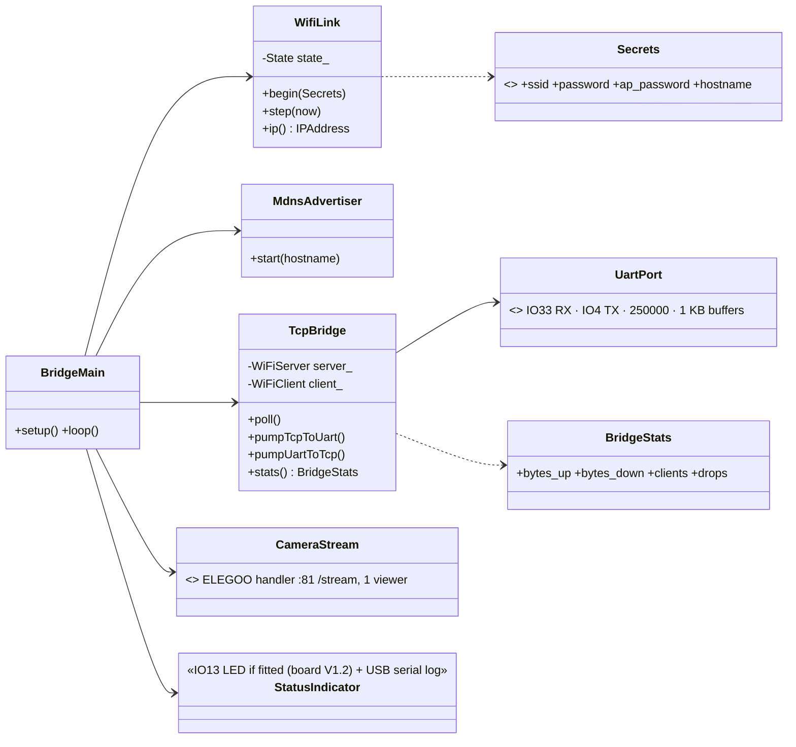
`WifiLink.State {Connecting, Station, FallbackAp}`; mDNS `conqueror-bridge.local`, service `_conqueror-bridge._tcp`; TCP port 3333 with TCP_NODELAY.

## WiFi behaviour
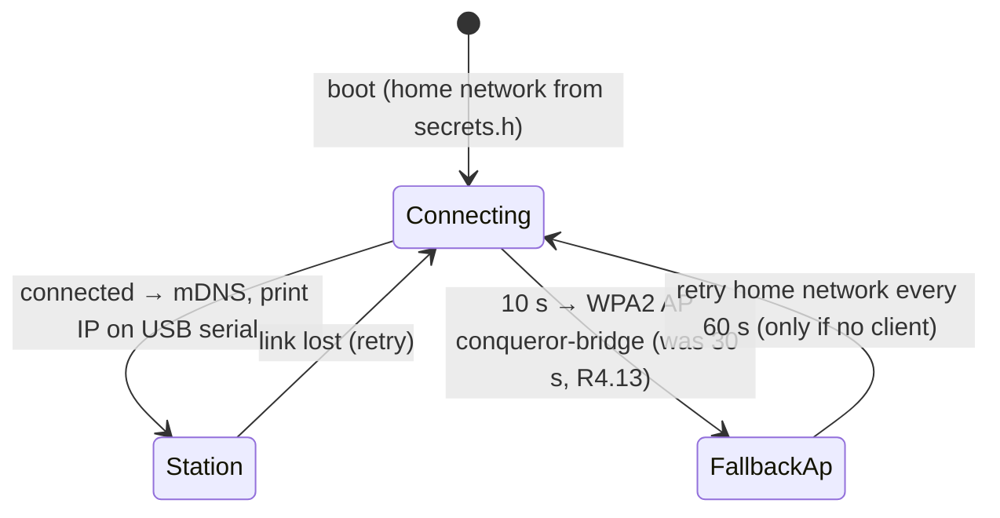
Status: always logged on ESP32 USB serial and shown by the bench tool; **IO13 green LED only on board V1.2** (V1.0 has no LED there): fast blink connecting · solid station · slow blink fallback AP · flicker on traffic.

## Byte pump
- Transparent both ways; frames not parsed (protocol + CRC end to end).
- One client; a new connection replaces the old (logged).
- TCP_NODELAY, immediate flush (~5–20 ms latency on home WiFi).
- **Never generates heartbeats or commands** → laptop/WiFi loss = heartbeats stop = Uno halts within 300 ms.
- Uno bytes with no client are discarded.

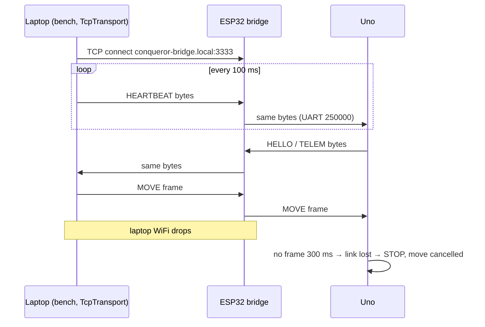

## Optional camera
ELEGOO's stream handler on :81 `/stream` (single viewer) for watching tests; proper multi-viewer camera comes with the gateway.

## Security
No authentication — developer use on the home network only; stated in README and boot log; never in release firmware.

## Hardware notes (verified from schematics)
- ESP32 board revisions V1.0 and V1.2: identical UART (IO33 RX, IO4 TX on connector P1), camera connector and power; only V1.2 fits the IO13 green LED.
- Uno shield = **SmartCar Shield V1.1** (user-confirmed); motor driver **TB6612FNG (confirmed)** (Uno LLD hardware revision). ESP32 board = **V1.0** (no IO13 LED → status via USB serial + bench tool).

---

## Revision 2 (2026-10-12)

Status: PROPOSED for owner review · supersedes the sections above where they differ.
Drivers: design-notes §22 (board is an ESP32-S3), §24 (pin map, flash/PSRAM, USB), §27 (self-describing firmware), §28 (Basic Drive page) and the phase-3 roadmap decisions (station mode, AP fallback after 30 s, mDNS, TCP 3333 ⇄ UART for the bench tool). New in this revision: OTA over WiFi and a chip check before flashing.

What changes in one paragraph: the bridge is no longer only a byte pump. It now has **two kinds of clients** — the bench tool on TCP 3333 (which speaks the body-link protocol itself, unchanged from Plan D) and the Basic Drive phone page on a WebSocket (for which the ESP32 itself must be the body-link master). A small **link owner** arbiter decides who is the master of the Uno link at any moment, and one **frame-aligned UART writer** makes sure frames from different sources never mix mid-frame. The Uno firmware is not changed.

### R2.1 Hardware (supersedes "Hardware notes" and the WROVER pins above)
| Item | Value | Source |
|---|---|---|
| Board | ELEGOO **ESP32S3-Camera-V1.0**, module ESP32-S3-WROOM-1, USB-C | §22 |
| Chip | ESP32-S3 (QFN56) rev v0.2, **8 MB flash** (GigaDevice), **8 MB embedded octal PSRAM** | §24 (esptool) |
| UART to the Uno | `Serial1`, **RX GPIO3, TX GPIO40**, **250000** 8N1 (old firmware used 115200) | §24 |
| Camera | ESP32-S3-EYE map: PWDN −1, RESET −1, XCLK 15, SDA 4, SCL 5, D7..D0 = 16, 17, 18, 12, 10, 8, 9, 11, VSYNC 6, HREF 7, PCLK 13; XCLK **10 MHz** (was 20 MHz, R4.14), JPEG. Sensor: driver auto-detects (OV3660 expected, logged at boot) | §24 |
| USB | native USB-Serial/JTAG (GPIO19/20), `303a:1001` → `/dev/ttyACM0` (Linux), `/dev/cu.usbmodem*` (macOS); used for flashing and the boot log | §24 |
| Status LED | none (no IO13 LED) → status on USB serial log, `/info` and the bench tool | §22 |
- GPIO3 is a strapping pin (JTAG source select, sampled at reset). It is only an input (UART RX) after boot, so it is fine; the Uno's TX idles high, which matches the default strap. Do not add a pull-down on it.
- GPIO 26–37 are used by flash and octal PSRAM — never touch them.
- PlatformIO board: `esp32-s3-devkitc-1` with `board_build.flash_size = 8MB`, `board_build.arduino.memory_type = qio_opi`, `board_build.partitions = partitions_cq8m.csv`, build flags `-D BOARD_HAS_PSRAM -D ARDUINO_USB_CDC_ON_BOOT=1` (same as the old firmware's `esp32s3:CDCOnBoot=cdc,PSRAM=opi`).

### R2.2 Partition table (8 MB flash)
`firmware/esp32/partitions_cq8m.csv`:

| Name | Type / subtype | Offset | Size | Purpose |
|---|---|---|---|---|
| `nvs` | data / nvs | 0x9000 | 0x5000 (20 KB) | WiFi + small settings (no secrets beyond what Arduino WiFi stores) |
| `otadata` | data / ota | 0xE000 | 0x2000 (8 KB) | which app slot boots |
| `app0` | app / ota_0 | 0x10000 | 0x300000 (3 MB) | firmware slot A |
| `app1` | app / ota_1 | 0x310000 | 0x300000 (3 MB) | firmware slot B (OTA writes the idle slot) |
| `source` | data / spiffs (0x82) | 0x610000 | 0x1E0000 (1.875 MB) | embedded source archive (raw blob, **not** a file system) |
| `coredump` | data / coredump | 0x7F0000 | 0x10000 (64 KB) | crash dump for debugging |
- Today's bridge app is expected at ~1.3–1.6 MB (WiFi + httpd + camera); 3 MB slots leave room for the phase-4 gateway in the same layout, so the table never has to change (changing it needs a USB flash).
- The source partition uses subtype `spiffs` only so that ArduinoOTA's "file system" upload (`espota -s`) can rewrite it over WiFi too (R2.5). The content is our own blob, not SPIFFS.
- Measured on 2026-10-12: `git archive HEAD | gzip -9` = **9.5 MB**, of which `docs/design/stitch/` PNGs are 9.0 MB; **without them 0.48 MB**. So the archive **excludes the Stitch images** (R2.3 step 6) and fits with ~4× headroom.

### R2.3 Build and flash procedure
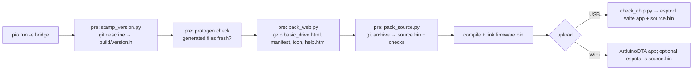
1. **Version stamp** (`firmware/esp32/scripts/stamp_version.py`, PlatformIO `extra_scripts = pre:`): writes the git-ignored `build/version.h` with `CQ_FW_NAME "conqueror-bridge"`, `CQ_FW_VERSION` (from `git describe --tags --match 'bridge-v*' --always --dirty`), `CQ_GIT_COMMIT` (full hash), `CQ_GIT_DIRTY` (0/1), `CQ_BUILD_DATE` (UTC ISO), `CQ_REPO_URL "https://github.com/mannuray/conqueror"`.
2. **Protocol freshness**: runs `uv run protogen check` in `protocol/`; the build fails if generated files are stale.
3. **Protocol code for the ESP32**: the ESP32 build includes the **same generated** `cq_protocol.h` via `build_flags = -I ../uno/src/generated` (one file, no copy; the header already compiles off-AVR — `PROGMEM` is shimmed). No hand edits, as for every generated file.
4. **Help cheat-sheet**: a **new protogen output** `firmware/esp32/src/generated/help_protocol.html` (an HTML fragment: frame format `AA len type seq payload crc8(poly 0x07)`, baud, the main commands with example bytes taken from `golden.yaml` — HEARTBEAT, HELLO/HELLO_ACK, DRIVE, STOP, CAM_JOY — and the error/ack-status codes). This is a small **Plan A generator addition** (template + golden test), done as a Plan C task; `protogen check` then covers it. The Tank Logo quick reference is a hand-written fragment `firmware/esp32/web/help_logo.html` (words, limits, how to upload/run/stop a program), kept in step with spec 05.
5. **Web assets** (`pack_web.py`): gzips `web/basic_drive.html` (one file, inline CSS + plain JS), `web/manifest.webmanifest`, `web/icon-192.png`, and the assembled `/help` page into C arrays in `build/web_assets.h` (served with `Content-Encoding: gzip`). Budget: page ≤ 25 KB gzipped (R2.12).
6. **Source archive** (`pack_source.py`):
   - `git archive --format=tar HEAD` honouring `.gitattributes` `export-ignore` (new lines: `docs/design/stitch/** export-ignore`, `*.png export-ignore`, `firmware/esp32/web/icon-192.png -export-ignore`) → `gzip -9`. `git archive` reads `.gitattributes` from the archived tree, so these lines only take effect once committed.
   - Prepends a 64-byte header: magic `CQSRC1\0\0`, git commit (40 hex), dirty flag, payload length u32, CRC32 u32 → `build/source.bin`.
   - **Checks (build fails):** payload > partition size − 64 B; any path named `secrets.h` in the tar; the **values** of `CQ_WIFI_PASSWORD`, `CQ_AP_PASSWORD` and `CQ_OTA_PASSWORD` from the local `secrets.h` appear anywhere in the uncompressed tar.
   - `git archive` packs **HEAD**, not the working tree: a dirty build sets the dirty flag in both `version.h` and the header, `/info` shows `"dirty": true`, and release builds (`-e bridge_release`, see 7) refuse a dirty tree.
   - `secrets.h` is never tracked: Plan C Task 1 adds `firmware/esp32/include/secrets.h` to `.gitignore` (today `.gitignore` has no such line), so `git archive` cannot contain it even by mistake; the value check above is the second guard.
7. **Releases**: every flashed release is tagged `bridge-vX.Y.Z` (Uno: `uno-vX.Y.Z`) and published with `gh release create` carrying `bootloader.bin`, `partitions.bin`, `firmware.bin`, `source.bin` and a `flash.sh` with the exact esptool command. `env:bridge_release` = `env:bridge` + refuse dirty tree.
8. **Chip check before any USB flash** (`scripts/check_chip.py`, hooked as a PlatformIO pre-upload action and also runnable alone): runs `esptool.py --port <port> flash_id` and refuses to flash unless the output says **`Chip is ESP32-S3`**, **`Detected flash size: 8MB`** and the chip features list **embedded PSRAM 8MB**. Prints the MAC (expected `48:ca:43:9e:74:b4` on the owner's board; a different MAC is a warning, not an error).
9. **USB flash (first time and recovery)**: shield switch S1 position does not matter for the ESP32's own USB-C; hold BOOT while plugging in if the port does not enumerate. `pio run -e bridge -t upload` writes bootloader + partitions + app; `pio run -e bridge -t upload_source` (custom target) writes `source.bin` at 0x610000. Note §23: the USB-C link was not detected on macOS with some cables — `/dev/ttyACM0` on Linux is confirmed (§24).

### R2.4 Self-describing pages: `/info`, `/help`, `/source.tar.gz`
All three are **read-only**: no control, no settings, no secrets. Port 80.

`/info` (JSON, `Cache-Control: no-store`):
```json
{"fw":{"name":"conqueror-bridge","version":"bridge-v0.2.0","commit":"98f7200…","dirty":false,"built":"2026-10-12T10:00:00Z","repo":"https://github.com/mannuray/conqueror"},
 "source":{"url":"/source.tar.gz","commit":"98f7200…","matches_fw":true,"bytes":481000},
 "hw":{"board":"ESP32S3-Camera-V1.0","chip":"ESP32-S3 rev v0.2","flash_mb":8,"psram_mb":8,"mac":"48:ca:43:9e:74:b4","camera":"OV3660",
       "pins":{"uno_rx":3,"uno_tx":40,"camera":"ESP32-S3-EYE map"}},
 "net":{"mode":"station","ssid":"home","ip":"192.168.1.42","rssi":-58,"mdns":"conqueror-bridge.local",
        "ports":{"http":80,"ws":"/ws","stream":81,"bench_tcp":3333,"ota":3232}},
 "uno":{"baud":250000,"synced":true,"fw":"1.0","commit":"1a2b3c4d","proto":2,"reset_reason":"power_on"},
 "link":{"owner":"web","driver":"phone-2","clients":{"ws":2,"tcp":0,"stream":1},"frames_tx":1234,"frames_rx":5678,"bad_crc":0},
 "uptime_s":321,"free_heap":182000,"free_psram":7900000}
```
- `uno.*` comes from the last HELLO seen (in either mode). `uno.commit` is HELLO `commit` (u32, protocol v2) printed as 8 lower-case hex digits; HELLO `commit` = 0 (Uno built outside git) → `null`; no HELLO seen yet → all `uno.*` except `baud` are `null`.
- `source.matches_fw` is false when the app was updated over OTA without the source image (R2.5); `/help` shows a warning then.

`/help` (one static HTML page, gzipped, ~10 KB): what this firmware is + version/commit/repo · how to connect (mDNS, IP, ports, AP fallback name) · how to drive (Basic Drive page at `/`, bench `bench --host conqueror-bridge.local`) · **protocol cheat-sheet** (generated, R2.3 step 4) · **Tank Logo quick reference** (R2.3 step 4) · hardware facts (board, chip, pin map, flash/PSRAM) · how to reflash (ESP32: chip check + esptool/pio commands, OTA command; Uno: USB only, Optiboot 115200, **S1 switch** to disconnect the ESP32 during uploads) · the security note (no authentication, home network only). Live values (IP, Uno version) are filled in by a few lines of JS from `/info`, so the page itself stays static.

`/source.tar.gz`: streams the partition payload (after the 64-byte header) in 4 KB chunks with `Content-Type: application/gzip`; 404 if the header magic or CRC is wrong (e.g. never written).

### R2.5 OTA updates over WiFi (new)
**Choice: ArduinoOTA** (simplest: built into Arduino-ESP32, PlatformIO uploads with `upload_protocol = espota`, no web upload page to write). Rejected: an HTTP upload handler (`esp_https_ota`/`Update` behind a POST route) — more code, and a password check we would write ourselves.
- Password: `CQ_OTA_PASSWORD` in git-ignored `secrets.h` (template in `secrets.example.h`); the build fails if it is missing or still `change-me`. ArduinoOTA uses an MD5 challenge — fine for "fun, not ultra secure", not real security (owner confirmation 3).
- Port 3232; announced by mDNS as `_arduino._tcp` with hostname `conqueror-bridge`.
- Commands: `pio run -e bridge_ota -t upload` (app; `upload_port = conqueror-bridge.local`, `upload_flags = --auth=${sysenv.CQ_OTA_PASSWORD}`) and `pio run -e bridge_ota -t upload_source_ota` (wraps `espota.py -s` to write `source.bin` into the `source` partition). The Plan C helper `scripts/ota.sh` runs both, so app and source stay in step; if only the app is sent, `/info` reports `matches_fw: false`.
- **Safety:** `ArduinoOTA.handle()` is only polled while **nobody is driving** (link owner not `WebDriving` and not `TcpPassthrough`); otherwise espota times out and the developer retries. `onStart`: inject STOP, close WS/TCP/stream clients, stop the camera, stop heartbeats (Uno link-loss → SoftStop is harmless at standstill). `onEnd`: reboot into the new slot. `onError`: log, reboot into the old slot.
- No automatic rollback (the stock Arduino bootloader has app rollback disabled): a bad image that boots but misbehaves is fixed by another OTA or a USB flash. An image that fails verification is never activated (the OTA library checks it before switching `otadata`).
- The phase-4 gateway's OTA (ESP32 LLD §8/§10.9, signed + admin key) replaces this; the bridge's OTA is developer-only like the rest of the bridge.

### R2.6 Class diagram (supersedes the Revision 1 class diagram)
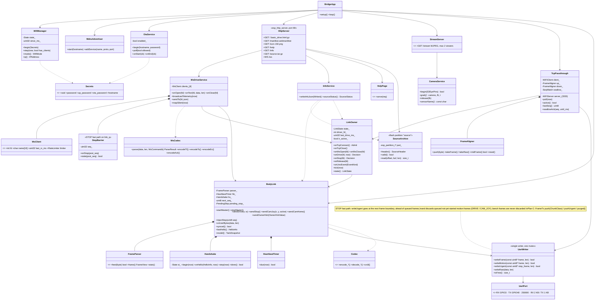
Enums: `LinkState {Idle, WebHandshake, WebReady, WebDriving, TcpPassthrough}` · `WifiMode {Connecting, Station, FallbackAp}` (behaviour unchanged from Revision 1; "only if no client" now counts WS, TCP and stream clients) · `Admit {Accept, RefuseBusy}` · `Decision {Send, NackNotOwner, NackBusy, NackBodyOffline, NackRateLimited}`.
- `FrameParser` is the ESP32's own C++ class (the Uno parser lives in Uno app code and is budget-resumable for AVR; the ESP32 does not need that). Same frames, order and counters as Plan A's `conqueror_protocol.framing.FrameParser`, proven by the same `protocol/vectors/` tests in a native (host) PlatformIO test env.
- `FrameAligner` is a light parser used only to find frame boundaries in the passthrough byte streams (sync, length, CRC). It never changes or drops bytes, except the one ACK frame swallowed in R2.8.

### R2.7 Link owner — who is the body-link master
The Uno accepts one master at a time (one heartbeat stream, one handshake). Rules:
- **The bench owns the link from TCP connect** (it handshakes and heartbeats at once), not from its first drive.
- **A phone owns driving from its first `drive`** until `release_control`, 5 s without a drive message (gateway `human_handback_ms`), or its WebSocket closes. Other phones get `nack NOT_OWNER`.
- **STOP is accepted from anyone, in every state**; in passthrough it is injected as a proper STOP frame (R2.8).
- **IR on the Uno beats all**: on EVENT `ir_override` / `control_changed` (owner IR) the ESP32 marks `ir_active`, drops the web driver (no STOP needed — the Uno already stopped) and nacks web motion `NOT_OWNER` until the Uno reports owner ≠ IR. In passthrough the bench sees the same frames and handles IR itself.
- **The ESP32 never drives on anyone's behalf.** It only originates HEARTBEAT, HELLO_REQ, HELLO_ACK, STOP, OWNER_HINT and CAM_HOME; every DRIVE / CAM_JOY is sent 1:1 for a received client message, never repeated or invented. So a silent client means a silent DRIVE stream → Uno deadman.
- **No ENVELOPE from the bridge** (it has no envelope store in phase 3). An envelope set by the bench stays on the Uno as the Uno keeps it; the bridge does not restore one after a Uno reboot (owner confirmation 5).

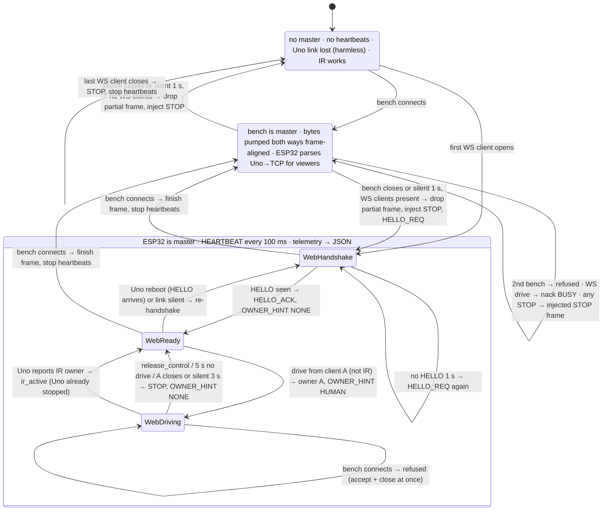
Notes on the transitions:
- **Re-establishing the Uno session when the master changes.** Web → bench: the ESP32 stops heartbeats right after a frame boundary; the bench starts its own handshake. If the gap is < 300 ms the Uno is still synced and sends no HELLO — Plan D already handles that with HELLO_REQ (`test_handshake_with_already_synced_uno`). Bench → web: the ESP32 always starts with `HELLO_REQ` (works whether the Uno is synced or, after > 300 ms of silence, lost and unsynced — Uno LLD §9.2/R2: link loss clears `synced`), waits for HELLO, checks `proto == kProtocolVersion` (mismatch → stays in WebHandshake, page shows `body_offline` with reason), then sends `HELLO_ACK`. Web motion before that → `nack BODY_OFFLINE`.
- **Refusing a bench (BUSY).** The bench speaks only binary frames, so it cannot read a JSON BUSY. The bridge **accepts and closes at once** (bench sees EOF → "bridge busy / closed" — Plan D's TcpTransport reports a closed link) and logs `tcp refused: phone-2 is driving` on USB serial and in `/info`. This **supersedes Revision 1's "a new connection replaces the old"**: a second bench is refused too. A half-dead bench connection is dropped after **1 s without any byte** (the bench heartbeats every 100 ms), so a crashed laptop cannot block the tank.
- **Client disconnect.** Any master/driver loss sends an explicit STOP (src HUMAN) — belt and braces, because the Uno's own deadman/link-loss stop already covers it.
- **The Uno is not changed**: deadman 300 ms on streamed DRIVE, link-loss after 300 ms without any valid frame, `synced` gate, IR owner — all exactly as Uno LLD §9.2, §9.4 and Revision R2.

### R2.8 Frame-aligned UART writer and STOP injection
One `UartWriter` owns `Serial1` TX behind one mutex. **Every writer hands it whole frames**, so frames never interleave mid-frame:
- `BodyLink` (ESP32-originated frames) encodes a full frame with the generated codec and calls `writeFrame()`.
- `TcpPassthrough` runs TCP bytes through `FrameAligner up_`: complete frames (CRC good **or bad** — passthrough stays transparent for tests that send broken frames) go out with `writeFrame()`; bytes outside any frame go out with `writeRaw()` at once. A partial frame waits for its remaining bytes; if they do not arrive within **50 ms** the partial bytes are flushed raw (keeps odd bench tests transparent; the Uno parser resyncs). On TCP close the partial frame is **discarded**, then STOP is injected.
- `writeFrame()` only writes if `txFree()` fits the whole frame (≤ 53 B), else it blocks for at most 2 ms (UART drains 25 B/ms at 250000 baud).
- **STOP fast path** (controller ruling 2026-10-13): every STOP (WS `stop`, ESP32-originated on driver loss / OTA start, injected in passthrough) goes out at the **next frame boundary, ahead of queued frames** — never mid-frame and never inside a partially received bench frame (the aligner holds partials back). Queued, not-yet-started DRIVE / CAM_JOY frames are **discarded** (the Uno resumes on the next DRIVE after a STOP, so an older drive must not follow it); bench passthrough frames are never discarded. On `link_q` the WS `stop` goes to the queue front, and drive/cam_joy messages posted before it are dropped when handled after it (Plan C: `FrameTx` urgent slot + `StopBarrier`).

**STOP injected during passthrough** (only from a WS `stop` or an OTA start):
1. Seq = `TcpPassthrough.lastSeq() + 128` (mod 256). The bench increments its seq on every frame (≥ 10 frames/s), so it needs ≥ 12.8 s to reach that value, while its own ACK waits time out after 200 ms → no collision with a pending bench command.
2. `BodyLink.injectStop(seq)` → `UartWriter.writeFrame()` (waits for the current bench frame to finish).
3. `TcpPassthrough.swallowAck(seq, now + 500 ms)`: the Uno's ACK with that `ack_seq` is **not forwarded** to the bench (its `LinkSession` would ignore it anyway, but a stray ACK must never resolve a bench future). The phone gets `ack` when the Uno ACK arrives, or a resend every 50 ms up to 10 times (same rule as the bench STOP).
4. The bench sees the effect in telemetry/EVENT frames (motion stopped) like an IR stop.

### R2.9 WebSocket API — the first slice of the phase-4 gateway API
Endpoint `ws://conqueror-bridge.local/ws`, text frames, JSON, names and fields **exactly as spec 01 §4–6** (phase-4 gateway), so Cockpit-lite and the hub can reuse them. The slice drops what the bridge does not have: keys/roles (every client is `human`), subscribe options, nav, settings.

Client → tank:
| WS message | Body-link frame(s) | Gateway name | Notes |
|---|---|---|---|
| `{"t":"hello","client":"basic-drive","proto":1}` | — (handshake is the ESP32's) | `hello` (no `key` in the slice; a `key` field is ignored) | → `welcome` |
| `{"t":"drive","v":-100..100,"w":-100..100}` | `DRIVE {src=HUMAN, v, w}` (w > 0 = turn left) | `drive` | stream ≤ 20 Hz while held (rate limit 25 Hz); first drive takes ownership; joystick and tilt steering both send this. Page mapping (stick x right +, y up +): **v = y, w = −x** (pushing right sends a negative w) |
| `{"t":"stop"}` | `STOP {src=HUMAN}` (acked; injected in passthrough) | `stop` | accepted from every client in every state; the page also sends it on joystick release and on `visibilitychange` → hidden |
| `{"t":"cam_joy","x":-100..100,"y":-100..100,"active":true/false}` | `CAM_JOY {x, y, active}` | `cam_joy` | `active:false` on release → Uno glides home after `cam_return_delay_ms` |
| `{"t":"cam_home"}` | `CAM_HOME` | `cam_home` | |
| `{"t":"release_control"}` | `OWNER_HINT {NONE}` (+ STOP if moving) | `release_control` | |
| `{"t":"ping","t0":…}` | — | `ping` | page sends every 1 s; any message counts as alive |
- **Speed slider = client-side only**: the page scales `v` and `w` by the slider before sending (no `speed` message; the gateway API has none, and the owner chose no extra cap). Camera pan/tilt also uses only `cam_joy` (absolute stick), matching the page's small second joystick.
- Not in the slice (rejected `nack INVALID_COMMAND`): `turn`, `move`, `led`, `sound`, `safety_override`, `envelope`, settings, calibration — Basic Drive has no horn/LED buttons and no Override (§28).

Tank → client:
| WS message | From | Content (subset of spec 01 §6) |
|---|---|---|
| `{"t":"welcome","role":"human","tank":{"name":"conqueror-bridge","fw":{"esp32":"bridge-v0.2.0","uno":"1.0"},"proto":2,"caps":{"encoders":false,"sensor":"OV3660"}},"owner":"none"}` | HELLO + build stamp | after `hello` |
| `{"t":"tf","seq","tank_ms","yaw","pitch","roll","dist_cm","pan","tilt","spd_cmd":[l,r],"cam_moving"}` | TELEM_FAST | 10 Hz (Uno sends 20 Hz; every 2nd frame) |
| `{"t":"ts","batt_v","owner","owner_client","flags":[…],"envelope":{…}}` | TELEM_SLOW + LinkOwner | 1 Hz; `owner` ∈ `none/human/ir` (spec 01 set; the bench drives with `src=HUMAN`, so it shows as `human`), `owner_client` = `phone-N` / `bench`; `flags` subset: blocked, tilted, lifted, batt_low, batt_critical, link_lost, brake_off, envelope, safety_override, selftest_locked, body_offline |
| `{"t":"ev","seq","tank_ms","kind",…}` | EVENT + LinkOwner | kinds: `control_changed{owner,client}`, `ir_override`, `deadman_stop`, `blocked{dist_cm}`, `unblocked`, `tilted`, `level`, `lifted`, `landed`, `batt_low{v}`, `batt_critical{v}`, `link_lost`, `link_restored`, `body_offline`, `body_online`, `safety_override{on,reason}` |
| `{"t":"ack","id"}` / `{"t":"nack","id"?,"code","reason","message"}` | Uno ACK / LinkOwner | reasons used: `NOT_OWNER` (another phone drives, or IR), `BUSY` (the bench holds the link), `BODY_OFFLINE` (not synced), `RATE_LIMITED`, `INVALID_COMMAND`, `BLOCKED` (from the Uno's ACK status) — codes from `protocol/defs/errors.yaml` (all six reasons already exist there) |
| `{"t":"pong","t0","tank_ms"}` | — | |
- Heading for the page = `yaw`; battery % is computed in the page from `batt_v` (2S curve) — the bridge sends volts only.
- §28 says other drivers get "BUSY"; the gateway API uses **`NOT_OWNER`** for another client of the same role. This revision follows the gateway (`NOT_OWNER` phone vs phone; `BUSY` only when the bench holds the link); the page shows both as "Busy — <owner_client> is driving" (owner confirmation 2).

### R2.10 Sequence diagrams
**Phone connects → drives → releases → STOP**
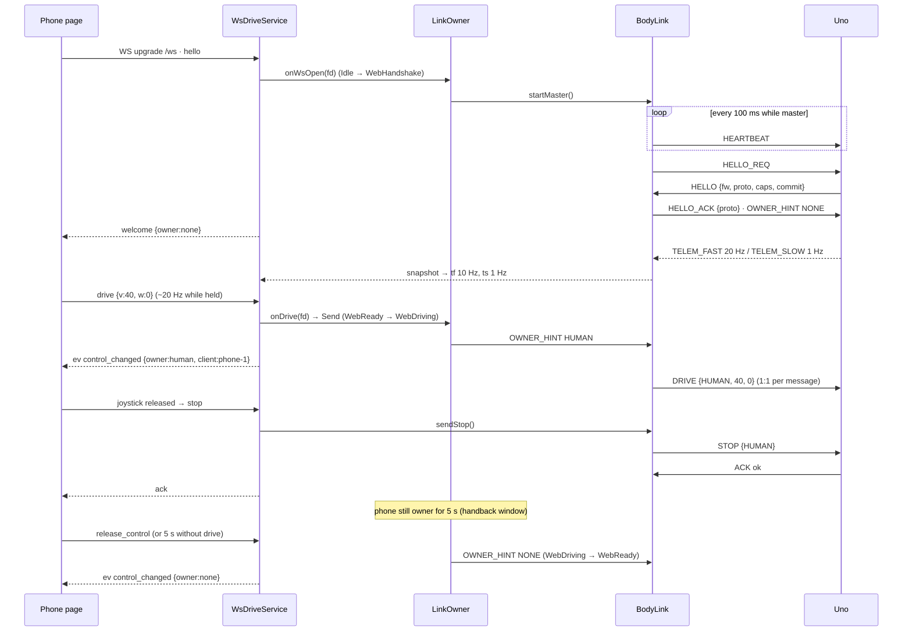

**Bench TCP connects while the phone is driving → BUSY; phone STOP during passthrough**
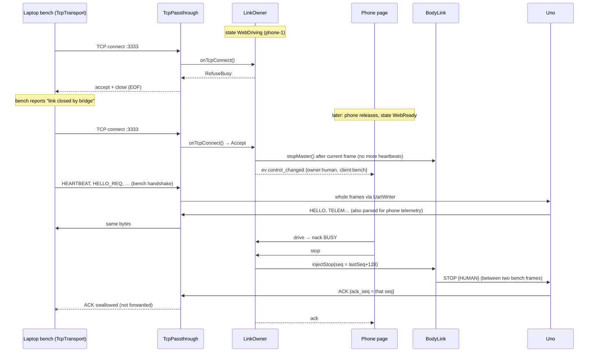

**Phone goes to sleep → DRIVE stream stops → Uno deadman; later WS timeout → explicit STOP → heartbeats stop**
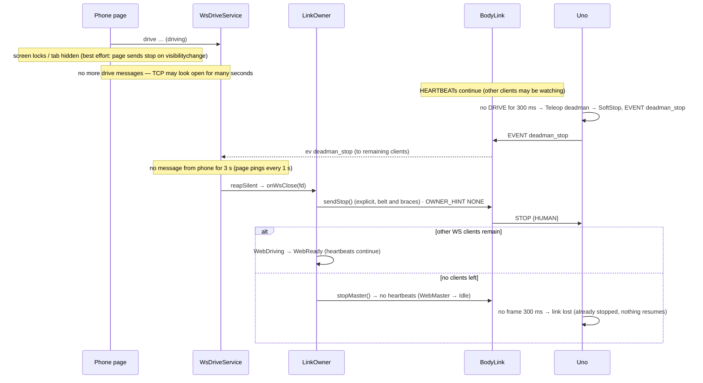
The tank is stopped by the **Uno's deadman** 300 ms after the last drive message, not by the WS timeout; the bridge never repeats DRIVE for a silent client, so that path cannot be defeated by the ESP32.

### R2.11 Tasks and data flow
| Task / context | Core | Work |
|---|---|---|
| WiFi / lwIP (IDF) | 0 | network stack |
| `httpd` port 80 (one worker task) | 0 | `/`, `/help`, `/info`, `/source.tar.gz` → 302 to port 81 (R3.11), `/ws` receive → posts `WsCommand` to `link_q` (STOP goes to the queue front) |
| `httpd` port 81 | 0 | `/stream` MJPEG (a task per viewer, R3.1), `/capture`, `/source.tar.gz` (chunked, R3.11); never blocks port 80 |
| `link_task` (prio above loop, 2 ms tick + UART event) | 1 | owns `BodyLink`, `LinkOwner`, `TcpPassthrough`, `UartWriter`: drains `link_q`, pumps UART ⇄ TCP, heartbeats, handshake, builds `tf/ts/ev` JSON and sends with `httpd_ws_send_frame_async` |
| Arduino `loop()` | 1 | `WifiManager.step`, `OtaService.poll(allowed)`, mDNS, status log every 10 s |
Only `link_task` touches the UART and the link state, so no locks are needed beyond the `UartWriter` mutex (kept for safety) and the queue. Verify at Plan C Task 1 that the pinned pioarduino core has `CONFIG_HTTPD_WS_SUPPORT=y`; if not, use the `WebSockets` (links2004) library on port 80 instead — the class design does not change.

### R2.12 Memory and CPU budget (ESP32-S3: 512 KB SRAM, 8 MB PSRAM, 2 × 240 MHz)
| Item | Internal RAM | PSRAM / flash |
|---|---|---|
| WiFi + lwIP + mDNS | ~70 KB | — |
| httpd ×2 (stacks 6 KB + 8 KB, ≤ 7 + 3 sockets) | ~25 KB | — |
| `link_task` stack | 6 KB | — |
| UART buffers (RX 2 KB, TX 1 KB) | 3 KB | — |
| WS clients (4 × ~0.3 KB) + JSON scratch 1 KB | ~2.5 KB | — |
| TCP passthrough buffers | ~3 KB | — |
| Camera frame buffers (2 × VGA JPEG) | DMA descriptors only | ~2 × 64 KB PSRAM |
| Web page + help + manifest/icon (gzipped) | — | ≤ 25 + 12 + 6 KB flash |
| ArduinoOTA | ~4 KB while idle (buffers during upload) | — |
| **Target** | **free internal heap ≥ 120 KB** in steady state (reported in `/info`) | |
CPU: UART is ≤ 25 KB/s (Uno telemetry ~1.5 KB/s); JSON to ≤ 4 clients at 10 Hz is < 1 % of one core; JPEG is encoded by the sensor, MJPEG VGA ~15 fps costs mostly WiFi airtime (~1–2 Mbit/s per viewer). Latency target phone → Uno ≤ 30 ms on home WiFi (WS + queue + 2 ms tick + UART 0.3 ms).

### R2.13 Plan C impact (applied when polishing Plan C — not in this revision)
Target `esp32s3` + R2.1 pins and flags · partition CSV · version stamp + releases · chip check · protogen help output (Plan A addition) · `BodyLink`/`FrameParser` with native vector tests · `LinkOwner` with native state-machine tests (all transitions above, incl. refuse-bench, STOP injection seq + ACK swallow, partial frame discard) · `UartWriter`/`FrameAligner` tests (no interleave, bad-CRC frames still forwarded, 50 ms partial flush) · WS service + Basic Drive page · `/info`, `/help`, source archive · ArduinoOTA · hardware smoke: Plan D bench over TCP unchanged, phone drive, bench-refused-while-driving, phone sleep → deadman, IR beats phone. Plan B (Uno) unchanged; Plan D unchanged (its TcpTransport, handshake with HELLO_REQ, STOP resend and ack-timeout rules all work through the passthrough).

### R2.14 Pending owner confirmations
1. **Link-owner rules (R2.7):** bench owns the link from connect; a phone owns from its first drive with a 5 s handback; a bench arriving while a phone drives is refused by accept-and-close; a second bench is refused (replaces "new connection replaces the old"); bench silent 1 s → dropped.
2. **Busy wording:** phone vs phone → `nack NOT_OWNER` (gateway name), phone vs bench → `nack BUSY`; page shows "Busy — X is driving" for both.
3. **OTA = ArduinoOTA with a password** from `secrets.h` (MD5 challenge — fun, not ultra secure); OTA only while nobody drives; no automatic rollback (USB flash recovers). Approving this also changes the roadmap's "Out of the MVP: … OTA" line (bridge-only developer OTA; signed OTA stays phase 4).
4. **Source archive excludes the Stitch PNGs** (and other PNGs) — §27 said "whole repo"; with them it is 9.5 MB and does not fit. Partition 1.875 MB (today's archive 0.48 MB). OTA can update it (`espota -s`); `/info` flags a mismatch if only the app was sent.
5. **No envelope on the bridge:** the phase-3 bridge sends no ENVELOPE and does not persist/restore one (child-play mode arrives with the phase-4 gateway); an envelope set by the bench lives on the Uno until reboot.
6. **Camera stream: 2 viewers** on port 81 (was 1 in Revision 1; matches the gateway's max 2) — the phone page plus one laptop.
7. **Telemetry rates to the page:** `tf` 10 Hz, `ts` 1 Hz (lower than the gateway's 20 Hz to keep phones light).
8. **WS drive shape and speed:** the page sends gateway `drive {v, w}` (not `[x,y]` or left/right track values) and the speed slider only scales v/w in the page — no `speed` message, so the slice stays a strict subset of the phase-4 API.
9. **Protogen addition:** a generated `/help` protocol cheat-sheet fragment (small Plan A change, done inside Plan C).

## Implementation notes (Plan C, 2026-10-13)
- Toolchain: pioarduino 55.03.311 (Arduino-ESP32 3.3.11, ESP-IDF 5.5.5), board `esp32-s3-devkitc-1`, `qio_opi`, `partitions_cq8m.csv`; `-Werror` only in `env:native` (framework headers are not warning-clean).
- mDNS services: `_cqbridge._tcp` 3333 (DNS-SD names ≤ 15 characters; Plan D's `discover` uses it), `_http._tcp` 80, `_arduino._tcp` 3232 — R1's `_conqueror-bridge._tcp` is not used.
- One `link_task` owns UART, `BodyLink`, `LinkOwner`, `TcpPassthrough` and `WsClients`; `UartWriter` is realised as `FrameTx` (whole-chunk queue + one urgent STOP slot) drained only by `link_task`, so no mutex is needed. WS replies are queued and sent by the httpd task (`httpd_queue_work`).
- **STOP fast path (R2.11, controller ruling 2026-10-13):** a WS `stop` is posted to the **front** of `link_q` (open/close/other texts stay FIFO; 100 ms wait, drained every 2 ms); every WS text carries a running `post_seq` and `StopBarrier` drops a `drive`/`cam_joy` posted before a STOP that was handled first, so an older drive can never restart the tank (the Uno resumes on the next DRIVE after a STOP). On the UART the STOP uses `FrameTx`'s urgent slot: it waits for the chunk being written (never mid-frame, never inside a bench frame — the aligner only hands over whole frames), goes ahead of queued frames and **purges queued DRIVE/CAM_JOY frames** that have not started. Bench chunks in passthrough are never purged (transparency). A STOP is applied even if it overtakes its own client's `kWsOpen`; only its `ack` needs the client. ESP32-originated STOPs (driver gone, OTA start) take the same urgent path.
- lwIP socket budget = 16 (the default limit): port 80 httpd 6 + listen + ctrl, port 81 httpd 2 + listen + ctrl, TCP 3333 listen + bench + one refused, OTA UDP 1. R2.12's "≤ 7 + 3 sockets" becomes 6 + 2.
- STOP injected during passthrough is resent every 50 ms (max 10); **all** ACKs with that seq are swallowed for 500 ms (one per resend), not only the first.
- The Uno's WIFI_RESET_REQ / ADMIN_RESET_REQ are answered with ESP_ACK `UNAVAILABLE` while the ESP32 is master (the bridge has no stored WiFi/admin settings); in passthrough the bench answers them.
- WebSocket: `welcome` adds `you` (this client's name) and `owner_client`; streaming rejections (`drive`, `cam_joy`) are reported once per reason (`nack` without `id`, spec 01 §5); rate limits drive 25/s, cam_joy 25/s, all 60/s, STOP never; max 4 WS clients; Uno owner CALIBRATION is shown as `"human"`.
- Camera: anyone may move the camera while nobody drives; while a phone drives only that phone may (`NOT_OWNER` otherwise); `BUSY` during passthrough.
- `icon-192.png` is drawn by `scripts/pack_web.py` at build time (no PNG in git), so `.gitattributes` needs no `-export-ignore` exception; the source archive is ≈ 0.78 MB (measured at the end of Plan C; 0.56 MB before Plans B/C landed).
- `/help` cheat-sheet examples are built by the protogen encoder from a fixed example list (golden.yaml has no HELLO/DRIVE/CAM_JOY vectors); the Tank Logo section is a placeholder until the phase-4 runner exists.
- Chip check uses esptool `flash-id` (v5; `flash_id` fallback for v4) and accepts both `Chip is` and `Chip type:` output.
- Body board: the bridge speaks to the Arduino Mega 2560 (Plan B, design-notes §29) exactly as to the Uno — it only sees the body link (protocol 2, HELLO `commit`).
- Build tools run on Python 3.12 (`uv tool install --python 3.12 platformio esptool`): macOS's system Python 3.9 is too old for the pioarduino platform and `datetime.UTC` in `stamp_version.py`.
- **WebSocket open (found on the board, 2026-10-13):** Arduino-ESP32 3.3.11 / IDF 5.5 does not call the `/ws` handler for the handshake, and `ws_post_handshake_cb` is compiled out (`CONFIG_HTTPD_WS_POST_HANDSHAKE_CB_SUPPORT` unset in the prebuilt libs). So `wsHandler` announces a client to `link_task` (`kWsOpen`) on its **first frame**, marked in the session context (`req->sess_ctx`); the handshake path stays for builds that do call it. The page sends `hello` right after connecting, so it is registered before any `drive`.
- **OTA scripts (found on the first OTA, 2026-10-13):** PlatformIO runs espota with `--debug`, which prints its options including `auth`, and SCons echoes the `upload_source_ota` command line — the OTA password appeared in clear text. `scripts/ota.sh` now filters every output line (`auth=***`) and `upload_source.py` runs espota without echo; the exposed password was rotated. `ota.sh` also resolves `conqueror-bridge.local` to an IP once (espota's own lookup missed a slow mDNS answer). Verified: app → `app1`, source updated, `/info` `matches_fw: true`, password absent from the output.


## R3. Cockpit-lite additions (owner, 2026-10-15; UX hub-ux.md Screen 7b)
Four bridge additions, all named in protocol spec 01 (gateway), so the hub can reuse them:
| Addition | Spec 01 | Bridge change |
|---|---|---|
| `{"t":"sound","name":"startup"}` | §4 `sound` | `WsCmdKind::kSound` → `SOUND {id}`; `name` = the `SoundId` enum name in lower snake case (generated list); unknown name → nack INVALID_COMMAND. Owner rules as `drive` (owner or none). |
| `{"t":"cam_lock","on":true}` | §4 `cam_lock` | `WsCmdKind::kCamLock` → `CAM_LOCK {on}` |
| `tf.yaw_rate` (°/s, one decimal) | §6.1 | `TankSnapshot` keeps `yaw_rate` from TELEM_FAST (0.1 °/s) |
| `welcome.tank.caps` | §6 | adds `turn`, `move`, `drive_rate`, `audio_led`, `calibrate` booleans from HELLO `caps` (CapBit) next to `encoders`, `sensor` |
| `GET :81/capture` | §2 `/api/capture` (slice: no key, stream resolution) | one JPEG from the camera buffer, `Content-Disposition: attachment; filename="tank-<uptime>.jpg"`; shares the stream server; refused (503) while the camera is stopped (OTA) |
The page (`web/basic_drive.html`) gains the Screen 7b layout; budget unchanged (page + help + manifest ≤ 25 + 12 + 6 KB gzipped).

```mermaid
classDiagram
  class WsCodec { <<core, host-tested>> +parseWsCommand(text, len) WsCommand }
  class WsCommand { kind · id · v · w · x · y · active · on · sound_id · t0 · client }
  class WsJson { <<core, host-tested>> +jsonWelcome(caps…) +jsonTf(+yaw_rate) }
  class LinkTask { <<net>> routes kSound → SOUND, kCamLock → CAM_LOCK (owner rules as drive) }
  class StreamServer { <<net>> /stream · NEW /capture }
  class BasicDrivePage { <<web>> chips · heading tape · distance bar · joysticks · LOCK/HOME · SNAP · SOUNDS · MOVES(caps) · vitals }
  WsCodec ..> WsCommand
  LinkTask ..> WsCodec
  LinkTask ..> WsJson
  BasicDrivePage ..> LinkTask : WebSocket /ws
  BasicDrivePage ..> StreamServer : :81 /stream, /capture
```
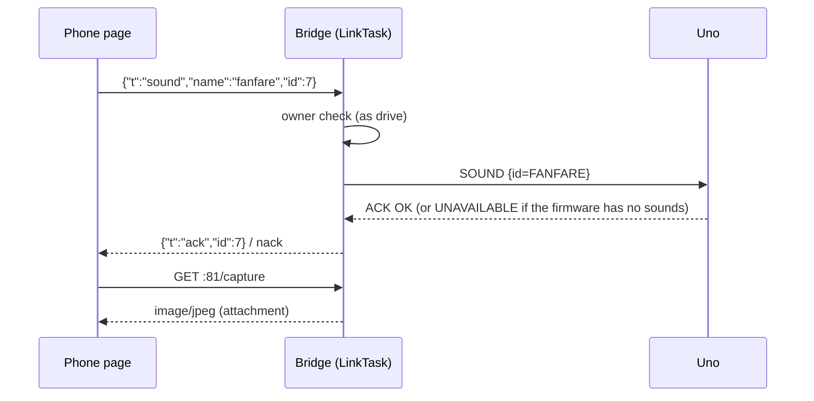
- **`/capture` and sockets (Plan F Task 3):** port 81 keeps `max_open_sockets = 2` (the lwIP budget of 16 is fully used, R2 implementation notes), so a snapshot shares the two viewer sockets: with the phone's stream open it works; with two viewers it is refused (connection not accepted). The camera-stopped (OTA) path answers 503.

### R3.1 Tank check fixes (owner, 2026-10-15, after the first Plan F tank check)
Found on the tank: (1) port 81 served one request at a time — the stream handler loops inside the HTTP server task, so SNAP (`/capture`) and a second viewer hung while one viewer watched; (2) a sound on a muted tank came back as `BUSY` and the page could not tell the tank was muted.

| Change | Detail |
|---|---|
| **Stream task per viewer** (owner option B) | `/stream` takes a viewer slot (max 2, as before), calls `httpd_req_async_handler_begin()` and hands the request copy to a new FreeRTOS task (`cq-stream`, 6 KB stack, core 0) that runs the frame loop and ends with `httpd_req_async_handler_complete()`. The server task is free at once, so `/capture` and the second viewer are served. Socket budget unchanged (`max_open_sockets = 2`): with two viewers open a snapshot is still refused. Task creation failure → the slot is released and the request answered 503. |
| **`audio_mode`** (spec 01 §4) | `{"t":"audio_mode","mode":"normal"\|"quiet"\|"mute","id":n}` → `WsCmdKind::kAudioMode`, `WsCommand::audio_mode` (`proto::AudioModeValue`); unknown/missing mode → nack INVALID_COMMAND. Routed as `sound` (owner or nobody, shared acked slot) → `AUDIO_MODE {mode}`. |
| **`ts.flags` gains `muted`, `quiet`** (spec 01 §6) | from TELEM_SLOW `flags2` (SlowFlagBit kMuted / kQuiet). |
| **Speaker chip** (hub-ux Screen 7b) | shows the flags; tap sends `audio_mode` mute ↔ normal; a `sound` nacked while `muted` toasts "Tank is muted — tap 🔊". |

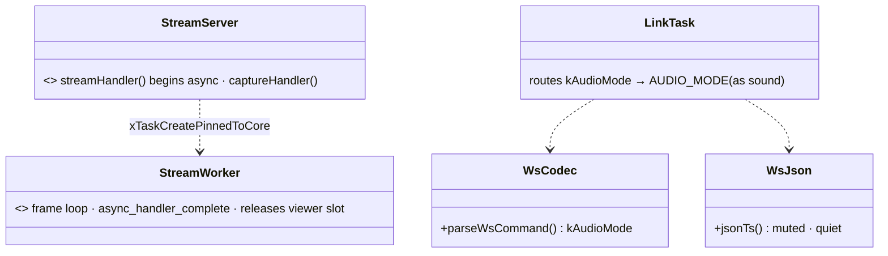
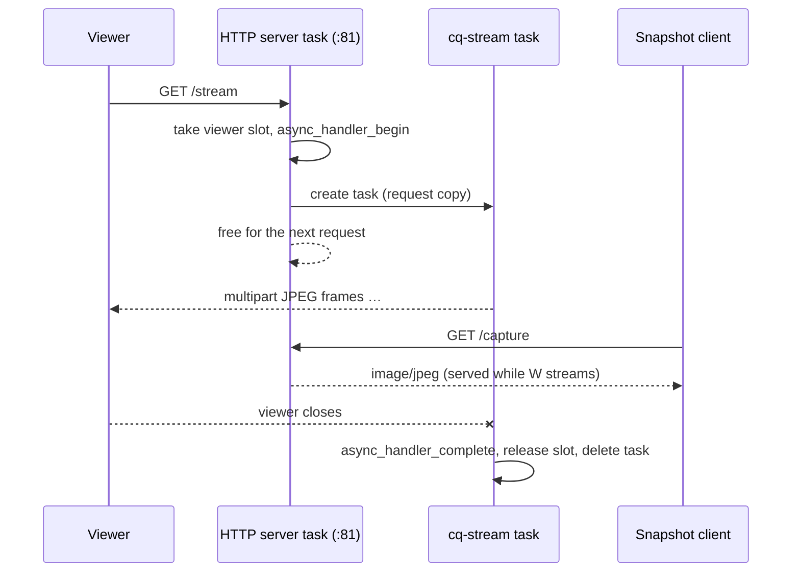

### R3.2 Page refinements (owner, 2026-10-15)
Page only (`web/basic_drive.html`), no bridge or protocol change — pan/tilt already arrive in `tf`:
- **⚡ MAX nn%** pill replaces ⋯ (speed limit at a glance; tap → slider sheet).
- Vitals line `SPEED nn% · TURN ±nn°/s` (the heading duplicate removed).
- **Camera ring as indicator:** ghost dot at ((90 − pan)/90, (90 − tilt)/90) × ring radius (up = smaller tilt angle, design-notes §45); title angles; ring mode from the owner: `you`/`none` → control (knob), anyone else → indicator (knob hidden, input ignored, dot bright).

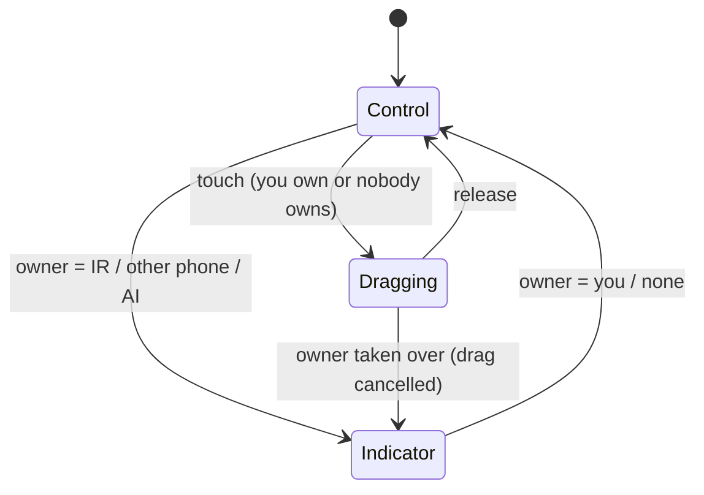

### R3.3 Display filters (owner, 2026-10-15)
Page only (`web/basic_drive.html`): filters change what is **shown**, never what the tank decides (obstacle brake, battery cut-off, stall stay on raw values in the Uno).

| Metric | Input rate | Filter |
|---|---|---|
| Range `tf.dist_cm` | 10 Hz | median of last 5 (null = clear = 999), then shown = median if closer, else shown += 0.3·(median − shown) |
| Turn rate `tf.yaw_rate` | 10 Hz | median of last 3 (one-off spikes), then EMA α = 0.3 (τ ≈ 0.3 s); \|x\| < 2 → 0 |
| Speed / vitals text | 10 Hz | text redrawn at most every 250 ms |
| Battery `ts.batt_v` | 1 Hz | mean of last 10 (reset when USB ↔ pack changes) |
| Latency (pong) | 1 Hz | mean of last 5 |
| Heading | — | none (gyro-integrated on the tank) |

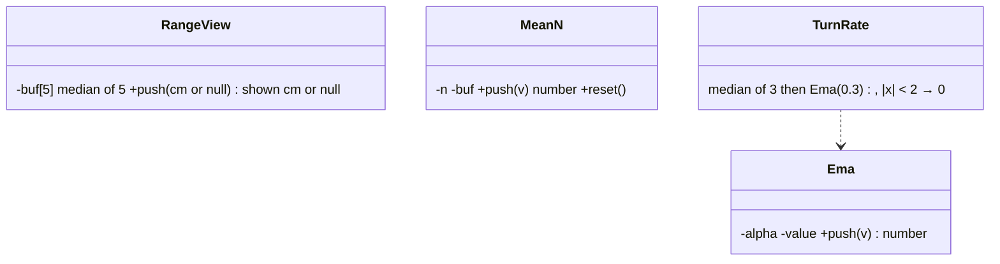

### R3.4 RC two-hand controls (owner, 2026-10-15; hub-ux "Drive controls — RC two-hand mode")
Page only; the bridge and the Uno are unchanged (the page converts to `drive {v, w}` and `cam_joy`).
- `Stick(el, onMove, onRelease, axis)`: axis `"xy"` (pads), `"y"` (throttle slider), `"x"` (steering slider).
- **RC → drive:** T = shape(throttle), S = shape(steer), θs = |S|·75°, T0 = 0.15. If S = 0: v = T, w = 0. Else blend b = max(0, 1 − |T|/T0): θ = θs + (90° − θs)·b, M = |T| + (|S| − |T|)·b; v = sign(T)·M·cos θ, w = −sign(S)·M·sin θ; × MAX. The Uno's angle mix (spec 02 §A4.1) turns that "virtual stick" into the tracks, so full steering = the 75° pivot at any speed and zero throttle = spin.
- **Drag camera:** virtual camera stick (x, y) seeded from the last `tf.pan/tilt` (Lite mapping 0.9°/unit: x = (90 − pan)/0.9, y = (90 − tilt)/0.9); drag adds dx/width·200 to x and −dy/width·200 to y (game style, full width = 180°), clamped ±100, sent as `cam_joy active` at 20 Hz; release sends `active:false` (LOCK keeps it). Double-tap (2 taps < 300 ms, within 30 px) → `cam_home`. Entering RC mode (and every `welcome` while in it) sends `cam_lock on`; leaving sends `cam_lock off`.
- **Mode chip** (`#ctlChip`, top row): shows STICK / RC; tap → `setControls(other, true)` unless `drive`, `thr` or `steer` is held (toast, no switch) — a switch never happens mid-drive.

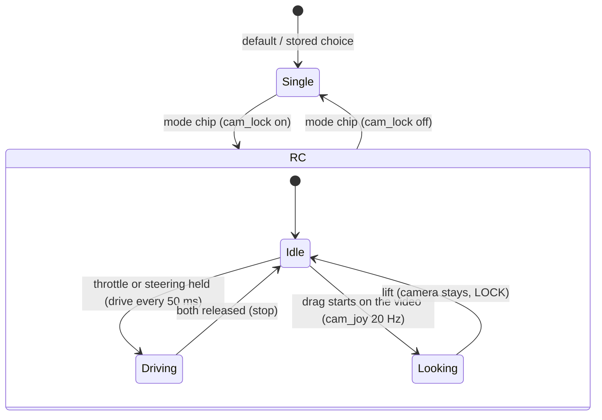

### R3.5 Compact gauges and mode chip place (owner, 2026-10-15)
- Side gauges: the glass boxes are gone; each gauge is a column (value on top, thin bar below, aligned to its screen edge). Battery value = filtered voltage (`x.xxV`, status colour) or `USB`; range value = filtered `nncm` / `CLEAR`. The charge is read from the bar.
- Mode chip `#ctlChip` moved out of the full chip row to the top right, `right = edge + 128 px` (a clear gap left of STOP); still ignored while a drive control is held.
- Speaker chip moved next to the mode chip (`.rchips`, top right, left of STOP); the speed sheet holds only the MAX slider — the mode chip is the only mode switch (owner, 2026-10-15).

### R3.6 Bigger sticks (owner, 2026-10-15) — sizes superseded by R3.8 (equal rings, `--pad` only)
- Stick sizes as CSS variables: `--pad` = min(44vh, 29vw, 240px), `--pad-s` (camera) = min(40vh, 26vw, 210px); short screens (≤ 380 px tall, e.g. a phone with the browser bar) min(55vh, 27vw, 210px) / min(48vh, 23vw, 180px) — about 40 % larger than before. RC sliders follow (`--pad`, steering = 1.2·`--pad-s`).
- Side gauges: from below STOP (60 px) down to `--pad` + 34 px, so they never meet the sticks (on very short screens the bars are short; the values stay).
- Narrow screens (< 800 px): LOCK / HOME / TILT STEER icon-only (like the pills). RC mode: HOME stacks above the camera indicator.
- Checked: no overlaps in single and RC mode at 710×317, 740×360, 844×390, 915×412. Tip for the owner: "Add to Home Screen" runs the page full screen (manifest), giving the sticks and gauges more height.

### R3.7 Edge gauges full height, Lucide icons (owner, 2026-10-15)
- **Gauges (option 1C):** battery and range bars run along the screen edges from below the top row (60 px) to 10 px above the bottom; both sticks sit 24 px further in (`.left` / `.right` offsets) so bars and sticks never touch. Values stay on top of the bars. TILT STEER becomes a small icon button at the drive ring's top-right corner (outside the circle).
- **Icons:** Lucide (ISC/MIT-style licence, lucide-static, pinned version), **inlined** as SVG paths — never loaded from the network (the phone may be on the bridge's own WiFi without internet). Mapping: MAX `gauge`, mode chip `joystick` (STICK) / `gamepad-2` (RC), speaker `volume-2` / `volume-x`, SNAP `camera`, SOUNDS `music`, MOVES `footprints`, LOCK `lock` (the ON state is the green fill), HOME `locate-fixed`, STOP `hand`, TILT `smartphone`, drive knob `navigation-2`, camera knob `scan-eye`, steering knob `circle-dot`, throttle knob `chevrons-up-down`, battery chip/none. Licence notice in the page head comment.

### R3.8 WiFi icon, equal rings, RC transmitter layout (owner, 2026-10-15)
- **WiFi chip (1A):** Lucide `wifi` (RSSI > −55 dBm), `wifi-high` (> −65), `wifi-low` (> −75, amber), `wifi-zero` (≤ −75, amber), `wifi-off` (`/info` unreachable, red); no "WIFI" text.
- **Equal rings:** the camera ring = the drive ring (`--pad-s` = `--pad`).
- **RC like a stick transmitter:** throttle (left, vertical) and steering (right, horizontal) have the **same travel** (steering width = throttle height = `--pad`) and the **same centre height** (steering lifted by `--pad`/2 − 32 px); camera indicator + title above the steering slider, HOME to its left — all out of the thumbs' resting path.

### R3.9 Heading tape (owner, 2026-10-15, option A)
`<canvas id="hdgTape">` + `<b id="hdgVal">` in the top-centre glass (width min(280 px, 28 vw), 46 px tall). `drawTape(head)` (called per `tf`, 10 Hz) clears and redraws: 2.8 px per degree, minor tick every 5°, medium every 15°, labels every 15° step that is a multiple of 30° (numbers) or 45° (N, NE, E, SE, S, SW, W, NW — a letter wins over a number), fixed centre caret; canvas backing size = CSS size × devicePixelRatio (set on resize). No images, no libraries.

### R3.10 Review fixes (owner, 2026-10-15: "fix all", RC option A) and diagrams for R3.5–R3.9
Whole-branch review (60ec480..f275f7a): no critical, 5 important, 24 minor findings. Fixed:
- **Stream sockets closed** when a viewer's frame loop ends (`httpd_req_async_handler_complete` **then** `httpd_sess_trigger_close`, handle and fd saved first — the reverse order lost the close while the async request still owned the session: on the tank port 81 stopped answering and heap fell; fixed and re-tested: 2×6 viewer cycles, capture 200, heap steady) — `complete` alone leaves the socket open (no LRU purge), freezing the page's video and filling the 2 stream sockets. Named task constants; "camera unavailable" vs "max 2 viewers".
- **Camera input ends on owner change and on blur** (cam stream timer cleared, drag-to-look ended silently) — it pinned the camera at home after control returned.
- **RC option A:** lifting the throttle while steering stops and drops the steering (press again from rest to spin); lifting the steering keeps the throttle. Lifting a thumb never speeds the tank up.
- **Camera lock synced:** `cam_lock` (rc or the page's lock) on `welcome` and on `ev body_online` (a rebooted Uno starts unlocked); a refused lock reverts the button.
- **Range fault:** `tf` adds `"dist_fault":true` for a faulted sensor (spec 01 §6.1); the page shows red FAULT, never CLEAR.
- Minor: BUSY wording (another driver vs "Tank busy - try again"); SNAP fetched as a blob and saved (a failed capture never leaves the page); WebSocket closed after 4 s of silence (reconnect); WiFi poll one at a time with a 5 s timeout, unknown RSSI amber; `cam_lock` needs `on`; audio modes from `proto::AudioModeValue`; sound list count `static_assert`ed against `proto::SoundId`; full-firmware `mix()` returns 0/0 instead of NaN when steering is cancelled at standstill; dead CSS/JS/ids removed; stale comments fixed.
- Deferred (owner may revisit): splitting `handleWsText` / `parseWsCommand` (over 40 lines); per-viewer task stack allocated per connection (bounded by 2 viewers) instead of at start-up; drag-to-look mapping for the full firmware's camera ranges; ~7 % over-MAX near 20° stick angle; drag start from the servo position instead of its target. *(2026-10-16: all fixed except the full-firmware drag mapping — see R4.12.)*

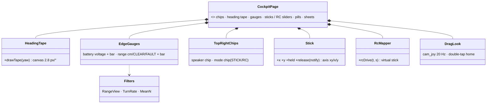
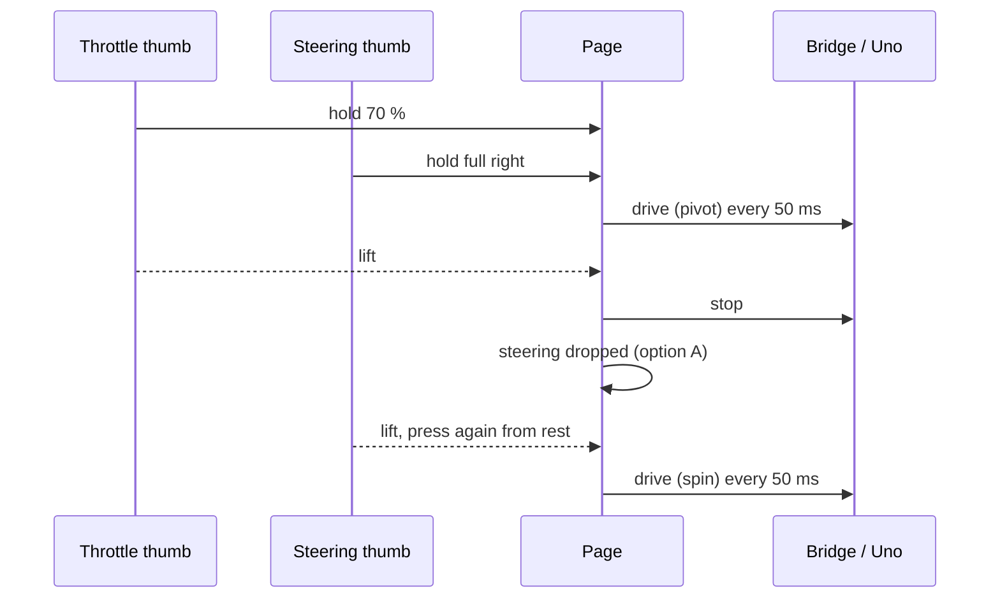
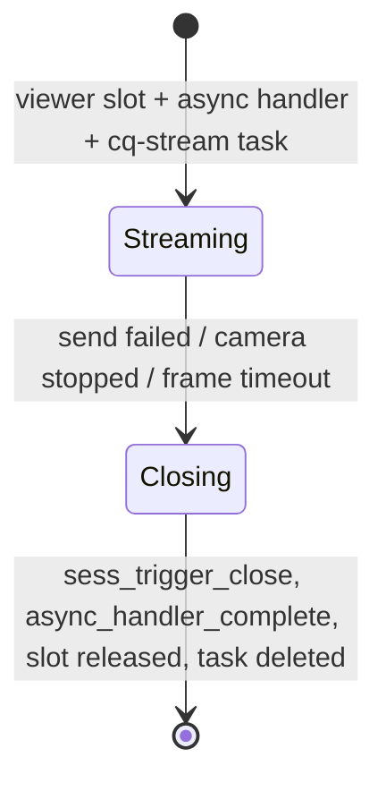

### R3.11 Source download on port 81 (owner, 2026-10-15, after Plan C check 9)
Check 9 showed a 1 MB `/source.tar.gz` on port 80 holding up `/ws` drives (3 deadman stops, a RATE_LIMITED burst): both shared the port-80 server task. Now:
- `/source.tar.gz` is served by the **port-81** server (`sourceRegister(streamServerHandle())`); port 80 keeps `/source.tar.gz` as a **302 redirect** to `http://<Host>:81/source.tar.gz` so `/info` (`source.url`) and the help link keep working.
- The port-81 server starts even if the camera fails (`cameraReady()` false → `/stream` and `/capture` answer 503), so the source stays downloadable without a camera. It starts with the camera stage (WiFi up or 10 s after boot); until it is registered, port 80 answers `/source.tar.gz` with 503 "not ready yet" (final review) instead of redirecting to a closed port. The Host check keeps IPv6 literals (`[fe80::1]`).
- Limit: port 81 has 2 connections; with two video viewers open the download waits for one to close. The download blocks only the port-81 server task (viewers run in their own tasks; a new viewer or `/capture` waits ~2 s).

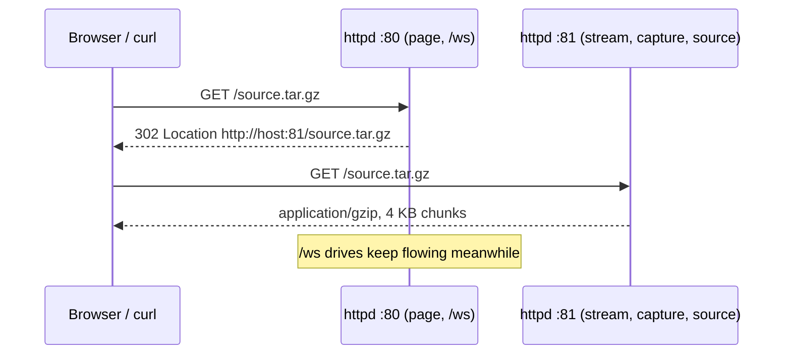

### R3.12 Final review fixes (owner, 2026-10-15)
- Redirect only once port 81 serves the archive (`g_served`, atomic), else 503 + `Retry-After: 10`; IPv6-safe Host.
- Page: on 4 s of silence the page goes offline at once (`goOffline()`: inputs released, pads off, reconnect) instead of waiting for the browser's close; on `welcome` / `body_online` it only re-sends **lock on** (RC mode or its own LOCK) and never while a bench owns the link — it no longer drops another phone's lock with "off".
- Comments: the known tiny fd-reuse window after `complete()` + `trigger_close` (accepted; the reverse order failed on the tank); `g_buf` belongs to the port-81 task.
- Repo: `.superpowers/` and `.playwright-mcp/` ignored; CLAUDE.md index and roadmap brought up to date.

## R4. Motion service — TURN and DRIVE_RATE on the bridge (spec 02 Part E, owner 2026-10-15)
Scope of this revision: **TURN by / to (spin)** and **DRIVE_RATE** for a body without those capabilities (Uno Lite), capability routing, and the 50 Hz telemetry. MOVE, arcs with radius and pose come with the encoders (later revision). Everything new in `core/` is host-tested; `net/link_task` only wires it.

### R4.1 Classes
```mermaid
classDiagram
  class MotionRouter { <<core>> +route(kind, bodyCaps) Route }
  class Route { <<enum>> Forward · Local · Unavailable }
  class MotionService { <<core, host-tested>>
    +startTurn(owner_fd, TurnCmd, now) Start
    +driveRate(owner_fd, v, rate_dps, now) Start
    +cancel(reason)
    +onTelemetry(TelemSample, now) MotionOut
    +tick(now) MotionOut
    +active() bool
    +progressPct() uint8 }
  class TurnController { <<core>> +begin(start_cdeg, target_cdeg, speed_pct) +step(yaw_cdeg, rate_ddps, now) TurnStep }
  class RateLoop { <<core>> +reset() +step(target_dps, rate_ddps, dt_ms) int8 w }
  class TelemSample { yaw_cdeg · rate_ddps · flags · fresh }
  class MotionOut { send bool · v int8 · w int8 · ended bool · end PrimitiveEnd }
  class PrimitiveEnd { kind turn/rate · ok bool · reason Reason }
  class Reason { <<enum>> Done · Cancelled · Stop · NotOwner · Stalled · Timeout · Link · Deadman }
  class LinkTask { <<net>> parses turn / drive_rate / cancel · owner check · feeds TELEM_FAST · sendDrive(v, w) · broadcasts primitive_done }
  MotionService *-- TurnController
  MotionService *-- RateLoop
  MotionService ..> TelemSample
  MotionService ..> MotionOut
  MotionOut *-- PrimitiveEnd
  LinkTask ..> MotionRouter
  LinkTask ..> MotionService
```
- **`MotionRouter`** (pure): `turn` → Forward if HELLO caps has `kTurn`, else Local; `drive_rate` → Forward if `kDriveRate`, else Local; `move` and `turn` with `radius_cm > 0` → Forward if `kMove` / encoders, else **Unavailable** (`nack UNAVAILABLE`, "needs encoders"). Forward = today's frame path (`TURN` / `DRIVE_RATE` frames, acked by the body) — designed now, exercised when a full-firmware body exists.
- **`MotionService`** (Local path) owns at most one primitive, on behalf of one WebSocket client (`owner_fd`, src human / ai as for `drive`). It produces a `DRIVE {v, w}` every new TELEM_FAST (50 Hz = 20 ms) while active, and one `w = 0` + STOP when it ends.
- **`welcome.tank.caps`** reports the effective capabilities: `turn` and `drive_rate` = body caps **or** the local service (true on the Uno Lite now); `move` = body `kMove` only (until encoders).

### R4.2 Gateway commands (spec 01 §4, now parsed)
| WS | Fields | Ack |
|---|---|---|
| `turn` | `by` ° (±1…720) **or** `to` ° (0…359), `speed` % (10…100, default 40), `radius_cm` (0 / omitted = spin), `id` | `ack id` on start; `ev primitive_done{kind:"turn", ok, reason, id}` at the end |
| `drive_rate` | `v` % (−100…100), `yaw_rate` °/s (−180…180, + = CCW / left) | streaming like `drive` (≤ 20 Hz, no ack; rejection reported once) |
| `cancel` | `id`? | `ack` (also when nothing runs) |
Errors: both `by` and `to`, or neither → INVALID_COMMAND; out-of-range → INVALID_COMMAND; not owner → NOT_OWNER; OTA → BUSY; body offline → BODY_OFFLINE.

### R4.3 TURN controller (spin)
- Angles in centi-degrees, yaw wrapped 0…36000; `to` takes the shortest way; `by` keeps its sign and may exceed 180°.
- Remaining error `e = wrap(target − yaw)`; **latency-compensated** `e_p = e − rate × 80 ms` (link + one telemetry period).
- Command `w = sign(e_p) × clamp(Kp × |e_p|, w_min, speed)` with `Kp = 1.0 %/°`, `w_min = 12 %` (the Uno's deadband start PWM already breaks the tracks loose). When `e_p` changes sign the command reverses at `w_min` (small correction).
- **Done:** `|e| ≤ 1.5°` and `|rate| < 5 °/s` for 200 ms (10 samples) → `w = 0`; the Uno's heading hold then settles (≤ 300 ms) and holds the new heading.
- **Timeout:** `|angle| / 20 °/s + 3 s`. **Stalled:** `|w| ≥ w_min` and `|rate| < 2 °/s` for 1.5 s.
- Expected ±1–2° (acceptance: 10 × 90° on the floor, owner measures; gyro log as evidence). Gains are constants in `motion_config.h` for floor tuning (not settings yet).

```mermaid
stateDiagram-v2
  [*] --> Idle
  Idle --> Turning: turn (owner ok, route Local) / ack id
  Turning --> Settling: |e| ≤ 1.5° and |rate| < 5 °/s
  Settling --> Turning: leaves the window
  Settling --> Idle: 200 ms in the window / w = 0, primitive_done ok
  Turning --> Idle: cancel · STOP (anyone) · owner's drive / turn · owner change (IR, other) · timeout · stalled · body offline · owner socket closed / STOP + primitive_done(reason)
```

### R4.4 DRIVE_RATE loop
- Target `r` from the client stream; `v` passed through. `w = ff × r + Kp × err + Ki × ∫err`, `err = r − rate`; `ff = 0.45 %/(°/s)` (floor data 2026-10-15: w 60 % spin ≈ 110–137 °/s), `Kp = 0.3`, `Ki = 0.6 /s`; `w` clamped to ±100 with anti-windup (integration stops while saturated); reset on start and on a sign change of `r`.
- If the client's stream stops for 300 ms → STOP and end (`deadman`) — the same rule as `drive`.
- The Uno receives ordinary `DRIVE {v, w}`: its angle mix, obstacle brake and caps apply; the loop simply asks for more `w` until the gyro agrees.

### R4.5 Sequence (local TURN)
```mermaid
sequenceDiagram
  participant P as Phone / hub
  participant L as LinkTask
  participant M as MotionService
  participant U as Uno Lite
  P->>L: {"t":"turn","by":90,"speed":40,"id":5}
  L->>L: owner check (as drive), route = Local
  L->>M: startTurn(fd, by 90, 40 %)
  L-->>P: {"t":"ack","id":5}
  loop every TELEM_FAST (50 Hz)
    U-->>L: TELEM_FAST yaw, yaw_rate
    L->>M: onTelemetry
    M-->>L: send v 0, w ±12…40
    L->>U: DRIVE (src human, v 0, w)
  end
  M-->>L: ended (done)
  L->>U: DRIVE (0, 0) then STOP
  L-->>P: ev primitive_done {kind turn, ok true, id 5}
```

### R4.6 Wiring rules in `link_task`
- A primitive keeps the owner's drive alive: every service DRIVE goes through `g_owner.onDrive(owner_fd, now)`; a non-`Send` decision ends it with `NotOwner`.
- Ends it: `stop` from anyone (fast path), the owner's `drive` / `turn` / `drive_rate` / `cancel`, `control_changed` away from the owner, `body_offline`, the owner's socket closing, OTA start.
- Telemetry watchdog: no TELEM_FAST for 200 ms while active → end (`Link`) and STOP (the Uno's own link-loss and deadman also stop it).
- `tf.primitive` = `{"kind":"turn","pct":nn}` while active (spec 01 §6.1); the page's tf stays 10 Hz (every 5th of the 50 Hz frames).

### R4.7 Uno side (Uno Lite LLD §18)
`telemetryFastDue` 50 ms → **20 ms** (50 Hz), Lite and full firmware; nothing else. TURN / DRIVE_RATE / MOVE frames keep answering `UNAVAILABLE` on the Lite (that is what routes them to the bridge).

### R4.8 Tests
Host (`test_motion_service`, `test_motion_router`, `test_ws_codec`, `test_ws_json`): router table; codec for turn / drive_rate / cancel (valid, both / neither of by-to, ranges); **closed-loop simulation** against a simple tank model (first-order turn response, 80 ms delay, ±3 °/s noise): `by 90`, `by −90`, `to` across 0°, `by 360` end within ±2° and before the timeout; cancel / STOP / owner loss / telemetry gap end with the right reason and a final `w = 0`; stall detection; drive_rate converges to ±10 % of target within 1 s and stops after 300 ms without updates; welcome caps on the Lite show turn / drive_rate true, move false.
Hardware: 10 × 90° (left and right) on the floor, owner measures; a drive_rate check (stick → steady turn rate on two surfaces).

### R4.9 No MOVES button (owner, 2026-10-15)
Measured moves are for the AI engine, Tank Logo and the hub; a human steers with the stick. The phone page therefore keeps **MOVES hidden** even when `caps.turn` is true (the button and placeholder sheet are removed from the page). TURN / DRIVE_RATE are tested by script (WebSocket client + tape measure), as the floor tests of 2026-10-15.

### R4.10 Implementation notes (Plan H Tasks 1–6, 2026-10-15)
- **Sign:** `turn by` + = CCW / left (the Uno's yaw); Tank Logo `RIGHT a` maps to `by −a`. `to` = shortest way; exactly opposite → +180°.
- **Done window with hysteresis:** enter at |e| ≤ 1.5° (and |rate| < 5 °/s), leave only beyond 2.5° — no hunting around the target at `w_min`.
- **Multi-turn:** the controller integrates the wrapped yaw steps, so `by 360` / `by −720` turn the full amount.
- **Wire format:** `primitive_done` carries the primitive in `"prim"` (`"turn"` / `"rate"`) because `"kind"` is the event kind: `{"t":"ev",…,"kind":"primitive_done","prim":"turn","ok":true,"reason":"done","id":5}`; reasons `done, cancelled, stop, not_owner, stalled, timeout, link, deadman`. `tf.primitive = {"kind":"turn","pct":n}` while active.
- **Routing for now:** Forward (a body that reports TURN / DRIVE_RATE) and Unavailable both answer `UNAVAILABLE` (code 3003); the frame path is left for when a full-firmware body exists. `move` stays an unsupported command until the encoder plan.
- **Ends without extra frames** when a STOP is already on its way (STOP fast path, owner socket close, OTA, body offline), when the owner's own `drive` follows, and on `not_owner` (a bridge STOP would also stop the IR driver).
- **Simulation result** (tank model: 2.2 °/s per %, 8 % static friction, 150 ms lag, 80 ms round trip, ±3 °/s noise): 30 committed runs (10 cases × 3 seeds: ±90°, across 0° both ways, 360°, −720°, 10°, 180°, speeds 12 and 100) all within 0.8°, 90° in ≈ 2 s. Floor acceptance is Task 7.

### R4.11 Review fixes (Plan H review, 2026-10-16)
- **AUTO source (C1):** the motion service sends `DRIVE src = AUTO` (protocol enum `Source.AUTO = 3`). The Uno (Lite and full) never applies car-style reverse steering to AUTO frames, so `drive_rate` with `v < 0` no longer runs away. IR input clears the flag.
- **MotionLink (I1):** `core::MotionLink` sits between `link_task` and `MotionService` and owns the frame policy: `LinkOut{drive, v, w, stop, event, end}`. Its frames use `LinkOwner::keepDriving(fd, now)` — check-only, refreshes the hand-back timer, **never takes ownership**; if the client no longer owns the tank the primitive ends `not_owner` with no frames. `release` ends the primitive; STOP is sent on an end only while the client still owns the tank. No redundant DRIVE 0/0 before the STOP (STOP purges the queue).
- **Diverged guard:** a drive_rate that commands |w| ≥ 95 while the body turns > 5 °/s the other way for 500 ms ends with reason `diverged`.
- **Codec:** `turn speed` ≥ 12 % (the minimum that breaks the tracks loose), `|by|` 1–720°, range checks before casts.
- **Caps rule:** the welcome caps report `turn` / `drive_rate` as available only when the bridge runs them locally (body lacks the cap). `UNAVAILABLE` is the bridge reason 3003; for `drive_rate` it is reported once per stream. `drive_rate` shares the 25/s stream budget with `drive`.
- **Rate loop:** the integral resets when the target rate is 0.
- **Tests:** MotionLink cases (release, forgotten release, IR mid-primitive, bench after release, event frame policy, done before last frame, telemetry gap), reverse drive_rate converges with the car flip modelled, diverging body ends.

### R4.12 Deferred small items cleared (2026-10-16, owner: "fix the small items")
Branch `small-fixes` (on top of `plan-h-motion`). Fixed:
- **Bridge:** `parseWsCommand` split into `readField` / `complete`; `handleWsText` split into one handler per command (behaviour unchanged, codec guard test added). Stream viewers: **two worker tasks created once at start-up** and fed through a queue (no task create / delete per connection) — to be checked on the tank (two phones, reconnects).
- **Page:** a camera drag started while the head is still slewing begins from the page's last target, not the moving position.
- **Uno (Lite and full):** stick distance by an **exact square root** (Lite: integer `isqrt16`; full: `sqrtf`) — the outer track never exceeds MAX (the old estimate `max + 3/8·min` was up to ~7 % over near 20°). Spec 02 §A4.1 and the Lite LLD updated.
- **Uno (full):** a setting changed while a save runs stays dirty (`Settings::changes()` / `markSaved()`); DRIVE_RATE refused for an unusable IMU sends a REJECTED event.
- **Uno Lite:** settings loaded from EEPROM are range-checked like `SETTING_SET` (out of range → defaults); `sendRaw` counts `tx_dropped` (also full); I2C `begin()` sets the PORTC pull-ups one bit at a time (atomic `SBI`), so the A0 buzzer's tone toggle is never lost.
- **Smoke tool:** the termios2 fallback also sets the input speed (CIBAUD); `close()` sends its STOP even while paused.
- Already done earlier (found while clearing): settings `loadBlock` buffer sized from the structs; WHO_AM_I accepts MPU-6500 / 9250.

Still open (need hardware or a design decision): **drag-to-look for the full firmware's camera ranges** — the page cannot know the body's pan/tilt limits (HELLO has no profile or ranges; a protocol change to decide with the owner, low priority while the full firmware waits for its board); PCINT2 ISR duration and WS2812 timing — measure on hardware.

### R4.13 Fallback AP after 10 s (owner, 2026-10-16)
The bridge opens its own network `conqueror-bridge` **10 s** after it cannot reach the home WiFi (was 30 s): at boot, or 10 s after the home WiFi drops. A normal join takes ~2 s (logs 2026-10-16: 1.6–1.8 s), so 10 s leaves 5× margin; 5 s was rejected because some routers need 3–6 s for the WPA login plus DHCP. Opening the AP too early is harmless: while no client is connected the bridge retries the home WiFi every 60 s and switches back. `core::kStationTimeoutMs` = 10000; host tests `test_fallback_ap_after_10s`, `test_station_lost_reconnects`; help page updated.

### R4.14 Camera clock 10 MHz — the camera was drowning the WiFi (owner, 2026-10-16)
Symptom (from 2026-10-15, with the same main firmware that had worked): station joins with a strong signal (−35…−47 dBm) but most traffic is lost — 93–100 % ping loss, 1–2 s delays, phones dropped after 3–7 s ("silent for 3 s"); the same with the bridge's own AP and a phone next to it, on battery and on USB. Bisected with a throw-away test sketch over USB (home WiFi, channel 6):

| Sketch | Pings | Median |
|---|---|---|
| WiFi only, TX 19.5 dBm | 40/40 | 5 ms |
| WiFi only, TX 15 dBm | 40/40 | 6 ms |
| + camera, XCLK 20 MHz (bridge settings) | 12/23 | 431 ms |
| + camera, XCLK 10 MHz | 37/37 | 36 ms |
| Full bridge (main + 10 MHz), camera on | 14/20 (Mac), 10/10 (Linux) | 0.2–0.7 s; `/info` 1–6 s |
| Full bridge, camera **not started** | 30/30 | 15 ms; `/info` 0.03 s |

So the radio, antenna and the rest of the bridge are fine and the running camera interferes; 10 MHz only reduces it. The same camera worked at 20 MHz until 2026-10-15, so a **physical cause is most likely** (camera module / ribbon moved, damaged or touching the module) — to inspect; why it started now is not proven (ribbon cable moved nearer the antenna, or the router's auto channel now on 6 where a 20 MHz harmonic, 2440 MHz, sits mid-channel). Fix: `board::kCamXclkHz` = **10 MHz**. Cost: fewer frames per second from the sensor (to measure; 16 MHz is the fallback if it is too slow). Also route the camera ribbon away from the module's antenna end.

**R4.14 follow-up (same day, more runs).** Results vary strongly from one boot to the next with the *same* firmware, so single runs mislead:
- **Camera not running: clean every time** (5 boots: test sketch at 19.5 / 15 dBm, bridge with the camera not started ×2, mode cycle "off" while the link was good).
- **Camera running: bad on most boots, clean on some** — at 10 MHz and 20 MHz, QVGA / VGA / SVGA, frames in PSRAM or DRAM, continuous or capture-on-request; a bad state can outlast stopping the camera by ~40 s.
- Bridge variants (no Uno link task, no TCP poll, UART without task, 10 ms link tick) were each good on one boot and bad on another — **none is proven**; the "link task" lead is withdrawn.
- Conclusion: the running camera is the trigger and the strength of its effect changes between boots — an electrical / RF coupling problem on the board or camera (module, ribbon, power), not a firmware feature. Options for the owner: replacement camera module or ribbon, shielding / ferrite / routing, an external-antenna board; in firmware, run the camera only while someone watches (sensor powered down otherwise) so control never depends on it.

### R4.15 Camera off for now (owner, 2026-10-16)
Owner decision: run **without the camera** until the module is replaced; the camera comes back with the AI work, so video is not needed meanwhile. `board::kCameraEnabled = false`: the bridge never starts the camera (log `camera: disabled`); port 81 still serves `/source.tar.gz`, `/stream` and `/capture` answer 503 "camera unavailable", the page shows its no-video state, `welcome.caps.sensor` is `"none"`. To re-enable: set it to `true` (XCLK stays 10 MHz, R4.14).

