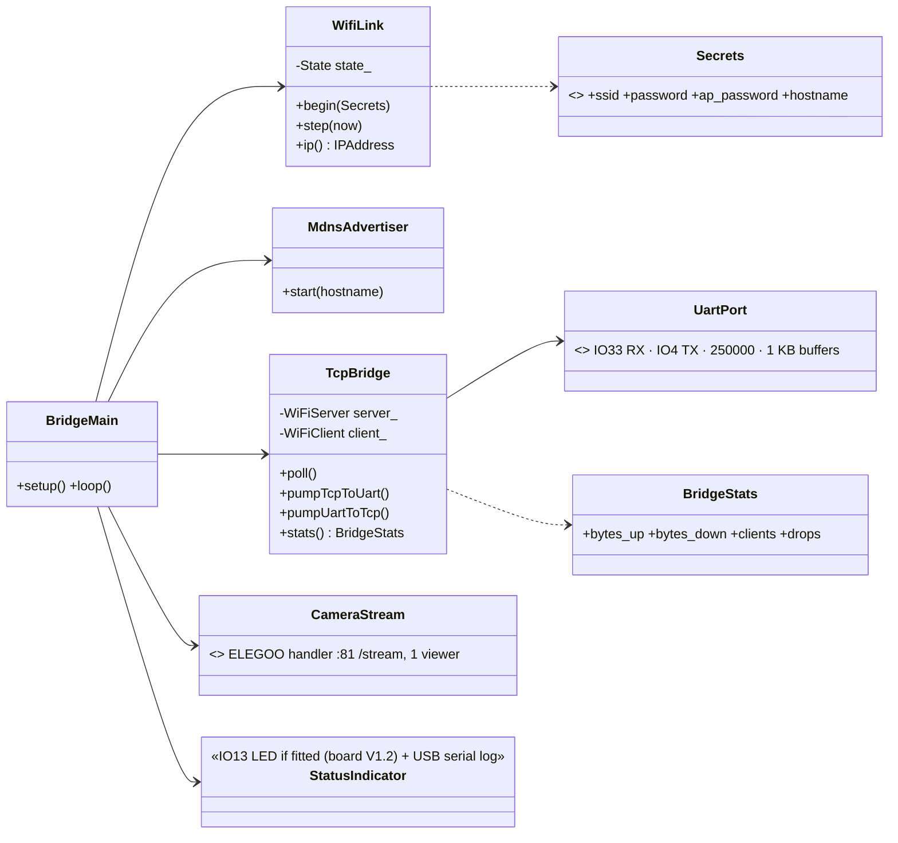
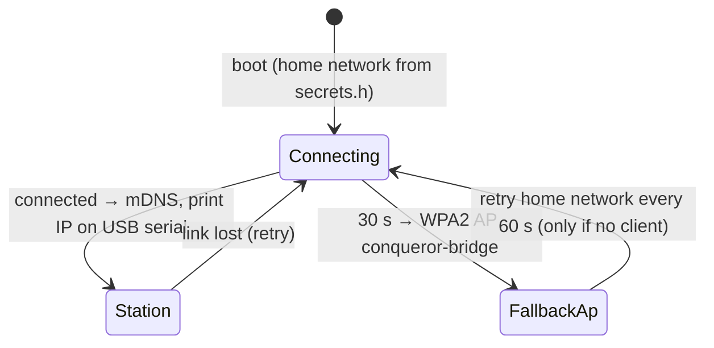
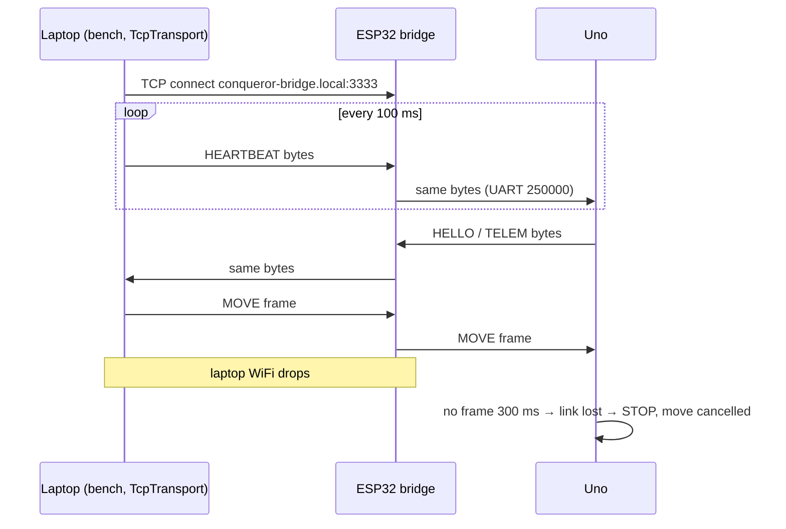
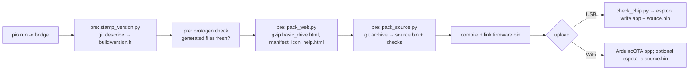

# ESP32 WiFi Bridge (developer firmware) — Low-Level Design

Status: APPROVED (Revision 1) · **Revision 2 (2026-10-12) at the end of this file supersedes earlier text where they differ** (ESP32-S3 board, Basic Drive page, link owner, OTA, `/help`) · Date: 2026-10-11 · Roadmap phase 3 · `firmware/esp32` → `env:bridge` (Arduino-ESP32 3.x); later only in gateway debug builds (`-D CQ_DEV_BRIDGE`)

## Class diagram

`WifiLink.State {Connecting, Station, FallbackAp}`; mDNS `conqueror-bridge.local`, service `_conqueror-bridge._tcp`; TCP port 3333 with TCP_NODELAY.

## WiFi behaviour

Status: always logged on ESP32 USB serial and shown by the bench tool; **IO13 green LED only on board V1.2** (V1.0 has no LED there): fast blink connecting · solid station · slow blink fallback AP · flicker on traffic.

## Byte pump
- Transparent both ways; frames not parsed (protocol + CRC end to end).
- One client; a new connection replaces the old (logged).
- TCP_NODELAY, immediate flush (~5–20 ms latency on home WiFi).
- **Never generates heartbeats or commands** → laptop/WiFi loss = heartbeats stop = Uno halts within 300 ms.
- Uno bytes with no client are discarded.



## Optional camera
ELEGOO's stream handler on :81 `/stream` (single viewer) for watching tests; proper multi-viewer camera comes with the gateway.

## Security
No authentication — developer use on the home network only; stated in README and boot log; never in release firmware.

## Hardware notes (verified from schematics)
- ESP32 board revisions V1.0 and V1.2: identical UART (IO33 RX, IO4 TX on connector P1), camera connector and power; only V1.2 fits the IO13 green LED.
- Uno shield = **SmartCar Shield V1.1** (user-confirmed); motor driver **TB6612FNG (confirmed)** (Uno LLD hardware revision). ESP32 board = **V1.0** (no IO13 LED → status via USB serial + bench tool).

---

## Revision 2 (2026-10-12)

Status: PROPOSED for owner review · supersedes the sections above where they differ.
Drivers: design-notes §22 (board is an ESP32-S3), §24 (pin map, flash/PSRAM, USB), §27 (self-describing firmware), §28 (Basic Drive page) and the phase-3 roadmap decisions (station mode, AP fallback after 30 s, mDNS, TCP 3333 ⇄ UART for the bench tool). New in this revision: OTA over WiFi and a chip check before flashing.

What changes in one paragraph: the bridge is no longer only a byte pump. It now has **two kinds of clients** — the bench tool on TCP 3333 (which speaks the body-link protocol itself, unchanged from Plan D) and the Basic Drive phone page on a WebSocket (for which the ESP32 itself must be the body-link master). A small **link owner** arbiter decides who is the master of the Uno link at any moment, and one **frame-aligned UART writer** makes sure frames from different sources never mix mid-frame. The Uno firmware is not changed.

### R2.1 Hardware (supersedes "Hardware notes" and the WROVER pins above)
| Item | Value | Source |
|---|---|---|
| Board | ELEGOO **ESP32S3-Camera-V1.0**, module ESP32-S3-WROOM-1, USB-C | §22 |
| Chip | ESP32-S3 (QFN56) rev v0.2, **8 MB flash** (GigaDevice), **8 MB embedded octal PSRAM** | §24 (esptool) |
| UART to the Uno | `Serial1`, **RX GPIO3, TX GPIO40**, **250000** 8N1 (old firmware used 115200) | §24 |
| Camera | ESP32-S3-EYE map: PWDN −1, RESET −1, XCLK 15, SDA 4, SCL 5, D7..D0 = 16, 17, 18, 12, 10, 8, 9, 11, VSYNC 6, HREF 7, PCLK 13; XCLK 20 MHz, JPEG. Sensor: driver auto-detects (OV3660 expected, logged at boot) | §24 |
| USB | native USB-Serial/JTAG (GPIO19/20), `303a:1001` → `/dev/ttyACM0` (Linux), `/dev/cu.usbmodem*` (macOS); used for flashing and the boot log | §24 |
| Status LED | none (no IO13 LED) → status on USB serial log, `/info` and the bench tool | §22 |
- GPIO3 is a strapping pin (JTAG source select, sampled at reset). It is only an input (UART RX) after boot, so it is fine; the Uno's TX idles high, which matches the default strap. Do not add a pull-down on it.
- GPIO 26–37 are used by flash and octal PSRAM — never touch them.
- PlatformIO board: `esp32-s3-devkitc-1` with `board_build.flash_size = 8MB`, `board_build.arduino.memory_type = qio_opi`, `board_build.partitions = partitions_cq8m.csv`, build flags `-D BOARD_HAS_PSRAM -D ARDUINO_USB_CDC_ON_BOOT=1` (same as the old firmware's `esp32s3:CDCOnBoot=cdc,PSRAM=opi`).

### R2.2 Partition table (8 MB flash)
`firmware/esp32/partitions_cq8m.csv`:

| Name | Type / subtype | Offset | Size | Purpose |
|---|---|---|---|---|
| `nvs` | data / nvs | 0x9000 | 0x5000 (20 KB) | WiFi + small settings (no secrets beyond what Arduino WiFi stores) |
| `otadata` | data / ota | 0xE000 | 0x2000 (8 KB) | which app slot boots |
| `app0` | app / ota_0 | 0x10000 | 0x300000 (3 MB) | firmware slot A |
| `app1` | app / ota_1 | 0x310000 | 0x300000 (3 MB) | firmware slot B (OTA writes the idle slot) |
| `source` | data / spiffs (0x82) | 0x610000 | 0x1E0000 (1.875 MB) | embedded source archive (raw blob, **not** a file system) |
| `coredump` | data / coredump | 0x7F0000 | 0x10000 (64 KB) | crash dump for debugging |
- Today's bridge app is expected at ~1.3–1.6 MB (WiFi + httpd + camera); 3 MB slots leave room for the phase-4 gateway in the same layout, so the table never has to change (changing it needs a USB flash).
- The source partition uses subtype `spiffs` only so that ArduinoOTA's "file system" upload (`espota -s`) can rewrite it over WiFi too (R2.5). The content is our own blob, not SPIFFS.
- Measured on 2026-10-12: `git archive HEAD | gzip -9` = **9.5 MB**, of which `docs/design/stitch/` PNGs are 9.0 MB; **without them 0.48 MB**. So the archive **excludes the Stitch images** (R2.4) and fits with ~4× headroom.

### R2.3 Build and flash procedure

1. **Version stamp** (`firmware/esp32/scripts/stamp_version.py`, PlatformIO `extra_scripts = pre:`): writes the git-ignored `build/version.h` with `CQ_FW_NAME "conqueror-bridge"`, `CQ_FW_VERSION` (from `git describe --tags --match 'bridge-v*' --always --dirty`), `CQ_GIT_COMMIT` (full hash), `CQ_GIT_DIRTY` (0/1), `CQ_BUILD_DATE` (UTC ISO), `CQ_REPO_URL "https://github.com/mannuray/conqueror"`.
2. **Protocol freshness**: runs `uv run protogen check` in `protocol/`; the build fails if generated files are stale.
3. **Protocol code for the ESP32**: the ESP32 build includes the **same generated** `cq_protocol.h` via `build_flags = -I ../uno/src/generated` (one file, no copy; the header already compiles off-AVR — `PROGMEM` is shimmed). No hand edits, as for every generated file.
4. **Help cheat-sheet**: a **new protogen output** `firmware/esp32/src/generated/help_protocol.html` (an HTML fragment: frame format `AA len type seq payload crc8(poly 0x07)`, baud, the main commands with example bytes taken from `golden.yaml` — HEARTBEAT, HELLO/HELLO_ACK, DRIVE, STOP, CAM_JOY — and the error/ack-status codes). This is a small **Plan A generator addition** (template + golden test), done as a Plan C task; `protogen check` then covers it. The Tank Logo quick reference is a hand-written fragment `firmware/esp32/web/help_logo.html` (words, limits, how to upload/run/stop a program), kept in step with spec 05.
5. **Web assets** (`pack_web.py`): gzips `web/basic_drive.html` (one file, inline CSS + plain JS), `web/manifest.webmanifest`, `web/icon-192.png`, and the assembled `/help` page into C arrays in `build/web_assets.h` (served with `Content-Encoding: gzip`). Budget: page ≤ 25 KB gzipped (R2.12).
6. **Source archive** (`pack_source.py`):
   - `git archive --format=tar HEAD` honouring `.gitattributes` `export-ignore` (new lines: `docs/design/stitch/** export-ignore`, `*.png export-ignore` except `firmware/esp32/web/icon-192.png`) → `gzip -9`.
   - Prepends a 64-byte header: magic `CQSRC1\0\0`, git commit (40 hex), dirty flag, payload length u32, CRC32 u32 → `build/source.bin`.
   - **Checks (build fails):** payload > partition size − 64 B; any path named `secrets.h` in the tar; the **values** of `CQ_WIFI_PASSWORD`, `CQ_AP_PASSWORD` and `CQ_OTA_PASSWORD` from the local `secrets.h` appear anywhere in the uncompressed tar.
   - `git archive` packs **HEAD**, not the working tree: a dirty build sets the dirty flag in both `version.h` and the header, `/info` shows `"dirty": true`, and release builds (`-e bridge_release`, see 7) refuse a dirty tree.
   - `secrets.h` is never tracked: Plan C Task 1 adds `firmware/esp32/include/secrets.h` to `.gitignore` (today `.gitignore` has no such line), so `git archive` cannot contain it even by mistake; the value check above is the second guard.
7. **Releases**: every flashed release is tagged `bridge-vX.Y.Z` (Uno: `uno-vX.Y.Z`) and published with `gh release create` carrying `bootloader.bin`, `partitions.bin`, `firmware.bin`, `source.bin` and a `flash.sh` with the exact esptool command. `env:bridge_release` = `env:bridge` + refuse dirty tree.
8. **Chip check before any USB flash** (`scripts/check_chip.py`, hooked as a PlatformIO pre-upload action and also runnable alone): runs `esptool.py --port <port> flash_id` and refuses to flash unless the output says **`Chip is ESP32-S3`**, **`Detected flash size: 8MB`** and the chip features list **embedded PSRAM 8MB**. Prints the MAC (expected `48:ca:43:9e:74:b4` on the owner's board; a different MAC is a warning, not an error).
9. **USB flash (first time and recovery)**: shield switch S1 position does not matter for the ESP32's own USB-C; hold BOOT while plugging in if the port does not enumerate. `pio run -e bridge -t upload` writes bootloader + partitions + app; `pio run -e bridge -t upload_source` (custom target) writes `source.bin` at 0x610000. Note §23: the USB-C link was not detected on macOS with some cables — `/dev/ttyACM0` on Linux is confirmed (§24).

### R2.4 Self-describing pages: `/info`, `/help`, `/source.tar.gz`
All three are **read-only**: no control, no settings, no secrets. Port 80.

`/info` (JSON, `Cache-Control: no-store`):
```json
{"fw":{"name":"conqueror-bridge","version":"bridge-v0.2.0","commit":"98f7200…","dirty":false,"built":"2026-10-12T10:00:00Z","repo":"https://github.com/mannuray/conqueror"},
 "source":{"url":"/source.tar.gz","commit":"98f7200…","matches_fw":true,"bytes":481000},
 "hw":{"board":"ESP32S3-Camera-V1.0","chip":"ESP32-S3 rev v0.2","flash_mb":8,"psram_mb":8,"mac":"48:ca:43:9e:74:b4","camera":"OV3660",
       "pins":{"uno_rx":3,"uno_tx":40,"camera":"ESP32-S3-EYE map"}},
 "net":{"mode":"station","ssid":"home","ip":"192.168.1.42","rssi":-58,"mdns":"conqueror-bridge.local",
        "ports":{"http":80,"ws":"/ws","stream":81,"bench_tcp":3333,"ota":3232}},
 "uno":{"baud":250000,"synced":true,"fw":"1.0","commit":"…","proto":1,"reset_reason":"power_on"},
 "link":{"owner":"web","driver":"phone-2","clients":{"ws":2,"tcp":0,"stream":1},"frames_tx":1234,"frames_rx":5678,"bad_crc":0},
 "uptime_s":321,"free_heap":182000,"free_psram":7900000}
```
- `uno.*` comes from the last HELLO seen (in either mode); Uno commit appears once Plan B adds it to HELLO (§27 habit) — until then `null`.
- `source.matches_fw` is false when the app was updated over OTA without the source image (R2.5); `/help` shows a warning then.

`/help` (one static HTML page, gzipped, ~10 KB): what this firmware is + version/commit/repo · how to connect (mDNS, IP, ports, AP fallback name) · how to drive (Basic Drive page at `/`, bench `bench --host conqueror-bridge.local`) · **protocol cheat-sheet** (generated, R2.3 step 4) · **Tank Logo quick reference** (R2.3 step 4) · hardware facts (board, chip, pin map, flash/PSRAM) · how to reflash (ESP32: chip check + esptool/pio commands, OTA command; Uno: USB only, Optiboot 115200, **S1 switch** to disconnect the ESP32 during uploads) · the security note (no authentication, home network only). Live values (IP, Uno version) are filled in by a few lines of JS from `/info`, so the page itself stays static.

`/source.tar.gz`: streams the partition payload (after the 64-byte header) in 4 KB chunks with `Content-Type: application/gzip`; 404 if the header magic or CRC is wrong (e.g. never written).

### R2.5 OTA updates over WiFi (new)
**Choice: ArduinoOTA** (simplest: built into Arduino-ESP32, PlatformIO uploads with `upload_protocol = espota`, no web upload page to write). Rejected: an HTTP upload handler (`esp_https_ota`/`Update` behind a POST route) — more code, and a password check we would write ourselves.
- Password: `CQ_OTA_PASSWORD` in git-ignored `secrets.h` (template in `secrets.example.h`); the build fails if it is missing or still `change-me`. ArduinoOTA uses an MD5 challenge — fine for "fun, not ultra secure", not real security (owner confirmation 3).
- Port 3232; announced by mDNS as `_arduino._tcp` with hostname `conqueror-bridge`.
- Commands: `pio run -e bridge_ota -t upload` (app; `upload_port = conqueror-bridge.local`, `upload_flags = --auth=${sysenv.CQ_OTA_PASSWORD}`) and `pio run -e bridge_ota -t upload_source_ota` (wraps `espota.py -s` to write `source.bin` into the `source` partition). The Plan C helper `scripts/ota.sh` runs both, so app and source stay in step; if only the app is sent, `/info` reports `matches_fw: false`.
- **Safety:** `ArduinoOTA.handle()` is only polled while **nobody is driving** (link owner not `WebDriving` and not `TcpPassthrough`); otherwise espota times out and the developer retries. `onStart`: inject STOP, close WS/TCP/stream clients, stop the camera, stop heartbeats (Uno link-loss → SoftStop is harmless at standstill). `onEnd`: reboot into the new slot. `onError`: log, reboot into the old slot.
- No automatic rollback (the stock Arduino bootloader has app rollback disabled): a bad image that boots but misbehaves is fixed by another OTA or a USB flash. An image that fails verification is never activated (the OTA library checks it before switching `otadata`).
- The phase-4 gateway's OTA (ESP32 LLD §8/§10.9, signed + admin key) replaces this; the bridge's OTA is developer-only like the rest of the bridge.

