# ESP32 Firmware — Low-Level Design

Status: COMPLETE — Revision 2 (review fixes in §10 are authoritative where earlier sections differ) · Date: 2026-10-10 · Implements: Spec 2 Part B, Spec 1 · Standards: `docs/standards/coding-standards.md` §3

Sections: 1 Structure, tasks & frameworks ✅ · 2 Ports ✅ · 3 Body link & clock sync ✅ · 4 Client API ✅ · 5 Navigation ✅ · 6 Camera service ✅ · 7 Calibration engine ✅ · 8 WiFi, mDNS, OTA & storage ✅ · 9 Memory/task budget & error handling ✅ · 10 Revision 2 review fixes ✅

Note: UART is **250000 baud** and calibration maths runs here (Uno LLD §9 revision).

---

## 1. Structure, tasks & frameworks (APPROVED)

### 1.1 Framework choices
| Concern | Choice | Why |
|---|---|---|
| Base | Arduino-ESP32 core on PlatformIO | reuses ELEGOO camera code |
| HTTP + WS + MJPEG | ESP-IDF `esp_http_server`, two instances (80: API/WS/setup, 81: stream) | already used by the camera example; native WS; one server stack |
| JSON | ArduinoJson 7 with a fixed memory-pool allocator (no heap in hot paths) | standard, fast, follows allocation rule |
| Hashing | mbedTLS: salted SHA-256 for tokens, PBKDF2 for the admin password | built in |
| Storage | NVS (Preferences) | wear-levelled |
| Protocol | generated C++ from `protocol/` (frames + JSON mapping) | single source |

### 1.2 Layers
```
src/
├── main.cpp       composition root: services, queues, tasks
├── app/           FreeRTOS tasks: read ports/queues → call domain → write ports/queues
├── domain/        pure C++: arbitration, auth rules, navigation, derived metrics, JSON⇄command mapping
├── ports/         headers (camera, uart, wifi, nvs, http, mdns, ota, clock)
├── drivers/       ESP32 implementations (IDF / Arduino)
└── generated/     frames, JSON schemas, error registry
```
`virtual` only where ≥ 2 implementations are active at runtime.

### 1.3 Tasks, cores, queues
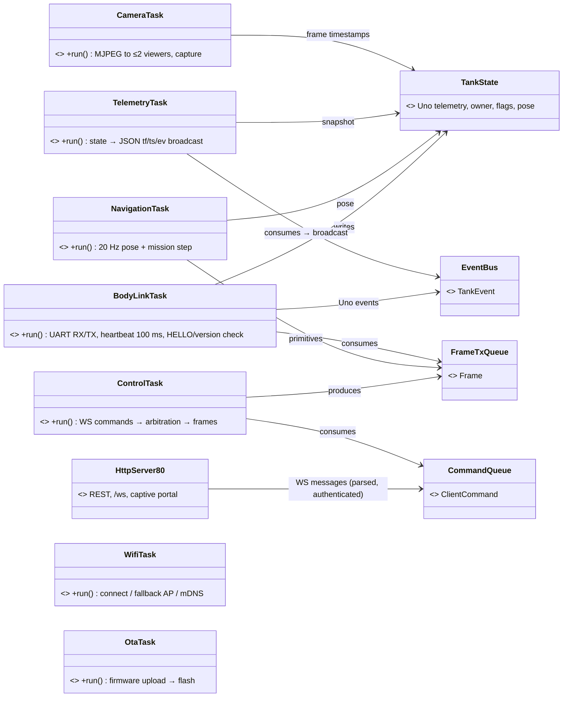
- Core 1 = robot-critical (link, control, navigation, telemetry); core 0 = WiFi stack, HTTP, camera, OTA → video load cannot delay STOP.
- Tasks communicate only via queues + `TankState` (single writer per field group, mutex snapshots for readers).
- **STOP fast path:** WS STOP is pushed to the front of `CommandQueue` (`xQueueSendToFront`) and forwarded immediately.
- Task watchdog on all app tasks; reboot reason kept in RTC memory and reported at next boot.

### 1.4 Startup sequence
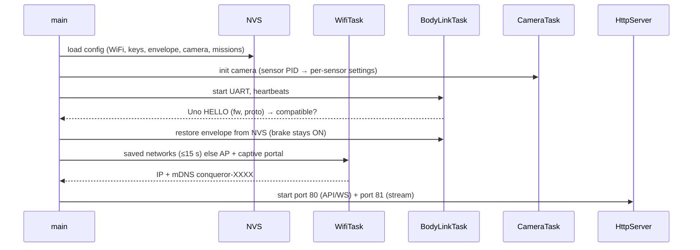

---

## 2. Ports (APPROVED)
Headers of free functions implemented in `drivers/`; no `virtual` needed.

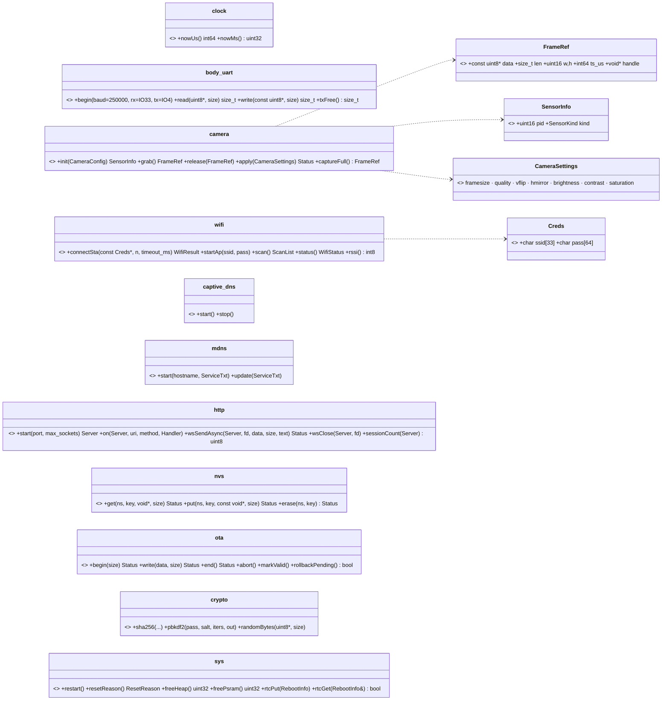
`SensorKind {OV2640, OV3660, OV5640}`.

| Port | Notes | Thread/core rules | On failure |
|---|---|---|---|
| clock | esp_timer µs since boot (64-bit) | any task | — |
| body_uart | UART2 @ 250000, 1 KB RX / 512 B TX | **only BodyLinkTask** | short read/write counted |
| camera | esp_camera, PSRAM, 2 frame buffers; `ts_us` = capture time in clock time | **only CameraTask** (others via queue) | grab timeout 200 ms → CAMERA_TIMEOUT; reinit after 5 consecutive |
| wifi | STA ≤ 3 creds, AP fallback, scan | **only WifiTask** | WifiResult (no network / wrong password / timeout) |
| captive_dns | all queries → 192.168.4.1 in AP setup | WifiTask | — |
| mdns | `conqueror-XXXX`, `_conqueror._tcp`, TXT id/name/proto/fw | WifiTask | retried on IP change |
| http | esp_http_server; :80 max 7 sockets (6 WS + 1 REST); :81 2 stream sockets | handlers in server task; WS sends async | send failure → session closed |
| nvs | namespaces wifi, keys, tank, missions, cal, envelope | any task, short ops | Status |
| ota | dual partitions + rollback (must reach Uno link OK + WiFi up within 60 s) | OtaTask | abort keeps old image |
| crypto | mbedTLS; PBKDF2 10 000 rounds | any task | — |
| sys | RTC memory keeps reboot reason + WDT culprit task | any task | — |

Rules: each hardware resource has **one owning task** (others via queues; no locks around hardware) · `domain/` never includes `ports/`; shared value types in `types/` · pins/sizes in `drivers/board_config.h` (camera pin map `CAMERA_MODEL_M5STACK_WIDE`, UART IO33/IO4).

---

## 3. Body link, clock sync & derived metrics (APPROVED)

### 3.1 Class diagram
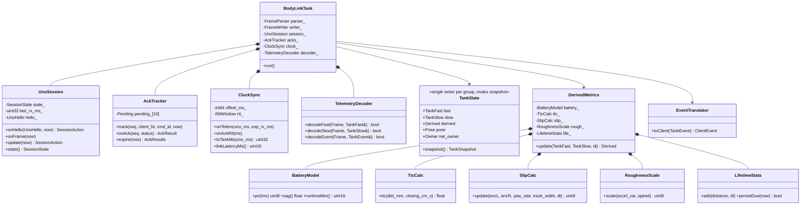
Writers: fast/slow/derived = BodyLinkTask · pose = NavigationTask · net_owner = ControlTask. `FrameParser`/`FrameWriter` are the same generated C++ as the Uno.

### 3.2 Uno session state machine
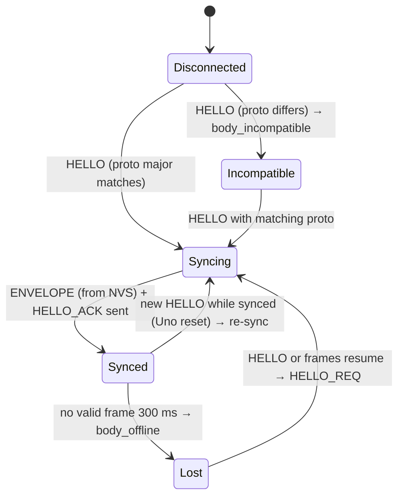
- Not Synced → client motion commands get `BODY_OFFLINE` / `BODY_INCOMPATIBLE`; camera keeps streaming.
- Heartbeat every 100 ms in every state.

### 3.3 Commands and acks
- ControlTask → `FrameTxQueue` (with client ref) → BodyLinkTask sends + tracks ack (seq → client, cmd id, 200 ms deadline).
- Uno ACK status → registry code/reason → client `ack`/`nack`; no ack in 200 ms → `nack COMMAND_TIMEOUT`.
- **Motion commands never auto-resent**; settings/calibration may retry once.
- Streaming (DRIVE, CAM_JOY) untracked; Uno's rate-limited rejection events → `nack` to the owning client.

### 3.4 Clock sync
- `tank_ms` = ESP32 time; offset = `esp_rx_ms − uno_ms` as the **minimum over a sliding window**; Uno timestamps converted.
- Link latency = EMA ack RTT / 2 → `esp.link_latency_ms`.
- Camera frames stamped in ESP32 time (same clock as telemetry); hub estimates its offset via ping/pong.

### 3.5 Derived metrics
| Metric | Method |
|---|---|
| batt_pct | 2S Li-ion LUT (8.4 V → 100 %, 6.6 V → 0 %) on idle voltage |
| sag_v | idle EMA − loaded EMA (`driving` flag) |
| runtime_min | voltage slope while driving → minutes to critical |
| ttc_s | dist / closing speed when closing > 2 cm/s, else null |
| slip_pct | `(vR − vL)/track_width` vs gyro rate during turns |
| roughness | accel_var normalised by speed → 0–100 |
| lifetime | encoder distance + runtime + power-ons; NVS every 5 min |

### 3.6 Telemetry path
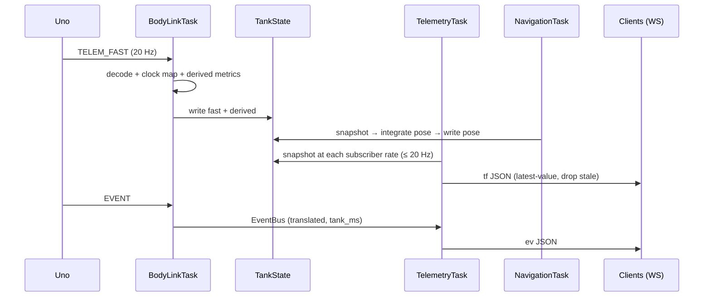

---

## 4. Client API — WebSocket, auth, arbitration, REST (APPROVED)

### 4.1 Class diagram
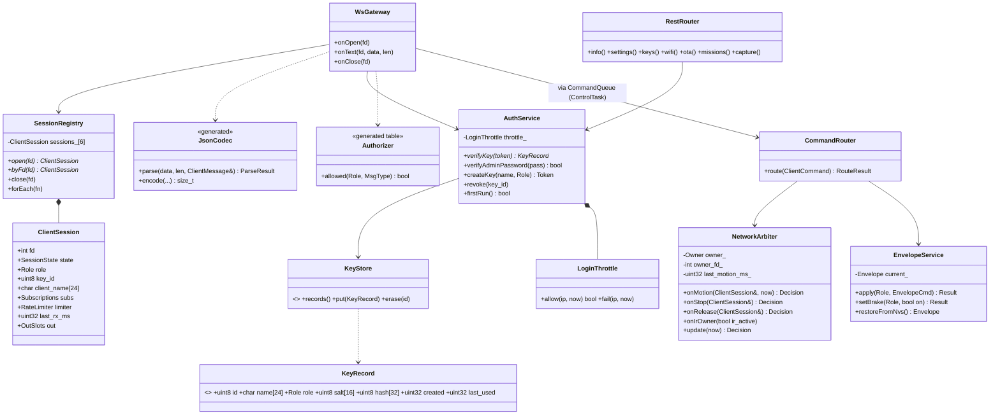
`SessionState {Connected, Authenticated, Closing}` · `Role {viewer, ai, human, admin}` · `Owner {None, Ai, Human}`. Keys: salted SHA-256 + constant-time compare; admin password PBKDF2; login throttle 5 failures → 30 s lockout.

### 4.2 Session lifecycle
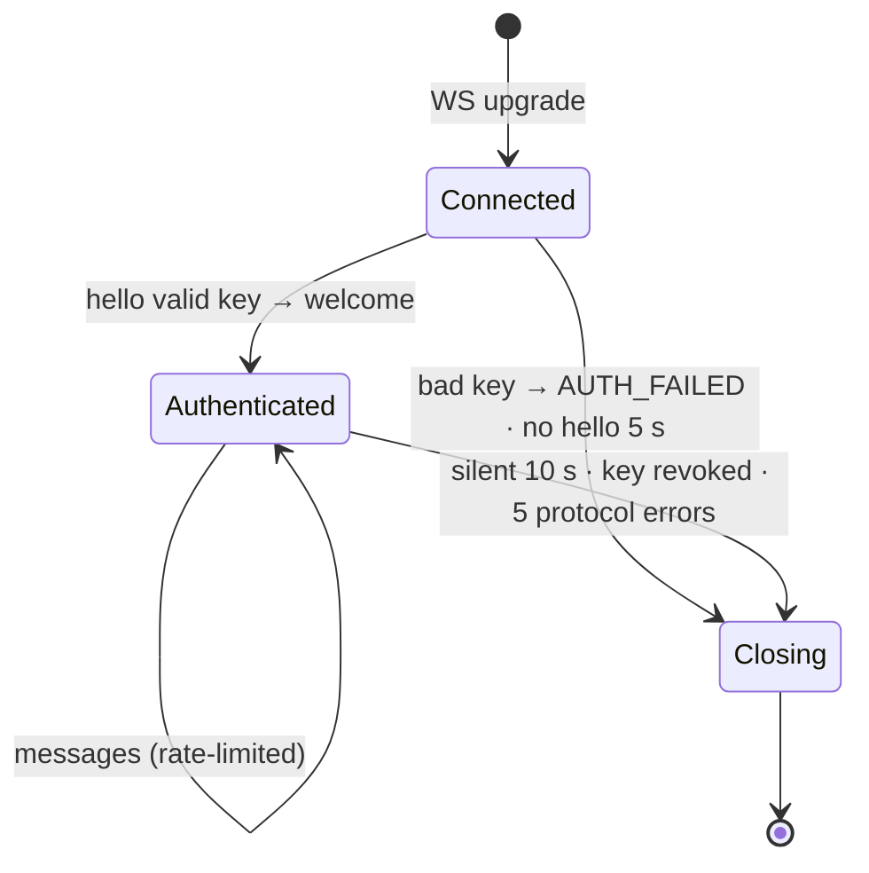
Owner session closing → STOP + owner released.

### 4.3 Network arbitration (human > AI)
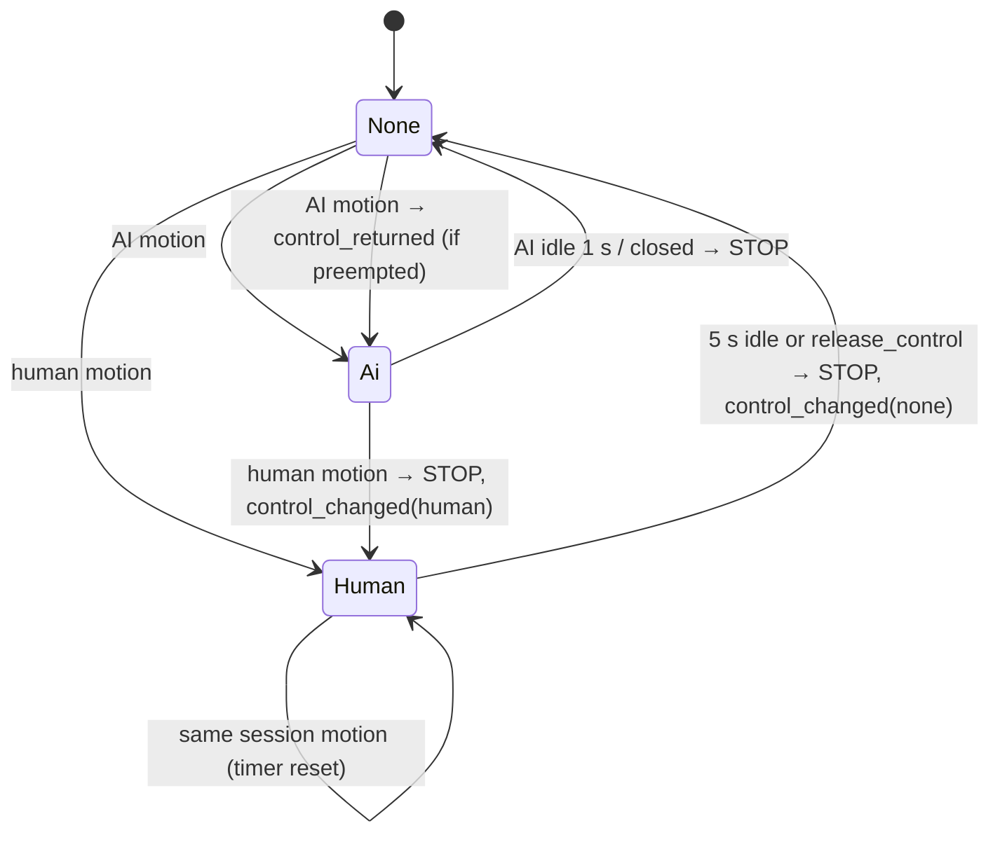
- Other same-role sessions → `NOT_OWNER` until the timer expires.
- IR owner (from Uno telemetry) → all network motion `NOT_OWNER`; arbiter frozen.
- STOP from any authenticated session (incl. viewer) → queue front → Uno.
- Frames tagged `src`; `OWNER_HINT` sent to the Uno for LED colour.

### 4.4 Validation pipeline
1. Parse (generated codec, fixed pool) → `INVALID_COMMAND`
2. Authorize (role × type table) → `ROLE_FORBIDDEN`
3. Range-validate (generated from schema) → `INVALID_COMMAND` + field
4. Rate limit (drive/cam_joy ≤ 25 Hz, others ≤ 10/s per session) → `RATE_LIMITED`
5. Capability (`move`/`nav_*` without encoders → `UNAVAILABLE`; body not synced → `BODY_OFFLINE`)
6. Arbitrate (motion) → `NOT_OWNER` / accepted
7. Route: body frame → FrameTxQueue · nav → NavigationTask · camera config → CameraTask · settings/keys → local · ping → pong

### 4.5 Envelope rules
| Action | ai | human/admin |
|---|---|---|
| set / tighten | ✅ tighter only | ✅ |
| loosen / clear | ❌ `ENVELOPE_LOCKED` | ✅ |
| obstacle brake off | ✅ unless `lock_brake` | ✅ unless `lock_brake` |
Envelope persisted in NVS and restored to the Uno on every HELLO.

### 4.6 REST (port 80)
`/api/info`, `/api/settings` (GET human+, PUT admin, ETag), `/api/keys`, `/api/wifi`, `/api/ota`, `/api/missions`, `/api/capture` (→ CameraTask queue). Auth: `Authorization: Bearer` or `?key=`. Errors: shared code/reason registry in the hub's envelope `{success:false, error:{…}}`.

### 4.7 Human takes over from the AI
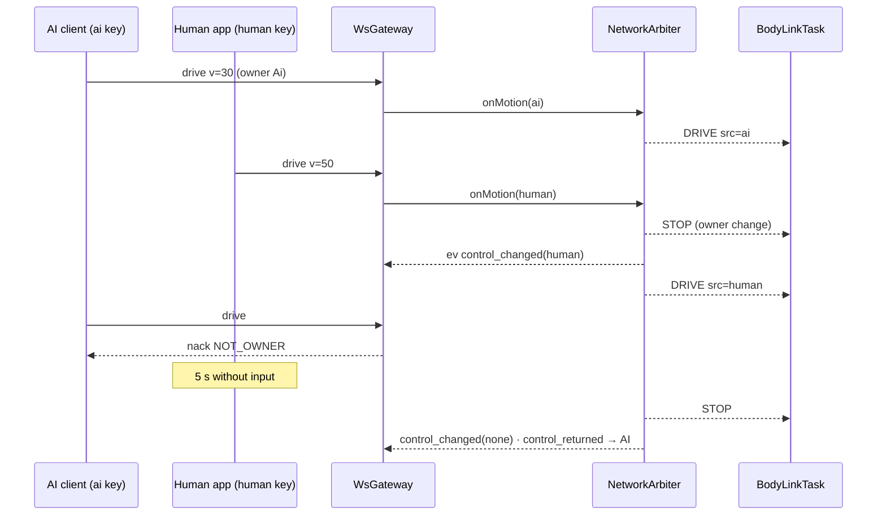

---

## 5. Navigation (APPROVED)

### 5.1 Class diagram

`SegKind {TurnTo, TurnArc, MoveDist, FinalHeading}`; MissionStore ≤ 8 missions × 32 points.

### 5.2 Pose integration (20 Hz)
- `Δd = mean(ΔencL, ΔencR) / counts_per_cm`; θ = Uno gyro yaw (source of truth; encoders not trusted for heading).
- Midpoint integration `x += Δd·cos(θ_mid)`, `y += Δd·sin(θ_mid)`.
- Uno reboot (counts jump to 0) → skip step, keep pose, raise `pose_degraded`.
- No encoders → `valid = false`, nav commands `UNAVAILABLE`.
- `nav_set_origin` → (0,0,0); `home_dist_cm` published.

### 5.3 Path planning
- Heading change ≤ 90° and distance ≥ 2 × radius → **arc** (`TURN to bearing`, radius `min(30 cm, dist/2)`) + `MOVE` remainder; else **spin** + `MOVE`.
- Residual > 5 cm after MOVE → re-plan (max 3), then continue with `waypoint_inaccurate`.
- Return home = go-to (0,0) then turn to θ = 0.

### 5.4 Mission runner state machine
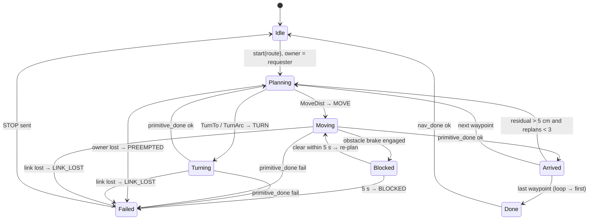
- Missions run under the requester's ownership (frames tagged with its source, normal arbitration); preemption → `PREEMPTED`, never silently resumed.
- Progress via `primitive` telemetry and `nav_progress` events.

### 5.5 Go-to sequence
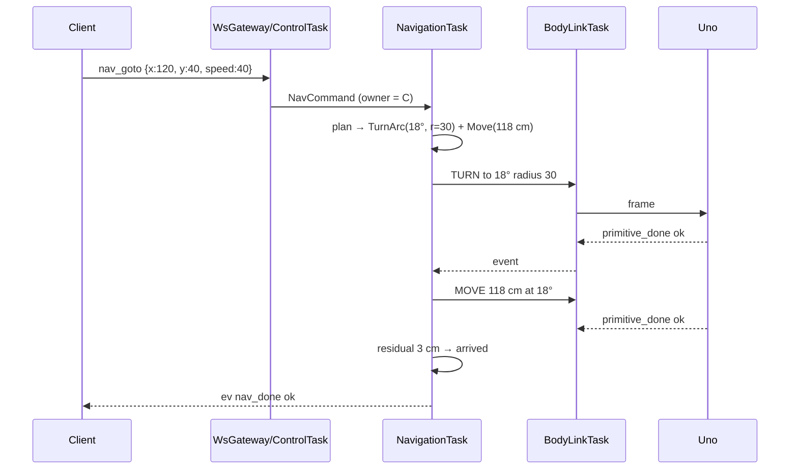

---

## 6. Camera service (APPROVED)
Problem solved: ELEGOO's stream handler loops inside the server task (second viewer blocked). Design: capture once, share to ≤ 2 viewers via refcounted frames and per-viewer async tasks.

### 6.1 Class diagram
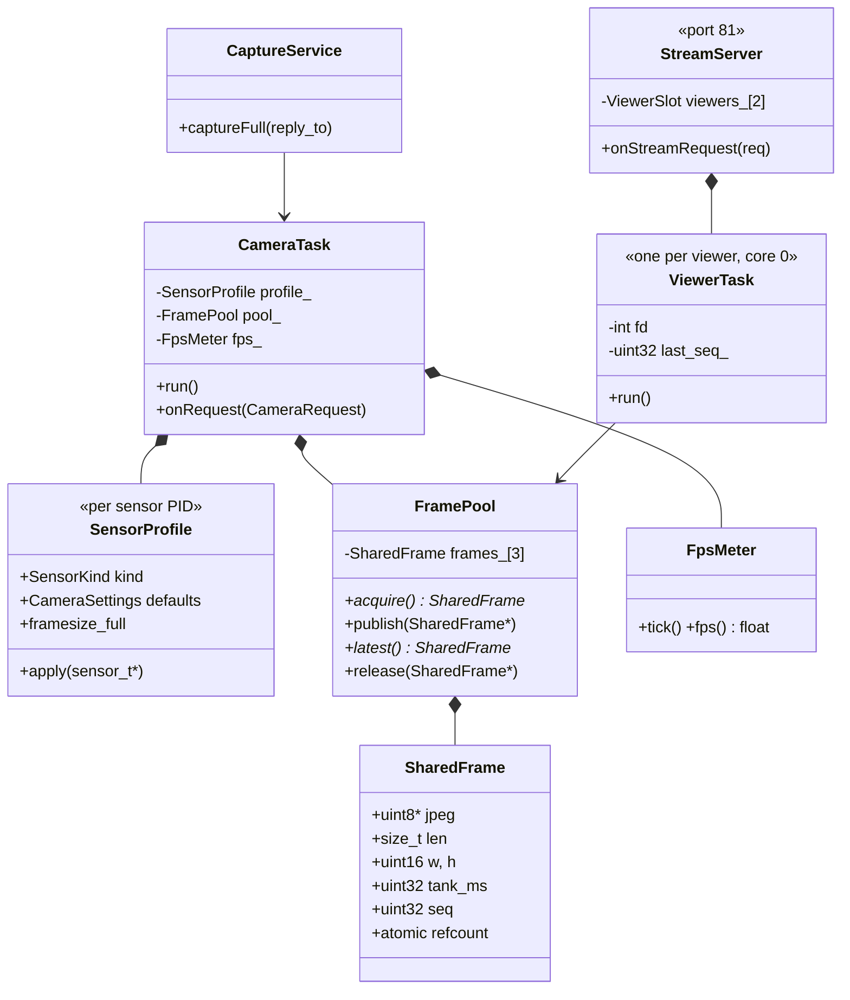

### 6.2 Streaming
- CameraTask grabs → copies JPEG into a refcounted PSRAM `SharedFrame` (≈ 25–60 KB @ 640×480) → returns the driver buffer at once → publishes as latest.
- One `ViewerTask` per viewer (max 2) using `httpd_req_async_handler_begin`; waits for a newer frame, sends one part, releases. **Latest-frame-wins**: slow viewers skip frames; the camera is never slowed.
- 3rd viewer → `503` ("use the hub").
- Each part: `X-Timestamp: <tank_ms>` (capture time, ESP32 clock) + `X-Frame-Seq`.
```
--frame
Content-Type: image/jpeg
Content-Length: 41233
X-Timestamp: 1234567
X-Frame-Seq: 9876
<jpeg bytes>
```
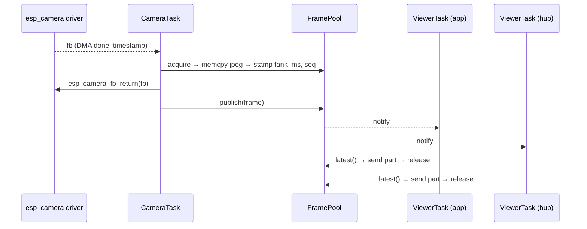

### 6.3 Full-resolution capture
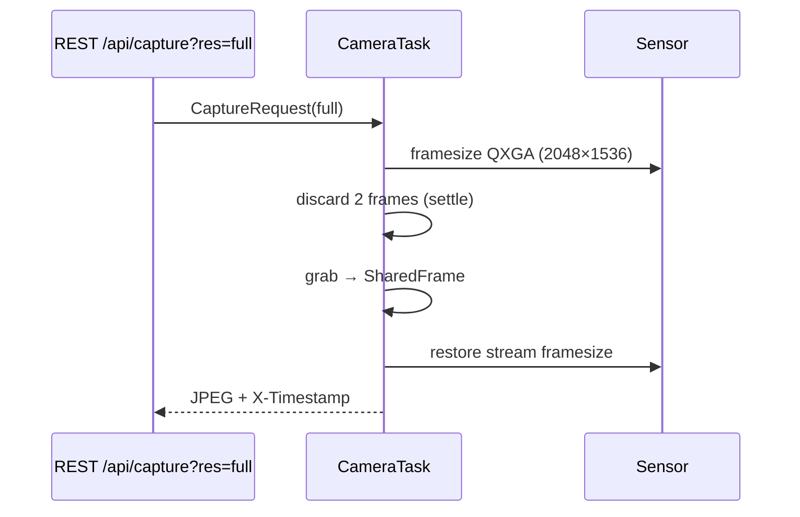
Stream pauses ~0.5 s (viewers keep the last frame); one full capture at a time, queue 2, then `BUSY`.

### 6.4 Sensor profiles, settings, health
- Sensor PID at boot → profile: **OV3660** (stock), OV2640, OV5640 (defaults: flip/mirror/quality, full framesize).
- Default stream 640×480, JPEG quality 12; admin changes via CameraTask queue; persisted in NVS.
- Grab timeout 200 ms → counter; 5 consecutive → re-init + `camera_reset` event; `esp.fps` + dropped-frame counters in telemetry.

### 6.5 Memory
PSRAM: 2 driver buffers + 3 pool frames ≈ 300 KB (+ ~400 KB temporary for a 3 MP capture) of 4 MB; internal RAM untouched by video.

---

## 7. Calibration engine (APPROVED)
The Uno runs motion scripts and streams raw `CAL_DATA`; the ESP32 runs prechecks, prompts, maths, results and saving.

### 7.1 Class diagram
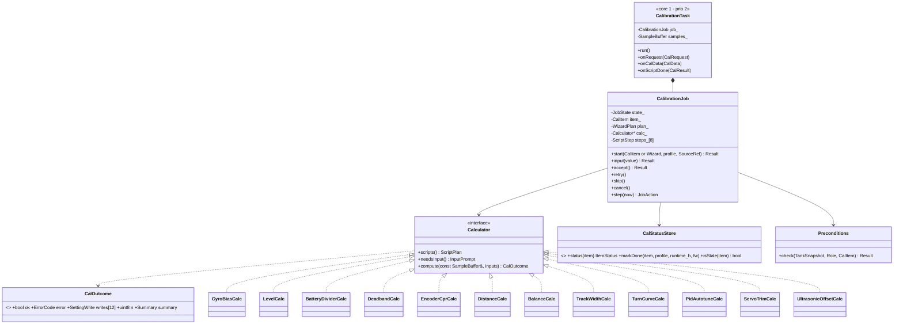
`virtual` justified here: 12 calculators selected at runtime. SampleBuffer in PSRAM (60 s × 50 Hz).

### 7.2 Job state machine
```mermaid
stateDiagram-v2
    [*] --> Idle
    Idle --> Precheck : start (admin)
    Precheck --> Failed : not synced / envelope / moving / battery low / no encoders
    Precheck --> RunningScript : CALIBRATE start(script)
    RunningScript --> RunningScript : CAL_DATA → buffer; next script
    RunningScript --> AwaitInput : needs user value
    AwaitInput --> RunningScript : input + more scripts
    AwaitInput --> Computing : input, no more scripts
    RunningScript --> Computing : last script done
    RunningScript --> Failed : script fail / IR / STOP / link lost
    Computing --> AwaitAccept : ok → new vs previous
    Computing --> Failed : invalid (reason + suggestion)
    AwaitAccept --> Saving : accept → SETTING_SET ×n + SETTINGS_SAVE
    AwaitAccept --> RunningScript : retry
    Saving --> Done : settings_saved
    Done --> Idle : wizard → next item
    Failed --> Idle : wizard offers retry / skip
```
Progress, prompts, live values, results → `calibration` events to the admin session (drives the Calibration stepper dialog). Cancel → `CALIBRATE cancel`, nothing saved.

### 7.3 Calculators
| Item | Uno script(s) | Computation |
|---|---|---|
| Gyro bias | StillSample 2 s | mean gx/gy/gz; reject high variance |
| Level | StillSample 2 s | mean accel → pitch/roll offsets |
| Battery divider | — | user mV ÷ raw → scale |
| Deadband | PwmRamp × 4 | start = PWM where gyro > 0.3 °/s or counts begin (100 ms); keep = where motion stops on ramp-down |
| Encoder CPR | — (live count) | count delta on confirmed shaft turn |
| Distance | DriveCounts(n) | counts ÷ measured cm |
| Track balance | FullSpin | max cps per track |
| Track width | SpinAndArc | encoder rotation vs gyro → track_width_eff + slip |
| Turn-rate curve | RateSteps | max achievable rate at 4 speeds |
| PID auto-tune | RelayOscillation | `Ku = 4d/(π·a)`, `Tu` → Tyreus–Luyben gains (speed, rate, heading) |
| Servo trim | ServoNudge | user nudges → trims |
| Ultrasonic offset | — | user distance |
All outcomes include new vs previous values.

### 7.4 Status and staleness
No RTC → staleness by **driving hours** (lifetime stats) + events: deadband/balance/track width > 50 driving hours or persistent heading-hold error; any profile item when the settings layout version changes; gyro bias never stale (auto re-estimated). `CalStatusStore` per item: done/missing, profile, driving hours, firmware version.

### 7.5 Deadband sequence
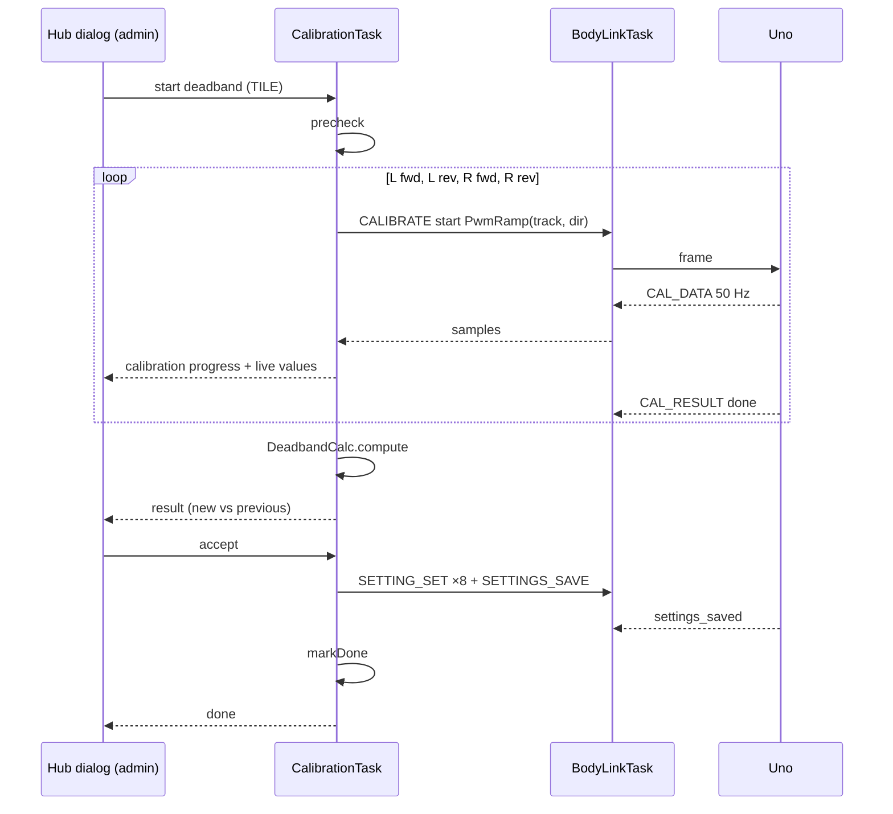

---

## 8. WiFi, mDNS, OTA & storage (APPROVED)

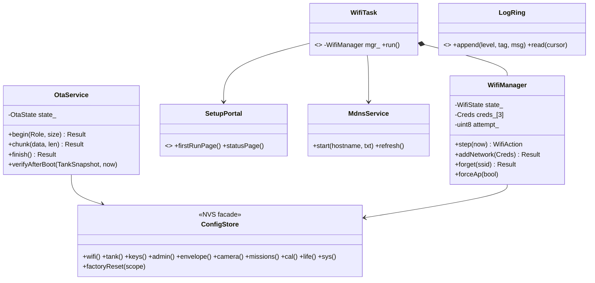

```mermaid
stateDiagram-v2
    [*] --> FirstRun : no admin password
    [*] --> TrySaved : configured
    FirstRun --> FirstRun : open AP + captive portal (setup only)
    FirstRun --> TrySaved : setup saved (admin pw, AP WPA2 pw, optional WiFi)
    TrySaved --> Station : connected (≤ 15 s)
    TrySaved --> AccessPoint : none reachable → WPA2 AP + portal
    Station --> Reconnecting : link lost
    Reconnecting --> Station : reconnected (backoff 1,2,4,8 s…)
    Reconnecting --> ApSta : down 2 min → AP + STA
    ApSta --> Station : home network back → AP off
    AccessPoint --> TrySaved : rescan every 60 s
```
- WiFi drop: Uno deadman already stopped the tank; after 2 min the tank also opens its own hotspot (AP+STA).
- mDNS re-announced on IP change; SNTP on home WiFi (log timestamps only).
- WiFi reset (Uno D2 5 s at boot) clears only saved networks.

```mermaid
stateDiagram-v2
    [*] --> Idle
    Idle --> Receiving : admin upload
    Receiving --> Receiving : chunks → inactive partition
    Receiving --> Failed : bad chunk / disconnect → abort
    Receiving --> Validating : complete
    Validating --> Rebooting : valid → set boot partition
    Validating --> Failed : invalid
    Rebooting --> PendingVerify : new image boots
    PendingVerify --> Committed : Uno synced + network up ≤ 60 s → markValid
    PendingVerify --> RolledBack : timeout / crash
```
After update: Uno protocol checked → `body_incompatible` warning if mismatched.

| NVS namespace | Keys |
|---|---|
| wifi | n0..n2 (ssid + pass) |
| tank | name, hostname, AP SSID, AP password (plain for the WiFi driver; optional NVS encryption) |
| admin | salt, PBKDF2 hash |
| keys | k0..k15 KeyRecords |
| envelope | current envelope |
| camera | settings per sensor |
| missions | m0..m7 |
| cal | status per item, profile names p0..p2, roughness signatures |
| life | distance, runtime, power-ons |
| sys | last reboot reason / WDT culprit |
Each namespace versioned; corrupt/old → defaults + `settings_reset` (others unaffected). Factory reset (admin): wifi / keys / all.

---

## 9. Memory, task budget & error handling (APPROVED)

| Internal RAM (≈ 320 KB) | KB |
|---|---|
| WiFi + LwIP + system | ~90 |
| Task stacks (BodyLink 4, Control 6, Nav 4, Telemetry 6, Calibration 6, Camera 4, Viewers 2×3, WiFi 4, OTA 4, HTTP 2×6) | ~56 |
| JSON pool | 16 |
| Sessions, queues, TankState, arbitration | ~14 |
| **Total ≈ 176 KB → ≥ 100 KB free (alert < 40 KB)** | |

| PSRAM (4 MB) | KB |
|---|---|
| Camera buffers + frame pool | ~300 |
| Full capture (temporary) | ~400 |
| Calibration samples | ~50 |
| Log ring, missions | ~40 |
Core 1 load < 25 % expected; core 0 carries WiFi + JPEG + streaming. Stack high-water marks and core loads in `esp` telemetry.

| Failure | Behaviour |
|---|---|
| UART frame errors | counted, dropped |
| Uno silent 300 ms | body_offline; motion BODY_OFFLINE; HELLO_REQ |
| Uno proto mismatch | body_incompatible; motion refused; camera works |
| Camera timeouts ×5 | re-init + camera_reset |
| WiFi lost | Uno deadman stopped; reconnect / AP+STA after 2 min |
| NVS namespace corrupt | defaults + settings_reset |
| Free heap < 40 KB | new sessions BUSY, warning, log |
| JSON pool exhausted | nack BUSY |
| Task watchdog | reboot; culprit + reason in RTC |
| OTA failure | old image kept / rolled back |
Errors use the shared code/reason registry. Logs: ESP-IDF on USB serial + 200-line ring at `/api/logs` (admin), collected by the hub.

---

## 10. Revision 2 — review fixes (APPROVED decisions; authoritative where earlier sections differ)
Source: independent review (25 findings). User decisions: **Arduino-ESP32 3.x (IDF 5.x, pioarduino platform)**; **first-run setup confirmed by pressing the tank's mode button**; **hold the button 15 s at boot → admin password + keys reset**.

### 10.1 Toolchain (I1)
- PlatformIO **pioarduino** platform, **Arduino-ESP32 3.x on ESP-IDF ≥ 5.1**, versions pinned in `platformio.ini` + lockfile. Required for `httpd_req_async_handler_begin`, `httpd_queue_work`, current esp32-camera. ELEGOO camera code ported to the 3.x API.
- Partition table: **2 × 1.9 MB OTA app**, NVS **24 KB**, otadata, coredump 64 KB (4 MB flash).

### 10.2 STOP fast path (C1, M1)
```mermaid
sequenceDiagram
    participant C as Client
    participant G as WsGateway (httpd task)
    participant B as BodyLinkTask
    participant U as Uno
    C->>G: {"t":"stop"}
    G->>G: auth only (no rate limit / capability / owner checks)
    G->>B: atomic stop_pending = true + task notify (no queue)
    B->>U: STOP frame (written before anything else in TX)
    U-->>B: ACK
    B->>B: not acked in 50 ms → resend (idempotent), up to 10×
    B-->>G: ack → client
```
- STOP never passes through `CommandQueue`/`FrameTxQueue`; TX loop checks `stop_pending` first every iteration.
- All blocking work is off the port-80 task (10.5), so STOP parsing is never delayed by capture/OTA/PBKDF2.

### 10.3 Ownership generation and client loss (C2, C3, I9)
- **Single arbitration state machine** (ESP32 view) with owners **None · Ai · Human · Ir · Calibration**, driven by Uno **events** (`ir_override`, `control_changed`) — not 1 Hz TELEM_SLOW.
- **Ownership generation counter** `gen` increments on every owner change. Every motion frame (from ControlTask, NavigationTask, CalibrationTask) carries the `gen` it was created under; **BodyLinkTask drops frames whose `gen` ≠ current** (stale mission steps can never reach the Uno).
- **All nav/calibration motion goes through `NetworkArbiter.authorize(source, gen)`** before entering FrameTxQueue.
- **Owner session liveness:** owner silent > **1.5 s** (no message/ping) or closed → STOP + `MissionRunner.cancel(OWNER_LOST)` + `CALIBRATE cancel`. Clients must ping ≥ 1 Hz (Spec 1 §4); non-owner sessions closed after 10 s silence.
- **Missions keep ownership** while the owner session is alive (mission activity refreshes the idle timer only while the owner pings).
- `control_returned` is emitted **at handback** to the preempted AI session (Spec 0 §4).
- When IR ownership ends → owner None (no automatic return to a previous network owner).
```mermaid
stateDiagram-v2
    [*] --> None
    None --> Ai : AI motion
    None --> Human : human motion
    Ai --> Human : human motion → STOP, gen++
    Human --> None : 5 s idle / release / owner lost → STOP, gen++ · control_returned → preempted AI
    Ai --> None : 1 s idle / owner lost → STOP, gen++
    None --> Ir : ir_override event
    Ai --> Ir : ir_override → gen++
    Human --> Ir : ir_override → gen++
    Ir --> None : control_changed(none) from Uno → gen++
    None --> Calibration : admin starts calibration
    Calibration --> None : done / cancel / owner lost → gen++
```
- Failure tables corrected: WiFi/client loss → **owner-loss rule stops primitives, missions and calibration** (not only the Uno deadman).

### 10.4 Envelope sync with acknowledgement (C4)
```mermaid
stateDiagram-v2
    [*] --> Syncing
    Syncing --> EnvelopeSent : HELLO → send ENVELOPE (from NVS)
    EnvelopeSent --> Synced : ENVELOPE ACK ok → send HELLO_ACK
    EnvelopeSent --> Syncing : no ACK 200 ms → resend (≤ 5) else body_offline
    Synced --> Syncing : TELEM_SLOW envelope ≠ NVS → resend + envelope_mismatch event
```
- Envelope changes: send to Uno → **write NVS only after ACK**.

### 10.5 Nothing blocking on the port-80 task (C5)
- `/api/capture`, `/api/ota`, and PBKDF2 verification use **async request handlers** handed to a **WorkerTask** (core 0, prio 2): capture waits on CameraTask there; OTA streams there with `esp_ota_begin(OTA_WITH_SEQUENTIAL_WRITES)` (incremental erase); PBKDF2 runs there.
- The httpd task only parses, authorizes and enqueues.

### 10.6 Camera revisions (I2, M3, M4)
- `esp_camera_init` with **framesize = QXGA (max)**, `fb_count = 3`, `grab_mode = CAMERA_GRAB_LATEST`, JPEG buffers sized for QXGA; stream set to VGA via `set_framesize` after init.
- **No PSRAM copy:** `SharedFrame` refcounts the driver `fb` directly; returned to the driver when refcount = 0 (3 buffers: one being filled, up to two held by viewers).
- Full capture: switch to QXGA → **validate JPEG SOI/EOI**, discard until valid (≤ 5 frames) → restore; stream pause up to ~1 s (documented).
- Timestamps: `fb->timestamp` is `gettimeofday` at end of readout → converted to `esp_timer` time via an offset sampled at boot and after every SNTP sync; documented as "end of readout".
- **Throughput targets:** 1 viewer 15 fps @ VGA q12; 2 viewers 10 fps each; **adaptive quality/fps** steps down when send queues back up.
- PSRAM budget: 3 × QXGA JPEG buffers ≈ **1.5 MB** + calibration 50 KB + log/missions 40 KB → ~1.6 MB of 4 MB.

### 10.7 Sockets and WS send path (I3, I4)
| Owner | Sockets |
|---|---|
| Port 80: WS sessions | 6 |
| Port 80: REST | 2 |
| Port 81: stream (2 + 1 for 503) | 3 |
| httpd control sockets | 2 |
| mDNS, captive DNS, SNTP | 3 |
| **Total** | **16 → `CONFIG_LWIP_MAX_SOCKETS=16`** |
- Port 81 accepts 3 and returns **503 "use the hub"** to the 3rd viewer; LRU purge disabled on both servers.
- **One sender per server:** all WS sends go through `httpd_queue_work` (executed on the httpd task); TelemetryTask only writes **per-session latest-value slots** (`OutSlots`: latest tf, latest ts, event ring 32) and posts a flush work item. `send_wait_timeout = 1 s`; a session that times out is closed.
- **SessionRegistry is owned by the httpd task**; other tasks post messages. Sessions keyed by **(fd, generation)** so a reused fd never receives a stale ack/event. MJPEG streams are closed when their key is revoked.

### 10.8 Navigation heading frame (I5, M2)
- PoseEstimator keeps `yaw_offset` (Uno yaw → pose θ). `nav_set_origin` sets `yaw_offset = −uno_yaw`; every bearing is converted back to the Uno frame before TURN/MOVE.
- Uno reset detected from **HELLO** (not count jumps) → pose marked degraded, offset re-anchored.
- Mission state machine fixes: owner-lost handled from **every** state; `Blocked → Planning` (re-plan); replans exhausted → continue to next waypoint with `waypoint_inaccurate`; **Uno `primitive_done` reason is authoritative** for blocked/stall (ESP32 5 s timer removed). `nav_progress` event added to Spec 1.

### 10.9 Startup and OTA commit (I6, I7)
- Boot starts **WiFi, HTTP, camera and the Uno session in parallel**; the Uno session is independent (absent/incompatible Uno never blocks the ESP32).
- OTA commit (`markValid`) = **network up + HTTP self-check + no crash within 60 s**; Uno state reported as a warning only.

### 10.10 Command and frame coverage (I8)
WS command → handler table (every row of Spec 1 §5):
| Command | Handler |
|---|---|
| stop | 10.2 fast path |
| drive, drive_rate, turn, move, cancel | arbiter → BodyLink |
| release_control | arbiter |
| cam_joy, cam_lock, cam_set, cam_nudge, cam_home | **arbiter (owner-only, Spec 1 §5)** → BodyLink |
| led, sound, tone | **arbiter (owner-only)** → BodyLink |
| audio_mode, obstacle_brake, envelope | EnvelopeService / BodyLink (role rules §4.5) |
| nav_goto, nav_home, nav_waypoints, nav_mission, nav_cancel, nav_set_origin | NavigationTask (via arbiter) |
| calibrate, calibrate_input, **calibrate_op {accept, retry, skip, cancel}** | CalibrationTask |
| surface_profile {select, create, rename, delete} | ProfileService: names in NVS ↔ Uno index; PROFILE frame |
| camera_config | CameraTask (WorkerTask for framesize) |
| subscribe | session (default before subscribe: events only; `fast_hz` clamped 1–20, default 10) |
| ping | immediate pong |

Uno → ESP32 frame table: HELLO → session · ACK → AckTracker · TELEM_FAST/SLOW → decoder · EVENT → translator (+ `cal_request` → CalibrationTask prompt to admin sessions; `button_press` → first-run confirm) · SETTING_VALUE → requester · CAL_RESULT/CAL_DATA → CalibrationTask · **WIFI_RESET_REQ / ADMIN_RESET_REQ → ACKed in every session state**, then executed.
- **OWNER_HINT** sent on every owner change and after every re-sync.
- **Surface auto-suggest:** `SurfaceSuggester` compares rolling roughness/slip signature with each profile's stored signature (NVS) → `surface_suggest{profile}` after 30 s consistent mismatch; auto-switch only when stopped and `surface_auto_switch` is on.
- CALIBRATE carries `profile u8` (Spec 1) — Uno LLD aligned. **CAL_DATA channel layout per script** defined in the generated protocol (e.g. PwmRamp: pwm, gyro_z, enc_l, enc_r, accel_x, …).

### 10.11 Auth, recovery and web security (I10, I11, I12)
- **Admin password is used only** for `POST /api/keys` (pairing/key minting) and the setup page; all other admin calls use admin **keys** (no PBKDF2 per request).
- **Recovery:** Uno D2 held **15 s at boot** → `ADMIN_RESET_REQ` (new frame 0x97) → ESP32 clears admin password + keys (WiFi kept) → back to FirstRun. 5 s hold still = WiFi reset only.
- **First-run protection:** setup page requires a **physical confirmation — press the tank's mode button** (Uno `button_press` event) within 60 s; the open setup AP **closes after 30 min** (re-opened by power cycle).
- Login throttle: **global exponential backoff** (not per-IP), so the hub is not locked out by one mistyped attempt.
- `?key=` accepted **only** on `GET :81/stream` and `GET /api/capture`; URIs never logged with query strings.
- **Host/Origin checks:** requests whose `Host` is not the tank's IP/hostname/192.168.4.1 are rejected (DNS-rebinding defence); WS `Origin` checked against an allowlist (hub origin, app); **no CORS headers** except the configured allowlist.

### 10.12 WiFi behaviour with an app on the hotspot (I13)
- AP mode never torn down for rescans; scans run in APSTA **only while no AP stations and no WS sessions** are connected.
- In ApSta, STA reconnect attempts are **paused while AP clients are connected** (avoids channel hopping drops).

### 10.13 Watchdog policy & task map (I14, I15)
| Task | Core / prio | TWDT | Longest blocking call | Queue in |
|---|---|---|---|---|
| BodyLinkTask | 1 / 6 | yes | UART read 5 ms | FrameTxQueue, stop flag |
| ControlTask | 1 / 5 | yes | queue wait 20 ms | CommandQueue |
| NavigationTask | 1 / 4 | yes | queue wait 50 ms | NavQueue, PrimitiveDone |
| TelemetryTask | 1 / 3 | yes | none (slots + work post) | EventBus |
| CalibrationTask | 1 / 2 | yes | queue wait 50 ms | CalQueue, CalDataQueue |
| CameraTask | 0 / 3 | yes | fb grab 200 ms | CameraRequestQueue |
| ViewerTask ×2 | 0 / 2 | no (send ≤ 1 s timeout) | socket send | frame notify |
| WorkerTask | 0 / 2 | no | OTA write / PBKDF2 ~1 s | WorkQueue |
| WifiTask | 0 / 1 | no (connect/scan) | connect 15 s | — |
| httpd ×2 | 0 / 5 | liveness ping via `httpd_queue_work` every 2 s | — | — |
Shared objects: TankState (writers per group, mutex snapshot) · SessionRegistry (httpd task) · KeyStore/MissionStore/ConfigStore (**ConfigTask-style single writer = WorkerTask**; readers get copies; a mission being run is copied at start) · CalStatusStore (CalibrationTask).

### 10.14 Registry, mapping, clock, budgets, flash (M1, M5, M6, M7, M8)
- New registry reasons: `COMMAND_TIMEOUT`, `BODY_INCOMPATIBLE`, `CAMERA_TIMEOUT`, `ENVELOPE_MISMATCH`, `OWNER_LOST`; events `settings_reset`, `pose_degraded`, `waypoint_inaccurate`, `camera_reset`, `nav_progress`. Auth failure aligned to Spec 1: `{"t":"error","code":"AUTH_1001","reason":"AUTH_FAILED"}` then close.
- **Wire → JSON mapping table** generated from `protocol/` (sentinels: `spd_act −128 → null`, `dist_mm 0xFFFF → null (clear)`, `0xFFFE → us_fault flag`; yaw 0.01°, temp 0.01 °C, flags bits → names, `profile_idx → NVS name`, fw u16 → "major.minor"). **Calibration source of truth:** Uno bits = done/missing; ESP32 = stale + profile.
- Clock sync: **offset + skew** (linear fit over sliding minima) to absorb Uno resonator drift; Spec 1 wording aligned ("from TELEM_FAST").
- Internal RAM: plan for **~220 KB available**; camera DMA descriptors counted; `SPIRAM_TRY_ALLOCATE_WIFI_LWIP` enabled; **first milestone = skeleton build measured**, build gate: free internal heap ≥ 60 KB at idle with 2 viewers + 6 WS.
- `KeyRecord.last_used` kept in RAM, flushed with lifetime stats (5 min). **NVS encryption: off by default** (documented risk: AP password and WiFi credentials readable with physical flash access); optional build flag to enable.
