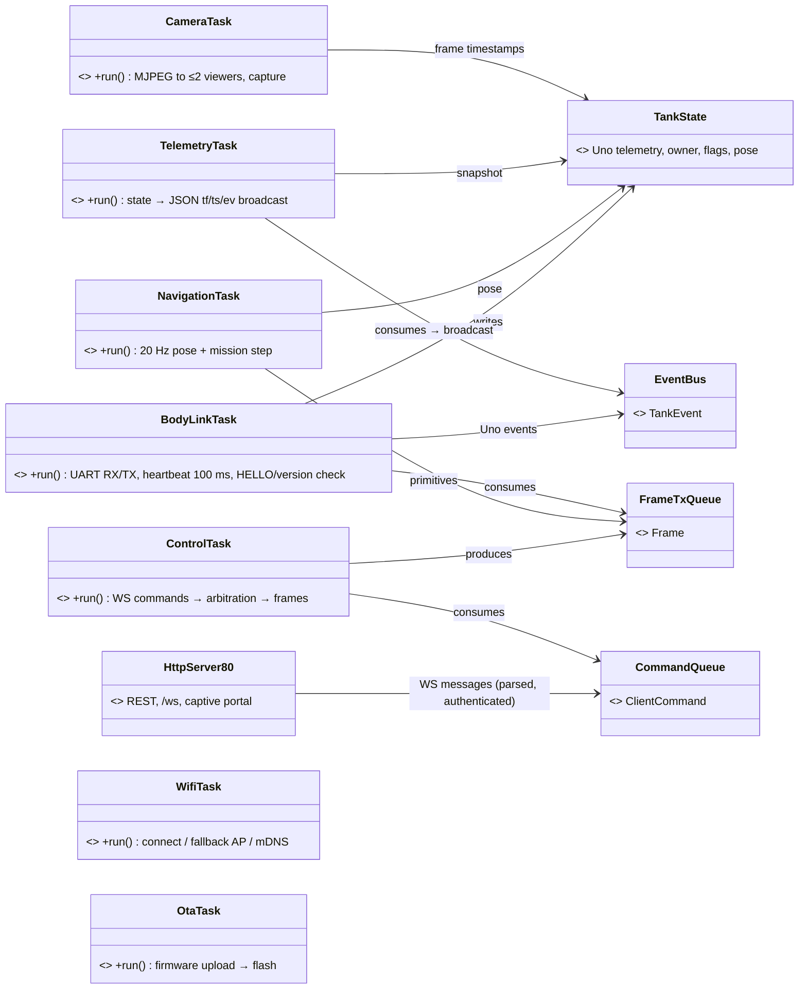
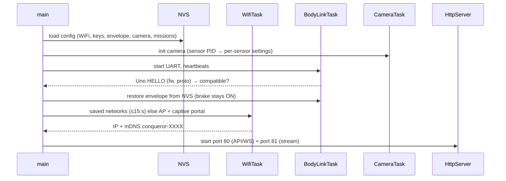
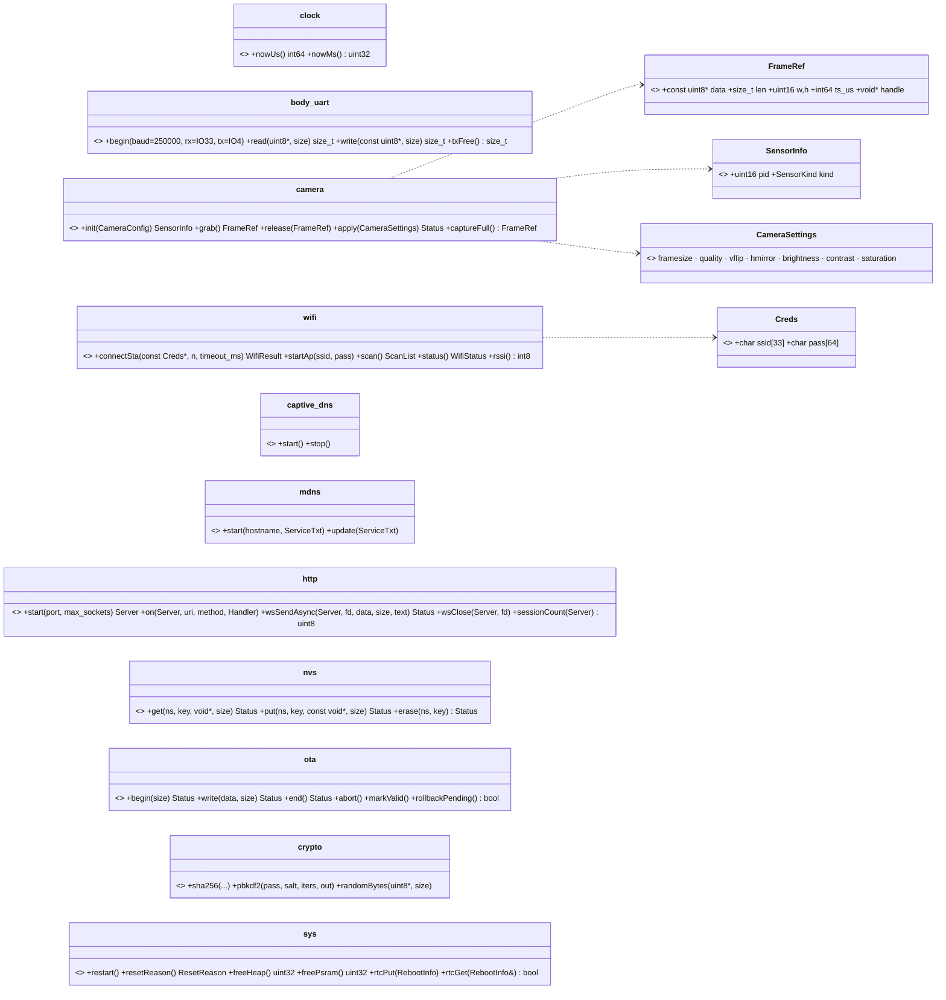
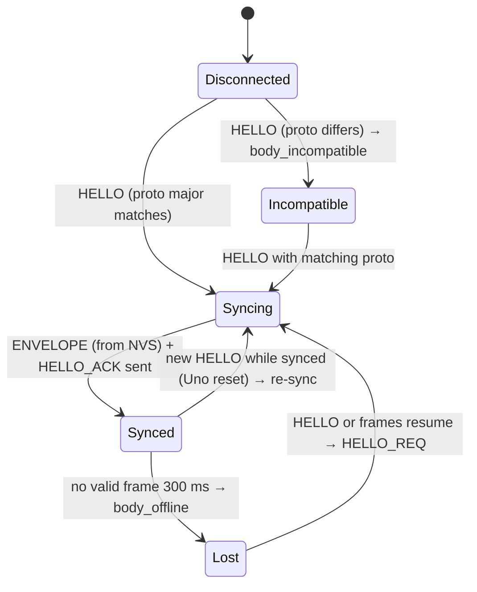
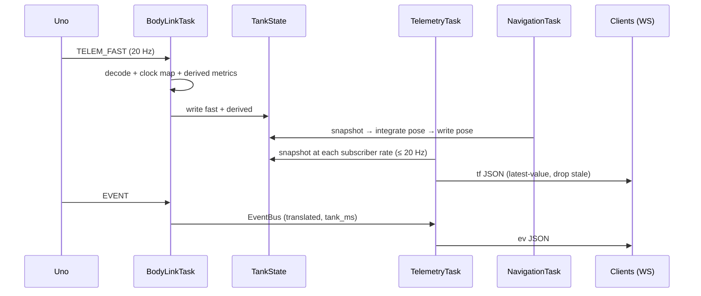

# ESP32 Firmware — Low-Level Design

Status: IN PROGRESS · Date: 2026-10-10 · Implements: Spec 2 Part B, Spec 1 · Standards: `docs/standards/coding-standards.md` §3

Sections: 1 Structure, tasks & frameworks ✅ · 2 Ports ✅ · 3 Body link & clock sync ✅ · 4 Client API · 5 Navigation · 6 Camera service · 7 Calibration engine · 8 WiFi, mDNS, OTA & storage · 9 Memory/task budget & error handling

Note: UART is **250000 baud** and calibration maths runs here (Uno LLD §9 revision).

---

## 1. Structure, tasks & frameworks (APPROVED)

### 1.1 Framework choices
| Concern | Choice | Why |
|---|---|---|
| Base | Arduino-ESP32 core on PlatformIO | reuses ELEGOO camera code |
| HTTP + WS + MJPEG | ESP-IDF `esp_http_server`, two instances (80: API/WS/setup, 81: stream) | already used by the camera example; native WS; one server stack |
| JSON | ArduinoJson 7 with a fixed memory-pool allocator (no heap in hot paths) | standard, fast, follows allocation rule |
| Hashing | mbedTLS: salted SHA-256 for tokens, PBKDF2 for the admin password | built in |
| Storage | NVS (Preferences) | wear-levelled |
| Protocol | generated C++ from `protocol/` (frames + JSON mapping) | single source |

### 1.2 Layers
```
src/
├── main.cpp       composition root: services, queues, tasks
├── app/           FreeRTOS tasks: read ports/queues → call domain → write ports/queues
├── domain/        pure C++: arbitration, auth rules, navigation, derived metrics, JSON⇄command mapping
├── ports/         headers (camera, uart, wifi, nvs, http, mdns, ota, clock)
├── drivers/       ESP32 implementations (IDF / Arduino)
└── generated/     frames, JSON schemas, error registry
```
`virtual` only where ≥ 2 implementations are active at runtime.

### 1.3 Tasks, cores, queues

- Core 1 = robot-critical (link, control, navigation, telemetry); core 0 = WiFi stack, HTTP, camera, OTA → video load cannot delay STOP.
- Tasks communicate only via queues + `TankState` (single writer per field group, mutex snapshots for readers).
- **STOP fast path:** WS STOP is pushed to the front of `CommandQueue` (`xQueueSendToFront`) and forwarded immediately.
- Task watchdog on all app tasks; reboot reason kept in RTC memory and reported at next boot.

### 1.4 Startup sequence


---

## 2. Ports (APPROVED)
Headers of free functions implemented in `drivers/`; no `virtual` needed.


`SensorKind {OV2640, OV3660, OV5640}`.

| Port | Notes | Thread/core rules | On failure |
|---|---|---|---|
| clock | esp_timer µs since boot (64-bit) | any task | — |
| body_uart | UART2 @ 250000, 1 KB RX / 512 B TX | **only BodyLinkTask** | short read/write counted |
| camera | esp_camera, PSRAM, 2 frame buffers; `ts_us` = capture time in clock time | **only CameraTask** (others via queue) | grab timeout 200 ms → CAMERA_TIMEOUT; reinit after 5 consecutive |
| wifi | STA ≤ 3 creds, AP fallback, scan | **only WifiTask** | WifiResult (no network / wrong password / timeout) |
| captive_dns | all queries → 192.168.4.1 in AP setup | WifiTask | — |
| mdns | `conqueror-XXXX`, `_conqueror._tcp`, TXT id/name/proto/fw | WifiTask | retried on IP change |
| http | esp_http_server; :80 max 7 sockets (6 WS + 1 REST); :81 2 stream sockets | handlers in server task; WS sends async | send failure → session closed |
| nvs | namespaces wifi, keys, tank, missions, cal, envelope | any task, short ops | Status |
| ota | dual partitions + rollback (must reach Uno link OK + WiFi up within 60 s) | OtaTask | abort keeps old image |
| crypto | mbedTLS; PBKDF2 10 000 rounds | any task | — |
| sys | RTC memory keeps reboot reason + WDT culprit task | any task | — |

Rules: each hardware resource has **one owning task** (others via queues; no locks around hardware) · `domain/` never includes `ports/`; shared value types in `types/` · pins/sizes in `drivers/board_config.h` (camera pin map `CAMERA_MODEL_M5STACK_WIDE`, UART IO33/IO4).

---

## 3. Body link, clock sync & derived metrics (APPROVED)

### 3.1 Class diagram

Writers: fast/slow/derived = BodyLinkTask · pose = NavigationTask · net_owner = ControlTask. `FrameParser`/`FrameWriter` are the same generated C++ as the Uno.

### 3.2 Uno session state machine

- Not Synced → client motion commands get `BODY_OFFLINE` / `BODY_INCOMPATIBLE`; camera keeps streaming.
- Heartbeat every 100 ms in every state.

### 3.3 Commands and acks
- ControlTask → `FrameTxQueue` (with client ref) → BodyLinkTask sends + tracks ack (seq → client, cmd id, 200 ms deadline).
- Uno ACK status → registry code/reason → client `ack`/`nack`; no ack in 200 ms → `nack COMMAND_TIMEOUT`.
- **Motion commands never auto-resent**; settings/calibration may retry once.
- Streaming (DRIVE, CAM_JOY) untracked; Uno's rate-limited rejection events → `nack` to the owning client.

### 3.4 Clock sync
- `tank_ms` = ESP32 time; offset = `esp_rx_ms − uno_ms` as the **minimum over a sliding window**; Uno timestamps converted.
- Link latency = EMA ack RTT / 2 → `esp.link_latency_ms`.
- Camera frames stamped in ESP32 time (same clock as telemetry); hub estimates its offset via ping/pong.

### 3.5 Derived metrics
| Metric | Method |
|---|---|
| batt_pct | 2S Li-ion LUT (8.4 V → 100 %, 6.6 V → 0 %) on idle voltage |
| sag_v | idle EMA − loaded EMA (`driving` flag) |
| runtime_min | voltage slope while driving → minutes to critical |
| ttc_s | dist / closing speed when closing > 2 cm/s, else null |
| slip_pct | `(vR − vL)/track_width` vs gyro rate during turns |
| roughness | accel_var normalised by speed → 0–100 |
| lifetime | encoder distance + runtime + power-ons; NVS every 5 min |

### 3.6 Telemetry path

