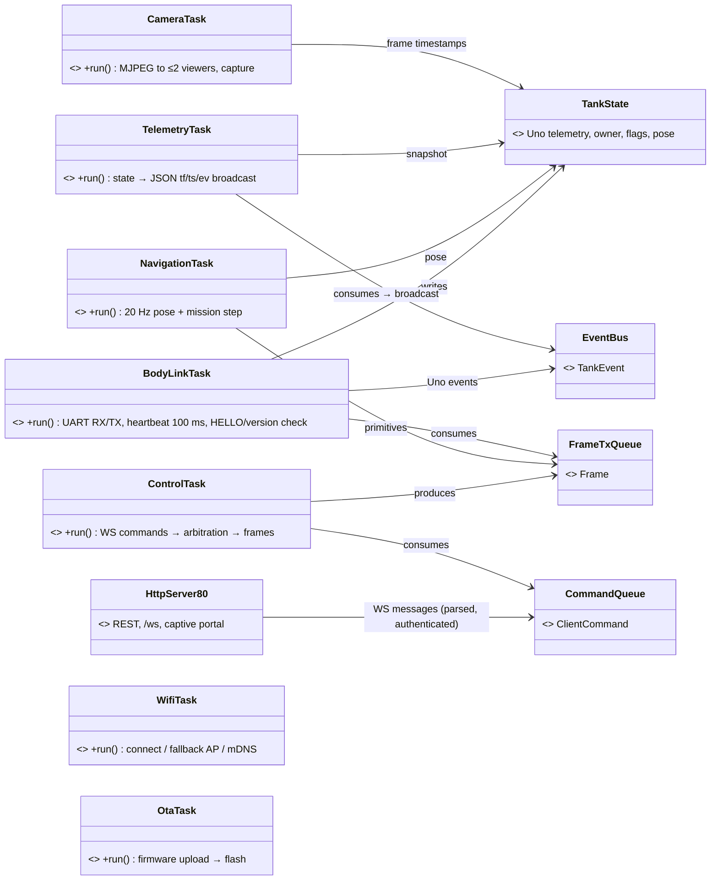
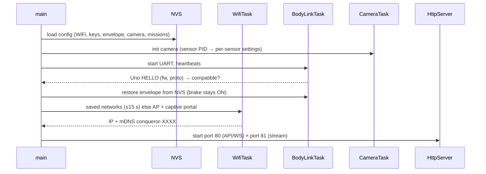

# ESP32 Firmware — Low-Level Design

Status: IN PROGRESS · Date: 2026-10-10 · Implements: Spec 2 Part B, Spec 1 · Standards: `docs/standards/coding-standards.md` §3

Sections: 1 Structure, tasks & frameworks ✅ · 2 Ports · 3 Body link & clock sync · 4 Client API · 5 Navigation · 6 Camera service · 7 WiFi, mDNS, OTA & storage · 8 Memory/task budget & error handling

---

## 1. Structure, tasks & frameworks (APPROVED)

### 1.1 Framework choices
| Concern | Choice | Why |
|---|---|---|
| Base | Arduino-ESP32 core on PlatformIO | reuses ELEGOO camera code |
| HTTP + WS + MJPEG | ESP-IDF `esp_http_server`, two instances (80: API/WS/setup, 81: stream) | already used by the camera example; native WS; one server stack |
| JSON | ArduinoJson 7 with a fixed memory-pool allocator (no heap in hot paths) | standard, fast, follows allocation rule |
| Hashing | mbedTLS: salted SHA-256 for tokens, PBKDF2 for the admin password | built in |
| Storage | NVS (Preferences) | wear-levelled |
| Protocol | generated C++ from `protocol/` (frames + JSON mapping) | single source |

### 1.2 Layers
```
src/
├── main.cpp       composition root: services, queues, tasks
├── app/           FreeRTOS tasks: read ports/queues → call domain → write ports/queues
├── domain/        pure C++: arbitration, auth rules, navigation, derived metrics, JSON⇄command mapping
├── ports/         headers (camera, uart, wifi, nvs, http, mdns, ota, clock)
├── drivers/       ESP32 implementations (IDF / Arduino)
└── generated/     frames, JSON schemas, error registry
```
`virtual` only where ≥ 2 implementations are active at runtime.

### 1.3 Tasks, cores, queues

- Core 1 = robot-critical (link, control, navigation, telemetry); core 0 = WiFi stack, HTTP, camera, OTA → video load cannot delay STOP.
- Tasks communicate only via queues + `TankState` (single writer per field group, mutex snapshots for readers).
- **STOP fast path:** WS STOP is pushed to the front of `CommandQueue` (`xQueueSendToFront`) and forwarded immediately.
- Task watchdog on all app tasks; reboot reason kept in RTC memory and reported at next boot.

### 1.4 Startup sequence

