# ESP32 Firmware — Low-Level Design

Status: IN PROGRESS · Date: 2026-10-10 · Implements: Spec 2 Part B, Spec 1 · Standards: `docs/standards/coding-standards.md` §3

Sections: 1 Structure, tasks & frameworks ✅ · 2 Ports ✅ · 3 Body link & clock sync ✅ · 4 Client API ✅ · 5 Navigation ✅ · 6 Camera service ✅ · 7 Calibration engine · 8 WiFi, mDNS, OTA & storage · 9 Memory/task budget & error handling

Note: UART is **250000 baud** and calibration maths runs here (Uno LLD §9 revision).

---

## 1. Structure, tasks & frameworks (APPROVED)

### 1.1 Framework choices
| Concern | Choice | Why |
|---|---|---|
| Base | Arduino-ESP32 core on PlatformIO | reuses ELEGOO camera code |
| HTTP + WS + MJPEG | ESP-IDF `esp_http_server`, two instances (80: API/WS/setup, 81: stream) | already used by the camera example; native WS; one server stack |
| JSON | ArduinoJson 7 with a fixed memory-pool allocator (no heap in hot paths) | standard, fast, follows allocation rule |
| Hashing | mbedTLS: salted SHA-256 for tokens, PBKDF2 for the admin password | built in |
| Storage | NVS (Preferences) | wear-levelled |
| Protocol | generated C++ from `protocol/` (frames + JSON mapping) | single source |

### 1.2 Layers
```
src/
├── main.cpp       composition root: services, queues, tasks
├── app/           FreeRTOS tasks: read ports/queues → call domain → write ports/queues
├── domain/        pure C++: arbitration, auth rules, navigation, derived metrics, JSON⇄command mapping
├── ports/         headers (camera, uart, wifi, nvs, http, mdns, ota, clock)
├── drivers/       ESP32 implementations (IDF / Arduino)
└── generated/     frames, JSON schemas, error registry
```
`virtual` only where ≥ 2 implementations are active at runtime.

### 1.3 Tasks, cores, queues
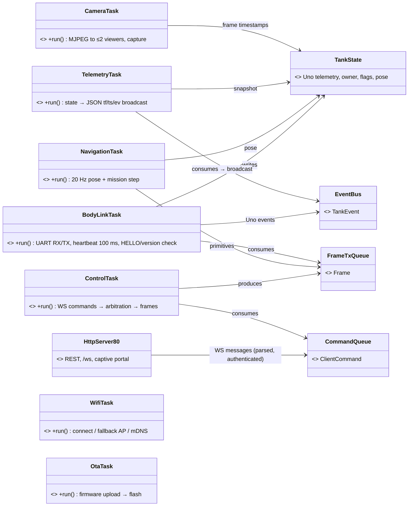
- Core 1 = robot-critical (link, control, navigation, telemetry); core 0 = WiFi stack, HTTP, camera, OTA → video load cannot delay STOP.
- Tasks communicate only via queues + `TankState` (single writer per field group, mutex snapshots for readers).
- **STOP fast path:** WS STOP is pushed to the front of `CommandQueue` (`xQueueSendToFront`) and forwarded immediately.
- Task watchdog on all app tasks; reboot reason kept in RTC memory and reported at next boot.

### 1.4 Startup sequence
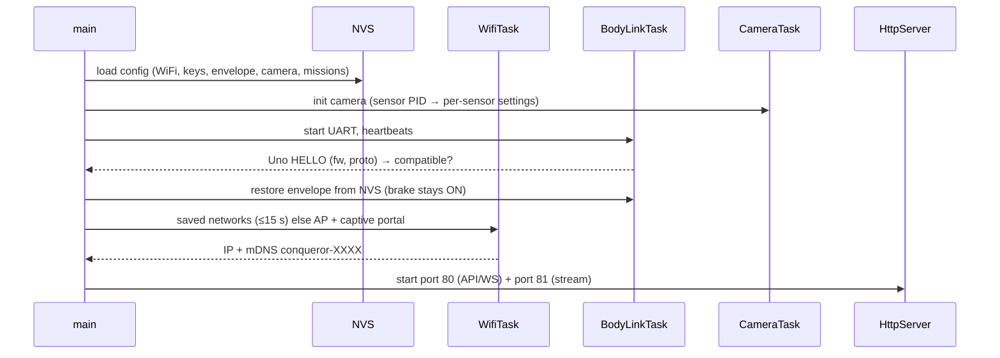

---

## 2. Ports (APPROVED)
Headers of free functions implemented in `drivers/`; no `virtual` needed.


`SensorKind {OV2640, OV3660, OV5640}`.

| Port | Notes | Thread/core rules | On failure |
|---|---|---|---|
| clock | esp_timer µs since boot (64-bit) | any task | — |
| body_uart | UART2 @ 250000, 1 KB RX / 512 B TX | **only BodyLinkTask** | short read/write counted |
| camera | esp_camera, PSRAM, 2 frame buffers; `ts_us` = capture time in clock time | **only CameraTask** (others via queue) | grab timeout 200 ms → CAMERA_TIMEOUT; reinit after 5 consecutive |
| wifi | STA ≤ 3 creds, AP fallback, scan | **only WifiTask** | WifiResult (no network / wrong password / timeout) |
| captive_dns | all queries → 192.168.4.1 in AP setup | WifiTask | — |
| mdns | `conqueror-XXXX`, `_conqueror._tcp`, TXT id/name/proto/fw | WifiTask | retried on IP change |
| http | esp_http_server; :80 max 7 sockets (6 WS + 1 REST); :81 2 stream sockets | handlers in server task; WS sends async | send failure → session closed |
| nvs | namespaces wifi, keys, tank, missions, cal, envelope | any task, short ops | Status |
| ota | dual partitions + rollback (must reach Uno link OK + WiFi up within 60 s) | OtaTask | abort keeps old image |
| crypto | mbedTLS; PBKDF2 10 000 rounds | any task | — |
| sys | RTC memory keeps reboot reason + WDT culprit task | any task | — |

Rules: each hardware resource has **one owning task** (others via queues; no locks around hardware) · `domain/` never includes `ports/`; shared value types in `types/` · pins/sizes in `drivers/board_config.h` (camera pin map `CAMERA_MODEL_M5STACK_WIDE`, UART IO33/IO4).

---

## 3. Body link, clock sync & derived metrics (APPROVED)

### 3.1 Class diagram

Writers: fast/slow/derived = BodyLinkTask · pose = NavigationTask · net_owner = ControlTask. `FrameParser`/`FrameWriter` are the same generated C++ as the Uno.

### 3.2 Uno session state machine
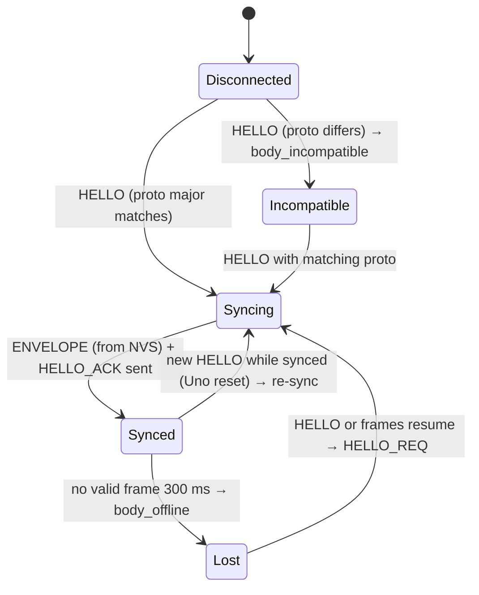
- Not Synced → client motion commands get `BODY_OFFLINE` / `BODY_INCOMPATIBLE`; camera keeps streaming.
- Heartbeat every 100 ms in every state.

### 3.3 Commands and acks
- ControlTask → `FrameTxQueue` (with client ref) → BodyLinkTask sends + tracks ack (seq → client, cmd id, 200 ms deadline).
- Uno ACK status → registry code/reason → client `ack`/`nack`; no ack in 200 ms → `nack COMMAND_TIMEOUT`.
- **Motion commands never auto-resent**; settings/calibration may retry once.
- Streaming (DRIVE, CAM_JOY) untracked; Uno's rate-limited rejection events → `nack` to the owning client.

### 3.4 Clock sync
- `tank_ms` = ESP32 time; offset = `esp_rx_ms − uno_ms` as the **minimum over a sliding window**; Uno timestamps converted.
- Link latency = EMA ack RTT / 2 → `esp.link_latency_ms`.
- Camera frames stamped in ESP32 time (same clock as telemetry); hub estimates its offset via ping/pong.

### 3.5 Derived metrics
| Metric | Method |
|---|---|
| batt_pct | 2S Li-ion LUT (8.4 V → 100 %, 6.6 V → 0 %) on idle voltage |
| sag_v | idle EMA − loaded EMA (`driving` flag) |
| runtime_min | voltage slope while driving → minutes to critical |
| ttc_s | dist / closing speed when closing > 2 cm/s, else null |
| slip_pct | `(vR − vL)/track_width` vs gyro rate during turns |
| roughness | accel_var normalised by speed → 0–100 |
| lifetime | encoder distance + runtime + power-ons; NVS every 5 min |

### 3.6 Telemetry path
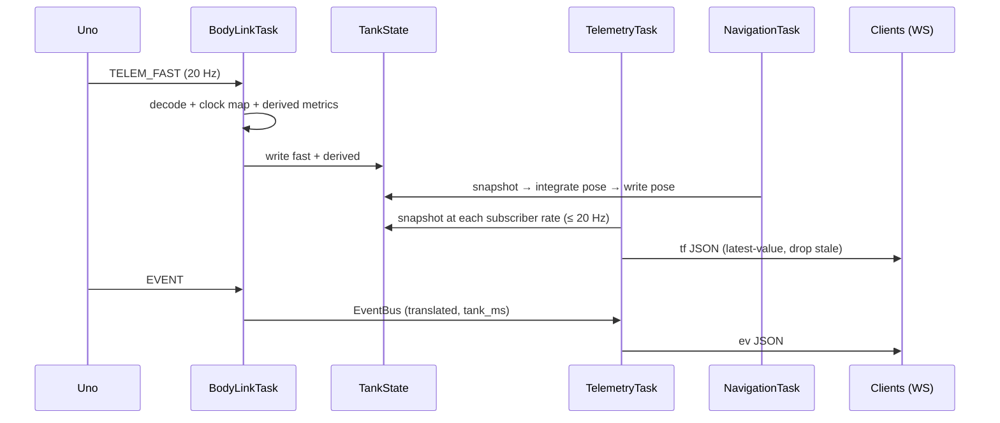

---

## 4. Client API — WebSocket, auth, arbitration, REST (APPROVED)

### 4.1 Class diagram

`SessionState {Connected, Authenticated, Closing}` · `Role {viewer, ai, human, admin}` · `Owner {None, Ai, Human}`. Keys: salted SHA-256 + constant-time compare; admin password PBKDF2; login throttle 5 failures → 30 s lockout.

### 4.2 Session lifecycle
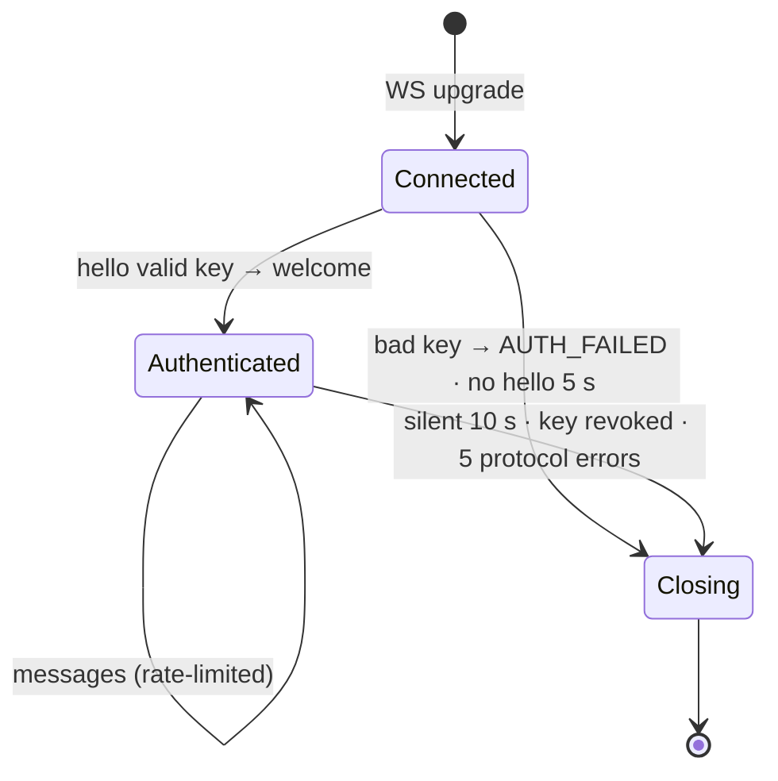
Owner session closing → STOP + owner released.

### 4.3 Network arbitration (human > AI)
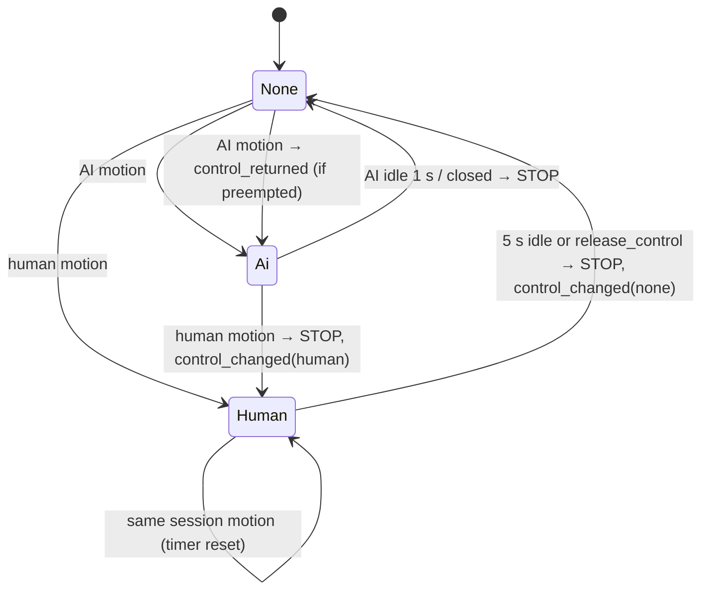
- Other same-role sessions → `NOT_OWNER` until the timer expires.
- IR owner (from Uno telemetry) → all network motion `NOT_OWNER`; arbiter frozen.
- STOP from any authenticated session (incl. viewer) → queue front → Uno.
- Frames tagged `src`; `OWNER_HINT` sent to the Uno for LED colour.

### 4.4 Validation pipeline
1. Parse (generated codec, fixed pool) → `INVALID_COMMAND`
2. Authorize (role × type table) → `ROLE_FORBIDDEN`
3. Range-validate (generated from schema) → `INVALID_COMMAND` + field
4. Rate limit (drive/cam_joy ≤ 25 Hz, others ≤ 10/s per session) → `RATE_LIMITED`
5. Capability (`move`/`nav_*` without encoders → `UNAVAILABLE`; body not synced → `BODY_OFFLINE`)
6. Arbitrate (motion) → `NOT_OWNER` / accepted
7. Route: body frame → FrameTxQueue · nav → NavigationTask · camera config → CameraTask · settings/keys → local · ping → pong

### 4.5 Envelope rules
| Action | ai | human/admin |
|---|---|---|
| set / tighten | ✅ tighter only | ✅ |
| loosen / clear | ❌ `ENVELOPE_LOCKED` | ✅ |
| obstacle brake off | ✅ unless `lock_brake` | ✅ unless `lock_brake` |
Envelope persisted in NVS and restored to the Uno on every HELLO.

### 4.6 REST (port 80)
`/api/info`, `/api/settings` (GET human+, PUT admin, ETag), `/api/keys`, `/api/wifi`, `/api/ota`, `/api/missions`, `/api/capture` (→ CameraTask queue). Auth: `Authorization: Bearer` or `?key=`. Errors: shared code/reason registry in the hub's envelope `{success:false, error:{…}}`.

### 4.7 Human takes over from the AI
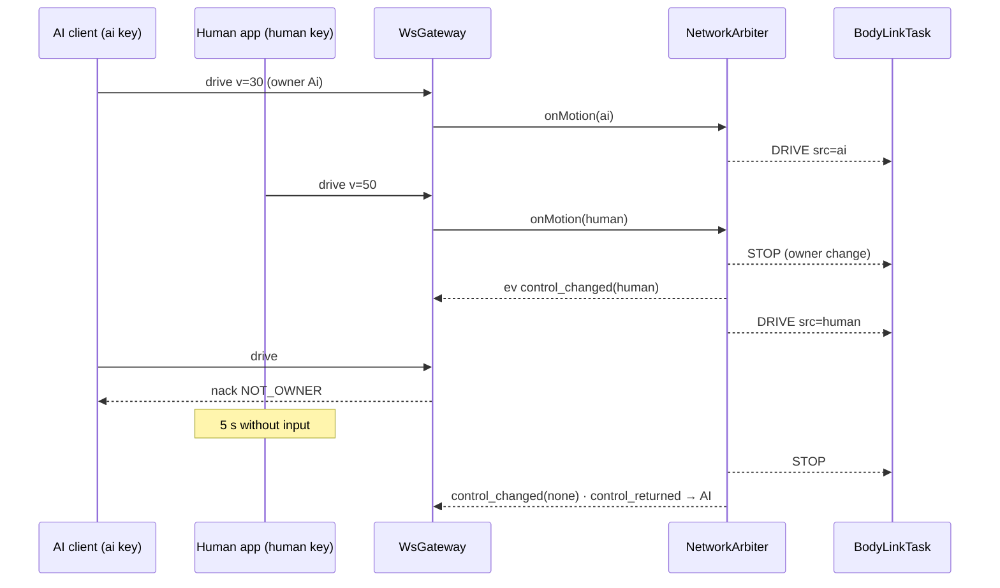

---

## 5. Navigation (APPROVED)

### 5.1 Class diagram
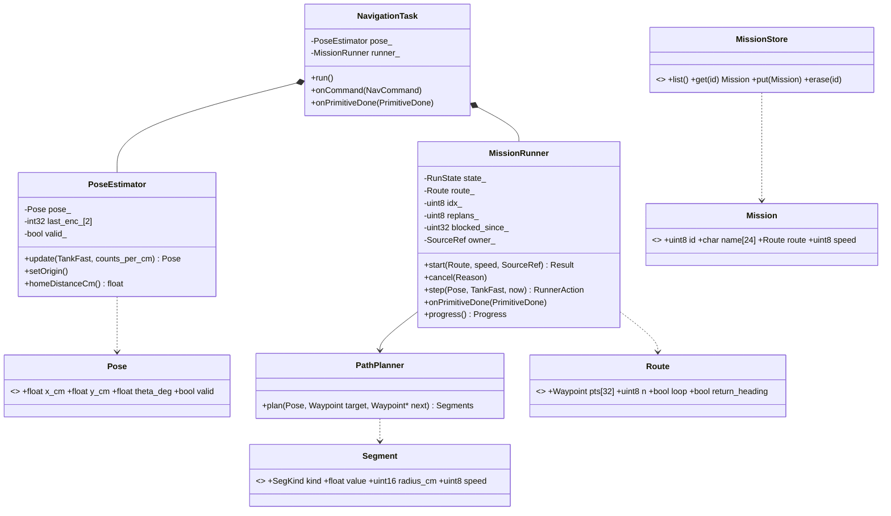
`SegKind {TurnTo, TurnArc, MoveDist, FinalHeading}`; MissionStore ≤ 8 missions × 32 points.

### 5.2 Pose integration (20 Hz)
- `Δd = mean(ΔencL, ΔencR) / counts_per_cm`; θ = Uno gyro yaw (source of truth; encoders not trusted for heading).
- Midpoint integration `x += Δd·cos(θ_mid)`, `y += Δd·sin(θ_mid)`.
- Uno reboot (counts jump to 0) → skip step, keep pose, raise `pose_degraded`.
- No encoders → `valid = false`, nav commands `UNAVAILABLE`.
- `nav_set_origin` → (0,0,0); `home_dist_cm` published.

### 5.3 Path planning
- Heading change ≤ 90° and distance ≥ 2 × radius → **arc** (`TURN to bearing`, radius `min(30 cm, dist/2)`) + `MOVE` remainder; else **spin** + `MOVE`.
- Residual > 5 cm after MOVE → re-plan (max 3), then continue with `waypoint_inaccurate`.
- Return home = go-to (0,0) then turn to θ = 0.

### 5.4 Mission runner state machine
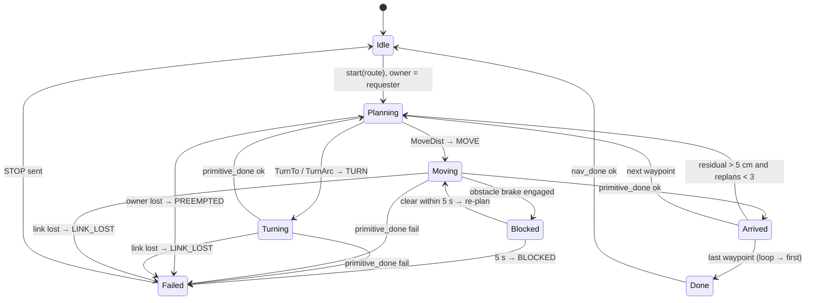
- Missions run under the requester's ownership (frames tagged with its source, normal arbitration); preemption → `PREEMPTED`, never silently resumed.
- Progress via `primitive` telemetry and `nav_progress` events.

### 5.5 Go-to sequence
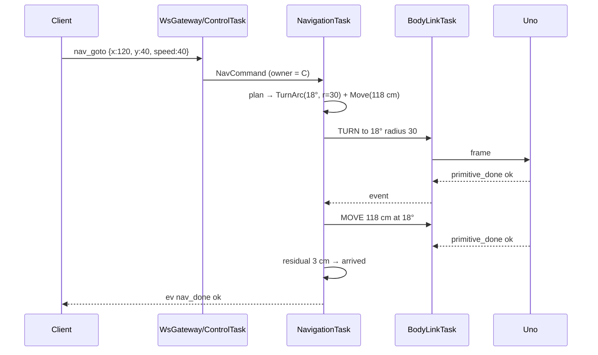

---

## 6. Camera service (APPROVED)
Problem solved: ELEGOO's stream handler loops inside the server task (second viewer blocked). Design: capture once, share to ≤ 2 viewers via refcounted frames and per-viewer async tasks.

### 6.1 Class diagram
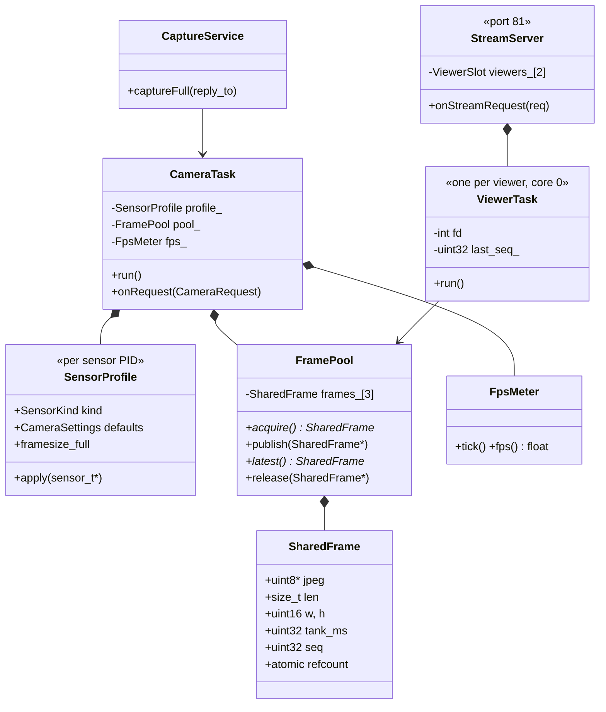

### 6.2 Streaming
- CameraTask grabs → copies JPEG into a refcounted PSRAM `SharedFrame` (≈ 25–60 KB @ 640×480) → returns the driver buffer at once → publishes as latest.
- One `ViewerTask` per viewer (max 2) using `httpd_req_async_handler_begin`; waits for a newer frame, sends one part, releases. **Latest-frame-wins**: slow viewers skip frames; the camera is never slowed.
- 3rd viewer → `503` ("use the hub").
- Each part: `X-Timestamp: <tank_ms>` (capture time, ESP32 clock) + `X-Frame-Seq`.
```
--frame
Content-Type: image/jpeg
Content-Length: 41233
X-Timestamp: 1234567
X-Frame-Seq: 9876
<jpeg bytes>
```
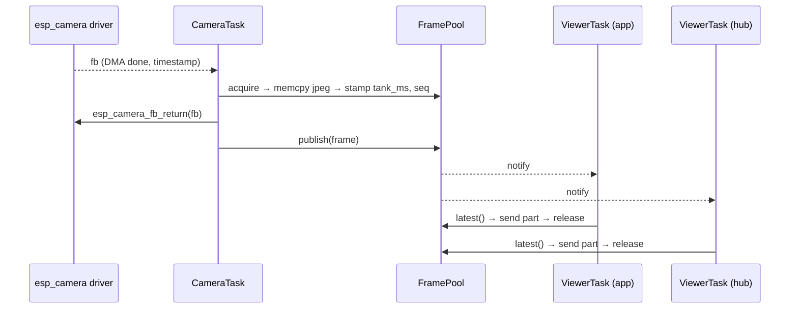

### 6.3 Full-resolution capture
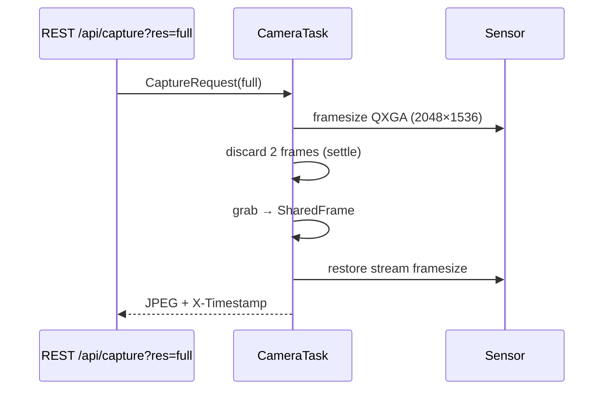
Stream pauses ~0.5 s (viewers keep the last frame); one full capture at a time, queue 2, then `BUSY`.

### 6.4 Sensor profiles, settings, health
- Sensor PID at boot → profile: **OV3660** (stock), OV2640, OV5640 (defaults: flip/mirror/quality, full framesize).
- Default stream 640×480, JPEG quality 12; admin changes via CameraTask queue; persisted in NVS.
- Grab timeout 200 ms → counter; 5 consecutive → re-init + `camera_reset` event; `esp.fps` + dropped-frame counters in telemetry.

### 6.5 Memory
PSRAM: 2 driver buffers + 3 pool frames ≈ 300 KB (+ ~400 KB temporary for a 3 MP capture) of 4 MB; internal RAM untouched by video.
