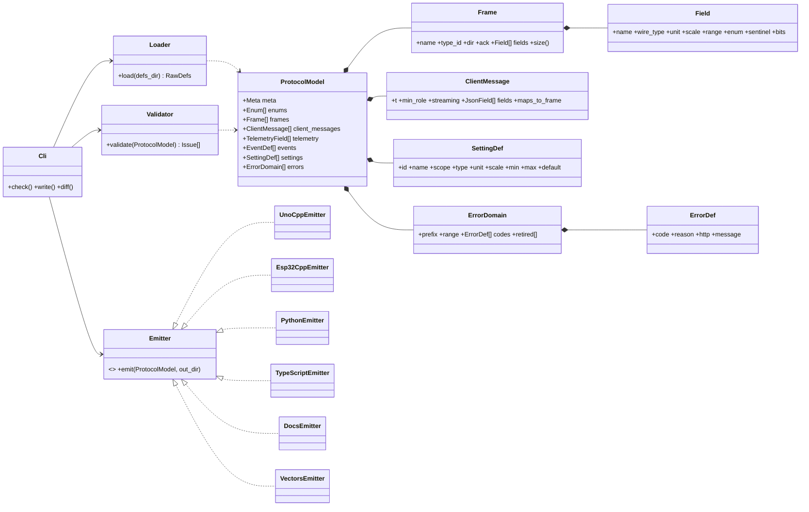
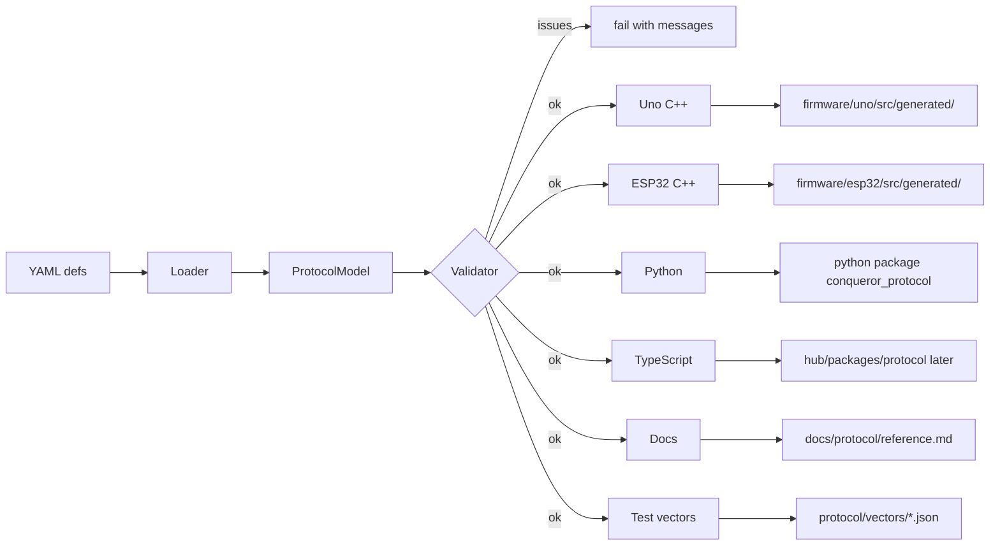

# Protocol Generator — Low-Level Design

Status: APPROVED · Date: 2026-10-11 · Implements: Spec 1 (single source of all messages) · Phase 0 of the roadmap

## Purpose
Every message is defined **once** (YAML) and generated into C++ (Uno), C++ (ESP32), Python (bench tool, AI engine), TypeScript (hub, later), docs and golden test vectors — so the four programs can never drift apart.

## Layout
```
protocol/
├── defs/
│   ├── meta.yaml          protocol version, frame layout, CRC
│   ├── enums.yaml         Owner, CmdKind, Role, SensorKind …
│   ├── body_frames.yaml   ESP32 ⇄ Uno binary frames (type id, direction, fields)
│   ├── client_ws.yaml     JSON client API (commands, roles, ranges, acks)
│   ├── telemetry.yaml     wire field ↔ JSON field mapping (scale, unit, sentinel)
│   ├── events.yaml        event kinds, a/b packing, JSON shape
│   ├── settings.yaml      setting ids, scope, type, unit, fixed-point scale, min/max/default
│   └── errors.yaml        domains with code ranges, code, reason, HTTP status, message, retired list
├── generator/             Python package "protogen"
├── templates/             Jinja2 templates per target
└── vectors/               generated golden test vectors (hex ⇄ values)
```
Example:
```yaml
# body_frames.yaml
- name: TURN
  type: 0x13
  dir: esp32_to_uno
  ack: true
  fields:
    - { name: src,       type: u8,  enum: Source }
    - { name: mode,      type: u8,  bits: { turn_mode: 0-6, pivot: 7 } }
    - { name: angle,     type: i16, unit: deg, scale: 0.1 }
    - { name: speed,     type: u8,  unit: pct, range: [0, 100] }
    - { name: radius_cm, type: u16, unit: cm, special: { 0: spin } }
```

## Class diagram


## Pipeline


## Outputs per target
| Target | Generated |
|---|---|
| Uno C++ (no STL, no heap) | packed frame structs, encode/decode, frame type enum, CRC-8, setting descriptors + event/ack code tables in PROGMEM |
| ESP32 C++ | frames + JSON ⇄ command mapping (ArduinoJson), wire → JSON telemetry mapping with sentinels, role × command table, range validators, error registry |
| Python (`conqueror_protocol`) | dataclasses + struct codec, CRC, enums, error registry (bench tool now, AI engine later) |
| TypeScript (later) | zod schemas + types |
| Docs | `docs/protocol/reference.md` |
| Test vectors | per frame: values ⇄ exact bytes incl. CRC; every language's tests must encode/decode them identically |

## Validation rules (build fails)
- Unique frame type ids per direction; payload ≤ 48 B.
- Error codes unique, inside their domain range, never reusing retired codes.
- Setting ids unique; defaults within min/max; fixed-point scale representable.
- Every client message has a role and a route; every telemetry field has a unit.
- Breaking change (removed/changed field) requires a protocol version bump (`protogen diff` vs last release).

## Usage
- `protogen write` regenerates outputs (committed, so firmware builds need no Python).
- `protogen check` in CI/pre-commit: fails on stale outputs or validation issues.
- Generated files carry a "DO NOT EDIT" header.
- Tooling: Python 3.12, uv, Jinja2, PyYAML, pydantic (model), ruff, pyright strict.
