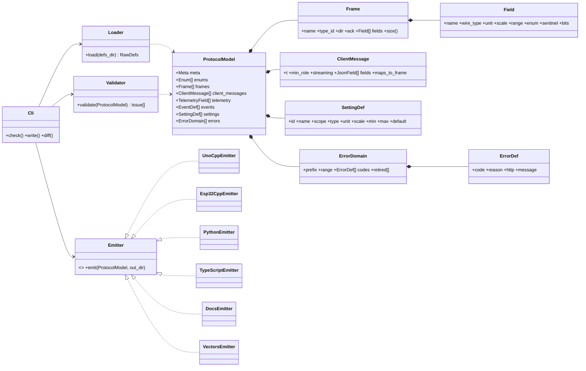
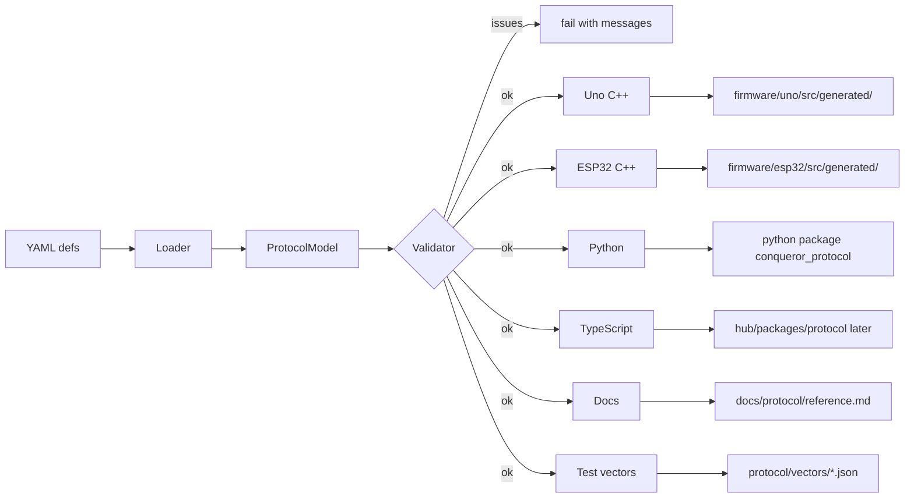

# Protocol Generator — Low-Level Design

Status: APPROVED · Date: 2026-10-11 · Implements: Spec 1 (single source of all messages) · Phase 0 of the roadmap

## Purpose
Every message is defined **once** (YAML) and generated into C++ (Uno), C++ (ESP32), Python (bench tool, AI engine), TypeScript (hub, later), docs and golden test vectors — so the four programs can never drift apart.

## Layout
```
protocol/
├── defs/
│   ├── meta.yaml          protocol version, frame layout, CRC
│   ├── enums.yaml         Owner, CmdKind, Role, SensorKind …
│   ├── body_frames.yaml   ESP32 ⇄ Uno binary frames (type id, direction, fields)
│   ├── client_ws.yaml     JSON client API (commands, roles, ranges, acks)
│   ├── telemetry.yaml     wire field ↔ JSON field mapping (scale, unit, sentinel)
│   ├── events.yaml        event kinds, a/b packing, JSON shape
│   ├── settings.yaml      setting ids, scope, type, unit, fixed-point scale, min/max/default
│   └── errors.yaml        domains with code ranges, code, reason, HTTP status, message, retired list
├── generator/             Python package "protogen"
├── templates/             Jinja2 templates per target
└── vectors/               generated golden test vectors (hex ⇄ values)
```
Example:
```yaml
# body_frames.yaml
- name: TURN
  type: 0x13
  dir: esp32_to_uno
  ack: true
  fields:
    - { name: src,       type: u8,  enum: Source }
    - { name: mode,      type: u8,  bits: { turn_mode: 0-6, pivot: 7 } }
    - { name: angle,     type: i16, unit: deg, scale: 0.1 }
    - { name: speed,     type: u8,  unit: pct, range: [0, 100] }
    - { name: radius_cm, type: u16, unit: cm, special: { 0: spin } }
```

## Class diagram


## Pipeline


## Outputs per target
| Target | Generated |
|---|---|
| Uno C++ (no STL, no heap) | packed frame structs, encode/decode, frame type enum, CRC-8, setting descriptors + event/ack code tables in PROGMEM |
| ESP32 C++ | frames + JSON ⇄ command mapping (ArduinoJson), wire → JSON telemetry mapping with sentinels, role × command table, range validators, error registry |
| Python (`conqueror_protocol`) | dataclasses + struct codec, CRC, enums, error registry (bench tool now, AI engine later) |
| TypeScript (later) | zod schemas + types |
| Docs | `docs/protocol/reference.md` |
| Test vectors | per frame: values ⇄ exact bytes incl. CRC; every language's tests must encode/decode them identically |

## Validation rules (build fails)
- Unique frame type ids per direction; payload ≤ 48 B.
- Error codes unique, inside their domain range, never reusing retired codes.
- Setting ids unique; defaults within min/max; fixed-point scale representable.
- Every client message has a role and a route; every telemetry field has a unit.
- Breaking change (removed/changed field) requires a protocol version bump (`protogen diff` vs last release).

## Usage
- `protogen write` regenerates outputs (committed, so firmware builds need no Python).
- `protogen check` in CI/pre-commit: fails on stale outputs or validation issues.
- Generated files carry a "DO NOT EDIT" header.
- Tooling: Python 3.12, uv, Jinja2, PyYAML, pydantic (model), ruff, pyright strict.

## Implementation note (Plan A)
- Jinja2 templates were replaced by small emitter functions (`emit_*.py`) that return text — simpler and unit-testable; no `templates/` folder.
- ESP32 C++, TypeScript and client-JSON outputs are deferred to roadmap phases 4/5 (YAGNI); the Uno header is reused by the ESP32 bridge only as raw bytes (the bridge does not parse frames).
- C++ host test: `pytest` (`test_cpp_vectors.py`) emits a fresh copy of the header and the vector test into a temp dir, compiles and runs it. The committed `protocol/tests/cpp/generated_vectors_test.cpp` is the same text (kept for building outside pytest) and is only staleness-checked by `protogen check`; it is not what pytest compiles.

## CAL_DATA channel layouts (authoritative)
Contract between the Uno `CalScriptRunner` (Plan B Task 7) and the reference calculators (Plan D Task 11, later the ESP32 port). `CAL_DATA {script, phase, t_ms u16 (ms since script start, wraps; host unwraps), v[8] i16}` at 50 Hz; unused channels 0. CCW yaw positive; encoder counts and cps signed by the commanded direction unless shown as |x|; ×10 = 0.1 units.

| Script | `param` | `phase` | v[0] | v[1] | v[2] | v[3] | v[4] | v[5] | v[6] | v[7] | Ends |
|---|---|---|---|---|---|---|---|---|---|---|---|
| STILL_SAMPLE, IDLE | duration ms (0 → 3000, max 30000) | 0 | gx | gy | gz | ax | ay | az | temp 0.01 °C | batt_mv | OK after duration |
| PWM_RAMP | track (0 L, 1 R) \| reverse << 1 \| max PWM << 8 (0 → 255) | 0 up, 1 down (5 PWM / 150 ms) | \|pwm\| | yaw_rate×10 | \|enc\| since start | \|cps\| | 0 | 0 | 0 | 0 | OK back at 0 |
| FULL_SPIN | PWM (0 → 255), CCW | 0 | pwm_l | pwm_r | cps_l | cps_r | yaw_rate×10 | yaw×10 | enc_l | enc_r (since start) | OK at 720°; CAL_FAILED after 20 s |
| SPIN_AND_ARC | bit 0 = CW | 0 = 360° spin at 90 °/s + 0.5 s settle; 1 = 90° arc (PWM 150, 30 °/s) | enc_l | enc_r | yaw×10 (since phase start) | yaw_rate×10 | pwm_l | pwm_r | 0 | 0 | OK after the arc; CAL_FAILED after 20 s |
| RATE_STEPS | speed steps n (2–5, 0 → 4) | step i: speed 100·i/(n−1) % + full CCW turn, 1.5 s (+0.5 s stop, no samples) | speed % | w %×10 (1000) | yaw_rate×10 | cps_l | cps_r | pwm_l | pwm_r | 0 | OK after n steps |
| RELAY_OSCILLATION | loop: 0 speed (needs encoders), 1 rate, 2 heading | 0 | setpoint×10 | measured×10 | relay output (speed %, rate w %, heading °/s) | pwm_l | pwm_r | 0 | 0 | 0 | OK after 8 s |
| DRIVE_COUNTS | counts (0 → 7600) | 0 | enc_l | enc_r | yaw×10 (since start) | pwm_l | pwm_r | cps_l | cps_r | 0 | OK at mean counts; CAL_FAILED after 15 s |
| SERVO_NUDGE | — | — | reserved: the Uno answers UNAVAILABLE; servo trim uses CAM_NUDGE + telemetry | | | | | | | | |

Raw IMU counts: 65.5 LSB per °/s (±500 °/s), 8192 LSB per g (±4 g). Missing encoders → CAL_PRECONDITION for FULL_SPIN, SPIN_AND_ARC, DRIVE_COUNTS, RELAY_OSCILLATION loop 0. `CAL_RESULT`: `OK` with progress < 100 = running (sent at start and every 500 ms), `OK` with progress 100 = done, any other status = failed/cancelled.

- Frame parser resync (decision taken during Plan A execution): when a length byte is out of range and is itself 0xAA, the parser treats it as a new start of frame; after a CRC mismatch it rescans the bytes it received after the false start for the next 0xAA, so noise or a cut-off frame does not cost the next good frame. Implemented in `conqueror_protocol.framing` (Plan A); the Uno parser (Plan B) must behave the same.
