# Tank Logo — Low-Level Design (v1)

Status: **APPROVED (owner, 2026-10-19)** · Date: 2026-10-19
Spec: `docs/superpowers/specs/2026-10-11-05-tank-logo-design.md` (Revision 2) · Language: `logo/spec/grammar.md`, `logo/spec/words.yaml`, `logo/spec/tests/` · UX: `docs/design/bridge-ux.md` §2, screens `docs/design/stitch/15-…`, `16-…` · Decisions: design-notes §79–§85 · Bridge: `docs/lld/esp32-bridge-lld.md` (motion service R4/R7/R8, ownership R2.7/R9.6/R10, hidden pages R11)

## 0. Scope of v1
- **In:** levels 1–2 of `words.yaml`, plus `OUTPUT`, plus **list literals** (constants written in the program, grammar.md §1); the reader (lexer, parser, checker, compiler), the runner, the planned path (simulator) and the driven path (odometry), saved programs on the tank, the WebSocket API, the `/logo` page (laptop + phone).
- **Not in v1:** run-time list building (`FIRST LIST MAP …` → `PROGRAM_7030`), vision words (AI programs, `PROGRAM_7020`), events (`WHEN`), running saved programs from the IR remote. v1.1 adds the list pool + garbage collector without changing the instruction format of §7 (list values already have a tag).
- **No new firmware on the Uno and no new safety rules.** Every motion step is an ordinary bridge primitive (MOVE / TURN / arc / pivot) or Uno command (LED, SOUND, TONE, CAM_SET); the obstacle brake, deadman, link-loss stop, stall, tilt and battery rules stay exactly as they are.
- **Implementation:** Plan N1 (reader) `docs/superpowers/plans/2026-10-19-plan-n1-logo-reader.md` — done when all v1 conformance cases pass (done 2026-10-19: 67 / 67, design-notes §88). Plan N2 (runner, host-tested) `docs/superpowers/plans/2026-10-19-plan-n2-logo-runner.md` — §19. On the tank (worker, controller, HTTP + WebSocket, saved programs, odometry): Plan N3 — §20 (approved by the owner 2026-10-19). Page: Plan N4.

## 1. Where it runs
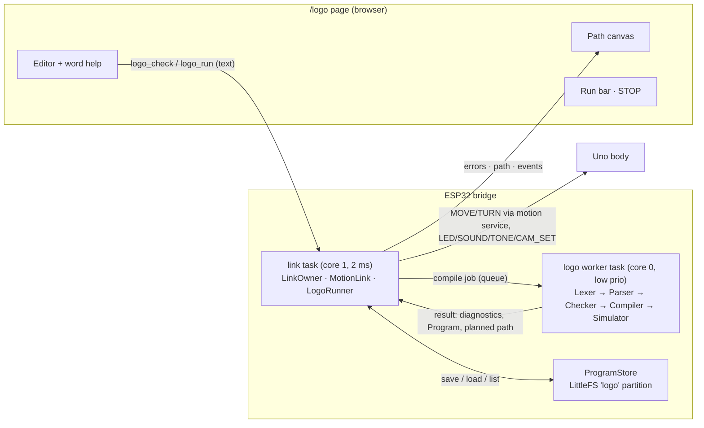
- **Reading and compiling** run in a separate low-priority **logo worker task** (core 0), so a long program never delays the link task's 2 ms tick (heartbeats, deadman, STOP fast path). A job is the source text + the tank's capabilities; the result goes back through a queue.
- **Running** happens in the **link task**: the runner advances the program in small slices (§8) on each tick, so it sees STOP, ownership changes and telemetry in the same place the motion service already does.
- **The page** only edits, shows and asks. It never interprets Logo.

## 2. Modules and files
| File (firmware/esp32) | Class | Pure / host-tested | Job |
|---|---|---|---|
| `src/logo/token.h`, `lexer.h/.cpp` | `Lexer`, `Token` | yes | text → tokens (grammar.md §2), MINUS vs NEG |
| `src/logo/ast.h`, `arena.h` | `AstNode`, `Arena` | yes | syntax tree in a fixed arena |
| `src/logo/parser.h/.cpp` | `Parser` | yes | pass 1 (definitions) + pass 2 (iterative, explicit stack) |
| `src/logo/checker.h/.cpp` | `Checker` | yes | scope, value/command use, ranges, needs, tail positions, `BLOCKED?` |
| `src/logo/diag.h/.cpp` | `Diagnostics` | yes | error list, messages from the generated templates |
| `src/logo/compiler.h/.cpp` | `Compiler`, `Program` | yes | tree → instructions (§7) |
| `src/logo/vm.h/.cpp` | `Vm`, `Value`, `Frame` | yes | runs instructions, stops at effects (§8) |
| `src/logo/effects.h/.cpp` | `EffectMapper` | yes | an effect → a bridge action, units and signs (§10) |
| `src/logo/run_controller.h/.cpp` | `RunController` | yes | states, slices, ends, step mode (§9) |
| `src/logo/simulator.h/.cpp` | `Simulator` | yes | planned path with ideal moves (§11) |
| `src/logo/odometry.h/.cpp` | `Odometry` | yes | driven path from encoders + heading (§11) |
| `src/logo/printer.h/.cpp` | `ReadsPrinter` | yes (tests) | the `reads` notation of `logo/spec/tests/README.md` |
| `src/logo/generated/words.h` | — | generated | word table, presets, limits, error templates from `words.yaml` |
| `src/net/logo_worker.h/.cpp` | `LogoWorker` | no (FreeRTOS) | the compile task + its queues |
| `src/net/program_store.h/.cpp` | `ProgramStore` | no (LittleFS) | saved programs (§12) |
| `src/net/logo_link.cpp` | — | no | WebSocket commands / events in the link task (§13) |
| `web/logo.html`, `web/generated/words.json` | — | page test | the editor page (§14) |
| `scripts/gen_logo.py` | — | — | `words.yaml` → `words.h` + `words.json`; `tests/*.yaml` → `test/test_logo_conformance/cases.h` (§15) |

**As built (Plan N1, reader only):** tokens live in `lexer.h` (no `token.h`); the tree and its fixed pool are `Node` / `NodePool` in `ast.h` (no `arena.h`); word lookups (`findWord`, presets, reserved words, `editDistance`) are in `words.h/.cpp`; the parser is one class in four files by concern — `parser.cpp` (pass 1, the frame loop, frames, lookups), `parser_stmt.cpp` (statements, calls and their inputs, note lists), `parser_expr.cpp` (operator precedence, operands, closers), `parser_diag.cpp` (messages, minus hint, recovery); the printer is free `printReads(...)` in `printer.h/.cpp`. The generator is `logogen` (uv project in `logo/`, `uv run logogen write|check`), not `scripts/gen_logo.py`; the bridge build runs `logogen check` as a pre-script.

## 3. Classes
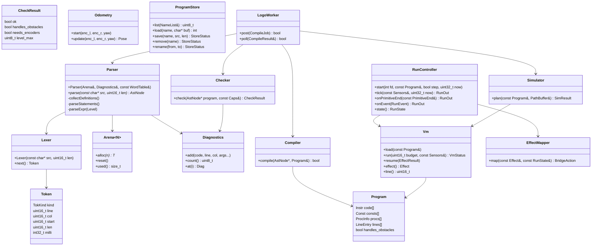
All `src/logo` classes are pure C++17 with fixed capacities (no heap after start-up, no `virtual`, no exceptions — coding standards §2.3/§3) and build in `env:native`.

## 4. Lexer
- One pass over the UTF-8 source (≤ 8192 bytes, `limits.source_bytes`), tokens on demand (`next()`); a `Token` keeps line, column (1-based, first character) and the source span, so messages and the editor can point at it.
- **MINUS vs NEG** (grammar.md §2): a `-` is NEG when the previous character is whitespace / `[` / `(` / start of text **and** the next is not whitespace; otherwise MINUS.
- Numbers are converted to **milli-units** (`int32_t`, 1/1000) at lexing; more than 3 decimals or |n| > 1 000 000 → 7015.
- Names are compared case-insensitively against the generated word table with a perfect-hash lookup (`words.h`), aliases map to the full name.

## 5. Parser
- **No recursion** (coding standards §2.3): pass 2 is a table-driven parser with an **explicit stack** of frames (`kStatements`, `kInputs(k remaining, type)`, `kExpr(level)`, `kBlock`, `kList`, `kTemplate`), at most 64 deep (deeper nesting → 7011). Expressions use precedence climbing with an operand / operator stack (grammar.md §6), stopping at comparisons for `value` inputs.
- **Pass 1** scans the token stream for top-level `TO NAME :a …` and records name, input count and the token range of the body (7007, 7008, 7017, 7003).
- **AST** in an `Arena<64 KB>` (allocated once at start-up in PSRAM, reset per job): node kinds `Program, Def, Call(word|proc), Control(REPEAT…), Block, List, Template, Op, Number, Word, Input, Placeholder, Bool`; every node keeps its token for line/column.
- Errors: the parser records the **first** error per statement and resynchronises at the next `]`, line break or known command, so the editor sees several errors at once (grammar.md §11); the first one is the one the tests check.

## 6. Checker
Walks the tree once (explicit stack) and fills `Diagnostics` and `CheckResult`:
- inputs in scope (`:x` belongs to the surrounding `TO`, 7009 with a "did you mean");
- your words: command vs value-giving (body contains `OUTPUT`) — 7004 / 7005; `OUTPUT` outside `TO` 7026;
- constant inputs out of range (`FD 600` 7025; `ARC … 20` 7022); presets (7029); level-3 words (7030); `MAKE RUN FOR` (7027); needs: encoders (7021, from `Caps`), AI (7020);
- `?` only in templates (7006, v1.1);
- **tail positions** (grammar.md §8): marks each `Call` node `tail = true|false`;
- **`handles_obstacles`** = the program uses `BLOCKED?` anywhere;
- the list-literal hint 7019 (a warning: it does not stop the program).

## 7. Compiler, values and instructions
**Values** (8 bytes): `{ tag: Num | Bool | Word | List, int32 milli | const index }`. In v1 words and lists are constants (indices into the program's constant pool); v1.1 adds pool references with the same tag.

**Program** (one, the last compiled, ≤ 2048 instructions, ≤ 256 constants, ≤ 64 procedures): `code[]`, `consts[]`, `procs[] {name, inputs, entry, gives_value}`, `lines[] {pc → line, col}`, flags.

| Instruction | Meaning |
|---|---|
| `LINE l` | current source line (events, step mode) |
| `PUSH c` / `ARG i` | constant / input i of the current word onto the value stack |
| `OP op` | `+ - * / = <> < > <= >= AND OR NOT NEG` (type checks → 7012, `/ 0` → 7013) |
| `SENSOR s` | `DISTANCE OBSTACLE? BLOCKED? HEADING TILT BATTERY TIMER` |
| `CALLB b n` | built-in reporter b with n arguments (`RANDOM REMAINDER ABS ROUND REPCOUNT`) |
| `JMP a` / `JZ a` | jumps (IF, IFELSE, WHILE) |
| `LOOP_INIT` / `LOOP_NEXT a` / `LOOP_END` | REPEAT / FOREVER with a REPCOUNT frame |
| `CALL p n` / `TCALL p n` / `RET` / `RETV` | your words; `TCALL` reuses the frame (tail call) |
| `EFFECT e n` | ask the host to do something (§10): MOVE, TURN, ARC, PIVOT, HOME, SPEED, WAIT, WAIT_UNTIL, LED, BEEP, SOUND, PLAY, LOOK, SAY |
| `HALT` / `STOP` | end of program / `STOP` word |

Frames: ≤ 100 (`limits.nesting`), each `{proc, return pc, args base}`; value stack ≤ 256. `TCALL` copies the new arguments over the current frame and jumps — so `COUNTDOWN 500` and `PING`/`PONG` run in one frame.

## 8. Runner (VM)
- `Vm::run(budget, sensors)` executes until one of: an `EFFECT` (returns `kEffect` with the request), the instruction **budget** for this slice (default 500 → returns `kYield`), `HALT`/`STOP`, or an error. The link task calls it once per 2 ms tick at most, so a busy loop (`WHILE NOT OBSTACLE? [ ]`) costs ≤ ~0.2 ms per tick and never starves the link.
- `Sensors` is a plain struct filled from the TELEM_FAST snapshot each tick (distance mm, obstacle-stop setting, yaw, pitch, roll, battery mV, run clock, last move cut short).
- After an effect the host calls `resume(result)`: `done`, `cut_short` (obstacle), or `failed(reason)` (§9).

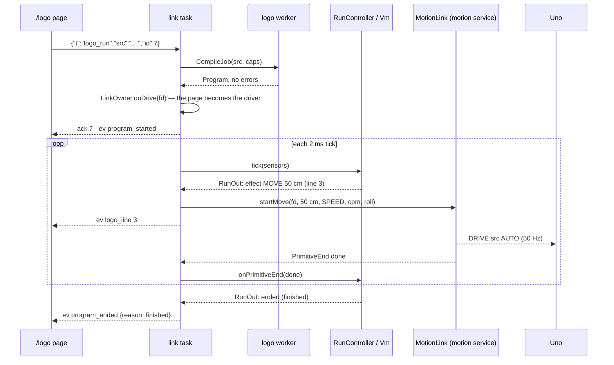

## 9. RunController — states and endings
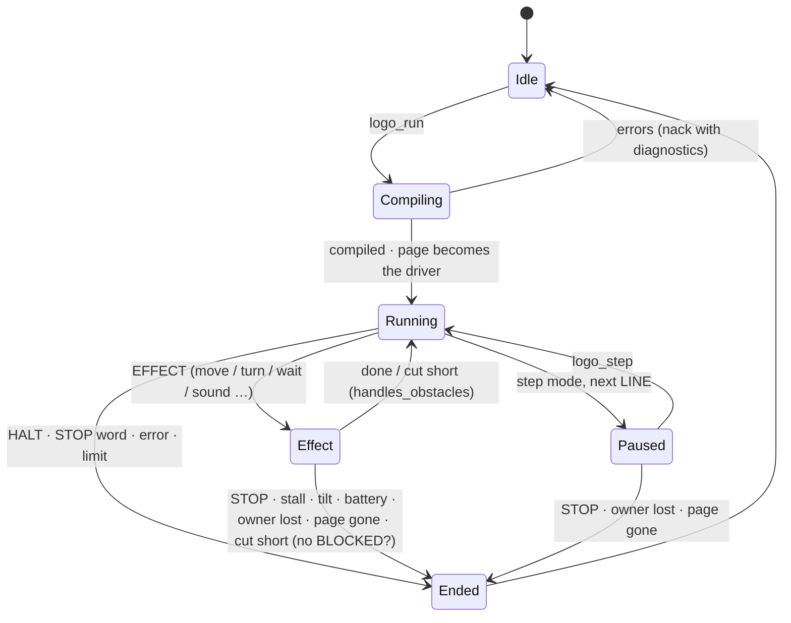
| Ending | Code / text (words.yaml) | From |
|---|---|---|
| finished | — | `HALT` |
| `STOP` word, STOP from any device | 7040 "Stopped by you." | VM / `MotionEvent::kStop` |
| time limit (300 s) | 7041 | run clock |
| battery low | 7042 | Uno event / snapshot |
| tilt | 7043 | Uno event |
| track stuck (stall) | 7044 | `EndReason::kStalled` |
| another device took control / IR | 7045 | `kNotOwner`, `MotionEvent::kRelease` |
| page hidden or closed | 7046 | `MotionEvent::kOwnerClosed` (bridge R11: a hidden page closes its socket) |
| obstacle, program without `BLOCKED?` | 7024 "Something is in the way on line n." | `EndReason::kBlocked` |
| obstacle, program with `BLOCKED?` | — (carries on, `BLOCKED?` = true) | `EndReason::kBlocked` |
| run-time error | 7011–7014, 7025, 7031 with line | VM |
| encoder fault | 7021 | `EndReason::kEncoderFault` |

**Every ending stops the tank** through the existing paths (the motion service's STOP, or `BodyLink::sendStop` when no primitive runs) and releases the driver; the program never resumes (Spec 5 §7).

## 10. Effects → the bridge
| Effect (word) | Bridge action | Units / sign | Refusals |
|---|---|---|---|
| MOVE (`FD n`, `BK n`) | `MotionService::startMove(fd, ±n cm, speed, cpm, roll)` | cm | route not Local (no encoders) → 7021 |
| TURN (`RT a`, `LT a`) | `startTurn(fd, yaw, delta, speed)` | Logo right = +; `delta_cdeg = −a·100` for RT, `+a·100` for LT | — |
| ARC (`ARC side a r`) | `startArc(fd, telem, ±a·100, r, speed′)` | speed′ = SPEED moved into `arcBand(r)` (note event when changed) | r < `arcMinRadiusCm()` → 7022 |
| PIVOT (`PIVOT side a`) | `startPivot(fd, yaw, ±a·100, speed)` | LEFT pivot = left track still | — |
| HOME | `startTurn` to the start yaw | — | — |
| SPEED p | runner state (default 40), capped by the child-play envelope later | % | 7025 |
| WAIT s / WAIT UNTIL | runner timer (≤ 60 s) / test re-evaluated each tick | s | — |
| LED c | `BodyLink::sendLed(solid, r, g, b)` | colour presets → RGB in `words.h` | — |
| BEEP / SOUND s / PLAY notes | `sendSound(id)` / **`sendTone(hz, ms)`** per note (new BodyLink method, frame `TONE` exists) | notes → Hz table | — |
| LOOK where | **`sendCamSet(pan, tilt)`** (new BodyLink method, frame `CAM_SET` exists) / `sendCamHome` | deg from centre, clamped by the Uno | — |
| SAY text | event `logo_say {text}` to the page (it speaks); nothing on the tank | — | — |

The program drives **as its page's WebSocket client** (`fd`): `logo_run` takes control with `LinkOwner::onDrive(fd)` like a manual drive, and each primitive is the same call the page's own `move` / `turn` would make (bridge LLD R4.6 rules: the primitive never takes ownership, ends with STOP only while its client still owns the body).

## 11. Planned path and driven path
- **Simulator:** runs the same `Vm` on the compiled program with ideal motion (moves and turns happen exactly), fixed sensors (`DISTANCE` 999, `OBSTACLE?`/`BLOCKED?` false, `TILT` 0, `BATTERY` 100, `RANDOM` seeded, `TIMER` advanced by simulated time: moves at their SPEED's track speed, `WAIT` as written). Output: up to 2000 path points `{x_mm, y_mm, heading, line, uncertain}`; `uncertain` once a sensor value has been read (drawn dashed, Spec 5 §10); stops at 300 s simulated, 200 000 instructions or the point limit (then "path cut short").
- **Odometry:** dead reckoning from the encoder counts (counts per metre) and the yaw while a program runs; sends `logo_pose {x_cm, y_cm, heading}` at 10 Hz for the driven line.

## 12. Saved programs
- **Flash:** a new **LittleFS partition `logo` (256 KB)**. The two app slots shrink from 3.0 MB to 2.875 MB each (the bridge uses ~1.1 MB); `source` and `coredump` keep their size. **The partition change needs one USB flash** (OTA cannot change partitions); existing NVS (WiFi, counts per metre, roll-on) is kept because `nvs` does not move.

| Name | Type | Offset | Size |
|---|---|---|---|
| nvs | data/nvs | 0x9000 | 0x5000 |
| otadata | data/ota | 0xE000 | 0x2000 |
| app0 | app/ota_0 | 0x10000 | **0x2E0000** |
| app1 | app/ota_1 | **0x2F0000** | **0x2E0000** |
| source | data/spiffs | **0x5D0000** | 0x1E0000 |
| **logo** | **data/littlefs** | **0x7B0000** | **0x40000** |
| coredump | data/coredump | 0x7F0000 | 0x10000 |
- Layout: one file per program, `/p/<name>.logo` (the source text, ≤ 8 KB); names 1–24 characters `a–z 0–9 _ -`, case-insensitive, ≤ 32 programs. Examples (`first square`, `avoid walls`, `look around`) are built into the firmware (read-only).
- Writes happen on the logo worker task (flash writes can take tens of ms) and never while a program runs.

## 13. WebSocket API (JSON, same `/ws`)
| Client → bridge | Reply / effect |
|---|---|
| `{"t":"logo_check","src":"…","id":n}` | `{"t":"logo_checked","id":n,"ok":bool,"diags":[{code,line,col,msg}],"path":[[x,y,h,u],…],"words":[{name,inputs,gives}],"handles_obstacles":bool}` |
| `{"t":"logo_run","src":"…","name"?,"step"?:bool,"id":n}` | `ack` (then events) or `nack` with `diags`; `BUSY` while another program runs; `NOT_OWNER` / `STOPPED` like a drive |
| `{"t":"logo_step","id":n}` | runs to the next line (step mode) |
| `{"t":"logo_stop","id":n}` | ends the program (7040) — the page's STOP also sends the usual `stop` |
| `{"t":"logo_list"}` / `logo_load {name}` / `logo_save {name,src}` / `logo_delete {name}` / `logo_rename {from,to}` | `logo_programs [{name,bytes,example}]` / `logo_source {name,src}` / `ack`·`nack` |

| Event (to all clients) | Fields |
|---|---|
| `logo_started` | `name`, `by` (client name) |
| `logo_line` | `line`, `round` (REPCOUNT of the innermost loop) |
| `logo_pose` | `x_cm`, `y_cm`, `heading` (10 Hz while running) |
| `logo_say` | `text` |
| `logo_note` | `line`, `msg` (e.g. "ARC RIGHT 90 40: speed set to 43 % for this radius") |
| `logo_ended` | `reason` (`finished` or a code), `line`, `msg` |
- New `WsCmdKind` values and JSON writers live in `ws_codec` / `ws_json` (host-tested like the existing commands); messages are bounded (source ≤ 8 KB → the WebSocket receive buffer grows to 9 KB for `logo_*` commands only).

## 14. The `/logo` page
- Plain HTML/CSS/JS, one file (`web/logo.html`, budget 24 KB gzipped) + the generated `words.json`; the Phosphor look and layout of screens 15/16; header with ‹ DRIVE, ☰ MENU, status chips, STOP.
- **Editor:** a `<textarea>` with a line-number gutter and a colouring overlay (`<pre>` behind the text, coloured from a small tokenizer that only colours — it never decides meaning); the running line highlighted from `logo_line`.
- **Made for children (owner, 2026-10-19):** colour by kind of word, the same colours in the editor, the word buttons and the help — **moves** (`FD BK ARC PIVOT HOME`) bright green, **turns** (`RT LT`) amber-green, **loops and choices** (`REPEAT IF IFELSE WHILE FOREVER WAIT UNTIL`) cyan, **light, sound, look** (`LED BEEP SOUND PLAY LOOK SAY`) purple-pink, **numbers** amber, **your own words** white, **comments** dim, **unknown words** underlined red while typing; 16 px monospace minimum (18 px on the phone), generous line height; tapping a word button inserts it with its example value selected (`FD 50` with `50` selected, so the child just types the number); `REPEAT` inserts `REPEAT 4 [  ]` with the cursor inside the brackets; error messages appear right under the line, as a plain sentence with a ▲ under the word.
- **Check as you type:** 600 ms after the last key, `logo_check`; errors shown under their line (code + friendly text), the planned path drawn; RUN is enabled only with no errors.
- **Word help:** from `words.json`, level-1 words first, "more words" shows levels 2 (and 3, marked "later"); tapping a word inserts it.
- **Path:** planned path (dashed where uncertain) + driven path from `logo_pose`; grid 5 cm, start marker, tank arrow.
- **Hidden page = no link** (bridge R11): a running program ends with 7046 when the page is hidden; the page says so when shown again.
- Programs list, new / rename / delete (with a confirm), examples.

## 15. Generated code
`scripts/gen_logo.py` (Python 3.12, run by a PlatformIO pre-script like `pack_web.py`; check mode in the pre-commit hook like `protogen check`):
- `logo/spec/words.yaml` → `src/logo/generated/words.h` (word table, presets, colour RGB, note → Hz, limits, error templates) and `web/generated/words.json` (name, aliases, level, inputs, help, example);
- `logo/spec/tests/*.yaml` → `test/test_logo_conformance/cases.h` (source, expected `reads` or error code/line/col).
Generated files are never edited by hand (CLAUDE.md hard rule).

## 16. Budgets
| Item | Budget |
|---|---|
| Flash (code) | ≈ 80–120 KB more (app 1.1 → ≈ 1.25 MB of 2.875 MB) |
| AST arena | 64 KB PSRAM, reset per compile |
| Program + constants | ≈ 24 KB PSRAM (one compiled program) |
| VM stacks | 100 frames × 16 B + 256 values × 8 B ≈ 4 KB |
| Path buffer | 2000 × 12 B = 24 KB PSRAM |
| Link task time | ≤ 500 instructions per tick (≈ 0.2 ms) |
| Compile time | target < 50 ms for an 8 KB program on the worker task |

## 17. Tests
- **Conformance (host):** every case in `logo/spec/tests/reading.yaml` and `errors.yaml` (v1) through `Lexer → Parser → Checker` and `ReadsPrinter`; level-3 cases expect 7030 in v1.
- **VM (host):** arithmetic and precedence, IF / IFELSE / WHILE / REPEAT / REPCOUNT, procedures with inputs, `OUTPUT`, tail calls (`COUNTDOWN 500`, `PING/PONG 300` in one frame), the 100-frame limit, budget slicing, run-time errors with line.
- **RunController (host):** each ending of §9 with a fake motion layer; `BLOCKED?` vs no `BLOCKED?`; step mode; STOP mid-move; owner lost; page gone.
- **EffectMapper (host):** RT/LT signs, ARC speed into band, PIVOT side, colour and note tables.
- **Simulator (host):** square → 4 corners within 1 mm; spiral; uncertain marking after a sensor read.
- **Page:** check-as-you-type with a fake WebSocket, error display, path drawing, run bar states, hidden page.
- **Tank (stand, then floor):** run `square`, the explore program with an obstacle, STOP mid-program, a second device taking control, hiding the page.

## 18. Decisions (owner, 2026-10-19, design-notes §87)
1. **Partition change (§12): yes** — one USB flash of the bridge for the 256 KB `logo` area.
2. **Compile on a separate task (§1):** the recommendation stands (owner did not object).
3. **Editor: a textarea with colouring, made easy for children** (§14) — colour by kind of word, big text, tap-to-insert with the value selected.

## 19. Revision N2 — the runner as built (Plan N2, 2026-10-19)
Plan N2 (`docs/superpowers/plans/2026-10-19-plan-n2-logo-runner.md`) built everything that runs a program and can be tested on the laptop (design-notes §100–§101). Where this section and §3 / §7–§11 differ, this section is authoritative. Wiring into the bridge (logo worker task, link task, WebSocket, saved programs, odometry) is Plan N3.

### 19.1 Files (`firmware/esp32/src/logo/`, all pure, host-tested in `env:native`)
| File | Class / function | Job |
|---|---|---|
| `notes.h/.cpp` | `noteHz`, `NoteReader` | note names → Hz, lengths 0.25–16 beats, ≤ 64 notes (checker and runner) |
| `program.h/.cpp` | `Program`, `Instr`, `Value`, `Const`, `ProcEntry`; `valueText`, `sameValue`, `formatMilli` | the compiled program (≈ 26 KB: 2048 instructions × 8 B, 256 constants, 512 list items, 4 KB text) |
| `compiler.h`, `compiler.cpp`, `compiler_expr.cpp`, `compiler_stmt.cpp` | `Compiler`, `WordRole` | checked tree → instructions; iterative (an explicit work stack, one entry per tree level, ≤ 256) |
| `vm.h/.cpp`, `vm_ops.h/.cpp`, `vm_calc.h/.cpp` | `Vm`, `VmOps`, `Sensors`, `Effect`, `RunError` | runs instructions in slices; one handler per instruction in a table |
| `effects.h/.cpp`, `effects_text.cpp` | `mapEffect`, `Action`, `MapState`, `actionText` | an effect → what the tank does (motion service units and signs) + the run-test notation |
| `run_controller.h/.cpp` | `RunController`, `RunTelem`, `RunConfig`, `RunOut` | one running program: states, slices, every ending (§9) |
| `simulator.h/.cpp` | `Simulator`, `PathBuffer`, `PathPoint`, `SimResult` | the planned path (§11) |

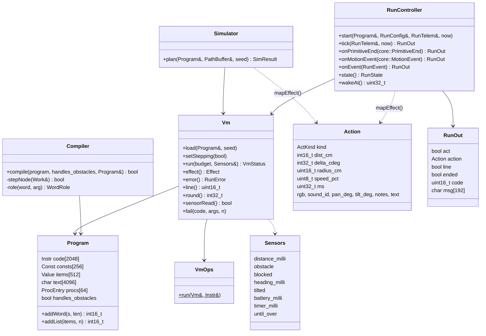

### 19.2 Instructions as built (replaces the table of §7)
| Instruction | `a` | `n` | Meaning |
|---|---|---|---|
| `HALT` | | | end of the program |
| `LINE` | | line | current line (events, step mode, errors) |
| `PUSHN` / `PUSHB` / `PUSHC` | | number / 0-1 / constant | a value onto the stack |
| `ARG` | input | | an input of the current word |
| `OP` | `Op` | | `+ - * / = <> < > <= >= AND OR NOT NEG` (7012 types, 7013 `/ 0`, 7033 too big) |
| `SENSOR` | `Sensor` | | `DISTANCE OBSTACLE? BLOCKED? HEADING TILTED? BATTERY TIMER` (+ the WAIT UNTIL limit) |
| `CALLB` | `Builtin` | | `RANDOM REMAINDER ABS ROUND REPCOUNT` |
| `JMP` / `JZ` / `JNZ` | condition's word | target | jumps (`IF IFELSE WHILE WAIT UNTIL`) |
| `LOOP_INIT` / `LOOP_NEXT` | 1 = FOREVER | end | REPEAT / FOREVER with a REPCOUNT record (no `LOOP_END`: `LOOP_NEXT` pops it) |
| `CALL` / `TCALL` | inputs | word | your words; `TCALL` reuses the frame |
| `RET` / `RETV` | | | end of a word / `OUTPUT` (pops the word's loop records) |
| `EFFECT` | `EffectKind` | inputs | ask the host (§10) |
| `STOP` / `FAIL` | | code | `STOP`; `FAIL 7031` at the end of a word that should give back a value |

`WAIT UNTIL test` compiles to `EFFECT(start 60 s); L: test JNZ end; EFFECT(tick); SENSOR(limit) JZ L; end:` — one tick per test, and the program goes on after 60 s.

### 19.3 Running a program
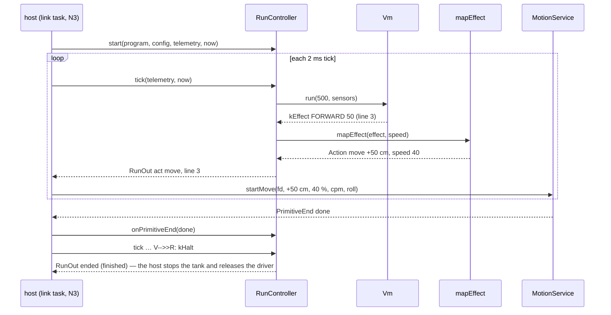

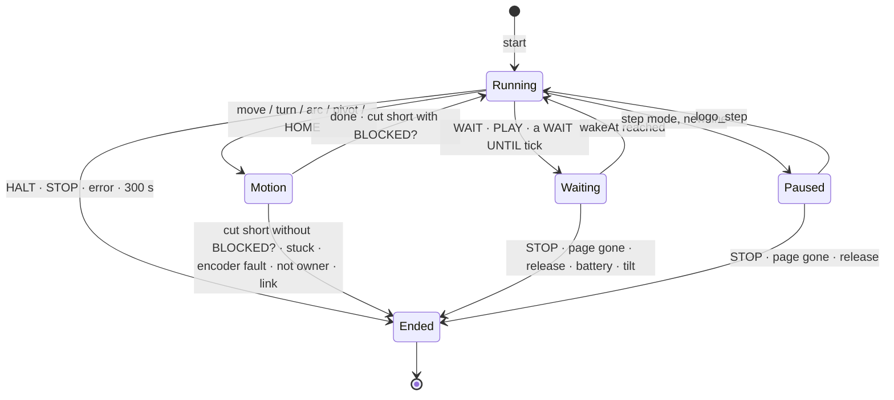
Endings by cause (codes in `words.yaml`): `EndReason` kDone → on; kBlocked → on with `BLOCKED?` true, else 7024; kCancelled / kStop → 7040; kNotOwner → 7045; kStalled / kTimeout / kDiverged → 7044; kLink / kDeadman → 7034; kEncoderFault → 7021. `MotionEvent` kStop / kCancel → 7040; kRelease / kOwnerCommand → 7045; kOwnerClosed → 7046; kOta / kBodyOffline / kTxFull → 7034; kBodyStall → 7044; kBodyEncoderFault → 7021. `RunEvent` kLogoStop → 7040, kBatteryLow → 7042, kTilt → 7043. Once ended, every later end reason is ignored.

### 19.4 Corrections to the earlier sections
- §3 `CheckResult` as built: `ok`, `handles_obstacles`, `tail_callees` (bit per word). §5: the parser's nesting limit gives **7010** "too deeply nested"; **7011** is the run-time limit of 100 nested calls.
- §7 / §8: the sensor word is **`TILTED?`** (the Uno's tilted / lifted alarm), not `TILT`; `Sensors` has no pitch or roll (the Uno Lite has none, design-notes §92). Values are 8 bytes (`VTag` + `int32_t`).
- §11: the simulator turns at 90 °/s and checks a `WAIT UNTIL` every 100 ms (time only); arcs get a point every 10°.
- §16: one compiled program ≈ 26 KB; the Vm's stacks ≈ 4 KB (256 values × 8 B, 101 frames, 128 loop records); the compiler's work stack 256 × 24 B.

## 20. Revision N3 — the runner on the tank (approved by the owner 2026-10-19, design-notes §102)
Plan N3 puts the N2 runner on the bridge in the Plan P structure (bridge LLD R15: controllers in `app/`, pure deciders in `core/` and `logo/`, ports chosen at link time). **This section replaces §1's data path, §12's write path and §13** where they differ: program text travels over HTTP, control and events over the WebSocket (§102). Safety is unchanged: every move is an ordinary motion-service primitive (`DRIVE src AUTO`) under all Uno rules; every ending stops the tank through the existing paths.

### 20.1 Parts
| Part | File (firmware/esp32) | Runs in | Pure / host-tested | Job |
|---|---|---|---|---|
| `LogoWorker` | `src/net/logo_worker.h/.cpp` | own task, core 0, below the web server | no (FreeRTOS) | one check at a time: lex → parse → check → compile → plan path into the **checked** program; numbers each check |
| `CheckBox` | `src/logo/check_box.h/.cpp` | shared (mutex in `net`) | yes | the checked program + its number + `ok`; `take(prog, out)` copies it for a run only if the number matches and it compiled OK |
| `LogoController` | `src/app/logo_controller.h/.cpp` | link task | yes (fakes) | `logo_run` / `logo_step` / `logo_stop`; owns the **running** program, `Vm`, `RunController`, `Odometry`; carries out each `RunOut`; events |
| `Odometry` | `src/logo/odometry.h/.cpp` | link task | yes | driven pose from `enc_l` / `enc_r` (counts per metre) and the yaw |
| `ProgramStore` | `src/net/program_store.h/.cpp` + `src/logo/program_names.h/.cpp` | web server task | names: yes | LittleFS `logo` area: `/p/<name>.logo`; 3 built-in examples (read-only) |
| `LogoHttp` | `src/net/logo_http.h/.cpp` | web server task | no | `POST /logo/check`, `GET/PUT/DELETE /logo/programs[/<name>]` |
| JSON | `src/core/ws_json_logo.cpp`, `src/logo/check_json.h/.cpp` | — | yes | the check reply (written in chunks), the `logo_*` events; `ws_codec` gains `logo_run` / `logo_step` / `logo_stop` |
| additions | `core/body_link` (`sendTone`, `sendCamSet`), `core/acked_ops` (`kTone`, `kCamSet`), `app/uno_channel` (a logo waiter), `app/motion_controller` (start by value) | link task | yes | |
| N2 follow-ups | `logo/program.h` (`ok`), `logo/vm.h` (value stack 1024, a WAIT UNTIL deadline per wait), `logo/compiler` (static work stack) | | yes | design-notes §101 |
| smoke tool | `tools/smoke/logo.py` | laptop | — | check, run, step, stop, save / load from the command line until the N4 page |

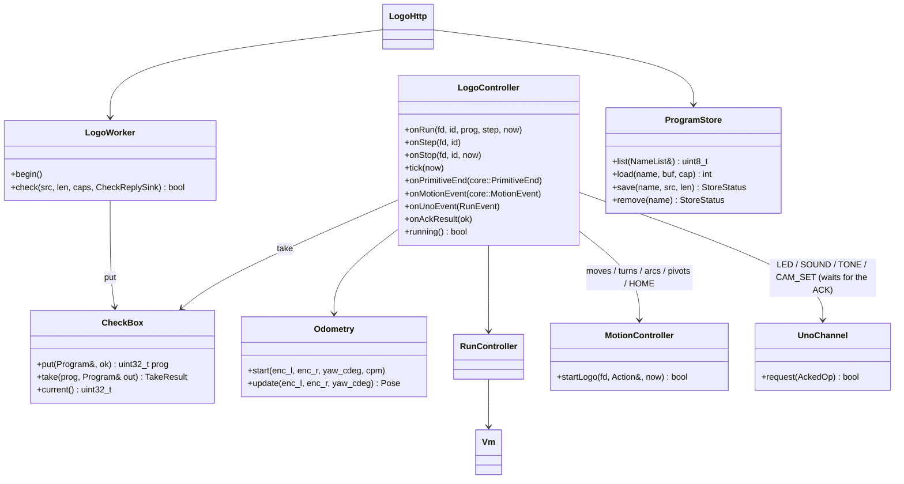

### 20.2 Checking a program
```mermaid
sequenceDiagram
  participant P as page / smoke tool
  participant H as web server task (LogoHttp)
  participant W as LogoWorker task
  participant B as CheckBox
  P->>H: POST /logo/check (text, ≤ 8 KB)
  H->>W: job (text in the worker's PSRAM inbox, caps from HELLO)
  Note over H: one check at a time; busy → 503
  W->>W: lex → parse → check → compile → plan path
  W->>B: put(program, ok) → prog 17
  W-->>H: diagnostics, words, handles_obstacles, path, prog 17
  H-->>P: 200 {ok, diags[], words[], handles_obstacles, path[[x,y,h,line,u]…], prog} (chunked)
```
- Text over 8 KB → 7010 before reading. The worker answers within 2 s or the request answers "busy" (and its result is dropped).
- Every check gets a number, also one with errors; only a number whose program compiled OK can run.

### 20.3 Running a program
```mermaid
sequenceDiagram
  participant P as page
  participant L as link task (CommandRouter → LogoController)
  participant R as RunController
  participant M as MotionController
  participant U as UnoChannel → Uno
  P->>L: WS {"t":"logo_run","prog":17,"step":false,"id":5}
  L->>L: CheckBox.take(17) → running program (refuse: CHECK_AGAIN / BUSY / NOT_OWNER / STOPPED / OTA)
  L->>L: claim the drive like a manual drive
  L-->>P: ack 5 · ev logo_started {name, by}
  loop each 2 ms tick
    L->>R: tick(telemetry, now)
    R-->>L: RunOut move +50 cm (line 3)
    L->>M: startLogo(fd, move) - an ordinary MOVE
    L-->>P: ev logo_line {line 3, round}
    M-->>L: PrimitiveEnd done → R.onPrimitiveEnd
    R-->>L: RunOut LED 0 255 0
    L->>U: request LED (waits for the ACK; none in 0.6 s → 7034)
    U-->>L: ack → R goes on
  end
  R-->>L: RunOut ended (finished / code)
  L->>L: stop the tank (motion STOP or BodyLink STOP), release the driver
  L-->>P: ev logo_ended {reason, line, msg}
```

```mermaid
stateDiagram-v2
  [*] --> Idle
  Idle --> Running : logo_run (checked program, compiled OK, control taken)
  Running --> WaitingAck : LED / BEEP / SOUND / PLAY / LOOK sent
  WaitingAck --> Running : ACK (or a refusal, logged)
  WaitingAck --> Idle : no ACK in 0.6 s (7034)
  Running --> Idle : ending (RunController) - tank stopped, driver released
  note right of Running : RunController's own states (§19.3) inside: motion, waits, step pauses
```

### 20.4 Messages
| Client → bridge | Reply |
|---|---|
| `POST /logo/check` body = program text | `{"ok":bool,"prog":n,"diags":[{"code","line","col","msg","warning"}],"words":[{"name","inputs","gives"}],"handles_obstacles":bool,"path":[[x_mm,y_mm,heading,line,uncertain]…],"cut_short":bool,"sim_error":{code,line,msg}?}` |
| `GET /logo/programs` | `{"programs":[{"name","bytes","example"}]}` |
| `GET /logo/programs/<name>` | the text (`text/plain`) |
| `PUT /logo/programs/<name>` body = text | `{"ok":true}` / `{"ok":false,"why":"NAME" / "FULL" / "TOO_BIG" / "EXAMPLE" / "RUNNING"}` |
| `DELETE /logo/programs/<name>` | same |
| WS `{"t":"logo_run","prog":n,"step"?:bool,"id":k}` | `ack` / `nack` with `CHECK_AGAIN`, `BUSY`, `NOT_OWNER`, `STOPPED`, `OTA` |
| WS `{"t":"logo_step","id":k}` / `{"t":"logo_stop","id":k}` | `ack` / `nack NOT_RUNNING` (`logo_stop` from any client; the page's STOP also sends the usual `stop`) |

| Event (all clients) | Fields |
|---|---|
| `logo_started` | `name` (saved name or ""), `by` (client) |
| `logo_line` | `line`, `round` |
| `logo_pose` | `x_cm`, `y_cm`, `heading` (10 Hz while running; start = 0, 0, 0, Logo axes) |
| `logo_say` | `text` |
| `logo_note` | `line`, `msg` (ARC speed moved into its band) |
| `logo_ended` | `reason` (`finished` or the code), `line`, `msg` |

### 20.5 Rules
- **Pacing (§102):** LED / BEEP / SOUND / PLAY (TONE frames of ≤ 10 notes, one request per frame) / LOOK go through the UnoChannel request queue as kinds `kLed`, `kSound`, `kTone`, `kCamSet`, `kCamHome`; the program goes on at the ACK. No ACK within the queue's 0.6 s backstop → 7034. A refusal is logged (`LogKind`) and the program goes on. SAY: `logo_say`, then a 0.2 s pause. `BEEP` = `SOUND BLIP`.
- **Who drives:** `logo_run` claims the drive like the page's own `drive` (LinkOwner); the program's moves never take ownership themselves (bridge R4.6). The driver's other commands (`drive`, `turn`, `move`) while a program runs end it with 7045 (`kOwnerCommand`).
- **Endings to RunController:** `MotionController` primitive ends → `onPrimitiveEnd`; STOP / release / page closed / OTA / body offline / stall / encoder fault → `onMotionEvent` (the same events MotionController gets); Uno EVENT battery critical → `kBatteryLow`, tilted or lifted → `kTilt`.
- **Stopping on an ending:** a primitive still running → MotionController's STOP path; none → `BodyLink` STOP (urgent slot). Then the driver is released, and `logo_ended` goes out.
- **Capabilities (`Caps`):** `encoders` from the Uno's HELLO caps (`CapBit::ENCODERS`); `ai` false; v1.
- **Counts per metre and roll-on** for moves and odometry: MotionController's values (NVS).
- **Not while running:** saving / deleting a program (`RUNNING`), OTA start (the program ends first, 7034), settings that need a still tank (as for a manual drive).

### 20.6 Memory and time
| Item | Where | Size |
|---|---|---|
| checked + running `Program` | PSRAM (allocated once at boot) | 2 × ≈ 26 KB |
| reader (`TokenList`, `NodePool` 4096) | PSRAM, worker | ≈ 64 KB + 33 KB |
| path buffer (2000 points) | PSRAM, worker | ≈ 24 KB |
| `Vm` (value stack 1024, 101 frames, 128 loops) | internal RAM, static, link task | ≈ 10 KB |
| `Compiler` work stack | static, worker | ≈ 6 KB |
| worker task stack | internal | 8 KB |
| link task per tick | ≤ 500 instructions (≈ 0.2 ms) + one action | stack high-water mark checked on the tank (8 KB task) |
| web server | `max_uri_handlers` 12 → 16 | |

### 20.7 Partitions (as §12, one USB flash)
`nvs 0x9000/0x5000 · otadata 0xE000/0x2000 · app0 0x10000/0x2E0000 · app1 0x2F0000/0x2E0000 · source 0x5D0000/0x1E0000 · logo (littlefs) 0x7B0000/0x40000 · coredump 0x7F0000/0x10000`. NVS does not move (WiFi, counts per metre and roll-on are kept). The flash happens over USB with the bridge on the Linux machine (dev-setup); the first boot formats the `logo` area.

### 20.8 Tests
- **Host:** `CheckBox` (numbers, ok, take refusals), `Odometry` (straight, turn, arc within 1 cm), check-reply JSON and events, `ws_codec` `logo_*`, `program_names`, `LogoController` with fakes (run / refusals / ACK pacing / 7034 / SAY pause / every ending stops the tank and releases / step / pose at 10 Hz), BodyLink `sendTone` / `sendCamSet` frames, the N2 follow-ups.
- **Build:** bridge `[SUCCESS]`, partition table check, size check.
- **Stand (tracks off the ground):** USB flash; with `tools/smoke/logo.py`: a square (tracks turn), LED / SOUND / PLAY / LOOK, STOP mid-program, a second phone taking control (7045), hiding the page (7046), `FOREVER` ended by `logo_stop`, save / load / delete, a check while a program runs.
- **Floor (after the road-wheel fix):** a 50 cm square back to its start, "avoid walls" with an obstacle (`BLOCKED?`), a program without `BLOCKED?` meeting an obstacle (7024), driven path (`logo_pose`) against the planned path.

### 20.9 As built (Plan N3, 2026-10-19; stand checks design-notes §105)
- The ten rules of Plan N3 (owner-confirmed, design-notes §104) hold. Corrections to §20.1-§20.6:
  - **§20.2:** the web server never waits - each `/logo/*` request is handed to the logo worker as an async job (esp_http_server `httpd_req_async_handler_begin`); the worker reads the body (bounded), checks / saves / loads, replies in chunks and completes it. No 2 s wait.
  - **§20.5:** the program keeps the drive with `LinkOwner::keepDriving` every tick (as a primitive does): no 5 s handback during waits; a takeover (IR remote; phones cannot take a running program's drive) ends it with 7045 **without** a STOP frame; the ending's STOP goes only while it still owns the drive. LOOK degrees → Uno servo angles (900 centre, right / up the smaller angles); BEEP = SOUND BLIP; PLAY sends each TONE frame (≤ 10 notes) when the previous one has played.
  - **§20.6:** check workspace ≈ 319 KB PSRAM (token list and node pool bigger than estimated), worker stack 16 KB (the checker keeps ≈ 6 KB on its stack); running program + Vm ≈ 36 KB. Measured: an 8 KB `FOREVER` check takes 41-43 ms on the bridge.
- **Files:** `logo/{check_job, check_json, check_box, program_names, odometry}`, `app/{logo_controller, logo_actions}`, `core/ws_json_logo.cpp`, `net/{logo_worker, logo_http, program_store}`, `tools/smoke/logo.py`; changes in MotionController, UnoChannel, BodyLink (`sendTone`, `sendCamSet`), AckedOps, the codec, the router, UnoEventRouter (alarm sink), the link task and `main.cpp` (bridge LLD R16).
- **On the stand:** turns end "stuck" (7044) - a spin cannot turn the body there; turns and the square are floor checks. Opening the bridge's USB serial port resets it.

## 21. Revision N4 — the `/logo` page (approved by the owner 2026-10-19, design-notes §106)
Plan N4 builds the page of §14 on the N3 transport (§20): program text over HTTP, control and events over the WebSocket. **This section replaces §14 where they differ.** The page changes nothing in how programs run; the bridge only serves it.

### 21.1 Decisions (owner, design-notes §106)
- No speed-limit control and no PAUSE in v1: the run bar is **RUN · STEP · STOP** (STEP starts the program in step mode; each later press runs the next line).
- Unsaved text is kept as a **draft in that browser** (`localStorage`) and restored when the page opens; a dot by the program name shows "not saved on the tank". No leave-warning, no automatic writes to the tank.
- Heading after a right turn is positive (§83); screens 15 / 16 showed `-90°` and are superseded there.
- Each word gets a **`group`** in `logo/spec/words.yaml` (generated into `words.json`) that picks its colour.

### 21.2 Files
| File | Job |
|---|---|
| `firmware/esp32/web/logo.html` | the page: layout of screens 15 (laptop: programs · editor · path) and 16 (phone: PROGRAM / PATH tabs, run bar at the bottom); header ‹ DRIVE, ☰ MENU, battery / WiFi / Uno chips, STOP |
| `firmware/esp32/web/logo.js` | the page's deciding code as plain functions and small classes, no DOM inside (`colour`, `insertWord`, `Drafts`, `fitView`, `RunBar`, `CheckScheduler`); `module.exports` when loaded by Node |
| `firmware/esp32/web/test/logo.test.js` | Node built-in test runner (`node --test`), no packages |
| `scripts/pack_web.py` | `/logo`: `logo.html` with `<!--CQ:LOGO_JS-->` replaced by `logo.js` and `<!--CQ:WORDS-->` by `generated/words.json`; gzip; **budget 24 KB gzipped** |
| `src/net/http_server.cpp` | `GET /logo` (exact URI; the `/logo/*` handlers of N3 are unchanged) |
| `web/basic_drive.html`, `web/help.html` | the ☰ MENU's Logo item enabled (now "COMING SOON"); Help links to `/logo` |
| `logo/spec/words.yaml`, `logo/generator` | `group` per word; `words.json` carries it; a generator test that every word has one |

### 21.3 Groups and colours
| `group` | Words | Colour (Phosphor) |
|---|---|---|
| `move` | `FORWARD BACK ARC PIVOT HOME SPEED` | bright green |
| `turn` | `RIGHT LEFT` | amber-green |
| `flow` | `REPEAT FOREVER IF IFELSE WHILE WAIT UNTIL TO END OUTPUT STOP` | cyan |
| `show` | `LED BEEP SOUND PLAY LOOK SAY` | purple-pink |
| `sense` | sensors and reporters (`DISTANCE OBSTACLE? BLOCKED? TILT BATTERY TIMER HEADING REPCOUNT RANDOM`) | light blue (quiet) |
| `maths` | operators, list words, `TRUE` / `FALSE` | soft white |
| — (page tokenizer) | numbers amber · your own words white · `:inputs` white italic · comments dim · words not in the list and not your own: red underline |
The exact word lists follow `words.yaml` (every word gets one group); the table shows the intent.

### 21.4 Parts
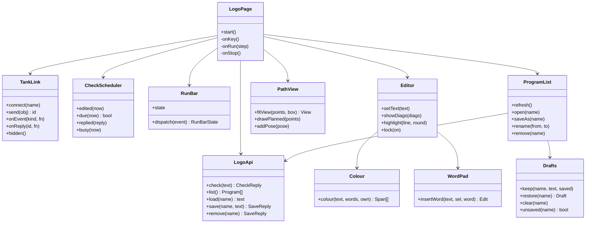
- **Pure (in `logo.js`, tested by Node):** `Colour`, `WordPad.insertWord`, `Drafts` (storage passed in), `PathView.fitView`, `CheckScheduler`, `RunBar`. **DOM only (in `logo.html`):** `LogoPage`, `Editor`, `PathView` drawing, `ProgramList`, `TankLink` (the same `hello` / reconnect / hidden-page handling as Drive, bridge R11).

### 21.5 Checking as you type
```mermaid
sequenceDiagram
  participant E as Editor
  participant S as CheckScheduler
  participant A as LogoApi
  participant H as bridge (POST /logo/check)
  E->>S: edited(now)
  Note over S: 600 ms after the last key
  S->>A: check(text)
  A->>H: POST /logo/check (≤ 8 KB)
  alt 200
    H-->>A: {ok, prog, diags, words, handles_obstacles, path, cut_short, sim_error}
    A-->>S: replied → RunBar CHECKED(ok, prog)
    S-->>E: showDiags (under each line, ▲ under the word); own words → Colour
  else 503 busy
    H-->>A: busy
    A-->>S: busy → try again 0.5 s later
  end
```
- A reply to an older text is dropped (each check carries the text's edit number). Text over 8 KB is shown as 7010 by the bridge, like any mistake.
- Mistakes are shown with their code and plain sentence; RUN and STEP are enabled only for `ok` (warnings allowed).

### 21.6 Running
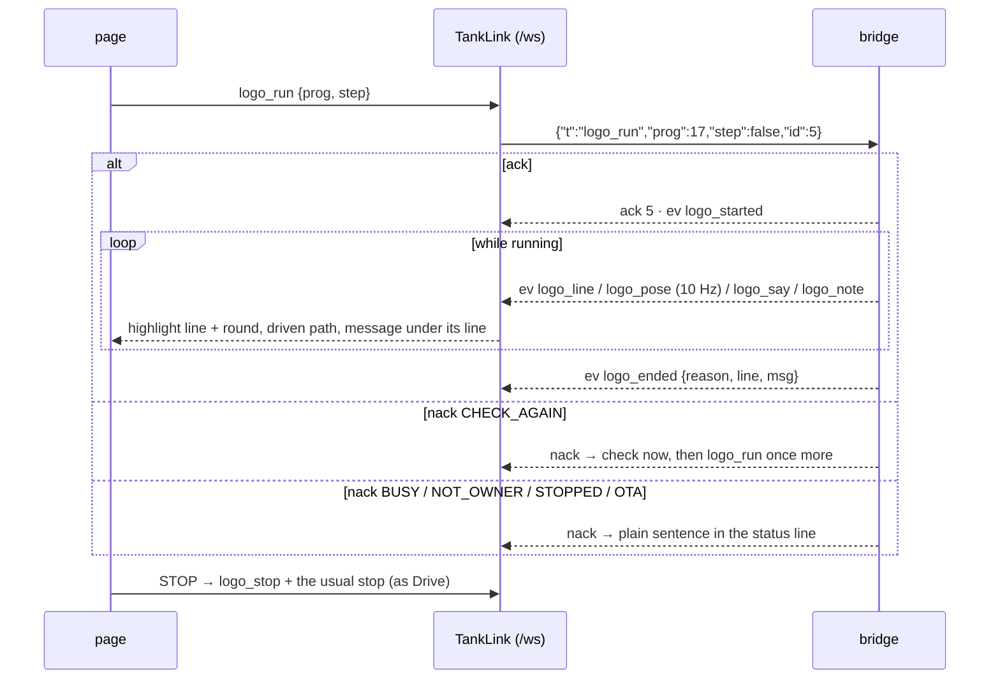

```mermaid
stateDiagram-v2
  [*] --> Editing
  Editing --> Checking : 600 ms after the last key
  Checking --> Ready : ok
  Checking --> HasMistakes : not ok
  Checking --> Checking : busy (retry 0.5 s)
  HasMistakes --> Editing : key
  Ready --> Editing : key
  Ready --> Starting : RUN / STEP
  Starting --> Running : ack
  Starting --> Checking : nack CHECK_AGAIN (once)
  Starting --> Ready : other nack (sentence shown)
  Running --> Stepping : step mode waits at a line
  Stepping --> Running : STEP pressed
  Running --> Ended : logo_ended
  Stepping --> Ended : logo_ended
  Ended --> Ready : key or RUN
  Ready --> OtherRunning : logo_pose / logo_line not from our run
  OtherRunning --> Ready : logo_ended
  note right of Running : editor locked; STOP always on screen
  note right of OtherRunning : "a program is running" - RUN off, STOP works
```
- **Hidden page:** a run started here ends with 7046 when the page is hidden (bridge R11); when it is shown again the page reconnects and the status line says "Stopped: the page was hidden (7046)".
- **Ended:** `finished` → "Done"; a code → its sentence under the line it ended on.

### 21.7 Path
- Logo axes: start (0, 0) facing up the screen; right turns positive; mm from the check, cm from `logo_pose`.
- `fitView` scales the planned and driven points (with a margin) into the box, keeps 1:1, draws a 5 cm grid (coarser when zoomed out) and a scale bar.
- Planned path solid up to the first sensor read, dashed after (`uncertain`); "path cut short" when `cut_short`. Driven path solid on top; the tank drawn as an arrow at the last pose.
- Under the path: heading, distance ahead (from the tank's status), time used of 5:00.

### 21.8 Programs and drafts
- List from `GET /logo/programs`: saved on the tank, then the three examples. Open = load the text (or its draft).
- **SAVE** = `PUT /logo/programs/<name>`; refusals as sentences (`NAME`, `FULL`, `TOO_BIG`, `EXAMPLE`, `RUNNING`). An example cannot be saved over: SAVE asks for a new name.
- **Rename** = save under the new name, then delete the old one; **delete** asks to confirm.
- **Drafts:** `localStorage` key `cq.logo.draft.<name>` (`<new>` for an unnamed program) holding `{text, saved}` (`saved` = the text last loaded / saved). Cleared after a successful SAVE; unsaved dot = text ≠ saved. Storage errors (private mode) only disable drafts.

### 21.9 Budgets and tests
- `/logo` ≤ 24 KB gzipped (word list ≈ 2.4 KB of it); no new WebSocket messages; bridge flash change ≈ page size.
- **Node (`node --test web/test/logo.test.js`):** colours per group, own words, numbers, comments, unknown underline; `insertWord` selections (`FORWARD 50` → `50` selected, `REPEAT 4 [  ]` → cursor inside); drafts keep / restore / clear / unsaved / storage errors; `fitView` (fits, 1:1, right turn positive, dashed after uncertain, cut short); `CheckScheduler` (600 ms, stale replies dropped, busy retry); `RunBar` every transition of §21.6 incl. CHECK_AGAIN once, another device's run, 7046 after hiding.
- **Generator:** every word has a `group`; `words.json` carries it; `logogen check` clean.
- **Build:** `pack_web` within budget; bridge build; size check.
- **Browser check (Playwright, stand-in tank as Plans M / O):** type → mistakes → RUN → line glows → messages and driven path → STOP sends `logo_stop` and `stop`; phone (390 × 844) and laptop (1440 × 900) screenshots against screens 15 / 16.
- **Stand (owner present, tracks off the ground):** mistake shown and fixed, planned path; RUN / STEP / STOP from the phone; phone locked → 7046 shown on return; a second phone sees "a program is running"; save / rename / delete, example → new name, draft survives a reload. **Floor** (with N3 Task 13, after the road-wheel fix): the square's driven path against its planned path.

### 21.10 As built (Plan N4, 2026-10-20; tank checks design-notes §108)
- The thirteen rules of Plan N4 (owner-confirmed at plan review, design-notes §108) hold. Corrections to §21.1–§21.9:
  - **§21.2:** no `http_server.cpp` change — `pack_web.py` adds `/logo` to the asset table (14 of 20 URI handlers on the main server; `/stream` and `/capture` are on port 81); `pack_web.py` gains `assemble_logo()` and can be loaded by the stand-in tank; Help's Logo section (`web/help_logo.html`) is rewritten for v1; `scripts/check-protocol.sh` finds `logo/` from its own folder.
  - **§21.4:** a `RequestQueue` in `logo.js` sends one `/logo` request at a time (the bridge's worker takes one job; `503 busy` retried every 0.5 s for 10 s; a request with no answer gives up after 15 s).
  - **§21.5 / §14:** mistakes are marked in the editor (underline, ▲ in the gutter) and written just under the editor, quoting the line with a ▲ under the word (a text box cannot open a gap under a line).
  - **§21.6:** in step mode a pause is a `logo_line` with a new line number; the moves on the paused line send `logo_line` too and do not light NEXT. An edit cancels a pending CHECK_AGAIN rerun. **STOP is always on screen:** the header sticks to the top above the name / delete sheets, and STOP acts on the first touch (`pointerdown`).
  - **§21.8:** a draft is never hidden (shown even when the tank's copy changed, with a note); SAVE AS onto an existing name needs a second press; a program switches only when its text has arrived (the editor is read-only meanwhile; a failed open changes nothing); text typed while a SAVE waits stays a draft; clearing a new program asks first; the draft is written 300 ms after the last key and at once when the page is hidden.
  - **§11 / §20 (odometry, found on the floor 2026-10-20):** the Uno counts rising encoder edges only — the counts rise in reverse too — so `logo::Odometry::update` takes each track's direction from its motor command (`spd_cmd_l` / `spd_cmd_r`, forward +; the last non-zero one while the tank rolls on). Before, BACK was drawn as FORWARD.
- **Files:** `web/logo.html`, `web/logo.js`, `web/test/logo.test.js` (46 Node tests), `web/test/fake_tank.py` (the stand-in tank), `web/test/browser_check.js` and `web/test/browser_fix_check.js` (Playwright checks); `words.yaml` `group`; `src/logo/odometry.*` and `src/app/logo_controller.cpp` (direction).
- **Sizes:** `/logo` 20.0 KB gzipped (budget 24 KB); bridge flash 44 %.

## 22. Revision N5 — `GO` and `HOLD` (approved by the owner 2026-10-22; Spec 5 Revision 3, design-notes §118)

### 22.1 What changes
- **Two new words** in `logo/spec/words.yaml`: `GO` and `HOLD`. Both are level 2, group `move`, kind `command`, with no inputs and no `needs`. Two new `EffectKind`s and two new `ActKind`s follow them.
- **`GO` is the first motion that does not block.** The runner carries it out and stays `Running`, remembering `m_going`.
- **The bridge gains one motion primitive, `PrimKind::kGo`** (bridge LLD R20). It drives v = SPEED with w = 0, letting the Uno's own heading hold keep it straight, as MOVE does. It must be refreshed every ≤ 300 ms, and it ends at once when the Uno's obstacle brake engages.
- **`HOLD`** ends a running `GO` as done (STOP to the Uno). The program goes on.
- **Not changed:**
  - the Uno and the protocol;
  - every other word and every safety ending;
  - the `/logo` page beyond its generated word help and the dashed preview segment, which it already draws for uncertain paths.

### 22.2 Rules (the runner, `RunController`)
| Situation | Runner | Host (`LogoController` → `MotionController`) |
|---|---|---|
| `GO`, not going | `m_going = true`, `m_blocked = false`, state stays `Running` | `startGo(fd, SPEED)` |
| `GO`, already going | nothing | — |
| `SPEED p` while going | speed kept as today | `goSpeed(p)`: the drive changes at once |
| every tick while going | — | `keepGo(now)` (≤ 300 ms, else the bridge ends it as deadman → 7034) |
| a motion word while going (`FD BK RT LT ARC PIVOT HOME`) | `m_going = false`, state `Motion` as today | `start…` replaces the GO primitive (no end for the GO) |
| `HOLD`, going | `m_going = false` | `hold(now)`: the GO ends as **done** (STOP to the Uno) |
| `HOLD`, not going | nothing | — |
| GO ended by the obstacle brake | `BLOCKED?` program: `m_blocked = true`, goes on; otherwise ends **7024** | — |
| GO ended any other way (stalled, link, deadman, not owner …) | ends with the same code as a move (`kByEndReason`) | — |
| the program ends while going | as today: the host stops the tank | — |

- `onPrimitiveEnd` gains the background case: an end that arrives while `Running` with `m_going` belongs to the GO. A **done** end there (from `HOLD`) is expected and ignored.
- **`BLOCKED?`** is cleared when a `GO` starts and, as today, when a move ends done, so `FOREVER [ GO WAIT UNTIL BLOCKED? BACK 10 RIGHT 90 ]` works round after round.

### 22.3 Classes
```mermaid
classDiagram
  class RunController {
    -m_going: bool
    -m_blocked: bool
    +tick(telem, now) RunOut
    +onPrimitiveEnd(end) RunOut
    +going() bool
  }
  class Action {
    +kind: kGo | kHold | kMove | ...
    +speed_pct
  }
  class LogoController {
    +tick(now): keepGo while going
  }
  class MotionController {
    +startLogo(fd, action, now, why)
    +keepLogoGo(now)
    +holdLogo(now)
  }
  class MotionService {
    +startGo(fd, speed, id, now)
    +keepGo(now)
    +goSpeed(speed)
    +hold(now) MotionOut
    -stepGo(telem, now) MotionOut
  }
  RunController --> Action : GO / HOLD
  LogoController --> RunController
  LogoController --> MotionController : startLogo(kGo / kHold), keepLogoGo
  MotionController --> MotionService
```

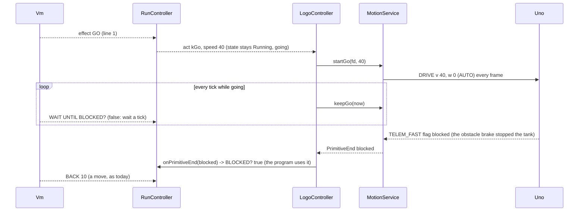

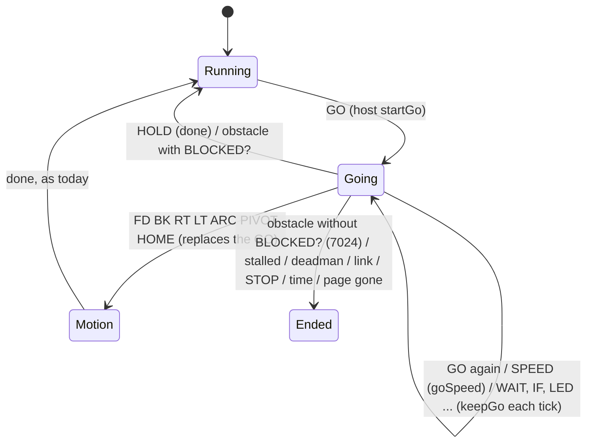
(`Going` is `Running` with `m_going` set, not a new `RunState`: everything that runs in `Running` also runs while going.)

### 22.4 Preview (simulator) and checker
- **Preview:** the simulator moves the turtle 1 m forward for a `GO` and marks the segment `uncertain` (the page already draws uncertain segments dashed). `HOLD` draws nothing.
- **`WAIT UNTIL`** with the simulator's fixed sensors (`BLOCKED?` false, `DISTANCE` 999) is already uncertain today and stays as it is.
- **The checker** needs nothing new: no inputs, and no `needs`.

### 22.5 Tests
- **Reading** (`logo/spec/tests/reading.yaml` → `test_logo_conformance`): `GO` and `HOLD` parse as commands with no inputs. `GO 40` → error 7004 ("You didn't say what to do with 40"). Both are reserved names.
- **Running** (`logo/spec/tests/running.yaml` → `test_logo_running`):
  - `GO WAIT 1 HOLD` → actions go, wait, hold; finished.
  - `GO FORWARD 50` → go, then a move with no GO end in between.
  - `GO WAIT UNTIL BLOCKED?` plus a blocked end → goes on with `BLOCKED?` true.
  - The same without `BLOCKED?` → 7024.
  - A deadman end → 7034.
  - `HOLD` alone → nothing.
  - `SPEED 60` while going → the speed action.
- **Bridge** (`test_motion`):
  - `startGo` sends v = speed, w = 0;
  - the brake flag ends it blocked at once;
  - no `keepGo` for 300 ms → deadman;
  - `hold` → done with v = 0;
  - a `startMove` during a GO replaces it without an end;
  - the Uno's stall event ends a GO as stalled (bridge LLD R20).
- **`test_logo_controller`:**
  - `keepGo` every tick while going;
  - `hold` on `HOLD`;
  - the program's end stops a GO.
- **Floor (owner):**
  - `FOREVER [ GO  WAIT UNTIL BLOCKED?  BACK 10  RIGHT 90 ]` in the same room as `avoid_walls`: it drives without stopping between walls.
  - `GO  WAIT UNTIL DISTANCE < 30  HOLD  BEEP`: it stops about 30 cm from a box.

### 22.6 Not in this revision
- **The WebSocket messages for the AI engine** (`{"t":"go","speed":n}` refreshed ≤ 300 ms, `{"t":"hold"}`). They come with the AI engine's Logo runner, using the same `MotionService` primitive.
- **`GO UNTIL cond`** (shorthand) and **steering while going.**
- **The `avoid_walls` example** may be rewritten with `GO` once the floor check passes (owner to decide then).

### 22.7 Changed by the final review (owner, 2026-10-22: "a, and do the smaller points too")
- **Step mode (option a):** while the program is paused on a line, `LogoController::pauseGo` holds the GO (`m_paused_go`), and STEP drives on with a new `GO` at the same speed (`m_go_speed`). HOLD's own end during the pause is not passed to the runner (`m_hold_end`), so the program still counts as going.
- **A GO stopped by the Uno's slow-down near an obstacle ends blocked** (MOVE's no-progress rule, bridge LLD R20).
- **A new GO ignores the brake flag in its very first frame**, which may still be the last primitive's; a real obstacle ends it one frame (20 ms) later.
- **`GO` needs the encoders** (`words.yaml` `needs: [encoders]`; at run time an encoder fault refuses it, like `FORWARD`).
- **`HOLD` is never refused:** nothing going is nothing to do, even with the body offline or during OTA.
- **The Tune log names a GO "go".**
- **New tests:**
  - a GO's deadman → 7034 (`test_logo_run`);
  - the program's end stops a GO;
  - losing the drive during a GO never STOPs the new driver;
  - step mode holds and drives on;
  - a stale flag in the first frame;
  - HOLD never refused / GO needs encoders;
  - GO without encoders → 7021 (`errors.yaml`).


## 23. Revision N6 — the `/logo` page as an editor on the laptop (approved by the owner 2026-10-24, design-notes §147)
On a laptop or tablet the page fills the window like a code editor. **The page itself never scrolls**; only the program list, the editor and the bottom panel scroll inside themselves. The run pane gets the **camera**. **The phone layout (narrower than 900 px) does not change**: it scrolls as today (§21), since Logo is meant for the laptop. How programs are checked, run and saved does not change, and the bridge does not change: only `logo.html`, `logo.js` and their tests do.

### 23.1 Decisions (owner, 2026-10-24: "yes all as recommended")
1. **Three columns with fixed sizes:**
   - programs 220 px;
   - the editor takes the rest;
   - the run pane is about a third of the width (camera above, path below).
2. **A bottom panel under the editor** with two tabs, **PROBLEMS** (with a count) and **MESSAGES**.
   - Clicking a problem jumps to its line (as today).
   - When a program starts, MESSAGES opens by itself.
3. **A status bar along the bottom:**
   - while a program runs: the running line and round;
   - otherwise: the word help while typing;
   - RUN and STEP on the right.
   - **STOP stays in the top bar**, red, always on screen.
4. **The camera pane** above the path:
   - 4:3, with the sonar distance on the picture;
   - a **HIDE** button gives its space to the path, remembered in this browser;
   - it streams **only while it is shown**.
5. **Keyboard shortcuts**, from anywhere on the page, the editor included:
   - **Esc = STOP**;
   - **Ctrl/⌘ + Enter = RUN**;
   - **F10 = STEP**;
   - **Ctrl/⌘ + S = save on the tank**.
   - Each is shown as a hint on its button.
6. **Fixed sizes, no draggable dividers** in this revision (they can come later if missed).
7. **Under 900 px** (phones, a tablet held upright): the §21 layout, unchanged. The shortcuts work there too, for a tablet with a keyboard.

### 23.2 The layout (900 px wide or more)
```
┌ ‹DRIVE  [ TANK LOGO ]   7.6V  WIFI  UNO              ☰   STOP Esc ┐ header
├────────────┬───────────────────────────────┬─────────────────────┤
│ PROGRAMS   │ FD RT LT REPEAT GO LOOK …  →  │ CAMERA        HIDE  │
│ ▸ saved    │ ┌───────────────────────────┐ │ 4:3 picture         │
│ ▸ examples │ │ 1  REPEAT 4 [             │ │ ▸ 64 cm  (sonar)    │
│ (scrolls)  │ │ 2    FORWARD 50           │ ├─────────────────────┤
│            │ │ 3    RIGHT 90 ]           │ │ PATH                │
│            │ │  editor: fills, scrolls   │ │ (fills)             │
│ NEW SAVE   │ └───────────────────────────┘ │ HEADING DIST TIME   │
│ RENAME DEL │ PROBLEMS 1 │ MESSAGES         │                     │
│            │ (about 9 lines, scrolls)      │                     │
├────────────┴───────────────────────────────┴─────────────────────┤
│ ● RUNNING line 2, round 3 · FORWARD n: drive n cm  STEP F10  ▶ RUN ⌘↵ │ status bar
└──────────────────────────────────────────────────────────────────┘
```
- **The page box:**
  - `body` is `height: 100dvh; overflow: hidden` and a grid of three rows: header (auto), work area (`1fr`, `min-height: 0`), status bar (auto).
  - **The work area's columns:** `220px minmax(0, 1fr) minmax(320px, 34%)`.
  - **Each column is a flex column**; the part that grows has `flex: 1; min-height: 0`:
    - programs: the list grows and scrolls, the buttons sit at its bottom;
    - centre: the word row (one line, scrolls sideways), the editor (grows) and the bottom panel (fixed, `12em`);
    - run pane: the camera (`aspect-ratio: 4 / 3`, gone when hidden), the path (grows) and the three stats.
- **The phone's PROGRAM / PATH tabs and the mini path** stay hidden on the laptop (as today).
- **Nothing in the window scrolls the page.** The check is `document.scrollingElement.scrollHeight ≤ innerHeight` at 1280 × 800 and 1024 × 700, with a 300-line program and 200 messages.
- **One page, two arrangements:** the same elements are used in both. *(As built, §23.8: only `#diags` and `#help` move; the word row moves by CSS `order`, and the messages and status stay where they are.)* The design said `Layout` moves five of them when the width crosses 900 px:
  - the word row (`#pad`);
  - the help line (`#help`);
  - the problems (`#diags`);
  - the messages (`#log`);
  - the run bar's status (`#status`).
  - Under 900 px they go back to where §21 puts them, so the phone page is the same as before.

### 23.3 Classes
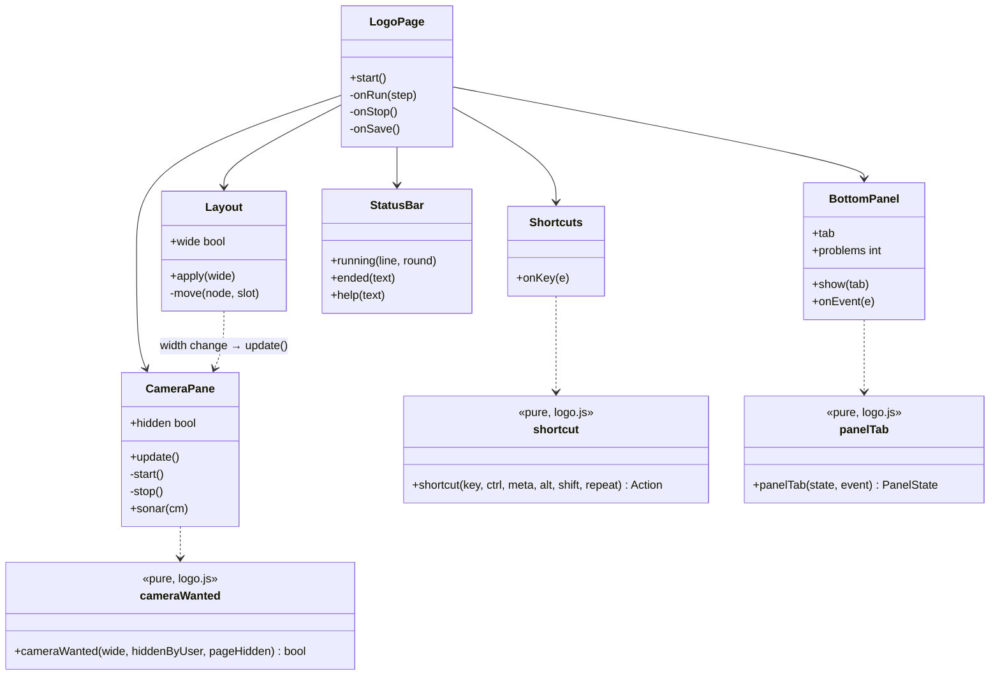
- **Pure, in `logo.js` and tested by Node:**
  - **`shortcut(key, ctrl, meta, alt, shift, repeat)`** → `"stop" | "run" | "step" | "save" | null`:
    - `Escape` → `stop`, even when repeated;
    - `Enter` with Ctrl or ⌘ → `run`;
    - `F10` → `step`;
    - `s` / `S` with Ctrl or ⌘ → `save`;
    - with Alt held → `null`;
    - `run` / `step` / `save` while the key is held down (repeat) → `null`, so a held key can't start a program twice.
  - **`panelTab(state, event)`** → `{tab, picked}`:
    - `{e: "pick", tab}` (a click) sets the tab and `picked`;
    - `{e: "started"}` (`logo_started`) → MESSAGES and clears `picked`;
    - `{e: "problems", n}`: when `n > 0`, no program is running and the user hasn't picked a tab since the last start → PROBLEMS;
    - nothing else changes the tab.
  - **`cameraWanted(wide, hiddenByUser, pageHidden)`** → stream only when the layout is wide, the pane is not hidden, and the page is visible.
- **DOM only, in `logo.html`:**
  - **`Layout`:** a `matchMedia("(min-width: 900px)")` listener; `apply` moves the five elements into the slots of §23.2 and calls `CameraPane.update()` and `draw()`.
  - **`BottomPanel`:** the two tab buttons and their counts; it reads `panelTab`.
  - **`CameraPane`:** the stream (below).
  - **`StatusBar`:** today's `#status` text; when no program runs, the help line sits next to it.
  - **`Shortcuts`:** one `keydown` listener on `window`, in the capture phase, so it runs before the editor's own Tab handling.
    - Each action is **the same as pressing its button**: a disabled button means no action. STOP is never disabled.
    - It calls `preventDefault()` for each action, so the browser's own "save page" and F10 menu don't open.
    - Esc in an open SAVE AS / DELETE dialog also closes the dialog.

### 23.4 Running, seen on the page
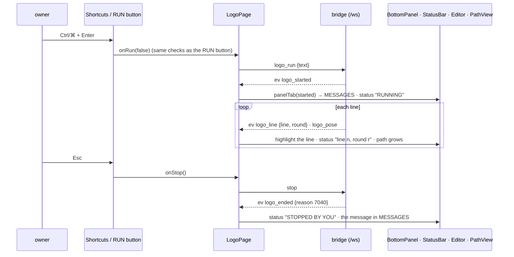

### 23.5 The camera pane
```mermaid
stateDiagram-v2
  [*] --> Off
  Off --> Connecting: cameraWanted() becomes true
  Connecting --> Showing: picture arrives (img load / first frame)
  Connecting --> Retry: error (no stream / "max 2 viewers")
  Showing --> Retry: stream breaks
  Retry --> Connecting: after 3 s, if still wanted
  Connecting --> Off: no longer wanted
  Showing --> Off: no longer wanted
  Retry --> Off: no longer wanted
```
- **The stream:** `http://<tank>:81/stream?t=<now>` into an ``, the same way as the Drive page (bridge LLD R3). Clearing `src` closes the connection. The pane is "wanted" when **HIDE** is not pressed, the window is 900 px or wider, and the page is visible (`visibilitychange`).
- **While it isn't showing:** the pane reads "NO CAMERA" or, after a refusal, "CAMERA BUSY (2 VIEWERS)", and tries again every 3 s while still wanted.
- **The sonar:** the latest `tf.dist_cm` (already read for the DISTANCE AHEAD stat), drawn on the picture's lower left; `--` when there is none.
- **HIDE / SHOW:** kept in `localStorage` `logo.cam` (`"off"` / absent). The path redraws to its new size (a `ResizeObserver` on the path box, which also covers window resizes).

### 23.6 Files, budget and tests
| File | Change |
|---|---|
| `web/logo.html` | the wide layout's CSS; the camera pane, bottom panel tabs and status bar markup; `Layout`, `BottomPanel`, `CameraPane`, `StatusBar`, `Shortcuts` |
| `web/logo.js` | `shortcut`, `panelTab`, `cameraWanted` (exported for Node) |
| `web/test/logo.test.js` | the three pure functions (below) |
| `web/test/browser_check_wide.js` | a Playwright check on the fake tank, 1280 × 800 and 1024 × 700 (below) |
- **Budget:** `/logo` is 20.1 KB gzipped today, against a 24 KB limit. This revision adds about 2–3 KB and stays under it; `pack_web.py` checks.
- **Node tests (`node --test`):**
  - `shortcut`: each of the four actions; Esc with repeat; Alt + Enter → null; a held Ctrl+Enter (repeat) → null; plain Enter → null; Ctrl+S and ⌘+S.
  - `panelTab`: a start opens MESSAGES; problems open PROBLEMS when idle and not picked; a pick sticks until the next start; problems while running don't switch.
  - `cameraWanted`: each of the three inputs alone turns it off.
- **Browser check (fake tank, injected WebSocket as in §21.9; Playwright `run_code`):**
  - at both sizes: the page doesn't scroll, with a 300-line program and 200 messages; the editor scrolls inside; STOP, RUN and STEP are inside the window;
  - Esc in the editor sends `stop`; Ctrl+Enter sends `logo_run`; F10 sends a step run; Ctrl+S saves;
  - `logo_started` opens MESSAGES; HIDE removes the camera `src` and the path grows;
  - at 390 px the page is as before: the N4 check `browser_check.js` still passes.
- **Tank check (owner, laptop, tank on the floor):** the 50 cm square run with Ctrl/⌘ + Enter while watching the camera and the path; Esc stops a `FORWARD 200` part-way; a second viewer (the phone's Drive page) still gets the camera.

### 23.7 Not in this revision
- Draggable dividers and resizable panes.
- Changing the phone layout.
- Camera controls (pan / tilt) on the Logo page: `LOOK` in a program does that.

### 23.8 As built (Plan N6, 2026-10-24; design-notes §149)
- **Files:**
  - `web/logo.js`: `shortcut`, `panelTab`, `cameraWanted`;
  - `web/logo.html`: the laptop CSS (grid areas), `applyLayout`, the bottom panel, the shortcuts and the camera pane;
  - `web/test/logo.test.js`: 52 Node tests;
  - `web/test/browser_check_wide.js`: the laptop check, at 1280 × 800, 1024 × 700, 1366 × 657 and 1280 × 600.
- **Size:** `/logo` is **22 990 B** gzipped (was 20 634 B; 24 KB budget). Bridge flash 44.6 %.
- **Rulings while drafting (the plan):**
  1. Only `#diags` and `#help` move between the layouts.
  2. `panelTab`'s problems event carries `running`.
  3. One camera note for "refused" and "no camera": a cross-port `` gets no reason.
  4. The running status shows the round, on the phone too.
  5. The camera box sets its own size, and the word buttons don't wrap.
- **The final review** (no Critical) changed:
  - **the camera shrinks in short windows** (`flex: 0 1 auto; max-height: 50%`), so at 1366 × 657 and 1280 × 600 the path and stats stay above the status bar;
  - **held keys:** every shortcut key is `preventDefault`ed, held ones too (no browser "save page" or F10 menu), but only Esc acts on a repeat;
  - **Esc's rate:** a held Esc sends at most 4 stops a second; the first press always sends at once;
  - **input-method keys** (`isComposing`, keyCode 229) are left to the IME, except Esc;
  - **after a dropped WebSocket** the camera stream starts again: a broken MJPEG stream keeps its last picture and fires no error.
- **Owner at the tank check:** the ☰ menu button moved to the far right of the laptop top bar (`.top { display: contents }`, `order`).
- **Tank check (2026-10-24, laptop, floor):**
  - the camera and sonar showed above the path;
  - the 50 cm square ran with ⌘ + Enter;
  - Esc stopped a `FORWARD 200` part-way.
- **Known, by design:** Esc is STOP for the whole tank, so it also stops a phone driver (STOP holds until they release the stick, design-notes §72).
- **Next (design-notes §148, Plan N7):** the page's text icons (WiFi bars, `● UNO`, `▶ RUN`) become Lucide icons from one shared icon file.


### 23.9 Icons (owner 2026-10-24, design-notes §148; bridge LLD R25, Plan N7)
The page's text icons become Lucide icons from the shared `web/icons.json` (bridge LLD R25.1 item 7):
- **WiFi:** Drive's five icons.
- **Battery:** by charge, with the volts; `plug` on USB.
- **Uno:** `cpu`.
- **Run controls:** RUN `play`, STEP `step-forward`, STOP `octagon-x`.
- **Camera:** HIDE `eye-off`, SHOW CAMERA `camera`; the sonar is `radar` + cm.
- **Navigation:** ‹ DRIVE `chevron-left`, ☰ `menu`.
- **Programs:** NEW / SAVE / RENAME / DELETE are `plus` / `save` / `pencil` / `trash-2`.
- The status line's ● dots stay text.
- **Budget:** 26 KB gzipped.

## 24. Revision N8 — the AI words (owner 2026-10-25, revised for Plan Z2a 2026-11-03; spec 8 Revision 2 §4.3–§4.4, design-notes §191, §197 — draft for review)

> Revision 1 of this section (2026-10-25) had `GOTO "ball` and a `"ball`-only checker. Replaced: no GOTO (§191); FIND / WANDER / EXPLORE / SETXY / AREA; loose names from the skill server; 7053 reworded, 7054 / 7055 new.

### 24.1 What changes
- **Every program, AI or not, runs on the ESP32's runner** (spec 8 §4.4). The AI engine answers and drives as the skill server (bridge LLD R26).
- **`logo/spec/words.yaml`** (level 2; `group: move` for the action words):

  | Word | Kind | Inputs | needs | Does / gives |
  |---|---|---|---|---|
  | `FIND` | command | thing | ai, encoders | looks round, searches, checks each maybe and stops ~30 cm from the thing |
  | `WANDER` | command | seconds 1–600 | ai, encoders | drives about for that long, keeping clear of things |
  | `EXPLORE` | command | — | ai, encoders | looks at all the floor it can reach, then stops |
  | `SETXY` | command | x cm, y cm (−1000..1000) | ai, encoders | drives to the point x right, y ahead of where the program started, round things |
  | `AREA` | command (`group: move`, a setting like `SPEED`) | metres 0–10 | ai | the next FIND / WANDER / EXPLORE / SETXY stay within that many m of here; 0 = anywhere |
  | `SEE?` | reporter | thing | ai | TRUE when the thing was seen in the last 0.5 s |
  | `HOWFAR` | reporter | thing | ai | the thing's distance from the camera in cm, −1 if not seen |

  - `SEE?` and `FIND` move down from level 3; `FOLLOW`, `HOWMANY` stay level 3 (later). All are reserved names.
  - A new input type **`thing`**: a quoted word (`"toy`) or anything giving a word at run time.
- **Errors (`words.yaml`):**
  - 7020 reworded: "{word} needs the AI helper (it runs on the laptop)."
  - 7050 "I couldn't find the {thing}."
  - 7051 "I lost sight of the {thing}."
  - 7052 "The AI helper stopped answering."
  - 7053 "I don't know what a {thing} is."
  - 7054 "I saw the {thing}, but it's outside the play area."
  - 7055 "I can't find a way there."
- **Loose names come from the skill server, not from `words.yaml`.** The engine's vocabulary can grow (teach it a word, Z2b), so a generated table would go stale.
  - The server's hello carries `things: [{word, names[]}]`, and `skill_things` replaces the list. Bounds: ≤ 48 words, ≤ 8 names each, ≤ 24 bytes per name, lower case.
  - `SkillHub` keeps the list. **`Caps`** gains `const ThingNames* things` (null = no server).
  - **The checker** resolves a literal thing: a known word or name → fine (the run sends the word itself); an unknown one → 7053 with the literal; no server → 7020 as today. A thing computed at run time is checked by the engine (`unknown_thing` → 7053).

### 24.2 Compiling and running
- **Questions (`SEE?`, `HOWFAR`) can't be `kSensor`:** their answer comes from the laptop and may take up to 300 ms. They compile to a new effect **`EffectKind::kAsk`** (thing, question) with a result:
  1. `VmOps::effect` yields `VmStatus::kEffect`;
  2. the runner enters **`RunState::kAsking`**, and `LogoController` sends `skill_ask`;
  3. `onAskAnswer(value)`, or 300 ms (FALSE / −1), pushes the value; the VM goes on.
  - **`OpCode::kResume`** carries the value back (`kAsk` is the first effect with a result).
  - In a `WAIT UNTIL SEE? "ball` (or any loop) a question is asked at most every 100 ms (~10 Hz): `RunController` holds a new question until 100 ms after the previous one went out (`kAskGapMs`); a lone question is not delayed. The 300 ms wait starts when it is sent.
- **`AREA n`** is a setting, like `SPEED`: the runner keeps `m_area_m` and the odometry pose where it ran (`m_area_at`). No message is sent.
  - The radius is kept in whole metres, rounded to the nearest, but a radius above 0 never rounds down to none: `AREA 0.4` is 1 m. Only `AREA 0` clears it.
- **Action words (`FIND`, `WANDER`, `EXPLORE`, `SETXY`)** are one effect **`EffectKind::kSkill`** (skill, args).
  - The runner enters **`RunState::kSkill`**, which behaves like `kMotion`: the program waits, STOP and the time limit apply.
  - `LogoController` asks `SkillHub` for the lease and sends `skill_start`. **Places are sent relative to the tank now**, from the bridge's odometry (§20), so the engine needs no frame of the run:
    - `SETXY x y` → `to: {fwd_cm, left_cm}` = the run-frame point minus the odometry pose, turned into the tank's heading;
    - an active `AREA` → `area: {r_m, fwd_cm, left_cm}`, its anchor turned the same way.
  - `onSkillEnd`:

    | End | Program |
    |---|---|
    | done | goes on |
    | not_found | 7050 |
    | lost | 7051 |
    | outside_area | 7054 |
    | no_way | 7055 |
    | blocked | 7024, or `m_blocked` for a `BLOCKED?` program, as a move |
    | unknown_thing | 7053 |
    | stale / server gone / the lease's deadman (no `skill_drive` for 300 ms) | 7052 |
    | STOP 7040, page 7046, owner 7045, stall 7044, link loss 7034… | as a move (`LogoController` maps a skill's drive end; the Uno's own deadman and link loss stay 7034) |

  - The lease's deadman is 7052, not 7034 (ruling 2026-11-03, design-notes §197): a laptop or WiFi loss is only ever seen as that deadman, and 7034 means the tank's body stopped answering.

- **While going** (`GO` running), an action word replaces the GO, as a motion word does (§22.2).
- **The simulator (preview):**
  - `SETXY` draws a dashed (uncertain) straight line to the point;
  - `FIND` / `WANDER` / `EXPLORE` end at an unknown place, so the rest of the preview path is dashed from where it was;
  - `SEE?` is FALSE and `HOWFAR` is −1, so a preview never assumes a thing;
  - `AREA` draws its circle.

```mermaid
stateDiagram-v2
  [*] --> Running
  Running --> Asking : SEE? / HOWFAR (skill_ask)
  Asking --> Running : answer, or 300 ms (FALSE / -1)
  Running --> Skill : FIND / WANDER / EXPLORE / SETXY (lease + skill_start)
  Skill --> Running : skill_done
  Skill --> Ended : skill_failed (7050-7055 / 7024) / STOP / page / owner / deadman / time
  Running --> Ended : as today
```

```mermaid
classDiagram
  class RunController {
    +tick(telem, now) RunOut
    +onAskAnswer(value) RunOut
    +onSkillEnd(end) RunOut
    -m_ask_deadline
    -m_area_m
    -m_area_at: Pose
  }
  class RunState { <<enum>> Idle Running Motion Waiting Asking Skill Paused Ended }
  class EffectKind { <<enum>> ... kGo kHold kAsk kSkill }
  class SkillCall { +skill: find|wander|explore|setxy +thing +seconds +to_fwd_cm +to_left_cm +area }
  class ThingNames { +resolve(name) word? +words() }
  class Caps { +encoders +ai +version +things: ThingNames* }
  class Checker { +check(src, caps) CheckResult }
  class LogoController {
    +tick(now)
    +setSkillHub(hub)
    +onSkillAnswer(fd, id, value, now)
    +onSkillEnd(fd, id, SkillEnd, now)
    +onClientClose(fd, now)
    -ask(action, now)
    -startSkill(action, now)
    -endLease(tell, why, motion, now)
    -Hooks.start_skill(fd, id, now, why&) / end_skill(EndReason, now)
  }
  class relative {
    <<logo/relative.h, free function>>
    +relative(pose, x_run_mm, y_run_mm) FwdLeft
  }
  LogoController ..> relative
  RunController --> RunState
  RunController ..> EffectKind
  RunController ..> SkillCall
  Checker --> Caps
  Caps --> ThingNames
  LogoController --> RunController
  LogoController ..> SkillHub : bridge LLD R26
  SkillHub --> ThingNames
```

### 24.3 Tests
- **Reading / errors** (`logo/spec/tests/`, `version: v1`):
  - each word parses with its inputs; `FIND` with no input → 7002; `WANDER 0` → 7025; `SETXY 10` → 7002;
  - with a test `things` list (`toy: [car, racing car]`): `FIND "car` fine, `FIND "dragon` → 7053;
  - with no skill server → 7020;
  - `DISTANCE` keeps its old meaning.
  - `model.py` / `emit.py` gain a `tank: {ai: true, things: {...}}` key for conformance cases.
- **Running** (`running.yaml`; the fake `World` gains answers and skill ends):
  - `IF SEE? "ball [ BEEP ]` with true → beep; with no answer in 300 ms → no beep;
  - `FIND "ball  BEEP` with done → beep, finished; with not_found → 7050; with outside_area → 7054;
  - with blocked and `BLOCKED?` → goes on;
  - STOP during a skill → 7040, and the lease ends;
  - `GO  WAIT UNTIL SEE? "ball  HOLD  FIND "ball` → go, asks each tick, hold, skill;
  - `FORWARD 50  SETXY 0 0` → `to` = 50 cm behind (fwd −50, left 0);
  - `AREA 2  RIGHT 90  FORWARD 30  WANDER 10` → area r 2 m, anchor 30 cm behind;
  - `AREA 0` clears it.
- **The generated files are regenerated** (`logogen write`), never edited.
- **Floor (owner, Plan Z2a):** from `/logo`, `AREA 2  FIND "ball  SOUND FANFARE`, `WANDER 30`, `SETXY 0 0` back to the start, and STOP during each.

- **As built (Plan Z2a, floor-checked 2026-11-04, design-notes §202):** all seven words run on the tank; a thing is one word in Logo (`FIND "car`), two-word names ("racing car") are for the `/ai` page's typing box and resolve on the engine; the lease's deadman ends the program 7052 "The AI helper stopped answering."

### 24.4 Plan Z2b additions (design-notes §198-§200, bridge LLD R27 — approved 2026-11-04)
- **A new error, 7056** (`words.yaml` errors): "I'm learning a new word - try again in a minute."
  - **Checker:** `Caps` gains `ai_learning` (from `SkillHub::learning()`); while it is true, every word with `needs: [ai]` gives 7056 at its call, instead of 7053 / 7020 (`needs` checked first: no skill server is still 7020).
  - **Runner:** a `skill_failed reason:"learning"` (a teach that started between the check and the word) ends the program with 7056, as the other reasons map (§24.2).
- **The `/ai` page's buttons are one-line programs** run with `logo_run` from the page's own `/ws` (bridge LLD R27.1): Find + thing + area → `AREA 2  FIND "toy` (the area chip off → no `AREA`); Wander → `WANDER 30`; Explore → `EXPLORE`; [Z2b-2] FIND on a remembered thing → `FIND "thing`; GO THERE on a named block → `SETXY x y` (bridge LLD R32, design-notes §211). Nothing else in the runner changes.
- **Tests:** a conformance case with `tank: {ai: true, learning: true}` → 7056 for `FIND "ball` and `SEE? "ball`; with `ai: false, learning: true` → 7020; a running case where the skill ends `learning` → 7056.

## 25. Revision L1 — lessons in `/logo` (owner 2026-11-05/06, design-notes §214, §216 — draft for review)

### 25.1 What changes
- **Five lessons are built into the tank, like the three examples** (§20.4): read-only programs; opening one puts it in the editor; a changed lesson is saved under a new name (`EXAMPLE` → "Examples cannot be changed - pick a new name." stays the message).
- **The explanation is in the program** as `;` comment lines at the top: what it does, what to watch, and a `Try this:` change. No new screen, no new page text.
- **The program list on `/logo`** gets a `[ LESSONS ]` section between `SAVED ON THE TANK` and `[ EXAMPLES ]`, in the fixed order below, each shown with its number (`1 back_to_start`). The name stays the plain program name.
- **No new words.** Each lesson uses today's level-1/2 words and the AI words (§24). A lesson that cannot be written well with them comes back to the owner before a word is added.
- **Safety: nothing new.** They are ordinary programs: STOP, the drive lease, the 300 s run limit (7041), FIND never targets a person, the play area (`AREA`).

### 25.2 The five lessons
The texts below are the design; the plan fixes the exact text against the checker (§25.4). **Superseded in detail by §25.5** (no `!` and no "to" inside SAY; the built texts are in `logo/program_names.cpp`). Every lesson that uses an AI word needs the AI helper running (7020 otherwise, as for any program).

| # | Name | What the child sees | Words |
|---|---|---|---|
| 1 | `back_to_start` | drives out a little L, says it is going back, drives back to where the program started; it never lands exactly on the spot (drift) | FORWARD, RIGHT, SAY, SETXY, SOUND |
| 2 | `where_is_my_ball` | looks round, searches, stops ~30 cm from the ball, says how many seconds it took; with a home a second run is quicker (it remembers) | AREA, FIND, SAY, TIMER, ROUND |
| 3 | `treasure_hunt` | finds the car, says so, finds the ball, says so, goes back to the start, plays a tune | AREA, FIND, SAY, SETXY, PLAY |
| 4 | `hot_and_cold` | **the tank stands still**; the child brings the ball closer; it beeps faster the nearer the ball is and plays a tune with "you found me!" within 40 cm (the camera is only sure that close, §215) | FOREVER, HOWFAR, IFELSE, BEEP, WAIT, PLAY, SAY, STOP, TO |
| 5 | `hot_and_cold_hunt` | the ball is hidden; the tank wanders 2 s, stops and listens (beeps by how near the ball is), wanders again; it ends with "found you!" within 50 cm, or at the 300 s limit | AREA, FOREVER, WANDER, HOWFAR, IFELSE, BEEP, SOUND, SAY, STOP, TO |

- **Lesson 5's limit, said in the lesson:** a program does one thing at a time, so it cannot beep *while* WANDER drives. Beeping while driving needs two things running at once - a much bigger change to Tank Logo, not in this slice.
- **Lesson 3 and the 300 s limit:** two FINDs can take longer than 5 minutes; `AREA 2` keeps the searches small, and the comment says the program ends by itself after 5 minutes (7041).
- **Lesson 2's time:** `SAY ROUND TIMER` if SAY takes a number; if the checker says no, it says "found it!" only (SENTENCE is level 3, reserved in v1 - no new word for this).

Draft of lesson 4 (the shape of all five):
```
; Lesson 4 - hot and cold
; The tank stands still. Bring the ball slowly towards it.
; The nearer the ball, the faster it beeps.
; Try this: change 40 to 60 - it finds you from further away.
TO HOTCOLD :cm
  IFELSE :cm < 0 [ WAIT 0.5 ] [
    IFELSE :cm < 40 [ PLAY [ C4 E4 G4 C5 2 ] SAY [ you found me! ] STOP ] [ BEEP WAIT :cm / 100 ]
  ]
END
FOREVER [ HOTCOLD HOWFAR "ball ]
```

### 25.3 Firmware and page
- **`logo/program_names.{h,cpp}`:** `Example` gains `bool lesson`; `kExamples` lists the five lessons first, in order, then the three examples. A new `constexpr uint8_t kBuiltInCount = 8` in the header (a `static_assert` in the .cpp keeps it equal to the table).
- **`net/program_store`:** `ProgramInfo` gains `bool lesson`, filled from the table; save / delete still refuse every built-in name (`findExample` covers lessons).
- **`net/logo_http.cpp` `doList`:** the list buffer is `kMaxPrograms + kBuiltInCount` (today `+ 3`); each item adds `"lesson":true|false`. Built-ins keep `"example":true`, so the editor's read-only rules do not change.
- **`web/logo.js` `programSections(progs)`** (pure, tested in `logo.test.js`) splits the list into saved / `[ LESSONS ]` / `[ EXAMPLES ]`, a lesson's label being its number and name; **`web/logo.html` `showProgs`** draws from it. The page budget has ~2.1 KB free (30 583 of 32 768 B); this costs about 150 B.

```mermaid
classDiagram
  class Example {
    +const char* name
    +const char* src
    +bool lesson
  }
  class program_names {
    +kBuiltInCount = 8
    +exampleCount() uint8_t
    +example(i) Example
    +findExample(name) Example*
  }
  class ProgramInfo {
    +char name[25]
    +uint16_t bytes
    +bool example
    +bool lesson
  }
  class ProgramStore {
    +programList(out, cap) uint8_t
    +programLoad(name, buf, cap) int
    +programSave(name, src) StoreStatus
  }
  class LogoHttp {
    +doList()  GET /logo/programs
    +doLoad()  GET /logo/programs/name
  }
  class LogoPage {
    +showProgs()  SAVED / LESSONS / EXAMPLES
    +openProg(name)
  }
  program_names --> Example
  ProgramStore --> program_names
  ProgramStore --> ProgramInfo
  LogoHttp --> ProgramStore
  LogoPage --> LogoHttp : JSON programs[] with lesson
```

```mermaid
sequenceDiagram
  participant C as Child on /logo
  participant P as logo.html
  participant H as LogoHttp
  participant S as ProgramStore
  P->>H: GET /logo/programs
  H->>S: programList()
  S-->>H: 5 lessons, 3 examples, saved programs
  H-->>P: {"programs":[{"name":"back_to_start","example":true,"lesson":true}, ...]}
  P->>P: showProgs(): SAVED, [ LESSONS ] 1..5, [ EXAMPLES ]
  C->>P: taps "4 hot_and_cold"
  P->>H: GET /logo/programs/hot_and_cold
  H-->>P: the text (comments + program), read-only
  C->>P: RUN (or changes 40 to 60, SAVE AS my_hot_cold)
```

### 25.4 Tests
- **Native (`test_logo_box`):** `exampleCount() == kBuiltInCount == 8`; the first five are lessons, in order, the last three not; every built-in passes `checkProgram` with `Caps{ai = true, things = a test list with ball and toy (car)}`; `findExample("treasure_hunt")` found; saving under `hot_and_cold` → `kExample`.
- **Running (`running.yaml`, the fake world's HOWFAR answers, §24.3):** lesson 4 with HOWFAR 120 then 30 → beeps, then the tune, the SAY and the end; with HOWFAR −1 → only waits.
- **Page (`logo.test.js`, `programSections`):** a list with a lesson, an example and a saved program shows `SAVED ON THE TANK`, `[ LESSONS ]` with `1 back_to_start`, then `[ EXAMPLES ]`.
- **On the tank (owner):** each lesson opens, reads well, and runs from `/logo`; lesson 4 by hand with the ball; lesson 5 with the ball hidden ~1.5 m away.

### 25.5 As built (Plan L1, 2026-11-06; tank check pending)
- **Wording the reader forced:** inside `SAY [ ]` the word `to` is read as `TO` (7017) and `!` is not a character Tank Logo reads (7016). So lesson 1 says "going back now", and the "found ..." lines have no `!` ("you found me", "found you", "found the car").
- **Lesson 2 keeps the time:** `SAY ROUND TIMER` is accepted; it says "found it in", the seconds, "seconds".
- **Sizes:** the five lessons are 1 757 B of text (strlen + 1 each, measured on the host); the bridge image 1 413 779 B (46.9 %); `/logo` 30 762 of 32 768 B gz (+179 B).
- **Final review fixes (Opus, 2026-11-06):** a program saved before the update under a lesson's name would hide behind the lesson for ever - at mount it is renamed to the first free `<name>_2` .. `_9` (`renameShadowed`, logged); lesson 4 says "roll the ball slowly along the floor" (HOWFAR places it from where it meets the floor); lesson 2 says "if the tank has a home"; `test_logo_box` checks every built-in is found by its own name (save / remove refuse it - `program_store` is not in the native build, so the refusal itself is checked on the tank); I1 → §25.6.
- **Tests:** `test_logo_box` checks all eight built-ins with the AI helper's caps (on failure it prints the checker's first code, line and column); two `running.yaml` cases run lesson 4's code (120 cm then 30 cm; not seen, not seen, 30 cm); `logo.test.js` tests `programSections`; the stand-in tank (`fake_tank.py`) lists two lessons, checked in a browser.

### 25.6 The STOP word ends as done (owner 2026-11-06, design-notes §216; the L1 final review's I1)
- **Why:** lessons 4 and 5 end their happy path with `STOP` ("you found me"); the page then said "Ended (7040) on line 3: Stopped by you." - an error, after the child won.
- **Change:** the runner ends a program that reaches the `STOP` word as **finished** (code 0, the page shows "Done"), exactly like a program that runs to its end; every ending already stops the tank and gives the drive back (`LogoController`), so nothing about stopping changes. **7040 "Stopped by you." stays for the STOP key** (the page's button, the phone's STOP, a skill ended by STOP).
- **Where:** `RunController` (`VmStatus::kStop` → `end(0)`); `running.yaml` "STOP ends the program" and lesson 4's two cases now end `finished`; `test_logo_run` `test_stop_word_ends_as_done`. Spec 5 §12.5 ("STOP ends the whole program and stops the tank") still holds.

## 26. Revision N9 — `LAUNCH`: a second part that runs alongside (owner 2026-11-07, design-notes §219 — draft for review)

### 26.1 Why
- Lesson 5 (hot and cold hunt) had to go "WANDER 2, stop, listen, WANDER 2": a program does one thing at a time, so it cannot beep while WANDER drives. On the floor (2026-11-07, room9) each `WANDER 2` stood 1 s and drove ~1 s - the tank moved one second in three, stop-and-go. Owner: "let's do C (two things at once) - why test something that we will discard".
- **Decided (owner):** a launched part may never move the tank: **only the main program moves the tank.**

### 26.2 The word
| Word | Kind | Inputs | Level | Does |
|---|---|---|---|---|
| `LAUNCH` | command | block | 2 | starts the block as a **second part** that runs alongside the main program; the main program goes on at once |

```
TO LISTEN :cm
  IFELSE :cm < 0 [ WAIT 0.5 ] [
    IFELSE :cm < 50 [ SOUND SUCCESS SAY [ found you ] STOP ] [ BEEP WAIT :cm / 200 ]
  ]
END
LAUNCH [ FOREVER [ LISTEN HOWFAR "ball ] ]
AREA 2
WANDER 120
```

### 26.3 Rules
1. **Only the main program moves the tank.** Inside a `LAUNCH` block, and in every word of your own it calls (followed through), no word that moves the tank or its camera or sets where it may go: the `move` / `turn` groups (`FORWARD` … `PIVOT`, `GO`, `HOLD`, `HOME`, `SPEED`), `LOOK`, and the AI action words (`FIND`, `WANDER`, `EXPLORE`, `SETXY`, `AREA`). The checker refuses it before the run: **7057** "{word} moves the tank - only the main program can do that, not LAUNCH." (line and column of the word; through a word of your own: at that word's call inside the block).
2. **Allowed inside:** sounds (`BEEP`, `SOUND`, `PLAY`), `LED`, `SAY`, `WAIT` / `WAIT UNTIL`, control (`REPEAT`, `FOREVER`, `IF`, `IFELSE`, `WHILE`, words of your own), every reporter including `SEE?`, `HOWFAR`, `DISTANCE`, `TIMER`, and `STOP`.
3. **One launched part at a time.** A `LAUNCH` while one runs ends the program with **7058** "Only one LAUNCH can run at a time." (run time, its line).
4. **Endings:** the launched part ending on its own is fine (the main goes on). The main program ending ends the launched part (the program is finished). `STOP` in either part ends **both**, as done (§25.6). A run-time error in either ends both with that error and its line. The STOP key, the run limit (7041), the deadman and every safety stop end both as today.
5. **Turns:** the runner gives each part a slice in turn; a part waiting (a motion, a skill, a `WAIT`, a question's answer, a tune) lets the other run. No shared state: Tank Logo v1 has no global variables, only words' inputs.
6. **Sounds:** one buzzer - a sound from either part replaces the one playing (as on the tank today).
7. **STEP:** stepping is the main program's; while the main is paused the launched part is paused too.
8. **The planned path** (`Simulator`) ignores the launched part: it cannot move the tank.
9. **Inputs and REPCOUNT** (final review): a LAUNCH inside a word of your own sees a copy of that word's inputs as they were at LAUNCH; REPCOUNT inside the block counts the block's own loops. `OUTPUT` inside the block is 7059.

### 26.4 Runner (ESP32)
- `Compiler`: the `LAUNCH` block is compiled as its own code entry; `LAUNCH` becomes `OP_LAUNCH <entry>`.
- `Vm`: unchanged per part; the `RunController` holds **two** `Vm`s over one `Program` (main, launched), each with its own pending effect (`m_pending[2]`), wait timer and question; `OP_LAUNCH` starts the second at the entry (7058 if it runs).
- Each `tick`: run the main part's slice unless it waits; then the launched part's unless it waits; an ending in either ends both. The launched part never produces a motion effect (the checker guarantees it; the runner also refuses one, 7057, as a guard).
- Events to the page: `logo_line` gains `part` (0 main, 1 launched); `logo_ended` unchanged.
- Memory: a second `Vm` (its stacks) - measured in the plan.

```mermaid
classDiagram
  class Compiler { +compile(ast) Program  LAUNCH block -> own entry, OP_LAUNCH }
  class Checker { +check(ast, caps)  7057 motion inside LAUNCH (followed through words) }
  class Vm { +start(entry) +run(budget, sensors) VmStatus }
  class RunController {
    -Vm m_vm[2]
    -Pending m_pending[2]
    +tick(telem, now) RunOut
    -slice(part) 
  }
  class LogoPage { +line marker per part }
  RunController --> Vm : main, launched
  Compiler --> Vm : Program, entries
  Checker ..> Compiler : checked first
  RunController --> LogoPage : logo_line part
```

```mermaid
sequenceDiagram
  participant M as main part
  participant L as launched part
  participant R as RunController
  participant E as engine
  M->>R: LAUNCH [ ... ]  (part 1 starts)
  M->>R: WANDER 120 (skill: waits)
  loop while WANDER drives
    L->>R: HOWFAR "ball (question)
    R->>E: skill_ask
    E-->>R: 85 cm
    L->>R: BEEP, WAIT 0.4
  end
  L->>R: SOUND SUCCESS, SAY, STOP
  R->>R: end both (done); the skill's lease ends, the tank stops
```

### 26.5 Tests
- **Reading / checking** (`logo/spec/tests/`): `LAUNCH [ BEEP ]` fine; `LAUNCH [ FORWARD 10 ]` → 7057 at FORWARD; a word of your own with `WANDER` called inside `LAUNCH` → 7057 at the call; `LAUNCH [ LOOK LEFT ]` → 7057; `LAUNCH` with no block → 7002.
- **Running** (`running.yaml`, the fake world): `LAUNCH [ BEEP BEEP ]  FORWARD 50` → `does` interleaved as the runner takes turns (exact order pinned by the test); `LAUNCH [ FOREVER [ BEEP WAIT 1 ] ]  WAIT 2.5` → beeps while the main waits, finished at 2.5 s; `LAUNCH [ STOP ]  FOREVER [ WAIT 1 ]` → finished; `LAUNCH [ BEEP ] LAUNCH [ BEEP ]` → 7058; lesson 5 rewritten (HOWFAR answers 120, 80, 30 during `WANDER`) → beeps, the tune, "found you", finished, the skill ended.
- **Native:** two `Vm`s fit (sizes printed); the guard refuses a motion effect from part 1.
- **Page (`logo.test.js`):** a `logo_line` with `part: 1` marks the second line, not the main one.
- **Generated files** regenerated by `logogen write`, never edited.
- **Floor (owner):** lesson 5 with LAUNCH - smooth wandering while it beeps; STOP during it.

### 26.6 Lesson 5 changes
`hot_and_cold_hunt` becomes the program in §26.2 (`WANDER 120` with a launched listener) and its comment teaches the new word: "LAUNCH starts a second part that runs alongside - it may beep and ask, but only the main program moves the tank." The `Try this:` line: "change 50 to 80 - it says found from further away".

### 26.7 As built (Plan N9, 2026-11-07; tank check pending)
- **Checker:** `checker_launch.cpp` - `logogen` emits `WordSpec::moves` (the `move` / `turn` groups and `LOOK`); words of your own are marked moving by a fixed point (recursion ends); one 7057 per LAUNCH, checked once the rest of the program is clean.
- **Compiler:** `LAUNCH` → `EFFECT kLaunch` (its block's entry in the instruction, `Effect::entry`), `JMP` over the block, the block, `HALT`.
- **Runner:** `run_parts.cpp` - a `Part` per `Vm` (state, wake, question, last effect); **the parts take turns going first** (with the main part always first the launched part starved: `LAUNCH [ BEEP BEEP ]  FD 50` finished before a beep); one question at a time across parts (the bridge keeps one pending question), its answer to the part that asked; `ready()` for hosts and tests (skip time only when no part can run now); the guard ends 7057 on a moving action from part 1; `waitsForMotion()` shared from `effects.h`.
- **Tank / page:** a second `logo::Vm` in the logo worker (10 112 B on the host); `logo_line` carries `part`; `/logo` marks the launched line with a flow-coloured right edge (`runBar` `line2`), never NEXT; `/logo` 30 927 of 32 768 B gz; flash 47.0 %.
- **Tests:** 8 conformance cases (7057 direct, through one and two words, LOOK, AREA, nested; recursion fine; 7002), 2 compiler, 6 running (interleaving pinned from the runner), 3 run (the guard, the STOP key ends both, STEP pauses both - each proved by switching its rule off), ws_json, 2 page.
- **Lesson 5** per §26.2, its comments teach LAUNCH.
- **Final review fixes (Opus, 2026-11-07):**
  - **Inputs:** a LAUNCH inside a word of your own gets **a copy of that word's inputs as they are at LAUNCH** (`Vm::inheritInputs`) - `TO T :n  LAUNCH [ SAY :n ] …  T 42` says 42 (it read stack junk, 0).
  - **7059** "OUTPUT can't be used inside LAUNCH - the launched part gives nothing back." at check time; as a guard a return from the launched part's bottom frame ends 7059 (it jumped to the program's start).
  - **REPCOUNT inside LAUNCH** counts the block's own REPEAT / FOREVER (0 outside them) - the block is its own part (rule added to §26.3).
  - The main part goes first at every run's start (it depended on the last run's ticks); the launched part's end sends `logo_line {part: 1, line: 0}` and the page clears its marker; each LAUNCH has its own RANDOM numbers; the logo worker's size comment.
- **After the floor run:** lesson 5 keeps `AREA 2` (the safe start for a child) and says how to search a big closed room ("change AREA 2 to AREA 0"); on the floor the toy lay outside the 2 m circle until the area was off (design-notes §219).

## 27. Revision G1 — the game words (Spec 10; design-notes §223-§224, bridge LLD R34, AI engine LLD §28 — approved 2026-11-09)

### 27.1 What changes
- **`logo/spec/words.yaml`** (level 3, `needs: [ai, encoders]` for the action words; generated as every word, `logogen write`):

  | Word | Kind | Inputs | Does / gives |
  |---|---|---|---|
  | `FACE` | command | person | turns the camera (or the tank, on the spot) to face the person for a moment |
  | `ESCAPE` | command | person, cm 20–100 | moves about that far away from the person - backwards facing them over floor it trusts, else it looks first; stays still if there is no way |
  | `FOLLOW` | command (reserved today: `needs: [ai]`, input `any` - becomes `[ai, encoders]`, input `person`) | person, seconds 1–60 | comes after the person, stopping at the follow distance - never close |
  | `CAUGHT?` | reporter | — | TRUE while the person has caught the tank (it stopped and beeped) |
  | `SEE?` / `HOWFAR` | reporters (today's) | thing **or person** | for the person, inside a game: seen in the last 0.5 s / the distance from the tank's front in cm, −1 if not seen |

- **A new input type `person`:** a quoted word from a short fixed list of the game's person words (`"baby`, `"person`,
  `"kid` - in `words.yaml`, so the checker knows them without the engine). It is **never** a `thing`: `FIND "baby`,
  `SETXY`, `GO` keep refusing people (7053, as today), and `FACE "toy` is refused (7062 "FACE, ESCAPE and FOLLOW are
  for a person in a game.").
- **Errors (`words.yaml`):**
  - 7060 "The game can't start - the tank's speed limit isn't set." (no envelope ack / the cap not measured)
  - 7061 "The game needs the seeing test first."
  - 7062 "FACE, ESCAPE and FOLLOW are for a person in a game."
  - Caught is **not** an error: a word running when caught ends normally; `CAUGHT?` tells the program.

### 27.2 The game flag (Spec 10 S8, corrected)
- **The checker marks a program a game run** when any of `FACE`, `ESCAPE`, `FOLLOW`, `CAUGHT?`, or `SEE?` / `HOWFAR`
  with a person input, appears **anywhere** in it - the main part, every `TO` body, every `LAUNCH` part (reachable or
  not: a static rule, simple to explain and impossible to dodge). `CheckResult` gains `game: bool`; the run sends it
  with `logo_run` (bridge LLD R34.2), so game mode is on **before the first motion**.
- **A person computed at run time** (`FIRST [baby]`, a procedure input) is resolved by the runner: in a game run it
  must be one of the person words; in a run not flagged as a game any person word reaching a `thing` input is refused
  7053 (today's rule) - so a program cannot become "a game" without the checker seeing it.

### 27.3 Backing up in a game (owner, 2026-11-09: "allow via the map")
- `BACK n`, a negative `MOVE`, a backward `ARC` run in a game only after the engine says the floor behind is trusted
  (bridge LLD R34.2, `back_ok`); otherwise the word ends without moving and without an error - the game goes on.
- Everything else runs as written, under the bridge's keep-out (R34.2): `FORWARD` towards the person ends early
  ("kept away", no error), turns wait until the person is beyond 35 cm, and nothing moves forward or turns while the
  person has been unseen 1 s (except `FACE`'s look-round).

### 27.4 The lesson and the game program
- **Lesson 6 "Chase with the baby"** (Tank Logo LLD §25's lessons): the ready-made program with a short explanation
  and something to change (the distances), linked from `/ai`'s GAMES card ("📜 how it works ›", design-notes §224):

  ```
  TO BABYGAME :escape_at :follow_at :minutes
    REPEAT :minutes * 60 [
      IFELSE CAUGHT? [ WAIT 3 ] [
        IFELSE HOWFAR "baby < :escape_at [ ESCAPE "baby 40 ] [
          IF HOWFAR "baby > :follow_at [ FOLLOW "baby 2 ] ]
        FACE "baby ] ]
  END
  BABYGAME 70 100 5
  ```
  (`REPEAT :minutes * 60` over ~1 s steps - the builder may use `TIMER` instead; the game's length is the program's.)

### 27.5 Classes and flow
```mermaid
classDiagram
    class Checker {
      +check(src, caps) CheckResult
      -markGame(ast) bool
    }
    class CheckResult {
      +ok: bool
      +diags: list
      +game: bool
    }
    class PersonWords {
      <<generated from words.yaml>>
      +isPerson(word) bool
    }
    class RunController {
      +start(prog, game: bool)
      -personAtRuntime(word) Status
    }
    class GameMode {
      <<bridge LLD R34>>
    }
    Checker --> CheckResult
    Checker ..> PersonWords
    RunController ..> PersonWords
    RunController ..> GameMode : startRun(game)
```
```mermaid
sequenceDiagram
    participant Pg as /logo or /ai START
    participant C as Checker
    participant R as RunController
    participant G as GameMode (bridge)
    Pg->>C: check BABYGAME
    C-->>Pg: ok, game = true
    Pg->>R: logo_run (game)
    R->>G: startRun(game)
    alt no engine / people false
        G-->>R: refuse 7061
    else cap not measured / no ack
        G-->>R: refuse 7060
    else armed
        G-->>R: go
        R->>R: run the program under the keep-out
    end
```

### 27.6 Tests
Conformance cases (generated): the game flag from a word in a `TO` body, in a `LAUNCH` part, unreached; `FACE "toy` → 7062; `FIND "baby` → 7053; a computed person in a non-game run → 7053 at run
time; `CAUGHT?` false outside a game. Running cases: a caught word ends without an error and `CAUGHT?` is TRUE; 7061 /
7060 at start.

### 27.7 As built so far (Plan G1, 2026-11-09)
- `CAUGHT?` is **level 2** (not 3): the tank's checker runs Logo v1 (`Caps::version` 1), which refuses every level-3
  word (7030) - FACE / ESCAPE / FOLLOW (Plan G3) are level 2 too.
- The game flag: `CheckResult::game` → `Program::game` (from `CAUGHT?` anywhere, TO bodies and LAUNCH parts
  included); `RunTelem::caught` feeds `CAUGHT?`; a game run's limit `game_run_time_s` 900 with **7063** "The game's
  time limit (15 minutes) is up." (7041's text fixes 5 minutes); 7060 "... isn't set or didn't reach the tank.",
  7061 as designed; 7062 stays Plan G3's.

### 27.8 As built (Plan G3, 2026-11-10, branch `plan-g3-game-words`)
- **`words.yaml`:** the input type `person` and the top-level `person_words: [baby, person, kid]` (not a preset - a
  preset is a bare reserved word, a person is quoted; generated as `gen::kPersonWords`); `FACE` (person), `ESCAPE`
  (person, cm 20-100), `FOLLOW` (person, seconds 1-60; moved from its level-3 reservation), all level 2,
  `needs: [ai, encoders]`; error 7062. `grammar.md` §5 lists `thing` and `person`.
- **Checker:** `FACE` / `ESCAPE` / `FOLLOW` / `CAUGHT?` anywhere make a game run (`isGameWord`); a written word at a
  person place that is not a person word is 7062 (`checkPerson`); a person word at a thing place is allowed only for
  `SEE?` / `HOWFAR`, which then make the program a game (`personAsked`) - anywhere else (`FIND "baby`) it is 7053,
  whether or not the AI helper's list has arrived.
- **Runner:** `SkillKind` gains `kFace`, `kEscape`, `kFollow` (the mapping of the AI and game words moved to
  `effects_ai.cpp`, the mapper's class to `effects_mapper.h`, for the 400-line rule); a computed person that is not a
  person word is 7062, a person word reaching a thing in a run that is not a game is 7053. **Owner-visible call:** a
  game word that ends `lost` or `no_way` ends the word, not the program (the program decides - lesson 6 waits and
  looks again); `caught` ends the word too (`SkillEnd::kCaught`). `FIND` keeps 7050 / 7051.
- **Lesson 6 `chase_with_the_baby`** (`kBuiltInCount` 9): `TO CHASE :cm :near :far` (unseen: `WAIT 1`; nearer than
  `:near`: `ESCAPE "baby 40`; farther than `:far`: `FOLLOW "baby 2`; then `FACE "baby`), `TO BABYGAME :near :far
  :minutes` with `WHILE TIMER < :minutes * 60 [ IFELSE CAUGHT? [ WAIT 3 ] [ CHASE HOWFAR "baby :near :far ] ]`, ending
  `BABYGAME 70 100 5`. `/logo#name` opens a program (the `/ai` GAMES card's lesson link).

### 27.9 7052 split in three (design-notes §236, owner 2026-11-11)
- `words.yaml` errors: **7064** "The AI helper couldn't do that just then." - `SkillEnd::kRefused`, the engine's
  `skill_failed` reason `stale` (`ws_codec`'s reason table); **7065** "The game is holding still - press STOP
  first." - `GameController::onRunStart` while held; **7066** "The game stopped: no news of where the person is.
  Press STOP to go on." - held during a run. **7052** keeps the lease's deadman, no skill server and the server's
  link closing.
- `SkillEnd` gains `kRefused` before `kCaught` (`kBySkillEnd` 7064); a game word's `kRefused` ends the program as any
  word's does.
- Tests: `test_ws_codec` `stale` → `kRefused`; `test_logo_runner` a refused skill ends 7064; `test_game_controller`
  start while held 7065, held during a run 7066; the deadman still 7052.
