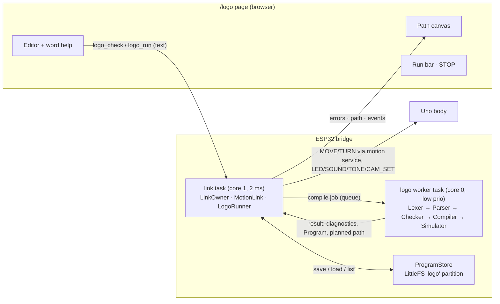
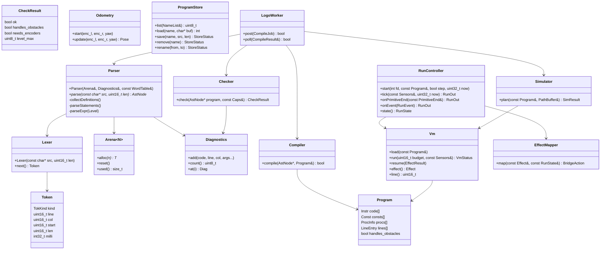
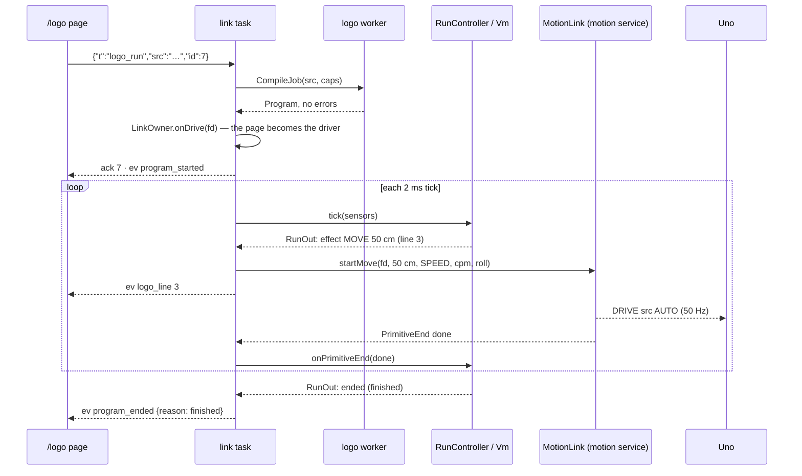
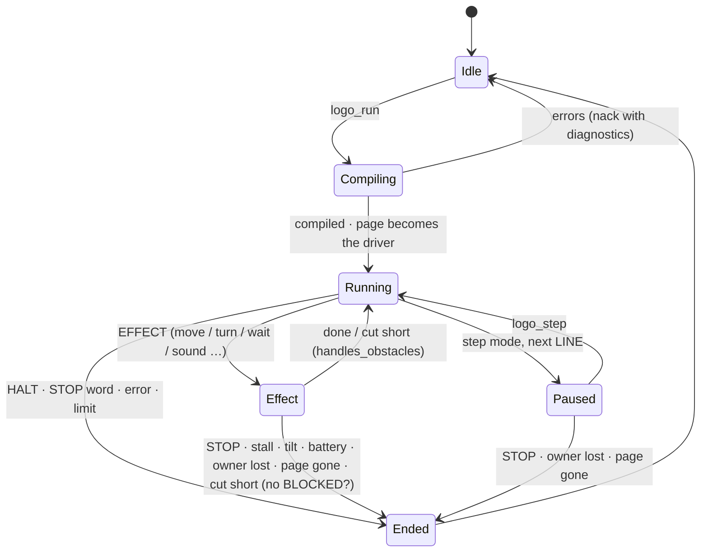
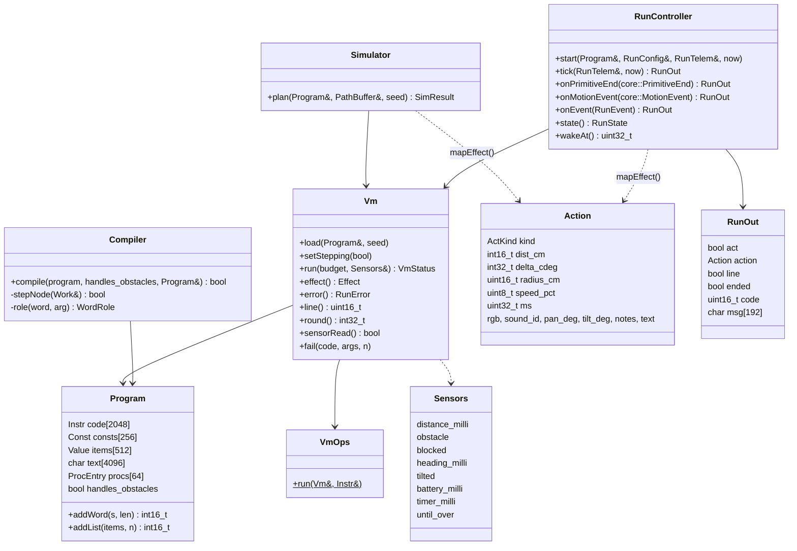
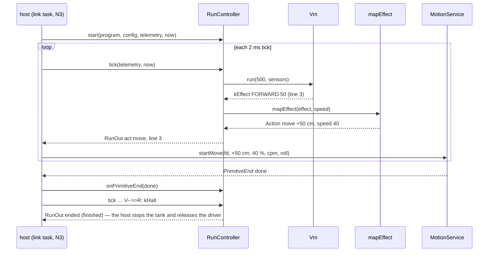
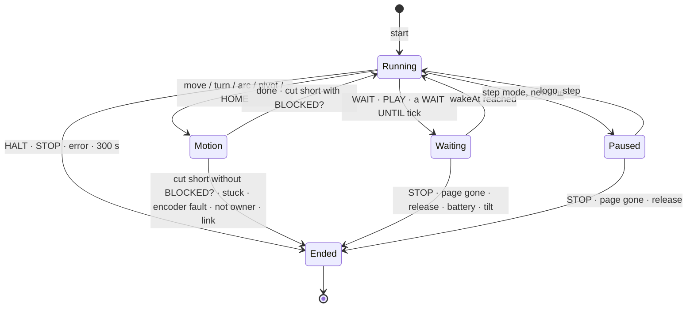
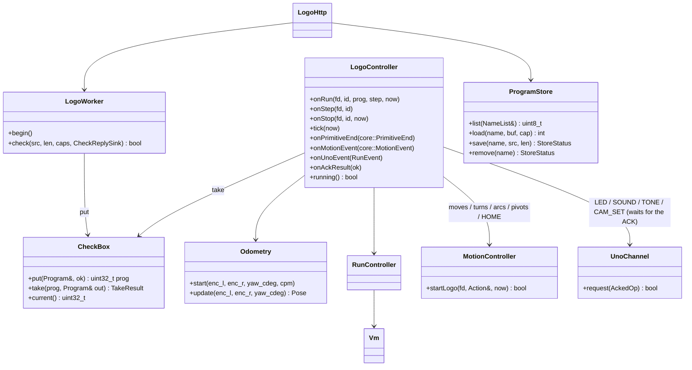

# Tank Logo — Low-Level Design (v1)

Status: **APPROVED (owner, 2026-10-19)** · Date: 2026-10-19
Spec: `docs/superpowers/specs/2026-10-11-05-tank-logo-design.md` (Revision 2) · Language: `logo/spec/grammar.md`, `logo/spec/words.yaml`, `logo/spec/tests/` · UX: `docs/design/bridge-ux.md` §2, screens `docs/design/stitch/15-…`, `16-…` · Decisions: design-notes §79–§85 · Bridge: `docs/lld/esp32-bridge-lld.md` (motion service R4/R7/R8, ownership R2.7/R9.6/R10, hidden pages R11)

## 0. Scope of v1
- **In:** levels 1–2 of `words.yaml`, plus `OUTPUT`, plus **list literals** (constants written in the program, grammar.md §1); the reader (lexer, parser, checker, compiler), the runner, the planned path (simulator) and the driven path (odometry), saved programs on the tank, the WebSocket API, the `/logo` page (laptop + phone).
- **Not in v1:** run-time list building (`FIRST LIST MAP …` → `PROGRAM_7030`), vision words (AI programs, `PROGRAM_7020`), events (`WHEN`), running saved programs from the IR remote. v1.1 adds the list pool + garbage collector without changing the instruction format of §7 (list values already have a tag).
- **No new firmware on the Uno and no new safety rules.** Every motion step is an ordinary bridge primitive (MOVE / TURN / arc / pivot) or Uno command (LED, SOUND, TONE, CAM_SET); the obstacle brake, deadman, link-loss stop, stall, tilt and battery rules stay exactly as they are.
- **Implementation:** Plan N1 (reader) `docs/superpowers/plans/2026-10-19-plan-n1-logo-reader.md` — done when all v1 conformance cases pass (done 2026-10-19: 67 / 67, design-notes §88). Plan N2 (runner, host-tested) `docs/superpowers/plans/2026-10-19-plan-n2-logo-runner.md` — §19. On the tank (worker, controller, HTTP + WebSocket, saved programs, odometry): Plan N3 — §20 (draft for the owner). Page: Plan N4.

## 1. Where it runs

- **Reading and compiling** run in a separate low-priority **logo worker task** (core 0), so a long program never delays the link task's 2 ms tick (heartbeats, deadman, STOP fast path). A job is the source text + the tank's capabilities; the result goes back through a queue.
- **Running** happens in the **link task**: the runner advances the program in small slices (§8) on each tick, so it sees STOP, ownership changes and telemetry in the same place the motion service already does.
- **The page** only edits, shows and asks. It never interprets Logo.

## 2. Modules and files
| File (firmware/esp32) | Class | Pure / host-tested | Job |
|---|---|---|---|
| `src/logo/token.h`, `lexer.h/.cpp` | `Lexer`, `Token` | yes | text → tokens (grammar.md §2), MINUS vs NEG |
| `src/logo/ast.h`, `arena.h` | `AstNode`, `Arena` | yes | syntax tree in a fixed arena |
| `src/logo/parser.h/.cpp` | `Parser` | yes | pass 1 (definitions) + pass 2 (iterative, explicit stack) |
| `src/logo/checker.h/.cpp` | `Checker` | yes | scope, value/command use, ranges, needs, tail positions, `BLOCKED?` |
| `src/logo/diag.h/.cpp` | `Diagnostics` | yes | error list, messages from the generated templates |
| `src/logo/compiler.h/.cpp` | `Compiler`, `Program` | yes | tree → instructions (§7) |
| `src/logo/vm.h/.cpp` | `Vm`, `Value`, `Frame` | yes | runs instructions, stops at effects (§8) |
| `src/logo/effects.h/.cpp` | `EffectMapper` | yes | an effect → a bridge action, units and signs (§10) |
| `src/logo/run_controller.h/.cpp` | `RunController` | yes | states, slices, ends, step mode (§9) |
| `src/logo/simulator.h/.cpp` | `Simulator` | yes | planned path with ideal moves (§11) |
| `src/logo/odometry.h/.cpp` | `Odometry` | yes | driven path from encoders + heading (§11) |
| `src/logo/printer.h/.cpp` | `ReadsPrinter` | yes (tests) | the `reads` notation of `logo/spec/tests/README.md` |
| `src/logo/generated/words.h` | — | generated | word table, presets, limits, error templates from `words.yaml` |
| `src/net/logo_worker.h/.cpp` | `LogoWorker` | no (FreeRTOS) | the compile task + its queues |
| `src/net/program_store.h/.cpp` | `ProgramStore` | no (LittleFS) | saved programs (§12) |
| `src/net/logo_link.cpp` | — | no | WebSocket commands / events in the link task (§13) |
| `web/logo.html`, `web/generated/words.json` | — | page test | the editor page (§14) |
| `scripts/gen_logo.py` | — | — | `words.yaml` → `words.h` + `words.json`; `tests/*.yaml` → `test/test_logo_conformance/cases.h` (§15) |

**As built (Plan N1, reader only):** tokens live in `lexer.h` (no `token.h`); the tree and its fixed pool are `Node` / `NodePool` in `ast.h` (no `arena.h`); word lookups (`findWord`, presets, reserved words, `editDistance`) are in `words.h/.cpp`; the parser is one class in four files by concern — `parser.cpp` (pass 1, the frame loop, frames, lookups), `parser_stmt.cpp` (statements, calls and their inputs, note lists), `parser_expr.cpp` (operator precedence, operands, closers), `parser_diag.cpp` (messages, minus hint, recovery); the printer is free `printReads(...)` in `printer.h/.cpp`. The generator is `logogen` (uv project in `logo/`, `uv run logogen write|check`), not `scripts/gen_logo.py`; the bridge build runs `logogen check` as a pre-script.

## 3. Classes

All `src/logo` classes are pure C++17 with fixed capacities (no heap after start-up, no `virtual`, no exceptions — coding standards §2.3/§3) and build in `env:native`.

## 4. Lexer
- One pass over the UTF-8 source (≤ 8192 bytes, `limits.source_bytes`), tokens on demand (`next()`); a `Token` keeps line, column (1-based, first character) and the source span, so messages and the editor can point at it.
- **MINUS vs NEG** (grammar.md §2): a `-` is NEG when the previous character is whitespace / `[` / `(` / start of text **and** the next is not whitespace; otherwise MINUS.
- Numbers are converted to **milli-units** (`int32_t`, 1/1000) at lexing; more than 3 decimals or |n| > 1 000 000 → 7015.
- Names are compared case-insensitively against the generated word table with a perfect-hash lookup (`words.h`), aliases map to the full name.

## 5. Parser
- **No recursion** (coding standards §2.3): pass 2 is a table-driven parser with an **explicit stack** of frames (`kStatements`, `kInputs(k remaining, type)`, `kExpr(level)`, `kBlock`, `kList`, `kTemplate`), at most 64 deep (deeper nesting → 7011). Expressions use precedence climbing with an operand / operator stack (grammar.md §6), stopping at comparisons for `value` inputs.
- **Pass 1** scans the token stream for top-level `TO NAME :a …` and records name, input count and the token range of the body (7007, 7008, 7017, 7003).
- **AST** in an `Arena<64 KB>` (allocated once at start-up in PSRAM, reset per job): node kinds `Program, Def, Call(word|proc), Control(REPEAT…), Block, List, Template, Op, Number, Word, Input, Placeholder, Bool`; every node keeps its token for line/column.
- Errors: the parser records the **first** error per statement and resynchronises at the next `]`, line break or known command, so the editor sees several errors at once (grammar.md §11); the first one is the one the tests check.

## 6. Checker
Walks the tree once (explicit stack) and fills `Diagnostics` and `CheckResult`:
- inputs in scope (`:x` belongs to the surrounding `TO`, 7009 with a "did you mean");
- your words: command vs value-giving (body contains `OUTPUT`) — 7004 / 7005; `OUTPUT` outside `TO` 7026;
- constant inputs out of range (`FD 600` 7025; `ARC … 20` 7022); presets (7029); level-3 words (7030); `MAKE RUN FOR` (7027); needs: encoders (7021, from `Caps`), AI (7020);
- `?` only in templates (7006, v1.1);
- **tail positions** (grammar.md §8): marks each `Call` node `tail = true|false`;
- **`handles_obstacles`** = the program uses `BLOCKED?` anywhere;
- the list-literal hint 7019 (a warning: it does not stop the program).

## 7. Compiler, values and instructions
**Values** (8 bytes): `{ tag: Num | Bool | Word | List, int32 milli | const index }`. In v1 words and lists are constants (indices into the program's constant pool); v1.1 adds pool references with the same tag.

**Program** (one, the last compiled, ≤ 2048 instructions, ≤ 256 constants, ≤ 64 procedures): `code[]`, `consts[]`, `procs[] {name, inputs, entry, gives_value}`, `lines[] {pc → line, col}`, flags.

| Instruction | Meaning |
|---|---|
| `LINE l` | current source line (events, step mode) |
| `PUSH c` / `ARG i` | constant / input i of the current word onto the value stack |
| `OP op` | `+ - * / = <> < > <= >= AND OR NOT NEG` (type checks → 7012, `/ 0` → 7013) |
| `SENSOR s` | `DISTANCE OBSTACLE? BLOCKED? HEADING TILT BATTERY TIMER` |
| `CALLB b n` | built-in reporter b with n arguments (`RANDOM REMAINDER ABS ROUND REPCOUNT`) |
| `JMP a` / `JZ a` | jumps (IF, IFELSE, WHILE) |
| `LOOP_INIT` / `LOOP_NEXT a` / `LOOP_END` | REPEAT / FOREVER with a REPCOUNT frame |
| `CALL p n` / `TCALL p n` / `RET` / `RETV` | your words; `TCALL` reuses the frame (tail call) |
| `EFFECT e n` | ask the host to do something (§10): MOVE, TURN, ARC, PIVOT, HOME, SPEED, WAIT, WAIT_UNTIL, LED, BEEP, SOUND, PLAY, LOOK, SAY |
| `HALT` / `STOP` | end of program / `STOP` word |

Frames: ≤ 100 (`limits.nesting`), each `{proc, return pc, args base}`; value stack ≤ 256. `TCALL` copies the new arguments over the current frame and jumps — so `COUNTDOWN 500` and `PING`/`PONG` run in one frame.

## 8. Runner (VM)
- `Vm::run(budget, sensors)` executes until one of: an `EFFECT` (returns `kEffect` with the request), the instruction **budget** for this slice (default 500 → returns `kYield`), `HALT`/`STOP`, or an error. The link task calls it once per 2 ms tick at most, so a busy loop (`WHILE NOT OBSTACLE? [ ]`) costs ≤ ~0.2 ms per tick and never starves the link.
- `Sensors` is a plain struct filled from the TELEM_FAST snapshot each tick (distance mm, obstacle-stop setting, yaw, pitch, roll, battery mV, run clock, last move cut short).
- After an effect the host calls `resume(result)`: `done`, `cut_short` (obstacle), or `failed(reason)` (§9).



## 9. RunController — states and endings

| Ending | Code / text (words.yaml) | From |
|---|---|---|
| finished | — | `HALT` |
| `STOP` word, STOP from any device | 7040 "Stopped by you." | VM / `MotionEvent::kStop` |
| time limit (300 s) | 7041 | run clock |
| battery low | 7042 | Uno event / snapshot |
| tilt | 7043 | Uno event |
| track stuck (stall) | 7044 | `EndReason::kStalled` |
| another device took control / IR | 7045 | `kNotOwner`, `MotionEvent::kRelease` |
| page hidden or closed | 7046 | `MotionEvent::kOwnerClosed` (bridge R11: a hidden page closes its socket) |
| obstacle, program without `BLOCKED?` | 7024 "Something is in the way on line n." | `EndReason::kBlocked` |
| obstacle, program with `BLOCKED?` | — (carries on, `BLOCKED?` = true) | `EndReason::kBlocked` |
| run-time error | 7011–7014, 7025, 7031 with line | VM |
| encoder fault | 7021 | `EndReason::kEncoderFault` |

**Every ending stops the tank** through the existing paths (the motion service's STOP, or `BodyLink::sendStop` when no primitive runs) and releases the driver; the program never resumes (Spec 5 §7).

## 10. Effects → the bridge
| Effect (word) | Bridge action | Units / sign | Refusals |
|---|---|---|---|
| MOVE (`FD n`, `BK n`) | `MotionService::startMove(fd, ±n cm, speed, cpm, roll)` | cm | route not Local (no encoders) → 7021 |
| TURN (`RT a`, `LT a`) | `startTurn(fd, yaw, delta, speed)` | Logo right = +; `delta_cdeg = −a·100` for RT, `+a·100` for LT | — |
| ARC (`ARC side a r`) | `startArc(fd, telem, ±a·100, r, speed′)` | speed′ = SPEED moved into `arcBand(r)` (note event when changed) | r < `arcMinRadiusCm()` → 7022 |
| PIVOT (`PIVOT side a`) | `startPivot(fd, yaw, ±a·100, speed)` | LEFT pivot = left track still | — |
| HOME | `startTurn` to the start yaw | — | — |
| SPEED p | runner state (default 40), capped by the child-play envelope later | % | 7025 |
| WAIT s / WAIT UNTIL | runner timer (≤ 60 s) / test re-evaluated each tick | s | — |
| LED c | `BodyLink::sendLed(solid, r, g, b)` | colour presets → RGB in `words.h` | — |
| BEEP / SOUND s / PLAY notes | `sendSound(id)` / **`sendTone(hz, ms)`** per note (new BodyLink method, frame `TONE` exists) | notes → Hz table | — |
| LOOK where | **`sendCamSet(pan, tilt)`** (new BodyLink method, frame `CAM_SET` exists) / `sendCamHome` | deg from centre, clamped by the Uno | — |
| SAY text | event `logo_say {text}` to the page (it speaks); nothing on the tank | — | — |

The program drives **as its page's WebSocket client** (`fd`): `logo_run` takes control with `LinkOwner::onDrive(fd)` like a manual drive, and each primitive is the same call the page's own `move` / `turn` would make (bridge LLD R4.6 rules: the primitive never takes ownership, ends with STOP only while its client still owns the body).

## 11. Planned path and driven path
- **Simulator:** runs the same `Vm` on the compiled program with ideal motion (moves and turns happen exactly), fixed sensors (`DISTANCE` 999, `OBSTACLE?`/`BLOCKED?` false, `TILT` 0, `BATTERY` 100, `RANDOM` seeded, `TIMER` advanced by simulated time: moves at their SPEED's track speed, `WAIT` as written). Output: up to 2000 path points `{x_mm, y_mm, heading, line, uncertain}`; `uncertain` once a sensor value has been read (drawn dashed, Spec 5 §10); stops at 300 s simulated, 200 000 instructions or the point limit (then "path cut short").
- **Odometry:** dead reckoning from the encoder counts (counts per metre) and the yaw while a program runs; sends `logo_pose {x_cm, y_cm, heading}` at 10 Hz for the driven line.

## 12. Saved programs
- **Flash:** a new **LittleFS partition `logo` (256 KB)**. The two app slots shrink from 3.0 MB to 2.875 MB each (the bridge uses ~1.1 MB); `source` and `coredump` keep their size. **The partition change needs one USB flash** (OTA cannot change partitions); existing NVS (WiFi, counts per metre, roll-on) is kept because `nvs` does not move.

| Name | Type | Offset | Size |
|---|---|---|---|
| nvs | data/nvs | 0x9000 | 0x5000 |
| otadata | data/ota | 0xE000 | 0x2000 |
| app0 | app/ota_0 | 0x10000 | **0x2E0000** |
| app1 | app/ota_1 | **0x2F0000** | **0x2E0000** |
| source | data/spiffs | **0x5D0000** | 0x1E0000 |
| **logo** | **data/littlefs** | **0x7B0000** | **0x40000** |
| coredump | data/coredump | 0x7F0000 | 0x10000 |
- Layout: one file per program, `/p/<name>.logo` (the source text, ≤ 8 KB); names 1–24 characters `a–z 0–9 _ -`, case-insensitive, ≤ 32 programs. Examples (`first square`, `avoid walls`, `look around`) are built into the firmware (read-only).
- Writes happen on the logo worker task (flash writes can take tens of ms) and never while a program runs.

## 13. WebSocket API (JSON, same `/ws`)
| Client → bridge | Reply / effect |
|---|---|
| `{"t":"logo_check","src":"…","id":n}` | `{"t":"logo_checked","id":n,"ok":bool,"diags":[{code,line,col,msg}],"path":[[x,y,h,u],…],"words":[{name,inputs,gives}],"handles_obstacles":bool}` |
| `{"t":"logo_run","src":"…","name"?,"step"?:bool,"id":n}` | `ack` (then events) or `nack` with `diags`; `BUSY` while another program runs; `NOT_OWNER` / `STOPPED` like a drive |
| `{"t":"logo_step","id":n}` | runs to the next line (step mode) |
| `{"t":"logo_stop","id":n}` | ends the program (7040) — the page's STOP also sends the usual `stop` |
| `{"t":"logo_list"}` / `logo_load {name}` / `logo_save {name,src}` / `logo_delete {name}` / `logo_rename {from,to}` | `logo_programs [{name,bytes,example}]` / `logo_source {name,src}` / `ack`·`nack` |

| Event (to all clients) | Fields |
|---|---|
| `logo_started` | `name`, `by` (client name) |
| `logo_line` | `line`, `round` (REPCOUNT of the innermost loop) |
| `logo_pose` | `x_cm`, `y_cm`, `heading` (10 Hz while running) |
| `logo_say` | `text` |
| `logo_note` | `line`, `msg` (e.g. "ARC RIGHT 90 40: speed set to 43 % for this radius") |
| `logo_ended` | `reason` (`finished` or a code), `line`, `msg` |
- New `WsCmdKind` values and JSON writers live in `ws_codec` / `ws_json` (host-tested like the existing commands); messages are bounded (source ≤ 8 KB → the WebSocket receive buffer grows to 9 KB for `logo_*` commands only).

## 14. The `/logo` page
- Plain HTML/CSS/JS, one file (`web/logo.html`, budget 24 KB gzipped) + the generated `words.json`; the Phosphor look and layout of screens 15/16; header with ‹ DRIVE, ☰ MENU, status chips, STOP.
- **Editor:** a `<textarea>` with a line-number gutter and a colouring overlay (`<pre>` behind the text, coloured from a small tokenizer that only colours — it never decides meaning); the running line highlighted from `logo_line`.
- **Made for children (owner, 2026-10-19):** colour by kind of word, the same colours in the editor, the word buttons and the help — **moves** (`FD BK ARC PIVOT HOME`) bright green, **turns** (`RT LT`) amber-green, **loops and choices** (`REPEAT IF IFELSE WHILE FOREVER WAIT UNTIL`) cyan, **light, sound, look** (`LED BEEP SOUND PLAY LOOK SAY`) purple-pink, **numbers** amber, **your own words** white, **comments** dim, **unknown words** underlined red while typing; 16 px monospace minimum (18 px on the phone), generous line height; tapping a word button inserts it with its example value selected (`FD 50` with `50` selected, so the child just types the number); `REPEAT` inserts `REPEAT 4 [  ]` with the cursor inside the brackets; error messages appear right under the line, as a plain sentence with a ▲ under the word.
- **Check as you type:** 600 ms after the last key, `logo_check`; errors shown under their line (code + friendly text), the planned path drawn; RUN is enabled only with no errors.
- **Word help:** from `words.json`, level-1 words first, "more words" shows levels 2 (and 3, marked "later"); tapping a word inserts it.
- **Path:** planned path (dashed where uncertain) + driven path from `logo_pose`; grid 5 cm, start marker, tank arrow.
- **Hidden page = no link** (bridge R11): a running program ends with 7046 when the page is hidden; the page says so when shown again.
- Programs list, new / rename / delete (with a confirm), examples.

## 15. Generated code
`scripts/gen_logo.py` (Python 3.12, run by a PlatformIO pre-script like `pack_web.py`; check mode in the pre-commit hook like `protogen check`):
- `logo/spec/words.yaml` → `src/logo/generated/words.h` (word table, presets, colour RGB, note → Hz, limits, error templates) and `web/generated/words.json` (name, aliases, level, inputs, help, example);
- `logo/spec/tests/*.yaml` → `test/test_logo_conformance/cases.h` (source, expected `reads` or error code/line/col).
Generated files are never edited by hand (CLAUDE.md hard rule).

## 16. Budgets
| Item | Budget |
|---|---|
| Flash (code) | ≈ 80–120 KB more (app 1.1 → ≈ 1.25 MB of 2.875 MB) |
| AST arena | 64 KB PSRAM, reset per compile |
| Program + constants | ≈ 24 KB PSRAM (one compiled program) |
| VM stacks | 100 frames × 16 B + 256 values × 8 B ≈ 4 KB |
| Path buffer | 2000 × 12 B = 24 KB PSRAM |
| Link task time | ≤ 500 instructions per tick (≈ 0.2 ms) |
| Compile time | target < 50 ms for an 8 KB program on the worker task |

## 17. Tests
- **Conformance (host):** every case in `logo/spec/tests/reading.yaml` and `errors.yaml` (v1) through `Lexer → Parser → Checker` and `ReadsPrinter`; level-3 cases expect 7030 in v1.
- **VM (host):** arithmetic and precedence, IF / IFELSE / WHILE / REPEAT / REPCOUNT, procedures with inputs, `OUTPUT`, tail calls (`COUNTDOWN 500`, `PING/PONG 300` in one frame), the 100-frame limit, budget slicing, run-time errors with line.
- **RunController (host):** each ending of §9 with a fake motion layer; `BLOCKED?` vs no `BLOCKED?`; step mode; STOP mid-move; owner lost; page gone.
- **EffectMapper (host):** RT/LT signs, ARC speed into band, PIVOT side, colour and note tables.
- **Simulator (host):** square → 4 corners within 1 mm; spiral; uncertain marking after a sensor read.
- **Page:** check-as-you-type with a fake WebSocket, error display, path drawing, run bar states, hidden page.
- **Tank (stand, then floor):** run `square`, the explore program with an obstacle, STOP mid-program, a second device taking control, hiding the page.

## 18. Decisions (owner, 2026-10-19, design-notes §87)
1. **Partition change (§12): yes** — one USB flash of the bridge for the 256 KB `logo` area.
2. **Compile on a separate task (§1):** the recommendation stands (owner did not object).
3. **Editor: a textarea with colouring, made easy for children** (§14) — colour by kind of word, big text, tap-to-insert with the value selected.

## 19. Revision N2 — the runner as built (Plan N2, 2026-10-19)
Plan N2 (`docs/superpowers/plans/2026-10-19-plan-n2-logo-runner.md`) built everything that runs a program and can be tested on the laptop (design-notes §100–§101). Where this section and §3 / §7–§11 differ, this section is authoritative. Wiring into the bridge (logo worker task, link task, WebSocket, saved programs, odometry) is Plan N3.

### 19.1 Files (`firmware/esp32/src/logo/`, all pure, host-tested in `env:native`)
| File | Class / function | Job |
|---|---|---|
| `notes.h/.cpp` | `noteHz`, `NoteReader` | note names → Hz, lengths 0.25–16 beats, ≤ 64 notes (checker and runner) |
| `program.h/.cpp` | `Program`, `Instr`, `Value`, `Const`, `ProcEntry`; `valueText`, `sameValue`, `formatMilli` | the compiled program (≈ 26 KB: 2048 instructions × 8 B, 256 constants, 512 list items, 4 KB text) |
| `compiler.h`, `compiler.cpp`, `compiler_expr.cpp`, `compiler_stmt.cpp` | `Compiler`, `WordRole` | checked tree → instructions; iterative (an explicit work stack, one entry per tree level, ≤ 256) |
| `vm.h/.cpp`, `vm_ops.h/.cpp`, `vm_calc.h/.cpp` | `Vm`, `VmOps`, `Sensors`, `Effect`, `RunError` | runs instructions in slices; one handler per instruction in a table |
| `effects.h/.cpp`, `effects_text.cpp` | `mapEffect`, `Action`, `MapState`, `actionText` | an effect → what the tank does (motion service units and signs) + the run-test notation |
| `run_controller.h/.cpp` | `RunController`, `RunTelem`, `RunConfig`, `RunOut` | one running program: states, slices, every ending (§9) |
| `simulator.h/.cpp` | `Simulator`, `PathBuffer`, `PathPoint`, `SimResult` | the planned path (§11) |



### 19.2 Instructions as built (replaces the table of §7)
| Instruction | `a` | `n` | Meaning |
|---|---|---|---|
| `HALT` | | | end of the program |
| `LINE` | | line | current line (events, step mode, errors) |
| `PUSHN` / `PUSHB` / `PUSHC` | | number / 0-1 / constant | a value onto the stack |
| `ARG` | input | | an input of the current word |
| `OP` | `Op` | | `+ - * / = <> < > <= >= AND OR NOT NEG` (7012 types, 7013 `/ 0`, 7033 too big) |
| `SENSOR` | `Sensor` | | `DISTANCE OBSTACLE? BLOCKED? HEADING TILTED? BATTERY TIMER` (+ the WAIT UNTIL limit) |
| `CALLB` | `Builtin` | | `RANDOM REMAINDER ABS ROUND REPCOUNT` |
| `JMP` / `JZ` / `JNZ` | condition's word | target | jumps (`IF IFELSE WHILE WAIT UNTIL`) |
| `LOOP_INIT` / `LOOP_NEXT` | 1 = FOREVER | end | REPEAT / FOREVER with a REPCOUNT record (no `LOOP_END`: `LOOP_NEXT` pops it) |
| `CALL` / `TCALL` | inputs | word | your words; `TCALL` reuses the frame |
| `RET` / `RETV` | | | end of a word / `OUTPUT` (pops the word's loop records) |
| `EFFECT` | `EffectKind` | inputs | ask the host (§10) |
| `STOP` / `FAIL` | | code | `STOP`; `FAIL 7031` at the end of a word that should give back a value |

`WAIT UNTIL test` compiles to `EFFECT(start 60 s); L: test JNZ end; EFFECT(tick); SENSOR(limit) JZ L; end:` — one tick per test, and the program goes on after 60 s.

### 19.3 Running a program



Endings by cause (codes in `words.yaml`): `EndReason` kDone → on; kBlocked → on with `BLOCKED?` true, else 7024; kCancelled / kStop → 7040; kNotOwner → 7045; kStalled / kTimeout / kDiverged → 7044; kLink / kDeadman → 7034; kEncoderFault → 7021. `MotionEvent` kStop / kCancel → 7040; kRelease / kOwnerCommand → 7045; kOwnerClosed → 7046; kOta / kBodyOffline / kTxFull → 7034; kBodyStall → 7044; kBodyEncoderFault → 7021. `RunEvent` kLogoStop → 7040, kBatteryLow → 7042, kTilt → 7043. Once ended, every later end reason is ignored.

### 19.4 Corrections to the earlier sections
- §3 `CheckResult` as built: `ok`, `handles_obstacles`, `tail_callees` (bit per word). §5: the parser's nesting limit gives **7010** "too deeply nested"; **7011** is the run-time limit of 100 nested calls.
- §7 / §8: the sensor word is **`TILTED?`** (the Uno's tilted / lifted alarm), not `TILT`; `Sensors` has no pitch or roll (the Uno Lite has none, design-notes §92). Values are 8 bytes (`VTag` + `int32_t`).
- §11: the simulator turns at 90 °/s and checks a `WAIT UNTIL` every 100 ms (time only); arcs get a point every 10°.
- §16: one compiled program ≈ 26 KB; the Vm's stacks ≈ 4 KB (256 values × 8 B, 101 frames, 128 loop records); the compiler's work stack 256 × 24 B.

## 20. Revision N3 — the runner on the tank (owner, 2026-10-19, design-notes §102)
Plan N3 puts the N2 runner on the bridge in the Plan P structure (bridge LLD R15: controllers in `app/`, pure deciders in `core/` and `logo/`, ports chosen at link time). **This section replaces §1's data path, §12's write path and §13** where they differ: program text travels over HTTP, control and events over the WebSocket (§102). Safety is unchanged: every move is an ordinary motion-service primitive (`DRIVE src AUTO`) under all Uno rules; every ending stops the tank through the existing paths.

### 20.1 Parts
| Part | File (firmware/esp32) | Runs in | Pure / host-tested | Job |
|---|---|---|---|---|
| `LogoWorker` | `src/net/logo_worker.h/.cpp` | own task, core 0, below the web server | no (FreeRTOS) | one check at a time: lex → parse → check → compile → plan path into the **checked** program; numbers each check |
| `CheckBox` | `src/logo/check_box.h/.cpp` | shared (mutex in `net`) | yes | the checked program + its number + `ok`; `take(prog, out)` copies it for a run only if the number matches and it compiled OK |
| `LogoController` | `src/app/logo_controller.h/.cpp` | link task | yes (fakes) | `logo_run` / `logo_step` / `logo_stop`; owns the **running** program, `Vm`, `RunController`, `Odometry`; carries out each `RunOut`; events |
| `Odometry` | `src/logo/odometry.h/.cpp` | link task | yes | driven pose from `enc_l` / `enc_r` (counts per metre) and the yaw |
| `ProgramStore` | `src/net/program_store.h/.cpp` + `src/logo/program_names.h/.cpp` | web server task | names: yes | LittleFS `logo` area: `/p/<name>.logo`; 3 built-in examples (read-only) |
| `LogoHttp` | `src/net/logo_http.h/.cpp` | web server task | no | `POST /logo/check`, `GET/PUT/DELETE /logo/programs[/<name>]` |
| JSON | `src/core/ws_json_logo.cpp`, `src/logo/check_json.h/.cpp` | — | yes | the check reply (written in chunks), the `logo_*` events; `ws_codec` gains `logo_run` / `logo_step` / `logo_stop` |
| additions | `core/body_link` (`sendTone`, `sendCamSet`), `core/acked_ops` (`kTone`, `kCamSet`), `app/uno_channel` (a logo waiter), `app/motion_controller` (start by value) | link task | yes | |
| N2 follow-ups | `logo/program.h` (`ok`), `logo/vm.h` (value stack 1024, a WAIT UNTIL deadline per wait), `logo/compiler` (static work stack) | | yes | design-notes §101 |
| smoke tool | `tools/smoke/logo.py` | laptop | — | check, run, step, stop, save / load from the command line until the N4 page |



### 20.2 Checking a program
```mermaid
sequenceDiagram
  participant P as page / smoke tool
  participant H as web server task (LogoHttp)
  participant W as LogoWorker task
  participant B as CheckBox
  P->>H: POST /logo/check (text, ≤ 8 KB)
  H->>W: job (text in the worker's PSRAM inbox, caps from HELLO)
  Note over H: one check at a time; busy → 503
  W->>W: lex → parse → check → compile → plan path
  W->>B: put(program, ok) → prog 17
  W-->>H: diagnostics, words, handles_obstacles, path, prog 17
  H-->>P: 200 {ok, diags[], words[], handles_obstacles, path[[x,y,h,line,u]…], prog} (chunked)
```
- Text over 8 KB → 7010 before reading. The worker answers within 2 s or the request answers "busy" (and its result is dropped).
- Every check gets a number, also one with errors; only a number whose program compiled OK can run.

### 20.3 Running a program
```mermaid
sequenceDiagram
  participant P as page
  participant L as link task (CommandRouter → LogoController)
  participant R as RunController
  participant M as MotionController
  participant U as UnoChannel → Uno
  P->>L: WS {"t":"logo_run","prog":17,"step":false,"id":5}
  L->>L: CheckBox.take(17) → running program (refuse: CHECK_AGAIN / BUSY / NOT_OWNER / STOPPED / OTA)
  L->>L: claim the drive like a manual drive
  L-->>P: ack 5 · ev logo_started {name, by}
  loop each 2 ms tick
    L->>R: tick(telemetry, now)
    R-->>L: RunOut move +50 cm (line 3)
    L->>M: startLogo(fd, move) - an ordinary MOVE
    L-->>P: ev logo_line {line 3, round}
    M-->>L: PrimitiveEnd done → R.onPrimitiveEnd
    R-->>L: RunOut LED 0 255 0
    L->>U: request LED (waits for the ACK; none in 0.6 s → 7034)
    U-->>L: ack → R goes on
  end
  R-->>L: RunOut ended (finished / code)
  L->>L: stop the tank (motion STOP or BodyLink STOP), release the driver
  L-->>P: ev logo_ended {reason, line, msg}
```

```mermaid
stateDiagram-v2
  [*] --> Idle
  Idle --> Running : logo_run (checked program, compiled OK, control taken)
  Running --> WaitingAck : LED / BEEP / SOUND / PLAY / LOOK sent
  WaitingAck --> Running : ACK (or a refusal, logged)
  WaitingAck --> Idle : no ACK in 0.6 s (7034)
  Running --> Idle : ending (RunController) - tank stopped, driver released
  note right of Running : RunController's own states (§19.3) inside: motion, waits, step pauses
```

### 20.4 Messages
| Client → bridge | Reply |
|---|---|
| `POST /logo/check` body = program text | `{"ok":bool,"prog":n,"diags":[{"code","line","col","msg","warning"}],"words":[{"name","inputs","gives"}],"handles_obstacles":bool,"path":[[x_mm,y_mm,heading,line,uncertain]…],"cut_short":bool,"sim_error":{code,line,msg}?}` |
| `GET /logo/programs` | `{"programs":[{"name","bytes","example"}]}` |
| `GET /logo/programs/<name>` | the text (`text/plain`) |
| `PUT /logo/programs/<name>` body = text | `{"ok":true}` / `{"ok":false,"why":"NAME" / "FULL" / "TOO_BIG" / "EXAMPLE" / "RUNNING"}` |
| `DELETE /logo/programs/<name>` | same |
| WS `{"t":"logo_run","prog":n,"step"?:bool,"id":k}` | `ack` / `nack` with `CHECK_AGAIN`, `BUSY`, `NOT_OWNER`, `STOPPED`, `OTA` |
| WS `{"t":"logo_step","id":k}` / `{"t":"logo_stop","id":k}` | `ack` / `nack NOT_RUNNING` (`logo_stop` from any client; the page's STOP also sends the usual `stop`) |

| Event (all clients) | Fields |
|---|---|
| `logo_started` | `name` (saved name or ""), `by` (client) |
| `logo_line` | `line`, `round` |
| `logo_pose` | `x_cm`, `y_cm`, `heading` (10 Hz while running; start = 0, 0, 0, Logo axes) |
| `logo_say` | `text` |
| `logo_note` | `line`, `msg` (ARC speed moved into its band) |
| `logo_ended` | `reason` (`finished` or the code), `line`, `msg` |

### 20.5 Rules
- **Pacing (§102):** LED / BEEP / SOUND / PLAY (TONE frames of ≤ 10 notes, one request per frame) / LOOK go through the UnoChannel request queue as kinds `kLed`, `kSound`, `kTone`, `kCamSet`, `kCamHome`; the program goes on at the ACK. No ACK within the queue's 0.6 s backstop → 7034. A refusal is logged (`LogKind`) and the program goes on. SAY: `logo_say`, then a 0.2 s pause. `BEEP` = `SOUND BLIP`.
- **Who drives:** `logo_run` claims the drive like the page's own `drive` (LinkOwner); the program's moves never take ownership themselves (bridge R4.6). The driver's other commands (`drive`, `turn`, `move`) while a program runs end it with 7045 (`kOwnerCommand`).
- **Endings to RunController:** `MotionController` primitive ends → `onPrimitiveEnd`; STOP / release / page closed / OTA / body offline / stall / encoder fault → `onMotionEvent` (the same events MotionController gets); Uno EVENT battery critical → `kBatteryLow`, tilted or lifted → `kTilt`.
- **Stopping on an ending:** a primitive still running → MotionController's STOP path; none → `BodyLink` STOP (urgent slot). Then the driver is released, and `logo_ended` goes out.
- **Capabilities (`Caps`):** `encoders` from the Uno's HELLO caps (`CapBit::ENCODERS`); `ai` false; v1.
- **Counts per metre and roll-on** for moves and odometry: MotionController's values (NVS).
- **Not while running:** saving / deleting a program (`RUNNING`), OTA start (the program ends first, 7034), settings that need a still tank (as for a manual drive).

### 20.6 Memory and time
| Item | Where | Size |
|---|---|---|
| checked + running `Program` | PSRAM (allocated once at boot) | 2 × ≈ 26 KB |
| reader (`TokenList`, `NodePool` 4096) | PSRAM, worker | ≈ 64 KB + 33 KB |
| path buffer (2000 points) | PSRAM, worker | ≈ 24 KB |
| `Vm` (value stack 1024, 101 frames, 128 loops) | internal RAM, static, link task | ≈ 10 KB |
| `Compiler` work stack | static, worker | ≈ 6 KB |
| worker task stack | internal | 8 KB |
| link task per tick | ≤ 500 instructions (≈ 0.2 ms) + one action | stack high-water mark checked on the tank (8 KB task) |
| web server | `max_uri_handlers` 12 → 16 | |

### 20.7 Partitions (as §12, one USB flash)
`nvs 0x9000/0x5000 · otadata 0xE000/0x2000 · app0 0x10000/0x2E0000 · app1 0x2F0000/0x2E0000 · source 0x5D0000/0x1E0000 · logo (littlefs) 0x7B0000/0x40000 · coredump 0x7F0000/0x10000`. NVS does not move (WiFi, counts per metre and roll-on are kept). The flash happens over USB with the bridge on the Linux machine (dev-setup); the first boot formats the `logo` area.

### 20.8 Tests
- **Host:** `CheckBox` (numbers, ok, take refusals), `Odometry` (straight, turn, arc within 1 cm), check-reply JSON and events, `ws_codec` `logo_*`, `program_names`, `LogoController` with fakes (run / refusals / ACK pacing / 7034 / SAY pause / every ending stops the tank and releases / step / pose at 10 Hz), BodyLink `sendTone` / `sendCamSet` frames, the N2 follow-ups.
- **Build:** bridge `[SUCCESS]`, partition table check, size check.
- **Stand (tracks off the ground):** USB flash; with `tools/smoke/logo.py`: a square (tracks turn), LED / SOUND / PLAY / LOOK, STOP mid-program, a second phone taking control (7045), hiding the page (7046), `FOREVER` ended by `logo_stop`, save / load / delete, a check while a program runs.
- **Floor (after the road-wheel fix):** a 50 cm square back to its start, "avoid walls" with an obstacle (`BLOCKED?`), a program without `BLOCKED?` meeting an obstacle (7024), driven path (`logo_pose`) against the planned path.
