# Uno Firmware — Low-Level Design

Status: IN PROGRESS · Date: 2026-10-10 · Implements: Spec 2 Part A, Spec 1 §8 · Standards: `docs/standards/coding-standards.md` §2

Sections: 1 Structure & execution ✅ · 2 Ports ✅ · 3 Motion control ✅ · 4 Safety & arbitration ✅ · 5 Comms ✅ · 6 Sensors & drivers ✅ · 7 Settings, calibration, self-test · 8 Memory budget & error handling

Every section includes classes and Mermaid diagrams (class, sequence, state).

---

## 1. Structure & execution model (APPROVED)

### 1.1 Directory layout (PlatformIO, `firmware/uno/`)
```
src/
├── main.cpp                    composition root: static objects, wiring, setup(), loop()
├── app/                        task classes: read ports → call domain → write ports
│   ├── scheduler.h/.cpp        fixed task table, due-time dispatch, load measurement
│   ├── control_task.*          100 Hz control chain (arbitration → … → safety → motors)
│   ├── imu_task.*              200 Hz IMU read + estimation
│   ├── sensor_tasks.*          ultrasonic 20 Hz, battery 10 Hz, button 50 Hz
│   ├── camera_task.*           servos 50 Hz
│   ├── ui_task.*               buzzer + LED 50 Hz
│   ├── comms_dispatcher.*      frame → command routing
│   └── telemetry_builder.*     TELEM_FAST / TELEM_SLOW / EVENT frames
├── domain/                     PURE C++: no Arduino.h, no port calls (inputs → outputs)
│   ├── motion/                 speed_controller, heading_controller, mixer, ramp, deadband,
│   │                           battery_comp, primitives, turn_profile
│   ├── safety/                 safety_supervisor, envelope
│   ├── arbitration/            arbitrator
│   ├── camera/                 servo_profile, camera_head
│   ├── ui/                     sound_sequencer, led_sequencer, catalogues (PROGMEM)
│   ├── estimation/             attitude_estimator, yaw_integrator, encoder_speed,
│   │                           bump_detector, lift_detector
│   ├── calibration/            calibration_runner + routines
│   ├── selftest/               self_test
│   ├── settings/               settings (typed struct + defaults + CRC)
│   └── util/                   pid.h, ring_buffer.h, units.h, crc8.h, filters.h
├── ports/                      headers only: namespaced free functions (link-time swap)
├── drivers/                    Uno implementations of ports (Arduino.h allowed only here)
└── generated/                  protocol frames + error registry (from /protocol)
test-fakes/                     host implementations of ports
```

### 1.2 Design rules applied
- **Functional core, imperative shell:** `domain/` classes take inputs and return outputs; they never touch hardware. `app/` task classes read ports, call domain, write ports.
- **Ports** are headers of namespaced free functions (`port::motor::write(...)`); the implementation is chosen at link time (`drivers/` on the Uno, `test-fakes/` on a PC). No `virtual`.
- **Safety by structure:** only `ControlTask` includes `ports/motor_output.h`, and it writes only the `SafetySupervisor` output.
- All objects static; no heap.

### 1.3 Top-level class diagram
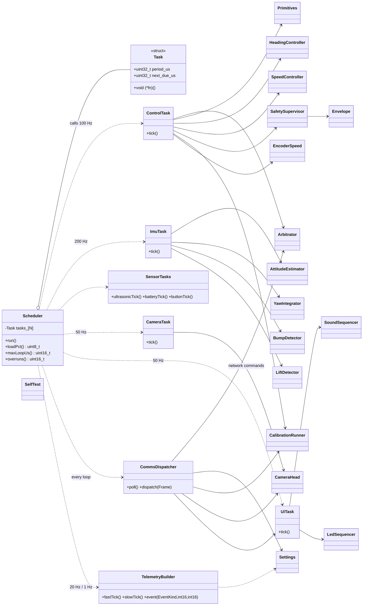
(Members of the domain classes are detailed in their own sections.)

### 1.4 Layer / port dependency diagram
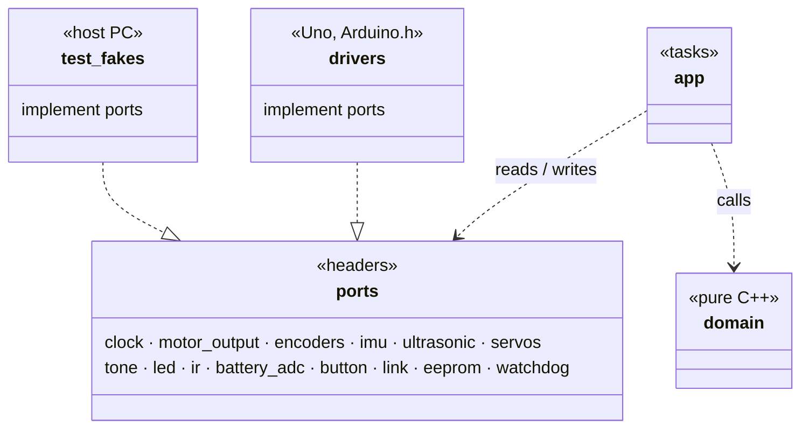

### 1.5 Execution model
- `loop()` → `scheduler.run()`: fixed task table (period + next-due), run-to-completion, never blocking; time from the clock port (`micros()`), wrap-safe.
- Periods: comms every loop · IMU 200 Hz · control 100 Hz · servos/UI/button 50 Hz · ultrasonic 20 Hz · telemetry 20 Hz fast / 1 Hz slow · battery 10 Hz.
- **Timing budget (16 MHz):** IMU ~0.4 ms @200 Hz, control chain ~1.5 ms @100 Hz, telemetry ~0.3 ms → expected load 30–40 %; measured `loop_load`, `loop_max_us`, overrun count reported in TELEM_SLOW.
- **Overrun rule:** a late task's next due = now + period (no catch-up bursts).
- **Watchdog:** 1 s, kicked by the scheduler after each full pass; reset reason reported at next boot.

### 1.6 Control tick sequence (100 Hz)
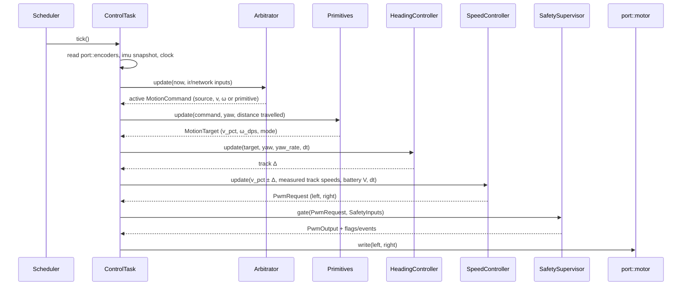

---

## 2. Ports (APPROVED)
Each port = header of namespaced free functions (`port::<name>::fn`), no `virtual`; Uno build links `drivers/*.cpp`, host build links `test-fakes/*.cpp`.

```mermaid
classDiagram
    direction LR
    class clock { <<port>> +nowUs() uint32_t +nowMs() uint32_t }
    class motor { <<port>> +init() +write(int16 left, int16 right) +brake() }
    class encoders { <<port>> +init(bool enabled) +snapshot() EncoderSnapshot }
    class imu { <<port>> +init() Status +read(ImuRaw&) Status +whoAmI() uint8_t }
    class ultrasonic { <<port>> +trigger() +poll(uint16_t& echo_us) EchoState }
    class servos { <<port>> +attach(Axis) +writeUs(Axis, uint16 us) +detach(Axis) }
    class tone { <<port>> +play(uint16 hz) +stop() }
    class led { <<port>> +show(Rgb) }
    class ir { <<port>> +poll(IrEvent&) bool }
    class battery_adc { <<port>> +readMv() uint16_t }
    class button { <<port>> +pressed() bool }
    class link { <<port>> +readByte(uint8_t&) bool +write(const uint8_t*, uint8 len) bool +txFree() uint8_t }
    class eeprom { <<port>> +read(uint16 addr, void*, uint16 len) +update(uint16 addr, const void*, uint16 len) }
    class watchdog { <<port>> +enable() +kick() +resetReason() ResetReason }

    class EncoderSnapshot { <<struct>> +int32 count_l +int32 count_r +uint32 period_l_us +uint32 period_r_us +uint32 t_us }
    class ImuRaw { <<struct>> +int16 ax,ay,az +int16 gx,gy,gz +int16 temp +uint32 t_us }
    class IrEvent { <<struct>> +uint32 code +bool repeat +uint32 t_us }
    class Rgb { <<struct>> +uint8 r,g,b }
    class Status { <<enum>> Ok · NotFound · BusError · Saturated }
    class EchoState { <<enum>> Pending · Ready · Timeout }
    class Axis { <<enum>> Pan · Tilt }
    class ResetReason { <<enum>> PowerOn · External · BrownOut · Watchdog }

    encoders ..> EncoderSnapshot
    imu ..> ImuRaw
    imu ..> Status
    ir ..> IrEvent
    led ..> Rgb
    ultrasonic ..> EchoState
    servos ..> Axis
    watchdog ..> ResetReason
```

| Port | Units / range | Timing | ISR safety | On failure |
|---|---|---|---|---|
| clock | µs / ms, wrap 2³² | O(1) | anywhere | — |
| motor | −255..255 (sign = direction, 0 = coast); `brake()` | < 20 µs | **only ControlTask includes it** | — |
| encoders | counts (sign from commanded direction), last pulse period µs | atomic snapshot (IRQs briefly off) | counting in ISRs (D3 INT1, A1 PCINT1) | disabled → zeros |
| imu | raw MPU6050 counts (±250 °/s, ±2 g) | ~0.4 ms I2C with timeout | main loop | BusError/NotFound, last values kept |
| ultrasonic | echo µs (cm = µs/58) | `trigger()` 10 µs pulse; echo timed by ISR; `poll()` non-blocking | echo edge in PCINT0 ISR | Timeout after 25 ms (no obstacle in range) |
| servos | 500–2500 µs | instant (Servo lib, Timer1) | main loop | — |
| tone | 31–20000 Hz | non-blocking (Timer2) | main loop | — |
| led | 0–255 per channel | ~30 µs IRQs off; call only on change | main loop | — |
| ir | NEC 32-bit code + repeat | decoded in PCINT0 ISR; 4-entry queue | queue ISR-safe | malformed dropped + counted |
| battery_adc | mV (divider scale applied) | ~120 µs ADC | main loop | — |
| button | debounced 20 ms | O(1) | main loop | — |
| link | bytes; 64 B RX ring, 64 B TX | non-blocking; `write` false if no room | serial ISRs in core | write false → frame dropped + counted |
| eeprom | bytes, 1 KB | `update` writes changed bytes only | main loop, never during motion bursts | — |
| watchdog | 1 s | `kick()` once per scheduler pass | — | reason from MCUSR |

Rules:
- ISRs only in `drivers/`, capture-only. The shared PCINT0 ISR (D9 IR, D12 echo) reads PINB once, diffs, forwards edges to the IR decoder and echo timer.
- `domain/` never includes `ports/`; only `app/` does.
- All pins/hardware constants in one file: `drivers/board_config.h` (matches Spec 2 §A1).

---

## 3. Motion control (APPROVED)

### 3.1 Pipeline
```
MotionCommand ─► Primitives ─► MotionTarget ─► HeadingController ─► Δ (turn effort)
                                    │ v                                    │
                                    └──────────────► Mixer (L = v−Δ, R = v+Δ, pivot fallback)
                                                          │ track targets %
                                     Ramp (accel limit) ◄─┘
                                          │
                     SpeedController [OpenLoop | EncoderPid]  ◄── EncoderSpeed
                          │ uses Deadband + BatteryComp
                          ▼
                     PwmRequest (L, R) ──► SafetySupervisor (§4)
```

### 3.2 Class diagram
```mermaid
classDiagram
    direction TB
    class MotionCommand {
      <<struct>>
      +Source source
      +CmdKind kind
      +int8 v_pct
      +int8 w_pct
      +int16 yaw_rate_ddps
      +TurnMode turn_mode
      +int16 angle_ddeg
      +uint16 radius_cm
      +bool pivot
      +int32 dist_mm
      +int16 heading_ddeg
      +uint8 speed_pct
      +uint32 t_ms
    }
    class MotionTarget {
      <<struct>>
      +float v_pct
      +TargetMode mode
      +float yaw_rate_dps
      +float heading_deg
      +bool pivot
    }
    class Primitives {
      -State state_
      -TurnProfile turn_
      -MoveProfile move_
      +accept(MotionCommand) Result
      +update(Inputs) MotionTarget
      +state() State
      +progressPct() uint8
      +takeDone(PrimitiveDone&) bool
    }
    class TurnProfile {
      +start(start_deg, target_deg, speed_pct, radius_cm)
      +update(yaw_deg, yaw_rate_dps, dt) TurnStep
    }
    class MoveProfile {
      +start(dist_mm, speed_pct, heading_deg)
      +update(travelled_mm, dt) MoveStep
    }
    class HeadingController {
      -Pid~float~ heading_pid_
      -Pid~float~ rate_pid_
      -float held_heading_
      -bool holding_
      -uint16 saturated_ms_
      +update(MotionTarget, yaw_deg, yaw_rate_dps, v_pct, dt) float
      +turnLimited() bool
      +reset()
    }
    class TurnLimits {
      <<value>>
      +float rate_max_dps
      +float rate_at_full_speed_pct
      +ReverseSteer reverse_steer
      +maxRate(v_pct) float
    }
    class Mixer {
      +mix(v_pct, delta_pct, pivot_fallback, keep_pct) TrackTargets
    }
    class TrackTargets { <<struct>> +float left_pct +float right_pct }
    class Ramp {
      -float out_[2]
      +apply(TrackTargets, accel_pct_s, dt) TrackTargets
      +reset()
    }
    class SpeedController {
      -Mode mode_
      -Pid~float~ pid_[2]
      -Deadband deadband_
      -BatteryComp battery_
      +setMode(Mode)
      +update(TrackTargets, TrackSpeeds, float batt_v, dt) PwmRequest
      +reset()
    }
    class Deadband {
      -uint8 start_[4]
      -uint8 keep_[4]
      -uint16 kick_ms_[2]
      +map(track, float pct, bool from_standstill, dt) int16
    }
    class BatteryComp {
      +float v_nominal
      +float motor_v_max
      +scale(int16 pwm, float batt_v) int16
    }
    class EncoderSpeed {
      -int32 last_count_[2]
      -Method method_[2]
      +update(EncoderSnapshot, int8 cmd_sign_l, int8 cmd_sign_r, dt) TrackSpeeds
      +travelledMm() float
      +faulty(track) bool
    }
    class TrackSpeeds { <<struct>> +float cps[2] +float pct[2] +bool valid }
    class PwmRequest { <<struct>> +int16 left +int16 right }
    class Pid~T~ {
      +T kp, ki, kd
      +T out_min, out_max, i_max
      +update(T setpoint, T measured, T dt) T
      +reset()
      +saturated() bool
    }
    Primitives *-- TurnProfile
    Primitives *-- MoveProfile
    Primitives ..> MotionCommand
    Primitives ..> MotionTarget
    HeadingController *-- Pid
    HeadingController ..> TurnLimits
    SpeedController *-- Pid
    SpeedController *-- Deadband
    SpeedController *-- BatteryComp
    SpeedController ..> TrackSpeeds
    SpeedController ..> PwmRequest
    Mixer ..> TrackTargets
    Ramp ..> TrackTargets
    EncoderSpeed ..> TrackSpeeds
```
Enums: `CmdKind {Drive, DriveRate, Turn, Move, Stop, Cancel}` · `TurnMode {By, To}` · `TargetMode {HoldHeading, Rate, Spin}` · `SpeedController::Mode {OpenLoop, EncoderPid}` (VARIANT POINT) · `EncoderSpeed::Method {Window, Period}` · `ReverseSteer {Car, Tank}`.

### 3.3 Primitives state machine
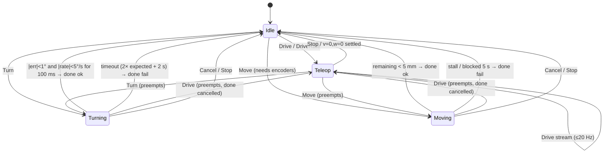

### 3.4 Algorithms
- **HeadingController (cascaded):** `w = 0, v ≠ 0` → heading hold (capture *current* heading when `w` returns to 0; heading PID → rate setpoint). `w ≠ 0` → rate mode, ω = `w% × maxRate(v)`; car-style reverse inverts ω when `v < 0`. Inner loop: turn-rate PID + feedforward `Δ = ω × track_width_eff / 2` (→ %). Anti-windup (integral + output clamp); `turnLimited` after 300 ms saturated.
- **TurnProfile:** ω = `min(max_rate, √(2·decel·|error|))`; radius → `v = ω·r` (arc), none → `v = 0` (spin).
- **MoveProfile:** trapezoid (accel, cruise = speed_pct, decel) with heading hold; distance from `EncoderSpeed::travelledMm()`.
- **Mixer:** `L = v − Δ`, `R = v + Δ`; if > 100 % scale both while preserving the difference (turning priority); pivot fallback: inner target below keep threshold (non-zero) → 0.
- **SpeedController:** OpenLoop `pwm = deadband.map(target%)`; EncoderPid `target_cps = target% × max_cps[track]`, `pwm = ff(target) + PID(target_cps, measured)`; encoder fault → OpenLoop + `encoder_fault`. Then BatteryComp: `pwm × V_nom / V_batt`, capped to `motor_v_max` (6 V).
- **Deadband:** `(0,100] → [keep..255]` per track/direction; 60 ms kick to `start` from standstill.
- **EncoderSpeed:** window method (counts / 20 ms) when ≥ 8 counts per window, else period method; direction from command; fault = driven above deadband with no counts 0.5 s.
- Controllers use `float` internally; integers on the wire.

---

## 4. Safety & arbitration (APPROVED)

### 4.1 Class diagram
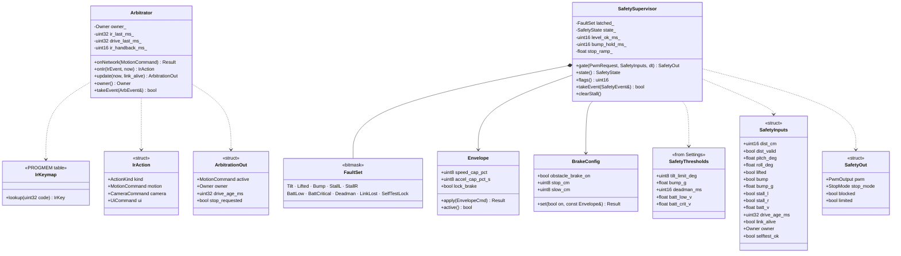
Enums: `Owner {None, Network, Ir}` · `ActionKind {Motion, Camera, Ui, Speed, Calibrate, None}` · `SafetyState {Normal, Limited, SoftStop, Halted, Locked}` · `StopMode {None, Smooth, Brake}`. `BrakeConfig.obstacle_brake_on` is always true at boot.

### 4.2 Owner state machine
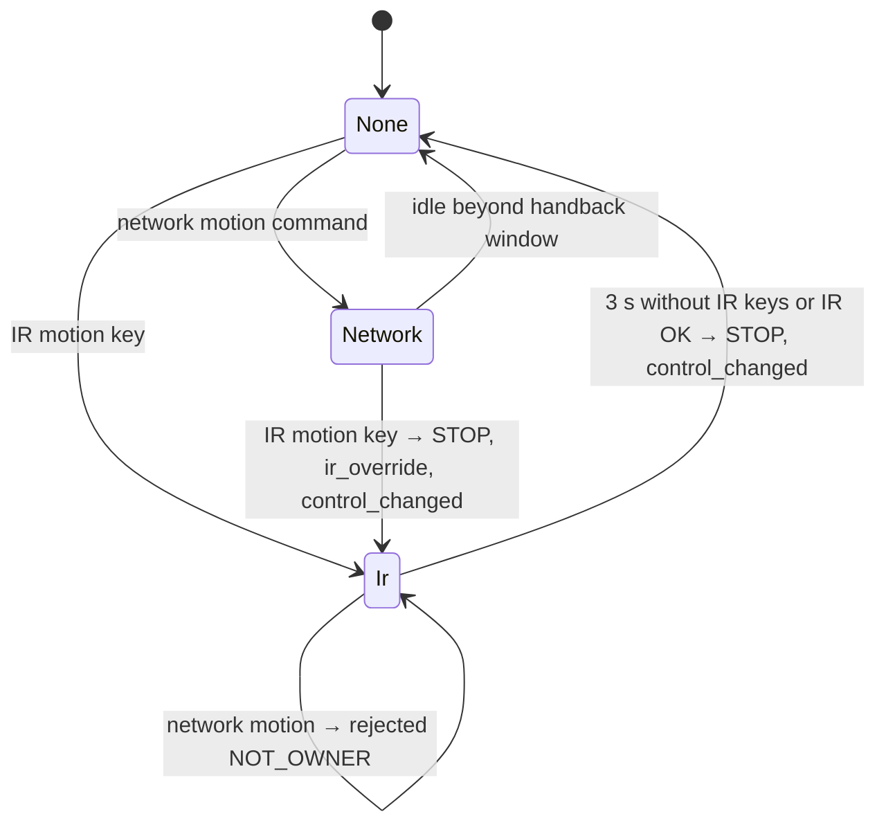
- The ESP32 already arbitrated human vs AI; the Uno sees "network" tagged with its source.
- Non-motion IR keys act via `IrAction` without changing the owner. STOP from any source always applies.

### 4.3 Safety supervisor state machine
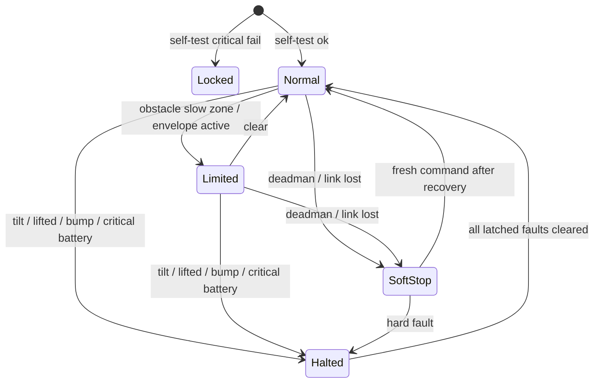

### 4.4 `gate()` rules (every 10 ms, in order)
1. **Locked** → motors 0.
2. **Hard faults → Halted, brake now:** tilt > limit (clears after level 1 s) · lifted (clears on landed) · bump > threshold (300 ms hold) · critical battery 2 s (clears above crit + 0.3 V hysteresis).
3. **Stall (per track):** cut that track until the commanded direction changes or 1 s.
4. **Deadman / link lost → SoftStop:** ramp to 0 over ~300 ms; recover on a fresh command.
5. **Obstacle brake (if on):** split into `v = (L+R)/2`, `Δ = (R−L)/2`; if `v > 0` scale `v` by `clamp((dist − stop)/(slow − stop), 0, 1)`; recombine. Reverse and spin stay allowed; `blocked` at 0.
6. **Envelope:** final `|v| ≤ speed_cap`; accel cap also passed to the Ramp.
7. Output + events (blocked/unblocked, tilted/level, lifted/landed, bump{g}, stall{side}, deadman_stop, batt_low/critical, envelope_changed).

Ownership: the Uno applies envelope/brake; the **ESP32 enforces who may change them**; the Uno still rejects "brake off" while `lock_brake` (defence in depth).

### 4.5 IR override sequence
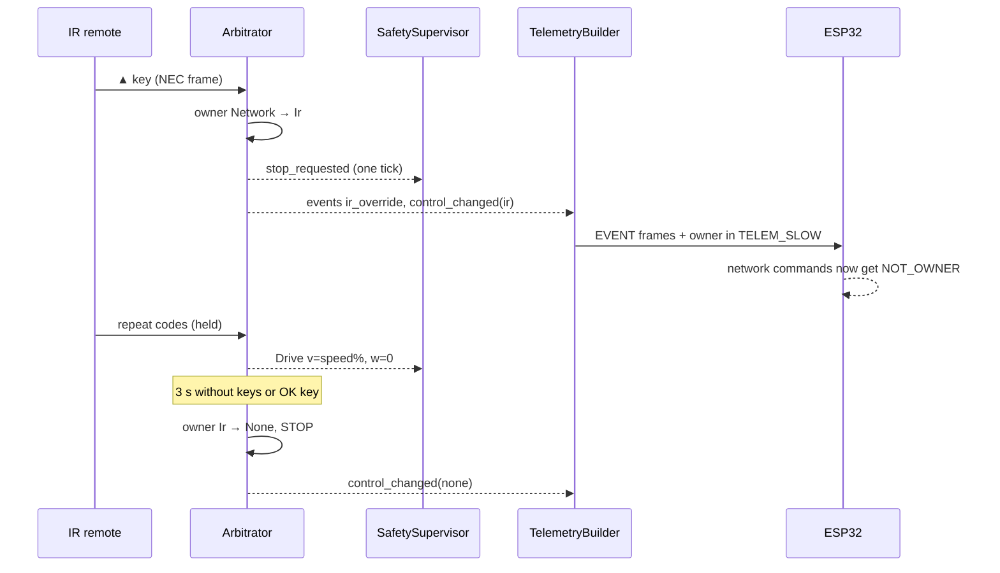

---

## 5. Comms — ESP32 link, Uno side (APPROVED)
Frames per Spec 1 §8: `0xAA | len | type | seq | payload | CRC-8`, 115200 baud.

### 5.1 Class diagram
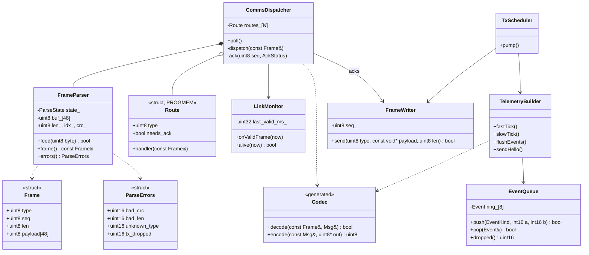
`ParseState {Sync, Len, Type, Seq, Payload, Crc}`. `Codec` has one decode/encode pair per message type (generated).

### 5.2 Parser state machine
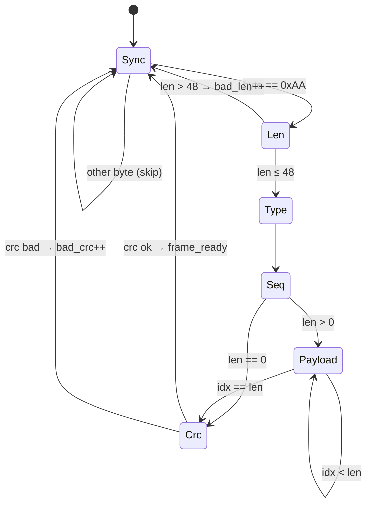

### 5.3 Routing table (OCP through data, PROGMEM)
| Type | Handler → target | Ack |
|---|---|---|
| HEARTBEAT | LinkMonitor | no |
| DRIVE, DRIVE_RATE | `Arbitrator::onNetwork` (streaming) | no (rejections → EVENT) |
| STOP, TURN, MOVE, CANCEL | `Arbitrator::onNetwork` | yes |
| CAM_JOY | CameraHead (streaming) | no |
| CAM_SET, CAM_NUDGE, CAM_HOME, CAM_LOCK | CameraHead | yes |
| LED, SOUND, TONE, AUDIO_MODE, OWNER_HINT | UiTask | yes (OWNER_HINT no) |
| BRAKE, ENVELOPE | BrakeConfig / Envelope | yes (`ENVELOPE_LOCKED` if refused) |
| SETTING_SET / GET / SAVE | Settings | yes / SETTING_VALUE |
| CALIBRATE, PROFILE | CalibrationRunner / Settings | yes, then CAL_RESULT progress |
| unknown | — | unknown_type++ |
Ack status = generated `COMMAND_3xxx` subset as a one-byte registry index.

### 5.4 Sending
- `TxScheduler::pump()` every loop, priority **ACK > EVENT > HELLO > TELEM_FAST > TELEM_SLOW**, only if `txFree()` fits the whole frame.
- No room → telemetry skipped (`tx_dropped`); events stay queued (ring 8, overflow counted).
- TELEM_FAST ≈ 46 B × 20 Hz ≈ 0.9 KB/s of 11.5 KB/s.
- HELLO at boot, repeated every 1 s until the first heartbeat, and on request.

### 5.5 Link health
- `alive` = valid frame within 300 ms → feeds the safety supervisor (link lost → SoftStop).
- `uno_ms` in every TELEM_FAST for ESP32 clock mapping.

### 5.6 Drive command flow
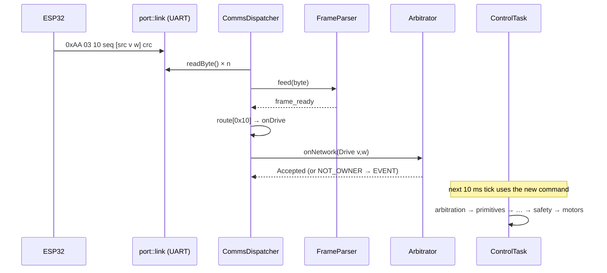

---

## 6. Sensors, estimation & drivers (APPROVED)

### 6.1 Drivers (`drivers/`, implement ports)
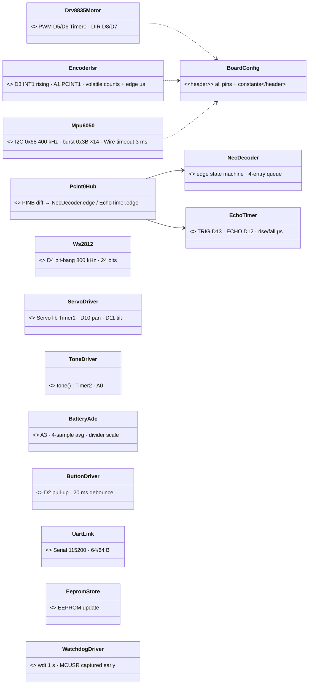
MPU6050 init: `PWR_MGMT_1=0x01` (PLL), `SMPLRT_DIV=4` (200 Hz), `CONFIG=0x03` (~44 Hz DLPF), gyro ±250 °/s, accel ±2 g; `WHO_AM_I=0x68` checked by self-test.

| ISR | Pins | Work (capture only, < 10 µs) |
|---|---|---|
| INT1_vect | D3 left encoder | `count_l += dir_l`, edge time |
| PCINT1_vect | A1 right encoder | same, right |
| PCINT0_vect | D9 IR, D12 echo | read PINB, diff, forward edge + µs |
| USART, TIMER0/1/2 | — | Arduino core, Servo, tone |

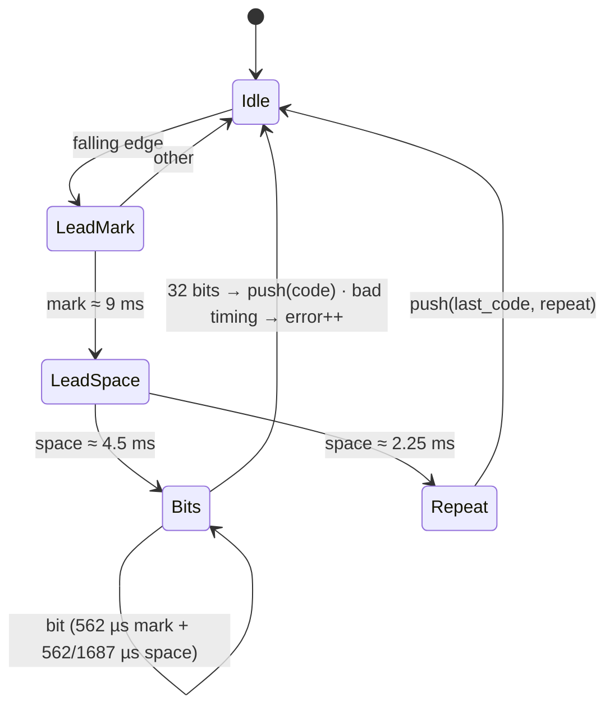

### 6.2 Estimation (`domain/estimation/`, pure)
```mermaid
classDiagram
    direction TB
    class ImuCalibration { <<from Settings>> +int16 gyro_bias[3] +float level_pitch +float level_roll }
    class AttitudeEstimator { -float pitch_, roll_ +float alpha +update(ImuRaw, dt) Attitude }
    class YawIntegrator { -float yaw_deg_ -float bias_dps_ -uint16 still_ms_ +update(gz_raw, dt, stationary) float +rateDps() float +reset(deg) }
    class BumpDetector { -float a_lp_ +update(ImuRaw, driving) BumpResult }
    class LiftDetector { -LiftState state_ +update(ImuRaw, Attitude, TrackSpeeds, PwmRequest) LiftResult }
    class UltrasonicFilter { -uint16 last_[3] +update(EchoState, echo_us, now) Range }
    class BatteryMonitor { -float v_ema_ -float v_idle_, v_load_ -BattState state_ +update(mv, driving, dt) Battery }
    class Attitude { <<struct>> +float pitch_deg +float roll_deg +float accel_g }
    YawIntegrator ..> ImuCalibration
    AttitudeEstimator ..> ImuCalibration
    AttitudeEstimator ..> Attitude
    LiftDetector ..> Attitude
```
- Attitude: complementary filter (α = 0.98) minus level offsets.
- Yaw: integrate `gz − bias`; **auto bias re-estimation** when not driven, encoders still, |rates| < 0.5 °/s for 5 s.
- Bump: |a| minus its low-pass; spike > `bump_g` → bump + direction (x-axis sign).
- Lift: any of vertical transient while not driving · sudden tilt change · (encoders) free-spin vs calibrated on-ground speed; landed = level + steady 1 g for 1 s.
- Ultrasonic: median of 3; Timeout = no obstacle in range; closing speed over 50 ms.
- Battery: EMA volts; sag = idle − loaded; low/critical need 2 s sustained.

### 6.3 Camera head (`domain/camera/`)
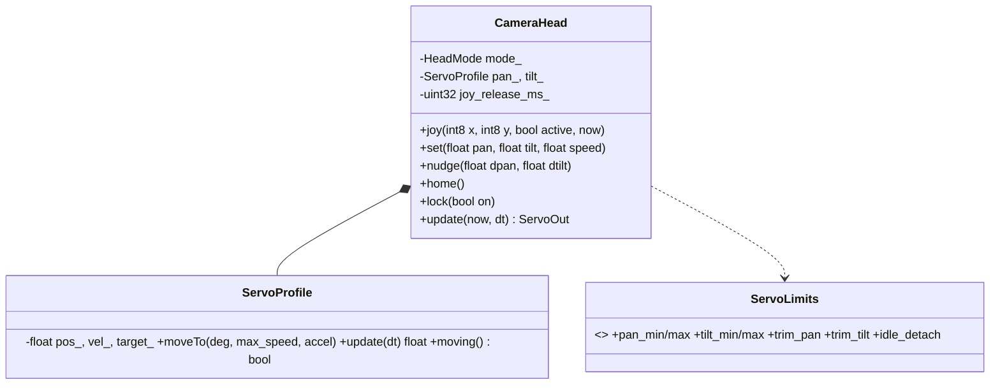
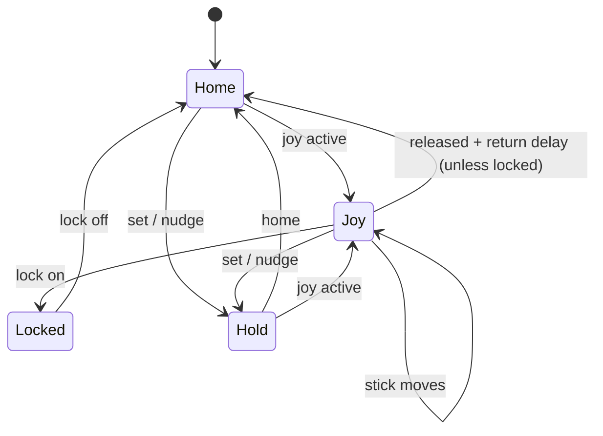
Trapezoidal motion at 50 Hz in µs; limits + trim applied last; optional idle detach at home.

### 6.4 Sound & LED (`domain/ui/`)
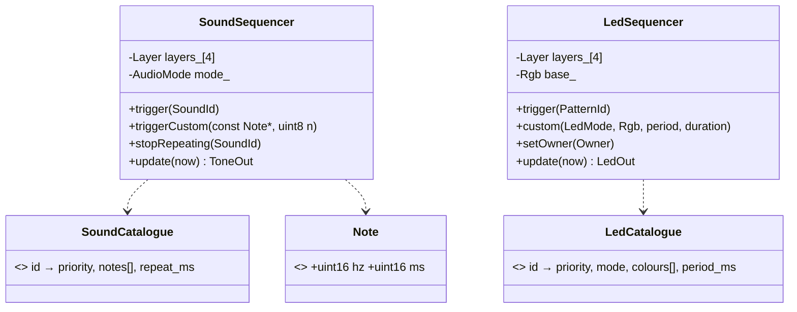
- Highest active layer plays; lower layers pause and resume (not lost).
- Audio mode: Mute → priority 1 only; Quiet → 1–2; Normal → all.
- Catalogues = tables in Spec 2 §A9; new sound/pattern = new table row (OCP).
- LED written only on colour change.
