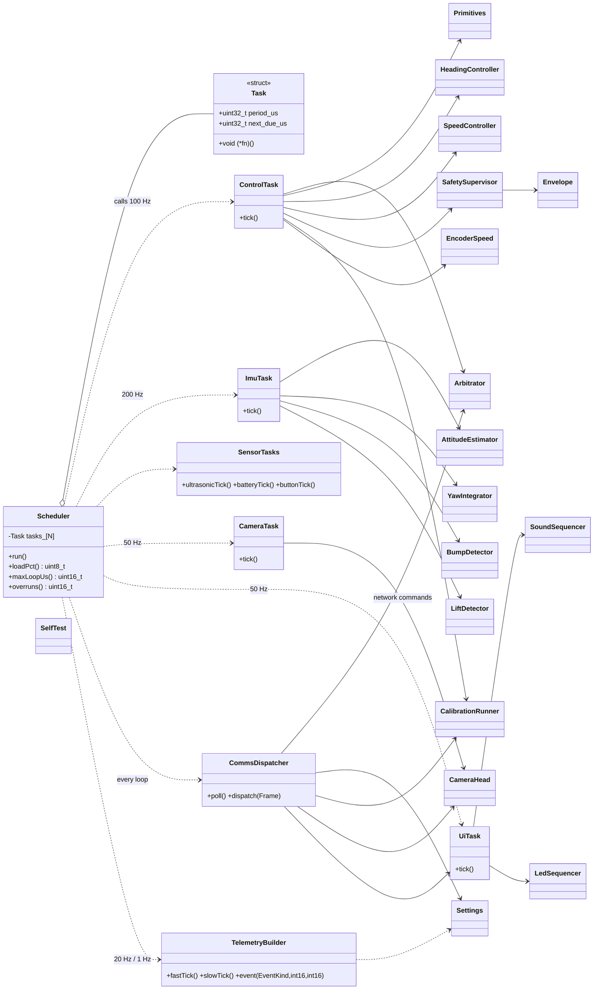
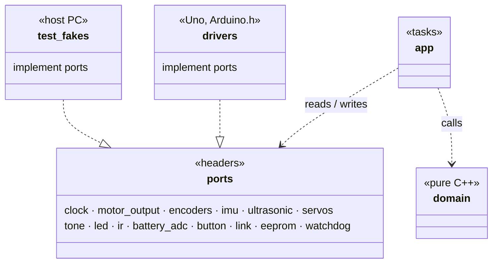
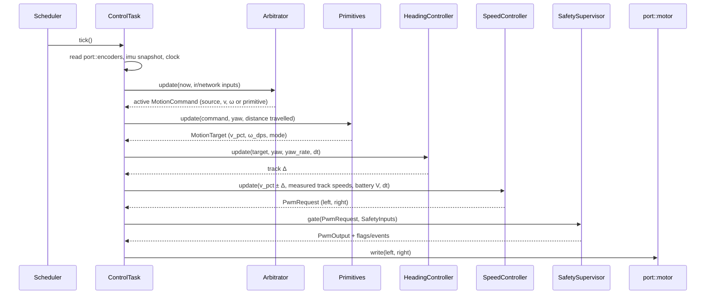

# Uno Firmware — Low-Level Design

Status: IN PROGRESS · Date: 2026-10-10 · Implements: Spec 2 Part A, Spec 1 §8 · Standards: `docs/standards/coding-standards.md` §2

Sections: 1 Structure & execution ✅ · 2 Ports · 3 Motion control · 4 Safety & arbitration · 5 Comms · 6 Sensors & drivers · 7 Settings, calibration, self-test · 8 Memory budget & error handling

Every section includes classes and Mermaid diagrams (class, sequence, state).

---

## 1. Structure & execution model (APPROVED)

### 1.1 Directory layout (PlatformIO, `firmware/uno/`)
```
src/
├── main.cpp                    composition root: static objects, wiring, setup(), loop()
├── app/                        task classes: read ports → call domain → write ports
│   ├── scheduler.h/.cpp        fixed task table, due-time dispatch, load measurement
│   ├── control_task.*          100 Hz control chain (arbitration → … → safety → motors)
│   ├── imu_task.*              200 Hz IMU read + estimation
│   ├── sensor_tasks.*          ultrasonic 20 Hz, battery 10 Hz, button 50 Hz
│   ├── camera_task.*           servos 50 Hz
│   ├── ui_task.*               buzzer + LED 50 Hz
│   ├── comms_dispatcher.*      frame → command routing
│   └── telemetry_builder.*     TELEM_FAST / TELEM_SLOW / EVENT frames
├── domain/                     PURE C++: no Arduino.h, no port calls (inputs → outputs)
│   ├── motion/                 speed_controller, heading_controller, mixer, ramp, deadband,
│   │                           battery_comp, primitives, turn_profile
│   ├── safety/                 safety_supervisor, envelope
│   ├── arbitration/            arbitrator
│   ├── camera/                 servo_profile, camera_head
│   ├── ui/                     sound_sequencer, led_sequencer, catalogues (PROGMEM)
│   ├── estimation/             attitude_estimator, yaw_integrator, encoder_speed,
│   │                           bump_detector, lift_detector
│   ├── calibration/            calibration_runner + routines
│   ├── selftest/               self_test
│   ├── settings/               settings (typed struct + defaults + CRC)
│   └── util/                   pid.h, ring_buffer.h, units.h, crc8.h, filters.h
├── ports/                      headers only: namespaced free functions (link-time swap)
├── drivers/                    Uno implementations of ports (Arduino.h allowed only here)
└── generated/                  protocol frames + error registry (from /protocol)
test-fakes/                     host implementations of ports
```

### 1.2 Design rules applied
- **Functional core, imperative shell:** `domain/` classes take inputs and return outputs; they never touch hardware. `app/` task classes read ports, call domain, write ports.
- **Ports** are headers of namespaced free functions (`port::motor::write(...)`); the implementation is chosen at link time (`drivers/` on the Uno, `test-fakes/` on a PC). No `virtual`.
- **Safety by structure:** only `ControlTask` includes `ports/motor_output.h`, and it writes only the `SafetySupervisor` output.
- All objects static; no heap.

### 1.3 Top-level class diagram

(Members of the domain classes are detailed in their own sections.)

### 1.4 Layer / port dependency diagram


### 1.5 Execution model
- `loop()` → `scheduler.run()`: fixed task table (period + next-due), run-to-completion, never blocking; time from the clock port (`micros()`), wrap-safe.
- Periods: comms every loop · IMU 200 Hz · control 100 Hz · servos/UI/button 50 Hz · ultrasonic 20 Hz · telemetry 20 Hz fast / 1 Hz slow · battery 10 Hz.
- **Timing budget (16 MHz):** IMU ~0.4 ms @200 Hz, control chain ~1.5 ms @100 Hz, telemetry ~0.3 ms → expected load 30–40 %; measured `loop_load`, `loop_max_us`, overrun count reported in TELEM_SLOW.
- **Overrun rule:** a late task's next due = now + period (no catch-up bursts).
- **Watchdog:** 1 s, kicked by the scheduler after each full pass; reset reason reported at next boot.

### 1.6 Control tick sequence (100 Hz)

