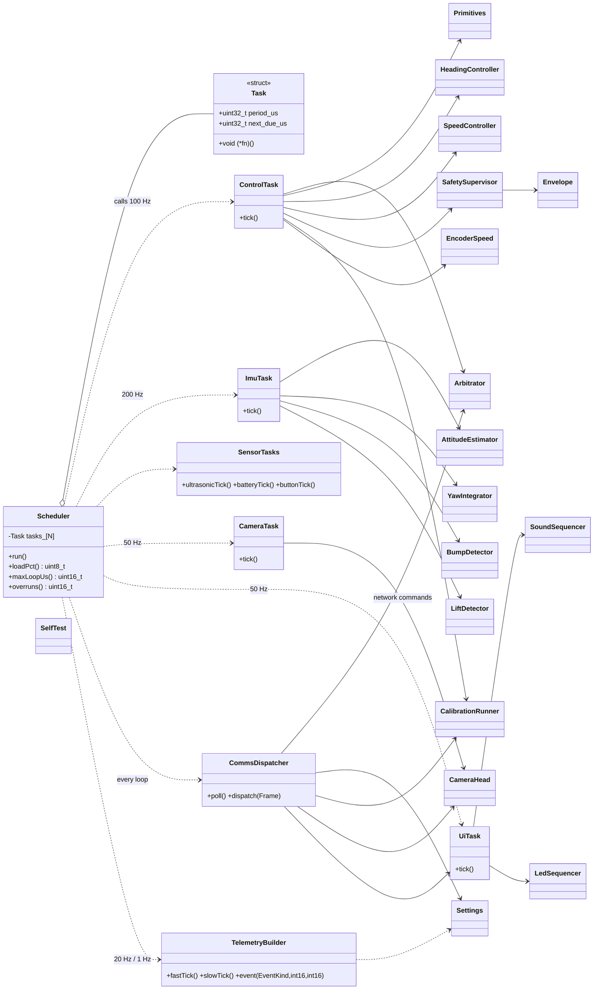
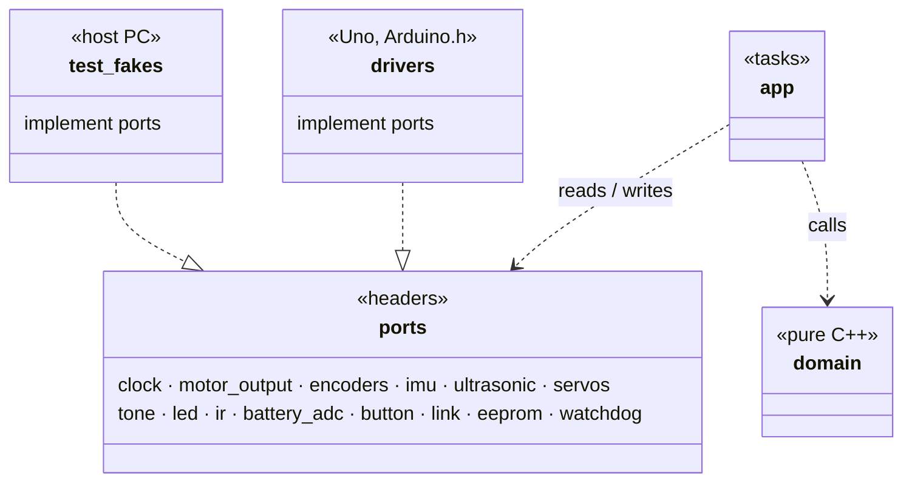
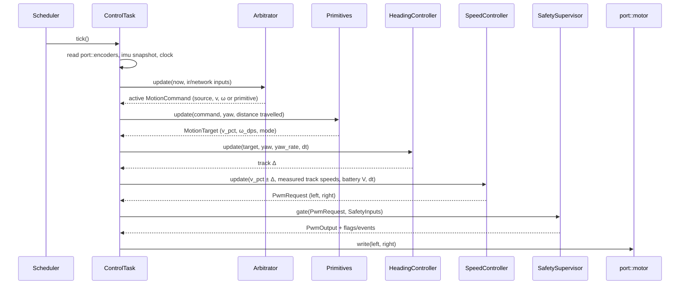

# Uno Firmware — Low-Level Design

Status: IN PROGRESS · Date: 2026-10-10 · Implements: Spec 2 Part A, Spec 1 §8 · Standards: `docs/standards/coding-standards.md` §2

Sections: 1 Structure & execution ✅ · 2 Ports ✅ · 3 Motion control · 4 Safety & arbitration · 5 Comms · 6 Sensors & drivers · 7 Settings, calibration, self-test · 8 Memory budget & error handling

Every section includes classes and Mermaid diagrams (class, sequence, state).

---

## 1. Structure & execution model (APPROVED)

### 1.1 Directory layout (PlatformIO, `firmware/uno/`)
```
src/
├── main.cpp                    composition root: static objects, wiring, setup(), loop()
├── app/                        task classes: read ports → call domain → write ports
│   ├── scheduler.h/.cpp        fixed task table, due-time dispatch, load measurement
│   ├── control_task.*          100 Hz control chain (arbitration → … → safety → motors)
│   ├── imu_task.*              200 Hz IMU read + estimation
│   ├── sensor_tasks.*          ultrasonic 20 Hz, battery 10 Hz, button 50 Hz
│   ├── camera_task.*           servos 50 Hz
│   ├── ui_task.*               buzzer + LED 50 Hz
│   ├── comms_dispatcher.*      frame → command routing
│   └── telemetry_builder.*     TELEM_FAST / TELEM_SLOW / EVENT frames
├── domain/                     PURE C++: no Arduino.h, no port calls (inputs → outputs)
│   ├── motion/                 speed_controller, heading_controller, mixer, ramp, deadband,
│   │                           battery_comp, primitives, turn_profile
│   ├── safety/                 safety_supervisor, envelope
│   ├── arbitration/            arbitrator
│   ├── camera/                 servo_profile, camera_head
│   ├── ui/                     sound_sequencer, led_sequencer, catalogues (PROGMEM)
│   ├── estimation/             attitude_estimator, yaw_integrator, encoder_speed,
│   │                           bump_detector, lift_detector
│   ├── calibration/            calibration_runner + routines
│   ├── selftest/               self_test
│   ├── settings/               settings (typed struct + defaults + CRC)
│   └── util/                   pid.h, ring_buffer.h, units.h, crc8.h, filters.h
├── ports/                      headers only: namespaced free functions (link-time swap)
├── drivers/                    Uno implementations of ports (Arduino.h allowed only here)
└── generated/                  protocol frames + error registry (from /protocol)
test-fakes/                     host implementations of ports
```

### 1.2 Design rules applied
- **Functional core, imperative shell:** `domain/` classes take inputs and return outputs; they never touch hardware. `app/` task classes read ports, call domain, write ports.
- **Ports** are headers of namespaced free functions (`port::motor::write(...)`); the implementation is chosen at link time (`drivers/` on the Uno, `test-fakes/` on a PC). No `virtual`.
- **Safety by structure:** only `ControlTask` includes `ports/motor_output.h`, and it writes only the `SafetySupervisor` output.
- All objects static; no heap.

### 1.3 Top-level class diagram

(Members of the domain classes are detailed in their own sections.)

### 1.4 Layer / port dependency diagram


### 1.5 Execution model
- `loop()` → `scheduler.run()`: fixed task table (period + next-due), run-to-completion, never blocking; time from the clock port (`micros()`), wrap-safe.
- Periods: comms every loop · IMU 200 Hz · control 100 Hz · servos/UI/button 50 Hz · ultrasonic 20 Hz · telemetry 20 Hz fast / 1 Hz slow · battery 10 Hz.
- **Timing budget (16 MHz):** IMU ~0.4 ms @200 Hz, control chain ~1.5 ms @100 Hz, telemetry ~0.3 ms → expected load 30–40 %; measured `loop_load`, `loop_max_us`, overrun count reported in TELEM_SLOW.
- **Overrun rule:** a late task's next due = now + period (no catch-up bursts).
- **Watchdog:** 1 s, kicked by the scheduler after each full pass; reset reason reported at next boot.

### 1.6 Control tick sequence (100 Hz)


---

## 2. Ports (APPROVED)
Each port = header of namespaced free functions (`port::<name>::fn`), no `virtual`; Uno build links `drivers/*.cpp`, host build links `test-fakes/*.cpp`.

```mermaid
classDiagram
    direction LR
    class clock { <<port>> +nowUs() uint32_t +nowMs() uint32_t }
    class motor { <<port>> +init() +write(int16 left, int16 right) +brake() }
    class encoders { <<port>> +init(bool enabled) +snapshot() EncoderSnapshot }
    class imu { <<port>> +init() Status +read(ImuRaw&) Status +whoAmI() uint8_t }
    class ultrasonic { <<port>> +trigger() +poll(uint16_t& echo_us) EchoState }
    class servos { <<port>> +attach(Axis) +writeUs(Axis, uint16 us) +detach(Axis) }
    class tone { <<port>> +play(uint16 hz) +stop() }
    class led { <<port>> +show(Rgb) }
    class ir { <<port>> +poll(IrEvent&) bool }
    class battery_adc { <<port>> +readMv() uint16_t }
    class button { <<port>> +pressed() bool }
    class link { <<port>> +readByte(uint8_t&) bool +write(const uint8_t*, uint8 len) bool +txFree() uint8_t }
    class eeprom { <<port>> +read(uint16 addr, void*, uint16 len) +update(uint16 addr, const void*, uint16 len) }
    class watchdog { <<port>> +enable() +kick() +resetReason() ResetReason }

    class EncoderSnapshot { <<struct>> +int32 count_l +int32 count_r +uint32 period_l_us +uint32 period_r_us +uint32 t_us }
    class ImuRaw { <<struct>> +int16 ax,ay,az +int16 gx,gy,gz +int16 temp +uint32 t_us }
    class IrEvent { <<struct>> +uint32 code +bool repeat +uint32 t_us }
    class Rgb { <<struct>> +uint8 r,g,b }
    class Status { <<enum>> Ok · NotFound · BusError · Saturated }
    class EchoState { <<enum>> Pending · Ready · Timeout }
    class Axis { <<enum>> Pan · Tilt }
    class ResetReason { <<enum>> PowerOn · External · BrownOut · Watchdog }

    encoders ..> EncoderSnapshot
    imu ..> ImuRaw
    imu ..> Status
    ir ..> IrEvent
    led ..> Rgb
    ultrasonic ..> EchoState
    servos ..> Axis
    watchdog ..> ResetReason
```

| Port | Units / range | Timing | ISR safety | On failure |
|---|---|---|---|---|
| clock | µs / ms, wrap 2³² | O(1) | anywhere | — |
| motor | −255..255 (sign = direction, 0 = coast); `brake()` | < 20 µs | **only ControlTask includes it** | — |
| encoders | counts (sign from commanded direction), last pulse period µs | atomic snapshot (IRQs briefly off) | counting in ISRs (D3 INT1, A1 PCINT1) | disabled → zeros |
| imu | raw MPU6050 counts (±250 °/s, ±2 g) | ~0.4 ms I2C with timeout | main loop | BusError/NotFound, last values kept |
| ultrasonic | echo µs (cm = µs/58) | `trigger()` 10 µs pulse; echo timed by ISR; `poll()` non-blocking | echo edge in PCINT0 ISR | Timeout after 25 ms (no obstacle in range) |
| servos | 500–2500 µs | instant (Servo lib, Timer1) | main loop | — |
| tone | 31–20000 Hz | non-blocking (Timer2) | main loop | — |
| led | 0–255 per channel | ~30 µs IRQs off; call only on change | main loop | — |
| ir | NEC 32-bit code + repeat | decoded in PCINT0 ISR; 4-entry queue | queue ISR-safe | malformed dropped + counted |
| battery_adc | mV (divider scale applied) | ~120 µs ADC | main loop | — |
| button | debounced 20 ms | O(1) | main loop | — |
| link | bytes; 64 B RX ring, 64 B TX | non-blocking; `write` false if no room | serial ISRs in core | write false → frame dropped + counted |
| eeprom | bytes, 1 KB | `update` writes changed bytes only | main loop, never during motion bursts | — |
| watchdog | 1 s | `kick()` once per scheduler pass | — | reason from MCUSR |

Rules:
- ISRs only in `drivers/`, capture-only. The shared PCINT0 ISR (D9 IR, D12 echo) reads PINB once, diffs, forwards edges to the IR decoder and echo timer.
- `domain/` never includes `ports/`; only `app/` does.
- All pins/hardware constants in one file: `drivers/board_config.h` (matches Spec 2 §A1).
