# Uno Firmware — Low-Level Design

Status: COMPLETE — Revision 2 (review fixes in §9 are authoritative where earlier sections differ) · Date: 2026-10-10 · Implements: Spec 2 Part A, Spec 1 §8 · Standards: `docs/standards/coding-standards.md` §2

Sections: 1 Structure & execution ✅ · 2 Ports ✅ · 3 Motion control ✅ · 4 Safety & arbitration ✅ · 5 Comms ✅ · 6 Sensors & drivers ✅ · 7 Settings, calibration, self-test ✅ · 8 Memory budget & error handling ✅ · 9 Revision 2 review fixes ✅

Every section includes classes and Mermaid diagrams (class, sequence, state).

---

## 1. Structure & execution model (APPROVED)

### 1.1 Directory layout (PlatformIO, `firmware/uno/`)
```
src/
├── main.cpp                    composition root: static objects, wiring, setup(), loop()
├── app/                        task classes: read ports → call domain → write ports
│   ├── scheduler.h/.cpp        fixed task table, due-time dispatch, load measurement
│   ├── control_task.*          100 Hz control chain (arbitration → … → safety → motors)
│   ├── imu_task.*              200 Hz IMU read + estimation
│   ├── sensor_tasks.*          ultrasonic 20 Hz, battery 10 Hz, button 50 Hz
│   ├── camera_task.*           servos 50 Hz
│   ├── ui_task.*               buzzer + LED 50 Hz
│   ├── comms_dispatcher.*      frame → command routing
│   └── telemetry_builder.*     TELEM_FAST / TELEM_SLOW / EVENT frames
├── domain/                     PURE C++: no Arduino.h, no port calls (inputs → outputs)
│   ├── motion/                 speed_controller, heading_controller, mixer, ramp, deadband,
│   │                           battery_comp, primitives, turn_profile
│   ├── safety/                 safety_supervisor, envelope
│   ├── arbitration/            arbitrator
│   ├── camera/                 servo_profile, camera_head
│   ├── ui/                     sound_sequencer, led_sequencer, catalogues (PROGMEM)
│   ├── estimation/             attitude_estimator, yaw_integrator, encoder_speed,
│   │                           bump_detector, lift_detector
│   ├── calibration/            calibration_runner + routines
│   ├── selftest/               self_test
│   ├── settings/               settings (typed struct + defaults + CRC)
│   └── util/                   pid.h, ring_buffer.h, units.h, crc8.h, filters.h
├── ports/                      headers only: namespaced free functions (link-time swap)
├── drivers/                    Uno implementations of ports (Arduino.h allowed only here)
└── generated/                  protocol frames + error registry (from /protocol)
test-fakes/                     host implementations of ports
```

### 1.2 Design rules applied
- **Functional core, imperative shell:** `domain/` classes take inputs and return outputs; they never touch hardware. `app/` task classes read ports, call domain, write ports.
- **Ports** are headers of namespaced free functions (`port::motor::write(...)`); the implementation is chosen at link time (`drivers/` on the Uno, `test-fakes/` on a PC). No `virtual`.
- **Safety by structure:** only `ControlTask` includes `ports/motor_output.h`, and it writes only the `SafetySupervisor` output.
- All objects static; no heap.

### 1.3 Top-level class diagram
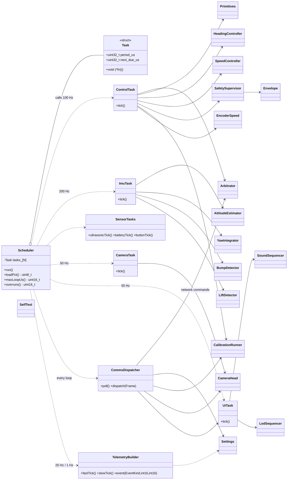
(Members of the domain classes are detailed in their own sections.)

### 1.4 Layer / port dependency diagram
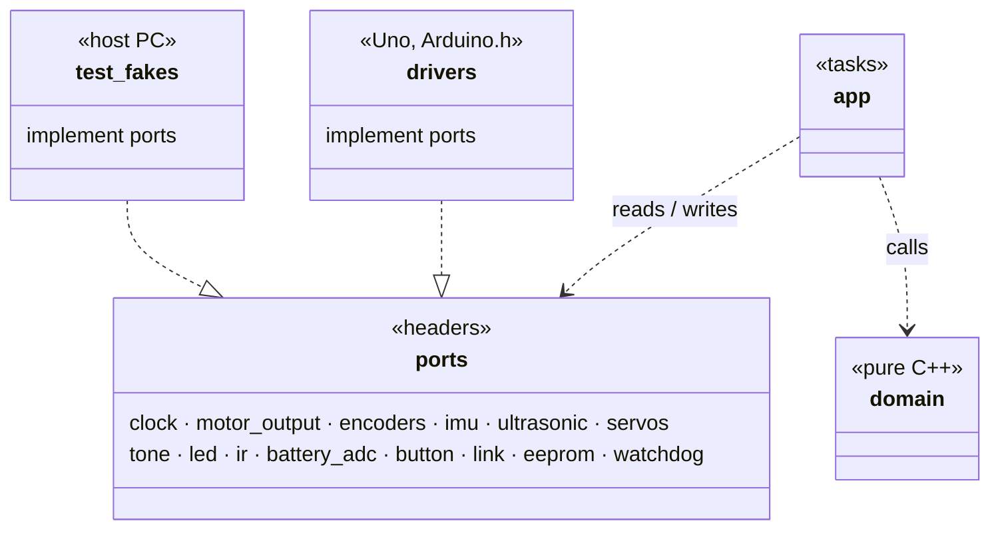

### 1.5 Execution model
- `loop()` → `scheduler.run()`: fixed task table (period + next-due), run-to-completion, never blocking; time from the clock port (`micros()`), wrap-safe.
- Periods: comms every loop · IMU 200 Hz · control 100 Hz · servos/UI/button 50 Hz · ultrasonic 20 Hz · telemetry 20 Hz fast / 1 Hz slow · battery 10 Hz.
- **Timing budget (16 MHz):** IMU ~0.4 ms @200 Hz, control chain ~1.5 ms @100 Hz, telemetry ~0.3 ms → expected load 30–40 %; measured `loop_load`, `loop_max_us`, overrun count reported in TELEM_SLOW.
- **Overrun rule:** a late task's next due = now + period (no catch-up bursts).
- **Watchdog:** 1 s, kicked by the scheduler after each full pass; reset reason reported at next boot.

### 1.6 Control tick sequence (100 Hz)
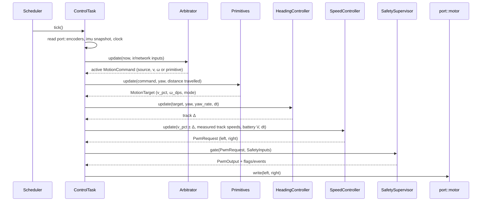

---

## 2. Ports (APPROVED)
Each port = header of namespaced free functions (`port::<name>::fn`), no `virtual`; Uno build links `drivers/*.cpp`, host build links `test-fakes/*.cpp`.

```mermaid
classDiagram
    direction LR
    class clock { <<port>> +nowUs() uint32_t +nowMs() uint32_t }
    class motor { <<port>> +init() +write(int16 left, int16 right) +brake() }
    class encoders { <<port>> +init(bool enabled) +snapshot() EncoderSnapshot }
    class imu { <<port>> +init() Status +read(ImuRaw&) Status +whoAmI() uint8_t }
    class ultrasonic { <<port>> +trigger() +poll(uint16_t& echo_us) EchoState }
    class servos { <<port>> +attach(Axis) +writeUs(Axis, uint16 us) +detach(Axis) }
    class tone { <<port>> +play(uint16 hz) +stop() }
    class led { <<port>> +show(Rgb) }
    class ir { <<port>> +poll(IrEvent&) bool }
    class battery_adc { <<port>> +readMv() uint16_t }
    class button { <<port>> +pressed() bool }
    class link { <<port>> +readByte(uint8_t&) bool +write(const uint8_t*, uint8 len) bool +txFree() uint8_t }
    class eeprom { <<port>> +read(uint16 addr, void*, uint16 len) +update(uint16 addr, const void*, uint16 len) }
    class watchdog { <<port>> +enable() +kick() +resetReason() ResetReason }

    class EncoderSnapshot { <<struct>> +int32 count_l +int32 count_r +uint32 period_l_us +uint32 period_r_us +uint32 t_us }
    class ImuRaw { <<struct>> +int16 ax,ay,az +int16 gx,gy,gz +int16 temp +uint32 t_us }
    class IrEvent { <<struct>> +uint32 code +bool repeat +uint32 t_us }
    class Rgb { <<struct>> +uint8 r,g,b }
    class Status { <<enum>> Ok · NotFound · BusError · Saturated }
    class EchoState { <<enum>> Pending · Ready · Timeout }
    class Axis { <<enum>> Pan · Tilt }
    class ResetReason { <<enum>> PowerOn · External · BrownOut · Watchdog }

    encoders ..> EncoderSnapshot
    imu ..> ImuRaw
    imu ..> Status
    ir ..> IrEvent
    led ..> Rgb
    ultrasonic ..> EchoState
    servos ..> Axis
    watchdog ..> ResetReason
```

| Port | Units / range | Timing | ISR safety | On failure |
|---|---|---|---|---|
| clock | µs / ms, wrap 2³² | O(1) | anywhere | — |
| motor | −255..255 (sign = direction); **0 = brake** (PH/EN mode, §9.14); takes `PwmOutput` only | < 20 µs | **only ControlTask includes it** | — |
| encoders | counts (sign from commanded direction), last pulse period µs | atomic snapshot (IRQs briefly off) | counting in ISRs (D3 INT1, A1 PCINT1) | disabled → zeros |
| imu | raw MPU6050 counts (±250 °/s, ±2 g) | ~0.4 ms I2C with timeout | main loop | BusError/NotFound, last values kept |
| ultrasonic | echo µs (cm = µs/58) | `trigger()` 10 µs pulse; echo timed by ISR; `poll()` non-blocking | echo edge in PCINT0 ISR | Timeout after 25 ms (no obstacle in range) |
| servos | 500–2500 µs | instant (Servo lib, Timer1) | main loop | — |
| tone | 31–20000 Hz | non-blocking (Timer2) | main loop | — |
| led | 0–255 per channel | ~30 µs IRQs off; call only on change | main loop | — |
| ir | NEC 32-bit code + repeat | decoded in PCINT0 ISR; 4-entry queue | queue ISR-safe | malformed dropped + counted |
| battery_adc | mV (divider scale applied) | ~120 µs ADC | main loop | — |
| button | debounced 20 ms | O(1) | main loop | — |
| link | bytes; 64 B RX ring, 64 B TX; **250000 baud** | non-blocking; `write` false if no room | serial ISRs in core | write false → frame dropped + counted |
| eeprom | bytes, 1 KB | `update` writes changed bytes only | main loop, never during motion bursts | — |
| watchdog | 1 s | `kick()` once per scheduler pass | — | reason from MCUSR |

Rules:
- ISRs only in `drivers/`, capture-only. The shared PCINT0 ISR (D9 IR, D12 echo) reads PINB once, diffs, forwards edges to the IR decoder and echo timer.
- `domain/` never includes `ports/`; only `app/` does.
- All pins/hardware constants in one file: `drivers/board_config.h` (matches Spec 2 §A1).

---

## 3. Motion control (APPROVED)

### 3.1 Pipeline
```
MotionCommand ─► Primitives ─► MotionTarget ─► HeadingController ─► Δ (turn effort)
                                    │ v                                    │
                                    └──────────────► Mixer (L = v−Δ, R = v+Δ, pivot fallback)
                                                          │ track targets %
                                     Ramp (accel limit) ◄─┘
                                          │
                     SpeedController [OpenLoop | EncoderPid]  ◄── EncoderSpeed
                          │ uses Deadband + BatteryComp
                          ▼
                     PwmRequest (L, R) ──► SafetySupervisor (§4)
```

### 3.2 Class diagram
```mermaid
classDiagram
    direction TB
    class MotionCommand {
      <<struct>>
      +Source source
      +CmdKind kind
      +int8 v_pct
      +int8 w_pct
      +int16 yaw_rate_ddps
      +TurnMode turn_mode
      +int16 angle_ddeg
      +uint16 radius_cm
      +bool pivot
      +int32 dist_mm
      +int16 heading_ddeg
      +uint8 speed_pct
      +uint32 t_ms
    }
    class MotionTarget {
      <<struct>>
      +float v_pct
      +TargetMode mode
      +float yaw_rate_dps
      +float heading_deg
      +bool pivot
    }
    class Primitives {
      -State state_
      -TurnProfile turn_
      -MoveProfile move_
      +accept(MotionCommand) Result
      +update(Inputs) MotionTarget
      +state() State
      +progressPct() uint8
      +takeDone(PrimitiveDone&) bool
    }
    class TurnProfile {
      +start(start_deg, target_deg, speed_pct, radius_cm)
      +update(yaw_deg, yaw_rate_dps, dt) TurnStep
    }
    class MoveProfile {
      +start(dist_mm, speed_pct, heading_deg)
      +update(travelled_mm, dt) MoveStep
    }
    class HeadingController {
      -Pid~float~ heading_pid_
      -Pid~float~ rate_pid_
      -float held_heading_
      -bool holding_
      -uint16 saturated_ms_
      +update(MotionTarget, yaw_deg, yaw_rate_dps, v_pct, dt) float
      +turnLimited() bool
      +reset()
    }
    class TurnLimits {
      <<value>>
      +float rate_max_dps
      +float rate_at_full_speed_pct
      +ReverseSteer reverse_steer
      +maxRate(v_pct) float
    }
    class Mixer {
      +mix(v_pct, delta_pct, pivot_fallback, keep_pct) TrackTargets
    }
    class TrackTargets { <<struct>> +float left_pct +float right_pct }
    class Ramp {
      -float out_[2]
      +apply(TrackTargets, accel_pct_s, dt) TrackTargets
      +reset()
    }
    class SpeedController {
      -Mode mode_
      -Pid~float~ pid_[2]
      -Deadband deadband_
      -BatteryComp battery_
      +setMode(Mode)
      +update(TrackTargets, TrackSpeeds, float batt_v, dt) PwmRequest
      +reset()
    }
    class Deadband {
      -uint8 start_[4]
      -uint8 keep_[4]
      -uint16 kick_ms_[2]
      +map(track, float pct, bool from_standstill, dt) int16
    }
    class BatteryComp {
      +float v_nominal
      +float motor_v_max
      +scale(int16 pwm, float batt_v) int16
    }
    class EncoderSpeed {
      -int32 last_count_[2]
      -Method method_[2]
      +update(EncoderSnapshot, int8 cmd_sign_l, int8 cmd_sign_r, dt) TrackSpeeds
      +travelledMm() float
      +faulty(track) bool
    }
    class TrackSpeeds { <<struct>> +float cps[2] +float pct[2] +bool valid }
    class PwmRequest { <<struct>> +int16 left +int16 right }
    class Pid~T~ {
      +T kp, ki, kd
      +T out_min, out_max, i_max
      +update(T setpoint, T measured, T dt) T
      +reset()
      +saturated() bool
    }
    Primitives *-- TurnProfile
    Primitives *-- MoveProfile
    Primitives ..> MotionCommand
    Primitives ..> MotionTarget
    HeadingController *-- Pid
    HeadingController ..> TurnLimits
    SpeedController *-- Pid
    SpeedController *-- Deadband
    SpeedController *-- BatteryComp
    SpeedController ..> TrackSpeeds
    SpeedController ..> PwmRequest
    Mixer ..> TrackTargets
    Ramp ..> TrackTargets
    EncoderSpeed ..> TrackSpeeds
```
Enums: `CmdKind {Drive, DriveRate, Turn, Move, Stop, Cancel}` · `TurnMode {By, To}` · `TargetMode {HoldHeading, Rate, Spin}` · `SpeedController::Mode {OpenLoop, EncoderPid}` (VARIANT POINT) · `EncoderSpeed::Method {Window, Period}` · `ReverseSteer {Car, Tank}`.

### 3.3 Primitives state machine
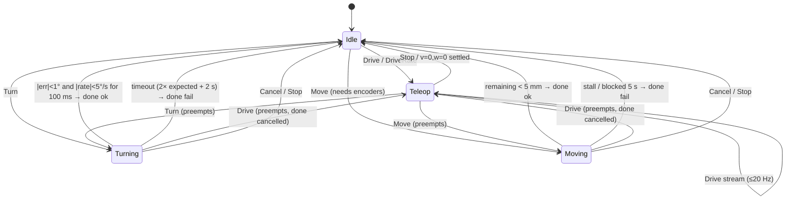

### 3.4 Algorithms
- **HeadingController (cascaded):** `w = 0, v ≠ 0` → heading hold (capture *current* heading when `w` returns to 0; heading PID → rate setpoint). `w ≠ 0` → rate mode, ω = `w% × maxRate(v)`; car-style reverse inverts ω when `v < 0`. Inner loop: turn-rate PID + feedforward `Δ = ω × track_width_eff / 2` (→ %). Anti-windup (integral + output clamp); `turnLimited` after 300 ms saturated.
- **TurnProfile:** ω = `min(max_rate, √(2·decel·|error|))`; radius → `v = ω·r` (arc), none → `v = 0` (spin).
- **MoveProfile:** trapezoid (accel, cruise = speed_pct, decel) with heading hold; distance from `EncoderSpeed::travelledMm()`.
- **Mixer:** `L = v − Δ`, `R = v + Δ`; if > 100 % scale both while preserving the difference (turning priority); pivot fallback: inner target below keep threshold (non-zero) → 0.
- **SpeedController:** OpenLoop `pwm = deadband.map(target%)`; EncoderPid `target_cps = target% × max_cps[track]`, `pwm = ff(target) + PID(target_cps, measured)`; encoder fault → OpenLoop + `encoder_fault`. Then BatteryComp: `pwm × V_nom / V_batt`, capped to `motor_v_max` (6 V).
- **Deadband:** `(0,100] → [keep..255]` per track/direction; 60 ms kick to `start` from standstill.
- **EncoderSpeed:** window method (counts / 20 ms) when ≥ 8 counts per window, else period method; direction from command; fault = driven above deadband with no counts 0.5 s.
- Controllers use `float` internally; integers on the wire.

---

## 4. Safety & arbitration (APPROVED)

### 4.1 Class diagram

Enums: `Owner {None, Network, Ir}` · `ActionKind {Motion, Camera, Ui, Speed, Calibrate, None}` · `SafetyState {Normal, Limited, SoftStop, Halted, Locked}` · `StopMode {None, Smooth, Brake}`. `BrakeConfig.obstacle_brake_on` is always true at boot.

### 4.2 Owner state machine
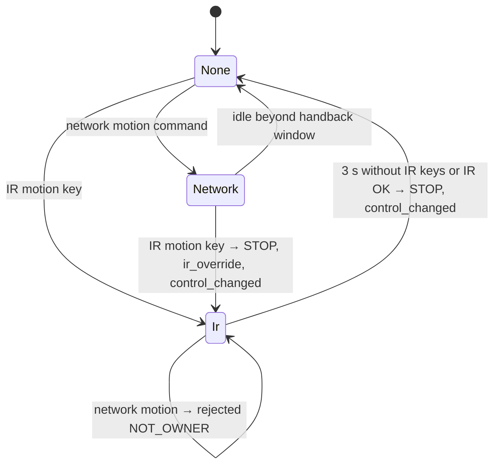
- The ESP32 already arbitrated human vs AI; the Uno sees "network" tagged with its source.
- Non-motion IR keys act via `IrAction` without changing the owner. STOP from any source always applies.

### 4.3 Safety supervisor state machine
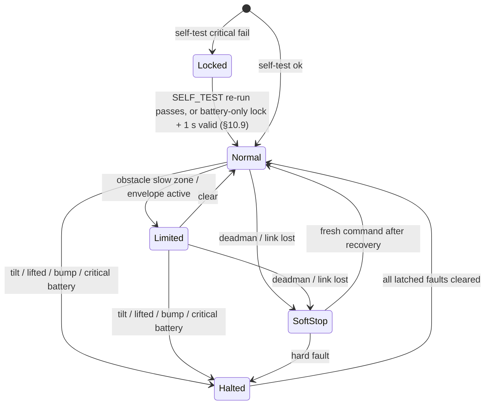

### 4.4 `gate()` rules (every 10 ms, in order)
1. **Locked** → motors 0.
2. **Hard faults → Halted, brake now:** tilt > limit (default 45°, must persist 300 ms; clears after level 1 s) · lifted (clears on landed) · bump > threshold (300 ms hold) · critical battery 2 s (clears above crit + 0.3 V hysteresis).
3. **Stall (per track):** cut that track until the commanded direction changes or 1 s.
4. **Deadman / link lost → SoftStop:** ramp to 0 over ~300 ms; recover on a fresh command.
5. **Obstacle brake (if on):** split into `v = (L+R)/2`, `Δ = (R−L)/2`; if `v > 0` scale `v` by `clamp((dist − stop)/(slow − stop), 0, 1)`; recombine. Reverse and spin stay allowed; `blocked` at 0.
6. **Envelope:** final `|v| ≤ speed_cap`; accel cap also passed to the Ramp.
7. Output + events (blocked/unblocked, tilted/level, lifted/landed, bump{g}, stall{side}, deadman_stop, batt_low/critical, envelope_changed).

Ownership: the Uno applies envelope/brake; the **ESP32 enforces who may change them**; the Uno still rejects "brake off" while `lock_brake` (defence in depth).

### 4.5 IR override sequence
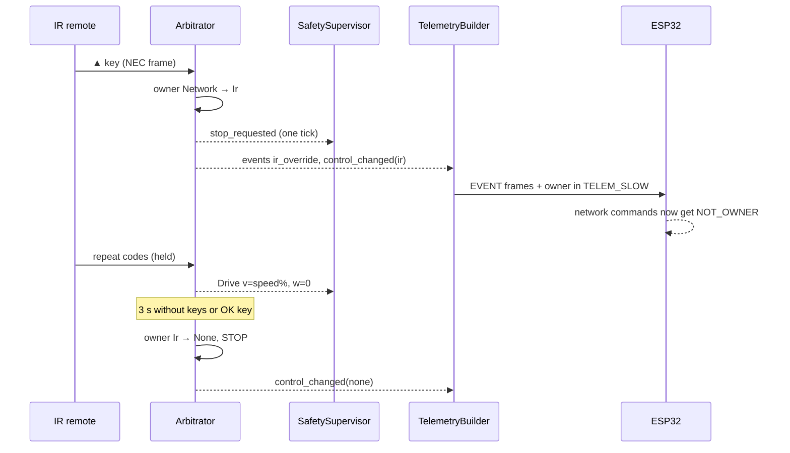

---

## 5. Comms — ESP32 link, Uno side (APPROVED)
Frames per Spec 1 §8: `0xAA | len | type | seq | payload | CRC-8`, **250000 baud** (see §9.18).

### 5.1 Class diagram
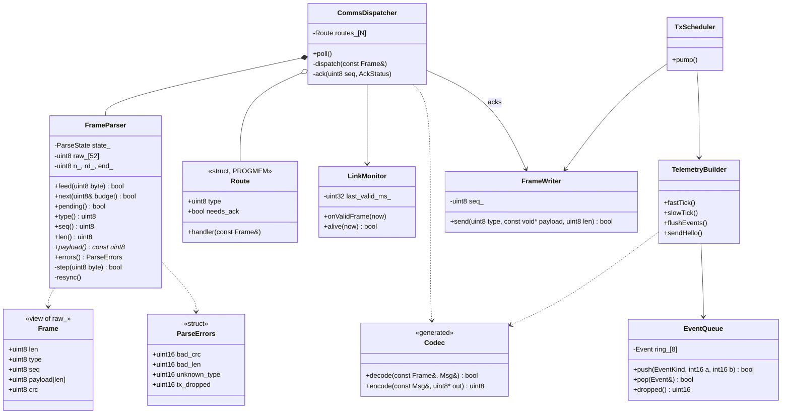
`ParseState {Sync, Len, Type, Seq, Payload, Crc}`. `Codec` has one decode/encode pair per message type (generated); when `decode()` returns false the message contents are unspecified.

**Parser API (revised 2026-10-11, see the resync notes at the end):** `raw_[52]` holds the bytes after the sync (len, type, seq, payload, crc) and is the frame — `Frame` is a view of it, not a copy. Work is resumable and bounded by the caller: `feed(byte)` queues one received byte and is legal only when `!pending()` (otherwise it returns false and changes nothing, so pending replay bytes are never dropped); `next(budget)` runs at most `budget` parser steps, decrementing it, and returns true when a frame is ready; whatever replay is left stays pending for the next call. Caller loop: `while (budget) { if (!p.pending()) { if (!read(b)) break; p.feed(b); } if (p.next(budget)) dispatch(p); }`. Frame accessors are valid until the next `feed()`/`next()`. Bytes waiting to be replayed live in the same `raw_` buffer behind the write position (no second buffer), which is why `feed()` refuses rather than appends: appending behind a full replay could need a 53rd byte. `bad_crc` / `bad_len` count rejection events — a replayed byte can be rejected and counted again. Frames, order and counters are the same as the Python parser for any stream and any budget split. RAM ≈ 64 B (raw 52 + 4 state bytes + 8 B counters); host tests add a step counter (`stepsTaken()`, `CQ_HOST_TEST` only).

### 5.2 Parser state machine
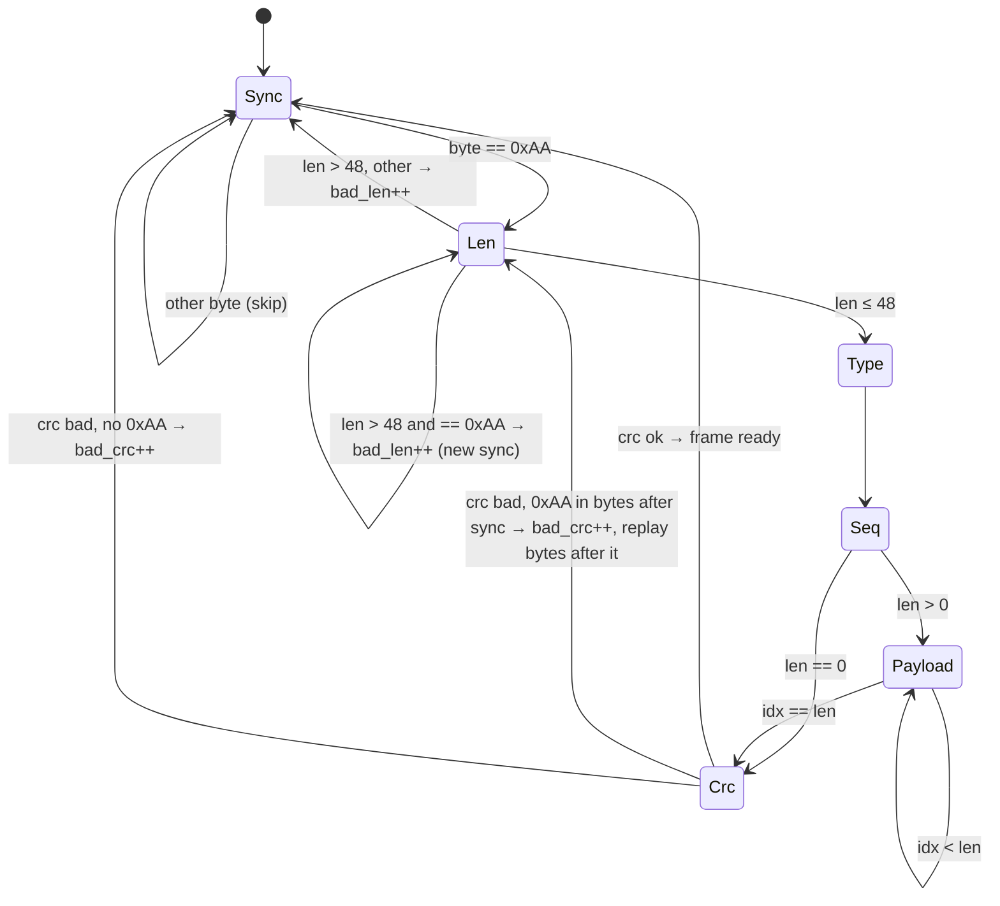
Replay (resync after a CRC mismatch): the bytes stored since the false sync (len … crc) are scanned for the first 0xAA; the bytes after it, followed by any bytes still waiting from an earlier replay, are fed back through the same states. Stored + waiting bytes shrink by at least one per resync, so the loop ends. Proven worst case for one received byte: about 700 parser steps and about 26 CRC passes (~676 CRC bytes), ≈ 4.6 ms at 16 MHz if run in one go — so the replay is resumable and `commsPoll` gives the parser at most 64 steps per loop pass (≈ 0.67 ms worst case, §9.18); ordinary noise costs a handful of steps. Identical behaviour to `conqueror_protocol.framing.FrameParser` (Plan A).

### 5.3 Routing table (OCP through data, PROGMEM)
| Type | Handler → target | Ack |
|---|---|---|
| HEARTBEAT | LinkMonitor | no |
| DRIVE, DRIVE_RATE | `Arbitrator::onNetwork` (streaming) | no (rejections → EVENT) |
| STOP, TURN, MOVE, CANCEL | `Arbitrator::onNetwork` | yes |
| CAM_JOY | CameraHead (streaming) | no |
| CAM_SET, CAM_NUDGE, CAM_HOME, CAM_LOCK | CameraHead | yes |
| LED, SOUND, TONE, AUDIO_MODE, OWNER_HINT | UiTask | yes (OWNER_HINT no) |
| BRAKE, ENVELOPE | BrakeConfig / Envelope | yes (`ENVELOPE_LOCKED` if refused) |
| SETTING_SET / GET / SAVE | Settings | yes / SETTING_VALUE |
| CALIBRATE, PROFILE | CalibrationRunner / Settings | yes, then CAL_RESULT progress |
| unknown | — | unknown_type++ |
Ack status = generated `COMMAND_3xxx` subset as a one-byte registry index.

### 5.4 Sending
- `TxScheduler::pump()` every loop, priority **ACK > EVENT > HELLO > TELEM_FAST > TELEM_SLOW**, only if `txFree()` fits the whole frame.
- No room → telemetry skipped (`tx_dropped`); events stay queued (ring 8, overflow counted).
- TELEM_FAST ≈ 46 B × 20 Hz ≈ 0.9 KB/s of 11.5 KB/s.
- HELLO at boot, repeated every 1 s until the first heartbeat, and on request.

### 5.5 Link health
- `alive` = valid frame within 300 ms → feeds the safety supervisor (link lost → SoftStop).
- `uno_ms` in every TELEM_FAST for ESP32 clock mapping.

### 5.6 Drive command flow
```mermaid
sequenceDiagram
    participant E as ESP32
    participant L as port::link (UART)
    participant D as CommsDispatcher
    participant P as FrameParser
    participant A as Arbitrator
    participant C as ControlTask
    E->>L: 0xAA 03 10 seq [src v w] crc
    Note over D,P: budget = 64 steps per loop pass
    D->>P: pending()?
    P-->>D: false
    D->>L: readByte()
    D->>P: feed(byte)
    D->>P: next(budget)
    P-->>D: true (frame ready), budget decremented
    Note over D,P: loop while budget > 0: pending replay is stepped before any new byte is read; leftover replay waits for the next pass
    D->>D: route[0x10] → onDrive
    D->>A: onNetwork(Drive v,w)
    A-->>D: Accepted (or NOT_OWNER → EVENT)
    Note over C: next 10 ms tick uses the new command
    C->>C: arbitration → primitives → … → safety → motors
```

---

## 6. Sensors, estimation & drivers (APPROVED)

### 6.1 Drivers (`drivers/`, implement ports)

MPU6050 init: `PWR_MGMT_1=0x01` (PLL), `SMPLRT_DIV=4` (200 Hz), `CONFIG=0x03` (~44 Hz DLPF), gyro ±250 °/s, accel ±2 g; `WHO_AM_I=0x68` checked by self-test.

| ISR | Pins | Work (capture only, < 10 µs) |
|---|---|---|
| INT1_vect | D3 left encoder | `count_l += dir_l`, edge time |
| PCINT1_vect | A1 right encoder | same, right |
| PCINT0_vect | D9 IR, D12 echo | read PINB, diff, forward edge + µs |
| USART, TIMER0/1/2 | — | Arduino core, Servo, tone |

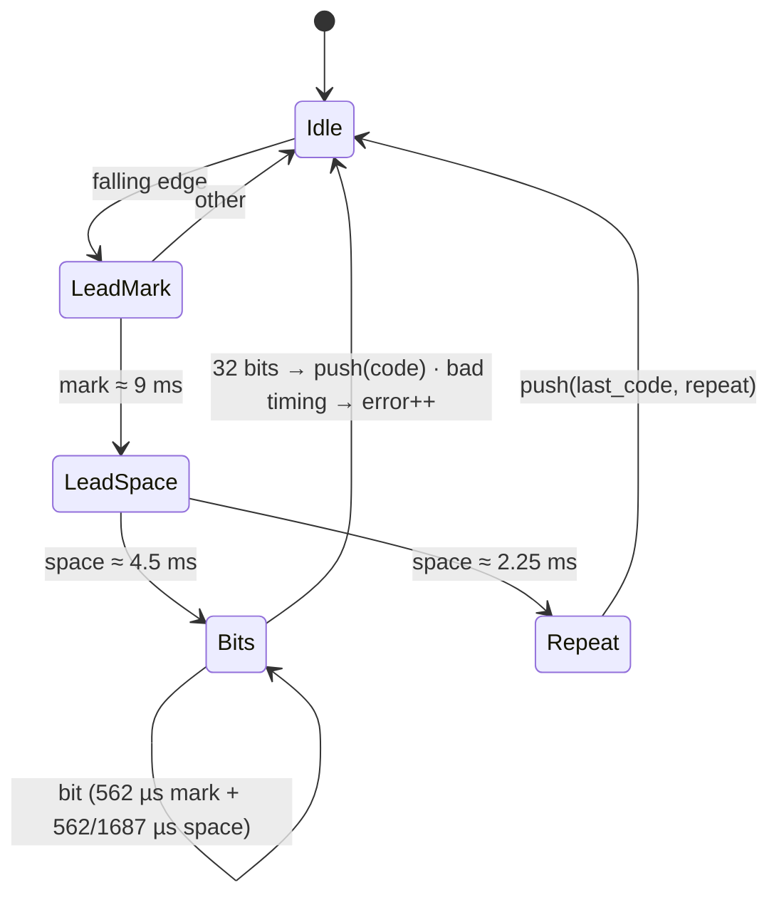

### 6.2 Estimation (`domain/estimation/`, pure)
```mermaid
classDiagram
    direction TB
    class ImuCalibration { <<from Settings>> +int16 gyro_bias[3] +float level_pitch +float level_roll }
    class AttitudeEstimator { -float pitch_, roll_ +float alpha +update(ImuRaw, dt) Attitude }
    class YawIntegrator { -float yaw_deg_ -float bias_dps_ -uint16 still_ms_ +update(gz_raw, dt, stationary) float +rateDps() float +reset(deg) }
    class BumpDetector { -float a_lp_ +update(ImuRaw, driving) BumpResult }
    class LiftDetector { -LiftState state_ +update(ImuRaw, Attitude, TrackSpeeds, PwmRequest) LiftResult }
    class UltrasonicFilter { -uint16 last_[3] +update(EchoState, echo_us, now) Range }
    class BatteryMonitor { -float v_ema_ -float v_idle_, v_load_ -BattState state_ +update(mv, driving, dt) Battery }
    class Attitude { <<struct>> +float pitch_deg +float roll_deg +float accel_g }
    YawIntegrator ..> ImuCalibration
    AttitudeEstimator ..> ImuCalibration
    AttitudeEstimator ..> Attitude
    LiftDetector ..> Attitude
```
- Attitude: complementary filter (α = 0.98) minus level offsets.
- Yaw: integrate `gz − bias`; **auto bias re-estimation** when not driven, encoders still, |rates| < 0.5 °/s for 5 s. *(Not built until §11.8, which replaces this rule.)*
- Bump: |a| minus its low-pass; spike > `bump_g` → bump + direction (x-axis sign).
- Lift: any of vertical transient while not driving · sudden tilt change · (encoders) free-spin vs calibrated on-ground speed; landed = level + steady 1 g for 1 s.
- Ultrasonic: median of 3; Timeout = no obstacle in range; closing speed over 50 ms.
- Battery: EMA volts; sag = idle − loaded; low/critical need 2 s sustained.

### 6.3 Camera head (`domain/camera/`)
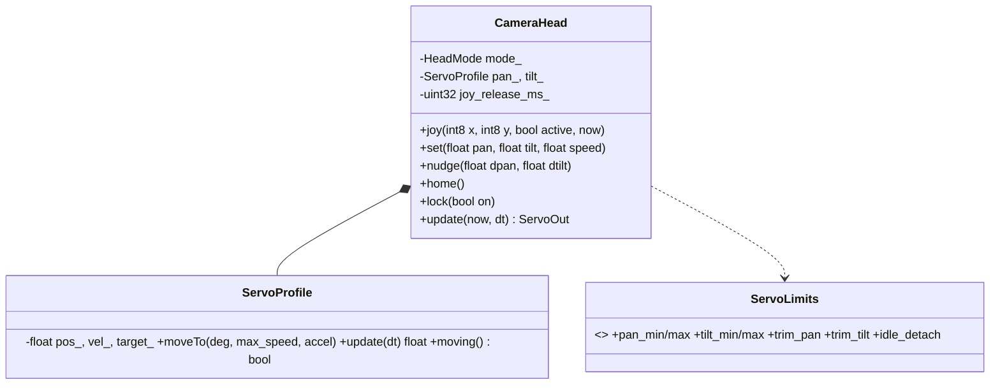
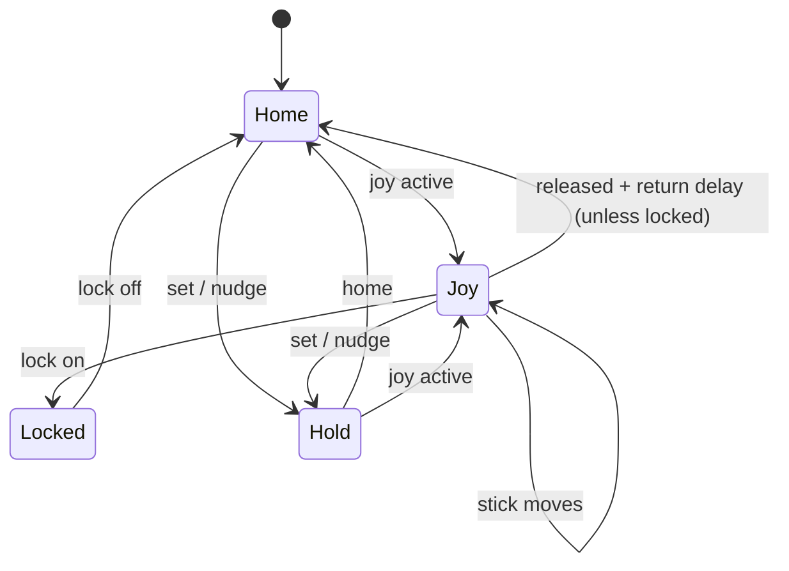
Trapezoidal motion at 50 Hz in µs; limits + trim applied last; optional idle detach at home.

### 6.4 Sound & LED (`domain/ui/`)
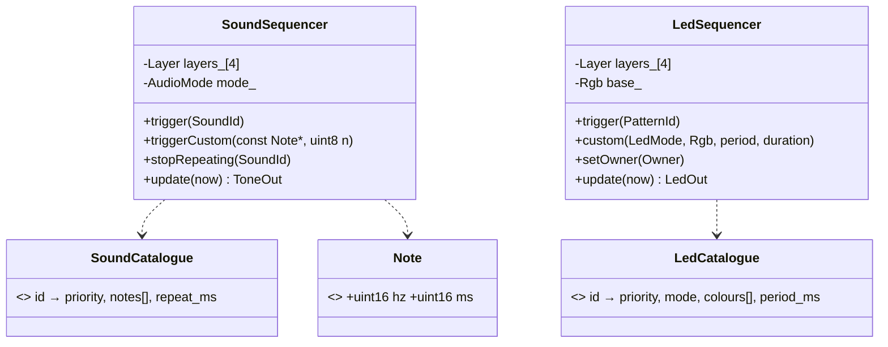
- Highest active layer plays; lower layers pause and resume (not lost).
- Audio mode: Mute → priority 1 only; Quiet → 1–2; Normal → all.
- Catalogues = tables in Spec 2 §A9; new sound/pattern = new table row (OCP).
- LED written only on colour change.

---

## 7. Settings, calibration & self-test (APPROVED)

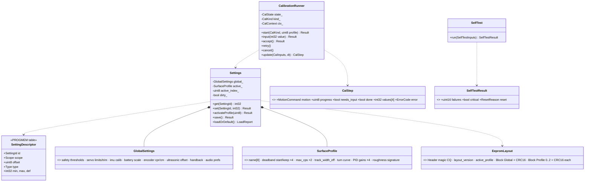
- Only the **active** surface profile in RAM; others stay in EEPROM.
- **CRC per block** → a corrupted block resets alone.
- `SETTING_SET/GET` generic via the descriptor table (range-checked); new setting = table row + struct field.
- EEPROM save **deferred until stopped**; `update()` writes changed bytes only.
- Layout version mismatch → matching blocks kept, others defaulted → `settings_reset` + calibration "missing".
- EEPROM use ≈ 450 / 1024 B.

```mermaid
stateDiagram-v2
    [*] --> Idle
    Idle --> Prepare : start(kind)
    Prepare --> Running : preconditions ok (stopped, battery ok, level)
    Prepare --> Failed : precondition failed
    Running --> AwaitInput : needs measurement
    AwaitInput --> Running : input(value)
    Running --> Result : routine done
    Running --> Failed : fault / timeout / IR / STOP
    Result --> Saved : accept → Settings (+ profile)
    Result --> Running : retry
    Failed --> Idle
    Saved --> Idle
    Running --> Idle : cancel (nothing saved)
```
- Calibration motion = local **Calibration** source in the Arbitrator, below IR (IR/STOP abort); safety supervisor fully active; no deadman.
- 12 routines (CalKind, VARIANT POINT): gyro bias · level · battery divider · deadband · encoder cpr · distance · track balance · track width · turn-rate curve · PID auto-tune (relay) · servo trim · ultrasonic offset; each a step function returning `CalStep`, streamed as `CAL_RESULT`.
- **Self-test (~2 s at boot):** IMU WHO_AM_I + not saturated · battery plausible · ultrasonic echo · encoders quiet at rest · settings CRCs · reset reason. Critical (IMU, battery read) → `Locked`; non-critical → warning + degraded feature; result event + startup sound/LED. **Revision 3:** the lock, the critical/warning list and the re-run are specified in §10.9 (authoritative).

---

## 8. Memory budget & error handling (APPROVED)

| RAM item | Bytes |
|---|---|
| Arduino core + Serial (64+64) | ~160 |
| Wire buffers | ~100 |
| Servo lib | ~30 |
| Settings (global + active profile) | ~200 |
| Controllers (5 PIDs) + motion | ~180 |
| Estimation, safety, arbitration | ~110 |
| Camera head + UI sequencers | ~80 |
| Comms (parser, event queue, writer) | ~140 |
| Scheduler, ISR state, calibration, misc | ~220 |
| Stack reserve | 400 |
| **Total ≈ 1620 B → ~430 B headroom** | |

Flash (~31.5 KB usable): core/Serial ~2.5 K · Wire ~2 K · Servo ~1 K · float math ~3 K · tone ~0.5 K · PROGMEM tables ~1.5 K · own code ~14–18 K → **~25–28 K**.
- `-Os` + LTO; no printf / float printing.
- **Build gates:** fail if static RAM > 1650 B or flash > 30 KB.
- First milestone: skeleton with all drivers, measured.
- Overflow plan (in order): shrink buffers → floats to fixed-point → drop PID auto-tune.

| Category | Example | Behaviour |
|---|---|---|
| Recoverable | bad frame, malformed IR | count, ignore |
| Degraded | encoder fault | OpenLoop + `encoder_fault` |
| Degraded | ultrasonic dead | obstacle brake unavailable flag; speed cap 50 % |
| Degraded | IMU bus error mid-run | retry 3× → `imu_fault`: heading hold off, speed cap 30 %, tilt/lift safety lost → warning sound + flag |
| Critical at boot | IMU missing, battery implausible | `Locked` |
| Fatal | hung task | watchdog reset, reason at next boot |
- `Status`/`Result` enums, no exceptions; `CQ_ASSERT` debug → safe stop + error event, release → counter.
- All error codes from the shared `protocol/errors` registry.

---

## 9. Revision 2 — review fixes (APPROVED decisions; authoritative where earlier sections differ)
Source: independent review (26 findings) + ELEGOO shield schematic `ConquerorCar-Shield-V1.0.pdf`. User decisions: **UART 250000 baud**; **calibration maths moved to the ESP32**.

### 9.1 Hardware facts confirmed from the shield schematic
- **DRV8835 MODE pin tied to VCC → PH/EN mode.** AIN1/PH ← D8, AIN2/EN ← D5 (right); BIN1/PH ← D7, BIN2/EN ← D6 (left). **EN = 0 brakes (slow decay); coast is impossible.**
- **Upload switch S1** on the shield disconnects RX from the ESP32 header for USB uploads.
- Old line-sensor header P7 = A0, A1, A2 + **5 V + GND** → buzzer + right encoder power available there; left encoder A uses **D3 on header P3**.
- Battery divider R1 10 kΩ / R4 1.5 kΩ → scale (10 + 1.5) / 1.5 = 7.667.
- Mode button S2 on D2 with 10 kΩ pull-up; IR on D9; WS2812 on D4 (100 kΩ pull-down); servos D10/D11; ultrasonic D13/D12; MPU6050 on A4/A5 (AD0 unconnected → 0x68).

### 9.2 Link, control-loss and deadman rules (fixes 1, 2)
- **Link loss stops only network-sourced motion.** With owner = **Ir**, link state is ignored (IR works with no ESP32). With owner = **Network** or **Calibration** (started from the network): link lost → SoftStop.
- **Deadman applies only in Primitives `Teleop` with owner = Network** (streamed `drive`/`drive_rate`). TURN/MOVE/IR/calibration are not subject to the 300 ms deadman.
- **On link loss:** `Primitives.cancel()` → `primitive_done{ok:false, reason:LINK_LOST}`; calibration aborted; **nothing resumes** — a new command is required (Spec 0 principle 5).
```mermaid
stateDiagram-v2
    [*] --> Linked
    Linked --> Lost : no valid frame 300 ms
    Lost --> Linked : valid frame
    state Lost {
        [*] --> CheckOwner
        CheckOwner --> SoftStopAndCancel : owner = Network or Calibration
        CheckOwner --> NoEffect : owner = Ir or None
    }
```

### 9.3 Non-blocking EEPROM (fix 3)
- New `app/EepromWriter`: queue of dirty ranges; writes **one byte per scheduler pass** by polling `EECR.EEPE` (never `EEPROM.update` busy-wait); **block CRC written last**; emits `settings_saved` when done.
- Boot with invalid/old layout: defaults applied **in RAM only**; persisted lazily by the writer (never synchronously at boot → no watchdog reset loop).
- Port change: `eeprom::read(...)` + `eeprom::writeByteAsync(addr, value)` + `eeprom::busy()`.

### 9.4 Boot handshake & envelope sync (fix 4, 26)
```mermaid
sequenceDiagram
    participant U as Uno
    participant E as ESP32
    U->>U: .init0 read reset reason (r2 / .noinit marker) · wdt_disable in .init3
    U->>U: load settings (RAM) · self-test (kicks WDT) · WiFi-reset window
    loop every 500 ms until HELLO_ACK
        U->>E: HELLO {fw, proto, caps, reset_reason, commit}
    end
    E->>U: ENVELOPE (from NVS, if any)
    E->>U: HELLO_ACK {proto}
    U->>U: synced = true
    Note over U: before sync: network motion → BUSY; IR allowed
    E->>U: HELLO_REQ (any time) → Uno re-sends HELLO
```
New frames: `0x02 HELLO_ACK {proto u8}` and `0x03 HELLO_REQ {}` (ESP32 → Uno).

### 9.5 Caps applied to targets, not PWM (fix 5)
New pure class **`TargetLimiter`** between Mixer and Ramp:
```
Mixer → TargetLimiter(obstacle scale on forward v, envelope speed_cap, degraded caps) → Ramp → SpeedController
```
- Works in **% of max speed** (so child-play 20 % really is 20 % speed).
- Sets `capped` → `SpeedController` **freezes PID integrators** while capped (no wind-up lurch).
- `SafetySupervisor.gate()` keeps only hard stops (Locked, Halted, SoftStop, stall) + a **final PWM clamp backstop**.
- Degraded caps: ultrasonic fault → 50 %; IMU fault → 30 % (added to Spec 2 A11 + flags).

### 9.6 Encoder fault vs stall (fix 6, 7)
| Condition (track driven above deadband for 0.5 s, no counts) | Other evidence | Verdict |
|---|---|---|
| gyro or other encoder shows the tank moving consistently with this track | yes | **encoder fault** → latch until reboot / re-enable; OpenLoop + `encoder_fault` |
| no gyro motion and other track not moving / also stuck | no | **stall** → safety cuts that track (clears on direction change or 1 s) |
- **Both encoders count rising edges only:** INT1 rising (D3); `PCINT1_vect` reads PINC, detects the **PC1 rising edge** (A1) and ignores falling edges.

### 9.7 Calibration on the ESP32 (fix 8, 19; user decision)
- The Uno runs only **calibration motion scripts** and streams raw samples; the **ESP32 computes results** and writes them back with `SETTING_SET` + `SETTINGS_SAVE`.
- `CalibrationRunner` → renamed **`CalScriptRunner`**: scripts = closed set (VARIANT POINT): `StillSample` (gyro bias, level) · `PwmRamp(track, dir)` (deadband) · `FullSpin` (balance) · `SpinAndArc` (track width) · `RateSteps` (turn curve) · `RelayOscillation` (PID auto-tune) · `DriveCounts(n)` (distance) · `ServoNudge` · `Idle` (battery divider / ultrasonic offset / encoder CPR: input-only, ESP32 asks the user).
- Wire: `CALIBRATE {op: start|cancel, script u8, param i32}`; Uno → ESP32 **`CAL_DATA` (0x95) {script, phase, t_ms u16, v[8] i16}** at 50 Hz (gyro rate, accel, encoder counts, PWM); `CAL_RESULT` reused for script done/fail.
- **`Owner::Calibration`** added to the Arbitrator: below IR (IR/STOP abort), above Network (network motion → BUSY while calibrating). Calibration **refused while an envelope is active**.
- IR `#` hold 3 s → `cal_request` event to the ESP32 (no ESP32 → error beep).
- Calibration **status bits** (missing/ok per item, 2 bits × 12) stored on the Uno; **"stale"** decided by the ESP32.

### 9.8 IR remote full design (fix 9)
| Key (remote A NEC code) | Action | Hold semantics |
|---|---|---|
| ▲ `0x00FF629D` / ▼ `0x00FFA857` | Drive v = ±ir_speed, w = 0 (heading hold) | repeats keep alive; stop 200 ms after last repeat |
| ◀ `0x00FF22DD` / ▶ `0x00FFC23D` | Spin w = ±ir_speed | same |
| OK `0x00FF02FD` | STOP + release to None | — |
| 1 `0x00FF6897` / 3 `0x00FFB04F` | `CameraHead::jog(pan ∓rate)` | while held |
| 2 `0x00FF9867` / 8 `0x00FF38C7` | `jog(tilt ±rate)` | while held |
| 5 `0x00FF18E7` | camera home | — |
| 4 `0x00FF30CF` / 6 `0x00FF7A85` | ir_speed −/+ 10 % (20–100, default 50), beep pitch ∝ speed | — |
| 7 `0x00FF10EF` | mute toggle | — |
| 9 `0x00FF5AA5` | battery check: LED colour + 3/2/1 beeps | — |
| 0 `0x00FF4AB5` | gyro TURN by 180° | — |
| * `0x00FF42BD` | parking beeps toggle | — |
| # `0x00FF52AD` | (hold 3 s) → `cal_request` to ESP32 | hold timer |
Codes are the 32-bit values as shifted in by the decoder in received order. Codes verified against the original ELEGOO firmware constants (5, 8, 9 corrected and 0/*/# filled in on 2026-10-11, Plan B Task 14). Keys are decoded by `IrController` (a switch on the code; `ir_speed_pct` lives in `IrController`); camera jog is repeated `CameraHead::nudge` at 60 °/s (no separate jog method).

### 9.9 Annunciator — when sounds and LED patterns play (fix 10)
New pure class **`Annunciator`**: a PROGMEM table **condition → (SoundId, PatternId, priority, continuous?)** evaluated at 50 Hz from flags/events (tilted, lifted, batt_low/critical, bump, stall, link lost, reversing, start forward, turning, owner, calibrating, startup/ready/selftest fail).
- Continuous conditions keep a layer active; parking beeps use a **parameterised repeat interval** = f(distance).
- Owner colour: Ir (local) = purple; Network owner colour from **OWNER_HINT** (human = green, AI = cyan).
- **TONE notes copied into an owned buffer** (10 × 4 B) — never pointing into the frame buffer.

### 9.10 WiFi-reset button (fix 11)
`app/WifiResetDetector`: active only in the boot window; if D2 is held at boot and stays held for **5 s** → `WIFI_RESET_REQ` (0x96) sent, **re-sent every 500 ms until acked** (ACK frame), confirmation sound + LED; one-shot per boot.

### 9.11 Telemetry encoding (fix 12)
TELEM_FAST (≈ 46 B):
| Field | Wire | Scale / sentinel |
|---|---|---|
| uno_ms | u32 | ms |
| yaw | u16 | 0.01°, 0–35999 (CCW positive) |
| yaw_rate | i16 | 0.1 °/s |
| pitch, roll | i16 | 0.01° |
| spd_cmd L/R | i8 | % |
| spd_act L/R | i8 | %, **−128 = n/a** (no encoders) |
| pwm L/R | i16 | −255..255 |
| dist_mm | u16 | mm, **0xFFFF = clear (no obstacle)**, **0xFFFE = sensor fault** |
| closing_cm_s | i16 | cm/s (for ESP32 TTC) |
| pan, tilt | i16 | 0.1° |
| enc L/R | i32 | counts |
| flags | u16 | bit0 blocked · 1 lifted · 2 tilted · 3 stall_l · 4 stall_r · 5 cam_moving · 6 turn_limited · 7 capped · 8 soft_stop · 9 halted · 10 locked · 11 imu_fault · 12 us_fault · 13 encoder_fault · 14 calibrating · 15 synced |
| prim, prim_pct | u8, u8 | primitive kind, % |

TELEM_SLOW (≈ 40 B): uptime_s u32 · reset_reason u8 · batt_mv u16 · driving u8 (for ESP32 sag) · temp i16 (0.01 °C) · owner u8 · flags2 u32 (batt_low, batt_crit, link_lost, brake_off, muted, quiet, envelope, deadman, …) · accel_var u16 · loop_load u8 · loop_max_us u16 · free_ram u16 · err_frames u16 · err_i2c u16 · settings_crc u16 · envelope u8×3 · **profile_idx u8** · **cal_status 3 B** · **hw u8** (encoders_enabled, imu_ok, us_ok).
- New pure **`AccelVariance`** estimator (IMU task) → `accel_var`. Sag computed by the ESP32 from batt_mv + driving.
- **Sign convention:** yaw and ω are **CCW-positive**; `w > 0` turns left. Clients map "stick right" to `w < 0`.

### 9.12 Layering fixes (fix 13, 25)
- Value types (`EncoderSnapshot`, `ImuRaw`, `IrEvent`, `Rgb`, `ResetReason`, …) move to **`src/types/`**, shared by ports and domain; domain still never includes `ports/`.
- `util/progmem.h` shim: PROGMEM macros on AVR, plain const on host.
- **Safety by type:** `motor::write(const PwmOutput&)`; `PwmOutput` has a private constructor, `friend class SafetySupervisor` → nothing else can produce motor commands.
- `HeadingController::update(const HeadingInputs&)` (parameter struct; ≤ 4 params rule).
- Naming: diagrams use `name_`; **code uses the standard's `m_` prefix**.

### 9.13 Timing exceptions & reset reason (fix 14, 15, 22, 24)
- **Documented exception:** the MPU6050 burst read (~380 µs at 400 kHz) may exceed the 50 µs busy-wait rule; Wire timeout via `setWireTimeout(3000, true)` (pin AVR core ≥ 1.8.3) + **I2C bus recovery** (9 SCL clocks) on timeout.
- Battery ADC: **one sample per tick** (10 Hz), averaged over 4 ticks.
- Pitch/roll (atan2/sqrt) computed at **50 Hz**; gyro integration stays at 200 Hz.
- Reset reason: read **r2 in `.init0`** (Optiboot ≥ 6) or a **`.noinit` marker** set before intentional WDT resets; `wdt_disable` in `.init3`; may report `Unknown` with old bootloaders (documented).
- Self-test kicks the WDT between steps.
- Safety supervisor runs at **100 Hz** (Spec 2 A2 updated).
- **WS2812** writes rate-limited to ≤ 20 Hz and on-change; accepted servo jitter ≤ ~2.7° transient.
- `MOTOR_PWM_244HZ` build option: the clock port returns corrected µs/ms, so ISRs (NEC, echo) stay correct.

### 9.14 Motor port contract (fix 16)
`motor::write(PwmOutput)`: −255..255; **0 = brake (slow decay)** — PH/EN mode, coast impossible. `StopMode::Smooth` = ramp to 0 over ~300 ms; `Brake` = immediate 0.

### 9.15 Lift detection (fix 17)
Lifted if **any**: sustained vertical acceleration deviation > 0.25 g for > 150 ms (**regardless of driving**) · |a| < 0.6 g (falling/held) · sudden tilt change > 15° within 300 ms · (encoders) free-spin. **Bumps rejected** by duration (< 50 ms spikes) and shape. Landed = level + steady 1 g for 1 s.

### 9.16 Ultrasonic fault handling (fix 18)
`EchoState {Pending, Ready, Clear, NoEcho}`:
- **No rising edge** within 2 ms of trigger → `NoEcho` (sensor fault). 3 consecutive → `us_fault` → obstacle brake **unavailable** → degraded cap 50 % + flag + warning.
- Echo high > 25 ms → `Clear` (nothing in range).
- **No new trigger while echo is still high** (clone modules hold up to 200 ms).
- Self-test: fault only on `NoEcho`, not on `Clear` (open rooms pass).

### 9.17 Settings & profile ownership (fix 20, 21)
- **SettingDescriptor table** (PROGMEM): `id u8 · scope (Global/Profile) · type · unit · fixed-point scale (e.g. batt_low in mV, bump in mg, gains ×1000) · min · max · default`.
- **Profile names live on the ESP32** (NVS); the Uno stores profiles by index 0–2 only.
- Roughness signature and battery sag: **ESP32 only** (removed from the Uno).
- `Envelope.apply`: setting `lock_brake = 1` **forces the obstacle brake on**; Uno rejects `BRAKE off` while locked (defence in depth); who may loosen = ESP32 role check.
- PIDs **reference gains in the active profile** (no duplicated gain copies).

### 9.18 Comms additions (fix 23, 26)
- **UART 250000 baud** (0 % error at 16 MHz with U2X; supported by the ESP32).
- Parser buffer **is** the frame (dispatch by reference; no duplicate `Frame.payload`): one 52 B raw buffer (len, type, seq, payload, crc) that also holds bytes waiting for a resync replay; one shared 52 B TX encode buffer.
- **Parser work per loop pass is bounded in steps, not bytes** (`kPollSteps = 64`): pending replay is drained first, new UART bytes are read only while nothing is pending. Worst case per pass (host model ~40 cycles/step, ~70 cycles/CRC byte; CRC bytes ≤ steps + 51 carried over): 64 × 40 + 115 × 70 ≈ 10.6 k cycles ≈ 0.66 ms; an adversarial search including resync scan/memmove found 10.8 k cycles ≈ 0.67 ms. Valid traffic costs one step per byte, so 64 bytes per pass — one full 64 B RX buffer (≈ 2.5 ms at 250000 baud) — against < 1 kB/s of real inbound traffic. A crafted flood overflows the RX buffer instead of stalling the 10 ms tick.
- TxScheduler priority: **ACK > WIFI_RESET_REQ > EVENT > HELLO > CAL_DATA > TELEM_FAST > TELEM_SLOW**.
- **NOT_OWNER / BUSY rejection events rate-limited** to 1 per 500 ms per source (a 20 Hz DRIVE stream cannot flood the queue).
- **Uno owner `Network → None`:** no network motion command for 1 s and Primitives idle (bookkeeping only; human/AI handback is the ESP32's).
- **EventKind → protocol event mapping** (generated table): e.g. `primitive_done a = kind | ok<<8, b = reason code`; `selftest a = failure bitmask, b = critical`; `bump a = mg, b = direction`.

### 9.19 Revised control tick sequence
```mermaid
sequenceDiagram
    participant C as ControlTask
    participant A as Arbitrator
    participant P as Primitives
    participant H as HeadingController
    participant X as Mixer
    participant L as TargetLimiter
    participant R as Ramp
    participant ES as EncoderSpeed
    participant V as SpeedController
    participant F as SafetySupervisor
    C->>ES: update(encoder snapshot, cmd signs)
    C->>A: update(now, link, inputs)
    A-->>C: command + owner
    C->>P: update(command, yaw, travelled)
    P-->>C: MotionTarget
    C->>H: update(HeadingInputs)
    H-->>C: Δ
    C->>X: mix(v, Δ)
    X-->>C: track targets %
    C->>L: limit(targets, obstacle, envelope, degraded)
    L-->>C: limited targets + capped
    C->>R: apply(targets, accel cap)
    C->>V: update(targets, speeds, batt, capped)
    V-->>C: PwmRequest
    C->>F: gate(request, safety inputs)
    F-->>C: PwmOutput (only constructible here)
    C->>C: motor::write(PwmOutput)
```

### 9.20 Revised memory budget
| RAM item | Bytes |
|---|---|
| Core + Serial (64+64) | ~160 |
| Wire (5 × 32) | ~160 |
| Servo | ~30 |
| Settings (global + active profile, gains referenced) | ~200 |
| Controllers + TargetLimiter + motion | ~170 |
| Estimation (+ AccelVariance), safety, arbitration | ~130 |
| Camera head, UI sequencers, Annunciator, TONE buffer (41) | ~140 |
| Comms (parser = frame: raw 52 + state ≈ 64 — the resumable step budget adds no RAM; TX buffer 52, event queue 8 × 6) | ~160 |
| Scheduler, ISR state, EepromWriter queue, CalScriptRunner, misc | ~190 |
| Stack reserve | 400 |
| **Total ≈ 1740 B → ~300 B headroom** | |
Flash: calibration maths moved to the ESP32 saves an estimated 3–4 K → own code ~12–15 K, total ~23–26 K. Build gates unchanged (RAM ≤ 1750 B static, flash ≤ 30 KB).

### 9.21 Alignment with ESP32 LLD Revision 2
- `CALIBRATE` carries `profile u8` (as in Spec 1).
- `WifiResetDetector` → **`BootButtonDetector`**: at boot, held 5 s → `WIFI_RESET_REQ` (0x96); held **15 s** → `ADMIN_RESET_REQ` (0x97); both resent every 500 ms until ACK; distinct confirmation sounds/LED.
- After the boot window, a short press of D2 → event **`button_press`** (used by the ESP32 for first-run physical confirmation).
- New error reasons/events from the ESP32 revision are added to the shared registry.

### Hardware revision (2026-10-11): Smart Car Shield V1.1 — dual-shield support (authoritative)
User confirmed the Uno shield is **ELEGOO SmartCar Shield V1.1** (Smart Robot Car V4 family); the ESP32 board is **V1.0** (no IO13 LED). **Motor driver chip confirmed by the user: TB6612FNG (2026-10-11).** Shield probe in bench bring-up still verifies the pin map (D3 standby, direction pins).

| Function | **SHIELD_SMARTCAR_V11_TB6612 (default)** | SHIELD_TANK_DRV8835 |
|---|---|---|
| Driver | TB6612FNG | DRV8835 (PH/EN, MODE high) |
| PWM right (A) / left (B) | D5 / D6 | D5 / D6 |
| Direction A / B | **D7 / D8** | D8 / D7 |
| Standby | **D3 (HIGH = enabled; LOW = coast)** | — |
| PWM 0 | short brake | brake |
| Coast available | yes (STBY low) | no |
Source for the V1.1 pin map: ELEGOO V4 driver code (third-party copy `raccrobotics/libelegoo-edu`); verify against the board.

**Pin plan change (both shields):** D3 is no longer free → **left encoder A on A1, right encoder A on A2** (both PCINT1, rising edges via PINC diff), **buzzer on A0**; the old line-sensor header (A0–A2 + 5 V + GND) carries buzzer + both encoders. D3 = motor standby (TB6612) or unused (DRV8835).
Firmware: `drivers/board_config.h` build option selects the shield; only the motor driver class + pin map differ; `StopMode::Coast` enabled when the shield supports it.

### Decisions (2026-10-11): motor driver config + Uno OTA
- ELEGOO ships the SmartCar Shield V1.1 with **either TB6612FNG or DRV8835** (TB6612 used during the DRV shortage). **Both supported via a build option** (`SHIELD_SMARTCAR_V11_TB6612` default for this tank, `SHIELD_SMARTCAR_V11_DRV8835` / `SHIELD_TANK_DRV8835`); flash the firmware matching the chip. The bench shield probe still verifies the pin map and warns if the build doesn't match the board (motors only run with D3 HIGH → TB6612).
- **Uno updates stay USB-only** (shield switch S1). Reason recorded: the ESP32↔Uno connector P1 carries only RX(IO33)/TX(IO4)/GND/VCC — no reset line, so the ESP32 cannot put the Uno into its bootloader. Future option (not planned): one wire ESP32 pad T14 (IO13) → 100 nF → Uno RESET + STK500 flashing from the ESP32 (esp-link approach).
- ESP32 self-OTA unchanged (dual partitions + rollback).
- 2022.03.23 ELEGOO package reviewed: its ESP32-WROVER-Camera-V1.2 schematic is identical to the one already used.

### Decision (2026-10-11): mounting and compass
- Compass dropped (no magnetometer support anywhere). IMU = MPU6050 on the shield socket.
- Stock baseplate mount; IMU axis mapping constant in `board_config.h`, measured at bring-up; bench mount check verifies (gravity → up axis, hand rotation → yaw sign).

### Decision note (2026-10-11): frame parser resync (see §5.2)
`FrameParser` must resync like the Plan A reference (`conqueror_protocol.framing`): when a length byte is out of range and is itself 0xAA, treat it as a new start of frame; after a CRC mismatch, rescan the bytes received after the false start for the next 0xAA, so noise or a cut-off frame does not cost the next good frame.
API consequence (agreed 2026-10-11 in the Plan A final review): a replay can complete more than one frame from one received byte, so `feed(byte)` returned the first ready frame and the caller drained `next()` until false (superseded by the bounded-replay note below; current API in §5.1). The single `raw_[52]` buffer holds both the frame and the bytes waiting for replay (+3 B over the old 48 B buffer + header fields); the replay is iterative and bounded. `bad_crc` / `bad_len` count rejection events, so a replayed byte can be counted again. The Plan B host tests mirror the three Python resync tests.

### Decision note (2026-10-11): bounded replay work per loop pass (supersedes the "drain `next()` until false" API above)
Review finding: `commsPoll` bounded received bytes (64), not replay work. One crafted byte can trigger about 700 parser steps and about 26 CRC passes (≈ 4.6 ms at 16 MHz; the earlier "~1.4 k steps" figure was wrong), and a sustained crafted stream costs ≈ 2.2 k cycles per byte, so 64 bytes took ≈ 9 ms of the 10 ms tick — reachable through the unauthenticated ESP32 WiFi bridge. Also, `feed()` discarded an undrained replay.
Decision (review option a): the replay is resumable. `bool next(uint8_t& budget)` runs at most `budget` steps; `bool pending()` says bytes remain; `feed()` is legal only when `!pending()` and refuses (returns false, changes nothing) otherwise — simpler than appending, which could need a 53rd buffer byte. `commsPoll` spends at most 64 steps per pass, pending replay first (≈ 0.67 ms worst case, §9.18). Frames, order and counters stay identical to `conqueror_protocol.framing` for any budget split. Plan B Task 2 host tests add: an adversarial nested-header stream matched against the Python parser at budgets 1/7/64/255, a check that no `next(budget)` call exceeds its budget, and pending replay surviving across calls with `feed()` refused meanwhile.

### Decision notes (2026-10-11): Plan B pre-flight rulings — link, settings, IMU, battery, reset reason
Agreed while polishing Plan B Tasks 1–5 (rulings R8–R12, R16 and review fixes); where they differ, these refine §5.4, §5.5, §6.1, §6.2, §9.13 and §9.17.
- **Link events (§5.5):** `LinkSession::poll()` (10 ms) reports `kLost` on alive→dead (and runs the link-lost handling) and `kRestored` on dead→alive **only after a loss**; the first contact after boot raises no `LINK_RESTORED`.
- **TX order (§5.4):** the TX pump peeks the head ACK/EVENT, sends, and pops only after the send succeeded, so a full TX buffer never reorders ACKs or events (no push-back to the tail).
- **Settings ordering invariants (§9.17):** `Settings::set` also rejects with `SETTING_OUT_OF_RANGE` a value that would break `pan_min ≤ pan_max`, `tilt_min ≤ tilt_max`, `obstacle_stop < obstacle_slow` or `batt_crit < batt_low`, checked against the current values. The hub must order its writes (e.g. raise `pan_max` before `pan_min`). The settings CRC for slow telemetry is computed at 1 Hz, not per settings pass.
- **Attitude rate (§9.13):** `Attitude::update()` runs at 200 Hz; it integrates the gyro every call and applies the accelerometer correction (`atan2`/`sqrt`) every 4th call (50 Hz) with α = 0.92 per correction (≈ 0.98⁴, same ~0.25 s time constant). Sign convention: the accelerometer reads specific force (+1 g up when level), so nose up gives `ax = +sin θ` and `pitch = atan2(ax, √(ay²+az²))`; +gy = nose down.
- **I2C recovery (§9.13):** on a Wire timeout the IMU driver clocks SCL up to 9 times until SDA is released, sends a STOP and restarts the TWI (~100 µs of short busy-waits, a documented exception like the burst read). After 10 consecutive failed reads the IMU task raises `IMU_FAULT`, sets `imu_ok = false` (no more 200 Hz reads that could each cost a 3 ms timeout) and retries `begin()` once per second; a successful re-init clears the fault.
- **Battery averaging (§9.13; supersedes the EMA in §6.2 and the driver-side average in §6.1):** the battery ADC driver returns one raw sample per 10 Hz tick; `BatteryMonitor` (domain) averages the last 4 samples. Low/critical persistence (2 s) and recovery hysteresis (+150 mV) unchanged.
- **Reset reason (§9.13):** r2 from Optiboot ≥ 6 is trusted only when it holds nothing but reset-flag bits (`r2 != 0 && (r2 & ~0x0F) == 0`); otherwise, and with the stock Uno bootloader (which clears MCUSR), the reason is `Unknown`. The `.noinit` intentional-reset marker is consumed (cleared) on every boot.

### Decision notes (2026-10-11): Plan B pre-flight rulings — ultrasonic, safety, motion (Tasks 5–10)
Agreed while polishing Plan B Tasks 5–10 (rulings R1–R7, R17 and review fixes); where they differ, these refine §3.4, §4, §9.4, §9.5, §9.6, §9.16 and §9.18.
- **Ultrasonic failure definition (§9.16, R17):** a *failed measurement* is `NoEcho` (no rising edge within 2 ms of the trigger) or an echo line held high so long that no ping could be sent for more than 250 ms (5 skipped 20 Hz pings — clones hold up to 200 ms; an unplugged sensor reads high through the `INPUT_PULLUP`). 3 consecutive failed measurements → `us_fault`. `Clear` (echo high > 25 ms, nothing in range) and up to 250 ms of skipped pings are never failures, so open rooms do not fault. The driver sends no trigger while the echo is high and then reports `Pending`; the counting lives in the pure `UltrasonicFilter` (host-tested).
- **Sync gate and idle release (§9.4, §9.18, R2):** the `Arbitrator` holds `synced` (copied from `LinkSession::synced()` every control tick); before sync `requestNetwork()` and `beginCalibration()` return `BUSY`, IR is unaffected. `tick(now, link_alive, primitive_busy, cfg)` releases owner Network → None when no network motion command arrived for 1 s, no DRIVE stream is active (the deadman fires first) and no primitive runs; it only changes the owner (`CONTROL_CHANGED`). Link loss also clears `synced`, so network motion is BUSY again until the next HELLO_ACK.
- **Stalled track cut (§9.6, R3):** `SafetyInputs.stall_mask` (bit 0 left, bit 1 right) makes `SafetySupervisor` output 0 on a stalled track (the other track keeps its command). Because the cut hides the requested direction, the app keeps both the PWM asked of the supervisor (`req_pwm_l/r`) and the PWM applied (`out_pwm_l/r`); `EncoderHealth` detects on the applied PWM and clears a stall on a reversal of the requested PWM. An ultrasonic fault (`dist_mm = 0xFFFE`) never blocks in the supervisor; the 50 % degraded cap is a target cap (`TargetLimiter`).
- **Encoder fault vs stall timing (§9.6, R3):** detection window 0.5 s of drive above `keep + 15` PWM with no edges (the earlier plan used 300 ms); the keep value is taken per track *and direction*. A stall is held for 1 s regardless of the (cut) output, clears early when the requested PWM reverses, and must then be re-detected from scratch (another 0.5 s). Faults stay latched.
- **Calibration abort (§9.7):** a network STOP aborts a running script (`CAL_RESULT CAL_CANCELLED`), as do IR and link loss; the aborted result reports the progress reached, not 0. Starting a script clears the stored DRIVE values so an old DRIVE never resumes after it.
- **Mixer (§3.4, R5):** `mix()` applies turning priority — when `|v| + |w|` exceeds 100 %, `|v|` is reduced by the excess so `L − R` is kept (the earlier plan scaled both tracks by a ratio) — and the pivot fallback: with setting `pivot_fallback = 1`, a non-zero inner target (strictly smaller magnitude; a spin has none) below `keep_pct` becomes 0. `keep_pct` is not defined elsewhere; it is the track speed % at the deadband keep PWM, approximated as `mean(deadband_keep) × 100 / 255` (speed ∝ PWM). The calibration script `RATE_STEPS` keeps its own fixed ratio mapping (it measures the raw turn curve, not the mixer).
- **Degraded caps (§9.5, §9.16, R1):** `Limits.degraded_cap_pct` (100 none, 50 ultrasonic fault, 30 IMU fault, the minimum when both) is applied with the envelope cap in the `TargetLimiter` (cap = min of the two, sets `capped` → flag `capped`). The supervisor itself never treats `0xFFFE` as an obstacle.
- **Ramp from rest:** a ramp at 0 accelerates toward a target of either sign (the earlier sign test used the decel rate for the first step toward a negative target).
- **Integrator freeze (§9.5, R4 — deviation kept on purpose):** `SpeedController::update(…, bool moving, bool capped)` freezes the speed PID integrator while the TargetLimiter reports `capped` (as §9.5 says) **and also** while the PWM output sits on its limit (envelope-derived `pwmLimitForCap` or 255). The second condition is extra anti-windup not in §9.5; it stops wind-up when a track is held or the battery is weak although nothing is capped.
- **Primitive admission (§3.3, R6, R7):** TURN is refused with `INVALID_COMMAND` when its speed (and radius) give a maximum turn rate below the profile floor of 15 °/s (e.g. a 5 % spin or a 10 % arc on 50 cm), or when the TurnMode is neither BY nor TO; MOVE needs encoders **and** the IMU (it always holds a gyro heading) and is otherwise refused with `UNAVAILABLE`, like every TURN without the IMU. The ESP32/hub should offer only turn speeds that reach 15 °/s.

### Decision notes (2026-10-11): Plan B pre-flight rulings — control pipeline, camera, UI, input (Tasks 11–15)
Agreed while polishing Plan B Tasks 11–15; where they differ, these refine §3, §4, §9.2, §9.5, §9.8 and §9.18.
- **Envelope accel cap (§4, §9.5):** the ramp uses `min(envelope accel_cap, accel_limit)` (accel_cap 0 = no cap); an envelope can only tighten the global limit, never loosen it. Deceleration stays 2 × that value.
- **Deadman stop timing (§9.2):** `DEADMAN_STOP` fires 300 ms after the last DRIVE/DRIVE_RATE; the tracks then follow the SoftStop ramp, so they are stopped ≤ ~420 ms after the last command (not ≤ 330 ms). `flags2.deadman` stays set from `DEADMAN_STOP` until the next accepted DRIVE/DRIVE_RATE.
- **Stalled track and the speed PID (§9.5, §9.6):** while `EncoderHealth` reports a stall the speed PID integrator of that track is frozen (same `capped` input as the TargetLimiter cap), so it does not wind up while the supervisor cuts the track and does not lurch when the stall clears.
- **IMU lost during a primitive (§3.3, R7):** a running TURN is ended with `UNAVAILABLE`; a running MOVE continues without heading hold (w = 0) under the 30 % degraded cap.
- **Teleop after an owner change (§9.18):** stored DRIVE/DRIVE_RATE values are cleared when the owner becomes None or Calibration (idle release, STOP, link loss, calibration), never resumed. The IR takeover (cancel primitives, clear DRIVE_RATE) happens in the input task *before* the IR command is applied, so a TURN started by the IR `0` key as the first IR key keeps running.
- **Camera power-on (§9.9):** the servo start position is unknown at boot, so `cameraInit` writes the home pulse before attaching and the head snaps to 90/90 once; every later move goes through the `ServoProfile`. Camera entry points are declared in `app/camera_api.h` (handlers, `configureCamera`) and `app/tasks.h` (`cameraInit`, `cameraTask`).
- **Alarm LED re-pick (§9.9):** the alarm layer is re-selected on any change of tilted, lifted, batt_crit, batt_low or selftest_critical (priority: self-test critical solid > tilted/lifted 250 ms blink > batt_crit 1000 ms blink > batt_low pulse), so the pattern always shows the highest remaining cause.
- **WS2812 timing (§6, R14):** one extra `rjmp` after `dec` gives T1L ≈ 440 ns (spec ≥ 300 ns) and 20–21 cycles per bit ≈ 1.3 µs; one LED write keeps interrupts off ≈ 32 µs (the §2 port table's ~30 µs), still shorter than one 250000-baud UART byte. To be confirmed with a scope (hardware checklist).
- **TONE with n = 0** is `INVALID_COMMAND` (not BUSY).

### Decision notes (2026-10-11): Plan B final consistency check
- **Reset reason without an intentional-reset marker (§9.13):** v1 has no software reboot path (no REBOOT frame, Uno updates are USB only), so the `.noinit` "intentional WDT reset" marker and `watchdog::markIntentionalReset()` are dropped. The reason comes only from MCUSR / plausible Optiboot r2; a watchdog reset is always a hang. Re-add the marker together with a reboot command if one is ever introduced.
- **UI route handlers:** `onLed/onSound/onTone/onAudioMode` are declared in `app/ui_api.h` (like `camera_api.h` and `motion_api.h`); `app/tasks.h` keeps only task/init entry points.

### Decision note (2026-10-12): tilt cut-off
- 2026-10-12 owner: `tilt_limit` default 45° (tank stable to ~75°), tilt must persist 300 ms. `LiftDetector` confirms `kTilted` only after the tilt has stayed over the limit for `kTiltHoldMs = 300` (separate since-timestamp; lift/land logic untouched). Release stays immediate below limit − 5° (hysteresis unchanged, no hold; simplest). Plan B Task 4 updated (extra test, host total 132).

## 10. Revision 3 — Override mode and catalogue (2026-10-12)
Source: design-notes §25 (catalogue update from the old firmware) and §26 (Safety Override), spec 02 §A6.1/§A8/§A9, protocol defs (frame `SAFETY_OVERRIDE` 0x43, event kind 27, `flags2` bit 8, settings 61–65). Authoritative where earlier sections differ. Class names follow Plan B (the code-level design), which refines §4/§6.4.

### 10.1 What changes, per class
| Class (Plan B task) | Change |
|---|---|
| **`SafetyOverride`** (new, `domain/safety/safety_override.{h,cpp}`, Task 6) | Owns the Override state: who enabled it (*binder*), entry time, last driving time; admission rules; expiry; one pending event. Pure, no `virtual`, no heap, ~12 B RAM. |
| `SafetySupervisor` (Task 6) | One addition: `SafetyInputs.selftest_locked` → zero output, `SafetyStatus.locked` + `halted` (§10.9). Its `SafetyInputs.brake_on` is now the *effective* brake `SafetyOverride::brakeOn(envelope.brakeOn())`; `tilted` comes from `LiftDetector` fed with the effective tilt limit. `lifted`, `batt_critical` and `stall_mask` never consult the override. |
| `TargetLimiter` (Task 8, wired Task 11) | Its obstacle slow zone gets the same effective brake flag (no slow-down while Override is on). Envelope and degraded caps unchanged. |
| `LiftDetector` (Task 4) | **Unchanged code**; the IMU task passes `override.tiltLimit(tilt_limit, override_tilt_deg)` instead of `tilt_limit`. The 300 ms hold and the release below limit − 5° stay. |
| `Arbitrator` (Task 6) | Unchanged API. The app reports its owner changes to `SafetyOverride::onOwner()`. |
| `Envelope` (Task 6) | `lock_brake` byte is a bit set (`EnvelopeFlagBit`: bit 0 lock brake, bit 1 child play; other bits → `INVALID_COMMAND`); new `childPlay()`. Only `childPlay()` gates Override: a child-play ENVELOPE applied while Override is on ends it first (`ENVELOPE`); an adult envelope (set or cleared) keeps Override, and its speed/accel caps keep applying (owner decision 4, 2026-10-12). |
| `IrController` (Task 14) | `*` tap acts on release (parking beeps); `*` held `kOverrideHoldMs = 2000` → `toggle_override` once per hold. |
| `BatteryMonitor` (Task 5) / settings | Recovery hysteresis = setting `batt_hyst` (200 mV) for low **and** critical (replaces the fixed +150 mV and the §4.4 +0.3 V); `batt_low` default 7.2 V. |
| `catalogues` (Task 13) | Flat PROGMEM note pool + `(id, offset, count)` index; old melodies as `SoundId` 12–23; STARTUP = old boot sweep (14 notes) → `SoundSequencer::kMaxNotes` 10 → 14 (TONE stays ≤ 10). |
| `LedSequencer` (Task 13) | New mode-independent brightness: `scale(Rgb, level)`; `kBase` layer **breathes** (triangle 2 s; 1 s when the battery is critical) when idle and is **speed-scaled** while driving; every output is capped by `led_max`. |
| `Annunciator` (Task 13) | New `AnnState` inputs `override_on`, `override_seq`, `toggle_seq`, `toggle_on`, `driving`, `speed_pct`; new rules: Override pulse layer, toggle-confirm blinks, obstacle-stop red blink + safety chirp, tilt siren from the safety chirp. |
| `GlobalSettings` (Task 3) | Fields `override_idle_s`, `override_max_s`, `override_tilt_deg`, `led_max`, `batt_hyst`. |

```mermaid
classDiagram
    direction LR
    class SafetyOverride {
      -bool m_active
      -Binder m_binder
      -uint32 m_since_ms
      -uint32 m_last_drive_ms
      -bool m_ev_pending
      -bool m_ev_on
      -OverrideReason m_ev_reason
      +requestNetwork(bool on, Source src, const Gate&, uint32 now) AckStatus
      +requestIr(const Gate&, uint32 now) AckStatus
      +onOwner(Owner owner)
      +onNetworkMotion(Source src, bool driving, uint32 now)
      +onIrMotion(bool driving, uint32 now)
      +onOwnerHint(OwnerHintValue hint)
      +end(OverrideReason why)
      +tick(uint32 now, const Config&)
      +active() bool
      +binder() Binder
      +brakeOn(bool configured) bool
      +tiltLimit(uint8 normal, uint8 relaxed) uint8
      +takeEvent(bool& on, OverrideReason& why) bool
    }
    class Gate {
      <<struct>>
      +bool synced
      +bool child_play
      +bool fault_latched
      +Owner owner
    }
    class Config {
      <<struct>>
      +uint8 idle_s
      +uint16 max_s
    }
    class Binder {
      <<enum>>
      kNone
      kIr
      kNetwork
    }
    class SafetySupervisor {
      +apply(pwm_l, pwm_r, const SafetyInputs&, SafetyStatus&) PwmOutput
    }
    class SafetyInputs {
      <<struct>>
      +bool lifted
      +bool tilted
      +bool batt_critical
      +bool brake_on  «effective»
      +uint16 dist_mm
      +uint8 stop_cm
      +uint8 stall_mask
    }
    class LiftDetector {
      +update(az, pitch, roll, tilt_limit_deg, now) Change
    }
    class Envelope {
      +set(speed_cap, accel_cap, flags) AckStatus
      +active() bool
      +childPlay() bool
      +brakeOn() bool
    }
    class Arbitrator {
      +owner() Owner
      +onIrInput(now) bool
    }
    class IrController {
      +onEvent(IrEvent, IrOutput&) bool
      +tick(now, IrOutput&) bool
      kOverrideHoldMs = 2000
    }
    class Annunciator {
      +update(const AnnState&, now, LedSequencer&, SoundSequencer&)
    }
    class LedSequencer {
      +set(LedLayer, LedPattern, now)
      +active(LedLayer) bool
      +setMax(uint8 led_max)
      +setBaseStyle(bool breathe, uint16 period_ms, uint8 level_pct)
      +output(now) Rgb
    }
    class BatteryMonitor {
      +update(adc, mv_per_count, low, crit, hyst, now)
    }
    SafetyOverride ..> Gate
    SafetyOverride ..> Config
    SafetyOverride *-- Binder
    SafetySupervisor ..> SafetyInputs
    SafetyOverride ..> SafetyInputs : brakeOn()
    SafetyOverride ..> LiftDetector : tiltLimit()
    Envelope ..> SafetyOverride : childPlay() → Gate
    Arbitrator ..> SafetyOverride : onOwner()
    IrController ..> SafetyOverride : toggle_override → requestIr()
    SafetyOverride ..> Annunciator : override_on
    Annunciator ..> LedSequencer
```
The app (`control_task`, `input_task`, routes) is the only caller: it builds the `Gate` from `LinkSession::synced()`, `Envelope::childPlay()`, `lift.lifted() || lift.tilted() || batt critical || selftest critical` and `Arbitrator::owner()`, and drains `takeEvent()` into `EVENT SAFETY_OVERRIDE {a = on, b = OverrideReason}` after every call (one slot is enough: each call changes the state at most once and the app drains immediately).

### 10.2 Override state machine
```mermaid
stateDiagram-v2
    [*] --> Off : boot (never persistent)
    Off --> Arming : IR * pressed (IrController)
    Arming --> Off : * released before 2 s → parking-beeps toggle (tap)
    Arming --> On : * held 2 s → IR takeover + requestIr() OK
    Arming --> Off : held 2 s but refused (child play / fault) → grumble + red blinks
    Off --> On : SAFETY_OVERRIDE on, src human, Gate OK → ACK OK
    Off --> Off : refused → ACK ROLE_FORBIDDEN / ENVELOPE_LOCKED / NOT_OWNER / BLOCKED / BUSY
    On --> Off : SAFETY_OVERRIDE off (NETWORK) · * held 2 s again (IR)
    On --> Off : override_idle_s without driving by the binder (IDLE)
    On --> Off : override_max_s since entry (MAX_TIME)
    On --> Off : any STOP — network or IR OK (STOP)
    On --> Off : owner → other principal · src=ai motion · OWNER_HINT ai · calibration (OWNER_CHANGE)
    On --> Off : link lost (LINK_LOST, network binder only)
    On --> Off : child-play ENVELOPE applied (ENVELOPE)
```
- *Arming* lives in `IrController` (key held, timer); `SafetyOverride` itself has only Off/On.
- **Binder:** `kIr` (entered by the remote) or `kNetwork` (entered by `SAFETY_OVERRIDE`). *Owner change* = the Uno owner becomes `Network`, `Ir` or `Calibration` and that is not the binder's owner. Owner → `None` (IR handback after 3 s, network idle release after 1 s) does **not** end Override; the idle timer does.
- **Driving** (refreshes the idle timer) = an accepted motion command from the binder with a non-zero target: DRIVE/DRIVE_RATE with v or w ≠ 0, TURN, MOVE (network binder, `src = human`); IR ▲▼◀▶ and 0 (IR binder).
- **Link loss** ends a network-bound Override; an IR-bound one ignores the link (IR works without the ESP32, §4.2).
- **Entry gate, in order:** `on = 0` → end (if on) and `OK` from any source · `src = ai` → `ROLE_FORBIDDEN` · not synced → `BUSY` (network only) · `envelope.childPlay()` → `ENVELOPE_LOCKED` (an adult envelope does not refuse) · owner `Ir`/`Calibration` → `NOT_OWNER` (network only) · fault latched (tilted, lifted, battery critical, self-test lock) → `BLOCKED` · already on with the same binder → `OK` (no event) · else enter, event `{1, NETWORK|IR}`.
- **Why refuse while a fault is latched:** with the limit raised to 65°, a tank latched at 50° would release (< 60°) at once — Override must never un-halt the tank.

### 10.3 Network enable sequence
```mermaid
sequenceDiagram
    participant C as Client (human key)
    participant E as ESP32 gateway
    participant R as routes (Uno)
    participant O as SafetyOverride
    participant A as Arbitrator / Envelope
    participant S as Supervisor path
    participant T as Telemetry / UI
    C->>E: safety_override {on:true} (after confirmation)
    E->>E: role human/admin? no Logo program? network owner?
    alt ai / viewer key
        E-->>C: nack ROLE_FORBIDDEN (nothing forwarded)
    end
    E->>R: SAFETY_OVERRIDE {src human, on 1}
    R->>A: synced? envelope.childPlay()? owner? faults?
    R->>O: requestNetwork(on, src, gate, now)
    alt refused
        O-->>R: ENVELOPE_LOCKED / NOT_OWNER / BLOCKED / BUSY / ROLE_FORBIDDEN
        R-->>E: ACK status
    else accepted
        O-->>R: OK (event pending {1, NETWORK})
        R-->>E: ACK OK
        R->>T: EVENT SAFETY_OVERRIDE a=1 b=NETWORK · flags2 bit 8
        T->>T: green ×3 blinks + chirp up, amber/red pulse layer
    end
    loop every control tick (100 Hz)
        S->>O: brakeOn(envelope.brakeOn()) → false
        S->>O: tiltLimit(45, 65) → 65 (IMU task, 200 Hz)
        S->>S: supervisor: lifted / batt_critical / stall still cut
        R->>O: onNetworkMotion(src, driving, now) per DRIVE/TURN/MOVE
        O->>O: tick(now, cfg): idle 60 s? max 300 s?
    end
    O-->>T: event {0, IDLE | MAX_TIME | STOP | OWNER_CHANGE | LINK_LOST | ENVELOPE (child play) | NETWORK}
    T->>T: red ×3 blinks + chirp down, pulse cleared; brake + 45° limit apply again
```

### 10.4 Exactly which checks consult the override
| Check | Where | While Override is on |
|---|---|---|
| Obstacle stop at `obstacle_stop` | `SafetySupervisor::apply` via `SafetyInputs.brake_on` | **off** (`brake_on = override.brakeOn(envelope.brakeOn())` = false) |
| Obstacle slow zone `obstacle_slow` | `TargetLimiter` brake flag | **off** (same effective flag) |
| Tilt cut-off | `LiftDetector::update(…, tilt_limit_deg, …)` from the IMU task | limit = `max(tilt_limit, override_tilt_deg)` (65°); still needs 300 ms over the limit; release below limit − 5°. On exit the limit drops back to 45° and a tank still tilted past it halts 300 ms later |
| Bump stop | — | Plan B v1 has **no** bump stop (bump = event + "ouch" only): **Override bump relaxation is a no-op until a bump stop exists** (owner decision 5). If a bump stop is added later it must test `override.active()`; the bump event is always reported |
| Lift, battery critical, stall cut, self-test lock, deadman/link-loss SoftStop, STOP, envelope speed/accel caps (adult envelope while Override is on), degraded caps | supervisor / arbitrator / TargetLimiter | **unchanged** — never consult the override |
| Adult envelope `LOCK_BRAKE` | `Envelope::brakeOn()` → `override.brakeOn()` | **relaxed** like the BRAKE setting (owner decision 4: Override relaxes only obstacle/bump/tilt; the lock still refuses `BRAKE off` and applies again on exit). Child play never reaches this row (it refuses/ends Override) |
`flags2.brake_off` reports the *effective* brake (set while Override is on); `flags2.safety_override` (bit 8) = `override.active()`. `BrakeConfig`/`Envelope::brakeOn()` is never modified by Override, so the user's `BRAKE` choice applies again on exit.

### 10.5 IR key for the 2 s hold
§9.8 has no unused key (all 17 assigned). Chosen: **`*`** — the old firmware toggled its safety override with NEC command byte `0x42`, which is `*` on the common ELEGOO 17-key remote (to be confirmed at the bring-up code capture, Task 14/15). `*` tap (released < 2 s) keeps its parking-beeps toggle, now acted on release (≤ 200 ms after release, `kReleaseMs`); held 2 s → `toggle_override` (one-shot; releasing afterwards does nothing). The input task first takes IR ownership (`Arbitrator::onIrInput`, same takeover as a motion key: primitives cancelled, network teleop stopped), then calls `requestIr()`; a refusal plays `GRUMBLE` and 3 red blinks.

### 10.6 Catalogue (design-notes §25)
- **Sound table:** flat `const Note kNotePool[] PROGMEM` + `const SoundIndex kSoundIndex[] PROGMEM = {id, offset, count}`. 23 sounds, 109 notes × 4 B + 23 × 3 B ≈ **505 B** flash (the Plan B per-row `Note[10]` layout would need 23 × 58 B ≈ 1.3 KB with a 14-note row). Net vs the old 11 × 42 B table: ≈ +45 B. `SoundSequencer::kMaxNotes` 14 → +16 B RAM (owned buffer). Old melody → id: 1 STARTUP, 2 SUCCESS, 3 FANFARE, 4 SAD, 5 SAFETY_CHIRP, 6 ACK_BLIP, 7 FAIL, 8 CONFIRM, 9 QUESTION, 10 OK_CHIRP, 11 GRUMBLE, 12 SCAN, 13 GOODBYE (notes exactly as `docs/legacy/uno-old-led-buzzer.md` §1; rests = `hz 0`).
- **Tilt siren** = SAFETY_CHIRP repeated at alarm priority every 400 ms while tilted (replaces "ouch" on tilt). **Obstacle stop** (blocked rising edge) = SAFETY_CHIRP once, event priority, and LED `kAttention` red blink 100/100 ms while blocked (replaces the tick).
- **Override** on/off = CHIRP_UP / CHIRP_DOWN at alarm priority (Plan B's Quiet plays alarms only; Mute silences all); LED `kAttention` layer while on: PULSE amber-red (255,60,0), period 1000 ms (one colour: `LedMode` has no two-colour pattern). Alarms (`kAlarm`) still win.
- **Toggle confirm** (mute 7, parking `*` tap, Override): one-shot on layer `kAttention` (below `kAlarm`): BLINK 80/80 ms, duration 480 ms, green = on, red = off; after it expires the attention layer is re-picked (obstacle blink > Override pulse > none). It is also re-picked whenever the layer went inactive (e.g. the 2 s IR `9` battery-check colour expired) while blocked or Override still holds, so the Override indication never disappears while Override is on.
- **Base colour styles:** `kBase` layer is styled by the sequencer: idle (not moving: `g_app.moving` false, 300 ms after the last non-zero output) → breathe, triangle, period 2000 ms (1000 ms when battery critical), level 20 %…100 %; driving → level = 20 % + 80 % × max(|L|,|R|) / 100. Final level × `led_max` / 255. One integer multiply per channel; the WS2812 is written only on change (§6.4).
- **Battery:** low < `batt_low` (7.2 V), critical < `batt_crit` (6.6 V), each 2 s sustained; recovery above threshold + `batt_hyst` (0.2 V) — low/critical as in the old firmware (7.2/7.4, 6.6/6.8 V).

### 10.7 Budget
Flash ≈ +1.7 KB (SafetyOverride + app glue ~0.6 KB, LED styles ~0.3 KB, IR hold ~0.1 KB, sound table +0.05 KB, routes/settings ~0.2 KB; owner decisions 2026-10-12: child-play flag ~0.05 KB, self-test lock + re-run ~0.25 KB, SettingsSaver ~0.1 KB net) → estimated total 24.9–27.9 KB of the 30 KB gate. RAM ≈ −10 B net (override 12, kMaxNotes +16, IR hold 4, LED style 4, misc; self-test lock +7; EEPROM writer queue 128 → 80 B and 6 → 4 ranges −56) → ≈ 1730 B of 2048 including the 400 B stack reserve; the static RAM gate (≤ 1750 B) keeps its margin because the stack reserve is not static. Measure at Task 15; overflow plan unchanged (§13 of design-notes).

Plan B host tests after this revision: **155** (+23: Override 6 + adult envelope 1 + self-test lock 5 in `test_safety` (25, incl. battery-only auto-clear and IMU-not-auto-cleared), per-block EEPROM save 1 in `test_settings` (9), battery hysteresis 1 in `test_sensors`, catalogue/LED/annunciator 7 in `test_ui`, IR `*` hold 2 in `test_input`).

### 10.8 Owner confirmations — resolved (2026-10-12)
1. **Accepted:** Override flag in `flags2` bit 8 (slow, 1 Hz) + the immediate `SAFETY_OVERRIDE` event (`TELEM_FAST.flags` has no free bit; widening it is breaking).
2. **Accepted:** IR `*` held 2 s toggles Override; a `*` tap acts on release. Old code `0x42` = `*` is still to be **confirmed at the Task 14/15 code capture** (hardware checklist step kept).
3. **Accepted:** entry refused with `BLOCKED` while a hard fault is latched (Override never un-halts the tank).
4. **Changed:** only the **child-play** envelope refuses/ends Override. The Uno knows it from `ENVELOPE.lock_brake` bit 1 `CHILD_PLAY` (`EnvelopeFlagBit`, non-breaking). Adult envelopes do not block it; their speed/accel caps keep applying while Override relaxes only obstacle brake (incl. an adult `LOCK_BRAKE`), bump stop and tilt (§10.1, §10.4).
5. (Not raised) Owner → None idle release does not end Override — unchanged.
6. **Accepted:** Plan B only detects bumps (event + sound). **Override bump relaxation is a no-op until a bump stop exists**; a future bump stop must consult `override.active()` (§10.4).
7. **Fixed:** a critical self-test failure locks all motion until a passing re-run or reboot; Override cannot lift it (§10.9).
8. (Not raised) Quiet plays alarms only, so the Override chirp uses alarm priority — unchanged.
9. **Fixed:** the EEPROM save is staged per block; the writer queue (now 80 B) can never overflow (§10.10).

### 10.9 Critical self-test lock (owner decision 6, 2026-10-12)
A critical boot self-test failure **locks all motion** — network, IR and calibration — until a self-test re-run passes or the Uno reboots. **Exception (owner 2026-10-12):** a lock caused *only* by the battery-range check clears by itself once the battery reading has been valid for 1 s (below). Override cannot lift it (consistent with §10.2: Override never un-halts).

| Check (`SelfTest::Check`, EVENT SELFTEST `a` bit) | Pass when | Class |
|---|---|---|
| `kImu` (bit 0) | `imu_ok` (MPU6050 `begin()` + WHO_AM_I; the IMU task retries `begin()` every 1 s) | **critical** |
| `kUltrasonic` (bit 1) | sensor not faulted and an echo seen | warning (brake unavailable, degraded cap) |
| `kBattery` (bit 2) | `SelfTest::batteryPlausible(batt.mv())`: 5000–9000 mV (2S pack 6.0–8.4 V) | **critical** (USB-only power reads ≈ 0 V → locked; **auto-clears 1 s after the battery reads 5–9 V**, no re-run needed) |
| `kSettings` (bit 3) | no block reset to defaults at load | warning (defaults are compiled in, so "invalid and not defaultable" cannot happen) |
| motor driver / STBY | — | not checked at boot: no driver feedback line; the STBY/direction `probe` is a stand step (Plan B Task 7) |

```mermaid
classDiagram
    class SelfTest {
      +kCriticalMask = IMU | BATTERY
      +batteryPlausible(uint16 mv)$ bool
      +begin()
      +report(Check, bool ok)
      +complete()
      +tickBattery(bool plausible, uint32 now_ms) bool
      +failMask() uint8
      +critical() bool
      +locked() bool
      +running() bool
      +runs() uint8
      -uint8 m_fail
      -uint8 m_runs
      -bool m_locked
      -bool m_running
      -bool m_batt_valid
      -uint32 m_batt_since
    }
    class SafetyInputs {
      <<struct>>
      +bool selftest_locked
    }
    class SafetyStatus {
      <<struct>>
      +bool locked
    }
    class SafetySupervisor {
      +apply(pwm_l, pwm_r, const SafetyInputs&, SafetyStatus&) PwmOutput
    }
    class SafetyOverride {
      +requestNetwork(on, src, const Gate&, now) AckStatus
      +requestIr(const Gate&, now) AckStatus
    }
    class AnnState {
      <<struct>>
      +bool selftest_critical
      +uint8 selftest_runs
      +bool selftest_failed
    }
    SelfTest ..> SafetyInputs : locked()
    SafetySupervisor ..> SafetyInputs
    SafetySupervisor ..> SafetyStatus
    SelfTest ..> SafetyOverride : locked() → Gate.fault_latched
    SelfTest ..> AnnState : locked() / runs()
```
- `SelfTest` (Plan B Task 6, pure header ~4 B RAM) keeps the verdict: `begin()` clears the fail mask but **keeps** the lock; `complete()` sets `locked = critical()`. So the lock holds through a re-run until its verdict.
- **Battery-only auto-recovery (owner 2026-10-12):** `tickBattery(plausible, now_ms)` (10 Hz from `selfTestRecoverTask`) acts only while `locked && !running` and the fail mask's critical bits are exactly `kBattery`. It times how long `plausible` has held without a break (any implausible sample restarts the 1 s, `kBattRecoverMs`); then it clears the `kBattery` bit, sets `locked = critical()`, `runs+1` and returns true, and the app emits the usual EVENT SELFTEST `{mask, 0}`, clears `flags2` bit 9, and the annunciator plays SUCCESS and clears the red LED (`runs` edge). If the IMU bit is also set it never acts: an **IMU failure still needs an explicit SELF_TEST re-run (or reboot)**. Override cannot unlock (unchanged: it only reads `locked()`).
- **Enforcement — one point:** `SafetyInputs.selftest_locked` makes `SafetySupervisor::apply` return a zero, driver-enabled output (`halted` + `locked`). Network teleop, IR keys and calibration scripts all pass through `apply`, so nothing can move. Lifted still coasts first.
- **Refusals (existing statuses):** DRIVE/DRIVE_RATE/TURN/MOVE → `BLOCKED` (+ `REJECTED` event), CALIBRATE (any motion script) → `BLOCKED`, SAFETY_OVERRIDE on / IR `*` hold → `BLOCKED` (the lock is part of `Gate.fault_latched`). STOP, camera, LED/sound, settings stay available.
- **Reporting:** EVENT SELFTEST `{a = fail mask, b = 1 locked / 0}` after every run; `flags2` bit 9 `SELFTEST_LOCKED` (new, append-only); annunciator: every completed run replays its sound (`selftest_runs` edge): fail → SELFTEST_FAIL (low error tone), pass → STARTUP on the boot run / SUCCESS on a re-run; solid red alarm layer while `locked()`.
- **Re-run:** `CALIBRATE {op START, script SELF_TEST (9, new, append-only)}` → `OK` and the run is due 1.5 s later (time for one 1 s IMU re-init attempt); `BUSY` while moving, calibrating, a run is already due, or Override is on. Bench: `uno_smoke.py selftest`; hub/ESP32: client command `selftest`.

```mermaid
stateDiagram-v2
    [*] --> Pending : reset (run due at 2 s)
    Pending --> Unlocked : run passes (no critical bit)
    Pending --> Locked : IMU or battery read fails
    Locked --> Unlocked : battery-only lock, reading 5–9 V for 1 s (auto)
    Locked --> Rerun : CALIBRATE SELF_TEST (not moving / calibrating / Override)
    Unlocked --> Rerun : CALIBRATE SELF_TEST
    Rerun --> Locked : critical failure (lock kept during the run)
    Rerun --> Unlocked : pass → SUCCESS sound, red cleared
    Locked --> [*] : reboot
    note right of Locked
      supervisor output zero (network, IR, calibration)
      motion commands and Override → BLOCKED
      IMU lock: re-run or reboot only
    end note
```

```mermaid
sequenceDiagram
    participant H as Bench / hub (human)
    participant R as onCalibrate (Uno)
    participant T as selfTestTask (1 Hz)
    participant S as SelfTest
    participant P as SafetySupervisor
    participant U as Annunciator
    Note over S,P: locked: every apply() returns zero
    H->>R: CALIBRATE {START, SELF_TEST}
    R-->>H: ACK OK (or BUSY)
    R->>T: self_test_pending, due = now + 1.5 s
    T->>S: begin() · report(IMU, batt, US, settings) · complete()
    T-->>H: EVENT SELFTEST {mask, locked} · flags2 bit 9
    alt pass
        S-->>P: locked() = false → outputs flow again
        S-->>U: runs+1 → SUCCESS, red alarm cleared
    else critical
        S-->>P: still locked
        S-->>U: runs+1 → SELFTEST_FAIL, solid red stays
    end
    Note over T,S: battery-only lock (no IMU bit): selfTestRecoverTask 10 Hz
    T->>S: tickBattery(batteryPlausible(mv), now)
    S-->>T: true after 1 s continuously valid → lock cleared
    T-->>H: EVENT SELFTEST {mask, 0} · flags2 bit 9 cleared · SUCCESS, red off
```

### 10.10 EEPROM save cannot overflow (owner decision 7, 2026-10-12)
**Problem:** a full save queued magic + global + profile (3 + 66 + 54 = 123 B) into the 128 B `EepromWriter` queue at once and ignored `enqueue()` failures — the next global setting would silently drop the profile block.
**Chosen: stage the save per block** (rather than enlarging the queue, which only moves the limit and costs RAM). New pure class `SettingsSaver` (Plan B Task 3, `domain/settings/settings_saver.{h,cpp}`, 2 B RAM) queues magic + global (69 B), waits until the writer has drained, then queues profile (54 B). The queue therefore never holds more than one block and shrinks **128 → 80 B** (ranges 6 → 4): **−56 B static RAM**. `static_assert`s pin both limits at compile time: magic + global ≤ `EepromWriter::kMaxBytes`, profile ≤ `kMaxBytes`, and global block end ≤ 80 (the EEPROM layout, 6 B left, is now the binding limit for new global settings — growing it means a layout version bump). An `enqueue()` failure keeps the request pending instead of losing it. Each block is one range `[len][data][crc]`, still written in order (CRC last), so a power cut mid-block fails that block's CRC → defaults + `settings_reset` as before. Test: `test_save_every_setting_at_once_never_overflows` (every setting changed, full save, reload equals).

```mermaid
classDiagram
    class SettingsSaver {
      -Stage m_stage
      -bool m_requested
      +request()
      +busy() bool
      +step(const Settings&, EepromWriter&, const EepromIo&, bool may_start) bool
      -queueBlock(const Settings&, block, addr, EepromWriter&)$ bool
    }
    class Stage {
      <<enum>>
      kIdle
      kGlobal
      kProfile
    }
    class EepromWriter {
      +kMaxBytes = 80
      +kMaxRanges = 4
      +enqueue(addr, data, len) bool
      +step(const EepromIo&) bool
      +idle() bool
    }
    class Settings {
      +serialize(block, out) uint8
      +deserialize(block, data, len, crc) bool
    }
    SettingsSaver *-- Stage
    SettingsSaver ..> EepromWriter
    SettingsSaver ..> Settings
```

```mermaid
sequenceDiagram
    participant R as onSettingsSave / settingsLoad
    participant T as settingsTask (50 Hz)
    participant S as SettingsSaver
    participant W as EepromWriter (80 B)
    R->>S: request() (SETTINGS_SAVE → BUSY while busy())
    loop each pass (≤ 1 byte written)
        T->>S: step(settings, writer, io, !moving)
        S->>W: step(io) — returns idle?
        alt idle and kIdle and requested and stopped
            S->>W: enqueue(magic 3 B) + enqueue(global 66 B) → kGlobal
        else idle and kGlobal
            S->>W: enqueue(profile 54 B) → kProfile
        else idle and kProfile
            S-->>T: true → clearDirty(), EVENT SETTINGS_SAVED
        end
    end
```

### 10.11 HELLO carries the git commit (design-notes §27, 2026-10-13)

- HELLO (0x80) gains `commit: u32` = the first 8 hex digits of the firmware's git commit read as a number (`git rev-parse --short=8 HEAD` → `0x1a2b3c4d`); `0` = built outside git / unknown. Payload 5 → **9 bytes**. Breaking change → **`protocol_version` 2** (nothing deployed yet).
- Build: the `uno` PlatformIO env runs `extra_scripts = pre:scripts/git_commit.py`, which defines `CQ_GIT_COMMIT`; `drivers/board_config.h` defaults it to `0UL` and exposes `board::kGitCommit`. The `native` env (host tests) does not run the script and no domain code reads the value.
- The commit is the checked-out `HEAD`; uncommitted edits are not marked. Flash release builds from a clean tree.

## 11. Revision 4 — Mega 2560 board support (2026-10-13)

Decision: `docs/design-notes.md` §29. The body board becomes the **Arduino Mega 2560** (ATmega2560, 16 MHz, 256 KB flash, 8 KB SRAM, 4 KB EEPROM) with the same ELEGOO SmartCar Shield V1.1 (TB6612). The Uno stays supported as a later **Lite** profile (stock tanks, no encoders). Domain code is unchanged; only `drivers/`, `board_config.h`, the build envs and the size gate know the board.

### 11.1 Pin map and wiring

| Function | Uno (shield) | Mega 2560 | Mega port/bit | Change |
|---|---|---|---|---|
| Motor PWM right / left | D5 / D6 | D5 / D6 | PE3 (Timer3) / PH3 (Timer4) | none (≈490 Hz PWM on the Mega instead of ≈980 Hz; fine for TT motors) |
| Motor dir right / left, STBY | D7 / D8, D3 | same | PH4 / PH5, PE5 | none |
| Servos pan / tilt | D10 / D11 = shield port **2** (pan) / port **1** (tilt), bench-confirmed 2026-10-13 | same | Servo lib uses Timer5 on the Mega | none |
| Buzzer | A0 | A0 (shield port, unchanged) | PF0, `tone()` on Timer2 | none (owner kept it on the shield, 2026-10-13) |
| Ultrasonic trig / echo | D13 / D12 | same | PB7 / **PB6 (PCINT6)** | echo bit changes (PCINT0 vector) |
| IR receiver | D9 (PB1, PCINT1) | **jumper D9 → A14**; D9 left as high-impedance input | **PK6 (PCINT22)** | wiring + driver (PCINT2 vector) |
| Encoders left / right | A1 / A2 (PC1/PC2, PCINT9/10) | **left A/B → A8/A9, right A/B → A10/A11** (direct wires, when fitted) | channel A: **PK0 / PK2 (PCINT16/18)**; B on PK1/PK3 for quadrature later | wiring + driver (PCINT2 vector) |
| MPU6050 I2C | A4 (SDA) / A5 (SCL) | **jumpers 20 → A4, 21 → A5**; A4/A5 stay inputs | PD1 / PD0 (TWI) | wiring; `Wire`/`SDA`/`SCL` resolve to 20/21 automatically |
| WS2812 LED | D4 (PD4) | D4 | **PG5** | LED bit-bang port changes |
| Button | D2 | D2 | PE4 | none |
| Battery | A3 | A3 | PF3 (ADC3, MUX5 = 0) | none |
| ESP32 link | D0/D1 (Serial) via S1 | same (Serial) | PE0/PE1 | none (Serial1 on D18/D19 is a later option) |

```mermaid
flowchart LR
  subgraph Shield["SmartCar Shield V1.1 (unchanged)"]
    IMU["MPU6050 on A4/A5"]
    IR["IR receiver on D9"]
    ENC["Encoder connector (was A1/A2)"]
  end
  subgraph Mega["Mega 2560 headers"]
    P20["D20 SDA"] --- J1((jumper)) --- IMU
    P21["D21 SCL"] --- J2((jumper)) --- IMU
    A14["A14 / PK6"] --- J3((jumper)) --- IR
    A8["A8/A9 left A/B"] --- ENC
    A10["A10/A11 right A/B"] --- ENC
  end
```

### 11.2 Board abstraction (classes)

```mermaid
classDiagram
  class board_config {
    <<header, BOARD_UNO | BOARD_MEGA>>
    +pins (motors, servos, buzzer, sensors)
    +kPinIr, kPinEncLeft, kPinEncRight
    +kLedPort, kLedBit
    +kFlashLimit, kRamLimit
  }
  class PcintHub {
    <<driver per board>>
    +irBegin() / ultrasonicBegin() / encodersBegin()
    ISR PCINT0: echo (both boards), IR (Uno)
    ISR PCINT1: encoders (Uno)
    ISR PCINT2: IR (PK6) + encoders (PK0, PK2) (Mega)
  }
  class Ws2812Driver {
    +show(Rgb) uses kLedPort/kLedBit
  }
  class SizeGate {
    +env uno: 30 KB / 1750 B
    +env mega: 240 KB / 6 KB
  }
  board_config <.. PcintHub
  board_config <.. Ws2812Driver
```

- `board_config.h` gains a `BOARD_MEGA` branch: same pin numbers except `kPinIr = A14` (68), `kPinBuzzer = A0` (54), `kPinEncLeft = A8` (62), `kPinEncRight = A10` (64) (B channels A9/A11 reserved); the LED driver takes its port/bit from the config (`PORTD/4` Uno, `PORTG/5` Mega).
- **Pin-change interrupts:** on the Uno, PCINT0 serves IR + echo and PCINT1 the encoders. On the Mega, PCINT0 serves echo only (PB6) and **PCINT2 serves IR (PK6) and both encoders (PK0 left, PK2 right)**. Each ISR stays capture-only (< 10 µs): read the port once, XOR with the previous value, timestamp the changed bits.
- `imu` bus recovery uses `SDA`/`SCL`, which are 20/21 on the Mega; the shield's A4/A5 pins are set to `INPUT` (no pull-up) at boot so they never fight the jumpers.
- PlatformIO: new env `mega` (`board = megaatmega2560`, `-DBOARD_MEGA`, same flags, git-commit pre-script); `uno` env keeps `-DBOARD_UNO` for the later Lite profile; `native` unchanged.
- Upload: genuine Mega (16U2) → `wiring` protocol at 115200 on `/dev/ttyACM*`; CH340 clones on `/dev/ttyUSB*`, same protocol.
- Size gate: `--env mega` limits **flash 240 KB** (8 KB bootloader reserved), **static RAM 6 KB** (2 KB headroom for stack); `--env uno` keeps 30 KB / 1750 B.
- Reset reason: the Mega's stk500v2 bootloader does not pass MCUSR either; R16 logic (trust r2 only when plausible) applies unchanged.

### 11.3 Bring-up order (Mega)

```mermaid
sequenceDiagram
  participant Owner
  participant Mega
  participant Bench as Linux (avrdude + smoke)
  Owner->>Mega: fit Mega under the shield, jumpers 20→A4, 21→A5, D9→A14; encoders A8/A9 + A10/A11 when fitted
  Bench->>Mega: flash Tasks 1–6 build (env mega)
  Mega-->>Bench: boot line, HELLO (fw, proto 2, caps, commit)
  Bench->>Mega: watch: IMU pitch/roll, ultrasonic, IR codes, battery
  Owner->>Bench: tank on the stand → first motor test (Task 6 stand checks)
```

### 11.4 No-rework Mega (2026-10-13, supersedes the jumpers in §11.1)

Principle (design-notes §30): the shield plugs onto the Mega as-is — no jumpers, no soldering. Encoder cables are independent wires and plug directly into the Mega header.

| Function | Mega solution | Pins |
|---|---|---|
| IMU (MPU6050 on the shield's A4/A5) | **software I2C master** (`SoftI2c`), open-drain by toggling DDR (pin LOW = output 0, released = input + the module's pull-ups) | A4 = PF4 (SDA), A5 = PF5 (SCL) |
| IR receiver (shield D9) | **20 kHz Timer1 sampler** (`IrSampler`) → falling-edge timestamps into the existing IR ring | D9 = PH6 |
| Encoders | direct cables into the Mega, **PCINT2** (unchanged from Task 6b) | left A/B A8/A9 = PK0/PK1, right A/B A10/A11 = PK2/PK3 (channel A used) |
| Echo, motors, servos, buzzer A0, LED, button, battery | unchanged | shield pins |

```mermaid
classDiagram
  class SoftI2c {
    <<driver, Mega only>>
    +begin()
    +write(addr, reg, data) bool
    +read(addr, reg, buf, n) bool
    +recover()  9 SCL clocks + STOP
    -sdaLow()/sdaRelease()/sclLow()/sclRelease()
    -bitDelay() ~2 µs (≈ 200–250 kHz)
  }
  class ImuDriver {
    <<port imu>>
    +begin() / read(ImuRaw&) / i2cErrors()
  }
  class IrSampler {
    <<driver, Mega only>>
    ISR TIMER1_COMPA 20 kHz
    -prev PH6 level
    +on falling edge: push micros() to IR ring
  }
  class EdgeDetector {
    <<header-only, host-tested>>
    +update(uint8_t level_bits) uint8_t falling
    +rising(uint8_t level_bits) uint8_t
  }
  class PcintHub {
    PCINT0: echo PB6
    PCINT2: encoders PK0/PK2 (Mega)
  }
  ImuDriver ..> SoftI2c : BOARD_MEGA
  ImuDriver ..> TwoWire : BOARD_UNO
  IrSampler ..> EdgeDetector
  PcintHub ..> EdgeDetector
```

```mermaid
sequenceDiagram
  participant T as imuTask (200 Hz)
  participant D as imu driver
  participant S as SoftI2c (A4/A5)
  participant M as MPU6050
  T->>D: read(raw)
  D->>S: read(0x68, ACCEL_XOUT_H, 14 bytes)
  S->>M: START, addr+W, reg, rSTART, addr+R
  M-->>S: 14 bytes (ACK each, NACK last), STOP
  alt NACK / SDA stuck low
    S->>S: recover() (9 clocks + STOP)
    D-->>T: false (fail streak → IMU_FAULT after 5)
  else ok
    D-->>T: true, axis-mapped ImuRaw
  end
```

```mermaid
stateDiagram-v2
  [*] --> High
  High --> Low: sample == 0 → push micros() (IR falling edge)
  Low --> High: sample == 1
  note right of High: Timer1 CTC, OCR1A = 99, prescaler 8 → 20 kHz; ISR < 2 µs
```

- **Timing/CPU:** IR sampler ISR ≈ 1.5–2 µs every 50 µs → ~3–4 % CPU; NEC marks/spaces are ≥ 560 µs, so 50 µs resolution is ample. Soft-I2C burst (≈ 150 bits at ~200 kHz) ≈ 0.7 ms per 5 ms IMU tick (documented exception to the 50 µs busy-wait rule, like the TWI burst it replaces); interrupts stay enabled (I2C tolerates the clock being stretched by ISRs because the master owns SCL).
- **Timer use (Mega):** Timer1 = IR sampler (D11/D12 PWM unused); Timer2 = tone; Timer3/4 = motor PWM D5/D6; Timer5 = Servo.
- **Uno build unchanged:** hardware TWI + PCINT (IR/echo PCINT0, encoders PCINT1).
- **Tests:** `EdgeDetector` is host-tested; `SoftI2c` and `IrSampler` are verified on the hardware (IMU answers with real pitch/roll; IR codes decode).

### 11.5 Scheduler phases (2026-10-13)

**Finding (Mega bench, normal build):** load 51 % but `loop_max_us` 6776 µs, against the soak limit of 4000 µs. Per-pass profiling showed the worst pass every second ran **all 14 tasks**: every period is a multiple of 5 ms and every task started at phase 0, so the 1 s tasks landed in the same pass as the IMU (≈2.4 ms with software I2C), control (≈0.8 ms), slow telemetry (≈0.9 ms), camera and UI. Each task on its own was within budget, and the TX path never blocks (`link::write` skips when the ring is full).

**Decision:** `Task` gets a `phase_us` field; `Scheduler::start()` sets `next_due = now + phase`. The periods are unchanged.

| Phase | Tasks |
|---|---|
| 0 | imu (5 ms), ir (5 ms), telemetryFast, battery, selfTest, selfTestRecover |
| 2.5 ms | control (10 ms), linkWatch, ultrasonic |
| 7.5 ms | telemetrySlow (1 s), settings, camera |
| 17.5 ms | ui, input |

Control now runs 2.5 ms after a fresh IMU sample. **Measured:** load 52 %, `loop_max_us` 3304 µs, no resets.

```mermaid
classDiagram
  class Task {
    TaskFn fn
    uint32_t period_us
    uint32_t phase_us
    uint32_t next_due_us
  }
  class Scheduler {
    +start(now_us)
    +runDue(now_us) uint8_t
    +overruns() uint16_t
  }
  Scheduler o-- "n" Task
```

Host test: `test_phase_offsets_first_run_and_keeps_period`. The software I2C read stays as designed (≈0.75–1.2 ms). Removing its half-bit delay would break the MPU6050 fast-mode timing (tLOW ≥ 1.3 µs), so it is not used.

### 11.6 Ultrasonic echo window for slow clone modules (2026-10-13, amends §9.16)

**Finding (bench, owner's sensor on P9):** the module answers, but its echo rises **2.2 ms** after the trigger (genuine HC-SR04 ≈ 0.5 ms). Our window was 2 ms, so every ping counted as `NoEcho` and the sensor faulted. Measured with a standalone sketch: rise 2208 µs, echo 1496 µs = 25 cm.

**Decision:** the "did it answer?" window becomes **10 ms** (`UltrasonicFilter::kMaxRiseUs`). 10 ms + the 25 ms clear limit still fits the 50 ms ping period, and a missing sensor still faults (no rise at all). The decision moves out of the driver into the pure `UltrasonicFilter::classify()`, so it is host-tested (`test_ultrasonic_classify_slow_clone_and_no_answer`).

```mermaid
classDiagram
  class UltrasonicDriver {
    <<driver: pcint_hub.cpp>>
    +trigger() bool
    +poll(echo_us) EchoState
  }
  class UltrasonicFilter {
    +kMaxRiseUs = 10000
    +kClearUs = 25000
    +classify(rose, rise_delay_us, fell, width_us, echo_us)$ EchoState
    +onReading(st, echo_us, offset_mm, now_ms) Change
  }
  UltrasonicDriver ..> UltrasonicFilter : classify()
```

### 11.7 "Moving" at boot (2026-10-13)

**Finding:** `moving = now − last_motion_ms < 300 ms` with `last_motion_ms` starting at 0 read as *moving* for the first 300 ms after boot. A calibration request in that window got `CAL_PRECONDITION`, and the yaw estimator's at-rest bias tracking (`stationary`) was off. Reproduced on the bench: refused with no delay after sync, accepted at +0.5 s.

**Fix:** `MotionTimer` (domain/util) holds the last-motion time *and* whether any motion happened yet. It is never moving before the first `mark()`. Host test: `test_motion_timer_not_moving_at_boot`.

```mermaid
classDiagram
  class MotionTimer {
    +kHoldMs = 300
    +mark(now_ms)
    +moving(now_ms) bool
    -m_last_ms uint32_t
    -m_seen bool
  }
  class App { MotionTimer motion; bool moving; bool stationary }
  App *-- MotionTimer
```

### 11.8 Automatic gyro zero (2026-10-14, APPROVED by owner, memory only — amends §6.2)

**Why.** §6.2 specified "auto bias re-estimation when not driven", but it was never built: the firmware subtracts the stored `gyro_bias_x/y/z` settings and nothing else. On the owner's Mega those were never calibrated (all 0). The turning axis read −0.20 °/s at rest, and heading hold turned that into a real left curve: ~10 cm over 3 m, down to ~4 cm after a manual `bias` calibration (design-notes §41). A gyro's zero also moves with temperature, and the MPU-6050 datasheet allows up to ±20 °/s initial zero-rate offset, so every tank needs this and a one-off calibration does not stay right. ELEGOO measures the zero at every power-on; we measure it **every time the tank stands still**.

**Rules**
1. **Quiet:** no motor output (`MotionTimer` not moving), not lifted or tilted, no calibration script or self-test running.
2. **Settle:** the tank must be quiet for **1 s** before measuring (tracks and body stop rocking).
3. **Window:** collect **2 s** of raw gyro samples (400 at 200 Hz) on all three axes: sum, min, max.
4. **Valid window:** on every axis the spread (max − min) is **≤ 1.5 °/s** (98 raw; sensor noise is well inside this, a hand or a bump is not) and the mean is **≤ 20 °/s** (datasheet limit). Anything that breaks quiet ends the window and starts again from step 2.
5. **Accept:** two valid windows **in a row agree within 0.3 °/s** (20 raw) on every axis → the new zero is their average. This rejects a slow, smooth hand rotation that would look like a steady offset for one window. First acceptance after boot: about 5 s of standing still.
6. **Use:** the IMU task subtracts the tracker's zero instead of the stored setting (attitude uses x/y, yaw uses z).
7. **Storage:** the tracker starts from the stored settings and keeps its value **in RAM only**. Nothing is written to EEPROM (no wear, settings CRC and `cal_status` unchanged). The manual `bias` calibration still writes the settings; when settings change, the tracker restarts from the new stored values.
8. **No protocol change.** Telemetry `yaw_rate` is already zero-corrected, so a correct zero shows as 0.0 °/s at rest.
9. **Unchanged:** the yaw integrator's at-rest clamp (0.5 °/s) and all safety features. The tracker never runs while the tank is driven, so it cannot change a running heading hold or turn.

**Class diagram**
```mermaid
classDiagram
  class GyroZeroTracker {
    <<domain/estimation, pure>>
    +kSettleMs = 1000
    +kWindowSamples = 400
    +kMaxSpreadRaw = 98
    +kMaxZeroRaw = 1310
    +kAgreeRaw = 20
    +seed(stored_raw[3])
    +update(raw[3], quiet, now_ms)
    +zero(axis) float
    +accepted() uint16
    -m_state State
    -m_quiet_since_ms uint32
    -m_n uint16
    -m_sum[3] int32
    -m_min[3] int16
    -m_max[3] int16
    -m_have_prev bool
    -m_prev[3] float
    -m_zero[3] float
    -m_seeded[3] int16
    -m_seeded_valid bool
    -m_accepted uint16
  }
  class ImuTask { +imuTask() }
  class ApplySettings { +applySettings() }
  class App { GyroZeroTracker gyro_zero; MotionTimer motion; LiftDetector lift }
  App *-- GyroZeroTracker
  ImuTask ..> GyroZeroTracker : update() then zero()
  ApplySettings ..> GyroZeroTracker : seed(gyro_bias_x/y/z)
```

**State diagram**
```mermaid
stateDiagram-v2
  [*] --> WaitQuiet : seed(stored)
  WaitQuiet --> Settle : quiet
  Settle --> WaitQuiet : not quiet
  Settle --> Collect : quiet for 1 s
  Collect --> WaitQuiet : not quiet (window dropped)
  Collect --> Collect : sample (sum, min, max)
  Collect --> Judge : 400 samples
  Judge --> Collect : invalid (spread or size), prev cleared
  Judge --> Collect : valid, no prev / disagrees, prev = this
  Judge --> Collect : valid and agrees, zero = avg(prev, this), prev = this
```

**Sequence (one IMU sample, 200 Hz)**
```mermaid
sequenceDiagram
  participant T as ImuTask
  participant I as Imu port
  participant Z as GyroZeroTracker
  participant Y as YawIntegrator
  T->>I: read raw ax..gz
  T->>Z: update(raw g, quiet = !moving && !lifted && !tilted && !cal && !selftest, now)
  T->>Z: zero(x), zero(y), zero(z)
  T->>T: g = (raw - zero) / 65.5
  T->>Y: update(gz, dt, stationary)
```

**RAM** ≈ 60 B (budget: static RAM 2370 / 6144 B). **Flash** ≈ 1 KB. Measured after implementation: +64 B RAM (2434 B), +1.3 KB flash (63218 B).

**Implementation note:** `seed()` remembers the last stored values and restarts only when they change, because `applySettings()` runs after every setting change (`test_gyro_zero_reseed_only_on_change`). The manual still-sample calibration reads raw gyro values, so it is not affected by the learned zero.

**Implementation plan** (one branch `gyro-auto-zero`, TDD, host tests first)
1. `GyroZeroTracker` + host tests (`test_estimation`): accepts after settle + 2 agreeing windows; a bump (spread) is rejected; motion mid-window drops the window; two disagreeing windows (slow hand rotation) are not accepted; |zero| > 20 °/s rejected; `seed()` restarts from the stored values.
2. Wire into `ImuTask` (subtract `zero()`), `quiet` from App state; `applySettings()` calls `seed()`.
3. Build, size gate, flash. Bench check: set `gyro_bias_z` to 0 on the owner's Mega (uncalibrated, as before), stand still 6 s, recording shows rest `yaw_rate` going from −0.2 to 0.0 °/s. Restore the calibrated value afterwards.
4. Floor check (owner): tape run, drift should stay at the calibrated ~4 cm without a manual calibration.

### 11.9 LED states back to the spec (2026-10-14, owner)

**Finding:** "no ESP32 link" (amber pulse) and "battery low" (orange pulse) looked the same. Both had drifted from spec 02's LED table, which says *idle, no client: blue breathing* and *battery low: amber blink every 2 s over the base colour*.

**Change:** `kColorNoLink` = blue (0, 0, 120) as a solid base (the sequencer makes it breathe while idle, like the other base colours). Battery low = a **150 ms amber flash every 2 s** on the alarm layer. To show the base colour between flashes, `LedPattern` gets an internal field `flash_ms` (not on the wire; the `LED` frame and `LedMode` enum are unchanged): with `kBlink` and `flash_ms > 0`, the layer is lit for `flash_ms` at the start of each period and **see-through** for the rest, so the next lower active layer shows.

```mermaid
classDiagram
  class LedPattern {
    +LedMode mode
    +Rgb color
    +uint16 period_ms
    +uint16 duration_ms
    +uint16 flash_ms = 0
  }
  class LedSequencer { +set(LedLayer, LedPattern, now) +output(now) Rgb -raw(now, layer) Rgb }
  class Annunciator { +kColorNoLink = (0,0,120) +kColorLow = (200,110,0) +kLowFlashMs = 150 +update(AnnState, now, LedSequencer, SoundSequencer) }
  LedSequencer o-- LedPattern
  Annunciator ..> LedSequencer
```
Tests: `test_led_flash_shows_base_between_flashes`, `test_annunciator_no_link_is_blue`, `test_annunciator_battery_low_is_short_amber_flash`.

### Decision note (owner, 2026-10-15): tilt direction
See Uno Lite LLD §15 — same rule in the full firmware: stick up / IR 2 → smaller tilt servo angle (this tank: larger angle = camera down). `CameraHead::joy` and the `input_task` IR nudge flip the tilt sign; CAM_SET / CAM_NUDGE / limits / telemetry stay in servo degrees.

### Decision note (owner, 2026-10-15): stick mixing by angle
Same rule as Uno Lite LLD §16 in `mix()` (floats): `w_steer_pct != 0` → angle mix (m, t, r with the 75° pivot point and spin within ±15° of sideways), otherwise the existing arcade mix; `pivot_fallback` still applies to the inner track afterwards; `turn_full_speed_pct` no longer scales the driver's steering. Tests in `test_mixer`: 45° forward arc, spin only near sideways, reverse arc, IR axes and w_ctrl-only paths unchanged.
