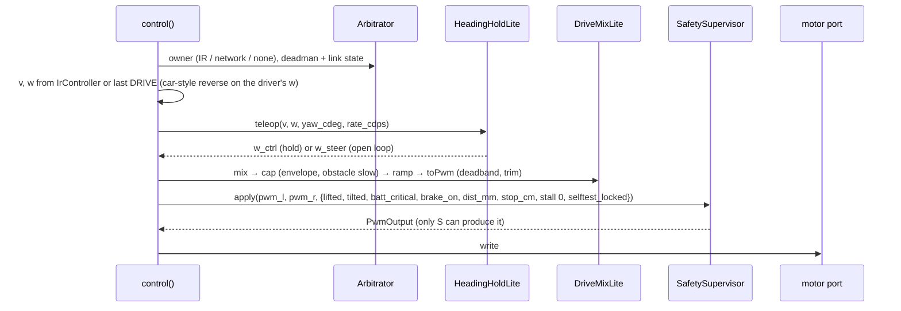
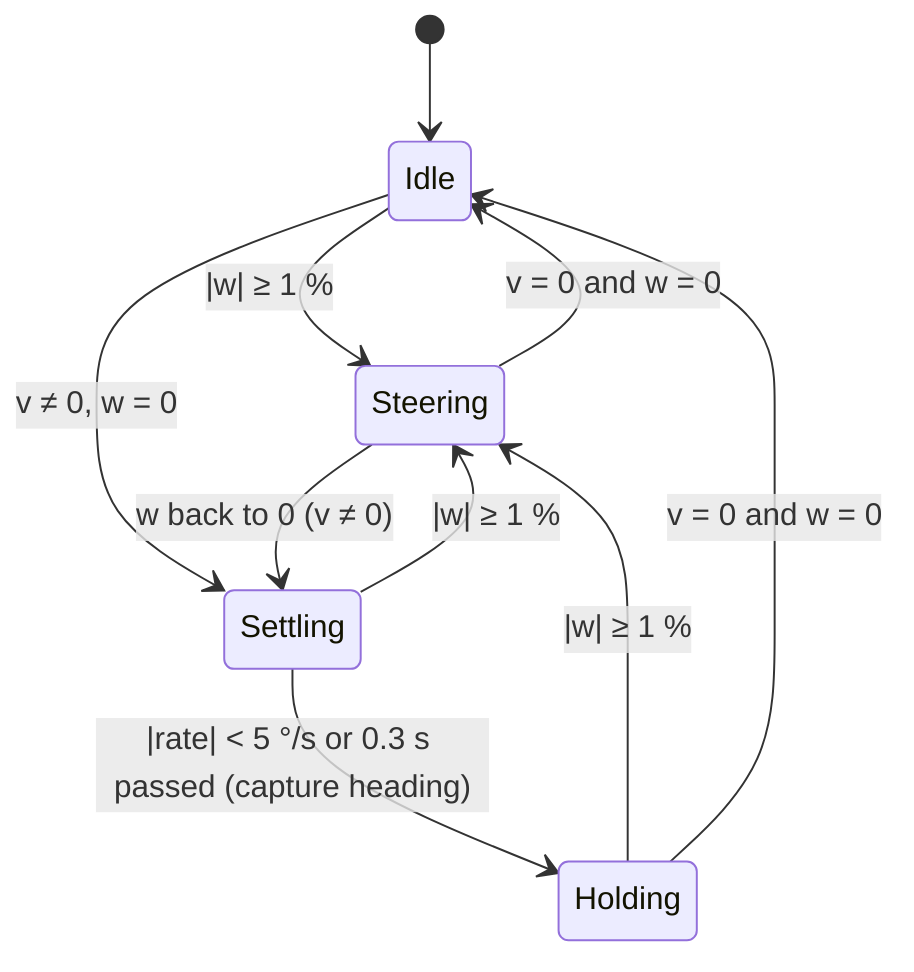

# Uno Lite Firmware — Low-Level Design

**Status:** APPROVED by owner (2026-10-14).
**Source:** spec 02 Part D (APPROVED 2026-10-14), design-notes §43. The full firmware (Mega, `src/app/`) is unchanged and tagged `full-firmware-2026-10-14`.

## 1. Goals and limits
- **Drivable, no bells and whistles:** IR remote, phone/web `DRIVE`/`STOP`, gyro straight-line hold, encoders, camera positioning, a few LED states, one beep.
- **Every safety rule of the full firmware stays:** deadman, link-loss stop, STOP, obstacle brake, child-play envelope caps, battery low/critical, lift/tilt stop, boot self-test lock. No Override mode.
- **Same protocol to the ESP32** (framing, CRC, frame types, HELLO handshake, heartbeats, telemetry frames). Unimplemented frames → `ACK UNAVAILABLE`.
- **Budget:** ≤ **28 KB flash**, ≤ **1.5 KB static RAM** (ATmega328P: 32 KB incl. 0.5 KB bootloader, 2 KB RAM). The size gate fails the build above that.
- **Whole-number maths only** in Lite code (no `float`/`double`; the float library costs ~7 KB). Units: % as `int8_t`, PWM as `int16_t`, angles in centi-degrees (`int32_t`), rates in raw gyro counts.

## 2. Build and source layout
```
firmware/uno/src/
  app/          full app (Mega)            — unchanged, not built for the Uno
  lite/         NEW: Uno Lite app (tasks, routes, telemetry, state)
  domain/       shared pure code: Lite reuses only the integer modules in §3; new integer modules go in domain/lite/
  drivers/ ports/ generated/ types/        — shared
```
- `env:uno` builds `+<lite/> +<drivers/> +<generated/>` and the reused domain files only (`build_src_filter`), with `-DPROFILE_LITE -Os -flto`. `env:mega` is unchanged. `scripts/size_gate.py` limits for `uno` become 28672 B flash / 1536 B RAM.
- `main.cpp` stays the entry point; under `PROFILE_LITE` it runs `lite::setup()/loop()` (two `#if` lines, no other shared file changes).
- Host tests: new suites `test_lite_*` for every new `domain/lite/` class (native env); the existing 182 tests keep running for the full app.


## 3. Reuse decisions
| Module | Decision | Why |
|---|---|---|
| generated protocol, `FrameParser`, `FrameWriter`, CRC | reuse | integer, tested; guarantees protocol compatibility |
| `LinkSession`, `EventQueue`, `AckQueue`, `RejectLimiter` | reuse | integer; HELLO/heartbeat/link-loss rules identical |
| `NecDecoder`, `IrController` | reuse | integer; tap nudge, 350 ms hold, speed keys 80 %/±10 % as tested on the floor |
| `SafetySupervisor`, `Arbitrator`, `Envelope`, `SelfTest` | reuse | integer; **the safety gate is the same tested code** (hard rule) |
| `BatteryMonitor`, `EepromWriter`, `LedSequencer`, `MotionTimer`, `Scheduler` | reuse | integer |
| `HeadingController`, `Pid`, `Mixer`, `Ramp`, `SpeedController`, `TargetLimiter` | **replace** with integer `HeadingHoldLite` + `DriveMixLite` | float |
| `Attitude`, `LiftDetector`, `YawIntegrator`, `GyroZeroTracker` | **replace** with `TiltLite`, `YawLite`, `GyroZeroLite` | float (`atan2`, `sqrt`) |
| `UltrasonicFilter`, `EncoderTrack`, `EncoderHealth` | **replace** with `RangeLite`, `EncoderLite` | float |
| `Settings` (70 settings, profiles), `SettingsSaver` | **replace** with `SettingsLite` (12 values, one block) | size (~3 KB) |
| calibration, primitives, camera profiles, sound catalogue, annunciator, bump, accel variance, Override | **not in Lite** | spec 02 Part D |

## 4. New integer classes (`domain/lite/`)

```mermaid
classDiagram
  class GyroZeroLite {
    +seed(stored_raw[3])
    +update(raw[3], quiet, now_ms)
    +zero(axis) int16
    -state, quiet_since_ms, n
    -sum[3] int32, min[3] int16, max[3] int16
    -prev[3] int16, have_prev bool, seeded[3] int16
  }
  class YawLite {
    +update(gz_raw_corrected, stationary)
    +yawCdeg() int32
    +rateCdps() int16
    -acc int32 (raw counts × ticks)
  }
  class HeadingHoldLite {
    +configure(kp_q8, kd_q8)
    +teleop(v_pct, w_pct, yaw_cdeg, rate_cdps) int8 w_out
    +reset()
    +holding() bool
    -state HoldState, held_cdeg int32, settle_ticks uint8
  }
  class DriveMixLite {
    +mix(v_pct, w_steer_pct, w_ctrl_pct, turn_full_pct, l, r)
    +cap(l, r, speed_cap_pct, obstacle_slow)
    +ramp(target, step) int8
    +toPwm(pct, start_pwm, keep_pwm, trim) int16
  }
  class TiltLite {
    +update(ax, ay, az raw, limit_deg, now_ms) TiltResult
    -tilt via ax²+ay² vs az²·tan²(limit) (int32, tan² table)
    -lift via |a| outside 0.6..1.4 g held 200 ms
  }
  class RangeLite { +update(echo_us, timed_out) +distMm() uint16 -median3 }
  class EncoderLite { +onEdge() +tick10ms() +counts() int32 +cps() int16 +moving() bool }
  class SettingsLite {
    +load(eeprom) bool
    +get(id, out) bool
    +set(id, value) AckStatus
    +block() bytes + crc8
  }
  class AnnunciatorLite { +update(state, now, LedSequencer, beep) }
```

- **GyroZeroLite:** the approved §11.8 rules unchanged (1 s settle, 2 s windows of 400 samples, spread ≤ 98 raw, |zero| ≤ 1310 raw, two windows agreeing within 20 raw, RAM only), integer means (`sum / n`, rounded).
- **YawLite:** IMU at 200 Hz; `acc += gz − zero` per sample; yaw [centi-deg] = `acc × 100 / (65.5 × 200)` = `acc × 2 / 262` (exact for ±500 °/s range). At rest (|gz−zero| < 33 raw ≈ 0.5 °/s and not moving) the sample is not added (same clamp as full).
- **HeadingHoldLite:** the floor-tested behaviour (design-notes §41): steering → open-loop, hold reset; steering released → wait for |rate| < 5 °/s or 0.3 s, capture heading; hold: `w = (kp × err_cdeg − kd × rate_cdps) >> 8`, clamped ±100 %, **not scaled by the turn authority**. Default gains give ≈ ±10 PWM per track per degree at 80 % speed (the target agreed from ELEGOO's tuning) plus rate damping; values in Q8 settings.
- **DriveMixLite:** arcade mix with turning priority (as full `mix()`), authority only on the driver's steering, envelope speed cap and obstacle slow on track %, accel ramp (`accel_limit` %/s → step per 10 ms tick), deadband start/keep PWM and per-track trim (%). Battery compensation dropped (motor_v_max is 12000 = off on the owner's tank).
- **TiltLite:** no `atan2`: tilted when `ax² + ay² > az² × tan²(limit)` with a 10-entry tan² table (Q8); a `TILT_HOLD` of 300 ms as full. Lift: |a| outside 0.6–1.4 g for 200 ms while not driven, landed after 1 s level.
- **SettingsLite** (EEPROM block v1 + CRC-8; ids are the existing `SettingId` numbers so the bridge/bench need no change):

| Setting | Default |
|---|---|
| gyro_bias_x/y/z | 0 (GyroZeroLite learns at rest) |
| deadband_start (L/R fwd/rev → one value) | 110 |
| deadband_keep | 90 |
| motor trim L / R (%) | 0 / 0 |
| pid_heading_kp / kd (Q8 in Lite, mapped from the milli value) | ≈ 3.5 / 0.1 equivalents |
| accel_limit | 200 %/s |
| turn_rate_full_speed | 40 % |
| obstacle_stop / obstacle_slow (cm) | as full defaults |
| reverse_steer | 0 (car style) |

Other `SETTING_SET` ids → `ACK UNAVAILABLE`. `SETTINGS_SAVE` writes the block through `EepromWriter` (non-blocking, never while moving).

## 5. Frames
| Frame (ESP32 → Uno) | Lite |
|---|---|
| HEARTBEAT, HELLO_REQ, HELLO_ACK, ESP_ACK | yes |
| DRIVE, STOP, BRAKE, ENVELOPE, OWNER_HINT | yes |
| CAM_SET, CAM_HOME, CAM_NUDGE, CAM_JOY, CAM_LOCK | yes (CAM_JOY/NUDGE as position steps; smooth if space, §8) |
| SETTING_SET, SETTING_GET, SETTINGS_SAVE | yes, Lite ids only |
| DRIVE_RATE, TURN, MOVE, CANCEL, CALIBRATE, PROFILE, SAFETY_OVERRIDE, LED, SOUND, TONE, AUDIO_MODE | `ACK UNAVAILABLE` |

| Frame (Uno → ESP32) | Lite |
|---|---|
| HELLO (caps, fw, commit, reset reason), ACK, EVENT | yes |
| TELEM_FAST (20 Hz) | all fields; unsupported ones 0 (`spd_act` −128 when encoders off, as full) |
| TELEM_SLOW (1 Hz) | batt_mv, uptime, reset_reason, driving, owner, flags2, envelope, err counters, hw; others 0 |
| SETTING_VALUE | Lite ids |
| CAL_RESULT, CAL_DATA, WIFI_RESET_REQ, ADMIN_RESET_REQ | WIFI/ADMIN reset from the boot button: yes; CAL_*: never sent |

**HELLO `caps` (protocol change, `protocol/defs`):** today bit 0 = encoders. New `CapBit` enum: bit0 ENCODERS, bit1 TURN, bit2 MOVE, bit3 DRIVE_RATE, bit4 CALIBRATE, bit5 OVERRIDE, bit6 AUDIO_LED (SOUND/TONE/LED frames), bit7 SETTINGS_FULL. Full sets bits 1–7 (+ bit0 when encoders are on); Lite sets only bit0. Old clients read bit0 only, so nothing breaks; the bridge help page and phone page hide what is missing (ESP32 change, Plan C follow-up).

## 6. Tasks and timing
| Task | Period | Phase | Work |
|---|---|---|---|
| imu | 5 ms | 0 | read gyro/accel (soft I2C), GyroZeroLite, YawLite, TiltLite |
| ir | 5 ms | 0 | NEC ring → IrController |
| control | 10 ms | 2.5 ms | source select (IR / network / none) → HeadingHoldLite → DriveMixLite → SafetySupervisor → motor |
| link | 10 ms | 2.5 ms | LinkSession poll, frame RX → routes, TX queue |
| ultrasonic | 50 ms | 2.5 ms | trigger / RangeLite |
| telemetry fast | 50 ms | 0 | TELEM_FAST |
| ui | 50 ms | 17.5 ms | AnnunciatorLite → LED, beep |
| battery | 100 ms | 7.5 ms | BatteryMonitor, self-test battery recovery |
| encoders | 10 ms | 5 ms | EncoderLite cps |
| settings | 20 ms | 7.5 ms | EepromWriter step |
| camera | 20 ms | 7.5 ms | servo targets (smooth step if built) |
| telemetry slow | 1 s | 7.5 ms | TELEM_SLOW |
| self-test | once at 2 s | — | IMU, ultrasonic, battery, settings → SelfTest (lock rules as full, LLD §10.9) |

### 6.1 Control tick (10 ms)


### 6.2 Heading hold states


## 7. Memory plan
| Area | Flash (est.) | RAM (est.) |
|---|---|---|
| Arduino core, HardwareSerial, Servo, runtime | 3.5 KB | 230 B |
| Drivers | 3.5 KB | 120 B |
| Protocol (generated subset, parser, writer, CRC) | 2.0 KB | 130 B |
| Link, acks, events, telemetry, routes | 3.0 KB | 180 B |
| Safety (supervisor, arbitrator, envelope, self-test) | 1.5 KB | 50 B |
| IR (decoder, controller) | 1.5 KB | 110 B |
| Motion (HeadingHoldLite, DriveMixLite) | 2.0 KB | 40 B |
| Estimation (GyroZeroLite, YawLite, TiltLite, RangeLite, EncoderLite, battery) | 2.5 KB | 110 B |
| SettingsLite + EepromWriter | 1.0 KB | 60 B |
| Camera (positioning) | 0.6 KB | 10 B |
| LED + beep | 0.8 KB | 80 B |
| Scheduler and glue | 2.0 KB | 120 B |
| **Total** | **≈ 23.9 KB** (≤ 28 KB) | **≈ 1.24 KB** (≤ 1.5 KB) |
| Optional: smooth camera (§8) | +0.8 KB | +30 B |

**Measured skeleton (Plan E Task 1, 2026-10-15):** drivers + core + protocol + link + telemetry = **7,984 B flash, 712 B RAM** (estimate for these rows ≈ 12.0 KB / 0.66 KB). The first build was 928 B RAM because the Uno IMU driver used the Arduino Wire library (five 32-byte buffers); the Uno now uses the same software I2C on A4/A5 as the Mega (port C instead of port F), which removed ~210 B RAM and ~2 KB flash.

**Measured, all core features (Plan E Task 15, 2026-10-15):** **24,060 B flash, 1,425 B static RAM**; with smooth camera movement (extra 1, +84 B): **24,144 B flash (84 %), 1,429 B RAM (93 %)**. Flash margin ≈ 4.5 KB; RAM is the tight resource (107 B left under the 1.5 KB gate, ~620 B free for the stack at run time). Encoder left/right balance (extra 2) is proposed to the owner as a separate small design, not built.

Estimates from the Mega build (link-time optimisation merges small classes, so per-class figures are approximate). **Plan step 1 builds a skeleton with all drivers and measures**; if the total is off by more than 15 %, the plan stops for a review.

## 8. Space-dependent extras (owner order)
1. **Smooth camera movement** (speed/acceleration limited servo steps, integer) — first, if ≥ 1.5 KB margin remains under 28 KB.
2. **Left/right speed balance from the encoders** (integer P on the count difference while driving straight) — if margin remains after 1.
3. Sound beyond the single beep — not planned (owner: decorative).

## 9. Tests
- Host (native, Unity): one suite per new class — `test_lite_gyro_zero`, `test_lite_yaw`, `test_lite_heading`, `test_lite_mix`, `test_lite_tilt`, `test_lite_range`, `test_lite_encoder`, `test_lite_settings`, `test_lite_annunciator`; plus a frame-routing test (`test_lite_routes`) that every unimplemented frame gets `ACK UNAVAILABLE` and HELLO caps = encoders only.
- Reused classes keep their existing tests.
- Hardware (owner, tank on the stand, then floor): HELLO + link sync through the ESP32 on battery; IR tap/hold/speed keys; phone DRIVE + deadman + link-loss stop; obstacle brake; lift/tilt stop; battery reading; 3 m straight run (≤ ~4 cm drift as on the Mega); size gate.

## 10. Next
After approval: implementation plan (`docs/superpowers/plans/2026-10-14-plan-e-uno-lite.md`) with step 1 = skeleton + size measurement, then one task per class/route group, TDD, size gate on every task.

## 11. Decision (owner, 2026-10-15): hardware I2C on the Uno
On the Uno, A4/A5 are the ATmega328P's hardware TWI pins (the Mega needed software I2C only because they are plain GPIO there). Plan E Task 1 had moved the Uno to the software I2C to drop the Arduino Wire library's buffers (~210 B RAM). Owner-approved replacement: a small **register-level hardware TWI driver** (`drivers/twi_uno.cpp`, polled, 400 kHz, no buffers) behind a common interface `drivers/i2c_bus.h` (`drv::i2c::begin/writeReg/readRegs/recover`); the Mega keeps `soft_i2c.cpp`. Same hardware path ELEGOO used on these pins; one byte ≈ 25 µs, the 14-byte IMU burst ≈ 0.35 ms (blocking, the documented burst-read exception). Each wait for TWINT gives up after ~0.4 ms so a stuck bus fails the read instead of hanging. Uno: 24,452 B flash, 1,431 B RAM; Mega unchanged (63,272 B).
