# Uno Lite Firmware — Low-Level Design

**Status:** APPROVED by owner (2026-10-14).
**Source:** spec 02 Part D (APPROVED 2026-10-14), design-notes §43. The full firmware (Mega, `src/app/`) is unchanged and tagged `full-firmware-2026-10-14`.

## 1. Goals and limits
- **Drivable, no bells and whistles:** IR remote, phone/web `DRIVE`/`STOP`, gyro straight-line hold, encoders, camera positioning, a few LED states, one beep.
- **Every safety rule of the full firmware stays:** deadman, link-loss stop, STOP, obstacle brake, child-play envelope caps, battery low/critical, lift/tilt stop, boot self-test lock. No Override mode.
- **Same protocol to the ESP32** (framing, CRC, frame types, HELLO handshake, heartbeats, telemetry frames). Unimplemented frames → `ACK UNAVAILABLE`.
- **Budget:** ≤ **28 KB flash**, ≤ **1.5 KB static RAM** (ATmega328P: 32 KB incl. 0.5 KB bootloader, 2 KB RAM). The size gate fails the build above that.
- **Whole-number maths only** in Lite code (no `float`/`double`; the float library costs ~7 KB). Units: % as `int8_t`, PWM as `int16_t`, angles in centi-degrees (`int32_t`), rates in raw gyro counts.

## 2. Build and source layout
```
firmware/uno/src/
  app/          full app (Mega)            — unchanged, not built for the Uno
  lite/         NEW: Uno Lite app (tasks, routes, telemetry, state)
  domain/       shared pure code: Lite reuses only the integer modules in §3; new integer modules go in domain/lite/
  drivers/ ports/ generated/ types/        — shared
```
- `env:uno` builds `+<lite/> +<drivers/> +<generated/>` and the reused domain files only (`build_src_filter`), with `-DPROFILE_LITE -Os -flto`. `env:mega` is unchanged. `scripts/size_gate.py` limits for `uno` become 28672 B flash / 1536 B RAM.
- `main.cpp` stays the entry point; under `PROFILE_LITE` it runs `lite::setup()/loop()` (two `#if` lines, no other shared file changes).
- Host tests: new suites `test_lite_*` for every new `domain/lite/` class (native env); the existing 182 tests keep running for the full app.

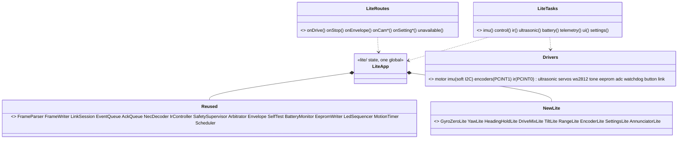

## 3. Reuse decisions
| Module | Decision | Why |
|---|---|---|
| generated protocol, `FrameParser`, `FrameWriter`, CRC | reuse | integer, tested; guarantees protocol compatibility |
| `LinkSession`, `EventQueue`, `AckQueue`, `RejectLimiter` | reuse | integer; HELLO/heartbeat/link-loss rules identical |
| `NecDecoder`, `IrController` | reuse | integer; tap nudge, 350 ms hold, speed keys 80 %/±10 % as tested on the floor |
| `SafetySupervisor`, `Arbitrator`, `Envelope`, `SelfTest` | reuse | integer; **the safety gate is the same tested code** (hard rule) |
| `BatteryMonitor`, `EepromWriter`, `LedSequencer`, `MotionTimer`, `Scheduler` | reuse | integer |
| `HeadingController`, `Pid`, `Mixer`, `Ramp`, `SpeedController`, `TargetLimiter` | **replace** with integer `HeadingHoldLite` + `DriveMixLite` | float |
| `Attitude`, `LiftDetector`, `YawIntegrator`, `GyroZeroTracker` | **replace** with `TiltLite`, `YawLite`, `GyroZeroLite` | float (`atan2`, `sqrt`) |
| `UltrasonicFilter`, `EncoderTrack`, `EncoderHealth` | **replace** with `RangeLite`, `EncoderLite` | float |
| `Settings` (70 settings, profiles), `SettingsSaver` | **replace** with `SettingsLite` (12 values, one block) | size (~3 KB) |
| calibration, primitives, camera profiles, sound catalogue, annunciator, bump, accel variance, Override | **not in Lite** | spec 02 Part D |

## 4. New integer classes (`domain/lite/`)
```mermaid
classDiagram
  class GyroZeroLite {
    +seed(stored_raw[3])
    +update(raw[3], quiet, now_ms)
    +zero(axis) int16
    -state, quiet_since_ms, n
    -sum[3] int32, min[3] int16, max[3] int16
    -prev[3] int16, have_prev bool, seeded[3] int16
  }
  class YawLite {
    +update(gz_raw_corrected, stationary)
    +yawCdeg() int32
    +rateCdps() int16
    -acc int32 (raw counts × ticks)
  }
  class HeadingHoldLite {
    +configure(kp_q8, kd_q8)
    +teleop(v_pct, w_pct, yaw_cdeg, rate_cdps) int8 w_out
    +reset()
    +holding() bool
    -state HoldState, held_cdeg int32, settle_ticks uint8
  }
  class DriveMixLite {
    +mix(v_pct, w_steer_pct, w_ctrl_pct, turn_full_pct, l, r)
    +cap(l, r, speed_cap_pct, obstacle_slow)
    +ramp(target, step) int8
    +toPwm(pct, start_pwm, keep_pwm, trim) int16
  }
  class TiltLite {
    +update(ax, ay, az raw, limit_deg, now_ms) TiltResult
    -tilt via ax²+ay² vs az²·tan²(limit) (int32, tan² table)
    -lift via |a| outside 0.6..1.4 g held 200 ms
  }
  class RangeLite { +update(echo_us, timed_out) +distMm() uint16 -median3 }
  class EncoderLite { +onEdge() +tick10ms() +counts() int32 +cps() int16 +moving() bool }
  class SettingsLite {
    +load(eeprom) bool
    +get(id, out) bool
    +set(id, value) AckStatus
    +block() bytes + crc8
  }
  class AnnunciatorLite { +update(state, now, LedSequencer, beep) }
```
- **GyroZeroLite:** the approved §11.8 rules unchanged (1 s settle, 2 s windows of 400 samples, spread ≤ 98 raw, |zero| ≤ 1310 raw, two windows agreeing within 20 raw, RAM only), integer means (`sum / n`, rounded).
- **YawLite:** IMU at 200 Hz; `acc += gz − zero` per sample; yaw [centi-deg] = `acc × 100 / (65.5 × 200)` = `acc × 2 / 262` (exact for ±500 °/s range). At rest (|gz−zero| < 33 raw ≈ 0.5 °/s and not moving) the sample is not added (same clamp as full).
- **HeadingHoldLite:** the floor-tested behaviour (design-notes §41): steering → open-loop, hold reset; steering released → wait for |rate| < 5 °/s or 0.3 s, capture heading; hold: `w = (kp × err_cdeg − kd × rate_cdps) >> 8`, clamped ±100 %, **not scaled by the turn authority**. Default gains give ≈ ±10 PWM per track per degree at 80 % speed (the target agreed from ELEGOO's tuning) plus rate damping; values in Q8 settings.
- **DriveMixLite:** arcade mix with turning priority (as full `mix()`), authority only on the driver's steering, envelope speed cap and obstacle slow on track %, accel ramp (`accel_limit` %/s → step per 10 ms tick), deadband start/keep PWM and per-track trim (%). Battery compensation dropped (motor_v_max is 12000 = off on the owner's tank).
- **TiltLite:** no `atan2`: tilted when `ax² + ay² > az² × tan²(limit)` with a 10-entry tan² table (Q8); a `TILT_HOLD` of 300 ms as full. Lift: |a| outside 0.6–1.4 g for 200 ms while not driven, landed after 1 s level.
- **SettingsLite** (EEPROM block v1 + CRC-8; ids are the existing `SettingId` numbers so the bridge/bench need no change):

| Setting | Default |
|---|---|
| gyro_bias_x/y/z | 0 (GyroZeroLite learns at rest) |
| deadband_start (L/R fwd/rev → one value) | 110 |
| deadband_keep | 90 |
| motor trim L / R (%) | 0 / 0 |
| pid_heading_kp / kd (Q8 in Lite, mapped from the milli value) | ≈ 3.5 / 0.1 equivalents |
| accel_limit | 200 %/s |
| turn_rate_full_speed | 40 % |
| obstacle_stop / obstacle_slow (cm) | as full defaults |
| reverse_steer | 0 (car style) |

Other `SETTING_SET` ids → `ACK UNAVAILABLE`. `SETTINGS_SAVE` writes the block through `EepromWriter` (non-blocking, never while moving).

## 5. Frames
| Frame (ESP32 → Uno) | Lite |
|---|---|
| HEARTBEAT, HELLO_REQ, HELLO_ACK, ESP_ACK | yes |
| DRIVE, STOP, BRAKE, ENVELOPE, OWNER_HINT | yes |
| CAM_SET, CAM_HOME, CAM_NUDGE, CAM_JOY, CAM_LOCK | yes (CAM_JOY/NUDGE as position steps; smooth if space, §8) |
| SETTING_SET, SETTING_GET, SETTINGS_SAVE | yes, Lite ids only |
| DRIVE_RATE, TURN, MOVE, CANCEL, CALIBRATE, PROFILE, SAFETY_OVERRIDE, LED, SOUND, TONE, AUDIO_MODE | `ACK UNAVAILABLE` |

| Frame (Uno → ESP32) | Lite |
|---|---|
| HELLO (caps, fw, commit, reset reason), ACK, EVENT | yes |
| TELEM_FAST (20 Hz) | all fields; unsupported ones 0 (`spd_act` −128 when encoders off, as full) |
| TELEM_SLOW (1 Hz) | batt_mv, uptime, reset_reason, driving, owner, flags2, envelope, err counters, hw; others 0 |
| SETTING_VALUE | Lite ids |
| CAL_RESULT, CAL_DATA, WIFI_RESET_REQ, ADMIN_RESET_REQ | WIFI/ADMIN reset from the boot button: yes; CAL_*: never sent |

**HELLO `caps` (protocol change, `protocol/defs`):** today bit 0 = encoders. New `CapBit` enum: bit0 ENCODERS, bit1 TURN, bit2 MOVE, bit3 DRIVE_RATE, bit4 CALIBRATE, bit5 OVERRIDE, bit6 AUDIO_LED (SOUND/TONE/LED frames), bit7 SETTINGS_FULL. Full sets bits 1–7 (+ bit0 when encoders are on); Lite sets only bit0. Old clients read bit0 only, so nothing breaks; the bridge help page and phone page hide what is missing (ESP32 change, Plan C follow-up).

## 6. Tasks and timing
| Task | Period | Phase | Work |
|---|---|---|---|
| imu | 5 ms | 0 | read gyro/accel (soft I2C), GyroZeroLite, YawLite, TiltLite |
| ir | 5 ms | 0 | NEC ring → IrController |
| control | 10 ms | 2.5 ms | source select (IR / network / none) → HeadingHoldLite → DriveMixLite → SafetySupervisor → motor |
| link | 10 ms | 2.5 ms | LinkSession poll, frame RX → routes, TX queue |
| ultrasonic | 50 ms | 2.5 ms | trigger / RangeLite |
| telemetry fast | 50 ms | 0 | TELEM_FAST |
| ui | 50 ms | 17.5 ms | AnnunciatorLite → LED, beep |
| battery | 100 ms | 7.5 ms | BatteryMonitor, self-test battery recovery |
| encoders | 10 ms | 5 ms | EncoderLite cps |
| settings | 20 ms | 7.5 ms | EepromWriter step |
| camera | 20 ms | 7.5 ms | servo targets (smooth step if built) |
| telemetry slow | 1 s | 7.5 ms | TELEM_SLOW |
| self-test | once at 2 s | — | IMU, ultrasonic, battery, settings → SelfTest (lock rules as full, LLD §10.9) |

### 6.1 Control tick (10 ms)
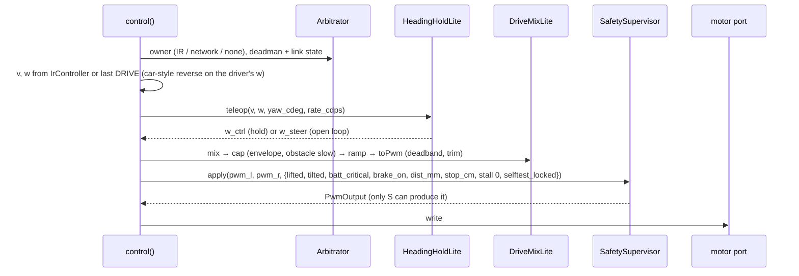

### 6.2 Heading hold states
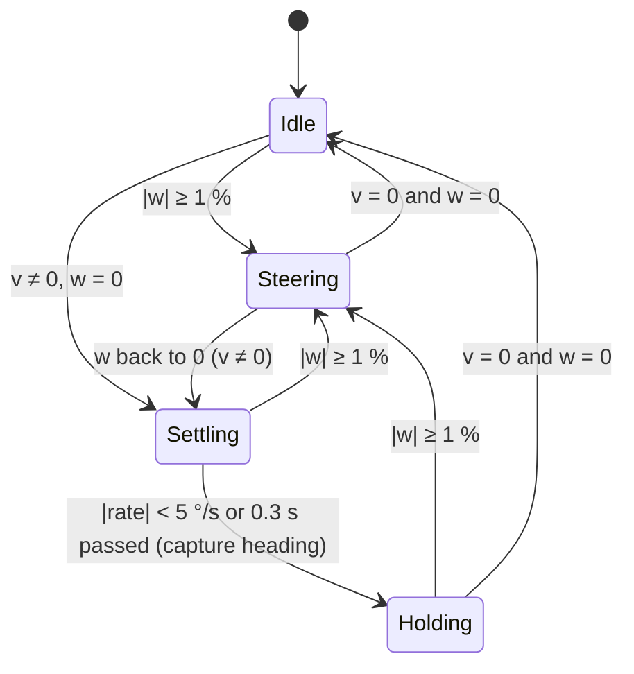

## 7. Memory plan
| Area | Flash (est.) | RAM (est.) |
|---|---|---|
| Arduino core, HardwareSerial, Servo, runtime | 3.5 KB | 230 B |
| Drivers | 3.5 KB | 120 B |
| Protocol (generated subset, parser, writer, CRC) | 2.0 KB | 130 B |
| Link, acks, events, telemetry, routes | 3.0 KB | 180 B |
| Safety (supervisor, arbitrator, envelope, self-test) | 1.5 KB | 50 B |
| IR (decoder, controller) | 1.5 KB | 110 B |
| Motion (HeadingHoldLite, DriveMixLite) | 2.0 KB | 40 B |
| Estimation (GyroZeroLite, YawLite, TiltLite, RangeLite, EncoderLite, battery) | 2.5 KB | 110 B |
| SettingsLite + EepromWriter | 1.0 KB | 60 B |
| Camera (positioning) | 0.6 KB | 10 B |
| LED + beep | 0.8 KB | 80 B |
| Scheduler and glue | 2.0 KB | 120 B |
| **Total** | **≈ 23.9 KB** (≤ 28 KB) | **≈ 1.24 KB** (≤ 1.5 KB) |
| Optional: smooth camera (§8) | +0.8 KB | +30 B |

**Measured skeleton (Plan E Task 1, 2026-10-15):** drivers + core + protocol + link + telemetry = **7,984 B flash, 712 B RAM** (estimate for these rows ≈ 12.0 KB / 0.66 KB). The first build was 928 B RAM because the Uno IMU driver used the Arduino Wire library (five 32-byte buffers); the Uno now uses the same software I2C on A4/A5 as the Mega (port C instead of port F), which removed ~210 B RAM and ~2 KB flash.

**Measured, all core features (Plan E Task 15, 2026-10-15):** **24,060 B flash, 1,425 B static RAM**; with smooth camera movement (extra 1, +84 B): **24,144 B flash (84 %), 1,429 B RAM (93 %)**. Flash margin ≈ 4.5 KB; RAM is the tight resource (107 B left under the 1.5 KB gate, ~620 B free for the stack at run time). Encoder left/right balance (extra 2) is proposed to the owner as a separate small design, not built.

Estimates from the Mega build (link-time optimisation merges small classes, so per-class figures are approximate). **Plan step 1 builds a skeleton with all drivers and measures**; if the total is off by more than 15 %, the plan stops for a review.

## 8. Space-dependent extras (owner order)
1. **Smooth camera movement** (speed/acceleration limited servo steps, integer) — first, if ≥ 1.5 KB margin remains under 28 KB.
2. **Left/right speed balance from the encoders** (integer P on the count difference while driving straight) — if margin remains after 1.
3. Sound beyond the single beep — not planned (owner: decorative).

## 9. Tests
- Host (native, Unity): one suite per new class — `test_lite_gyro_zero`, `test_lite_yaw`, `test_lite_heading`, `test_lite_mix`, `test_lite_tilt`, `test_lite_range`, `test_lite_encoder`, `test_lite_settings`, `test_lite_annunciator`; plus a frame-routing test (`test_lite_routes`) that every unimplemented frame gets `ACK UNAVAILABLE` and HELLO caps = encoders only.
- Reused classes keep their existing tests.
- Hardware (owner, tank on the stand, then floor): HELLO + link sync through the ESP32 on battery; IR tap/hold/speed keys; phone DRIVE + deadman + link-loss stop; obstacle brake; lift/tilt stop; battery reading; 3 m straight run (≤ ~4 cm drift as on the Mega); size gate.

## 10. Next
After approval: implementation plan (`docs/superpowers/plans/2026-10-14-plan-e-uno-lite.md`) with step 1 = skeleton + size measurement, then one task per class/route group, TDD, size gate on every task.

## 11. Decision (owner, 2026-10-15): hardware I2C on the Uno
On the Uno, A4/A5 are the ATmega328P's hardware TWI pins (the Mega needed software I2C only because they are plain GPIO there). Plan E Task 1 had moved the Uno to the software I2C to drop the Arduino Wire library's buffers (~210 B RAM). Owner-approved replacement: a small **register-level hardware TWI driver** (`drivers/twi_uno.cpp`, polled, 400 kHz, no buffers) behind a common interface `drivers/i2c_bus.h` (`drv::i2c::begin/writeReg/readRegs/recover`); the Mega keeps `soft_i2c.cpp`. Same hardware path ELEGOO used on these pins; one byte ≈ 25 µs, the 14-byte IMU burst ≈ 0.35 ms (blocking, the documented burst-read exception). Each wait for TWINT gives up after ~0.4 ms so a stuck bus fails the read instead of hanging. Uno: 24,452 B flash, 1,431 B RAM; Mega unchanged (63,272 B).

## 12. Sounds and LED = the full firmware's Annunciator (owner, 2026-10-15, option A; spec 02 §D4)
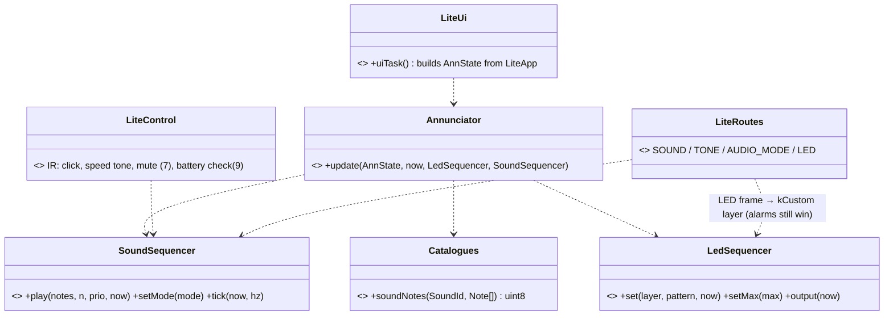
- `AnnState` from Lite state as in the full `uiTask`; fixed `false`/0: `calibrating`, `override_on`, `override_seq`, `bump_seq`, `parking_beeps`; `hint` from OWNER_HINT; `toggle_seq`/`toggle_on` from IR key 7; `led.setMax(50)`.
- IR key click: on a decoded IR **code** (not a repeat) the control task plays `SoundId::kTick` at info priority before applying the key; speed/mute/battery-check sounds follow the full `input_task.cpp`.
- `EepromWriter::kMaxBytes` = 32 under `PROFILE_LITE` (80 in the full firmware); a `static_assert` in `lite_sensors.cpp` pins that `SettingsLite::kBlockSize` fits.
- Removed: `domain/lite/annunciator_lite.*`, `domain/lite/beeper.h` and their tests (the full `test_ui` suite covers `Annunciator`).
- Tests: `test_lite_frames` updated first (SOUND/TONE/AUDIO_MODE/LED handled, `helloCaps` = AUDIO_LED | encoders); RED → GREEN.
- Safety valve: static RAM > 1,500 B → frames (spec §D4 item 4) stay UNAVAILABLE.
- **Built (2026-10-15):** Uno **27,426 B flash (96 %), 1,483 B static RAM** — under the valve, so SOUND/TONE/AUDIO_MODE/LED are in. The raw IMU sample became a local in `imuTask` (−18 B); `TELEM_SLOW.free_ram` now reports the run-time stack margin (≈ 565 B expected) for the tank test. Flash is now the closer limit too: ≈ 1.2 KB left.

## 13. Second-review fixes and additions (owner, 2026-10-15; spec 02 §D5)
- `lite_telemetry::slowFlags(…, proto::AudioModeValue mode)` sets/clears MUTED and QUIET; `slow.err_i2c = port::imu::i2cErrors()`.
- `buttonTask` plays the full input task's button sounds/blinks (BLIP, TICK at thresholds, JINGLE + blink on reset requests).
- Stack high-water: `setup()` first paints `[__heap_start, SP − 32)` with 0xAA; `telemetrySlowDue` counts the untouched bytes from `__heap_start` → `free_ram` (≈ worst-case headroom; ≈ 285 B expected from the disassembly).
- `EncoderHealth::Inputs::yaw_rate_dps` becomes `int16_t` (whole °/s); the full app passes `static_cast<int16_t>(yaw_rate_dps)`. Lite: `g_lite.enc_health`, inputs from the previous tick's applied and requested PWM, edges = `EncoderLite::moving()`, keep = `db_keep` by direction; `SafetyInputs.stall_mask = enc_health.stalledMask()` when encoders are enabled; events STALL / ENCODER_FAULT; FAST flags STALL_L/R, ENCODER_FAULT.
- `CamLite`: `set()` clears a pending return; `tick(now)` also ends a joystick held without refresh for 500 ms and tracks stillness; `wantAttached()` false after 2 s still; `cameraTask` attaches/detaches the servos on change.
- Tests first: `test_slow_flags_audio_mode`, `test_cam_set_cancels_pending_return`, `test_cam_joy_timeout_returns_home`, `test_cam_idle_detach_after_2s`; existing `test_encoders` updated to whole °/s.
- **Built (2026-10-15):** Uno **28,592 B flash (80 B under the 28,672 B gate), 1,533 B static RAM (3 B under 1,536 B)** with `-mcall-prologues` added to the Uno build (shared function prologue/epilogue code: −506 B flash, slightly slower calls); the camera's joystick-refresh and release times share one field (they are never needed together). **The Uno Lite firmware is now full** at the agreed gates; anything more needs a gate decision by the owner (the chip has 32,256 B usable flash, 2,048 B RAM).

## 14. Camera wake-up, key swap, USB power, budget (owner, 2026-10-15; spec 02 §D6)
- `CamLite::set()` marks activity; `tick()` treats "activity since last tick" like movement (wakes, restarts the 2 s still timer). Test `test_cam_small_jog_wakes_servos` (idle, then one 12 dd nudge → `wantAttached()`).
- `IrController` (shared): k1/k3 = speed −/+, k4/k6 = jog pan −1/+1; tests in `test_input` updated first.
- `BatteryMonitor` (shared): `kUsb` when the average is < `kUsbMaxMv` = 5500 mV **and** `m_battery_seen` is false; `m_battery_seen` latches on the first average ≥ `kPackSeenMv` = 6000 mV (corrected 2026-10-15: with both at 5000 mV a servo-induced 5.07 V reading on USB latched it; test `test_battery_usb_jitter_stays_usb`). Tests: 4.7 V from boot → kUsb; battery seen then 4.8 V → kCritical (after 2 s).
- `AnnState` (shared) gains `usb_power`; `Annunciator` alarm chain: … → batt_low → **usb_power: white (60,60,60) kBlink 2000 ms, flash 150 ms** → clear. The UI tasks (full and Lite) compute `selftest_critical`/`selftest_failed` from the fail mask with the battery bit removed when on USB power (an IMU failure stays solid red).
- `size_gate.py`: uno flash 30 × 1024.

## 15. Tilt direction (owner, 2026-10-15, option A; spec 02 §A8 note)
Tank check: stick up and IR 2 moved the camera **down**. On this tank a **larger tilt servo angle = camera looks down** (pan was right: stick left = camera left = larger pan angle). Fix at the camera layer, same rule in both firmwares: an "up" request (CAM_JOY `y > 0`, IR 2 jog) moves tilt to a **smaller** angle.
- `CamLite::joy` / `CameraHead::joy`: `y > 0` → home − y·(home − tilt_min); `y < 0` → toward tilt_max.
- `CamLite::applyJog` / full `input_task` IR nudge: tilt step = −jog_tilt.
- Unchanged: servo-degree interfaces (`CAM_SET`, `CAM_NUDGE`, settings `tilt_min`/`tilt_max`, telemetry `tilt`). With the defaults 30…110 the camera can look 60° up and 20° down (limits to be tuned on the tank, settings only).
- A `tilt_reverse` setting (option B) waits until another mount exists.
Tests: `test_cam_held_jog_rate` (IR up → tilt angle falls), `test_joy_is_absolute_and_release_returns_home` (stick up → tilt_min).

## 16. Stick mixing by angle (owner, 2026-10-15; spec 02 §A4.1)
`mixLite(v, w_steer, w_ctrl, turn_full)` keeps its signature. `w_steer == 0` → today's code path, unchanged (straight + heading correction). `w_steer != 0` (heading hold guarantees `w_ctrl == 0` then) → new `angleMixLite(v, w_steer)`: integers only, ‰ ratios, no division by zero (`|v| + |w| > 0` there). `pivot_fallback` is not used by the Lite (as today).

```mermaid
flowchart TD
  A[v, w_steer, w_ctrl] --> B{w_steer == 0?}
  B -- yes --> C[old arcade mix: L = v − w_ctrl, R = v + w_ctrl, speed given up for the turn]
  B -- no --> D["m = min(100, isqrt(v² + w²))"]
  D --> E["t‰ = |w|·1000 / (|v|+|w|)"]
  E --> F{"t ≤ 789?"}
  F -- yes --> G["r‰ = 1000 − t·1000/789"]
  F -- no --> H["r‰ = −(t − 789)·1000/211"]
  G --> I[outer = m, inner = r·m/1000; w > 0: left inner (forward) / right inner (reverse, mirrored)]
  H --> I
```
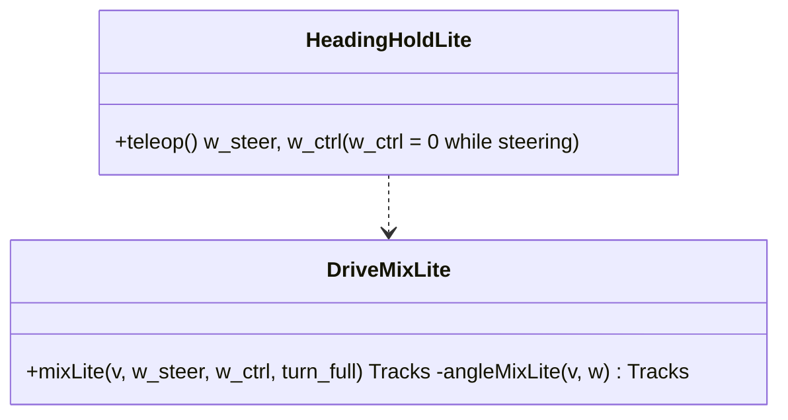
Tests (`test_lite_motion`): `test_angle_mix_45_is_forward_arc` (71/71 → 35/97 order by side), `test_angle_mix_spin_only_near_sideways` (75° → inner 0, 80° → inner < 0, 90° → −m/+m), `test_angle_mix_reverse_both_tracks_back`, `test_ir_axes_unchanged` (±80 on each axis = old values), `test_straight_with_correction_unchanged` (w_steer 0 path = old values).

## 17. Encoder wiring (owner, 2026-10-15; design-notes §53)
Channel A only: left → **A1**, right → **A2**, both from the shield's **P7 (LineTrack: GND, 5V, A2, A1, A0)**; P7's 5 V / GND are shared with the buzzer (A0 + GND) through a mini breadboard power strip (no soldering). B not connected. No firmware change: `EncoderLite` already counts A1/A2 (PCINT1); `encoders_enabled` is switched on after the hand-turn count check.

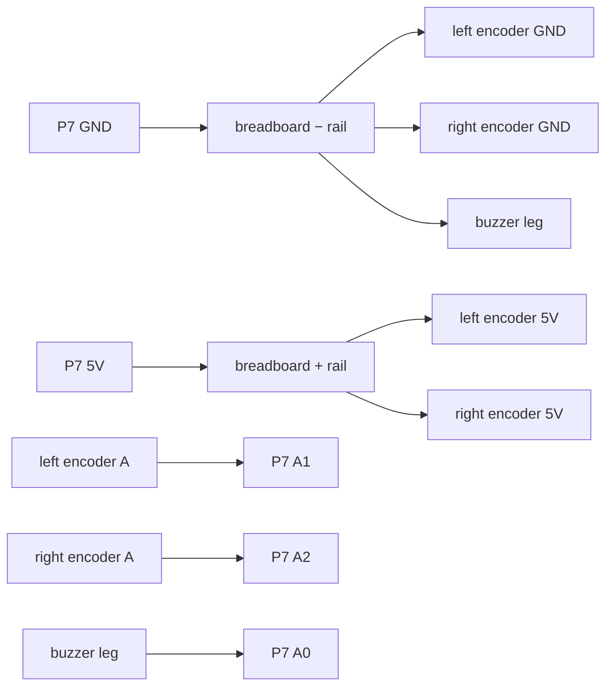

## 18. TELEM_FAST at 50 Hz (spec 02 §E4, bridge LLD R4.7)
`lite_app.cpp` scheduler: `telemetryFastDue` period 50000 µs → **20000 µs**. Same frame, no RAM change; ≈ 2.3 KB/s on the 250000-baud link. The full firmware's `main.cpp` table changes the same way. Size gate re-checked in the plan (flash unchanged expected). No TURN / DRIVE_RATE code on the Lite — the bridge's motion service runs them (bridge LLD R4).

## 19. Encoder features, phase 1 (spec 02 Part F §F1, approved 2026-10-17, design-notes §62)
Scope: **Uno Lite**. The full firmware (Mega, waiting for its board) gets only F1.4 (plain mix for `src AUTO`); it keeps its own `EncoderHealth` / encoder PID until it is revised (ruling: no hardware to test it on; cost: the Mega build behaves like before for stalls).

### 19.1 Classes (domain, whole numbers, no heap, no virtual)
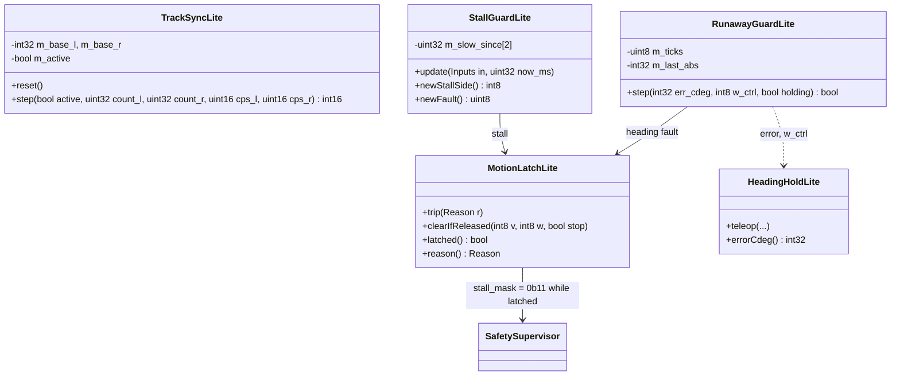
- **TrackSyncLite (F1.1):** active only while driving straight — `encoders_enabled`, no encoder fault, both track targets non-zero with the same sign, no driver steering (`w_steer == 0`). On activation it records both counts as the base. Output `c` (0.1 %, clamped ±150 = ±15 %) = `Kd × (Δcount_L − Δcount_R)` + `Kv × (cps_L − cps_R)`, with `Δcount` since the base; the distance term is clamped (anti-windup ±200 counts). Applied to the **magnitudes** after the mix: the faster side is slowed by `c/2`, the slower one sped up by `c/2` (works forward and in reverse). The gyro heading hold keeps running on top (slow outer loop: slip). Constants in `drive_mix_lite.h`, floor-tuned with `td_record.py`.
- **StallGuardLite (F1.2):** replaces `EncoderHealth` on the Lite. A side is *driven* when |applied PWM| ≥ keep + 15. Expected speed `exp = max_cps × (|pwm| − keep) / (255 − keep)`; the side is *slow* when `cps < exp × 30 / 100` (owner 2026-10-17, was 15). Slow for **500 ms** → if the other side is moving and the gyro shows the tank turning toward the slow side (or turning when it should not), it is a **stall**; if the other side moves, the tank is not turning and the slow side reads 0 cps for 500 ms while the tank clearly drives straight (gyro |rate| < 10 °/s, both PWMs same sign), the encoder is **faulted** (`ENCODER_FAULT` event, track sync off, stall checks off for that side until reboot) — **a fault also trips the latch** (stop both tracks), so a held track stops the tank on a stand too. `max_cps` = constant **2500 counts/s at PWM 255** — measured on the stand 2026-10-17 (full-power spin: left 2535, right 2490, design-notes §70; was 4000 from ~1200 at 30 %, §59). One value for both tracks (within 2 %); the per-side settings `max_cps_l/_r` stay unimplemented on the Lite (owner: option 1).
- **RunawayGuardLite (F1.3):** watches the heading hold while it is holding: if |error| > **30°** and still growing while |w_ctrl| = 100 for **0.5 s** (50 ticks of 10 ms) → trip.
- **MotionLatchLite:** one latch for both guards (owner: **stop both tracks** until the driver commands again). While latched, `SafetyInputs.stall_mask = 0b11` (both tracks cut by the supervisor — no supervisor change). Cleared by **STOP** (any source), or when the active owner's command returns to **v = 0, w = 0** (stick / IR key released); the next non-zero command drives again.
- **F1.4:** `driveTargets()` — if `teleop_auto`, the heading hold's `w_steer` is passed to `mixLite` as `w_ctrl` (plain mix L = v − w, R = v + w); humans keep the angle mix.

### 19.2 Latch state
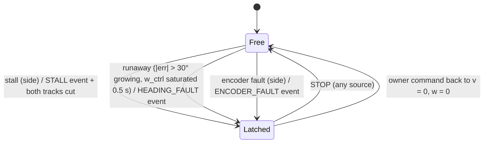

### 19.3 Control tick (10 ms)
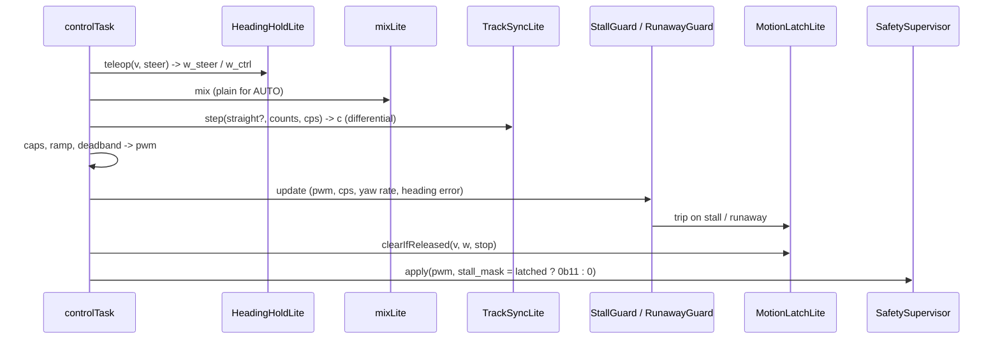

### 19.4 Protocol
`EventKind` gains **`HEADING_FAULT` (28)**, `a` = heading error in whole degrees (additive: events are forwarded generically; no version bump). `STALL` (6) keeps `a` = side. `TELEM_FAST.flags`: `STALL_L` / `STALL_R` show the side that tripped while latched; `HALTED` is set by the supervisor as today.

### 19.5 Budget and tests
Estimated **+0.8–1.2 KB flash** (`EncoderHealth` leaves the Lite build, ~0.4 KB back), **+~24 B RAM**. Host tests per class: track sync (equal / unequal counts, reverse, clamp, inactive while steering, reset on re-entry); stall guard (held track at 25 % → stall in 0.5 s; slow but moving at 20 % of expected → no stall; creep at 960 counts/turn → stall; encoder unplugged while driving straight → fault, not stall); runaway (reversed motor model → trip in ≤ 0.6 s; normal correction never trips); latch (STOP clears, release clears, a new command while latched stays cut); F1.4 (AUTO frame w = 30 → L = v − 30, R = v + 30). Hardware: floor runs recorded with `td_record.py` — straight 3 m (drift), held-track stall, unplugged-encoder fault, and the reversed-motor build to prove the runaway guard.

### 19.6 Floor-test fix: stall time adds up (2026-10-17)
First held-track run: the right track slipped under the cloth (correctly no stall) but the **left track did not move** while the heading hold flipped its PWM (+130 / ~100 / −110); every dip below "driven" restarted the 500 ms timer, so nothing tripped. `StallGuardLite` now **accumulates** driven-and-slow time per side: it pauses while the side is not driven, resets when the side moves properly or sits at PWM 0 for 200 ms (`kIdleResetMs`). Tests `test_stall_flapping_pwm_still_trips` (RED before), `test_stall_idle_resets_the_timer`. Second run (right held firmly): `stall` right at 8.34 s, both tracks cut and held while the stick stayed on, STOP freed it. Uno Lite after the fix: flash 30 098 B, RAM 1 523 B.

### 19.7 Final review fixes (2026-10-17)
Review of Plan I (`.superpowers/sdd/2026-10-17-plan-i-encoder-phase1/final-review.md`): 0 Critical, 1 Important, 9 Minor.
- **I1 — only the driver releases the latch:** `MotionLatchLite::onDriverCommand(v, w)` (an accepted DRIVE 0/0 from the owner, in `lite_routes`), `onDriverRelease()` (the IR drive key let go after it drove) and `clear()` (network STOP, IR OK). The per-tick "command is 0/0" check is gone: a deadman (300 ms stream gap) or link loss zeroes the command inside the Uno without freeing the latch, so the still-held stick's next frame finds the tank still stopped. Test `test_latch_not_released_by_firmware_zeroing`.
- **M1 (re-graded Important) — track sync never reverses or overdrives a track:** the correction may slow a track to 0 but keeps its sign and |value| ≤ 100 (one track twitched backwards at creep speed). Test `test_sync_never_flips_or_overdrives`.
- Minors deferred (owner list): stale stall-guard timing after re-enabling encoders; runaway "grew" without margin; the disabled-encoders test does not exercise the app gate; 30 % not re-run on the floor; sync and hold in parallel; a misclassified encoder fault disables that side's stall check until reboot; the latch is invisible after its one-shot event and the phone page ignores stall / fault events; doc drift.
- Uno Lite after the fixes: flash 30 288 B, RAM 1 524 B; host tests 282.

## 20. Straight-driving tuning (spec 02 §F5, approved and done 2026-10-17)

### 20.1 Classes
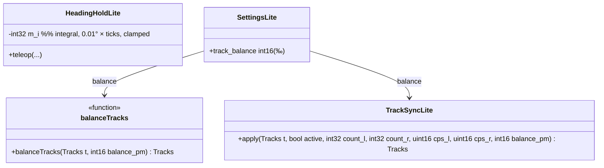
- **`balanceTracks(t, b)`** (`drive_mix_lite`): while both targets have the same sign, scales the magnitudes `|l| × (1000 − b/2) / 1000`, `|r| × (1000 + b/2) / 1000` (clamped to 100) — feed-forward, also with encoders off. Not applied while the driver steers or for `src AUTO` turns (straight only).
- **`TrackSyncLite::apply(…, balance_pm)`**: the distance term compares `Δcount_L × (1000 + b)` with `Δcount_R × 1000` (the right track is expected to turn `b` ‰ more); the speed term compares `cps_L × (1000 + b)` with `cps_R × 1000`. `b = 0` is today's behaviour (existing tests unchanged).
- **`HeadingHoldLite`** gains `m_i`: while holding, `m_i += err` each 10 ms tick, clamped so `Ki × m_i` ≤ ±15 %; `out = Kp × err + Ki × m_i − Kd × rate`, `Ki` = Kp / 4 per second (`kIDivTicks` = 400 control ticks, floor-tuned), integral contribution clamped to ±15 %; reset on steering, stop and capture.
- **`SettingsLite`**: new field `track_balance` (int16, ‰) appended to `LiteSettings`; the EEPROM loader accepts the previous block size (fields up to `encoders_enabled`) and keeps the default for the new field — a saved Lite block survives the update. Setting id **66** `track_balance` (global, i16, ‰, −100…100, default 0) in `protocol/defs/settings.yaml`; the full firmware gets the slot too (`GlobalSettings`, layout version 2 — its EEPROM resets once; no full board in use).

### 20.2 Tick (unchanged order, two additions)
heading hold (now P + I + D) → `liteMix` → **`balanceTracks`** (straight only) → track sync (**ratio target**) → caps → ramp → deadband → supervisor.

### 20.3 Tests and budget
Host: `balanceTracks` (+19 ‰ at 40/40 → 40/41 rounding, reverse, steering untouched, clamp); sync ratio (counts in ratio 1.019 → no correction; equal counts → corrects toward R); heading hold integral (a constant disturbance that P alone leaves at a steady error is driven to ~0 in a simulated loop; integral resets on steer / stop; clamp); settings migration (a block of the previous size `offsetof(LiteSettings, track_balance)` loads with `track_balance` = 0; the new block round-trips). Budget: ~+300 B flash, +4 B RAM.

### 20.4 As built and review fixes (2026-10-17)
- Budget measured: Uno Lite **31 028 B flash (96.2 %), 1 532 B RAM** (+740 B / +8 B for plan J). About 1.2 KB of flash is left — future Lite features must be small.
- Final review: 0 Critical / 0 Important / 7 Minor. Fixed: **M1** sync ratio maths without the `dl × (1000 + b)` product (UB overflow after ~260 m of one straight stretch; the wrap happened to cancel, test `test_sync_ratio_no_overflow_on_long_stretch`); **M2** the integral is **frozen while the obstacle brake or the latch holds the tank** (`freezeIntegral`, set each tick) and does not grow while P is saturated — no wound-up swerve on release (`test_hold_integral_frozen_while_blocked`).
- Note (M7): flashing an older firmware after a save resets the Lite settings to defaults (an old build does not know the longer block) — re-set `track_balance` / `encoders_enabled` after a downgrade.
- Saved on the tank: `track_balance` = 19 ‰, `encoders_enabled` = 1, heading gains 3500 / 1200.


## 21. Board temperature, tilt angles, self-test on request (owner 2026-10-19, design-notes §91, bridge LLD R13)
> **As built (owner, 2026-10-19, design-notes §92): only item 3, the self-test on request (+100 B → 31 144 / 32 256 B).** Items 1 and 2 were built (+632 B with 16-bit-only maths) and removed: the flash is too tight for their value (tilt is already an alarm; the temperature is the chip's own).
Three small additions for the tank app's Tank tab (Uno flash before: 31 044 B / 96.2 %, ~1.2 KB free; budget for all three ≤ 400 B, measured after each):
1. **Board temperature:** the IMU burst already reads the MPU6050 temperature (`ImuRaw::temp`, `imu_uno.cpp`); TELEM_SLOW `temp` (0.01 °C) = `raw × 100 / 340 + 3653` in integer maths, the last value of the 1 Hz slow frame. It is the chip's temperature (a few °C above the room).
2. **Tilt angles:** `TiltLite` keeps the filtered accelerometer (128 per g); TELEM_FAST `pitch` / `roll` (0.01°) = `iatan2(x, isqrt(y² + z²))` and `iatan2(y, z)` with an **integer atan2** (octant reduction + a 2nd-order polynomial, error ≤ 0.5°; no floats, no `atan2f` — the Lite does not link the float maths) and the existing `isqrt16`; computed once per TELEM_FAST.
3. **Self-test on request:** CALIBRATE with script `SELF_TEST` (9) → ACK OK and the boot self-test runs again (the same `selfTestTask` on its next tick — it only waits for uptime ≥ 2 s, as at boot — EVENT SELFTEST with the result and the lock as at boot); every other CALIBRATE script stays UNAVAILABLE; refused BUSY while driving.

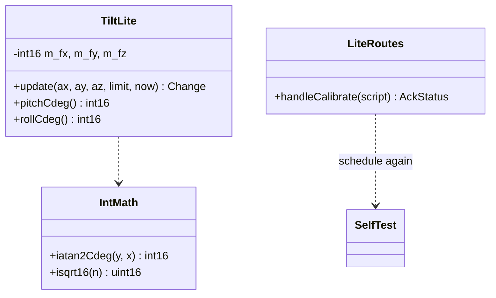
Tests (host): `iatan2Cdeg` against `atan2` at 1° steps (|error| ≤ 50 cdeg), pitch/roll from synthetic accel vectors, temperature conversion, CALIBRATE SELF_TEST → OK + a new SELFTEST event, other scripts → UNAVAILABLE.
> **As built (design-notes §97):** the CALIBRATE case is written inline in the Lite route dispatcher (no separate `handleCalibrate`), and the host test is `test_calibrate_is_handled_for_self_test` (frame use); the OK / UNAVAILABLE / BUSY replies were checked on the tank (stand check, Plan O).

## 22. Camera centre: pan and tilt trim (owner 2026-10-23, design-notes §125 b and §128, bridge LLD R23 — approved 2026-10-23)
- **Why:** at servo 90° the pan looks 5° left of dead ahead (§125). The servo's spline teeth step ~14°, so the horn cannot fix it. The Uno itself sends the camera home on HOME, on the IR remote's HOME key and 500 ms after the stick is let go, so the trim has to live on the Uno.
- **Settings:** the existing ids **27 `pan_trim`** and **28 `tilt_trim`**:
  - i16, 0.1° steps, −300…300 (±30°), default 0, in **servo terms** (added to the servo angle, as in the Mega firmware's `CameraHead`);
  - for this tank: pan_trim −50 (servo 85° = dead ahead);
  - SETTING_SET / GET / SETTINGS_SAVE as for every Lite setting.
- **EEPROM:** `LiteSettings` gains `pan_trim`, `tilt_trim` at its end. `load()` accepts three block sizes: before plan J, before this change, now. Fields missing from an older block keep their defaults (0), as for `track_balance`.
- **Applying it:**
  - `CamLite` keeps its targets and smooth output in **logical** terms (900 = the true centre). `home()`, `joy()`, `set()`, `nudge()` and the jog keys are unchanged.
  - Only the servo write adds the trim: `servoPan() = clamp(outPan() + pan_trim, 0, 1800)`, the same for tilt.
  - **Telemetry `pan` / `tilt` stay logical** (`outPan()` / `outTilt()`): 90° means "looks straight ahead".
  - The logical limits (pan 0…1800, tilt 300…1100) are unchanged. Near an end, the servo's own 0…180° clamp takes off up to the trim.
  - `applySettings()` calls `cam.setTrim(pan, tilt)`. A change of trim **wakes the servos** (like a command), so the camera moves to the new centre at once, even after it was released.
- **Unchanged:** the bridge's `LOOK` / `cam_set` rule (`dd = 900 − deg × 10`), the protocol (version 3), and the generated files.
- **After it is saved on the tank:** the AI calibration's `pan_map` goes back to (1, 0), because telemetry then reports the true centre as 90°.

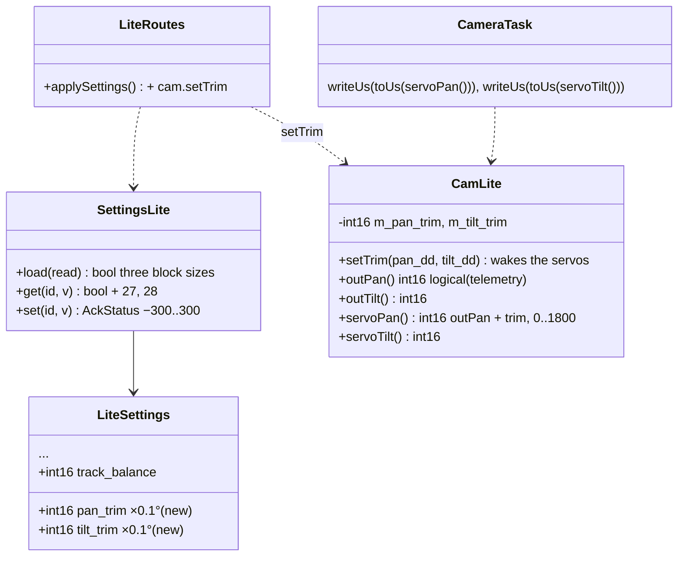

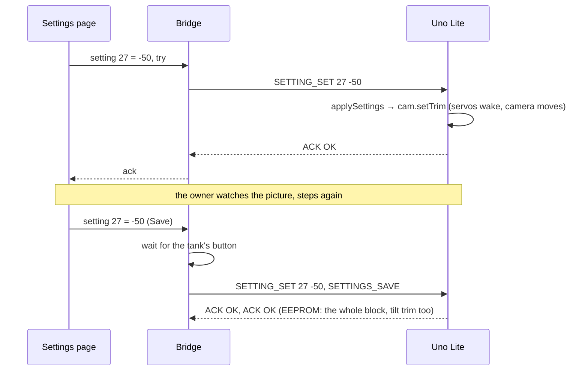
- **Tests (host):**
  - `SettingsLite`: get / set 27 and 28, range ±300 → OUT_OF_RANGE beyond, defaults 0;
  - a block saved before this change loads with trims 0; a block with the trims round-trips;
  - `CamLite`: `servoPan()` = `outPan()` + trim, clamped at 0 and 1800; `outPan()` unchanged by the trim; `home()` → servo 900 + trim; `setTrim` wakes a released camera.
- **Budget:** ≤ 200 B of flash, measured in the plan (before: 31 144 B / 96.6 %).

### 22.1 As built (Plan S, 2026-10-23; design-notes §129)
- **As designed, plus the final review's fixes:**
  - **No jump at power-on:** `setup()` runs `settingsLoad()` first, then one `cameraTask()`, then attaches the servos. AVR `Servo` keeps a pulse written before `attach()`, and its default range, 544…2400 µs, is the same as ours. So the very first pulse already carries the saved trim.
  - **An unchanged trim does not wake the servos:** `setTrim` returns early when both values are the same. `applySettings()` runs after every SETTING_SET, so before this fix a track-balance change re-attached a released camera for 2 s.
- **Flash:** 31 376 B / 32 256 B (+232 B over 31 144 B; the ruling accepts the 32 B beyond the 200 B budget for the two fixes). 880 B free. RAM 1540 B.
- **The EEPROM block is now 31 B, in the 32 B write buffer (`EepromWriter::kMaxBytes`).** The next Lite setting needs the buffer raised, which costs RAM, or another field shrunk.
- **Tests:** Uno native 298/298, including `test_settings_camera_trims`, `test_settings_block_before_the_trims_still_loads`, `test_cam_trim_moves_only_the_servo`, `test_cam_trim_wakes_servos` and `test_cam_same_trim_does_not_wake_servos`.
- **On the tank:** pan_trim −50 (−5.0°), tilt_trim 0. They are kept across a power cycle, with no jump at power-on.

## 23. Smooth camera motion (owner 2026-10-23, design-notes §136 — draft)
- **Why:** on the stand, the camera's motion didn't feel as smooth as from an RC transmitter. The servo output recorded at 50 Hz (`td.pan`, 30 s of stick moves) showed:
  - **slow moves are stop-and-go:** one step, then 1–4 ticks still, 151 pauses inside the motion. The phone's stick reaches the Uno only ~15–25 times a second, in whole percents (0.9°), and `CamLite::step` reaches each new target within one tick, then waits;
  - **fast moves run at exactly the 2.4°-per-tick cap** (120°/s) with hard starts and stops (155 of 389 moving steps).
- **Where:** in `CamLite::step()` on the Uno, the last stage before the servo. It runs at the servo's 50 Hz frame and covers every source: stick, IR jog, HOME, the joystick's return, `CAM_SET` (Logo `LOOK`, the AI's `cam_set`).
- **How (each 20 ms tick, per axis, integers in deci-degrees):**
  1. `want` = (target − out) / `kFollowDiv` (4), rounded away from zero so it never stalls short: each tick covers a quarter of the remaining gap. This fills the gaps between stick updates and eases into the stop.
  2. `want` is limited to ±`kStepDd` (24 dd = 2.4° per tick = 120°/s), as now.
  3. **Speeding up is limited:** the speed `v` may grow by at most `kAccelDd` (3 dd per tick, i.e. 750°/s², 0 → 120°/s in 0.16 s) when `want` is faster than `v` in the same direction. Slowing down and reversing follow `want` at once, so it never overshoots.
  4. `out` += `v`. Within 2 dd of the target, `out` = target and `v` = 0.
- **Unchanged:**
  - `pan()` / `tilt()` (targets), `outPan()` / `outTilt()` (telemetry), and the trims (§22, added at the servo write);
  - the 2 s release: "moving" is `out ≠ target` or `v ≠ 0`. A released camera starts from `v` = 0.
- **The trade-off:** the camera follows about 0.1 s behind a stick move (soft, not twitchy). `kFollowDiv` and `kAccelDd` are constants, tuned on the stand with the owner; no new setting (flash).
- **Budget:** ≤ 120 B (31 376 B before; 880 B free), measured in the plan.

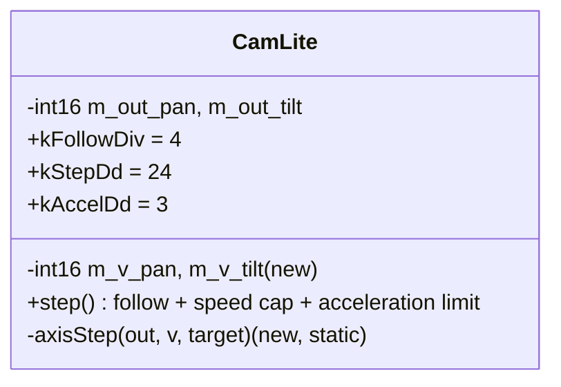

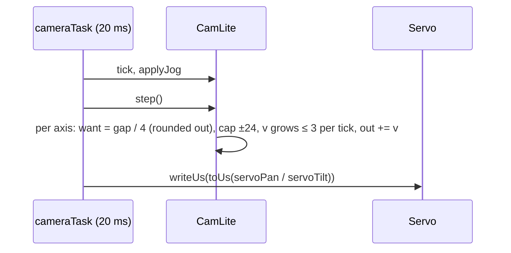

- **Tests (host):**
  - a big move: monotonic, never past the target, every step ≤ 24, the first steps 3, 6, 9 … (ease-in), lands exactly on the target;
  - **a staircase target** (+9 dd every 3 ticks, like the phone's stick) → **the output moves every tick**, with no stalls inside the motion;
  - a reversal mid-move → no overshoot past the new target;
  - a 1 dd move lands; the release after 2 s still works; the trims are unaffected;
  - the IR jog keeps its 60°/s target rate.
- **On the stand:** the same recording as §23's "why" (`servo_record.py`). Expected: no stop-and-go pattern in slow moves, ramped starts in fast ones, and the owner's feel against the RC transmitter.
