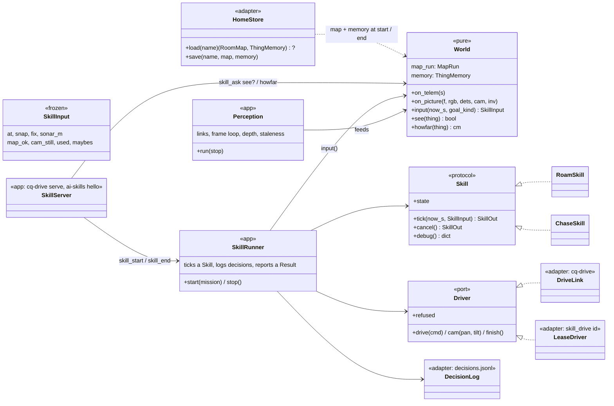

# AI engine: architecture review (structure, not bugs)

Branch `main` at 0eadd01. Read-only review: the code under `ai-engine/src/conqueror_ai/`, the tests, the drive and map configs, design-notes §189-§190, bridge LLD R26 and Tank Logo LLD §24.

## 1. Verdict

**The domain is healthy. The app layer needs some work before the next two steps.**

- **Layering is clean.** Nothing in `domain/` imports `app/` or `adapters/`, or calls `time` or `print`.
- **Each part is pure, small and tested:** PoseFilter, RoomMap, CostMap, Planner, RoutePlanner, Recovery and the goals. The `Detector` protocol is a real port.
- **The drive skills are pure tick functions.** That is the right shape for replay and for a skill server.

The weak points are where the fast floor-driven work landed:

1. **`app/drive.py`'s `drive_session` mixes four jobs:**
   - the per-run wiring;
   - the perception loop;
   - the per-tick "world" glue (goal, memory, maybes, flags);
   - the CLI output.

   The perception loop is written three times: in `app/objects.py`, `app/map.py` and `app/drive.py`.
2. **`RoamSkill` has become three skills behind mode flags.** About half of it is find-only.
3. **The skill API is wide and positional:** 9 to 11 arguments, a different order per skill, and dispatch by `isinstance` plus `m.action`.
4. **Persistent state was never designed in.**
   - The map's single `seen` layer and the memory's clock assume one run.
   - The drive's decisions are not recorded, so a run can't be replayed decision by decision.

None of this calls for a rewrite. About five targeted changes, most of them S or M effort, cover the home spot and Z2.

## 2. Findings

### F1. The per-tick glue lives in the CLI loop and is barely tested (M)

**What.** `app/drive.py:186-299` does all of this inline, between `await`s:
- links up;
- the depth and detector gather;
- `run.gate`, which works out `cam_still`, `used_now` and `picture_counts`;
- `by_size`;
- `goal.update`, `memory.update` and `maybes_of`;
- the snapshot;
- the off-loop `_tick`;
- the drive and camera sends;
- `print`.

The sim harness (`tests/test_drive_roam_sim.py:62-120`) rebuilds its own loop on a bare `RoomMap`. It never uses `MapRun`, `Goal` or `ThingMemory`, and passes no memory. The only test of `drive_session` is one fake-bridge test (`tests/test_drive_app.py:164`, "never moves without a fresh map").

**Why it matters.**
- The subtle flags were each a review fix (§190 I2: `used_now`). Yet they are exercised by neither the sim nor the app tests as one piece.
- Z2 needs this same glue to run without the CLI loop.
- The home spot needs to inject a loaded map and memory into it. Today `MapRun` builds `RoomMap(cfg.map)` itself (`app/map.py:102`), and `drive_session` builds `ThingMemory()` itself (`app/drive.py:190`).

**Recommendation.** Pull the glue into one pure class, `World`, that both the app and the sim use:
- it takes telemetry and used pictures;
- it holds the MapRun, Goal and ThingMemory;
- it hands out a `SkillInput`.

Pass the map and memory in through its constructor. Move `MapRun` out of `app/map.py` beside it: it is pure, and two apps import it.

### F2. The perception loop is written three times (M; do it together with F1)

**What.** Each of these has its own `telemetry()` closure, link and task setup, depth/detector `gather`, `see_off_loop` and failure handling:
- `app/objects.py:215-289`;
- `app/map.py:222-288`;
- `app/drive.py:199-258`.

`app/drive.py` also imports paths, `decode`, `load_depth`, `map_state` and `task_failure` from the other two app modules (`drive.py:40-63`).

**Why it matters.**
- Z2 wants a fourth copy: a long-lived server loop.
- Fixes so far have had to be made in each copy (the final review's C1, off-loop seeing).

**Recommendation.** One `Perception` runner in `app/perception.py` (links, the frame loop, depth, staleness), feeding the `World`. The three CLIs and the server become thin. Paths and constants go to `app/paths.py`.

### F3. The skill interface (S to M)

**What.**
- `RoamSkill.tick` takes `(now_s, at, snap, fix, sonar_m, map_ok, cam_still, maybes, used)` (`roam.py:153`).
- `ChaseSkill.tick` takes `(now_s, at, fix, sonar_m, map_ok, cam_still, snap)` (`chase.py:83`).
- `app/drive.py:275` passes 11 positional arguments into `_tick`, which dispatches with `isinstance` and `m.action == "find"` (`drive.py:302-320`).
- `make_skill` never returns a `ChaseSkill` any more (`drive.py:162-169`). The `ChaseSkill` branch in `_tick` is dead.
- Results are strings, and the app rewrites one of them (`"stale"` → `"stale - …"`).

**Why it matters.**
- Z2's `skill_failed` needs fixed reasons that map to Logo codes 7050, 7051 and so on.
- Every new input means editing four signatures.
- Positional booleans (`map_ok`, `cam_still`, `used`) are an easy order bug.

**Recommendation.**
- `SkillInput` as one frozen dataclass.
- A `Skill` Protocol with `tick(now_s, inp) -> SkillOut`, `cancel()` and `state`.
- `SkillOut.result` as a small enum (`done`, `not_found`, `lost`, `blocked`, `stale`, `cancelled`, `refused`, `failed`) plus a detail string.

`SkillInput` is also what you would log for replay (F8).

### F4. RoamSkill is three skills behind flags (M; can wait)

**What.**
- `mode` and `find` are redundant: `find` always means `mode="search"` (`drive.py:168`).
- `_destination` and `_plan` branch on mode three times (`roam.py:277-300`).
- The find-only parts take about 200 of 416 lines: candidates, the `_Check` sub-state machine (`roam.py:58-73`, `323-388`), the chase hand-off, seeding from memory and the search's look marking.
- States are bare strings set in about 15 places.

**Why it matters.** It is manageable today. It gets worse if Z2 brings GOTO back or the home spot adds a "go to the remembered spot first" phase.

**Recommendation.**
- **Cheap part (S), do it now:**
  - a `DestinationGoal` protocol (`destination`, `drop`, `done`), chosen once, which removes the if-chains;
  - remove the `find` flag.
- **Later (M):**
  - move the check into a `CandidateCheck` class beside `Candidates`, the way `Recovery` stands on its own;
  - make `FindSkill` a composition of the roam driving core, the check and the chase.

Don't do the later part before a feature needs it.

### F5. Overlapping concepts, written more than once (S each)

**The look round exists three times, with different rules:**
- the chase's sweep: `SWEEP_PANS` (0, -45, 45, -90, 90). It waits for still pictures (`cam_still`) and has a time cap (`chase.py:16-18`, `145-166`);
- Recovery's look: `LOOK_PANS` (-90, -45, 45, 90, 0), purely timed, ignoring `cam_still` (`recovery.py:17-18`, `121-127`);
- the check's look: `roam.py:360-373`.

One `LookAt` / `LookRound` part (pans, still-time, cap) would serve all three. That is "general before special".

**Code repeated in both skills:**
- the stale stop: `roam.py:208-215` and `chase.py:100-107`;
- the dt / `MAX_TICK_S` clamp;
- the slow planner, with `SLOW_CMS = 18.0` defined three times: `roam.py:42`, `chase.py:31` and `adapters/drive_config.py:28`. It is a spec 9 §5 safety value and should have one definition, `Limits.slow_cms`;
- the camera follow in `PAN_STEP_DEG` steps, written three times: `roam.py:410-415`, `384-387` and `chase.py:259-263`.

These are small shared helpers, not a base class.

**Radius constants that mean the same thing:**
- **"Same thing within 0.5 m" (the floor point's looseness):**
  - `memory.MERGE_M`;
  - `candidates.MERGE_M`;
  - `objects.SAME_THING_M`.
- **"The detector names things for sure within about 1 m" (§188):**
  - `candidates.CLOSE_M`, re-exported as `CHECK_CLOSE_M`;
  - `goals.LOOK_M`.

Give each idea one name in one place: `SAME_SPOT_M` and `SURE_REACH_M`. The detector's reach depends on the detector, the light and the robot, so it is a fair candidate for config. The others (`REACHED_M`, `TARGET_R_M`, the `VISIT_*` values) are separate ideas; leave them.

`DRIVE_TILT = -15` (`chase.py:19`) is a calibration value (design-notes §125), imported by roam and the app. Move it to `Limits` or `calibration.yaml`.

### F6. Cost maps built ad hoc, with the play area handed round by hand (S)

**What.** `CostMap(...)` is built in five places:
- `roam.py:149`, cached per snapshot;
- `chase.py:177`, built every spin tick;
- `chase.py:216`, built every approach tick;
- `chase.py:239`, a dead fallback, since `fan` is never None when `snap` is set;
- `candidates.py:77`, one per pending candidate per `next()`, then again every check tick.

The play area reaches the chase by setting an attribute in two places (`roam.py:174`, `268`). Every new `ChaseSkill(...)` has to remember to do it.

**Why it matters.**
- A forgotten `area=` lets a skill drive out of the play area. That is the bug class this invites.
- **Time per tick.** `Candidates.next` runs one distance transform and one A* (6-21 ms) per pending candidate. Once memory lasts across runs, 20 remembered spots means one tick of about 0.4 s. `DriveLink.FRESH_FOR_S` is 0.5 s, so the tank would stop on the deadman, mid-run.

**Recommendation.**
- A per-snapshot `CostMaps` factory owned by the run. It holds the settings and the area, and offers `base()` and `ignoring(x, y, r)`, both cached.
- `Candidates.next`: rank by straight-line distance first, then run A* on the best few (say 3) only.
- Prune or cap the memory (F7).

### F7. Persistence was not designed in (home-spot blockers; S to M)

1. **The single `seen` layer — a design decision for the owner.** The `seen` mask feeds:
   - `ExploreGoal`'s frontier: it would be `done` at the start;
   - `SearchGoal`'s "seen and not looked at": it would skip frontiers;
   - `CostMap.known_free = seen & ~lethal`: yesterday's floor would count as known free.

   `Recovery._back_ok` backs up only over `known_free` floor, because nothing senses behind the tank (`recovery.py:169-185`). Loading yesterday's `seen` and free evidence would invent free space, which `room_map.py`'s rule forbids.

   Recommendation:
   - save and load obstacle marks as weakened hints (low and high log-odds scaled down);
   - load `seen` into a separate "known from before" layer that cost maps and goals do not read as seen;
   - never load free (miss) evidence.

   This choice is safety-adjacent; it is not just how the file is written.
2. **`Remembered.last_seen_s` runs on the bridge capture clock** (`memory.py:22`, `35`). That clock resets on every bridge boot, so after a load the "most recent first" order in `of_kind` means nothing.
   - Store wall-clock time and a run id.
   - Within a run: `ObjectPipeline` rebuilds the tracker when `cap_us` goes back (`objects.py:411-414`). Object ids restart, and `Goal.oid` and `ThingMemory` aren't told.

   The underlying issue is that the engine has two clock domains without naming them:
   - monotonic seconds for skills and staleness;
   - bridge µs for the pose, the map and objects.

   Persistence adds a third, wall time. Name all three and convert in one place.
3. **The frame.** The PoseFilter starts at (0, 0, 0) at the first sample (`pose.py:5`). The RoomMap is 8 x 8 m and centred on the start.
   - For the home spot this is already the identity transform, which is the easy case.
   - Store a `frame` block in the file (`{"kind": "home", "version": 1, "pose_offset": [0, 0, 0], "cell_m", "size_m"}`). Localization can then fill in the offset later without changing the format.
   - Refuse to load a file with a different `cell_m` or `size_m`.
4. **Where the code goes.**
   - Pure `to_dict` / `from_dict` (and NumPy arrays) on `RoomMap` and `ThingMemory` in `domain/`.
   - `adapters/home_store.py` for the files: `homes/<name>/map.npz`, `things.json`, git-ignored.
   - Inject both into the `World` (F1).
5. **Size.** `ThingMemory` grows without limit and never forgets. At save time, drop things marked gone and things older than N runs, and keep at most K per word.

### F8. Visibility and replay: inputs are recorded, decisions are not (S to M)

**What.**
- `SessionRecorder` keeps telemetry and frames (`adapters/session.py`).
- `cq-map` and `cq-objects` can replay those deterministically.
- `cq-drive` records no state, destination, route, candidates, check phase, search marks, command or result.
- Skill time is `time.monotonic()`, and ticks also fire on the 0.2 s timeout (`drive.py:237`). A drive run can't be re-run decision by decision.
- Design-notes §189 lists "showing candidates on the live view" as not done yet.

**Why it matters.**
- It breaks "everything visible and replayable".
- Every floor analysis in §189 had to rebuild state by hand: "replayed picture by picture", "the search map drawn locally".

**Recommendation.**
- Write `decisions.jsonl` in the session folder, one line per tick:
  - `now_s`;
  - a compact `SkillInput`: the pose, the fix, the sonar, the flags, the maybes, and a snapshot id;
  - `SkillOut`;
  - `skill.state`;
  - a small `debug()` dict from each skill (destination, route, pending candidates, check phase).
- Optionally save snapshots as `np.packbits` every N ticks.
- Add a `cq-drive --replay DIR` that feeds the logged inputs to a fresh skill with the same rng seed, and checks or shows that the outputs match.
- Add a `RerunView.skill(...)` panel to show candidates and the route live.

This needs F3's `SkillInput` first.

### F9. Readiness for the skill server (Z2)

Tank Logo LLD §24 puts `SEE?` and `HOWFAR` in Z2, alongside FIND and GOTO. Both question words must be answered within 300 ms (R26.2). So perception (pose, map, tracker, memory) has to run all the time in the server, including when no skill is running. That is the strongest requirement Z2 puts on the structure.

**What blocks it today:**
- `drive_session` owns the links, the perception, one skill and the CLI print, all for one run (F1, F2).
- There is no `Driver` port. `DriveLink` is the only sink (`drive`, `cam`, `refused`, `finish`), and the lease needs `skill_drive {id}` on the same socket as `skill_*`.
- Results are strings (F3).
- Status goes out with `print` (`drive.py:285-290`).

**What already fits:**
- Skills are pure and cancellable (`cancel()`).
- `Mission` maps directly onto `skill_start {skill, thing}`.
- Ticking off the event loop is already isolated.

**GOTO.** The chase's no-map path (`snap is None`, `BLOCKED_GIVE_UP_S`, about 8 `fan is None` branches in `chase.py`) can't be reached from production: `test_goto_is_gone`, and roam returns before the chase when there is no snapshot. Decide now whether Z2's GOTO is "find without the search", and so always on the map. If it is, delete the no-map path.

**Memory in the server.** One `cq-drive serve` process naturally keeps the map and memory between skills. That alone makes the §190 M2 seeding pay off, before the home spot.

### F10. Smaller notes

- `SimRoom` repeats `Limits` values (`sim.py:32-33`: `CAM_X_M`, `SONAR_X_M`). Read them from `Limits`.
- `ObjectPipeline` owns the `PoseFilter` (`objects.py:377`), so the pose is reached through "objects" (`run.p.pose()`). Rename, or lift the pose up into `World`, during F1. Not worth doing on its own.
- **Config.** Keep behaviour timings in code. The YAML files hold measured values and safety bounds that "may only be made more careful", and that is a good rule. Move only `SURE_REACH_M` (it depends on the detector), `DRIVE_TILT` and the body values for other robots, which are already in `Limits`.
- **Performance is fine.** Ticks p95 are about 10 ms (§190). Snapshots are cheap copies of 160² arrays. The only real risk is F6's per-candidate cost.

## 3. Priorities

### Before the home spot

1. Decide the `seen` and free-space question (F7.1) and write it into the home-spot design. **Owner decision**, then S.
2. Inject the room map and memory into the run; add pure `to_dict` / `from_dict` with a version and a frame block; add `adapters/home_store.py` (F7.3-F7.4). **S to M.**
3. Put wall-clock time and a run id on `Remembered`; cap and prune memory at save time (F7.2, F7.5). **S.**
4. Rank `Candidates.next` before running A*; add the `CostMaps` factory that carries the area (F6). **S.**
5. Define `SLOW_CMS` once; give the "same spot" and "sure reach" radii one name each (F5). **S.**

### Before Z2

6. `SkillInput`, the `Skill` protocol and result kinds (F3). **S to M.**
7. `World` and `Perception` out of `drive_session`; the three perception loops become one (F1, F2). **M.** This is the main Z2 enabler. It also gives the sim tests the real glue.
8. A `Driver` port: `DriveLink` for the CLI, and a lease driver over the `ai-skills` socket. A status callback in place of `print` (F9). **S to M.**
9. Decisions log and replay (F8). **S to M**, once item 6 is in. Strongly recommended for the owner's "visible and replayable" rule, and because the home-spot floor runs will need it.
10. Settle GOTO and delete the chase's no-map path if it is not needed (F9). **S.**

### Can wait

- `FindSkill` out of `RoamSkill`; `CandidateCheck` as its own class (F4, later part).
- One shared `LookRound` for the sweep, the recovery look and the check look (F5). Worth doing the next time any of the three is touched: it is the "general before special" fix, but it changes floor-tuned behaviour, so it needs floor runs.
- Renaming `ObjectPipeline` and moving the pose up; tidying the sim constants.
- Localization: the frame block from item 2 is all it needs from now.

### Not recommended

- A skill base class or framework.
- Moving tuning constants into YAML in bulk.
- Rewriting `ObjectTracker` or `RoomMap`: both are sound.

## 4. Target structure (only the parts to change)

- **`cq-drive find ball`:** `Perception` + `World` + `SkillRunner(DriveLink)`, with an optional `HomeStore` load at the start and save at the end.
- **`cq-drive serve`:** the same `Perception` and `World` stay up for the whole session. Each `skill_start` makes a `SkillRunner(LeaseDriver)`. Questions read the `World` directly.
- **`cq-map` and `cq-objects`:** `Perception` + `World` with no runner.
- **The sim tests:** a `SimRoom` feeds `World.on_*`, so the sim exercises the same glue as the tank.
