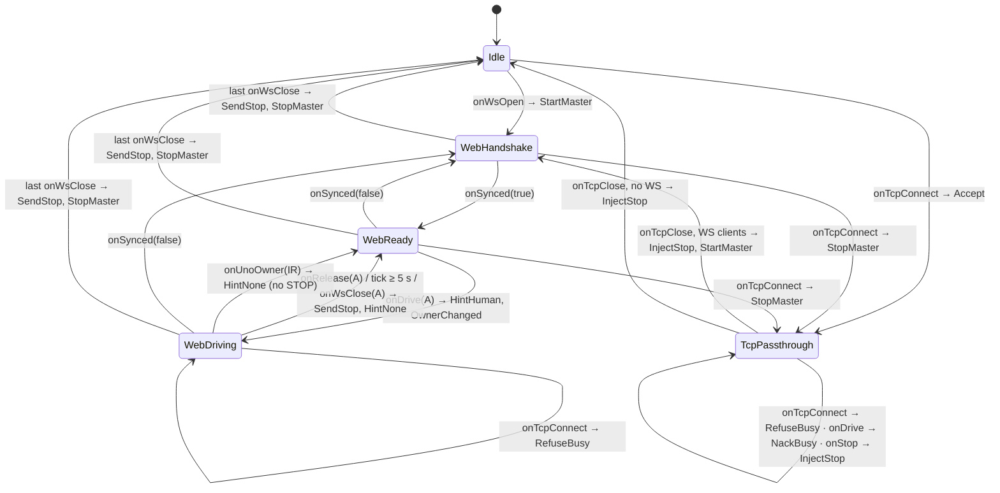

# Plan C — ESP32-S3 WiFi Bridge + Basic Drive Page Implementation Plan

> **For agentic workers:** REQUIRED SUB-SKILL: Use superpowers:subagent-driven-development (recommended) or superpowers:executing-plans to implement this plan task-by-task. Steps use checkbox (`- [ ]`) syntax for tracking.

**Goal:** Developer firmware for the ELEGOO **ESP32S3-Camera-V1.0** board that (a) joins the home WiFi (AP fallback), (b) passes the bench tool's TCP 3333 byte stream to the Uno frame-aligned (Plan D unchanged), (c) acts itself as the body-link master for a phone **Basic Drive page** served at `/` over a WebSocket `/ws`, (d) streams the camera (MJPEG :81, 2 viewers), (e) updates over WiFi (ArduinoOTA, password) and (f) describes itself (`/info`, `/help`, `/source.tar.gz`).

**Architecture:** One PlatformIO project `firmware/esp32/`. A **pure C++ core** (`src/core/`, no `Arduino.h`, host-tested in `env:native` with Unity): `FrameParser` (same resync contract as Plan A's Python parser, proven on `protocol/vectors/`), `FrameTx` (whole-chunk TX queue — frames from different sources never interleave), `BodyLink` (master: HELLO_REQ → HELLO → HELLO_ACK, HEARTBEAT 100 ms, STOP resend until ACK, telemetry snapshot), `LinkOwner` (Idle / WebHandshake / WebReady / WebDriving / TcpPassthrough arbiter), `FrameAligner` (frame boundaries in passthrough streams), `WsCodec` / `WsJson` / `WsClients` (JSON ⇄ frames). A thin **Arduino/IDF shell** (`src/net/`): one `link_task` owns UART, core objects and the TCP client; `esp_http_server` on port 80 (`/`, `/ws`, `/info`, `/help`, `/source.tar.gz`) and port 81 (`/stream`); `WifiManager`, mDNS, `OtaService`, `CameraService`. Build scripts stamp version + git commit, gzip the web assets into a header, pack a `git archive` into the `source` flash partition and refuse to flash anything that is not an ESP32-S3.

**Tech Stack:** PlatformIO (installed with `uv tool`), **pioarduino** platform release **55.03.311** (Arduino-ESP32 **3.3.11**, ESP-IDF **5.5.5**), C++17 (`gnu++17`), `esp_http_server` (WebSocket support), esp32-camera (bundled with the core), ESPmDNS, ArduinoOTA; Unity for host tests; one HTML file with inline CSS + plain JS (no framework, no npm, no build step); Python 3.12 + uv for build scripts and the smoke script (Plan A's `conqueror_protocol`).

**Spec:** `docs/lld/esp32-bridge-lld.md` **Revision 2 (2026-10-12)** — authoritative where it differs from the Revision 1 text above it — plus `docs/design-notes.md` §22 (board is an ESP32-S3), §24 (pin map, flash/PSRAM, USB), §27 (self-describing firmware, HELLO `commit`), §28 (Basic Drive page) and the 2026-10-12 line accepting **all nine R2.14 confirmations**. Also `docs/lld/esp32-firmware-lld.md` §10.1 (toolchain), `docs/design/hub-ux.md` (Phosphor theme), `docs/implementation-roadmap.md` phase 3, `docs/standards/coding-standards.md` §1/§3.

**Roadmap position:** Phase 3, alongside Plan D (bench tool). Depends on **Plan A** (merged: `cq_protocol.h`, `protocol/vectors/`, `conqueror_protocol`; Task 9 adds one protogen output). **Plan B must be flashed on the Uno first** — the bridge speaks **protocol version 2** (HELLO carries `commit: u32`) and refuses an Uno that reports another version (page shows `body_offline`). Plan D talks to the Uno through this bridge unchanged.

## Global Constraints

- **Platform:** commands are shown for macOS; on **Linux** use the equivalents in `docs/dev-setup.md` (uv install, serial port names `/dev/ttyACM0`/`/dev/ttyUSB0` + `dialout` group, PlatformIO udev rules, `avahi-browse` instead of `dns-sd`, hold-to-drive needs X11). The ESP32-S3 board enumerates as `303a:1001` → **`/dev/ttyACM0`** on Linux (confirmed, §24) and `/dev/cu.usbmodem*` on macOS (§23: some USB-C cables are not detected on macOS — use Linux or another cable).
- **Board (§22/§24):** ELEGOO ESP32S3-Camera-V1.0, module ESP32-S3-WROOM-1, chip ESP32-S3 (QFN56) rev v0.2, **8 MB flash**, **8 MB embedded octal PSRAM** (`qio_opi`), native USB-Serial/JTAG (GPIO19/20) with `ARDUINO_USB_CDC_ON_BOOT=1`. No status LED → status on the USB serial log, `/info` and the bench tool. Every USB flash runs `scripts/check_chip.py` first and refuses unless esptool reports an ESP32-S3 with 8 MB flash and 8 MB embedded PSRAM.
- **Uno link:** `Serial1`, **RX GPIO3, TX GPIO40, 250000 8N1**, RX buffer 2 KB, TX buffer 1 KB. GPIO3 is a strapping pin — input only after boot, no pull-down. GPIO 26–37 (flash/PSRAM) are never touched.
- **Camera:** ESP32-S3-EYE map (PWDN −1, RESET −1, XCLK 15, SDA 4, SCL 5, D7..D0 = 16, 17, 18, 12, 10, 8, 9, 11, VSYNC 6, HREF 7, PCLK 13), XCLK 20 MHz, JPEG VGA, 2 frame buffers in PSRAM; MJPEG on **port 81 `/stream`, max 2 viewers**; sensor auto-detected (OV3660 expected) and logged.
- **Partitions (8 MB, `partitions_cq8m.csv`):** nvs 0x9000/0x5000 · otadata 0xE000/0x2000 · app0 0x10000/0x300000 · app1 0x310000/0x300000 · source (data/spiffs) 0x610000/0x1E0000 · coredump 0x7F0000/0x10000.
- **Body link (Plan A/B contract):** frames `0xAA | len | type | seq | payload | crc8(poly 0x07)` built and decoded **only** with the generated `cq_protocol.h`, included from `firmware/uno/src/generated/` through `-I ../uno/src/generated` (one file, never copied, never edited). As master the ESP32 sends HEARTBEAT every **100 ms**, HELLO_REQ on start and every **1 s** until a HELLO with `proto == kProtocolVersion` (2) arrives, then HELLO_ACK + OWNER_HINT. **No ENVELOPE from the bridge** (R2.14 confirmation 5 — the brief's "HELLO/ENVELOPE/HELLO_ACK" is the bench's optional path, not the bridge's). STOP is resent every **50 ms** up to **10** times until the Uno's ACK. Uno WIFI_RESET_REQ / ADMIN_RESET_REQ are answered with ESP_ACK `UNAVAILABLE` (the bridge has no WiFi/admin store) and logged.
- **The ESP32 never drives on anyone's behalf:** it originates only HEARTBEAT, HELLO_REQ, HELLO_ACK, ESP_ACK, STOP, OWNER_HINT and CAM_HOME; every DRIVE / CAM_JOY is sent 1:1 for a received WS message. A silent page ⇒ no DRIVE ⇒ Uno deadman (300 ms). The page therefore **re-sends `drive` every 50 ms from a timer while the stick is held**, even when the stick does not move.
- **Link owner (R2.7, accepted):** bench owns the link from TCP connect; a phone owns driving from its first `drive` until `release_control`, **5 s** without `drive`, or its socket closes; other phones → `nack NOT_OWNER`; phone motion while the bench holds the link → `nack BUSY`; a bench arriving while a phone drives, or a second bench, is **accepted and closed at once**; bench silent **1 s** → dropped; WS client silent **3 s** → reaped; **STOP from anyone in every state** (injected in passthrough with `seq = lastSeq + 128`, its ACK swallowed); IR on the Uno beats all.
- **TCP 3333:** `TCP_NODELAY`, one client, frame-aligned both ways (partial frame flushed raw after **50 ms**, discarded on close), bad-CRC frames forwarded unchanged (passthrough stays transparent).
- **WebSocket `/ws`:** JSON text frames exactly as LLD R2.9 (spec 01 §4–6 names): in `hello`, `drive{v,w}`, `stop`, `cam_joy{x,y,active}`, `cam_home`, `release_control`, `ping{t0}`; out `welcome`, `tf` (10 Hz), `ts` (1 Hz), `ev`, `ack`, `nack`, `pong`. Max **4** WS clients, rate limit **25 msg/s** per client. JSON is parsed and written by our own fixed-buffer code (`WsCodec`, `WsJson`) — no JSON library, no heap.
- **WiFi:** station from git-ignored `include/secrets.h`; **30 s** without a connection → WPA2 fallback AP `conqueror-bridge` (password from `secrets.h`, ≥ 8 chars) at `192.168.4.1`; in AP mode retry the home network every **60 s** only while no WS/TCP/stream client is connected. mDNS host **`conqueror-bridge.local`**; services **`_cqbridge._tcp` port 3333** (Plan D's `discover` looks for exactly this; `_conqueror-bridge` would exceed the 15-character DNS-SD limit), `_http._tcp` port 80; ArduinoOTA adds `_arduino._tcp` port 3232.
- **OTA:** ArduinoOTA, port 3232, password `CQ_OTA_PASSWORD` from `secrets.h` (build fails when missing or `change-me`); `ArduinoOTA.handle()` is polled **only while LinkOwner is Idle, WebHandshake or WebReady** (nobody driving, no bench). Uno firmware stays **USB only**.
- **Memory / tasks:** allocation at startup only (fixed pools for WS out messages, no `String` in hot paths); `link_task` (core 1, 2 ms tick) is the only owner of the UART, the core objects and the TCP client; httpd handlers talk to it through one FreeRTOS queue; free internal heap ≥ **120 KB** in steady state (reported in `/info`).
- **Read-only self-description:** `/info`, `/help`, `/source.tar.gz` never control anything and never contain secrets; `secrets.h` is git-ignored and `pack_source.py` fails the build if a secret value appears in the archive.
- **Security:** **DEVELOPER BRIDGE — NO AUTHENTICATION.** Anyone on the same network can drive the tank (WS and TCP). Home network only, never in release firmware; the boot log, `/help` and the README say so.
- **Host tests:** `cd firmware/esp32 && pio test -e native` (Unity). Core code compiles with `-Wall -Wextra -Werror` on the host and on the ESP32.
- **Commits:** Conventional Commits, one per task, each ending with `Co-Authored-By: Claude Opus 5.5 <noreply@anthropic.com>`. Generated files are never edited by hand (`firmware/uno/src/generated/`, `firmware/esp32/src/generated/`, `protocol/vectors/`, …) — change `protocol/defs/*.yaml` or the generator and run `cd protocol && uv run protogen write`.
- **Hardware steps** (marked **[HW]**) are run with the owner present, **tank on a stand, tracks off the ground**, a STOP within reach (page STOP, bench Space, IR remote).

## Review Focus

1. **Phone goes to sleep / tab hidden while driving** → no more `drive` messages; the Uno deadman stops the tank within 300 ms; the bridge never repeats a DRIVE (Task 6 test `test_bridge_never_invents_drive`; Task 10 HW check "phone sleep").
2. **Holding the joystick still** → the page keeps sending `drive` every 50 ms so the deadman does not stop a tank that the driver is holding (Task 7 page code `startDriveTimer`; Task 10 HW check).
3. **Bench connects while a phone drives / second bench** → accepted and closed at once, logged; the phone keeps driving (Task 3 tests `test_bench_refused_while_phone_drives`, `test_second_bench_refused`).
4. **Phone STOP while the bench holds the link** → STOP frame injected between two whole bench frames with `seq = lastSeq + 128`, resent until the ACK, ACK not forwarded to the bench (Task 2 `test_stop_resend_until_ack`, Task 4 `test_ack_swallowed_once`, `test_injected_frame_waits_for_partial`).
5. **Master change** (web → bench → web) → heartbeats stop at a frame boundary; when the web side takes over again it always starts with HELLO_REQ and only sends HELLO_ACK for `proto == 2` (Task 2 `test_handshake_rejects_wrong_proto`, Task 3 `test_bench_close_with_ws_clients_rehandshakes`).
6. **IR remote takes over** → web driver dropped without STOP (the Uno already stopped), web motion nacked `NOT_OWNER` until the Uno reports another owner (Task 3 `test_ir_beats_phone`).
7. **Interleaving** → TCP bytes and ESP32-originated frames never mix mid-frame on the UART; bad-CRC bench frames still pass (Task 2 `test_urgent_waits_for_chunk_boundary`, Task 4 `test_bad_crc_frame_forwarded`).
8. **Secrets** → `secrets.h` never tracked, never in `/source.tar.gz`, never logged (Task 9 `pack_source.py` checks, Task 1 `.gitignore`).

---

## File Structure

```
firmware/esp32/
├── platformio.ini                  envs bridge, bridge_release, bridge_ota, native (Task 1)
├── partitions_cq8m.csv             8 MB layout (Task 1)
├── README.md                       usage, security warning, hardware checklist (Task 10)
├── include/
│   ├── board_config.h              pins, ports, timings, sizes (Task 1)
│   ├── secrets.example.h           committed template (Task 1)
│   └── secrets.h                   git-ignored, local only
├── scripts/
│   ├── stamp_version.py            pre: build/version.h (version, git commit, dirty, date) (Task 1)
│   ├── check_chip.py               esptool flash-id gate, also pre-upload hook (Task 1)
│   ├── protogen_check.py           pre: protogen check (Task 1)
│   ├── native_paths.py             native env: CQ_VECTORS_PATH (Task 2)
│   ├── pack_web.py                 pre: gzip web assets + icon → build/web_assets.h (Task 7, help in Task 9)
│   ├── pack_source.py              pre: git archive → build/source.bin + secret checks (Task 9)
│   ├── upload_source.py            custom targets upload_source / upload_source_ota (Task 9)
│   └── ota.sh                      app + source over WiFi (Task 9)
├── src/
│   ├── main.cpp                    setup()/loop() composition root (Task 1, grows)
│   ├── core/                       pure C++ — no Arduino.h, host-tested
│   │   ├── frame_parser.h/.cpp     resyncing parser (Task 2)
│   │   ├── frame_tx.h/.cpp         whole-chunk TX queue + urgent slot (Task 2)
│   │   ├── body_link.h/.cpp        master: handshake, heartbeat, STOP resend, snapshot, events (Task 2)
│   │   ├── link_owner.h/.cpp       who is master / driver (Task 3)
│   │   ├── frame_aligner.h         passthrough frame boundaries, 50 ms flush, ACK swallow (Task 4)
│   │   ├── ws_codec.h/.cpp         JSON in → WsCommand (Task 6)
│   │   ├── ws_json.h/.cpp          snapshot/events → JSON out (Task 6)
│   │   └── ws_clients.h/.cpp       client table: names, rate limit, silence reap (Task 6)
│   ├── net/                        Arduino / ESP-IDF shell
│   │   ├── log.h/.cpp              USB serial status log (Task 1)
│   │   ├── uart_port.h/.cpp        Serial1 wrapper (Task 2)
│   │   ├── link_task.h/.cpp        owns core + UART + TCP; command queue (Task 2, grows 3/4/6/9)
│   │   ├── tcp_passthrough.h/.cpp  port 3333 (Task 4)
│   │   ├── wifi_manager.h/.cpp     station / fallback AP (Task 5)
│   │   ├── ota_service.h/.cpp      ArduinoOTA (Task 5)
│   │   ├── http_server.h/.cpp      port 80: /, /ws, assets, /info, /help, /source.tar.gz (Tasks 6, 7, 9)
│   │   ├── camera_service.h/.cpp   esp32-camera, S3-EYE pins (Task 8)
│   │   ├── stream_server.h/.cpp    port 81 /stream MJPEG (Task 8)
│   │   ├── info_service.h/.cpp     /info JSON (Task 9)
│   │   └── source_archive.h/.cpp   "source" partition reader (Task 9)
│   └── generated/help_protocol.html   protogen output — DO NOT EDIT (Task 9)
├── web/
│   ├── basic_drive.html            the Basic Drive page (Task 7)
│   ├── manifest.webmanifest        add-to-home-screen (Task 7)
│   ├── help.html                   /help template (Task 9)
│   └── help_logo.html              Tank Logo quick reference (hand-written, Task 9)
└── test/                           Unity, env:native
    ├── test_frame_parser/  test_frame_tx/  test_body_link/  test_link_owner/
    └── test_frame_aligner/ test_ws_codec/  test_ws_json/    test_ws_clients/
protocol/generator/protogen/emit_help.py      new protogen output (Task 9, Plan A addition)
protocol/generator/tests/test_emit_help.py    (Task 9)
tools/smoke/bridge_echo.py                    TCP smoke script (Task 10; uv project shared with Plan B)
.gitignore                                    + firmware/esp32/include/secrets.h (Task 1)
.gitattributes                                export-ignore PNGs for the source archive (Task 9)
```

> **Rewrite in progress:** Tasks 1–10 are being written; this marker is removed when the plan is complete.

---

### Task 1: PlatformIO project for the ESP32-S3, partitions, secrets, version stamp, chip check, boot log

**Files:**
- Create: `firmware/esp32/platformio.ini`, `firmware/esp32/partitions_cq8m.csv`, `firmware/esp32/include/board_config.h`, `firmware/esp32/include/secrets.example.h`, `firmware/esp32/include/secrets_guard.h`, `firmware/esp32/scripts/stamp_version.py`, `firmware/esp32/scripts/protogen_check.py`, `firmware/esp32/scripts/check_chip.py`, `firmware/esp32/src/net/log.h`, `firmware/esp32/src/net/log.cpp`, `firmware/esp32/src/main.cpp`
- Modify: `.gitignore` (add `firmware/esp32/include/secrets.h`; `build/` and `.pio/` are already ignored)

**Interfaces:**
- Consumes: `firmware/uno/src/generated/cq_protocol.h` (Plan A) via `-I ../uno/src/generated`.
- Produces: envs `bridge`, `bridge_release` (refuses a dirty tree), `bridge_ota` (espota, Task 5/9), `native` (host tests of `src/core/`); `cq::board::*` constants (pins, ports, timings, camera map); `build/version.h` macros `CQ_FW_NAME`, `CQ_FW_VERSION`, `CQ_GIT_COMMIT` (40 hex), `CQ_GIT_COMMIT8` (u32), `CQ_GIT_DIRTY`, `CQ_BUILD_DATE`, `CQ_REPO_URL`; `secrets.h` macros `CQ_WIFI_SSID`, `CQ_WIFI_PASSWORD`, `CQ_AP_PASSWORD`, `CQ_OTA_PASSWORD`; `cq::net::logBegin()`, `cq::net::logf(fmt, ...)`; `scripts/check_chip.py --port P | --self-test` (also a pre-upload action for every USB upload).

- [ ] **Step 1: Install PlatformIO and esptool**

Run: `command -v uv || brew install uv; uv tool install platformio && uv tool install esptool && pio --version && esptool version`
Expected: `PlatformIO Core, version 6.x.y` and an esptool version line (v4.8+ or v5.x). Linux: same commands; also install the PlatformIO udev rules and join `dialout` (`docs/dev-setup.md` §1).

- [ ] **Step 2: Create the project files**

`firmware/esp32/platformio.ini`:
```ini
; Conqueror ESP32-S3 firmware (ELEGOO ESP32S3-Camera-V1.0).
; env:bridge = developer WiFi bridge + Basic Drive page (NO AUTHENTICATION - home network only).
; env:native = host tests of src/core (Unity). env:gateway (full firmware) arrives in phase 4.

[platformio]
default_envs = bridge

[esp32]
platform = https://github.com/pioarduino/platform-espressif32/releases/download/55.03.311/platform-espressif32.zip
framework = arduino
board = esp32-s3-devkitc-1
board_build.flash_size = 8MB
board_upload.flash_size = 8MB
board_build.arduino.memory_type = qio_opi
board_build.partitions = partitions_cq8m.csv
monitor_speed = 115200
monitor_filters = esp32_exception_decoder
upload_speed = 921600
build_unflags = -std=gnu++11 -std=gnu++2b
build_flags =
    -std=gnu++17
    -I ../uno/src/generated
    -I build
    -D BOARD_HAS_PSRAM
    -D ARDUINO_USB_CDC_ON_BOOT=1
    -D CORE_DEBUG_LEVEL=1
; framework headers are not warning-clean, so -Werror is enforced on src/core in env:native
build_src_flags = -Wall -Wextra
extra_scripts =
    pre:scripts/protogen_check.py
    pre:scripts/stamp_version.py
    post:scripts/check_chip.py

[env:bridge]
extends = esp32

[env:bridge_release]
extends = esp32
build_flags = ${esp32.build_flags} -D CQ_RELEASE_BUILD

[env:bridge_ota]
extends = esp32
upload_protocol = espota
upload_port = conqueror-bridge.local
upload_flags =
    --port=3232
    --auth=${sysenv.CQ_OTA_PASSWORD}

[env:native]
platform = native
build_src_filter = +<core/>
test_build_src = yes
build_flags = -std=gnu++17 -I ../uno/src/generated -D CQ_HOST_TEST
build_src_flags = -Wall -Wextra -Werror
```

`firmware/esp32/partitions_cq8m.csv`:
```csv
# ESP32-S3 8 MB layout (bridge LLD R2.2). Changing it needs a USB flash.
# Name,   Type, SubType,  Offset,   Size,     Flags
nvs,      data, nvs,      0x9000,   0x5000,
otadata,  data, ota,      0xE000,   0x2000,
app0,     app,  ota_0,    0x10000,  0x300000,
app1,     app,  ota_1,    0x310000, 0x300000,
source,   data, spiffs,   0x610000, 0x1E0000,
coredump, data, coredump, 0x7F0000, 0x10000,
```

`firmware/esp32/include/board_config.h`:
```cpp
// ELEGOO ESP32S3-Camera-V1.0: pins, ports and sizes (bridge LLD R2.1, design-notes §24).
#pragma once

#include <stdint.h>

#include "cq_protocol.h"

namespace cq {
namespace board {

constexpr const char* kBoardName = "ESP32S3-Camera-V1.0";
constexpr const char* kExpectedMac = "48:ca:43:9e:74:b4";  // owner's board (warning only)

// Uno link: Serial1. GPIO3 is a strapping pin: input only after boot, no pull-down.
constexpr int kUnoRxPin = 3;    // <- Uno TX
constexpr int kUnoTxPin = 40;   // -> Uno RX
constexpr uint32_t kUnoBaud = 250000UL;
static_assert(kUnoBaud == proto::kBaud, "UART baud must match protocol/defs/meta.yaml");
constexpr int kUartRxBufSize = 2048;
constexpr int kUartTxBufSize = 1024;

constexpr uint32_t kLogBaud = 115200UL;  // USB-CDC log
constexpr uint16_t kHttpPort = 80;
constexpr uint16_t kStreamPort = 81;
constexpr uint16_t kTcpPort = 3333;
constexpr uint16_t kOtaPort = 3232;

constexpr const char* kHostname = "conqueror-bridge";  // mDNS conqueror-bridge.local
constexpr const char* kFallbackSsid = "conqueror-bridge";
constexpr uint32_t kStatusPeriodMs = 10000;
constexpr uint32_t kLinkTickMs = 2;

constexpr uint8_t kMaxStreamViewers = 2;

// Camera: ESP32-S3-EYE map (design-notes §24). -1 = not connected.
constexpr int kCamPwdn = -1;
constexpr int kCamReset = -1;
constexpr int kCamXclk = 15;
constexpr int kCamSda = 4;
constexpr int kCamScl = 5;
constexpr int kCamD7 = 16;
constexpr int kCamD6 = 17;
constexpr int kCamD5 = 18;
constexpr int kCamD4 = 12;
constexpr int kCamD3 = 10;
constexpr int kCamD2 = 8;
constexpr int kCamD1 = 9;
constexpr int kCamD0 = 11;
constexpr int kCamVsync = 6;
constexpr int kCamHref = 7;
constexpr int kCamPclk = 13;
constexpr uint32_t kCamXclkHz = 20000000UL;

}  // namespace board
}  // namespace cq
```

`firmware/esp32/include/secrets.example.h`:
```cpp
// Template for include/secrets.h (git-ignored). Copy, then fill in:
//   cp include/secrets.example.h include/secrets.h
// Never commit secrets.h. pack_source.py fails the build if these values appear in the source archive.
#pragma once

#define CQ_WIFI_SSID "your-home-ssid"
#define CQ_WIFI_PASSWORD "your-home-password"
// Fallback hotspot "conqueror-bridge" (WPA2): at least 8 characters.
#define CQ_AP_PASSWORD "change-me-too"
// ArduinoOTA password (also export it as CQ_OTA_PASSWORD for `pio run -e bridge_ota -t upload`).
// The build refuses "change-me".
#define CQ_OTA_PASSWORD "change-me"
```

`firmware/esp32/include/secrets_guard.h`:
```cpp
// Compile-time checks on include/secrets.h (included by main.cpp only).
#pragma once

#if !__has_include("secrets.h")
#error "include/secrets.h missing: cp include/secrets.example.h include/secrets.h and fill it in"
#endif
#include "secrets.h"

#if !defined(CQ_WIFI_SSID) || !defined(CQ_WIFI_PASSWORD) || !defined(CQ_AP_PASSWORD) || \
    !defined(CQ_OTA_PASSWORD)
#error "secrets.h must define CQ_WIFI_SSID, CQ_WIFI_PASSWORD, CQ_AP_PASSWORD, CQ_OTA_PASSWORD"
#endif

namespace cq {
namespace secrets_guard {
constexpr bool streq(const char* a, const char* b) {
  return *a == *b && (*a == '\0' || streq(a + 1, b + 1));
}
static_assert(!streq(CQ_OTA_PASSWORD, "change-me"), "set CQ_OTA_PASSWORD in secrets.h");
static_assert(sizeof(CQ_OTA_PASSWORD) >= 9, "CQ_OTA_PASSWORD: at least 8 characters");
static_assert(sizeof(CQ_AP_PASSWORD) >= 9, "CQ_AP_PASSWORD: WPA2 needs at least 8 characters");
}  // namespace secrets_guard
}  // namespace cq
```

Append to the repository's `.gitignore`:
```text

# ESP32 bridge secrets (WiFi, AP and OTA passwords) - never commit
firmware/esp32/include/secrets.h
```

- [ ] **Step 3: Build scripts — version stamp, protocol freshness, chip check**

`firmware/esp32/scripts/stamp_version.py`:
```python
"""PlatformIO pre-script: write build/version.h (bridge LLD R2.3 step 1, design-notes §27).

CQ_FW_VERSION = git describe --tags --match 'bridge-v*' --always --dirty
CQ_GIT_COMMIT = full HEAD hash, CQ_GIT_COMMIT8 = first 8 hex digits as a number (0 = unknown).
env:bridge_release refuses a dirty tree. Plain Python + git: same on macOS and Linux.
"""

import datetime
import pathlib
import subprocess

Import("env")  # type: ignore[name-defined]  # noqa: F821 - SCons injects Import/env

project = pathlib.Path(env.subst("$PROJECT_DIR"))  # type: ignore[name-defined]  # noqa: F821
env_name = env.subst("$PIOENV")  # type: ignore[name-defined]  # noqa: F821


def git(*args: str) -> str:
    try:
        return subprocess.run(
            ["git", *args], cwd=project, capture_output=True, text=True, check=True
        ).stdout.strip()
    except (OSError, subprocess.CalledProcessError):
        return ""


commit = git("rev-parse", "HEAD")
version = git("describe", "--tags", "--match", "bridge-v*", "--always", "--dirty") or "unknown"
dirty = 1 if git("status", "--porcelain", "--untracked-files=no") else 0
try:
    commit8 = int(commit[:8], 16)
except ValueError:
    commit8 = 0
built = datetime.datetime.now(datetime.timezone.utc).strftime("%Y-%m-%dT%H:%M:%SZ")

if env_name.endswith("_release") and (dirty or not commit):
    print("stamp_version: release build refused - commit or stash your changes first")
    env.Exit(1)  # type: ignore[name-defined]  # noqa: F821

out = project / "build" / "version.h"
out.parent.mkdir(exist_ok=True)
out.write_text(
    "// generated by scripts/stamp_version.py - do not edit, git-ignored\n"
    "#pragma once\n"
    '#define CQ_FW_NAME "conqueror-bridge"\n'
    f'#define CQ_FW_VERSION "{version}"\n'
    f'#define CQ_GIT_COMMIT "{commit or "unknown"}"\n'
    f"#define CQ_GIT_COMMIT8 0x{commit8:08X}UL\n"
    f"#define CQ_GIT_DIRTY {dirty}\n"
    f'#define CQ_BUILD_DATE "{built}"\n'
    '#define CQ_REPO_URL "https://github.com/mannuray/conqueror"\n',
    encoding="utf-8",
)
print(f"stamp_version: {version} commit={commit[:8] or '?'} dirty={dirty}")
```

`firmware/esp32/scripts/protogen_check.py`:
```python
"""PlatformIO pre-script: fail the build when generated protocol files are stale (LLD R2.3 step 2)."""

import pathlib
import shutil
import subprocess

Import("env")  # type: ignore[name-defined]  # noqa: F821 - SCons injects Import/env

if env.subst("$PIOENV") != "native":  # type: ignore[name-defined]  # noqa: F821
    protocol = pathlib.Path(env.subst("$PROJECT_DIR")).parents[1] / "protocol"  # type: ignore[name-defined]  # noqa: F821
    if shutil.which("uv") is None:
        print("protogen_check: uv not found (see docs/dev-setup.md)")
        env.Exit(1)  # type: ignore[name-defined]  # noqa: F821
    result = subprocess.run(["uv", "run", "protogen", "check"], cwd=protocol, check=False)
    if result.returncode != 0:
        print("protogen_check: stale generated files - run: cd protocol && uv run protogen write")
        env.Exit(1)  # type: ignore[name-defined]  # noqa: F821
    print("protogen_check: generated files are fresh")
```

`firmware/esp32/scripts/check_chip.py`:
```python
"""Refuse to flash anything that is not the ESP32-S3 N8R8 board (bridge LLD R2.3 step 8).

Standalone:   python3 scripts/check_chip.py --port /dev/ttyACM0
Self-test:    python3 scripts/check_chip.py --self-test
PlatformIO:   loaded as post: script; runs before every USB upload (not before OTA).
Works with esptool v4 ("Chip is ...", flash_id) and v5 ("Chip type: ...", flash-id).
"""

from __future__ import annotations

import pathlib
import re
import shutil
import subprocess
import sys

EXPECTED_MAC = "48:ca:43:9e:74:b4"

CHIP_RE = re.compile(r"(?:Chip is|Chip type:)\s*(ESP32-S3)\b")
FLASH_RE = re.compile(r"Detected flash size:\s*8MB")
PSRAM_RE = re.compile(r"Embedded PSRAM 8MB")
MAC_RE = re.compile(r"MAC:\s*([0-9a-fA-F:]{17})")


def evaluate(text: str) -> tuple[list[str], str | None]:
    """Return (problems, mac). No problems = safe to flash."""
    problems: list[str] = []
    if not CHIP_RE.search(text):
        problems.append("chip is not an ESP32-S3")
    if not FLASH_RE.search(text):
        problems.append("flash size is not 8MB")
    if not PSRAM_RE.search(text):
        problems.append("no embedded 8MB PSRAM reported")
    m = MAC_RE.search(text)
    return problems, (m.group(1).lower() if m else None)


def esptool_cmd(python: str = sys.executable, package_dir: str | None = None) -> list[str]:
    if package_dir and pathlib.Path(package_dir, "esptool.py").exists():
        return [python, str(pathlib.Path(package_dir, "esptool.py"))]
    probe = subprocess.run([python, "-c", "import esptool"], capture_output=True, check=False)
    if probe.returncode == 0:
        return [python, "-m", "esptool"]
    if shutil.which("uvx"):
        return ["uvx", "--from", "esptool", "esptool"]
    raise SystemExit("check_chip: esptool not found (uv tool install esptool)")


def run_check(cmd: list[str], port: str) -> int:
    text = ""
    for verb in ("flash-id", "flash_id"):  # v5 name first, v4 fallback
        proc = subprocess.run(
            [*cmd, "--port", port, verb], capture_output=True, text=True, check=False
        )
        text = proc.stdout + proc.stderr
        if proc.returncode == 0:
            break
    problems, mac = evaluate(text)
    if problems:
        print(text)
        for p in problems:
            print(f"check_chip: REFUSED - {p}")
        return 1
    print(f"check_chip: OK - ESP32-S3, 8MB flash, 8MB PSRAM, MAC {mac}")
    if mac != EXPECTED_MAC:
        print(f"check_chip: WARNING - MAC {mac} is not the owner's board ({EXPECTED_MAC})")
    return 0


V4_SAMPLE = """Chip is ESP32-S3 (QFN56) (revision v0.2)
Features: WiFi, BLE, Embedded PSRAM 8MB (AP_3v3)
MAC: 48:ca:43:9e:74:b4
Detected flash size: 8MB"""
V5_SAMPLE = """Chip type:          ESP32-S3 (QFN56) (revision v0.2)
Features:           Wi-Fi, BT 5 (LE), Dual Core + LP Core, 240MHz, Embedded PSRAM 8MB (AP_3v3)
MAC:                48:ca:43:9e:74:b4
Detected flash size: 8MB"""
WROVER_SAMPLE = """Chip is ESP32-D0WD-V3 (revision v3.0)
Features: WiFi, BT, Dual Core, 240MHz
MAC: 08:3a:f2:00:00:01
Detected flash size: 4MB"""


def self_test() -> int:
    assert evaluate(V4_SAMPLE) == ([], EXPECTED_MAC)
    assert evaluate(V5_SAMPLE) == ([], EXPECTED_MAC)
    problems, _ = evaluate(WROVER_SAMPLE)
    assert len(problems) == 3, problems
    print("check_chip self-test: OK")
    return 0


def main(argv: list[str]) -> int:
    if "--self-test" in argv:
        return self_test()
    if "--port" not in argv:
        print("usage: check_chip.py --port /dev/ttyACM0 | --self-test")
        return 2
    return run_check(esptool_cmd(), argv[argv.index("--port") + 1])


if __name__ == "__main__":
    raise SystemExit(main(sys.argv[1:]))
else:  # loaded by PlatformIO as an extra script
    Import("env")  # type: ignore[name-defined]  # noqa: F821

    def _before_upload(source, target, env):  # type: ignore[no-untyped-def]  # noqa: ARG001
        if env.subst("$UPLOAD_PROTOCOL") == "espota":
            return
        pkg = env.PioPlatform().get_package_dir("tool-esptoolpy")
        port = env.subst("$UPLOAD_PORT")
        if not port:
            env.AutodetectUploadPort()
            port = env.subst("$UPLOAD_PORT")
        if run_check(esptool_cmd(env.subst("$PYTHONEXE"), pkg), port) != 0:
            env.Exit(1)

    env.AddPreAction("upload", _before_upload)  # type: ignore[name-defined]  # noqa: F821
```

Run: `cd firmware/esp32 && python3 scripts/check_chip.py --self-test`
Expected: `check_chip self-test: OK` (v4 and v5 esptool outputs accepted, a WROVER output refused with 3 problems).

- [ ] **Step 4: Boot log and composition root**

`firmware/esp32/src/net/log.h`:
```cpp
// USB-CDC status log ("[  12345] text"). Safe from any task; never logs secrets.
#pragma once

namespace cq {
namespace net {

void logBegin();
void logf(const char* fmt, ...) __attribute__((format(printf, 1, 2)));

}  // namespace net
}  // namespace cq
```

`firmware/esp32/src/net/log.cpp`:
```cpp
#include "net/log.h"

#include <Arduino.h>
#include <stdarg.h>
#include <stdio.h>

#include "board_config.h"

namespace cq {
namespace net {

void logBegin() {
  Serial.begin(board::kLogBaud);
  const uint32_t t0 = millis();
  while (!Serial && millis() - t0 < 2000) {
    vTaskDelay(pdMS_TO_TICKS(10));  // wait up to 2 s for a USB host (boot log), never block forever
  }
}

void logf(const char* fmt, ...) {
  char line[224];
  int n = snprintf(line, sizeof(line), "[%7lu] ", static_cast<unsigned long>(millis()));
  va_list ap;
  va_start(ap, fmt);
  vsnprintf(line + n, sizeof(line) - static_cast<size_t>(n) - 2, fmt, ap);
  va_end(ap);
  size_t len = strlen(line);
  line[len++] = '\r';
  line[len++] = '\n';
  Serial.write(reinterpret_cast<const uint8_t*>(line), len);  // one write: lines never mix
}

}  // namespace net
}  // namespace cq
```

`firmware/esp32/src/main.cpp`:
```cpp
// Conqueror ESP32-S3 developer bridge - composition root (bridge LLD R2.6).
// DEVELOPER BRIDGE - NO AUTHENTICATION - home network only. Never in release firmware.
#include <Arduino.h>
#include <esp_mac.h>
#include <esp_ota_ops.h>

#include "board_config.h"
#include "net/log.h"
#include "secrets_guard.h"
#include "version.h"

namespace {

uint32_t g_last_status_ms = 0;

void logBanner() {
  using cq::net::logf;
  logf("%s %s commit %.8s%s built %s", CQ_FW_NAME, CQ_FW_VERSION, CQ_GIT_COMMIT,
       CQ_GIT_DIRTY ? " (dirty)" : "", CQ_BUILD_DATE);
  logf("repo %s", CQ_REPO_URL);
  uint8_t mac[6] = {};
  esp_read_mac(mac, ESP_MAC_WIFI_STA);
  logf("chip %s rev %u, %u MHz, flash %lu MB, PSRAM %lu MB, MAC %02x:%02x:%02x:%02x:%02x:%02x",
       ESP.getChipModel(), static_cast<unsigned>(ESP.getChipRevision()),
       static_cast<unsigned>(ESP.getCpuFreqMHz()),
       static_cast<unsigned long>(ESP.getFlashChipSize() >> 20),
       static_cast<unsigned long>(ESP.getPsramSize() >> 20), mac[0], mac[1], mac[2], mac[3], mac[4],
       mac[5]);
  const esp_partition_t* running = esp_ota_get_running_partition();
  logf("running from partition %s", running ? running->label : "?");
  logf("DEVELOPER BRIDGE - NO AUTHENTICATION - home network only");
}

void logStatus(uint32_t now_ms) {
  cq::net::logf("status: up %lus heap %lu psram %lu", static_cast<unsigned long>(now_ms / 1000),
                static_cast<unsigned long>(ESP.getFreeHeap()),
                static_cast<unsigned long>(ESP.getFreePsram()));
}

}  // namespace

void setup() {
  cq::net::logBegin();
  logBanner();
  if (ESP.getPsramSize() == 0) {
    cq::net::logf("ERROR: no PSRAM - check board_build.arduino.memory_type = qio_opi");
  }
}

void loop() {
  const uint32_t now = millis();
  if (now - g_last_status_ms >= cq::board::kStatusPeriodMs) {
    g_last_status_ms = now;
    logStatus(now);
  }
  vTaskDelay(pdMS_TO_TICKS(10));
}
```

- [ ] **Step 5: Local secrets, then build**

Run:
```bash
cd firmware/esp32 && cp include/secrets.example.h include/secrets.h
git check-ignore -v include/secrets.h
```
Expected: `.gitignore:…:firmware/esp32/include/secrets.h	include/secrets.h`. Edit `include/secrets.h`: home SSID/password, an AP password (≥ 8 chars), an OTA password (not `change-me`).

Run: `pio run -e bridge`
Expected: `protogen_check: generated files are fresh`, `stamp_version: <version> commit=<8 hex> dirty=0|1`, then `SUCCESS`; RAM/Flash summary with Flash well under the 3 MB app slot (~0.3 MB at this point). With the unchanged template the build stops at `static_assert … set CQ_OTA_PASSWORD in secrets.h` — that is the intended guard.

- [ ] **Step 6: Confirm the toolchain has WebSocket support in `esp_http_server` (LLD R2.11)**

Run: `grep -rh "define CONFIG_HTTPD_WS_SUPPORT" ~/.platformio/packages/framework-arduinoespressif32-libs/esp32s3/ | sort -u`
Expected: `#define CONFIG_HTTPD_WS_SUPPORT 1`. If the line is missing, **stop and ask the owner**: the fallback in the LLD is the links2004 `WebSockets` library on port 80 (Task 6 changes only inside `http_server.cpp`).

- [ ] **Step 7 [HW]: Chip check, first USB flash, boot log**

Connect the board's USB-C directly (shield switch S1 position does not matter for the ESP32's own USB; hold BOOT while plugging in if no port appears). Find the port: Linux `ls /dev/ttyACM*` (expected `/dev/ttyACM0`), macOS `ls /dev/cu.usbmodem*`.

Run: `python3 scripts/check_chip.py --port /dev/ttyACM0`
Expected: `check_chip: OK - ESP32-S3, 8MB flash, 8MB PSRAM, MAC 48:ca:43:9e:74:b4` (another MAC only prints a WARNING). Anything else prints `REFUSED` — do not flash.

Run: `pio run -e bridge -t upload --upload-port /dev/ttyACM0 && pio device monitor -p /dev/ttyACM0 -b 115200`
Expected: the upload starts with the same `check_chip: OK` line (pre-upload hook); after reset the monitor shows:
```
[    2xx] conqueror-bridge <version> commit <8 hex> built 2026-…Z
[    2xx] repo https://github.com/mannuray/conqueror
[    2xx] chip ESP32-S3 rev 2, 240 MHz, flash 8 MB, PSRAM 8 MB, MAC 48:ca:43:9e:74:b4
[    2xx] running from partition app0
[    2xx] DEVELOPER BRIDGE - NO AUTHENTICATION - home network only
[  10xxx] status: up 10s heap 3xxxxx psram 83xxxxx
```
(`rev 2` = esptool's v0.2.) Exit the monitor with `Ctrl-C`.

- [ ] **Step 8: Commit**

```bash
git add .gitignore firmware/esp32/platformio.ini firmware/esp32/partitions_cq8m.csv firmware/esp32/include/board_config.h firmware/esp32/include/secrets.example.h firmware/esp32/include/secrets_guard.h firmware/esp32/scripts firmware/esp32/src
git status --short | grep secrets.h && echo "STOP: secrets.h staged" || true
git commit -m "feat(esp32): ESP32-S3 PlatformIO project, partitions, version stamp, chip check

Co-Authored-By: Claude Opus 5.5 <noreply@anthropic.com>"
```
Expected: only `secrets.example.h` and `secrets_guard.h` from `include/` are committed; no `STOP` line.

---

### Task 2: Body link on the ESP32 — parser, frame-aligned TX queue, master handshake, heartbeats, STOP resend

**Files:**
- Create: `firmware/esp32/src/core/frame_parser.h`, `firmware/esp32/src/core/frame_parser.cpp`, `firmware/esp32/src/core/frame_tx.h`, `firmware/esp32/src/core/frame_tx.cpp`, `firmware/esp32/src/core/body_link.h`, `firmware/esp32/src/core/body_link.cpp`, `firmware/esp32/src/net/uart_port.h`, `firmware/esp32/src/net/uart_port.cpp`, `firmware/esp32/src/net/link_task.h`, `firmware/esp32/src/net/link_task.cpp`, `firmware/esp32/scripts/native_paths.py`, `firmware/esp32/test/support/frames.h`, `firmware/esp32/test/support/wire.h`, `firmware/esp32/test/test_frame_parser/test_main.cpp`, `firmware/esp32/test/test_frame_tx/test_main.cpp`, `firmware/esp32/test/test_body_link/test_main.cpp`
- Modify: `firmware/esp32/platformio.ini` (`[env:native]` extra script), `firmware/esp32/src/main.cpp` (start `link_task`)

**Interfaces:**
- Consumes: `cq_protocol.h` (`encode`/`decode`, `crc8`, `FrameType`, `*Msg`, `kProtocolVersion`), `protocol/vectors/frames.json`, `cq::board::*`, `cq::net::logf`.
- Produces:
  - `cq::core::FrameParser` — `template <class F> feed(const uint8_t*, size_t, F&& on_frame)` with `on_frame(const FrameView&)`; `stats()` → `ParserStats{frames, bad_crc, bad_len}`; same resync rules as `conqueror_protocol.framing.FrameParser`.
  - `cq::core::FrameTx` — `push(data, len)`, `pushUrgent(data, len)`, `peek(const uint8_t*&) → len`, `pop()`, `clear()`, `queued()`, `dropped()`; chunks ≤ 64 B, 32 slots, one urgent slot served at the next chunk boundary.
  - `cq::core::BodyLink(FrameTx&)` — `startMaster(now)`, `stopMaster()`, `master()`, `synced()`, `handshake()`, `step(now)`, `onUartBytes(data, len, now)`, `sendDrive(v, w)`, `sendCamJoy(x, y, active)`, `sendCamHome(now, seq&)`, `setOwnerHint(OwnerHintValue)`, `sendStop(now) → seq`, `injectStop(seq, now)`, `stopPending()`, `popEvent(LinkEvent&)`, `hello() → HelloInfo`, `snapshot() → TankSnapshot`, `parserStats()`, `stats()`, `lastRxMs()`; constants `kHeartbeatMs = 100`, `kHelloRetryMs = 1000`, `kUnoSilentMs = 1000`, `kStopResendMs = 50`, `kStopMaxSends = 10`, `kAckTimeoutMs = 200`, `kStatusTimeout = 0xFF`; `LinkEventKind {kUnoEvent, kStopResult, kAckResult, kBodyOnline, kBodyOffline, kResetRequest}`.
  - `cq::net::UartPort` (`begin`, `read`, `txFree`, `write`), `cq::net::LinkCommand {Kind {kWsOpen, kWsClose, kWsText, kOtaStart}, fd, len, text[200]}`, `cq::net::linkTaskStart()`, `cq::net::linkPost(cmd, urgent)`.

- [ ] **Step 1: Native env gets the vectors path**

In `firmware/esp32/platformio.ini`, add to `[env:native]` (after `build_src_flags`):
```ini
extra_scripts = pre:scripts/native_paths.py
```

`firmware/esp32/scripts/native_paths.py`:
```python
"""PlatformIO pre-script for env:native: absolute path of protocol/vectors/frames.json for tests."""

import pathlib

Import("env")  # type: ignore[name-defined]  # noqa: F821 - SCons injects Import/env

vectors = (
    pathlib.Path(env.subst("$PROJECT_DIR")).parents[1] / "protocol" / "vectors" / "frames.json"  # type: ignore[name-defined]  # noqa: F821
)
env.Append(CPPDEFINES=[("CQ_VECTORS_PATH", env.StringifyMacro(str(vectors)))])  # type: ignore[name-defined]  # noqa: F821
```

- [ ] **Step 2: Write the failing tests**

Test helpers (build frames only with the generated codec; drain a `FrameTx` like the UART):

`firmware/esp32/test/support/frames.h`:
```cpp
// Test helper: build frames with the generated codec (tests never hand-code frame bytes).
#pragma once

#include <stddef.h>
#include <stdint.h>

#include "cq_protocol.h"

namespace cqtest {

template <class Msg>
size_t frame(const Msg& m, uint8_t seq, uint8_t* out) {
  const uint8_t n = cq::proto::encode(m, out + 4);
  out[0] = cq::proto::kSync;
  out[1] = n;
  out[2] = static_cast<uint8_t>(Msg::kType);
  out[3] = seq;
  out[4 + n] = cq::proto::crc8(out + 1, static_cast<uint8_t>(n + 3));
  return n + 5u;
}

}  // namespace cqtest
```

`firmware/esp32/test/support/wire.h`:
```cpp
// Test helper: drain a FrameTx like the UART would and record the frames that went out.
#pragma once

#include <string.h>

#include "core/frame_parser.h"
#include "core/frame_tx.h"

namespace cqtest {

struct Sent {
  uint8_t type;
  uint8_t seq;
  uint8_t len;
  uint8_t payload[48];
};

struct Wire {
  cq::core::FrameParser parser;
  Sent sent[128];
  size_t n = 0;

  void drain(cq::core::FrameTx& tx) {
    const uint8_t* p = nullptr;
    size_t len = 0;
    while ((len = tx.peek(p)) != 0) {
      parser.feed(p, len, [this](const cq::core::FrameView& f) {
        if (n < 128) {
          sent[n].type = f.type;
          sent[n].seq = f.seq;
          sent[n].len = f.len;
          memcpy(sent[n].payload, f.payload, f.len);
          ++n;
        }
      });
      tx.pop();
    }
  }
  size_t count(cq::proto::FrameType t) const {
    size_t c = 0;
    for (size_t i = 0; i < n; ++i) c += sent[i].type == static_cast<uint8_t>(t) ? 1 : 0;
    return c;
  }
  const Sent* last(cq::proto::FrameType t) const {
    for (size_t i = n; i > 0; --i) {
      if (sent[i - 1].type == static_cast<uint8_t>(t)) return &sent[i - 1];
    }
    return nullptr;
  }
  void clear() { n = 0; }
};

}  // namespace cqtest
```

`firmware/esp32/test/test_frame_parser/test_main.cpp`:
```cpp
// FrameParser: protocol/vectors/frames.json + the resync cases of Plan A's Python parser tests.
#include <stdio.h>
#include <stdlib.h>
#include <string.h>
#include <unity.h>

#include "../support/frames.h"
#include "core/frame_parser.h"

using cq::core::FrameParser;
using cq::core::FrameView;

namespace {

struct Seen {
  uint8_t types[64];
  size_t n = 0;
};

void collect(FrameParser& p, const uint8_t* d, size_t len, Seen& s, size_t chunk = 0) {
  if (chunk == 0) chunk = len;
  for (size_t i = 0; i < len; i += chunk) {
    const size_t n = (len - i < chunk) ? len - i : chunk;
    p.feed(d + i, n, [&s](const FrameView& f) {
      if (s.n < sizeof(s.types)) s.types[s.n++] = f.type;
    });
  }
}

size_t stopFrame(uint8_t* out) { return cqtest::frame(cq::proto::StopMsg{1}, 5, out); }  // golden 1
size_t turnFrame(uint8_t* out) {
  return cqtest::frame(cq::proto::TurnMsg{2, 0x81, -900, 40, 0}, 7, out);  // golden 2
}

// Reads every "hex": "aa .." string of protocol/vectors/frames.json.
size_t loadVectors(uint8_t* out, size_t cap, size_t& count, uint8_t* types) {
  FILE* f = fopen(CQ_VECTORS_PATH, "rb");
  if (!f) return 0;
  static char text[200000];
  const size_t len = fread(text, 1, sizeof(text) - 1, f);
  fclose(f);
  text[len] = '\0';
  size_t n = 0;
  count = 0;
  for (const char* p = strstr(text, "\"hex\": \""); p; p = strstr(p, "\"hex\": \"")) {
    p += 8;
    types[count++] = static_cast<uint8_t>(strtoul(p + 6, nullptr, 16));  // "aa ll TT"
    while (*p != '"' && n < cap) {
      out[n++] = static_cast<uint8_t>(strtoul(p, const_cast<char**>(&p), 16));
      while (*p == ' ') ++p;
    }
  }
  return n;
}

}  // namespace

void setUp() {}
void tearDown() {}

void test_all_vectors_parse_in_order() {
  static uint8_t data[20000];
  uint8_t types[128];
  size_t count = 0;
  const size_t len = loadVectors(data, sizeof(data), count, types);
  TEST_ASSERT_GREATER_THAN(50, static_cast<int>(count));
  const size_t chunks[] = {0, 1, 7};
  for (size_t chunk : chunks) {
    FrameParser p;
    size_t got = 0;
    bool order_ok = true;
    for (size_t i = 0; i < len; i += (chunk ? chunk : len)) {
      const size_t n = chunk && len - i > chunk ? chunk : len - i;
      p.feed(data + i, n, [&](const FrameView& f) {
        if (got >= count || types[got] != f.type) order_ok = false;
        ++got;
      });
    }
    TEST_ASSERT_EQUAL(count, got);
    TEST_ASSERT_TRUE(order_ok);
    TEST_ASSERT_EQUAL(0, p.stats().bad_crc);
  }
}

void test_split_and_noise() {
  uint8_t d[32] = {0x00, 0x13, 0xFF};
  const size_t n = 3 + turnFrame(d + 3);
  FrameParser p;
  Seen s;
  collect(p, d, n, s, 1);
  TEST_ASSERT_EQUAL(1, s.n);
  TEST_ASSERT_EQUAL_HEX8(0x13, s.types[0]);
}

void test_bad_crc_then_good() {
  uint8_t d[32];
  const size_t g = stopFrame(d);
  memcpy(d + g, d, g);
  d[g - 1] ^= 0xFF;  // corrupt the first copy's CRC
  FrameParser p;
  Seen s;
  collect(p, d, 2 * g, s);
  TEST_ASSERT_EQUAL(1, p.stats().bad_crc);
  TEST_ASSERT_EQUAL(1, s.n);
  TEST_ASSERT_EQUAL_HEX8(0x12, s.types[0]);
}

void test_bad_len() {
  const uint8_t d[] = {0xAA, 49, 0x10, 0};
  FrameParser p;
  Seen s;
  collect(p, d, sizeof(d), s);
  TEST_ASSERT_EQUAL(0, s.n);
  TEST_ASSERT_EQUAL(1, p.stats().bad_len);
}

void test_resyncs_after_stray_sync() {
  uint8_t d[32] = {0xAA};
  const size_t n = 1 + stopFrame(d + 1);
  FrameParser p;
  Seen s;
  collect(p, d, n, s);
  TEST_ASSERT_EQUAL(1, s.n);
  TEST_ASSERT_EQUAL(1, p.stats().bad_len);
}

void test_recovers_good_frame_after_truncated_header() {
  const uint8_t junk1[] = {0xAA, 0x05};
  const uint8_t junk2[] = {0xAA, 0x03, 0x10, 0x00, 0x01};
  const uint8_t* junks[] = {junk1, junk2};
  const size_t jl[] = {sizeof(junk1), sizeof(junk2)};
  for (int j = 0; j < 2; ++j) {
    uint8_t d[64];
    memcpy(d, junks[j], jl[j]);
    size_t n = jl[j];
    for (int k = 0; k < 3; ++k) n += stopFrame(d + n);
    FrameParser p;
    Seen s;
    collect(p, d, n, s);
    TEST_ASSERT_EQUAL(3, s.n);
    TEST_ASSERT_EQUAL(1, p.stats().bad_crc);
  }
}

void test_noise_with_many_syncs_then_frames() {
  uint8_t d[96] = {0xAA, 0xAA, 0x00, 0xAA, 49, 0xAA, 0x02, 0xAA};
  size_t n = 8;
  n += stopFrame(d + n);
  n += turnFrame(d + n);
  n += stopFrame(d + n);
  const size_t chunks[] = {n, 1, 3};
  for (size_t chunk : chunks) {
    FrameParser p;
    Seen s;
    collect(p, d, n, s, chunk);
    TEST_ASSERT_EQUAL(3, s.n);
    TEST_ASSERT_EQUAL_HEX8(0x12, s.types[0]);
    TEST_ASSERT_EQUAL_HEX8(0x13, s.types[1]);
    TEST_ASSERT_EQUAL_HEX8(0x12, s.types[2]);
  }
}

int main() {
  UNITY_BEGIN();
  RUN_TEST(test_all_vectors_parse_in_order);
  RUN_TEST(test_split_and_noise);
  RUN_TEST(test_bad_crc_then_good);
  RUN_TEST(test_bad_len);
  RUN_TEST(test_resyncs_after_stray_sync);
  RUN_TEST(test_recovers_good_frame_after_truncated_header);
  RUN_TEST(test_noise_with_many_syncs_then_frames);
  return UNITY_END();
}
```

`firmware/esp32/test/test_frame_tx/test_main.cpp`:
```cpp
// FrameTx: whole chunks only, urgent STOP at the next chunk boundary, bounded, no heap.
#include <string.h>
#include <unity.h>

#include "core/frame_tx.h"

using cq::core::FrameTx;

namespace {
FrameTx* g_tx = nullptr;
const uint8_t kA[] = {0xAA, 1, 2, 3};
const uint8_t kB[] = {0xAA, 4, 5};
const uint8_t kS[] = {0xAA, 9};
}  // namespace

void setUp() {
  static FrameTx tx;
  tx = FrameTx();
  g_tx = &tx;
}
void tearDown() {}

void test_fifo_whole_chunks() {
  TEST_ASSERT_TRUE(g_tx->push(kA, sizeof(kA)));
  TEST_ASSERT_TRUE(g_tx->push(kB, sizeof(kB)));
  const uint8_t* p = nullptr;
  TEST_ASSERT_EQUAL(sizeof(kA), g_tx->peek(p));
  TEST_ASSERT_EQUAL_MEMORY(kA, p, sizeof(kA));
  g_tx->pop();
  TEST_ASSERT_EQUAL(sizeof(kB), g_tx->peek(p));
  TEST_ASSERT_EQUAL_MEMORY(kB, p, sizeof(kB));
  g_tx->pop();
  TEST_ASSERT_EQUAL(0, g_tx->peek(p));
}

void test_urgent_goes_first_when_idle() {
  g_tx->push(kA, sizeof(kA));
  g_tx->pushUrgent(kS, sizeof(kS));
  const uint8_t* p = nullptr;
  TEST_ASSERT_EQUAL(sizeof(kS), g_tx->peek(p));
  TEST_ASSERT_EQUAL_MEMORY(kS, p, sizeof(kS));
}

void test_urgent_waits_for_chunk_boundary() {
  g_tx->push(kA, sizeof(kA));
  g_tx->push(kB, sizeof(kB));
  const uint8_t* p = nullptr;
  g_tx->peek(p);  // A is being written
  g_tx->pushUrgent(kS, sizeof(kS));
  TEST_ASSERT_EQUAL(sizeof(kA), g_tx->peek(p));  // still A: never cut a chunk
  g_tx->pop();
  TEST_ASSERT_EQUAL(sizeof(kS), g_tx->peek(p));  // STOP before B
  g_tx->pop();
  TEST_ASSERT_EQUAL(sizeof(kB), g_tx->peek(p));
}

void test_full_queue_drops_and_counts() {
  for (size_t i = 0; i < FrameTx::kSlots; ++i) TEST_ASSERT_TRUE(g_tx->push(kA, sizeof(kA)));
  TEST_ASSERT_FALSE(g_tx->push(kA, sizeof(kA)));
  uint8_t big[FrameTx::kMaxChunk + 1] = {};
  TEST_ASSERT_FALSE(g_tx->pushUrgent(big, sizeof(big)));
  TEST_ASSERT_EQUAL(2, g_tx->dropped());
}

void test_clear_keeps_chunk_in_flight() {
  g_tx->push(kA, sizeof(kA));
  g_tx->push(kB, sizeof(kB));
  const uint8_t* p = nullptr;
  g_tx->peek(p);
  g_tx->clear();
  TEST_ASSERT_EQUAL(sizeof(kA), g_tx->peek(p));
  g_tx->pop();
  TEST_ASSERT_EQUAL(0, g_tx->peek(p));
}

void test_clear_keeps_urgent_stop() {
  g_tx->push(kA, sizeof(kA));
  g_tx->pushUrgent(kS, sizeof(kS));
  g_tx->clear();  // master change drops queued ESP32 frames, never a pending STOP
  const uint8_t* p = nullptr;
  TEST_ASSERT_EQUAL(sizeof(kS), g_tx->peek(p));
  g_tx->pop();
  TEST_ASSERT_EQUAL(0, g_tx->peek(p));
}

int main() {
  UNITY_BEGIN();
  RUN_TEST(test_fifo_whole_chunks);
  RUN_TEST(test_urgent_goes_first_when_idle);
  RUN_TEST(test_urgent_waits_for_chunk_boundary);
  RUN_TEST(test_full_queue_drops_and_counts);
  RUN_TEST(test_clear_keeps_chunk_in_flight);
  RUN_TEST(test_clear_keeps_urgent_stop);
  return UNITY_END();
}
```

`firmware/esp32/test/test_body_link/test_main.cpp`:
```cpp
// BodyLink: master handshake, heartbeats, STOP resend until ACK, telemetry snapshot, events.
#include <unity.h>

#include <new>

#include "../support/frames.h"
#include "../support/wire.h"
#include "core/body_link.h"

using cq::core::BodyLink;
using cq::core::FrameTx;
using cq::core::HandshakeState;
using cq::core::LinkEvent;
using cq::core::LinkEventKind;
namespace proto = cq::proto;
using FT = cq::proto::FrameType;

namespace {

FrameTx* tx = nullptr;
BodyLink* bl = nullptr;
cqtest::Wire* wire = nullptr;

void unoSends(const uint8_t* d, size_t n, uint32_t now) { bl->onUartBytes(d, n, now); }

void hello(uint8_t proto_version, uint32_t now, uint8_t seq = 1) {
  uint8_t f[64];
  const size_t n =
      cqtest::frame(proto::HelloMsg{0x0100, proto_version, 0, 1, 0x1a2b3c4dUL}, seq, f);
  unoSends(f, n, now);
}

void ack(uint8_t ack_seq, uint8_t status, uint32_t now) {
  uint8_t f[16];
  const size_t n = cqtest::frame(proto::AckMsg{ack_seq, status}, 9, f);
  unoSends(f, n, now);
}

void run(uint32_t from, uint32_t to) {
  for (uint32_t t = from; t <= to; t += 2) {  // link_task: step + drain every 2 ms
    bl->step(t);
    wire->drain(*tx);
  }
}

bool popKind(LinkEventKind k, LinkEvent& out) {
  LinkEvent ev{};
  while (bl->popEvent(ev)) {
    if (ev.kind == k) {
      out = ev;
      return true;
    }
  }
  return false;
}

}  // namespace

void setUp() {
  static FrameTx s_tx;
  static cqtest::Wire s_wire;
  s_tx = FrameTx();
  s_wire = cqtest::Wire();
  tx = &s_tx;
  wire = &s_wire;
  alignas(BodyLink) static unsigned char s_mem[sizeof(BodyLink)];
  bl = new (s_mem) BodyLink(*tx);  // fresh object per test, no heap
}
void tearDown() {}

void test_start_master_sends_heartbeat_and_hello_req() {
  bl->startMaster(1000);
  wire->drain(*tx);
  TEST_ASSERT_EQUAL(1, wire->count(FT::kHeartbeat));
  TEST_ASSERT_EQUAL(1, wire->count(FT::kHelloReq));
  TEST_ASSERT_EQUAL(static_cast<int>(HandshakeState::kWaitHello),
                    static_cast<int>(bl->handshake()));
}

void test_heartbeat_every_100ms() {
  bl->startMaster(0);
  run(2, 1000);
  TEST_ASSERT_EQUAL(11, wire->count(FT::kHeartbeat));  // t = 0, 100, ..., 1000
}

void test_hello_req_repeats_every_second_until_hello() {
  bl->startMaster(0);
  run(2, 2500);
  TEST_ASSERT_EQUAL(3, wire->count(FT::kHelloReq));  // 0, 1000, 2000
}

void test_handshake_acks_matching_proto_and_sends_owner_hint() {
  bl->startMaster(0);
  bl->setOwnerHint(proto::OwnerHintValue::kNone);
  hello(proto::kProtocolVersion, 50);
  wire->drain(*tx);
  const cqtest::Sent* a = wire->last(FT::kHelloAck);
  TEST_ASSERT_NOT_NULL(a);
  TEST_ASSERT_EQUAL(proto::kProtocolVersion, a->payload[0]);
  TEST_ASSERT_EQUAL(1, wire->count(FT::kOwnerHint));
  TEST_ASSERT_EQUAL(0, wire->count(FT::kEnvelope));  // R2.14 #5: never an ENVELOPE
  TEST_ASSERT_TRUE(bl->synced());
  TEST_ASSERT_EQUAL(0x1a2b3c4dUL, bl->hello().commit);
  LinkEvent ev{};
  TEST_ASSERT_TRUE(popKind(LinkEventKind::kBodyOnline, ev));
}

void test_handshake_rejects_wrong_proto() {
  bl->startMaster(0);
  hello(1, 50);
  wire->drain(*tx);
  TEST_ASSERT_EQUAL(0, wire->count(FT::kHelloAck));
  TEST_ASSERT_FALSE(bl->synced());
  LinkEvent ev{};
  TEST_ASSERT_TRUE(popKind(LinkEventKind::kBodyOffline, ev));
  TEST_ASSERT_EQUAL(1, ev.code);
  TEST_ASSERT_EQUAL(1, ev.a);
  TEST_ASSERT_FALSE(bl->sendDrive(10, 0));  // motion refused while incompatible
}

void test_uno_reboot_hello_is_acked_again() {
  bl->startMaster(0);
  hello(proto::kProtocolVersion, 10);
  hello(proto::kProtocolVersion, 500, 2);  // Uno rebooted: HELLO again
  wire->drain(*tx);
  TEST_ASSERT_EQUAL(2, wire->count(FT::kHelloAck));
}

void test_silent_uno_restarts_handshake() {
  bl->startMaster(0);
  hello(proto::kProtocolVersion, 10);
  wire->drain(*tx);
  wire->clear();
  run(12, 1100);  // no Uno bytes since t = 10
  TEST_ASSERT_FALSE(bl->synced());
  TEST_ASSERT_GREATER_THAN(0, static_cast<int>(wire->count(FT::kHelloReq)));
}

void test_not_master_never_sends_heartbeat_or_hello_ack() {
  hello(proto::kProtocolVersion, 10);  // bench is master (passthrough)
  run(0, 1000);
  TEST_ASSERT_EQUAL(0, wire->count(FT::kHeartbeat));
  TEST_ASSERT_EQUAL(0, wire->count(FT::kHelloAck));
  TEST_ASSERT_TRUE(bl->hello().seen);  // HELLO info still recorded for /info
}

void test_drive_only_when_synced() {
  bl->startMaster(0);
  TEST_ASSERT_FALSE(bl->sendDrive(40, 0));
  hello(proto::kProtocolVersion, 10);
  TEST_ASSERT_TRUE(bl->sendDrive(40, -20));
  wire->drain(*tx);
  const cqtest::Sent* d = wire->last(FT::kDrive);
  TEST_ASSERT_NOT_NULL(d);
  TEST_ASSERT_EQUAL(static_cast<uint8_t>(proto::Source::kHuman), d->payload[0]);
  TEST_ASSERT_EQUAL(40, static_cast<int8_t>(d->payload[1]));
  TEST_ASSERT_EQUAL(-20, static_cast<int8_t>(d->payload[2]));
}

void test_bridge_never_invents_drive() {
  bl->startMaster(0);
  hello(proto::kProtocolVersion, 10);
  bl->sendDrive(50, 0);
  for (uint32_t t = 12; t <= 5000; t += 2) {
    if (t % 40 == 0) {
      uint8_t f[64];
      const size_t n = cqtest::frame(proto::TelemFastMsg{}, 3, f);  // keep the link alive
      unoSends(f, n, t);
    }
    bl->step(t);
  }
  wire->drain(*tx);
  TEST_ASSERT_EQUAL(1, wire->count(FT::kDrive));  // exactly the one client message
  TEST_ASSERT_EQUAL(0, wire->count(FT::kCamJoy));
}

void test_stop_resend_until_ack() {
  bl->startMaster(0);
  hello(proto::kProtocolVersion, 10);
  const uint8_t seq = bl->sendStop(20);
  run(22, 130);  // sends at 20, 70, 120
  TEST_ASSERT_EQUAL(3, wire->count(FT::kStop));
  TEST_ASSERT_EQUAL(seq, wire->last(FT::kStop)->seq);
  ack(seq, 0, 131);
  run(132, 400);
  TEST_ASSERT_EQUAL(3, wire->count(FT::kStop));
  LinkEvent ev{};
  TEST_ASSERT_TRUE(popKind(LinkEventKind::kStopResult, ev));
  TEST_ASSERT_EQUAL(seq, ev.seq);
  TEST_ASSERT_EQUAL(0, ev.status);
}

void test_stop_gives_up_after_ten_sends() {
  bl->sendStop(0);  // works without being master (passthrough / not synced)
  run(2, 1000);
  TEST_ASSERT_EQUAL(10, wire->count(FT::kStop));
  LinkEvent ev{};
  TEST_ASSERT_TRUE(popKind(LinkEventKind::kStopResult, ev));
  TEST_ASSERT_EQUAL(cq::core::kStatusTimeout, ev.status);
}

void test_inject_stop_uses_callers_seq() {
  bl->injectStop(200, 0);
  wire->drain(*tx);
  TEST_ASSERT_EQUAL(200, wire->last(FT::kStop)->seq);
}

void test_cam_home_ack_and_timeout() {
  bl->startMaster(0);
  hello(proto::kProtocolVersion, 10);
  uint8_t seq = 0;
  TEST_ASSERT_TRUE(bl->sendCamHome(20, seq));
  ack(seq, 0, 30);
  LinkEvent ev{};
  TEST_ASSERT_TRUE(popKind(LinkEventKind::kAckResult, ev));
  TEST_ASSERT_EQUAL(0, ev.status);
  TEST_ASSERT_TRUE(bl->sendCamHome(40, seq));
  run(42, 300);
  TEST_ASSERT_TRUE(popKind(LinkEventKind::kAckResult, ev));
  TEST_ASSERT_EQUAL(cq::core::kStatusTimeout, ev.status);
}

void test_telemetry_snapshot_and_events() {
  proto::TelemFastMsg tf{};
  tf.yaw = 9000;
  tf.dist_mm = 420;
  uint8_t f[64];
  size_t n = cqtest::frame(tf, 1, f);
  unoSends(f, n, 5);
  n = cqtest::frame(proto::EventMsg{static_cast<uint8_t>(proto::EventKind::kDeadmanStop), 0, 0}, 2,
                    f);
  unoSends(f, n, 6);
  TEST_ASSERT_TRUE(bl->snapshot().fast_valid);
  TEST_ASSERT_EQUAL(9000, bl->snapshot().fast.yaw);
  LinkEvent ev{};
  TEST_ASSERT_TRUE(popKind(LinkEventKind::kUnoEvent, ev));
  TEST_ASSERT_EQUAL(static_cast<int>(proto::EventKind::kDeadmanStop), ev.code);
}

void test_wifi_reset_request_answered_unavailable() {
  bl->startMaster(0);
  uint8_t f[16];
  const size_t n = cqtest::frame(proto::WifiResetReqMsg{}, 77, f);
  unoSends(f, n, 5);
  wire->drain(*tx);
  const cqtest::Sent* a = wire->last(FT::kEspAck);
  TEST_ASSERT_NOT_NULL(a);
  TEST_ASSERT_EQUAL(77, a->payload[0]);
  TEST_ASSERT_EQUAL(static_cast<uint8_t>(proto::AckStatus::kUnavailable), a->payload[1]);
}

int main() {
  UNITY_BEGIN();
  RUN_TEST(test_start_master_sends_heartbeat_and_hello_req);
  RUN_TEST(test_heartbeat_every_100ms);
  RUN_TEST(test_hello_req_repeats_every_second_until_hello);
  RUN_TEST(test_handshake_acks_matching_proto_and_sends_owner_hint);
  RUN_TEST(test_handshake_rejects_wrong_proto);
  RUN_TEST(test_uno_reboot_hello_is_acked_again);
  RUN_TEST(test_silent_uno_restarts_handshake);
  RUN_TEST(test_not_master_never_sends_heartbeat_or_hello_ack);
  RUN_TEST(test_drive_only_when_synced);
  RUN_TEST(test_bridge_never_invents_drive);
  RUN_TEST(test_stop_resend_until_ack);
  RUN_TEST(test_stop_gives_up_after_ten_sends);
  RUN_TEST(test_inject_stop_uses_callers_seq);
  RUN_TEST(test_cam_home_ack_and_timeout);
  RUN_TEST(test_telemetry_snapshot_and_events);
  RUN_TEST(test_wifi_reset_request_answered_unavailable);
  return UNITY_END();
}
```

Run: `cd firmware/esp32 && pio test -e native`
Expected: build errors — `core/frame_parser.h`, `core/frame_tx.h`, `core/body_link.h` not found.

- [ ] **Step 3: Implement the parser**

`firmware/esp32/src/core/frame_parser.h`:
```cpp
// Resyncing body-link frame parser (bridge LLD R2.6). Same frames, order and counters as Plan A's
// conqueror_protocol.framing.FrameParser: after a bad length the parser hunts for SYNC again; after a
// bad CRC the bytes received since the false SYNC are re-scanned, so a good frame hidden behind a
// bad header is not lost. Pure C++ (host-tested on protocol/vectors/).
#pragma once

#include <stddef.h>
#include <stdint.h>

#include "cq_protocol.h"

namespace cq {
namespace core {

struct FrameView {
  uint8_t type;
  uint8_t seq;
  uint8_t len;
  const uint8_t* payload;  // valid only inside the on_frame callback
};

struct ParserStats {
  uint32_t frames = 0;
  uint32_t bad_crc = 0;
  uint32_t bad_len = 0;
};

class FrameParser {
 public:
  // Calls on_frame(const FrameView&) for every good frame, in order.
  template <class OnFrame>
  void feed(const uint8_t* data, size_t len, OnFrame&& on_frame) {
    for (size_t i = 0; i < len; ++i) feedByte(data[i], on_frame);
  }
  const ParserStats& stats() const { return m_stats; }
  void reset();

 private:
  enum class State : uint8_t { kSync, kLen, kType, kSeq, kPayload, kCrc };
  enum class Step : uint8_t { kNone, kFrame, kReplay };
  static constexpr size_t kRawMax = proto::kMaxPayload + 4;  // len type seq payload crc
  static constexpr size_t kWorkMax = kRawMax + 1;

  template <class OnFrame>
  void feedByte(uint8_t b, OnFrame& on_frame) {
    uint8_t work[kWorkMax];
    size_t n = 0;
    size_t pos = 0;
    work[n++] = b;
    while (pos < n) {
      const Step s = step(work[pos++]);
      if (s == Step::kFrame) {
        const FrameView v{m_type, m_seq, m_len, m_buf};
        on_frame(v);
      } else if (s == Step::kReplay) {
        // replay = bytes after the next SYNC in the false frame; always shorter than what was
        // consumed since that SYNC, so the loop terminates and fits kWorkMax.
        uint8_t rest[kWorkMax];
        const size_t rest_n = n - pos;
        for (size_t i = 0; i < rest_n; ++i) rest[i] = work[pos + i];
        n = 0;
        for (size_t i = 0; i < m_replay_n; ++i) work[n++] = m_replay[i];
        for (size_t i = 0; i < rest_n && n < kWorkMax; ++i) work[n++] = rest[i];
        pos = 0;
      }
    }
  }
  Step step(uint8_t b);

  State m_state = State::kSync;
  uint8_t m_len = 0;
  uint8_t m_type = 0;
  uint8_t m_seq = 0;
  uint8_t m_got = 0;
  uint8_t m_buf[proto::kMaxPayload] = {};
  uint8_t m_raw[kRawMax] = {};  // every byte since the (possibly false) SYNC
  size_t m_raw_n = 0;
  uint8_t m_replay[kRawMax] = {};
  size_t m_replay_n = 0;
  ParserStats m_stats;
};

}  // namespace core
}  // namespace cq
```

`firmware/esp32/src/core/frame_parser.cpp`:
```cpp
#include "core/frame_parser.h"

namespace cq {
namespace core {

void FrameParser::reset() {
  m_state = State::kSync;
  m_raw_n = 0;
  m_replay_n = 0;
}

FrameParser::Step FrameParser::step(uint8_t b) {
  if (m_state == State::kSync) {
    if (b == proto::kSync) {
      m_state = State::kLen;
      m_raw_n = 0;
    }
    return Step::kNone;
  }
  if (m_raw_n < kRawMax) m_raw[m_raw_n++] = b;
  switch (m_state) {
    case State::kLen:
      if (b > proto::kMaxPayload) {
        ++m_stats.bad_len;
        if (b == proto::kSync) {
          m_raw_n = 0;  // treat as a fresh SYNC; stay in kLen
        } else {
          m_state = State::kSync;
        }
        return Step::kNone;
      }
      m_len = b;
      m_state = State::kType;
      return Step::kNone;
    case State::kType:
      m_type = b;
      m_state = State::kSeq;
      return Step::kNone;
    case State::kSeq:
      m_seq = b;
      m_got = 0;
      m_state = m_len ? State::kPayload : State::kCrc;
      return Step::kNone;
    case State::kPayload:
      m_buf[m_got++] = b;
      if (m_got == m_len) m_state = State::kCrc;
      return Step::kNone;
    case State::kCrc:
    default: {
      m_state = State::kSync;
      const uint8_t head[3] = {m_len, m_type, m_seq};
      const uint8_t expected = proto::crc8(m_buf, m_len, proto::crc8(head, 3));
      if (b == expected) {
        ++m_stats.frames;
        return Step::kFrame;
      }
      ++m_stats.bad_crc;
      size_t idx = 0;
      while (idx < m_raw_n && m_raw[idx] != proto::kSync) ++idx;
      if (idx >= m_raw_n) {
        m_raw_n = 0;
        return Step::kNone;
      }
      m_replay_n = 0;
      for (size_t i = idx + 1; i < m_raw_n; ++i) m_replay[m_replay_n++] = m_raw[i];
      m_raw_n = 0;
      m_state = State::kLen;
      return Step::kReplay;
    }
  }
}

}  // namespace core
}  // namespace cq
```

- [ ] **Step 4: Implement the whole-chunk TX queue**

`firmware/esp32/src/core/frame_tx.h`:
```cpp
// Whole-chunk TX queue in front of the Uno UART (bridge LLD R2.8). Every writer hands over complete
// chunks (one frame, or one run of raw passthrough bytes); the single drainer (link_task) writes a
// chunk only when the UART can take all of it, so chunks never interleave mid-frame. One urgent
// slot (STOP) goes out at the next chunk boundary, ahead of queued chunks. Pure C++, no heap.
#pragma once

#include <stddef.h>
#include <stdint.h>

namespace cq {
namespace core {

class FrameTx {
 public:
  static constexpr size_t kMaxChunk = 64;  // > largest frame (53 B)
  static constexpr size_t kSlots = 32;

  bool push(const uint8_t* data, size_t len);        // false (and counted) when full or too long
  bool pushUrgent(const uint8_t* data, size_t len);  // replaces a not-yet-started urgent chunk
  size_t peek(const uint8_t*& data);                 // next chunk (0 = empty); stays until pop()
  void pop();                                        // the peeked chunk was written whole
  void clear();  // drop queued chunks not yet peeked; the urgent slot (STOP) is kept
  size_t queued() const { return m_count + (m_urgent_len ? 1 : 0); }
  uint32_t dropped() const { return m_dropped; }

 private:
  enum class Inflight : uint8_t { kNone, kQueue, kUrgent };
  uint8_t m_data[kSlots][kMaxChunk] = {};
  uint8_t m_len[kSlots] = {};
  size_t m_head = 0;
  size_t m_count = 0;
  uint8_t m_urgent[kMaxChunk] = {};
  size_t m_urgent_len = 0;
  Inflight m_inflight = Inflight::kNone;
  uint32_t m_dropped = 0;
};

}  // namespace core
}  // namespace cq
```

`firmware/esp32/src/core/frame_tx.cpp`:
```cpp
#include "core/frame_tx.h"

#include <string.h>

namespace cq {
namespace core {

bool FrameTx::push(const uint8_t* data, size_t len) {
  if (len == 0 || len > kMaxChunk || m_count == kSlots) {
    ++m_dropped;
    return false;
  }
  const size_t tail = (m_head + m_count) % kSlots;
  memcpy(m_data[tail], data, len);
  m_len[tail] = static_cast<uint8_t>(len);
  ++m_count;
  return true;
}

bool FrameTx::pushUrgent(const uint8_t* data, size_t len) {
  if (len == 0 || len > kMaxChunk || m_inflight == Inflight::kUrgent) {
    ++m_dropped;
    return false;
  }
  memcpy(m_urgent, data, len);
  m_urgent_len = len;
  return true;
}

size_t FrameTx::peek(const uint8_t*& data) {
  if (m_inflight == Inflight::kNone) {
    if (m_urgent_len) {
      m_inflight = Inflight::kUrgent;
    } else if (m_count) {
      m_inflight = Inflight::kQueue;
    } else {
      return 0;
    }
  }
  if (m_inflight == Inflight::kUrgent) {
    data = m_urgent;
    return m_urgent_len;
  }
  data = m_data[m_head];
  return m_len[m_head];
}

void FrameTx::pop() {
  if (m_inflight == Inflight::kUrgent) {
    m_urgent_len = 0;
  } else if (m_inflight == Inflight::kQueue) {
    m_head = (m_head + 1) % kSlots;
    --m_count;
  }
  m_inflight = Inflight::kNone;
}

void FrameTx::clear() {
  if (m_inflight == Inflight::kQueue) {
    m_count = 1;  // keep the chunk being written
  } else {
    m_count = 0;
  }
}

}  // namespace core
}  // namespace cq
```

- [ ] **Step 5: Implement the body link master**

`firmware/esp32/src/core/body_link.h`:
```cpp
// The ESP32 side of the body link when the ESP32 is the master (bridge LLD R2.6-R2.8).
// Master: HEARTBEAT every 100 ms; HELLO_REQ at start and every 1 s until a HELLO with
// proto == kProtocolVersion, then HELLO_ACK + OWNER_HINT (no ENVELOPE - R2.14 #5). STOP is resent
// every 50 ms until the Uno's ACK (max 10 sends). Uno frames are always parsed (also during TCP
// passthrough) to keep the snapshot, HELLO info and events for the web clients.
// It never originates DRIVE/CAM_JOY: those are sent 1:1 for client messages. Pure C++.
#pragma once

#include <stddef.h>
#include <stdint.h>

#include "core/frame_parser.h"
#include "core/frame_tx.h"
#include "cq_protocol.h"

namespace cq {
namespace core {

constexpr uint32_t kHeartbeatMs = 100;
constexpr uint32_t kHelloRetryMs = 1000;
constexpr uint32_t kUnoSilentMs = 1000;  // synced Uno silent this long -> re-handshake
constexpr uint32_t kStopResendMs = 50;
constexpr uint8_t kStopMaxSends = 10;
constexpr uint32_t kAckTimeoutMs = 200;
constexpr uint8_t kStatusTimeout = 0xFF;  // LinkEvent.status: no ACK in time

enum class HandshakeState : uint8_t { kIdle, kWaitHello, kSynced, kIncompatible };

struct HelloInfo {
  bool seen = false;
  uint16_t fw = 0;
  uint8_t proto = 0;
  uint8_t caps = 0;
  uint8_t reset_reason = 0;
  uint32_t commit = 0;
};

struct TankSnapshot {
  bool fast_valid = false;
  bool slow_valid = false;
  uint32_t fast_count = 0;  // TELEM_FAST frames seen (tf is sent for every 2nd)
  proto::TelemFastMsg fast{};
  proto::TelemSlowMsg slow{};
};

enum class LinkEventKind : uint8_t {
  kUnoEvent,      // EVENT frame: code, a, b
  kStopResult,    // seq, status (ack_status index or kStatusTimeout)
  kAckResult,     // CAM_HOME: seq, status
  kBodyOnline,    // HELLO accepted
  kBodyOffline,   // code 0 = silent, 1 = incompatible protocol (a = Uno proto)
  kResetRequest,  // code = frame type (WIFI/ADMIN_RESET_REQ), answered UNAVAILABLE
};

struct LinkEvent {
  LinkEventKind kind;
  uint8_t code;
  uint8_t seq;
  uint8_t status;
  int16_t a;
  int16_t b;
};

struct LinkStats {
  uint32_t frames_tx = 0;
  uint32_t frames_rx = 0;
};

class BodyLink {
 public:
  explicit BodyLink(FrameTx& tx) : m_tx(tx) {}

  void startMaster(uint32_t now_ms);  // HEARTBEAT + HELLO_REQ now
  void stopMaster();                  // no more heartbeats; snapshot/events keep flowing
  bool master() const { return m_master; }
  bool synced() const { return m_master && m_hs == HandshakeState::kSynced; }
  HandshakeState handshake() const { return m_hs; }

  void step(uint32_t now_ms);
  void onUartBytes(const uint8_t* data, size_t len, uint32_t now_ms);

  // Client commands (master + synced only; false = not sent).
  bool sendDrive(int8_t v, int8_t w);
  bool sendCamJoy(int8_t x, int8_t y, bool active);
  bool sendCamHome(uint32_t now_ms, uint8_t& seq_out);
  void setOwnerHint(proto::OwnerHintValue hint);  // remembered; sent now if synced, and after HELLO

  // STOP {src HUMAN}: master -> own seq; passthrough -> injectStop with the caller's seq.
  // Both use the urgent slot and are resent until the ACK. Returns the seq used.
  uint8_t sendStop(uint32_t now_ms);
  void injectStop(uint8_t seq, uint32_t now_ms);
  bool stopPending() const { return m_stop_sends != 0; }

  bool popEvent(LinkEvent& ev);
  const HelloInfo& hello() const { return m_hello; }
  const TankSnapshot& snapshot() const { return m_snap; }
  const ParserStats& parserStats() const { return m_parser.stats(); }
  const LinkStats& stats() const { return m_stats; }
  uint32_t lastRxMs() const { return m_last_rx_ms; }

 private:
  template <class Msg>
  bool emit(const Msg& m, uint8_t seq, bool urgent);
  template <class Msg>
  bool emitNext(const Msg& m) {
    return emit(m, m_next_seq++, false);
  }
  void onFrame(const FrameView& f, uint32_t now_ms);
  void onHello(const proto::HelloMsg& h);
  void pushEvent(const LinkEvent& ev);
  void sendStopFrame();

  FrameTx& m_tx;
  FrameParser m_parser;
  bool m_master = false;
  HandshakeState m_hs = HandshakeState::kIdle;
  uint8_t m_next_seq = 0;
  uint32_t m_last_hb_ms = 0;
  uint32_t m_last_req_ms = 0;
  uint32_t m_last_rx_ms = 0;
  bool m_incompatible_reported = false;
  proto::OwnerHintValue m_hint = proto::OwnerHintValue::kNone;
  uint8_t m_stop_seq = 0;
  uint8_t m_stop_sends = 0;
  uint32_t m_stop_last_ms = 0;
  uint8_t m_cam_seq = 0;
  bool m_cam_pending = false;
  uint32_t m_cam_sent_ms = 0;
  HelloInfo m_hello;
  TankSnapshot m_snap;
  LinkStats m_stats;
  static constexpr size_t kEventSlots = 16;
  LinkEvent m_events[kEventSlots] = {};
  size_t m_ev_head = 0;
  size_t m_ev_count = 0;
};

}  // namespace core
}  // namespace cq
```

`firmware/esp32/src/core/body_link.cpp`:
```cpp
#include "core/body_link.h"

namespace cq {
namespace core {

template <class Msg>
bool BodyLink::emit(const Msg& m, uint8_t seq, bool urgent) {
  uint8_t frame[proto::kMaxPayload + 5];
  const uint8_t n = proto::encode(m, frame + 4);
  if (n == proto::kEncodeError || n > proto::kMaxPayload) return false;
  frame[0] = proto::kSync;
  frame[1] = n;
  frame[2] = static_cast<uint8_t>(Msg::kType);
  frame[3] = seq;
  frame[4 + n] = proto::crc8(frame + 1, static_cast<uint8_t>(n + 3));
  const bool ok = urgent ? m_tx.pushUrgent(frame, n + 5u) : m_tx.push(frame, n + 5u);
  if (ok) ++m_stats.frames_tx;
  return ok;
}

void BodyLink::startMaster(uint32_t now_ms) {
  m_master = true;
  m_hs = HandshakeState::kWaitHello;
  m_incompatible_reported = false;
  m_last_hb_ms = now_ms;
  m_last_req_ms = now_ms;
  emitNext(proto::HeartbeatMsg{now_ms});
  emitNext(proto::HelloReqMsg{});
}

void BodyLink::stopMaster() {
  if (m_master && m_hs == HandshakeState::kSynced) {
    pushEvent({LinkEventKind::kBodyOffline, 0, 0, 0, 0, 0});
  }
  m_master = false;
  m_hs = HandshakeState::kIdle;
  m_cam_pending = false;
}

void BodyLink::step(uint32_t now_ms) {
  if (m_master) {
    if (now_ms - m_last_hb_ms >= kHeartbeatMs) {
      m_last_hb_ms = now_ms;
      emitNext(proto::HeartbeatMsg{now_ms});
    }
    if (m_hs == HandshakeState::kSynced && now_ms - m_last_rx_ms >= kUnoSilentMs) {
      m_hs = HandshakeState::kWaitHello;  // Uno gone or rebooting: start over with HELLO_REQ
      pushEvent({LinkEventKind::kBodyOffline, 0, 0, 0, 0, 0});
      m_last_req_ms = now_ms - kHelloRetryMs;
    }
    if (m_hs != HandshakeState::kSynced && now_ms - m_last_req_ms >= kHelloRetryMs) {
      m_last_req_ms = now_ms;
      emitNext(proto::HelloReqMsg{});
    }
  }
  if (m_stop_sends != 0 && now_ms - m_stop_last_ms >= kStopResendMs) {
    if (m_stop_sends >= kStopMaxSends) {
      m_stop_sends = 0;
      pushEvent({LinkEventKind::kStopResult, 0, m_stop_seq, kStatusTimeout, 0, 0});
    } else {
      m_stop_last_ms = now_ms;
      sendStopFrame();
    }
  }
  if (m_cam_pending && now_ms - m_cam_sent_ms >= kAckTimeoutMs) {
    m_cam_pending = false;
    pushEvent({LinkEventKind::kAckResult, 0, m_cam_seq, kStatusTimeout, 0, 0});
  }
}

void BodyLink::onUartBytes(const uint8_t* data, size_t len, uint32_t now_ms) {
  m_parser.feed(data, len, [this, now_ms](const FrameView& f) { onFrame(f, now_ms); });
}

void BodyLink::onFrame(const FrameView& f, uint32_t now_ms) {
  m_last_rx_ms = now_ms;
  ++m_stats.frames_rx;
  switch (static_cast<proto::FrameType>(f.type)) {
    case proto::FrameType::kHello: {
      proto::HelloMsg h{};
      if (proto::decode(f.payload, f.len, h)) onHello(h);
      break;
    }
    case proto::FrameType::kAck: {
      proto::AckMsg a{};
      if (!proto::decode(f.payload, f.len, a)) break;
      if (m_stop_sends != 0 && a.ack_seq == m_stop_seq) {
        m_stop_sends = 0;
        pushEvent({LinkEventKind::kStopResult, 0, a.ack_seq, a.status, 0, 0});
      } else if (m_cam_pending && a.ack_seq == m_cam_seq) {
        m_cam_pending = false;
        pushEvent({LinkEventKind::kAckResult, 0, a.ack_seq, a.status, 0, 0});
      }
      break;
    }
    case proto::FrameType::kTelemFast:
      if (proto::decode(f.payload, f.len, m_snap.fast)) {
        m_snap.fast_valid = true;
        ++m_snap.fast_count;
      }
      break;
    case proto::FrameType::kTelemSlow:
      if (proto::decode(f.payload, f.len, m_snap.slow)) m_snap.slow_valid = true;
      break;
    case proto::FrameType::kEvent: {
      proto::EventMsg e{};
      if (proto::decode(f.payload, f.len, e)) {
        pushEvent({LinkEventKind::kUnoEvent, e.kind, f.seq, 0, e.a, e.b});
      }
      break;
    }
    case proto::FrameType::kWifiResetReq:
    case proto::FrameType::kAdminResetReq:
      if (m_master) {
        const proto::EspAckMsg ack{f.seq, static_cast<uint8_t>(proto::AckStatus::kUnavailable)};
        emitNext(ack);
        pushEvent({LinkEventKind::kResetRequest, f.type, f.seq, 0, 0, 0});
      }
      break;
    default:
      break;  // SETTING_VALUE, CAL_*: only the bench uses them (passthrough)
  }
}

void BodyLink::onHello(const proto::HelloMsg& h) {
  m_hello = HelloInfo{true, h.fw, h.proto, h.caps, h.reset_reason, h.commit};
  if (!m_master) return;  // bench is master: it answers its own HELLO
  if (h.proto != proto::kProtocolVersion) {
    m_hs = HandshakeState::kIncompatible;
    if (!m_incompatible_reported) {
      m_incompatible_reported = true;
      pushEvent({LinkEventKind::kBodyOffline, 1, 0, 0, h.proto, 0});
    }
    return;
  }
  const bool was_synced = m_hs == HandshakeState::kSynced;
  emitNext(proto::HelloAckMsg{proto::kProtocolVersion});
  emitNext(proto::OwnerHintMsg{static_cast<uint8_t>(m_hint)});
  m_hs = HandshakeState::kSynced;
  m_incompatible_reported = false;
  if (!was_synced) pushEvent({LinkEventKind::kBodyOnline, 0, 0, 0, 0, 0});
}

bool BodyLink::sendDrive(int8_t v, int8_t w) {
  if (!synced()) return false;
  return emitNext(proto::DriveMsg{static_cast<uint8_t>(proto::Source::kHuman), v, w});
}

bool BodyLink::sendCamJoy(int8_t x, int8_t y, bool active) {
  if (!synced()) return false;
  return emitNext(proto::CamJoyMsg{x, y, static_cast<uint8_t>(active ? 1 : 0)});
}

bool BodyLink::sendCamHome(uint32_t now_ms, uint8_t& seq_out) {
  if (!synced()) return false;
  seq_out = m_next_seq;
  if (!emitNext(proto::CamHomeMsg{})) return false;
  m_cam_seq = seq_out;
  m_cam_pending = true;
  m_cam_sent_ms = now_ms;
  return true;
}

void BodyLink::setOwnerHint(proto::OwnerHintValue hint) {
  m_hint = hint;
  if (synced()) emitNext(proto::OwnerHintMsg{static_cast<uint8_t>(hint)});
}

uint8_t BodyLink::sendStop(uint32_t now_ms) {
  const uint8_t seq = m_next_seq++;
  injectStop(seq, now_ms);
  return seq;
}

void BodyLink::injectStop(uint8_t seq, uint32_t now_ms) {
  m_stop_seq = seq;
  m_stop_sends = 0;
  m_stop_last_ms = now_ms;
  sendStopFrame();
}

void BodyLink::sendStopFrame() {
  // STOP is accepted by the Uno from any source in any state, so it goes out even before sync.
  // A full urgent slot (previous STOP still being written) also counts as an attempt.
  emit(proto::StopMsg{static_cast<uint8_t>(proto::Source::kHuman)}, m_stop_seq, true);
  ++m_stop_sends;
}

void BodyLink::pushEvent(const LinkEvent& ev) {
  if (m_ev_count == kEventSlots) {  // full: drop the oldest
    m_ev_head = (m_ev_head + 1) % kEventSlots;
    --m_ev_count;
  }
  m_events[(m_ev_head + m_ev_count) % kEventSlots] = ev;
  ++m_ev_count;
}

bool BodyLink::popEvent(LinkEvent& ev) {
  if (m_ev_count == 0) return false;
  ev = m_events[m_ev_head];
  m_ev_head = (m_ev_head + 1) % kEventSlots;
  --m_ev_count;
  return true;
}

}  // namespace core
}  // namespace cq
```

Run: `pio test -e native`
Expected: `29 test cases: 29 succeeded` (frame_parser 7, frame_tx 6, body_link 16).

- [ ] **Step 6: UART port and `link_task` (Arduino shell)**

`firmware/esp32/src/net/uart_port.h`:
```cpp
// Serial1 to the Uno: RX GPIO3, TX GPIO40, 250000 8N1 (bridge LLD R2.1). Only link_task uses it.
#pragma once

#include <stddef.h>
#include <stdint.h>

namespace cq {
namespace net {

class UartPort {
 public:
  void begin();
  size_t read(uint8_t* buf, size_t max);
  size_t txFree();
  void write(const uint8_t* data, size_t len);  // caller checked txFree() >= len
};

}  // namespace net
}  // namespace cq
```

`firmware/esp32/src/net/uart_port.cpp`:
```cpp
#include "net/uart_port.h"

#include <Arduino.h>

#include "board_config.h"

namespace cq {
namespace net {

void UartPort::begin() {
  Serial1.setRxBufferSize(board::kUartRxBufSize);
  Serial1.setTxBufferSize(board::kUartTxBufSize);
  Serial1.begin(board::kUnoBaud, SERIAL_8N1, board::kUnoRxPin, board::kUnoTxPin);
}

size_t UartPort::read(uint8_t* buf, size_t max) {
  const int avail = Serial1.available();
  if (avail <= 0) return 0;
  return Serial1.read(buf, static_cast<size_t>(avail) < max ? static_cast<size_t>(avail) : max);
}

size_t UartPort::txFree() { return static_cast<size_t>(Serial1.availableForWrite()); }

void UartPort::write(const uint8_t* data, size_t len) { Serial1.write(data, len); }

}  // namespace net
}  // namespace cq
```

`firmware/esp32/src/net/link_task.h`:
```cpp
// link_task: the only owner of the Uno UART and the body-link core objects (bridge LLD R2.11).
// Runs on core 1 every 2 ms. Other tasks talk to it only through linkPost().
#pragma once

#include <stddef.h>
#include <stdint.h>

namespace cq {
namespace net {

struct LinkCommand {
  enum class Kind : uint8_t { kWsOpen, kWsClose, kWsText, kOtaStart };
  Kind kind;
  int fd;
  uint16_t len;
  char text[200];  // one WS JSON message (longer ones are refused by the WS handler)
};

void linkTaskStart();
bool linkPost(const LinkCommand& cmd, bool urgent);  // urgent (STOP) goes to the queue front

}  // namespace net
}  // namespace cq
```

`firmware/esp32/src/net/link_task.cpp`:
```cpp
#include "net/link_task.h"

#include <Arduino.h>

#include "board_config.h"
#include "core/body_link.h"
#include "core/frame_tx.h"
#include "net/log.h"
#include "net/uart_port.h"

namespace cq {
namespace net {
namespace {

QueueHandle_t g_queue = nullptr;
UartPort g_uart;
core::FrameTx g_tx;
core::BodyLink g_link(g_tx);

void drainTx() {
  const uint8_t* p = nullptr;
  size_t len = 0;
  while ((len = g_tx.peek(p)) != 0) {
    if (g_uart.txFree() < len) return;  // next tick (UART drains 25 B/ms); never a partial chunk
    g_uart.write(p, len);
    g_tx.pop();
  }
}

void logEvents() {
  core::LinkEvent ev{};
  while (g_link.popEvent(ev)) {
    if (ev.kind == core::LinkEventKind::kBodyOnline) {
      const core::HelloInfo& h = g_link.hello();
      logf("uno: synced fw %u.%u proto %u commit %08lx", h.fw >> 8, h.fw & 0xFF, h.proto,
           static_cast<unsigned long>(h.commit));
    } else if (ev.kind == core::LinkEventKind::kBodyOffline) {
      if (ev.code == 1) {
        logf("uno: incompatible protocol %d (need %u) - flash Plan B firmware", ev.a,
             proto::kProtocolVersion);
      } else {
        logf("uno: body offline (silent)");
      }
    } else if (ev.kind == core::LinkEventKind::kResetRequest) {
      logf("uno: %s reset request ignored (bridge has no stored settings)",
           ev.code == static_cast<uint8_t>(proto::FrameType::kWifiResetReq) ? "WiFi" : "admin");
    }
  }
}

void linkTask(void*) {
  uint8_t rx[256];
  bool hello_logged = false;
#ifdef CQ_MASTER_AT_BOOT
  g_link.startMaster(millis());  // Task 2 hardware check only
#endif
  TickType_t wake = xTaskGetTickCount();
  for (;;) {
    const uint32_t now = millis();
    size_t n = 0;
    while ((n = g_uart.read(rx, sizeof(rx))) != 0) g_link.onUartBytes(rx, n, now);
    if (!hello_logged && g_link.hello().seen) {
      hello_logged = true;
      const core::HelloInfo& h = g_link.hello();
      logf("uno: HELLO fw %u.%u proto %u caps 0x%02x commit %08lx", h.fw >> 8, h.fw & 0xFF,
           h.proto, h.caps, static_cast<unsigned long>(h.commit));
    }
    LinkCommand cmd;
    while (xQueueReceive(g_queue, &cmd, 0) == pdTRUE) {
      (void)cmd;  // clients arrive in Tasks 4 and 6
    }
    g_link.step(now);
    drainTx();
    logEvents();
    vTaskDelayUntil(&wake, pdMS_TO_TICKS(board::kLinkTickMs));
  }
}

}  // namespace

void linkTaskStart() {
  g_uart.begin();
  g_queue = xQueueCreate(16, sizeof(LinkCommand));
  xTaskCreatePinnedToCore(linkTask, "link", 6144, nullptr, 5, nullptr, 1);
  logf("uno link: Serial1 RX %d TX %d %lu baud", board::kUnoRxPin, board::kUnoTxPin,
       static_cast<unsigned long>(board::kUnoBaud));
}

bool linkPost(const LinkCommand& cmd, bool urgent) {
  if (g_queue == nullptr) return false;
  return (urgent ? xQueueSendToFront(g_queue, &cmd, 0) : xQueueSendToBack(g_queue, &cmd, 0)) ==
         pdTRUE;
}

}  // namespace net
}  // namespace cq
```

In `firmware/esp32/src/main.cpp` add `#include "net/link_task.h"` after `#include "net/log.h"`, and at the end of `setup()`:
```cpp
  cq::net::linkTaskStart();
```

Run: `pio run -e bridge`
Expected: `SUCCESS`.

- [ ] **Step 7 [HW]: Passive HELLO, then a master handshake with the Uno (Plan B flashed, tank on a stand)**

Prepare: Plan B firmware on the Uno (protocol 2), 4-pin ESP32↔Uno cable connected, shield switch **S1 in the "ESP32 connected" position**, battery on, tracks off the ground.

Run: `pio run -e bridge -t upload --upload-port /dev/ttyACM0 && pio device monitor -p /dev/ttyACM0 -b 115200`, then press the Uno's reset button.
Expected (the bridge is not master, so it only listens; the Uno repeats HELLO every 500 ms until someone answers):
```
[ …] uno link: Serial1 RX 3 TX 40 250000 baud
[ …] uno: HELLO fw 1.0 proto 2 caps 0x00 commit <8 hex of the Uno build>
```
Then the master check (temporary build flag, nothing is driven):
```bash
PLATFORMIO_BUILD_FLAGS="-D CQ_MASTER_AT_BOOT" pio run -e bridge -t upload --upload-port /dev/ttyACM0 && pio device monitor -p /dev/ttyACM0 -b 115200
```
Expected: `uno: synced fw 1.0 proto 2 commit <8 hex>` within ~1 s of boot, no `body offline` lines afterwards; the Uno's LED shows the "network, no owner" colour (Plan B). Unplug the ESP32↔Uno cable for 2 s → `uno: body offline (silent)`; plug back → `uno: synced …` again. Finally flash the normal build again: `pio run -e bridge -t upload --upload-port /dev/ttyACM0`.

- [ ] **Step 8: Commit**

```bash
git add firmware/esp32/platformio.ini firmware/esp32/scripts/native_paths.py firmware/esp32/src firmware/esp32/test
git commit -m "feat(esp32): body link master with resyncing parser and frame-aligned TX queue

Co-Authored-By: Claude Opus 5.5 <noreply@anthropic.com>"
```

---

### Task 3: `LinkOwner` arbiter (who is master, who drives)

**Files:**
- Create: `firmware/esp32/src/core/link_owner.h`, `firmware/esp32/src/core/link_owner.cpp`, `firmware/esp32/test/test_link_owner/test_main.cpp`

**Interfaces:**
- Consumes: `cq::proto::Owner` (Uno's `TELEM_SLOW.owner` / EVENT `control_changed`).
- Produces: `cq::core::LinkOwner` — `onWsOpen(fd)`, `onWsClose(fd)`, `onTcpConnect(Actions&) → Admit`, `onTcpClose()`, `onDrive(fd, now, Actions&) → Decision`, `onCamera(fd) → Decision`, `onStop(fd)`, `onRelease(fd)`, `onSynced(bool)`, `onUnoOwner(Owner)`, `tick(now)` (all return `Actions` unless noted); `state()`, `driverFd()`, `wsCount()`, `irActive()`, `otaAllowed()`; `LinkState {kIdle, kWebHandshake, kWebReady, kWebDriving, kTcpPassthrough}`, `Admit {kAccept, kRefuseBusy}`, `Decision {kSend, kNackNotOwner, kNackBusy, kNackBodyOffline}`, `Actions` bits `kStartMaster, kStopMaster, kSendStop, kInjectStop, kHintNone, kHintHuman, kOwnerChanged`; `kHandbackMs = 5000`. Used by `link_task` in Tasks 4 and 6, `OtaService` in Task 5.

State machine implemented (bridge LLD R2.7; rate limiting lives in `WsClients`, Task 6; bench 1 s silence in `TcpPassthrough`, Task 4; WS 3 s silence in `WsClients`, Task 6):


- [ ] **Step 1: Write the failing tests**

`firmware/esp32/test/test_link_owner/test_main.cpp`:
```cpp
// LinkOwner: every transition of the bridge LLD R2.7 state diagram.
#include <unity.h>

#include "core/link_owner.h"

using cq::core::Actions;
using cq::core::Admit;
using cq::core::Decision;
using cq::core::LinkOwner;
using cq::core::LinkState;
using cq::proto::Owner;

namespace {

LinkOwner o;
constexpr int kA = 11;  // phone A socket
constexpr int kB = 12;  // phone B socket

int st() { return static_cast<int>(o.state()); }
int S(LinkState s) { return static_cast<int>(s); }
int D(Decision d) { return static_cast<int>(d); }

void readyWithA() {
  o.onWsOpen(kA);
  o.onSynced(true);
}

void drivingA(uint32_t now = 100) {
  readyWithA();
  Actions a;
  o.onDrive(kA, now, a);
}

}  // namespace

void setUp() { o = LinkOwner(); }
void tearDown() {}

void test_first_ws_starts_master() {
  const Actions a = o.onWsOpen(kA);
  TEST_ASSERT_TRUE(a.has(Actions::kStartMaster));
  TEST_ASSERT_EQUAL(S(LinkState::kWebHandshake), st());
  TEST_ASSERT_FALSE(o.onWsOpen(kB).has(Actions::kStartMaster));  // second client: no new master
  TEST_ASSERT_EQUAL(2, o.wsCount());
}

void test_drive_before_sync_is_body_offline() {
  o.onWsOpen(kA);
  Actions a;
  TEST_ASSERT_EQUAL(D(Decision::kNackBodyOffline), D(o.onDrive(kA, 0, a)));
}

void test_first_drive_takes_ownership() {
  readyWithA();
  TEST_ASSERT_EQUAL(S(LinkState::kWebReady), st());
  Actions a;
  TEST_ASSERT_EQUAL(D(Decision::kSend), D(o.onDrive(kA, 100, a)));
  TEST_ASSERT_TRUE(a.has(Actions::kHintHuman));
  TEST_ASSERT_TRUE(a.has(Actions::kOwnerChanged));
  TEST_ASSERT_EQUAL(S(LinkState::kWebDriving), st());
  TEST_ASSERT_EQUAL(kA, o.driverFd());
  TEST_ASSERT_EQUAL(D(Decision::kSend), D(o.onDrive(kA, 150, a)));
  TEST_ASSERT_FALSE(a.has(Actions::kOwnerChanged));  // already the owner
}

void test_other_phone_gets_not_owner() {
  drivingA();
  o.onWsOpen(kB);
  Actions a;
  TEST_ASSERT_EQUAL(D(Decision::kNackNotOwner), D(o.onDrive(kB, 120, a)));
  TEST_ASSERT_EQUAL(D(Decision::kNackNotOwner), D(o.onCamera(kB)));
  TEST_ASSERT_EQUAL(D(Decision::kSend), D(o.onCamera(kA)));
}

void test_handback_after_5s_without_drive() {
  drivingA(100);
  TEST_ASSERT_EQUAL(0, o.tick(5099).bits);
  const Actions a = o.tick(5100);
  TEST_ASSERT_TRUE(a.has(Actions::kSendStop));
  TEST_ASSERT_TRUE(a.has(Actions::kHintNone));
  TEST_ASSERT_EQUAL(S(LinkState::kWebReady), st());
  TEST_ASSERT_EQUAL(LinkOwner::kNoFd, o.driverFd());
}

void test_release_control() {
  drivingA();
  TEST_ASSERT_EQUAL(0, o.onRelease(kB).bits);  // not the driver: ignored
  const Actions a = o.onRelease(kA);
  TEST_ASSERT_TRUE(a.has(Actions::kSendStop));
  TEST_ASSERT_TRUE(a.has(Actions::kOwnerChanged));
  TEST_ASSERT_EQUAL(S(LinkState::kWebReady), st());
}

void test_driver_close_with_others_left_stops_and_keeps_master() {
  drivingA();
  o.onWsOpen(kB);
  const Actions a = o.onWsClose(kA);
  TEST_ASSERT_TRUE(a.has(Actions::kSendStop));
  TEST_ASSERT_FALSE(a.has(Actions::kStopMaster));
  TEST_ASSERT_EQUAL(S(LinkState::kWebReady), st());
}

void test_last_ws_close_stops_and_goes_idle() {
  drivingA();
  const Actions a = o.onWsClose(kA);
  TEST_ASSERT_TRUE(a.has(Actions::kSendStop));
  TEST_ASSERT_TRUE(a.has(Actions::kStopMaster));
  TEST_ASSERT_EQUAL(S(LinkState::kIdle), st());
}

void test_stop_from_anyone_in_every_state() {
  TEST_ASSERT_TRUE(o.onStop(kB).has(Actions::kSendStop));  // Idle
  drivingA();
  o.onWsOpen(kB);
  TEST_ASSERT_TRUE(o.onStop(kB).has(Actions::kSendStop));  // not the driver: still accepted
  TEST_ASSERT_EQUAL(kA, o.driverFd());                      // STOP does not change the owner
}

void test_bench_connect_from_idle_and_ready() {
  Actions a;
  TEST_ASSERT_EQUAL(static_cast<int>(Admit::kAccept), static_cast<int>(o.onTcpConnect(a)));
  TEST_ASSERT_FALSE(a.has(Actions::kStopMaster));
  TEST_ASSERT_EQUAL(S(LinkState::kTcpPassthrough), st());
  o = LinkOwner();
  readyWithA();
  TEST_ASSERT_EQUAL(static_cast<int>(Admit::kAccept), static_cast<int>(o.onTcpConnect(a)));
  TEST_ASSERT_TRUE(a.has(Actions::kStopMaster));  // web master ends at a frame boundary
  TEST_ASSERT_TRUE(a.has(Actions::kOwnerChanged));
}

void test_bench_refused_while_phone_drives() {
  drivingA();
  Actions a;
  TEST_ASSERT_EQUAL(static_cast<int>(Admit::kRefuseBusy), static_cast<int>(o.onTcpConnect(a)));
  TEST_ASSERT_EQUAL(0, a.bits);
  TEST_ASSERT_EQUAL(S(LinkState::kWebDriving), st());
}

void test_second_bench_refused() {
  Actions a;
  o.onTcpConnect(a);
  TEST_ASSERT_EQUAL(static_cast<int>(Admit::kRefuseBusy), static_cast<int>(o.onTcpConnect(a)));
}

void test_phone_during_passthrough_gets_busy_and_stop_is_injected() {
  Actions a;
  o.onTcpConnect(a);
  o.onWsOpen(kA);
  TEST_ASSERT_EQUAL(S(LinkState::kTcpPassthrough), st());
  TEST_ASSERT_EQUAL(D(Decision::kNackBusy), D(o.onDrive(kA, 10, a)));
  TEST_ASSERT_EQUAL(D(Decision::kNackBusy), D(o.onCamera(kA)));
  const Actions s = o.onStop(kA);
  TEST_ASSERT_TRUE(s.has(Actions::kInjectStop));
  TEST_ASSERT_FALSE(s.has(Actions::kSendStop));
}

void test_bench_close_with_ws_clients_rehandshakes() {
  Actions a;
  o.onTcpConnect(a);
  o.onWsOpen(kA);
  const Actions c = o.onTcpClose();
  TEST_ASSERT_TRUE(c.has(Actions::kInjectStop));
  TEST_ASSERT_TRUE(c.has(Actions::kStartMaster));
  TEST_ASSERT_EQUAL(S(LinkState::kWebHandshake), st());
}

void test_bench_close_alone_goes_idle() {
  Actions a;
  o.onTcpConnect(a);
  const Actions c = o.onTcpClose();
  TEST_ASSERT_TRUE(c.has(Actions::kInjectStop));
  TEST_ASSERT_FALSE(c.has(Actions::kStartMaster));
  TEST_ASSERT_EQUAL(S(LinkState::kIdle), st());
}

void test_ir_beats_phone() {
  drivingA();
  const Actions a = o.onUnoOwner(Owner::kIr);
  TEST_ASSERT_FALSE(a.has(Actions::kSendStop));  // the Uno already stopped
  TEST_ASSERT_TRUE(a.has(Actions::kOwnerChanged));
  TEST_ASSERT_EQUAL(LinkOwner::kNoFd, o.driverFd());
  Actions d;
  TEST_ASSERT_EQUAL(D(Decision::kNackNotOwner), D(o.onDrive(kA, 200, d)));
  o.onUnoOwner(Owner::kNetwork);
  TEST_ASSERT_EQUAL(D(Decision::kSend), D(o.onDrive(kA, 300, d)));
}

void test_sync_lost_drops_driver_and_rehandshakes() {
  drivingA();
  const Actions a = o.onSynced(false);
  TEST_ASSERT_EQUAL(S(LinkState::kWebHandshake), st());
  TEST_ASSERT_EQUAL(LinkOwner::kNoFd, o.driverFd());
  TEST_ASSERT_TRUE(a.has(Actions::kOwnerChanged));
}

void test_ota_allowed_only_when_nobody_drives() {
  TEST_ASSERT_TRUE(o.otaAllowed());
  readyWithA();
  TEST_ASSERT_TRUE(o.otaAllowed());
  Actions a;
  o.onDrive(kA, 0, a);
  TEST_ASSERT_FALSE(o.otaAllowed());
  o = LinkOwner();
  o.onTcpConnect(a);
  TEST_ASSERT_FALSE(o.otaAllowed());
}

int main() {
  UNITY_BEGIN();
  RUN_TEST(test_first_ws_starts_master);
  RUN_TEST(test_drive_before_sync_is_body_offline);
  RUN_TEST(test_first_drive_takes_ownership);
  RUN_TEST(test_other_phone_gets_not_owner);
  RUN_TEST(test_handback_after_5s_without_drive);
  RUN_TEST(test_release_control);
  RUN_TEST(test_driver_close_with_others_left_stops_and_keeps_master);
  RUN_TEST(test_last_ws_close_stops_and_goes_idle);
  RUN_TEST(test_stop_from_anyone_in_every_state);
  RUN_TEST(test_bench_connect_from_idle_and_ready);
  RUN_TEST(test_bench_refused_while_phone_drives);
  RUN_TEST(test_second_bench_refused);
  RUN_TEST(test_phone_during_passthrough_gets_busy_and_stop_is_injected);
  RUN_TEST(test_bench_close_with_ws_clients_rehandshakes);
  RUN_TEST(test_bench_close_alone_goes_idle);
  RUN_TEST(test_ir_beats_phone);
  RUN_TEST(test_sync_lost_drops_driver_and_rehandshakes);
  RUN_TEST(test_ota_allowed_only_when_nobody_drives);
  return UNITY_END();
}
```

Run: `cd firmware/esp32 && pio test -e native -f test_link_owner`
Expected: build error — `core/link_owner.h` not found.

- [ ] **Step 2: Implement**

`firmware/esp32/src/core/link_owner.h`:
```cpp
// Who is the body-link master and who drives (bridge LLD R2.7, owner-accepted R2.14 #1/#2).
// Bench owns the link from TCP connect. A phone owns driving from its first drive until
// release_control, 5 s without drive, or its socket closes. STOP from anyone in every state.
// IR on the Uno beats all. Pure C++: returns decisions and actions, the caller executes them.
#pragma once

#include <stdint.h>

#include "cq_protocol.h"

namespace cq {
namespace core {

constexpr uint32_t kHandbackMs = 5000;  // gateway human_handback_ms

enum class LinkState : uint8_t { kIdle, kWebHandshake, kWebReady, kWebDriving, kTcpPassthrough };
enum class Admit : uint8_t { kAccept, kRefuseBusy };
enum class Decision : uint8_t { kSend, kNackNotOwner, kNackBusy, kNackBodyOffline };

// Things the caller must do, in this order: kStopMaster, kInjectStop / kSendStop, kHintNone /
// kHintHuman, kStartMaster, kOwnerChanged (broadcast ev control_changed + ts).
struct Actions {
  enum : uint8_t {
    kStartMaster = 1 << 0,
    kStopMaster = 1 << 1,
    kSendStop = 1 << 2,    // ESP32 is (or was) master: STOP with BodyLink's own seq
    kInjectStop = 1 << 3,  // passthrough: STOP with seq = lastSeq + 128, ACK swallowed
    kHintNone = 1 << 4,
    kHintHuman = 1 << 5,
    kOwnerChanged = 1 << 6,
  };
  uint8_t bits = 0;
  bool has(uint8_t a) const { return (bits & a) != 0; }
};

class LinkOwner {
 public:
  static constexpr int kNoFd = -1;

  Actions onWsOpen(int fd);
  Actions onWsClose(int fd);
  Admit onTcpConnect(Actions& out);
  Actions onTcpClose();
  Decision onDrive(int fd, uint32_t now_ms, Actions& out);
  Decision onCamera(int fd) const;  // cam_joy / cam_home: no ownership taken
  Actions onStop(int fd);
  Actions onRelease(int fd);
  Actions onSynced(bool synced);
  Actions onUnoOwner(proto::Owner owner);  // from TELEM_SLOW.owner or EVENT control_changed
  Actions tick(uint32_t now_ms);

  LinkState state() const { return m_state; }
  int driverFd() const { return m_driver; }
  uint8_t wsCount() const { return m_ws; }
  bool irActive() const { return m_ir; }
  bool otaAllowed() const {
    return m_state == LinkState::kIdle || m_state == LinkState::kWebHandshake ||
           m_state == LinkState::kWebReady;
  }

 private:
  Actions dropDriver(bool send_stop);
  bool webMaster() const {
    return m_state == LinkState::kWebHandshake || m_state == LinkState::kWebReady ||
           m_state == LinkState::kWebDriving;
  }

  LinkState m_state = LinkState::kIdle;
  int m_driver = kNoFd;
  uint8_t m_ws = 0;
  bool m_synced = false;
  bool m_ir = false;
  uint32_t m_last_drive_ms = 0;
};

}  // namespace core
}  // namespace cq
```

`firmware/esp32/src/core/link_owner.cpp`:
```cpp
#include "core/link_owner.h"

namespace cq {
namespace core {

Actions LinkOwner::dropDriver(bool send_stop) {
  Actions a;
  if (m_driver == kNoFd) return a;
  m_driver = kNoFd;
  if (m_state == LinkState::kWebDriving) m_state = LinkState::kWebReady;
  a.bits |= Actions::kHintNone | Actions::kOwnerChanged;
  if (send_stop) a.bits |= Actions::kSendStop;
  return a;
}

Actions LinkOwner::onWsOpen(int /*fd*/) {
  Actions a;
  ++m_ws;
  if (m_state == LinkState::kIdle) {
    m_state = LinkState::kWebHandshake;
    m_synced = false;
    a.bits |= Actions::kStartMaster;
  }
  return a;
}

Actions LinkOwner::onWsClose(int fd) {
  Actions a;
  if (m_ws > 0) --m_ws;
  if (fd == m_driver) a = dropDriver(true);  // explicit STOP, belt and braces
  if (m_ws == 0 && webMaster()) {
    m_state = LinkState::kIdle;
    m_synced = false;
    a.bits |= Actions::kSendStop | Actions::kStopMaster;
  }
  return a;
}

Admit LinkOwner::onTcpConnect(Actions& out) {
  out = Actions();
  if (m_state == LinkState::kWebDriving || m_state == LinkState::kTcpPassthrough) {
    return Admit::kRefuseBusy;  // accept + close at once; the bench sees EOF
  }
  if (webMaster()) out.bits |= Actions::kStopMaster;
  m_state = LinkState::kTcpPassthrough;
  m_synced = false;
  out.bits |= Actions::kOwnerChanged;
  return Admit::kAccept;
}

Actions LinkOwner::onTcpClose() {
  Actions a;
  if (m_state != LinkState::kTcpPassthrough) return a;
  a.bits |= Actions::kInjectStop | Actions::kOwnerChanged;
  if (m_ws > 0) {
    m_state = LinkState::kWebHandshake;
    a.bits |= Actions::kStartMaster;  // always starts with HELLO_REQ (Uno synced or not)
  } else {
    m_state = LinkState::kIdle;
  }
  return a;
}

Decision LinkOwner::onDrive(int fd, uint32_t now_ms, Actions& out) {
  out = Actions();
  if (m_state == LinkState::kTcpPassthrough) return Decision::kNackBusy;
  if (m_ir) return Decision::kNackNotOwner;
  if (m_state == LinkState::kIdle || m_state == LinkState::kWebHandshake) {
    return Decision::kNackBodyOffline;
  }
  if (m_state == LinkState::kWebDriving && fd != m_driver) return Decision::kNackNotOwner;
  if (m_state == LinkState::kWebReady) {
    m_state = LinkState::kWebDriving;
    m_driver = fd;
    out.bits |= Actions::kHintHuman | Actions::kOwnerChanged;
  }
  m_last_drive_ms = now_ms;
  return Decision::kSend;
}

Decision LinkOwner::onCamera(int fd) const {
  if (m_state == LinkState::kTcpPassthrough) return Decision::kNackBusy;
  if (m_state == LinkState::kIdle || m_state == LinkState::kWebHandshake) {
    return Decision::kNackBodyOffline;
  }
  if (m_state == LinkState::kWebDriving && fd != m_driver) return Decision::kNackNotOwner;
  return Decision::kSend;
}

Actions LinkOwner::onStop(int /*fd*/) {
  Actions a;
  a.bits |= (m_state == LinkState::kTcpPassthrough) ? Actions::kInjectStop : Actions::kSendStop;
  return a;  // STOP never changes ownership (the driver keeps it for the handback window)
}

Actions LinkOwner::onRelease(int fd) {
  if (fd != m_driver) return Actions();
  return dropDriver(true);
}

Actions LinkOwner::onSynced(bool synced) {
  Actions a;
  m_synced = synced;
  if (!webMaster()) return a;
  if (synced && m_state == LinkState::kWebHandshake) {
    m_state = LinkState::kWebReady;
    a.bits |= Actions::kOwnerChanged;
  } else if (!synced) {
    a = dropDriver(false);  // Uno is gone: nothing to stop
    m_state = LinkState::kWebHandshake;
    a.bits |= Actions::kOwnerChanged;
  }
  return a;
}

Actions LinkOwner::onUnoOwner(proto::Owner owner) {
  Actions a;
  const bool ir = owner == proto::Owner::kIr;
  if (ir == m_ir) return a;
  m_ir = ir;
  a.bits |= Actions::kOwnerChanged;
  if (ir) {
    const Actions d = dropDriver(false);  // the Uno already stopped for IR
    a.bits |= d.bits;
  }
  return a;
}

Actions LinkOwner::tick(uint32_t now_ms) {
  if (m_state == LinkState::kWebDriving && now_ms - m_last_drive_ms >= kHandbackMs) {
    return dropDriver(true);
  }
  return Actions();
}

}  // namespace core
}  // namespace cq
```

Run: `pio test -e native`
Expected: `47 test cases: 47 succeeded` (Task 2's 29 + link_owner 18).

- [ ] **Step 3: Commit**

```bash
git add firmware/esp32/src/core/link_owner.h firmware/esp32/src/core/link_owner.cpp firmware/esp32/test/test_link_owner
git commit -m "feat(esp32): link owner arbiter for bench passthrough and phone driving

Co-Authored-By: Claude Opus 5.5 <noreply@anthropic.com>"
```

---

### Task 4: WiFi station + fallback AP, mDNS, ArduinoOTA, `link_task` gets the link owner

(The TCP passthrough is Task 5: it needs the network from this task.)

**Files:**
- Create: `firmware/esp32/src/core/wifi_policy.h`, `firmware/esp32/test/test_wifi_policy/test_main.cpp`, `firmware/esp32/src/net/wifi_manager.h`, `firmware/esp32/src/net/wifi_manager.cpp`, `firmware/esp32/src/net/ota_service.h`, `firmware/esp32/src/net/ota_service.cpp`
- Modify (full new content below): `firmware/esp32/src/net/link_task.h`, `firmware/esp32/src/net/link_task.cpp`, `firmware/esp32/src/main.cpp`

**Interfaces:**
- Consumes: `LinkOwner` (Task 3), `BodyLink`/`FrameTx` (Task 2), `secrets.h`, `cq::board::*`.
- Produces:
  - `cq::core::WifiPolicy` — `begin(now) → WifiAction`, `step(now, sta_connected, has_clients) → WifiAction`, `mode()`; `WifiMode {kConnecting, kStation, kFallbackAp}`, `WifiAction {kNone, kStartStation, kStationUp, kStartAp, kRetryStation, kApOff}`; `kStationTimeoutMs = 30000`, `kHomeRetryMs = 60000`.
  - `cq::net::WifiManager` — `begin(now)`, `step(now, has_clients)`, `mode()`, `modeName()` (`"connecting"|"station"|"fallback_ap"`), `ip(char*, len)`, `rssi()`; mDNS `conqueror-bridge.local` with `_http._tcp` 80, `_cqbridge._tcp` 3333, `_arduino._tcp` 3232.
  - `cq::net::OtaService` — `begin()`, `addStartHook(void(*)())`, `poll(bool allowed)`.
  - `cq::net::LinkStatus` (state, ota_allowed, ota_active, synced, hello, driver, ws_clients, tcp_active, tcp_refused, last_refusal, frames_tx/rx, bad_crc, tcp_up/down) and `cq::net::linkStatus()`; `link_task` now applies `LinkOwner` actions, follows the Uno owner (IR) and handles `LinkCommand::Kind::kOtaStart`.

- [ ] **Step 1: Write the failing WiFi policy test**

`firmware/esp32/test/test_wifi_policy/test_main.cpp`:
```cpp
// WifiPolicy: station first, AP after 30 s, retry every 60 s only without clients.
#include <unity.h>

#include "core/wifi_policy.h"

using cq::core::WifiAction;
using cq::core::WifiMode;
using cq::core::WifiPolicy;

namespace {
int A(WifiAction a) { return static_cast<int>(a); }
}  // namespace

void setUp() {}
void tearDown() {}

void test_station_connects() {
  WifiPolicy p;
  TEST_ASSERT_EQUAL(A(WifiAction::kStartStation), A(p.begin(0)));
  TEST_ASSERT_EQUAL(A(WifiAction::kNone), A(p.step(1000, false, false)));
  TEST_ASSERT_EQUAL(A(WifiAction::kStationUp), A(p.step(2000, true, false)));
  TEST_ASSERT_EQUAL(static_cast<int>(WifiMode::kStation), static_cast<int>(p.mode()));
}

void test_fallback_ap_after_30s() {
  WifiPolicy p;
  p.begin(0);
  TEST_ASSERT_EQUAL(A(WifiAction::kNone), A(p.step(29999, false, false)));
  TEST_ASSERT_EQUAL(A(WifiAction::kStartAp), A(p.step(30000, false, false)));
  TEST_ASSERT_EQUAL(static_cast<int>(WifiMode::kFallbackAp), static_cast<int>(p.mode()));
}

void test_retry_every_60s_only_without_clients() {
  WifiPolicy p;
  p.begin(0);
  p.step(30000, false, false);
  TEST_ASSERT_EQUAL(A(WifiAction::kNone), A(p.step(90000, false, true)));  // phone connected
  TEST_ASSERT_EQUAL(A(WifiAction::kRetryStation), A(p.step(90001, false, false)));
  TEST_ASSERT_EQUAL(A(WifiAction::kNone), A(p.step(100000, false, false)));
  TEST_ASSERT_EQUAL(A(WifiAction::kApOff), A(p.step(110000, true, false)));
}

void test_station_lost_reconnects() {
  WifiPolicy p;
  p.begin(0);
  p.step(10, true, false);
  TEST_ASSERT_EQUAL(A(WifiAction::kStartStation), A(p.step(5000, false, false)));
  TEST_ASSERT_EQUAL(A(WifiAction::kStartAp), A(p.step(35000, false, false)));
}

int main() {
  UNITY_BEGIN();
  RUN_TEST(test_station_connects);
  RUN_TEST(test_fallback_ap_after_30s);
  RUN_TEST(test_retry_every_60s_only_without_clients);
  RUN_TEST(test_station_lost_reconnects);
  return UNITY_END();
}
```

Run: `cd firmware/esp32 && pio test -e native -f test_wifi_policy`
Expected: build error — `core/wifi_policy.h` not found.

- [ ] **Step 2: Implement the policy**

`firmware/esp32/src/core/wifi_policy.h`:
```cpp
// WiFi station / fallback AP decisions (bridge LLD Revision 1 "WiFi behaviour", unchanged in R2):
// try the home network; after 30 s start the WPA2 AP "conqueror-bridge"; while in AP mode retry the
// home network every 60 s, but only when no WS/TCP/stream client is connected. Pure C++.
#pragma once

#include <stdint.h>

namespace cq {
namespace core {

constexpr uint32_t kStationTimeoutMs = 30000;
constexpr uint32_t kHomeRetryMs = 60000;

enum class WifiMode : uint8_t { kConnecting, kStation, kFallbackAp };
enum class WifiAction : uint8_t { kNone, kStartStation, kStationUp, kStartAp, kRetryStation, kApOff };

class WifiPolicy {
 public:
  WifiAction begin(uint32_t now_ms) {
    m_mode = WifiMode::kConnecting;
    m_since_ms = now_ms;
    return WifiAction::kStartStation;
  }
  WifiAction step(uint32_t now_ms, bool sta_connected, bool has_clients) {
    switch (m_mode) {
      case WifiMode::kConnecting:
        if (sta_connected) {
          m_mode = WifiMode::kStation;
          return WifiAction::kStationUp;
        }
        if (now_ms - m_since_ms >= kStationTimeoutMs) {
          m_mode = WifiMode::kFallbackAp;
          m_since_ms = now_ms;
          return WifiAction::kStartAp;
        }
        return WifiAction::kNone;
      case WifiMode::kStation:
        if (!sta_connected) {
          m_mode = WifiMode::kConnecting;
          m_since_ms = now_ms;
          return WifiAction::kStartStation;
        }
        return WifiAction::kNone;
      case WifiMode::kFallbackAp:
      default:
        if (sta_connected) {
          m_mode = WifiMode::kStation;
          return WifiAction::kApOff;  // home network is back: AP off, station up
        }
        if (!has_clients && now_ms - m_since_ms >= kHomeRetryMs) {
          m_since_ms = now_ms;
          return WifiAction::kRetryStation;  // AP stays up while the station retries
        }
        return WifiAction::kNone;
    }
  }
  WifiMode mode() const { return m_mode; }

 private:
  WifiMode m_mode = WifiMode::kConnecting;
  uint32_t m_since_ms = 0;
};

}  // namespace core
}  // namespace cq
```

Run: `pio test -e native`
Expected: `51 test cases: 51 succeeded`.

- [ ] **Step 3: WiFi manager with mDNS**

`firmware/esp32/src/net/wifi_manager.h`:
```cpp
// Station / fallback AP + mDNS (bridge LLD R2.6 WifiManager, MdnsAdvertiser). Arduino loop only.
#pragma once

#include <stddef.h>
#include <stdint.h>

#include "core/wifi_policy.h"

namespace cq {
namespace net {

class WifiManager {
 public:
  void begin(uint32_t now_ms);
  void step(uint32_t now_ms, bool has_clients);
  core::WifiMode mode() const { return m_policy.mode(); }
  const char* modeName() const;
  void ip(char* out, size_t len) const;  // "192.168.1.42" or "" when not up
  int rssi() const;

 private:
  void startMdns();
  core::WifiPolicy m_policy;
  bool m_mdns = false;
};

}  // namespace net
}  // namespace cq
```

`firmware/esp32/src/net/wifi_manager.cpp`:
```cpp
#include "net/wifi_manager.h"

#include <ESPmDNS.h>
#include <WiFi.h>

#include "board_config.h"
#include "net/log.h"
#include "secrets.h"

namespace cq {
namespace net {

void WifiManager::begin(uint32_t now_ms) {
  WiFi.persistent(false);  // credentials come from secrets.h, not NVS
  WiFi.setHostname(board::kHostname);
  WiFi.mode(WIFI_STA);
  WiFi.setSleep(false);  // modem sleep adds 100+ ms latency to drive messages
  m_policy.begin(now_ms);
  WiFi.begin(CQ_WIFI_SSID, CQ_WIFI_PASSWORD);
  logf("wifi: connecting to \"%s\"", CQ_WIFI_SSID);
}

void WifiManager::step(uint32_t now_ms, bool has_clients) {
  const bool connected = WiFi.status() == WL_CONNECTED;
  switch (m_policy.step(now_ms, connected, has_clients)) {
    case core::WifiAction::kStationUp:
    case core::WifiAction::kApOff:
      if (WiFi.getMode() == WIFI_AP_STA) WiFi.mode(WIFI_STA);
      logf("wifi: station up, IP %s, RSSI %d dBm, http://%s.local/", WiFi.localIP().toString().c_str(),
           WiFi.RSSI(), board::kHostname);
      startMdns();
      break;
    case core::WifiAction::kStartStation:
      logf("wifi: station lost, reconnecting");
      WiFi.reconnect();
      break;
    case core::WifiAction::kStartAp:
      WiFi.mode(WIFI_AP_STA);
      WiFi.softAP(board::kFallbackSsid, CQ_AP_PASSWORD);
      logf("wifi: home network not reachable - fallback AP \"%s\" at %s", board::kFallbackSsid,
           WiFi.softAPIP().toString().c_str());
      startMdns();
      break;
    case core::WifiAction::kRetryStation:
      logf("wifi: retrying home network (AP stays up)");
      WiFi.begin(CQ_WIFI_SSID, CQ_WIFI_PASSWORD);
      break;
    case core::WifiAction::kNone:
    default:
      break;
  }
}

void WifiManager::startMdns() {
  if (m_mdns) return;
  if (!MDNS.begin(board::kHostname)) {
    logf("mdns: start failed");
    return;
  }
  MDNS.addService("http", "tcp", board::kHttpPort);
  MDNS.addService("cqbridge", "tcp", board::kTcpPort);  // Plan D: discover looks for _cqbridge._tcp
  MDNS.enableArduino(board::kOtaPort, true);             // _arduino._tcp for espota
  m_mdns = true;
  logf("mdns: %s.local (_http._tcp 80, _cqbridge._tcp 3333, _arduino._tcp 3232)",
       board::kHostname);
}

const char* WifiManager::modeName() const {
  switch (m_policy.mode()) {
    case core::WifiMode::kStation:
      return "station";
    case core::WifiMode::kFallbackAp:
      return "fallback_ap";
    case core::WifiMode::kConnecting:
    default:
      return "connecting";
  }
}

void WifiManager::ip(char* out, size_t len) const {
  IPAddress a;
  if (m_policy.mode() == core::WifiMode::kStation) a = WiFi.localIP();
  if (m_policy.mode() == core::WifiMode::kFallbackAp) a = WiFi.softAPIP();
  if (len == 0) return;
  out[0] = '\0';
  if (a != IPAddress()) snprintf(out, len, "%s", a.toString().c_str());
}

int WifiManager::rssi() const {
  return m_policy.mode() == core::WifiMode::kStation ? WiFi.RSSI() : 0;
}

}  // namespace net
}  // namespace cq
```

- [ ] **Step 4: ArduinoOTA service**

`firmware/esp32/src/net/ota_service.h`:
```cpp
// ArduinoOTA with a password (bridge LLD R2.5, R2.14 #3). Polled only while nobody drives.
#pragma once

#include <stdint.h>

namespace cq {
namespace net {

class OtaService {
 public:
  using Hook = void (*)();
  void begin();
  void addStartHook(Hook hook);  // e.g. stop the camera (Task 8)
  void poll(bool allowed);       // ArduinoOTA.handle() only when allowed

 private:
  static void onStart();
  static constexpr int kMaxHooks = 4;
  static Hook s_hooks[kMaxHooks];
  static int s_hook_count;
  bool m_started = false;
};

}  // namespace net
}  // namespace cq
```

`firmware/esp32/src/net/ota_service.cpp`:
```cpp
#include "net/ota_service.h"

#include <Arduino.h>
#include <ArduinoOTA.h>

#include "board_config.h"
#include "net/link_task.h"
#include "net/log.h"
#include "secrets.h"

namespace cq {
namespace net {

OtaService::Hook OtaService::s_hooks[OtaService::kMaxHooks] = {};
int OtaService::s_hook_count = 0;

void OtaService::begin() {
  ArduinoOTA.setPort(board::kOtaPort);
  ArduinoOTA.setHostname(board::kHostname);
  ArduinoOTA.setPassword(CQ_OTA_PASSWORD);  // MD5 challenge: "fun, not ultra secure"
  ArduinoOTA.setMdnsEnabled(false);         // WifiManager announces _arduino._tcp
  ArduinoOTA.onStart(onStart);
  ArduinoOTA.onEnd([]() { logf("ota: done - rebooting into the new slot"); });
  ArduinoOTA.onError([](ota_error_t e) {
    logf("ota: error %u - rebooting into the current firmware", static_cast<unsigned>(e));
    vTaskDelay(pdMS_TO_TICKS(500));
    ESP.restart();  // clients were closed and heartbeats stopped: start clean
  });
}

void OtaService::addStartHook(Hook hook) {
  if (s_hook_count < kMaxHooks) s_hooks[s_hook_count++] = hook;
}

void OtaService::onStart() {
  logf("ota: start (%s) - stopping the tank and closing clients",
       ArduinoOTA.getCommand() == U_FLASH ? "app" : "source partition");
  LinkCommand cmd{};
  cmd.kind = LinkCommand::Kind::kOtaStart;
  linkPost(cmd, true);  // STOP, close WS/TCP, stop heartbeats
  for (int i = 0; i < s_hook_count; ++i) s_hooks[i]();
  vTaskDelay(pdMS_TO_TICKS(50));  // let link_task send the STOP before flash writes start
}

void OtaService::poll(bool allowed) {
  if (!allowed) return;  // espota times out; retry when nobody drives
  if (!m_started) {
    ArduinoOTA.begin();  // needs the network up: first call after WiFi is ready
    m_started = true;
    logf("ota: ready on port %u (password from secrets.h)", board::kOtaPort);
  }
  ArduinoOTA.handle();
}

}  // namespace net
}  // namespace cq
```

- [ ] **Step 5: `link_task` with the link owner and a status snapshot (replace both files)**

`firmware/esp32/src/net/link_task.h`:
```cpp
// link_task: the only owner of the Uno UART, the body-link core objects, the link owner and the
// bench TCP client (bridge LLD R2.11). Runs on core 1 every 2 ms. Other tasks talk to it only
// through linkPost() and read a copy of its state with linkStatus().
#pragma once

#include <stddef.h>
#include <stdint.h>

#include "core/body_link.h"
#include "core/link_owner.h"

namespace cq {
namespace net {

struct LinkCommand {
  enum class Kind : uint8_t { kWsOpen, kWsClose, kWsText, kOtaStart };
  Kind kind;
  int fd;
  uint16_t len;
  char text[200];  // one WS JSON message (longer ones are refused by the WS handler)
};

struct LinkStatus {
  core::LinkState state = core::LinkState::kIdle;
  bool ota_allowed = true;
  bool ota_active = false;
  bool synced = false;
  core::HelloInfo hello;
  char driver[16] = "";   // "phone-2" / "bench" / ""
  uint8_t ws_clients = 0;
  bool tcp_active = false;
  uint32_t tcp_refused = 0;
  char last_refusal[48] = "";
  uint32_t frames_tx = 0;
  uint32_t frames_rx = 0;
  uint32_t bad_crc = 0;
  uint32_t tcp_up = 0;    // bench -> Uno bytes
  uint32_t tcp_down = 0;  // Uno -> bench bytes
};

void linkTaskStart();
bool linkPost(const LinkCommand& cmd, bool urgent);  // urgent (STOP, OTA) goes to the queue front
LinkStatus linkStatus();                             // consistent copy, any task

}  // namespace net
}  // namespace cq
```

`firmware/esp32/src/net/link_task.cpp`:
```cpp
#include "net/link_task.h"

#include <Arduino.h>
#include <string.h>

#include "board_config.h"
#include "core/frame_tx.h"
#include "net/log.h"
#include "net/uart_port.h"

namespace cq {
namespace net {
namespace {

QueueHandle_t g_queue = nullptr;
portMUX_TYPE g_status_mux = portMUX_INITIALIZER_UNLOCKED;
LinkStatus g_status;

UartPort g_uart;
core::FrameTx g_tx;
core::BodyLink g_link(g_tx);
core::LinkOwner g_owner;
bool g_ota_active = false;

void drainTx() {
  const uint8_t* p = nullptr;
  size_t len = 0;
  while ((len = g_tx.peek(p)) != 0) {
    if (g_uart.txFree() < len) return;  // next tick (UART drains 25 B/ms); never a partial chunk
    g_uart.write(p, len);
    g_tx.pop();
  }
}

// Executes LinkOwner actions in the documented order.
void apply(const core::Actions& a, uint32_t now) {
  if (a.has(core::Actions::kStopMaster)) {
    g_link.stopMaster();
    g_tx.clear();  // drop queued ESP32 frames; a pending STOP (urgent slot) is kept
  }
  if (a.has(core::Actions::kSendStop)) g_link.sendStop(now);
  if (a.has(core::Actions::kHintNone)) g_link.setOwnerHint(proto::OwnerHintValue::kNone);
  if (a.has(core::Actions::kHintHuman)) g_link.setOwnerHint(proto::OwnerHintValue::kHuman);
  if (a.has(core::Actions::kStartMaster)) g_link.startMaster(now);
}

void handleLinkEvents(uint32_t now) {
  core::LinkEvent ev{};
  while (g_link.popEvent(ev)) {
    switch (ev.kind) {
      case core::LinkEventKind::kBodyOnline: {
        const core::HelloInfo& h = g_link.hello();
        logf("uno: synced fw %u.%u proto %u commit %08lx", h.fw >> 8, h.fw & 0xFF, h.proto,
             static_cast<unsigned long>(h.commit));
        apply(g_owner.onSynced(true), now);
        break;
      }
      case core::LinkEventKind::kBodyOffline:
        if (ev.code == 1) {
          logf("uno: incompatible protocol %d (need %u) - flash Plan B firmware", ev.a,
               proto::kProtocolVersion);
        } else {
          logf("uno: body offline (silent)");
        }
        apply(g_owner.onSynced(false), now);
        break;
      case core::LinkEventKind::kUnoEvent:
        if (ev.code == static_cast<uint8_t>(proto::EventKind::kControlChanged)) {
          apply(g_owner.onUnoOwner(static_cast<proto::Owner>(ev.a)), now);
        }
        break;
      case core::LinkEventKind::kResetRequest:
        logf("uno: %s reset request ignored (bridge has no stored settings)",
             ev.code == static_cast<uint8_t>(proto::FrameType::kWifiResetReq) ? "WiFi" : "admin");
        break;
      case core::LinkEventKind::kStopResult:
      case core::LinkEventKind::kAckResult:
      default:
        break;
    }
  }
}

void handleCommand(const LinkCommand& cmd, uint32_t now) {
  if (cmd.kind == LinkCommand::Kind::kOtaStart) {
    g_ota_active = true;  // from now on: drives nacked BUSY, benches refused
    g_link.sendStop(now);  // resent until the Uno's ACK
    g_link.stopMaster();   // heartbeats stop: Uno link-loss stop at standstill is harmless
  }
}

void publishStatus() {
  LinkStatus s;
  s.state = g_owner.state();
  s.ota_active = g_ota_active;
  s.ota_allowed = g_owner.otaAllowed() && !g_ota_active;
  s.synced = g_link.synced();
  s.hello = g_link.hello();
  s.ws_clients = g_owner.wsCount();
  s.frames_tx = g_link.stats().frames_tx;
  s.frames_rx = g_link.stats().frames_rx;
  s.bad_crc = g_link.parserStats().bad_crc;
  portENTER_CRITICAL(&g_status_mux);
  g_status = s;
  portEXIT_CRITICAL(&g_status_mux);
}

void linkTask(void*) {
  uint8_t rx[256];
  uint32_t last_publish = 0;
  TickType_t wake = xTaskGetTickCount();
  for (;;) {
    const uint32_t now = millis();
    size_t n = 0;
    while ((n = g_uart.read(rx, sizeof(rx))) != 0) g_link.onUartBytes(rx, n, now);
    LinkCommand cmd;
    while (xQueueReceive(g_queue, &cmd, 0) == pdTRUE) handleCommand(cmd, now);
    if (g_link.snapshot().slow_valid) {
      apply(g_owner.onUnoOwner(static_cast<proto::Owner>(g_link.snapshot().slow.owner)), now);
    }
    apply(g_owner.tick(now), now);
    g_link.step(now);
    handleLinkEvents(now);
    drainTx();
    if (now - last_publish >= 100) {
      last_publish = now;
      publishStatus();
    }
    vTaskDelayUntil(&wake, pdMS_TO_TICKS(board::kLinkTickMs));
  }
}

}  // namespace

void linkTaskStart() {
  g_uart.begin();
  g_queue = xQueueCreate(16, sizeof(LinkCommand));
  xTaskCreatePinnedToCore(linkTask, "link", 6144, nullptr, 5, nullptr, 1);
  logf("uno link: Serial1 RX %d TX %d %lu baud", board::kUnoRxPin, board::kUnoTxPin,
       static_cast<unsigned long>(board::kUnoBaud));
}

bool linkPost(const LinkCommand& cmd, bool urgent) {
  if (g_queue == nullptr) return false;
  return (urgent ? xQueueSendToFront(g_queue, &cmd, 0) : xQueueSendToBack(g_queue, &cmd, 0)) ==
         pdTRUE;
}

LinkStatus linkStatus() {
  portENTER_CRITICAL(&g_status_mux);
  const LinkStatus s = g_status;
  portEXIT_CRITICAL(&g_status_mux);
  return s;
}

}  // namespace net
}  // namespace cq
```

- [ ] **Step 6: Composition root (replace `src/main.cpp`)**

`firmware/esp32/src/main.cpp`:
```cpp
// Conqueror ESP32-S3 developer bridge - composition root (bridge LLD R2.6).
// DEVELOPER BRIDGE - NO AUTHENTICATION - home network only. Never in release firmware.
#include <Arduino.h>
#include <esp_mac.h>
#include <esp_ota_ops.h>

#include "board_config.h"
#include "net/link_task.h"
#include "net/log.h"
#include "net/ota_service.h"
#include "net/wifi_manager.h"
#include "secrets_guard.h"
#include "version.h"

namespace {

cq::net::WifiManager g_wifi;
cq::net::OtaService g_ota;
uint32_t g_last_status_ms = 0;

void logBanner() {
  using cq::net::logf;
  logf("%s %s commit %.8s%s built %s", CQ_FW_NAME, CQ_FW_VERSION, CQ_GIT_COMMIT,
       CQ_GIT_DIRTY ? " (dirty)" : "", CQ_BUILD_DATE);
  logf("repo %s", CQ_REPO_URL);
  uint8_t mac[6] = {};
  esp_read_mac(mac, ESP_MAC_WIFI_STA);
  logf("chip %s rev %u, %u MHz, flash %lu MB, PSRAM %lu MB, MAC %02x:%02x:%02x:%02x:%02x:%02x",
       ESP.getChipModel(), static_cast<unsigned>(ESP.getChipRevision()),
       static_cast<unsigned>(ESP.getCpuFreqMHz()),
       static_cast<unsigned long>(ESP.getFlashChipSize() >> 20),
       static_cast<unsigned long>(ESP.getPsramSize() >> 20), mac[0], mac[1], mac[2], mac[3], mac[4],
       mac[5]);
  const esp_partition_t* running = esp_ota_get_running_partition();
  logf("running from partition %s", running ? running->label : "?");
  logf("DEVELOPER BRIDGE - NO AUTHENTICATION - home network only");
}

const char* stateName(cq::core::LinkState s) {
  switch (s) {
    case cq::core::LinkState::kWebHandshake:
      return "web-handshake";
    case cq::core::LinkState::kWebReady:
      return "web-ready";
    case cq::core::LinkState::kWebDriving:
      return "web-driving";
    case cq::core::LinkState::kTcpPassthrough:
      return "bench";
    case cq::core::LinkState::kIdle:
    default:
      return "idle";
  }
}

bool hasClients(const cq::net::LinkStatus& s) { return s.ws_clients > 0 || s.tcp_active; }

void logStatus(uint32_t now_ms, const cq::net::LinkStatus& s) {
  cq::net::logf("status: up %lus wifi %s link %s uno %s ws %u tcp %u rx %lu tx %lu crc %lu heap %lu",
                static_cast<unsigned long>(now_ms / 1000), g_wifi.modeName(), stateName(s.state),
                s.synced ? "synced" : (s.hello.seen ? "seen" : "-"), s.ws_clients,
                s.tcp_active ? 1u : 0u, static_cast<unsigned long>(s.frames_rx),
                static_cast<unsigned long>(s.frames_tx), static_cast<unsigned long>(s.bad_crc),
                static_cast<unsigned long>(ESP.getFreeHeap()));
}

}  // namespace

void setup() {
  cq::net::logBegin();
  logBanner();
  if (ESP.getPsramSize() == 0) {
    cq::net::logf("ERROR: no PSRAM - check board_build.arduino.memory_type = qio_opi");
  }
  cq::net::linkTaskStart();
  g_wifi.begin(millis());
  g_ota.begin();
}

void loop() {
  const uint32_t now = millis();
  const cq::net::LinkStatus s = cq::net::linkStatus();
  g_wifi.step(now, hasClients(s));
  g_ota.poll(s.ota_allowed && g_wifi.mode() != cq::core::WifiMode::kConnecting);
  if (now - g_last_status_ms >= cq::board::kStatusPeriodMs) {
    g_last_status_ms = now;
    logStatus(now, s);
  }
  vTaskDelay(pdMS_TO_TICKS(10));
}
```

Run: `pio run -e bridge`
Expected: `SUCCESS`.

- [ ] **Step 7 [HW]: Station, mDNS, fallback AP**

Run: `pio run -e bridge -t upload --upload-port /dev/ttyACM0 && pio device monitor -p /dev/ttyACM0 -b 115200`
Expected within a few seconds:
```
[ …] wifi: connecting to "<ssid>"
[ …] wifi: station up, IP 192.168.x.y, RSSI -5x dBm, http://conqueror-bridge.local/
[ …] mdns: conqueror-bridge.local (_http._tcp 80, _cqbridge._tcp 3333, _arduino._tcp 3232)
[ …] ota: ready on port 3232 (password from secrets.h)
[ …] status: up 10s wifi station link idle uno seen ws 0 tcp 0 rx … tx 0 crc 0 heap …
```
From the laptop: `ping -c 3 conqueror-bridge.local` answers; macOS `dns-sd -B _cqbridge._tcp` (Linux `avahi-browse -rt _cqbridge._tcp`) lists `conqueror-bridge`.
Fallback: put a wrong `CQ_WIFI_PASSWORD` in `secrets.h`, flash, wait 30 s → `wifi: home network not reachable - fallback AP "conqueror-bridge" at 192.168.4.1`; join that network from a phone with `CQ_AP_PASSWORD` and open `http://192.168.4.1/` (404 until Task 6 — the connection itself is the check). Restore the password and flash again.

- [ ] **Step 8 [HW]: OTA update over WiFi**

Run (same password as in `secrets.h`):
```bash
export CQ_OTA_PASSWORD='<your OTA password>'
pio run -e bridge_ota -t upload
```
Expected: espota prints `Authenticating...OK`, `Uploading…`, `Done...`; the USB log shows `ota: start (app) - stopping the tank and closing clients`, `ota: done - rebooting into the new slot`, then after reboot `running from partition app1` (the other slot). With a wrong password espota fails at authentication and the bridge keeps running.

- [ ] **Step 9: Commit**

```bash
git add firmware/esp32/src firmware/esp32/test/test_wifi_policy
git commit -m "feat(esp32): WiFi station with fallback AP, mDNS and password-protected OTA

Co-Authored-By: Claude Opus 5.5 <noreply@anthropic.com>"
```

---

### Task 5: TCP 3333 passthrough for the bench tool, under the link owner

**Files:**
- Create: `firmware/esp32/src/core/frame_aligner.h`, `firmware/esp32/test/test_frame_aligner/test_main.cpp`, `firmware/esp32/src/net/tcp_passthrough.h`, `firmware/esp32/src/net/tcp_passthrough.cpp`, `tools/smoke/bridge_echo.py`; `tools/smoke/pyproject.toml` only if it does not exist yet (shared with Plan B — whichever plan runs first creates it with exactly the content below)
- Modify: `firmware/esp32/src/net/link_task.cpp` (full new content below), `firmware/esp32/src/main.cpp` (start order)

**Interfaces:**
- Consumes: `LinkOwner` (Task 3), `FrameTx`/`BodyLink` (Task 2), `link_task` + `LinkStatus` (Task 4); Plan A's `conqueror_protocol` for the smoke script.
- Produces:
  - `cq::core::FrameAligner` — `template <class Sink> push(data, len, now, sink)`, `flushIfStale(now, sink)`, `discardPartial()`, `reset()`, `midFrame()`, `haveSeq()`, `lastSeq()`, `frames()`, `badCrc()`, `flushed()`; sink method `chunk(const uint8_t*, size_t, ChunkKind)`; `ChunkKind {kFrame, kBadFrame, kRaw}`; `kPartialFlushMs = 50`.
  - `cq::core::AckSwallow` — `arm(seq, until_ms)`, `shouldDrop(frame, len, now) → bool`, `dropped()`.
  - `cq::net::TcpPassthrough` — `begin()`, `poll(now, owner, tx, driver, refuse_all) → Actions`, `forwardFromUno(data, len, now)`, `active()`, `injectSeq()` (= bench `lastSeq + 128`), `swallowAck(seq, now)`, `close()`, `stats() → TcpStats{up, down, refused, sessions}`, `lastRefusal()`; `kBenchSilentMs = 1000`, `kSwallowMs = 500`.
  - `tools/smoke/bridge_echo.py --host H tcp [--seconds S]` and `… tcp-busy`.

- [ ] **Step 1: Write the failing aligner tests**

`firmware/esp32/test/test_frame_aligner/test_main.cpp`:
```cpp
// FrameAligner + AckSwallow + FrameTx: transparent passthrough, whole chunks, injected STOP.
#include <string.h>
#include <unity.h>

#include "../support/frames.h"
#include "core/frame_aligner.h"
#include "core/frame_tx.h"

using cq::core::AckSwallow;
using cq::core::ChunkKind;
using cq::core::FrameAligner;
using cq::core::FrameTx;
namespace proto = cq::proto;

namespace {

struct Capture {
  uint8_t bytes[1024];
  size_t n = 0;
  ChunkKind kinds[64];
  size_t lens[64];
  size_t chunks = 0;
  void chunk(const uint8_t* d, size_t len, ChunkKind k) {
    memcpy(bytes + n, d, len);
    n += len;
    kinds[chunks] = k;
    lens[chunks++] = len;
  }
};

struct TxSink {  // what link_task does for the bench -> Uno direction
  FrameTx* tx;
  void chunk(const uint8_t* d, size_t len, ChunkKind) { tx->push(d, len); }
};

size_t heartbeat(uint8_t seq, uint8_t* out) { return cqtest::frame(proto::HeartbeatMsg{7}, seq, out); }

}  // namespace

void setUp() {}
void tearDown() {}

void test_stream_is_forwarded_unchanged() {
  uint8_t in[128] = {0x01, 0x02};
  size_t n = 2;
  n += heartbeat(1, in + n);
  in[n++] = 0x55;
  n += heartbeat(2, in + n);
  FrameAligner a;
  Capture c;
  for (size_t i = 0; i < n; ++i) a.push(in + i, 1, 0, c);  // byte by byte
  TEST_ASSERT_EQUAL(n, c.n);
  TEST_ASSERT_EQUAL_MEMORY(in, c.bytes, n);
  TEST_ASSERT_EQUAL(2, a.frames());
  TEST_ASSERT_EQUAL(2, a.lastSeq());
}

void test_frames_are_single_chunks() {
  uint8_t in[64];
  const size_t n = heartbeat(9, in);
  FrameAligner a;
  Capture c;
  a.push(in, 3, 0, c);
  TEST_ASSERT_EQUAL(0, c.chunks);  // partial frame waits
  TEST_ASSERT_TRUE(a.midFrame());
  a.push(in + 3, n - 3, 1, c);
  TEST_ASSERT_EQUAL(1, c.chunks);
  TEST_ASSERT_EQUAL(n, c.lens[0]);
  TEST_ASSERT_EQUAL(static_cast<int>(ChunkKind::kFrame), static_cast<int>(c.kinds[0]));
}

void test_bad_crc_frame_forwarded() {
  uint8_t in[64];
  const size_t n = heartbeat(3, in);
  in[n - 1] ^= 0x5A;
  FrameAligner a;
  Capture c;
  a.push(in, n, 0, c);
  TEST_ASSERT_EQUAL(1, c.chunks);
  TEST_ASSERT_EQUAL(static_cast<int>(ChunkKind::kBadFrame), static_cast<int>(c.kinds[0]));
  TEST_ASSERT_EQUAL_MEMORY(in, c.bytes, n);
  TEST_ASSERT_EQUAL(1, a.badCrc());
}

void test_sync_with_bad_length_is_raw() {
  const uint8_t in[] = {0xAA, 0xC8, 0x10};
  FrameAligner a;
  Capture c;
  a.push(in, sizeof(in), 0, c);
  TEST_ASSERT_EQUAL(sizeof(in), c.n);
  TEST_ASSERT_EQUAL_MEMORY(in, c.bytes, sizeof(in));
  TEST_ASSERT_FALSE(a.midFrame());
}

void test_partial_flushed_raw_after_50ms() {
  uint8_t in[64];
  heartbeat(1, in);
  FrameAligner a;
  Capture c;
  a.push(in, 4, 100, c);
  a.flushIfStale(149, c);
  TEST_ASSERT_EQUAL(0, c.n);
  a.flushIfStale(150, c);
  TEST_ASSERT_EQUAL(4, c.n);
  TEST_ASSERT_EQUAL(static_cast<int>(ChunkKind::kRaw), static_cast<int>(c.kinds[0]));
  TEST_ASSERT_EQUAL(1, a.flushed());
}

void test_partial_discarded_on_close() {
  uint8_t in[64];
  heartbeat(1, in);
  FrameAligner a;
  Capture c;
  a.push(in, 5, 0, c);
  a.discardPartial();
  a.flushIfStale(1000, c);
  TEST_ASSERT_EQUAL(0, c.n);
}

void test_injected_frame_waits_for_partial() {
  FrameTx tx;
  TxSink sink{&tx};
  FrameAligner a;
  uint8_t bench[64];
  const size_t n = heartbeat(10, bench);
  a.push(bench, 4, 0, sink);  // bench frame half received
  const uint8_t stop[] = {0xAA, 0x01, 0x12, 0x8A, 0x01, 0x00};
  tx.pushUrgent(stop, sizeof(stop));
  const uint8_t* p = nullptr;
  TEST_ASSERT_EQUAL(sizeof(stop), tx.peek(p));  // nothing of the bench frame is in the queue yet
  tx.pop();
  a.push(bench + 4, n - 4, 1, sink);
  TEST_ASSERT_EQUAL(n, tx.peek(p));  // the bench frame follows whole
  TEST_ASSERT_EQUAL_MEMORY(bench, p, n);
}

void test_injected_stop_acks_swallowed() {
  AckSwallow s;
  uint8_t f[16];
  const uint8_t seq = static_cast<uint8_t>(200 + 128);  // lastSeq 200 + 128 wraps to 72
  const size_t n = cqtest::frame(proto::AckMsg{seq, 0}, 4, f);
  TEST_ASSERT_FALSE(s.shouldDrop(f, n, 0));  // not armed
  s.arm(seq, 500);
  TEST_ASSERT_TRUE(s.shouldDrop(f, n, 100));
  TEST_ASSERT_TRUE(s.shouldDrop(f, n, 150));  // resend's ACK too
  uint8_t other[16];
  const size_t m = cqtest::frame(proto::AckMsg{static_cast<uint8_t>(seq + 1), 0}, 5, other);
  TEST_ASSERT_FALSE(s.shouldDrop(other, m, 200));  // bench's own ACK passes
  TEST_ASSERT_FALSE(s.shouldDrop(f, n, 500));      // window over
  TEST_ASSERT_EQUAL(2, s.dropped());
}

int main() {
  UNITY_BEGIN();
  RUN_TEST(test_stream_is_forwarded_unchanged);
  RUN_TEST(test_frames_are_single_chunks);
  RUN_TEST(test_bad_crc_frame_forwarded);
  RUN_TEST(test_sync_with_bad_length_is_raw);
  RUN_TEST(test_partial_flushed_raw_after_50ms);
  RUN_TEST(test_partial_discarded_on_close);
  RUN_TEST(test_injected_frame_waits_for_partial);
  RUN_TEST(test_injected_stop_acks_swallowed);
  return UNITY_END();
}
```

Run: `cd firmware/esp32 && pio test -e native -f test_frame_aligner`
Expected: build error — `core/frame_aligner.h` not found.

- [ ] **Step 2: Implement the aligner and the ACK swallow**

`firmware/esp32/src/core/frame_aligner.h`:
```cpp
// Frame boundaries in the passthrough byte streams (bridge LLD R2.6/R2.8). Never changes a byte:
// complete frames (CRC good or bad - passthrough stays transparent) and runs of bytes outside any
// frame are handed to the sink as whole chunks; a partial frame waits for its remaining bytes and
// is flushed raw after 50 ms (the Uno parser resyncs) or discarded when the client closes.
// Sink: void chunk(const uint8_t* data, size_t len, ChunkKind kind). Pure C++, no heap.
#pragma once

#include <stddef.h>
#include <stdint.h>

#include "cq_protocol.h"

namespace cq {
namespace core {

constexpr uint32_t kPartialFlushMs = 50;
constexpr size_t kRawRunMax = 64;

enum class ChunkKind : uint8_t { kFrame, kBadFrame, kRaw };

class FrameAligner {
 public:
  template <class Sink>
  void push(const uint8_t* data, size_t len, uint32_t now_ms, Sink& sink) {
    for (size_t i = 0; i < len; ++i) pushByte(data[i], now_ms, sink);
    flushRaw(sink);  // bytes outside frames go out at once
  }

  template <class Sink>
  void flushIfStale(uint32_t now_ms, Sink& sink) {
    if (m_n != 0 && now_ms - m_started_ms >= kPartialFlushMs) {
      sink.chunk(m_buf, m_n, ChunkKind::kRaw);
      m_n = 0;
      ++m_flushed;
    }
  }

  void discardPartial() { m_n = 0; }
  void reset() {
    m_n = 0;
    m_raw_n = 0;
    m_have_seq = false;
  }
  bool midFrame() const { return m_n != 0; }
  bool haveSeq() const { return m_have_seq; }
  uint8_t lastSeq() const { return m_last_seq; }  // seq of the last complete frame
  uint32_t frames() const { return m_frames; }
  uint32_t badCrc() const { return m_bad_crc; }
  uint32_t flushed() const { return m_flushed; }

 private:
  template <class Sink>
  void pushByte(uint8_t b, uint32_t now_ms, Sink& sink) {
    if (m_n == 0) {
      if (b == proto::kSync) {
        m_buf[0] = b;
        m_n = 1;
        m_started_ms = now_ms;
      } else {
        rawByte(b, sink);
      }
      return;
    }
    if (m_n == 1 && b > proto::kMaxPayload) {  // the SYNC did not start a frame
      m_n = 0;
      rawByte(proto::kSync, sink);
      pushByte(b, now_ms, sink);  // b may itself be a SYNC
      return;
    }
    m_buf[m_n++] = b;
    if (m_n >= 2 && m_n == static_cast<size_t>(m_buf[1]) + 5u) {
      const uint8_t crc = proto::crc8(m_buf + 1, static_cast<uint8_t>(m_buf[1] + 3));
      const bool good = crc == m_buf[m_n - 1];
      flushRaw(sink);
      sink.chunk(m_buf, m_n, good ? ChunkKind::kFrame : ChunkKind::kBadFrame);
      if (good) {
        ++m_frames;
        m_last_seq = m_buf[3];
        m_have_seq = true;
      } else {
        ++m_bad_crc;
      }
      m_n = 0;
    }
  }

  template <class Sink>
  void rawByte(uint8_t b, Sink& sink) {
    m_raw[m_raw_n++] = b;
    if (m_raw_n == kRawRunMax) flushRaw(sink);
  }

  template <class Sink>
  void flushRaw(Sink& sink) {
    if (m_raw_n == 0) return;
    sink.chunk(m_raw, m_raw_n, ChunkKind::kRaw);
    m_raw_n = 0;
  }

  uint8_t m_buf[proto::kMaxPayload + 5] = {};
  size_t m_n = 0;
  uint32_t m_started_ms = 0;
  uint8_t m_raw[kRawRunMax] = {};
  size_t m_raw_n = 0;
  uint8_t m_last_seq = 0;
  bool m_have_seq = false;
  uint32_t m_frames = 0;
  uint32_t m_bad_crc = 0;
  uint32_t m_flushed = 0;
};

// Drops the Uno's ACK(s) for a STOP the bridge injected during passthrough, so a stray ACK never
// resolves a bench command (LLD R2.8 step 3). Resends produce one ACK each; all are dropped
// until the deadline.
class AckSwallow {
 public:
  void arm(uint8_t seq, uint32_t until_ms) {
    m_seq = seq;
    m_until_ms = until_ms;
    m_armed = true;
  }
  bool shouldDrop(const uint8_t* frame, size_t len, uint32_t now_ms) {
    if (!m_armed) return false;
    if (static_cast<int32_t>(now_ms - m_until_ms) >= 0) {
      m_armed = false;
      return false;
    }
    if (len == 7 && frame[2] == static_cast<uint8_t>(proto::FrameType::kAck) &&
        frame[4] == m_seq) {
      ++m_dropped;
      return true;
    }
    return false;
  }
  uint32_t dropped() const { return m_dropped; }

 private:
  uint8_t m_seq = 0;
  uint32_t m_until_ms = 0;
  bool m_armed = false;
  uint32_t m_dropped = 0;
};

}  // namespace core
}  // namespace cq
```

Run: `pio test -e native`
Expected: `59 test cases: 59 succeeded`.

- [ ] **Step 3: TCP passthrough (Arduino shell)**

`firmware/esp32/src/net/tcp_passthrough.h`:
```cpp
// Bench tool on TCP 3333 (bridge LLD R2.7/R2.8): one client, frame-aligned both ways, refused
// (accept + close) while a phone drives or a bench is already connected, dropped after 1 s
// without a byte. Owned by link_task only.
#pragma once

#include <WiFi.h>
#include <stdint.h>

#include "core/frame_aligner.h"
#include "core/frame_tx.h"
#include "core/link_owner.h"

namespace cq {
namespace net {

constexpr uint32_t kBenchSilentMs = 1000;
constexpr uint32_t kSwallowMs = 500;

struct TcpStats {
  uint32_t up = 0;       // bench -> Uno bytes
  uint32_t down = 0;     // Uno -> bench bytes
  uint32_t refused = 0;  // connections accepted and closed at once
  uint32_t sessions = 0;
};

class TcpPassthrough {
 public:
  void begin();
  // Accepts/refuses, pumps bench bytes into tx, drops a closed or silent bench.
  // Returns the LinkOwner actions to apply (connect / close).
  core::Actions poll(uint32_t now_ms, core::LinkOwner& owner, core::FrameTx& tx,
                     const char* driver, bool refuse_all);
  void forwardFromUno(const uint8_t* data, size_t len, uint32_t now_ms);
  bool active() { return m_active; }
  uint8_t injectSeq() const { return static_cast<uint8_t>(m_up.lastSeq() + 128); }
  void swallowAck(uint8_t seq, uint32_t now_ms) { m_swallow.arm(seq, now_ms + kSwallowMs); }
  void close();  // drop the client now (OTA start); caller applies owner.onTcpClose()
  const TcpStats& stats() const { return m_stats; }
  const char* lastRefusal() const { return m_last_refusal; }

 private:
  struct UpSink {
    core::FrameTx* tx;
    TcpStats* stats;
    void chunk(const uint8_t* d, size_t len, core::ChunkKind) {
      if (tx->push(d, len)) stats->up += len;
    }
  };
  struct DownSink {
    WiFiClient* client;
    core::AckSwallow* swallow;
    TcpStats* stats;
    uint32_t now_ms;
    void chunk(const uint8_t* d, size_t len, core::ChunkKind kind) {
      if (kind == core::ChunkKind::kFrame && swallow->shouldDrop(d, len, now_ms)) return;
      stats->down += client->write(d, len);
    }
  };

  WiFiServer m_server{3333};
  WiFiClient m_client;
  bool m_active = false;
  uint32_t m_last_rx_ms = 0;
  core::FrameAligner m_up;
  core::FrameAligner m_down;
  core::AckSwallow m_swallow;
  TcpStats m_stats;
  char m_last_refusal[48] = "";
};

}  // namespace net
}  // namespace cq
```

`firmware/esp32/src/net/tcp_passthrough.cpp`:
```cpp
#include "net/tcp_passthrough.h"

#include "board_config.h"
#include "net/log.h"

namespace cq {
namespace net {

void TcpPassthrough::begin() {
  m_server.begin(board::kTcpPort);
  m_server.setNoDelay(true);
  logf("tcp: bench passthrough on port %u", board::kTcpPort);
}

core::Actions TcpPassthrough::poll(uint32_t now_ms, core::LinkOwner& owner, core::FrameTx& tx,
                                   const char* driver, bool refuse_all) {
  core::Actions out;
  if (m_server.hasClient()) {
    WiFiClient incoming = m_server.accept();
    core::Actions a;
    const bool refuse = refuse_all || owner.onTcpConnect(a) == core::Admit::kRefuseBusy;
    if (refuse) {
      incoming.stop();  // the bench reads EOF: "link closed by bridge"
      ++m_stats.refused;
      snprintf(m_last_refusal, sizeof(m_last_refusal), "%s",
               refuse_all ? "ota in progress" : (m_active ? "bench connected" : driver));
      logf("tcp refused: %s%s", m_last_refusal,
           (refuse_all || m_active) ? "" : " is driving");
    } else {
      m_client = incoming;
      m_client.setNoDelay(true);
      m_active = true;
      m_last_rx_ms = now_ms;
      m_up.reset();
      m_down.reset();
      ++m_stats.sessions;
      logf("tcp: bench connected from %s", m_client.remoteIP().toString().c_str());
      out = a;
    }
  }
  if (!m_active) return out;

  uint8_t buf[256];
  UpSink up{&tx, &m_stats};
  int avail = m_client.available();
  while (avail > 0) {
    const int n = m_client.read(buf, avail < static_cast<int>(sizeof(buf)) ? avail : sizeof(buf));
    if (n <= 0) break;
    m_up.push(buf, static_cast<size_t>(n), now_ms, up);
    m_last_rx_ms = now_ms;
    avail = m_client.available();
  }
  m_up.flushIfStale(now_ms, up);
  DownSink down{&m_client, &m_swallow, &m_stats, now_ms};
  m_down.flushIfStale(now_ms, down);

  const bool silent = now_ms - m_last_rx_ms >= kBenchSilentMs;
  if (!m_client.connected() || silent) {
    logf("tcp: bench %s", silent ? "silent for 1 s - dropped" : "disconnected");
    close();
    const core::Actions c = owner.onTcpClose();
    out.bits |= c.bits;
  }
  return out;
}

void TcpPassthrough::forwardFromUno(const uint8_t* data, size_t len, uint32_t now_ms) {
  if (!m_active) return;  // no bench: Uno bytes only feed BodyLink's parser
  DownSink down{&m_client, &m_swallow, &m_stats, now_ms};
  m_down.push(data, len, now_ms, down);
}

void TcpPassthrough::close() {
  m_up.discardPartial();  // a half bench frame never reaches the Uno
  m_down.discardPartial();
  m_client.stop();
  m_active = false;
}

}  // namespace net
}  // namespace cq
```

- [ ] **Step 4: `link_task` pumps the bench (replace `src/net/link_task.cpp`)**

`firmware/esp32/src/net/link_task.cpp`:
```cpp
#include "net/link_task.h"

#include <Arduino.h>
#include <string.h>

#include "board_config.h"
#include "core/frame_tx.h"
#include "net/log.h"
#include "net/tcp_passthrough.h"
#include "net/uart_port.h"

namespace cq {
namespace net {
namespace {

QueueHandle_t g_queue = nullptr;
portMUX_TYPE g_status_mux = portMUX_INITIALIZER_UNLOCKED;
LinkStatus g_status;

UartPort g_uart;
core::FrameTx g_tx;
core::BodyLink g_link(g_tx);
core::LinkOwner g_owner;
TcpPassthrough g_tcp;
bool g_ota_active = false;

void drainTx() {
  const uint8_t* p = nullptr;
  size_t len = 0;
  while ((len = g_tx.peek(p)) != 0) {
    if (g_uart.txFree() < len) return;  // next tick (UART drains 25 B/ms); never a partial chunk
    g_uart.write(p, len);
    g_tx.pop();
  }
}

// Executes LinkOwner actions in the documented order.
void apply(const core::Actions& a, uint32_t now) {
  if (a.has(core::Actions::kStopMaster)) {
    g_link.stopMaster();
    g_tx.clear();  // drop queued ESP32 frames; a pending STOP (urgent slot) is kept
  }
  if (a.has(core::Actions::kInjectStop)) {
    const uint8_t seq = g_tcp.injectSeq();  // bench lastSeq + 128: no collision with its commands
    g_link.injectStop(seq, now);
    g_tcp.swallowAck(seq, now);
  }
  if (a.has(core::Actions::kSendStop)) g_link.sendStop(now);
  if (a.has(core::Actions::kHintNone)) g_link.setOwnerHint(proto::OwnerHintValue::kNone);
  if (a.has(core::Actions::kHintHuman)) g_link.setOwnerHint(proto::OwnerHintValue::kHuman);
  if (a.has(core::Actions::kStartMaster)) g_link.startMaster(now);
}

void handleLinkEvents(uint32_t now) {
  core::LinkEvent ev{};
  while (g_link.popEvent(ev)) {
    switch (ev.kind) {
      case core::LinkEventKind::kBodyOnline: {
        const core::HelloInfo& h = g_link.hello();
        logf("uno: synced fw %u.%u proto %u commit %08lx", h.fw >> 8, h.fw & 0xFF, h.proto,
             static_cast<unsigned long>(h.commit));
        apply(g_owner.onSynced(true), now);
        break;
      }
      case core::LinkEventKind::kBodyOffline:
        if (ev.code == 1) {
          logf("uno: incompatible protocol %d (need %u) - flash Plan B firmware", ev.a,
               proto::kProtocolVersion);
        } else {
          logf("uno: body offline (silent)");
        }
        apply(g_owner.onSynced(false), now);
        break;
      case core::LinkEventKind::kUnoEvent:
        if (ev.code == static_cast<uint8_t>(proto::EventKind::kControlChanged)) {
          apply(g_owner.onUnoOwner(static_cast<proto::Owner>(ev.a)), now);
        }
        break;
      case core::LinkEventKind::kResetRequest:
        logf("uno: %s reset request ignored (bridge has no stored settings)",
             ev.code == static_cast<uint8_t>(proto::FrameType::kWifiResetReq) ? "WiFi" : "admin");
        break;
      case core::LinkEventKind::kStopResult:
      case core::LinkEventKind::kAckResult:
      default:
        break;
    }
  }
}

void handleCommand(const LinkCommand& cmd, uint32_t now) {
  if (cmd.kind == LinkCommand::Kind::kOtaStart) {
    g_ota_active = true;  // from now on: drives nacked BUSY, benches refused
    if (g_owner.state() == core::LinkState::kTcpPassthrough) {
      g_tcp.close();
      core::Actions a = g_owner.onTcpClose();  // InjectStop
      a.bits &= static_cast<uint8_t>(~core::Actions::kStartMaster);
      apply(a, now);
    } else {
      g_link.sendStop(now);  // resent until the Uno's ACK
    }
    g_link.stopMaster();  // heartbeats stop: Uno link-loss stop at standstill is harmless
  }
}

void publishStatus() {
  LinkStatus s;
  s.state = g_owner.state();
  s.ota_active = g_ota_active;
  s.ota_allowed = g_owner.otaAllowed() && !g_ota_active;
  s.synced = g_link.synced();
  s.hello = g_link.hello();
  s.ws_clients = g_owner.wsCount();
  s.tcp_active = g_tcp.active();
  s.tcp_refused = g_tcp.stats().refused;
  snprintf(s.last_refusal, sizeof(s.last_refusal), "%s", g_tcp.lastRefusal());
  s.tcp_up = g_tcp.stats().up;
  s.tcp_down = g_tcp.stats().down;
  if (s.state == core::LinkState::kTcpPassthrough) snprintf(s.driver, sizeof(s.driver), "bench");
  s.frames_tx = g_link.stats().frames_tx;
  s.frames_rx = g_link.stats().frames_rx;
  s.bad_crc = g_link.parserStats().bad_crc;
  portENTER_CRITICAL(&g_status_mux);
  g_status = s;
  portEXIT_CRITICAL(&g_status_mux);
}

void linkTask(void*) {
  uint8_t rx[256];
  uint32_t last_publish = 0;
  TickType_t wake = xTaskGetTickCount();
  for (;;) {
    const uint32_t now = millis();
    size_t n = 0;
    while ((n = g_uart.read(rx, sizeof(rx))) != 0) {
      g_link.onUartBytes(rx, n, now);  // snapshot, events, STOP ACKs - also in passthrough
      g_tcp.forwardFromUno(rx, n, now);
    }
    LinkCommand cmd;
    while (xQueueReceive(g_queue, &cmd, 0) == pdTRUE) handleCommand(cmd, now);
    if (g_link.snapshot().slow_valid) {
      apply(g_owner.onUnoOwner(static_cast<proto::Owner>(g_link.snapshot().slow.owner)), now);
    }
    apply(g_tcp.poll(now, g_owner, g_tx, "a phone", g_ota_active), now);
    apply(g_owner.tick(now), now);
    g_link.step(now);
    handleLinkEvents(now);
    drainTx();
    if (now - last_publish >= 100) {
      last_publish = now;
      publishStatus();
    }
    vTaskDelayUntil(&wake, pdMS_TO_TICKS(board::kLinkTickMs));
  }
}

}  // namespace

void linkTaskStart() {
  g_uart.begin();
  g_tcp.begin();
  g_queue = xQueueCreate(16, sizeof(LinkCommand));
  xTaskCreatePinnedToCore(linkTask, "link", 6144, nullptr, 5, nullptr, 1);
  logf("uno link: Serial1 RX %d TX %d %lu baud", board::kUnoRxPin, board::kUnoTxPin,
       static_cast<unsigned long>(board::kUnoBaud));
}

bool linkPost(const LinkCommand& cmd, bool urgent) {
  if (g_queue == nullptr) return false;
  return (urgent ? xQueueSendToFront(g_queue, &cmd, 0) : xQueueSendToBack(g_queue, &cmd, 0)) ==
         pdTRUE;
}

LinkStatus linkStatus() {
  portENTER_CRITICAL(&g_status_mux);
  const LinkStatus s = g_status;
  portEXIT_CRITICAL(&g_status_mux);
  return s;
}

}  // namespace net
}  // namespace cq
```

In `firmware/esp32/src/main.cpp` `setup()`, the TCP server needs the network stack: move `cq::net::linkTaskStart();` **below** `g_wifi.begin(millis());` so the end of `setup()` reads:
```cpp
  g_wifi.begin(millis());
  cq::net::linkTaskStart();
  g_ota.begin();
}
```

Run: `pio run -e bridge`
Expected: `SUCCESS`.

- [ ] **Step 5: Smoke script**

`tools/smoke/pyproject.toml` (skip if Plan B already created it — the content is identical):

`tools/smoke/pyproject.toml`:
```toml
[project]
name = "conqueror-smoke"
version = "0.1.0"
description = "Stand and bridge smoke scripts (Plans B and C)"
requires-python = ">=3.12"
dependencies = ["conqueror-protocol", "pyserial>=3.5"]

[tool.uv]
package = false

[tool.uv.sources]
conqueror-protocol = { path = "../../protocol/python", editable = true }

[dependency-groups]
dev = ["ruff>=0.7", "pyright>=1.1", "types-pyserial>=3.5"]

[tool.ruff]
line-length = 100
target-version = "py312"

[tool.ruff.lint]
select = ["E", "F", "I", "B", "UP", "SIM", "RUF"]

[tool.pyright]
pythonVersion = "3.12"
typeCheckingMode = "strict"
reportMissingTypeStubs = false
```

`tools/smoke/bridge_echo.py`:
```python
#!/usr/bin/env python3
"""Plan C bridge smoke checks over WiFi (developer bridge, no authentication).

Run from tools/smoke/:
  uv run python bridge_echo.py --host conqueror-bridge.local tcp --seconds 10
  uv run python bridge_echo.py --host conqueror-bridge.local tcp-busy
"""

from __future__ import annotations

import argparse
import socket
import threading
import time

from conqueror_protocol import FrameParser, build_frame, decode_frame
from conqueror_protocol import generated as g
from conqueror_protocol.wire import Message

TCP_PORT = 3333
SYNCED_BIT = 1 << g.FastFlagBit.SYNCED


class TcpBench:
    """Minimal bench: heartbeats, HELLO_REQ -> HELLO -> HELLO_ACK, frame counting."""

    def __init__(self, host: str) -> None:
        self.sock = socket.create_connection((host, TCP_PORT), timeout=5.0)
        self.sock.setsockopt(socket.IPPROTO_TCP, socket.TCP_NODELAY, 1)
        self.sock.settimeout(0.05)
        self.parser = FrameParser()
        self.seq = 0
        self.lock = threading.Lock()
        self.running = True
        self.closed_by_peer = False
        self.hello: g.Hello | None = None
        self.counts: dict[str, int] = {}
        self.synced_seen = False
        threading.Thread(target=self._heartbeat, daemon=True).start()

    def send(self, msg: Message) -> None:
        with self.lock:
            frame = build_frame(msg, self.seq)
            self.seq = (self.seq + 1) & 0xFF
            self.sock.sendall(frame)

    def _heartbeat(self) -> None:
        while self.running:
            try:
                self.send(g.Heartbeat(esp_ms=int(time.monotonic() * 1000) & 0xFFFFFFFF))
            except OSError:
                return
            time.sleep(0.1)

    def pump(self, seconds: float) -> None:
        end = time.monotonic() + seconds
        while time.monotonic() < end and self.running:
            try:
                data = self.sock.recv(1024)
            except TimeoutError:
                continue
            if not data:
                self.closed_by_peer = True
                return
            for raw in self.parser.feed(data):
                msg = decode_frame(raw, "uno_to_esp32")
                name = type(msg).__name__
                self.counts[name] = self.counts.get(name, 0) + 1
                self._on(msg)

    def _on(self, msg: Message) -> None:
        if isinstance(msg, g.Hello):
            self.hello = msg
            print(
                f"HELLO fw={msg.fw >> 8}.{msg.fw & 0xFF} proto={msg.proto} "
                f"commit={msg.commit:08x} -> HELLO_ACK sent"
            )
            self.send(g.HelloAck(proto=g.PROTOCOL_VERSION))
        elif isinstance(msg, g.TelemFast) and msg.flags & SYNCED_BIT:
            self.synced_seen = True

    def close(self) -> None:
        self.running = False
        self.sock.close()


def cmd_tcp(host: str, seconds: float) -> int:
    bench = TcpBench(host)
    bench.send(g.HelloReq())
    bench.pump(seconds)
    bench.close()
    if bench.closed_by_peer:
        print("closed by bridge (busy: a phone is driving, or another bench is connected)")
        return 1
    stats = bench.parser.stats
    print(f"frames by type: {dict(sorted(bench.counts.items()))}")
    print(f"done: frames={stats.frames} bad_crc={stats.bad_crc} synced={bench.synced_seen}")
    ok = bench.hello is not None and bench.hello.proto == g.PROTOCOL_VERSION
    return 0 if ok and bench.synced_seen and stats.bad_crc == 0 else 1


def cmd_tcp_busy(host: str) -> int:
    first = TcpBench(host)
    first.send(g.HelloReq())
    first.pump(0.5)
    second = socket.create_connection((host, TCP_PORT), timeout=5.0)
    second.settimeout(2.0)
    try:
        refused = second.recv(64) == b""
    except TimeoutError:
        refused = False
    second.close()
    first.close()
    print(f"second bench refused: {refused}")
    return 0 if refused else 1


def main() -> int:
    parser = argparse.ArgumentParser(description=__doc__)
    parser.add_argument("--host", default="conqueror-bridge.local")
    sub = parser.add_subparsers(dest="cmd", required=True)
    tcp = sub.add_parser("tcp", help="bench handshake through the TCP passthrough")
    tcp.add_argument("--seconds", type=float, default=10.0)
    sub.add_parser("tcp-busy", help="a second bench is accepted and closed at once")
    args = parser.parse_args()
    host: str = args.host
    if args.cmd == "tcp":
        return cmd_tcp(host, float(args.seconds))
    return cmd_tcp_busy(host)


if __name__ == "__main__":
    raise SystemExit(main())
```

Run (from `tools/smoke/`): `uv run ruff format --check . && uv run ruff check . && uv run pyright`
Expected: `… files already formatted`, `All checks passed!`, `0 errors, 0 warnings, 0 informations`.

- [ ] **Step 6 [HW]: Bench through the bridge (Plan B on the Uno, tank on a stand)**

Run: `pio run -e bridge -t upload --upload-port /dev/ttyACM0`, then from `tools/smoke/`:
```bash
uv run python bridge_echo.py --host conqueror-bridge.local tcp --seconds 10
```
Expected:
```
HELLO fw=1.0 proto=2 commit=<8 hex> -> HELLO_ACK sent
frames by type: {'Hello': 1, 'TelemFast': ~200, 'TelemSlow': ~10, …}
done: frames=… bad_crc=0 synced=True
```
USB log: `tcp: bench connected from <laptop IP>` and, 1 s after the script ends, `tcp: bench disconnected` (or `silent for 1 s - dropped`).
Then: `uv run python bridge_echo.py --host conqueror-bridge.local tcp-busy` → `second bench refused: True`; USB log `tcp refused: bench connected`.
If Plan D is available: `uv run bench -H conqueror-bridge.local dash` shows live telemetry and `discover` lists `conqueror-bridge` (unchanged Plan D, `_cqbridge._tcp`).

- [ ] **Step 7 [HW]: Laptop vanishes mid-turn (tank on a stand, tracks off the ground)**

With Plan D: `uv run bench -H conqueror-bridge.local`, start `turn by 360` at 30 %, then switch the laptop's WiFi off.
Expected: tracks stop within ~0.3 s (Uno link loss); the USB log shows `tcp: bench silent for 1 s - dropped`; after WiFi returns the turn does **not** resume and a new bench connection is accepted. (Without Plan D, run the `tcp` smoke command and switch WiFi off: the log shows the same drop.)

- [ ] **Step 8: Commit**

```bash
git add firmware/esp32/src firmware/esp32/test/test_frame_aligner tools/smoke/pyproject.toml tools/smoke/bridge_echo.py
git commit -m "feat(esp32): frame-aligned TCP passthrough for the bench under the link owner

Co-Authored-By: Claude Opus 5.5 <noreply@anthropic.com>"
```

---

### Task 6: WebSocket `/ws` drive service — JSON ⇄ body-link frames

**Files:**
- Create: `firmware/esp32/src/core/ws_codec.h`, `firmware/esp32/src/core/ws_codec.cpp`, `firmware/esp32/src/core/ws_json.h`, `firmware/esp32/src/core/ws_json.cpp`, `firmware/esp32/src/core/ws_clients.h`, `firmware/esp32/src/core/ws_clients.cpp`, `firmware/esp32/test/test_ws_codec/test_main.cpp`, `firmware/esp32/test/test_ws_json/test_main.cpp`, `firmware/esp32/test/test_ws_clients/test_main.cpp`, `firmware/esp32/src/net/http_server.h`, `firmware/esp32/src/net/http_server.cpp`
- Modify (full new content below): `firmware/esp32/src/net/link_task.h`, `firmware/esp32/src/net/link_task.cpp`, `tools/smoke/bridge_echo.py`; `firmware/esp32/src/main.cpp` (start the HTTP server)

**Interfaces:**
- Consumes: `BodyLink`, `LinkOwner`, `TcpPassthrough`, `link_task` (Tasks 2–5); `cq_protocol.h` (`AckStatus`, `kAckStatusCode`, `EventKind`, `FastFlagBit`, `SlowFlagBit`, `Owner`).
- Produces:
  - `cq::core::parseWsCommand(text, len) → WsCommand{kind, has_id, id, v, w, x, y, active, t0, client}`; `WsCmdKind {kHello, kDrive, kStop, kCamJoy, kCamHome, kRelease, kPing, kUnsupported, kInvalid}`.
  - `cq::core::jsonWelcome / jsonTf / jsonTs / jsonUnoEvent / jsonControlChanged / jsonBody / jsonAck / jsonNackStatus / jsonNack / jsonPong` (each `(char* out, size_t cap, …) → size_t`), `ownerName(Owner)`, `ackReasonCode(status)`, `OwnerView{owner, client}`, `WelcomeInfo`, `BridgeReason {kNotOwner, kBusy, kBodyOffline, kRateLimited, kInvalidCommand, kTimeout}`, `kWsJsonMax = 384`.
  - `cq::core::WsClients` — `add(fd, now)`, `remove(fd)`, `contains(fd)`, `count()`, `fdAt(i)`, `name(fd)` (`phone-N`), `admit(fd, kind, now)`, `silent(now, out, max)`, `reportStreamReject(fd, reason)`, `streamAccepted(fd)`; `kMaxWsClients = 4`, `kWsSilentMs = 3000`, `kStreamLimitPerS = 25`, `kTotalLimitPerS = 60`.
  - `cq::net::httpServerStart()`, `httpServer() → httpd_handle_t` (Tasks 7 and 9 register URIs on it), `wsSend(fd, json, len)`, `wsClose(fd)`, `wsDropped()`.
  - `cq::net::linkTaskStart(const char* camera_sensor)` (signature change: the welcome message reports the sensor; `"none"` until Task 8).
  - `bridge_echo.py … ws [--seconds S]` and `… ws-owner`.

Message mapping implemented (bridge LLD R2.9; page mapping v = stick y, w = −stick x):

| WS in | Checks | Body-link out | WS reply |
|---|---|---|---|
| `hello` | — | — | `welcome` (+ `you`: this client's name, + `owner_client`) then `ts` |
| `drive{v,w}` | rate ≤ 25/s, `LinkOwner.onDrive` | `DRIVE{HUMAN, v, w}` 1:1 | none; a rejection → one `nack` without `id` per reason (`NOT_OWNER`, `BUSY`, `BODY_OFFLINE`, `RATE_LIMITED`) |
| `stop{id?}` | never limited, any state | `STOP{HUMAN}` (urgent; injected in passthrough), resent until ACK | `ack{id}` on the Uno ACK, else `nack` with the Uno's status or `COMMAND_TIMEOUT` |
| `cam_joy{x,y,active}` | rate ≤ 25/s, `onCamera` | `CAM_JOY{x, y, active}` 1:1 | streaming rejection as for drive |
| `cam_home{id?}` | `onCamera` | `CAM_HOME` | `ack`/`nack` from the Uno ACK (200 ms timeout) |
| `release_control{id?}` | — | `STOP` + `OWNER_HINT NONE` if it was the driver | `ack{id}` |
| `ping{t0}` | — | — | `pong{t0, tank_ms}` |
| anything else | — | — | `nack INVALID_COMMAND` |

Out without a request: `tf` every 2nd TELEM_FAST (10 Hz), `ts` every 1 s and on owner change, `ev` for the slice's Uno events, `control_changed` (from LinkOwner), `body_online` / `body_offline` (`reason: BODY_INCOMPATIBLE` with `uno_proto` when the Uno is not protocol 2). Uno owner CALIBRATION is shown as `"human"` (someone runs it from the bench).

- [ ] **Step 1: Write the failing tests**

`firmware/esp32/test/test_ws_codec/test_main.cpp`:
```cpp
// WsCodec: the Basic Drive JSON slice (bridge LLD R2.9) in, robust against junk.
#include <string.h>
#include <unity.h>

#include "core/ws_codec.h"

using cq::core::parseWsCommand;
using cq::core::WsCmdKind;
using cq::core::WsCommand;

namespace {
WsCommand P(const char* s) { return parseWsCommand(s, strlen(s)); }
int K(WsCmdKind k) { return static_cast<int>(k); }
}  // namespace

void setUp() {}
void tearDown() {}

void test_drive() {
  const WsCommand c = P("{\"t\":\"drive\",\"v\":40,\"w\":-12}");
  TEST_ASSERT_EQUAL(K(WsCmdKind::kDrive), K(c.kind));
  TEST_ASSERT_EQUAL(40, c.v);
  TEST_ASSERT_EQUAL(-12, c.w);
  TEST_ASSERT_FALSE(c.has_id);
}

void test_drive_clamps_and_rounds() {
  const WsCommand c = P("{ \"t\" : \"drive\" , \"v\" : 250.4 , \"w\" : -33.6 }");
  TEST_ASSERT_EQUAL(100, c.v);
  TEST_ASSERT_EQUAL(-34, c.w);
}

void test_drive_needs_v_and_w() {
  TEST_ASSERT_EQUAL(K(WsCmdKind::kInvalid), K(P("{\"t\":\"drive\",\"v\":10}").kind));
}

void test_stop_with_id() {
  const WsCommand c = P("{\"t\":\"stop\",\"id\":7}");
  TEST_ASSERT_EQUAL(K(WsCmdKind::kStop), K(c.kind));
  TEST_ASSERT_TRUE(c.has_id);
  TEST_ASSERT_EQUAL(7, c.id);
}

void test_cam_joy() {
  const WsCommand c = P("{\"t\":\"cam_joy\",\"x\":-100,\"y\":55,\"active\":true}");
  TEST_ASSERT_EQUAL(K(WsCmdKind::kCamJoy), K(c.kind));
  TEST_ASSERT_EQUAL(-100, c.x);
  TEST_ASSERT_EQUAL(55, c.y);
  TEST_ASSERT_TRUE(c.active);
  TEST_ASSERT_FALSE(P("{\"t\":\"cam_joy\",\"x\":0,\"y\":0,\"active\":false}").active);
  TEST_ASSERT_EQUAL(K(WsCmdKind::kInvalid), K(P("{\"t\":\"cam_joy\",\"x\":0,\"y\":0}").kind));
}

void test_simple_kinds() {
  TEST_ASSERT_EQUAL(K(WsCmdKind::kCamHome), K(P("{\"t\":\"cam_home\",\"id\":3}").kind));
  TEST_ASSERT_EQUAL(K(WsCmdKind::kRelease), K(P("{\"t\":\"release_control\"}").kind));
}

void test_hello_ignores_key_and_nested() {
  const WsCommand c = P(
      "{\"t\":\"hello\",\"key\":\"abc\\\"def\",\"client\":\"basic-drive\",\"proto\":1,"
      "\"extra\":{\"a\":[1,{\"b\":\"}\"}]}}");
  TEST_ASSERT_EQUAL(K(WsCmdKind::kHello), K(c.kind));
  TEST_ASSERT_EQUAL_STRING("basic-drive", c.client);
}

void test_ping_echoes_t0_verbatim() {
  const WsCommand c = P("{\"t\":\"ping\",\"t0\":1728734400123.5}");
  TEST_ASSERT_EQUAL(K(WsCmdKind::kPing), K(c.kind));
  TEST_ASSERT_EQUAL_STRING("1728734400123.5", c.t0);
  TEST_ASSERT_EQUAL_STRING("null", P("{\"t\":\"ping\"}").t0);
}

void test_unsupported_commands() {
  TEST_ASSERT_EQUAL(K(WsCmdKind::kUnsupported), K(P("{\"t\":\"turn\",\"angle\":90}").kind));
  TEST_ASSERT_EQUAL(K(WsCmdKind::kUnsupported), K(P("{\"t\":\"safety_override\"}").kind));
}

void test_junk_is_invalid() {
  const char* junk[] = {"", "x", "{", "{}", "{\"t\":}", "{\"t\":\"drive\",\"v\":1,\"w\":2",
                        "{\"t\":\"drive\",\"v\":\"a\",\"w\":2}", "{\"t\":\"stop\"} trailing",
                        "[\"t\",\"stop\"]", "{\"t\":\"drive\",\"v\":1e,\"w\":2}"};
  for (const char* j : junk) TEST_ASSERT_EQUAL(K(WsCmdKind::kInvalid), K(P(j).kind));
}

void test_length_is_respected() {
  const char* s = "{\"t\":\"stop\"}GARBAGE";
  TEST_ASSERT_EQUAL(K(WsCmdKind::kStop), K(parseWsCommand(s, 12).kind));
}

int main() {
  UNITY_BEGIN();
  RUN_TEST(test_drive);
  RUN_TEST(test_drive_clamps_and_rounds);
  RUN_TEST(test_drive_needs_v_and_w);
  RUN_TEST(test_stop_with_id);
  RUN_TEST(test_cam_joy);
  RUN_TEST(test_simple_kinds);
  RUN_TEST(test_hello_ignores_key_and_nested);
  RUN_TEST(test_ping_echoes_t0_verbatim);
  RUN_TEST(test_unsupported_commands);
  RUN_TEST(test_junk_is_invalid);
  RUN_TEST(test_length_is_respected);
  return UNITY_END();
}
```

`firmware/esp32/test/test_ws_json/test_main.cpp`:
```cpp
// WsJson: frames/snapshot -> the JSON the Basic Drive page reads (bridge LLD R2.9).
#include <string.h>
#include <unity.h>

#include "core/ws_json.h"

using namespace cq::core;
namespace proto = cq::proto;

namespace {
char buf[kWsJsonMax];
const OwnerView kNone{"none", ""};
}  // namespace

void setUp() { memset(buf, 0, sizeof(buf)); }
void tearDown() {}

void test_ack_reason_table_matches_generated_codes() {
  for (uint8_t i = 0; i <= static_cast<uint8_t>(proto::AckStatus::kRoleForbidden); ++i) {
    TEST_ASSERT_EQUAL(proto::kAckStatusCode[i], ackReasonCode(i));
  }
}

void test_tf_scaling_and_sentinels() {
  TankSnapshot s;
  TEST_ASSERT_EQUAL(0, jsonTf(buf, sizeof(buf), 1, s));  // nothing before the first TELEM_FAST
  s.fast_valid = true;
  s.fast.uno_ms = 1234;
  s.fast.yaw = 9050;     // 90.50 deg
  s.fast.pitch = -125;   // -1.25 deg
  s.fast.roll = 300;     // 3.00 deg
  s.fast.dist_mm = 424;  // 42 cm
  s.fast.pan = -155;     // -15.5 deg
  s.fast.tilt = 200;
  s.fast.spd_cmd_l = 40;
  s.fast.spd_cmd_r = -40;
  s.fast.flags = 1u << static_cast<unsigned>(proto::FastFlagBit::kCamMoving);
  jsonTf(buf, sizeof(buf), 7, s);
  TEST_ASSERT_EQUAL_STRING(
      "{\"t\":\"tf\",\"seq\":7,\"tank_ms\":1234,\"yaw\":90.50,\"pitch\":-1.25,\"roll\":3.00,"
      "\"dist_cm\":42,\"pan\":-15.5,\"tilt\":20.0,\"spd_cmd\":[40,-40],\"cam_moving\":true}",
      buf);
  s.fast.dist_mm = 65535;  // clear
  jsonTf(buf, sizeof(buf), 8, s);
  TEST_ASSERT_NOT_NULL(strstr(buf, "\"dist_cm\":null"));
  s.fast.dist_mm = 65534;  // sensor fault
  jsonTf(buf, sizeof(buf), 9, s);
  TEST_ASSERT_NOT_NULL(strstr(buf, "\"dist_cm\":null"));
}

void test_ts_flags_owner_and_battery() {
  TankSnapshot s;
  s.slow_valid = true;
  s.slow.batt_mv = 7620;
  s.slow.flags2 = (1u << static_cast<unsigned>(proto::SlowFlagBit::kBattLow)) |
                  (1u << static_cast<unsigned>(proto::SlowFlagBit::kBrakeOff));
  s.slow.env_speed_cap = 100;
  s.fast_valid = true;
  s.fast.flags = 1u << static_cast<unsigned>(proto::FastFlagBit::kBlocked);
  jsonTs(buf, sizeof(buf), s, OwnerView{"human", "phone-1"}, false);
  TEST_ASSERT_EQUAL_STRING(
      "{\"t\":\"ts\",\"batt_v\":7.62,\"owner\":\"human\",\"owner_client\":\"phone-1\","
      "\"flags\":[\"blocked\",\"batt_low\",\"brake_off\"],"
      "\"envelope\":{\"speed_cap\":100,\"accel_cap\":0,\"lock_brake\":0}}",
      buf);
  jsonTs(buf, sizeof(buf), TankSnapshot{}, kNone, true);
  TEST_ASSERT_NOT_NULL(strstr(buf, "\"batt_v\":null"));
  TEST_ASSERT_NOT_NULL(strstr(buf, "\"flags\":[\"body_offline\"]"));
}

void test_owner_names() {
  TEST_ASSERT_EQUAL_STRING("none", ownerName(proto::Owner::kNone));
  TEST_ASSERT_EQUAL_STRING("human", ownerName(proto::Owner::kNetwork));
  TEST_ASSERT_EQUAL_STRING("ir", ownerName(proto::Owner::kIr));
  TEST_ASSERT_EQUAL_STRING("human", ownerName(proto::Owner::kCalibration));
}

void test_events_in_the_slice() {
  jsonUnoEvent(buf, sizeof(buf), 3, 500, static_cast<uint8_t>(proto::EventKind::kBlocked), 284, 0);
  TEST_ASSERT_EQUAL_STRING(
      "{\"t\":\"ev\",\"seq\":3,\"tank_ms\":500,\"kind\":\"blocked\",\"dist_cm\":28}", buf);
  jsonUnoEvent(buf, sizeof(buf), 4, 600, static_cast<uint8_t>(proto::EventKind::kBattLow), 7150,
               0);
  TEST_ASSERT_NOT_NULL(strstr(buf, "\"kind\":\"batt_low\",\"v\":7.15"));
  jsonUnoEvent(buf, sizeof(buf), 5, 700,
               static_cast<uint8_t>(proto::EventKind::kSafetyOverride), 0, 2);
  TEST_ASSERT_NOT_NULL(strstr(buf, "\"on\":false,\"reason\":\"idle\""));
  TEST_ASSERT_EQUAL(0, jsonUnoEvent(buf, sizeof(buf), 6, 0,
                                    static_cast<uint8_t>(proto::EventKind::kSettingsSaved), 0, 0));
  TEST_ASSERT_EQUAL(0, jsonUnoEvent(buf, sizeof(buf), 6, 0,
                                    static_cast<uint8_t>(proto::EventKind::kControlChanged), 1, 0));
}

void test_control_changed_and_body() {
  jsonControlChanged(buf, sizeof(buf), 9, 10, OwnerView{"human", "bench"});
  TEST_ASSERT_EQUAL_STRING(
      "{\"t\":\"ev\",\"seq\":9,\"tank_ms\":10,\"kind\":\"control_changed\",\"owner\":\"human\","
      "\"client\":\"bench\"}",
      buf);
  jsonBody(buf, sizeof(buf), 1, 0, false, 1);
  TEST_ASSERT_NOT_NULL(strstr(buf, "\"reason\":\"BODY_INCOMPATIBLE\",\"uno_proto\":1"));
  jsonBody(buf, sizeof(buf), 2, 0, true, -1);
  TEST_ASSERT_NOT_NULL(strstr(buf, "\"kind\":\"body_online\""));
}

void test_ack_and_nacks() {
  jsonAck(buf, sizeof(buf), 7);
  TEST_ASSERT_EQUAL_STRING("{\"t\":\"ack\",\"id\":7}", buf);
  jsonNack(buf, sizeof(buf), 7, BridgeReason::kNotOwner);
  TEST_ASSERT_EQUAL_STRING(
      "{\"t\":\"nack\",\"id\":7,\"code\":\"COMMAND_3001\",\"reason\":\"NOT_OWNER\","
      "\"message\":\"Another source has control\"}",
      buf);
  jsonNack(buf, sizeof(buf), -1, BridgeReason::kBusy);  // streaming: no id
  TEST_ASSERT_EQUAL_STRING(
      "{\"t\":\"nack\",\"code\":\"COMMAND_3005\",\"reason\":\"BUSY\",\"message\":\"Busy, try "
      "again\"}",
      buf);
  jsonNackStatus(buf, sizeof(buf), 4, static_cast<uint8_t>(proto::AckStatus::kBlocked));
  TEST_ASSERT_NOT_NULL(strstr(buf, "\"code\":\"COMMAND_3002\",\"reason\":\"BLOCKED\""));
  jsonNackStatus(buf, sizeof(buf), 5, kStatusTimeout);
  TEST_ASSERT_NOT_NULL(strstr(buf, "\"reason\":\"COMMAND_TIMEOUT\""));
  jsonNack(buf, sizeof(buf), 6, BridgeReason::kBodyOffline);
  TEST_ASSERT_NOT_NULL(strstr(buf, "\"code\":\"COMMAND_3007\""));
}

void test_welcome_and_pong() {
  HelloInfo h;
  h.seen = true;
  h.fw = 0x0100;
  h.caps = 0;
  jsonWelcome(buf, sizeof(buf), WelcomeInfo{"bridge-v0.2.0", &h, "OV3660", kNone, "phone-1"});
  TEST_ASSERT_EQUAL_STRING(
      "{\"t\":\"welcome\",\"role\":\"human\",\"you\":\"phone-1\",\"tank\":{\"name\":"
      "\"conqueror-bridge\",\"fw\":{\"esp32\":\"bridge-v0.2.0\",\"uno\":\"1.0\"},\"proto\":2,"
      "\"caps\":{\"encoders\":false,\"sensor\":\"OV3660\"}},\"owner\":\"none\",\"owner_client\":"
      "\"\"}",
      buf);
  HelloInfo none;
  jsonWelcome(buf, sizeof(buf), WelcomeInfo{"x", &none, "none", kNone, "phone-2"});
  TEST_ASSERT_NOT_NULL(strstr(buf, "\"uno\":null"));
  jsonPong(buf, sizeof(buf), "1728734400123.5", 99);
  TEST_ASSERT_EQUAL_STRING("{\"t\":\"pong\",\"t0\":1728734400123.5,\"tank_ms\":99}", buf);
}

void test_too_small_buffer_returns_zero() {
  char small[16];
  TEST_ASSERT_EQUAL(0, jsonNack(small, sizeof(small), 1, BridgeReason::kBusy));
}

int main() {
  UNITY_BEGIN();
  RUN_TEST(test_ack_reason_table_matches_generated_codes);
  RUN_TEST(test_tf_scaling_and_sentinels);
  RUN_TEST(test_ts_flags_owner_and_battery);
  RUN_TEST(test_owner_names);
  RUN_TEST(test_events_in_the_slice);
  RUN_TEST(test_control_changed_and_body);
  RUN_TEST(test_ack_and_nacks);
  RUN_TEST(test_welcome_and_pong);
  RUN_TEST(test_too_small_buffer_returns_zero);
  return UNITY_END();
}
```

`firmware/esp32/test/test_ws_clients/test_main.cpp`:
```cpp
// WsClients: names, capacity, rate limits, silence reaping, one nack per streaming rejection.
#include <unity.h>

#include "core/ws_clients.h"

using cq::core::WsClients;
using cq::core::WsCmdKind;

namespace {
WsClients c;
}

void setUp() { c = WsClients(); }
void tearDown() {}

void test_names_and_capacity() {
  TEST_ASSERT_TRUE(c.add(10, 0));
  TEST_ASSERT_TRUE(c.add(11, 0));
  TEST_ASSERT_EQUAL_STRING("phone-1", c.name(10));
  TEST_ASSERT_EQUAL_STRING("phone-2", c.name(11));
  TEST_ASSERT_TRUE(c.add(12, 0));
  TEST_ASSERT_TRUE(c.add(13, 0));
  TEST_ASSERT_FALSE(c.add(14, 0));  // max 4
  TEST_ASSERT_TRUE(c.remove(10));
  TEST_ASSERT_FALSE(c.remove(10));  // plain HTTP sockets also close: not ours
  TEST_ASSERT_TRUE(c.add(14, 0));
  TEST_ASSERT_EQUAL_STRING("phone-5", c.name(14));  // numbers are never reused
}

void test_drive_rate_limit_25_per_second() {
  c.add(10, 0);
  int accepted = 0;
  for (int i = 0; i < 40; ++i) accepted += c.admit(10, WsCmdKind::kDrive, 10 + i) ? 1 : 0;
  TEST_ASSERT_EQUAL(25, accepted);
  TEST_ASSERT_TRUE(c.admit(10, WsCmdKind::kStop, 60));         // STOP is never limited
  TEST_ASSERT_TRUE(c.admit(10, WsCmdKind::kCamJoy, 61));       // separate budget
  TEST_ASSERT_TRUE(c.admit(10, WsCmdKind::kDrive, 1000));      // next window
}

void test_total_limit() {
  c.add(10, 0);
  int accepted = 0;
  for (int i = 0; i < 80; ++i) accepted += c.admit(10, WsCmdKind::kPing, i) ? 1 : 0;
  TEST_ASSERT_EQUAL(60, accepted);
}

void test_silent_clients_are_reported() {
  c.add(10, 0);
  c.add(11, 0);
  c.admit(11, WsCmdKind::kPing, 2500);
  int fds[4];
  TEST_ASSERT_EQUAL(0, c.silent(2999, fds, 4));
  TEST_ASSERT_EQUAL(1, c.silent(3000, fds, 4));
  TEST_ASSERT_EQUAL(10, fds[0]);
}

void test_stream_reject_reported_once() {
  c.add(10, 0);
  TEST_ASSERT_TRUE(c.reportStreamReject(10, 1));
  TEST_ASSERT_FALSE(c.reportStreamReject(10, 1));  // 20 Hz drive: one nack, not twenty
  TEST_ASSERT_TRUE(c.reportStreamReject(10, 2));   // a new reason is reported
  c.streamAccepted(10);
  TEST_ASSERT_TRUE(c.reportStreamReject(10, 2));
}

int main() {
  UNITY_BEGIN();
  RUN_TEST(test_names_and_capacity);
  RUN_TEST(test_drive_rate_limit_25_per_second);
  RUN_TEST(test_total_limit);
  RUN_TEST(test_silent_clients_are_reported);
  RUN_TEST(test_stream_reject_reported_once);
  return UNITY_END();
}
```

Run: `cd firmware/esp32 && pio test -e native`
Expected: build errors — `core/ws_codec.h`, `core/ws_json.h`, `core/ws_clients.h` not found.

- [ ] **Step 2: JSON in**

`firmware/esp32/src/core/ws_codec.h`:
```cpp
// WebSocket JSON in -> WsCommand (bridge LLD R2.9, spec 01 §4-5 names). Messages are small flat
// objects; this is a fixed-buffer reader for exactly that (no JSON library, no heap). Unknown keys
// (e.g. a gateway "key") are skipped, nested values are skipped, numbers are clamped to -100..100.
#pragma once

#include <stddef.h>
#include <stdint.h>

namespace cq {
namespace core {

enum class WsCmdKind : uint8_t {
  kHello,
  kDrive,
  kStop,
  kCamJoy,
  kCamHome,
  kRelease,
  kPing,
  kUnsupported,  // valid JSON, "t" not in the Basic Drive slice -> nack INVALID_COMMAND
  kInvalid,      // not JSON / no "t" / bad field -> nack INVALID_COMMAND
};

struct WsCommand {
  WsCmdKind kind = WsCmdKind::kInvalid;
  bool has_id = false;
  int32_t id = 0;
  int8_t v = 0;  // drive: forward +
  int8_t w = 0;  // drive: turn left + (page sends w = -x)
  int8_t x = 0;  // cam_joy: pan right +
  int8_t y = 0;  // cam_joy: tilt up +
  bool active = false;
  char t0[24] = "";  // ping: number echoed verbatim in pong
  char client[24] = "";
};

WsCommand parseWsCommand(const char* text, size_t len);

}  // namespace core
}  // namespace cq
```

`firmware/esp32/src/core/ws_codec.cpp`:
```cpp
#include "core/ws_codec.h"

#include <stdio.h>
#include <stdlib.h>
#include <string.h>

namespace cq {
namespace core {
namespace {

class Reader {
 public:
  Reader(const char* s, size_t n) : m_s(s), m_end(s + n) {}

  void ws() {
    while (m_s < m_end && (*m_s == ' ' || *m_s == '\t' || *m_s == '\r' || *m_s == '\n')) ++m_s;
  }
  bool eat(char c) {
    ws();
    if (m_s < m_end && *m_s == c) {
      ++m_s;
      return true;
    }
    return false;
  }
  bool peek(char c) {
    ws();
    return m_s < m_end && *m_s == c;
  }
  // Reads a string into out (truncated to cap-1); escapes are kept only for \" and \\.
  bool str(char* out, size_t cap) {
    if (!eat('"')) return false;
    size_t n = 0;
    while (m_s < m_end && *m_s != '"') {
      char c = *m_s++;
      if (c == '\\') {
        if (m_s >= m_end) return false;
        c = *m_s++;
      }
      if (n + 1 < cap) out[n++] = c;
    }
    if (cap) out[n] = '\0';
    return eat('"');
  }
  // Copies a JSON number token verbatim (for t0) and returns its value.
  bool num(double& value, char* raw, size_t cap) {
    ws();
    const char* start = m_s;
    while (m_s < m_end && (strchr("+-.eE", *m_s) != nullptr || (*m_s >= '0' && *m_s <= '9'))) ++m_s;
    const size_t n = static_cast<size_t>(m_s - start);
    if (n == 0 || n >= 24) return false;
    char tmp[24];
    memcpy(tmp, start, n);
    tmp[n] = '\0';
    char* endp = nullptr;
    value = strtod(tmp, &endp);
    if (endp != tmp + n) return false;
    if (raw && cap > n) {
      memcpy(raw, tmp, n + 1);
    }
    return true;
  }
  bool word(const char* w) {
    ws();
    const size_t n = strlen(w);
    if (static_cast<size_t>(m_end - m_s) < n || strncmp(m_s, w, n) != 0) return false;
    m_s += n;
    return true;
  }
  // Skips any value, including nested objects/arrays.
  bool skip() {
    ws();
    if (m_s >= m_end) return false;
    if (*m_s == '"') {
      char dummy[2];
      return str(dummy, sizeof(dummy));
    }
    if (*m_s == '{' || *m_s == '[') {
      int depth = 0;
      bool in_str = false;
      while (m_s < m_end) {
        const char c = *m_s++;
        if (in_str) {
          if (c == '\\') {
            ++m_s;
          } else if (c == '"') {
            in_str = false;
          }
        } else if (c == '"') {
          in_str = true;
        } else if (c == '{' || c == '[') {
          ++depth;
        } else if (c == '}' || c == ']') {
          if (--depth == 0) return true;
        }
      }
      return false;
    }
    if (word("true") || word("false") || word("null")) return true;
    double v = 0;
    return num(v, nullptr, 0);
  }
  bool atEnd() {
    ws();
    return m_s == m_end;
  }

 private:
  const char* m_s;
  const char* m_end;
};

int8_t clampPct(double v) {
  if (v > 100.0) return 100;
  if (v < -100.0) return -100;
  return static_cast<int8_t>(v < 0 ? v - 0.5 : v + 0.5);
}

WsCmdKind kindOf(const char* t) {
  if (strcmp(t, "drive") == 0) return WsCmdKind::kDrive;
  if (strcmp(t, "stop") == 0) return WsCmdKind::kStop;
  if (strcmp(t, "cam_joy") == 0) return WsCmdKind::kCamJoy;
  if (strcmp(t, "cam_home") == 0) return WsCmdKind::kCamHome;
  if (strcmp(t, "release_control") == 0) return WsCmdKind::kRelease;
  if (strcmp(t, "ping") == 0) return WsCmdKind::kPing;
  if (strcmp(t, "hello") == 0) return WsCmdKind::kHello;
  return WsCmdKind::kUnsupported;
}

}  // namespace

WsCommand parseWsCommand(const char* text, size_t len) {
  WsCommand c;
  WsCommand bad;
  Reader r(text, len);
  char t[24] = "";
  bool have_v = false, have_w = false, have_x = false, have_y = false, have_active = false;
  if (!r.eat('{')) return bad;
  if (!r.peek('}')) {
    do {
      char key[16];
      if (!r.str(key, sizeof(key)) || !r.eat(':')) return bad;
      double num = 0;
      if (strcmp(key, "t") == 0) {
        if (!r.str(t, sizeof(t))) return bad;
      } else if (strcmp(key, "id") == 0) {
        if (!r.num(num, nullptr, 0)) return bad;
        c.has_id = true;
        c.id = static_cast<int32_t>(num);
      } else if (strcmp(key, "v") == 0 || strcmp(key, "w") == 0 || strcmp(key, "x") == 0 ||
                 strcmp(key, "y") == 0) {
        if (!r.num(num, nullptr, 0)) return bad;
        const int8_t p = clampPct(num);
        switch (key[0]) {
          case 'v':
            c.v = p;
            have_v = true;
            break;
          case 'w':
            c.w = p;
            have_w = true;
            break;
          case 'x':
            c.x = p;
            have_x = true;
            break;
          default:
            c.y = p;
            have_y = true;
            break;
        }
      } else if (strcmp(key, "active") == 0) {
        if (r.word("true")) {
          c.active = true;
        } else if (!r.word("false")) {
          return bad;
        }
        have_active = true;
      } else if (strcmp(key, "t0") == 0) {
        if (!r.num(num, c.t0, sizeof(c.t0))) return bad;
      } else if (strcmp(key, "client") == 0) {
        if (!r.str(c.client, sizeof(c.client))) return bad;
      } else if (!r.skip()) {
        return bad;
      }
    } while (r.eat(','));
  }
  if (!r.eat('}') || !r.atEnd() || t[0] == '\0') return bad;
  c.kind = kindOf(t);
  if (c.kind == WsCmdKind::kDrive && !(have_v && have_w)) return bad;
  if (c.kind == WsCmdKind::kCamJoy && !(have_x && have_y && have_active)) return bad;
  if (c.kind == WsCmdKind::kPing && c.t0[0] == '\0') snprintf(c.t0, sizeof(c.t0), "null");
  return c;
}

}  // namespace core
}  // namespace cq
```

- [ ] **Step 3: JSON out**

`firmware/esp32/src/core/ws_json.h`:
```cpp
// Tank -> WebSocket JSON (bridge LLD R2.9, spec 01 §4 and §6 subset). Writes into caller buffers
// with snprintf; every function returns the length, or 0 when nothing is to be sent / it did not
// fit. Pure C++, no heap.
#pragma once

#include <stddef.h>
#include <stdint.h>

#include "core/body_link.h"
#include "cq_protocol.h"

namespace cq {
namespace core {

constexpr size_t kWsJsonMax = 384;

// Reasons the bridge itself produces (not on the Uno's ack_status list).
enum class BridgeReason : uint8_t { kNotOwner, kBusy, kBodyOffline, kRateLimited, kInvalidCommand, kTimeout };

struct OwnerView {
  const char* owner;   // "none" | "human" | "ir"
  const char* client;  // "phone-2" | "bench" | ""
};

struct WelcomeInfo {
  const char* fw_esp32;
  const HelloInfo* hello;  // uno fw / caps (null fields until a HELLO was seen)
  const char* sensor;      // camera sensor name or "none"
  OwnerView owner;
  const char* you;  // this client's name, e.g. "phone-1"
};

size_t jsonWelcome(char* out, size_t cap, const WelcomeInfo& w);
size_t jsonTf(char* out, size_t cap, uint32_t seq, const TankSnapshot& s);
size_t jsonTs(char* out, size_t cap, const TankSnapshot& s, OwnerView owner, bool body_offline);
// EVENT from the Uno; returns 0 for kinds outside the Basic Drive slice.
size_t jsonUnoEvent(char* out, size_t cap, uint32_t seq, uint32_t tank_ms, uint8_t kind, int16_t a,
                    int16_t b);
size_t jsonControlChanged(char* out, size_t cap, uint32_t seq, uint32_t tank_ms, OwnerView owner);
size_t jsonBody(char* out, size_t cap, uint32_t seq, uint32_t tank_ms, bool online,
                int uno_proto);  // uno_proto >= 0: offline because of an incompatible protocol
size_t jsonAck(char* out, size_t cap, int32_t id);
// id < 0: no "id" (streaming command rejected). status: Uno ack_status index or kStatusTimeout.
size_t jsonNackStatus(char* out, size_t cap, int32_t id, uint8_t status);
size_t jsonNack(char* out, size_t cap, int32_t id, BridgeReason reason);
size_t jsonPong(char* out, size_t cap, const char* t0, uint32_t tank_ms);

// Error code number behind an ack_status index (checked against kAckStatusCode in tests).
uint16_t ackReasonCode(uint8_t status);

// Uno owner -> spec 01 owner name. CALIBRATION shows as "human" (a person runs it from the bench).
const char* ownerName(proto::Owner o);

}  // namespace core
}  // namespace cq
```

`firmware/esp32/src/core/ws_json.cpp`:
```cpp
#include "core/ws_json.h"

#include <stdarg.h>
#include <stdio.h>

namespace cq {
namespace core {
namespace {

struct ReasonInfo {
  uint16_t code;
  const char* reason;
  const char* message;
};

// Index = on-wire ack_status (protocol/defs/errors.yaml, append-only). Codes are checked against
// the generated kAckStatusCode table in test_ws_json.
constexpr ReasonInfo kAckReasons[] = {
    {0, "OK", "OK"},
    {3001, "NOT_OWNER", "Another source has control"},
    {3002, "BLOCKED", "Blocked by a safety rule"},
    {3003, "UNAVAILABLE", "Capability not available"},
    {3004, "ENVELOPE_LOCKED", "Locked by the safety envelope"},
    {3005, "BUSY", "Busy, try again"},
    {3006, "INVALID_COMMAND", "Invalid command"},
    {3013, "CANCELLED", "Cancelled"},
    {3014, "TIMEOUT", "Primitive timed out"},
    {3015, "STALLED", "Track stalled"},
    {3012, "LINK_LOST", "Link to the body lost"},
    {8001, "SETTING_UNKNOWN", "Unknown setting"},
    {8002, "SETTING_OUT_OF_RANGE", "Value out of range"},
    {8003, "SETTINGS_SAVE_BUSY", "Save already in progress"},
    {6001, "CAL_PRECONDITION", "Calibration preconditions not met"},
    {6002, "CAL_FAILED", "Calibration failed"},
    {6003, "CAL_CANCELLED", "Calibration cancelled"},
    {9001, "INTERNAL", "Internal error"},
    {1002, "ROLE_FORBIDDEN", "Role may not do this"},
};
constexpr size_t kAckReasonCount = sizeof(kAckReasons) / sizeof(kAckReasons[0]);
static_assert(static_cast<size_t>(proto::AckStatus::kRoleForbidden) + 1 == kAckReasonCount,
              "ack_status grew: add the new reason to kAckReasons");

constexpr ReasonInfo kBridgeReasons[] = {
    {3001, "NOT_OWNER", "Another source has control"},
    {3005, "BUSY", "Busy, try again"},
    {3007, "BODY_OFFLINE", "Body (Uno) offline"},
    {3010, "RATE_LIMITED", "Too many commands"},
    {3006, "INVALID_COMMAND", "Invalid command"},
    {3009, "COMMAND_TIMEOUT", "No acknowledgement in time"},
};

const char* domain(uint16_t code) {
  switch (code / 1000) {
    case 1:
      return "AUTH";
    case 2:
      return "TANK";
    case 3:
      return "COMMAND";
    case 6:
      return "CALIBRATION";
    case 8:
      return "SETTINGS";
    default:
      return "SYSTEM";
  }
}

size_t fmt(char* out, size_t cap, const char* f, ...) __attribute__((format(printf, 3, 4)));
size_t fmt(char* out, size_t cap, const char* f, ...) {
  va_list ap;
  va_start(ap, f);
  const int n = vsnprintf(out, cap, f, ap);
  va_end(ap);
  return (n < 0 || static_cast<size_t>(n) >= cap) ? 0 : static_cast<size_t>(n);
}

size_t nack(char* out, size_t cap, int32_t id, const ReasonInfo& r) {
  char id_part[24] = "";
  if (id >= 0) snprintf(id_part, sizeof(id_part), "\"id\":%ld,", static_cast<long>(id));
  return fmt(out, cap, "{\"t\":\"nack\",%s\"code\":\"%s_%u\",\"reason\":\"%s\",\"message\":\"%s\"}",
             id_part, domain(r.code), r.code, r.reason, r.message);
}

bool bit(uint32_t v, unsigned b) { return ((v >> b) & 1u) != 0; }

const char* overrideReason(int16_t b) {
  static const char* const kNames[] = {"network", "ir",          "idle",      "max_time",
                                       "stop",    "owner_change", "link_lost", "envelope"};
  return (b >= 0 && b < 8) ? kNames[b] : "unknown";
}

}  // namespace

const char* ownerName(proto::Owner o) {
  switch (o) {
    case proto::Owner::kIr:
      return "ir";
    case proto::Owner::kNetwork:
    case proto::Owner::kCalibration:
      return "human";
    case proto::Owner::kNone:
    default:
      return "none";
  }
}

size_t jsonWelcome(char* out, size_t cap, const WelcomeInfo& w) {
  char uno[16] = "null";
  if (w.hello->seen) snprintf(uno, sizeof(uno), "\"%u.%u\"", w.hello->fw >> 8, w.hello->fw & 0xFF);
  return fmt(out, cap,
             "{\"t\":\"welcome\",\"role\":\"human\",\"you\":\"%s\",\"tank\":{\"name\":"
             "\"conqueror-bridge\",\"fw\":{\"esp32\":\"%s\",\"uno\":%s},\"proto\":%u,\"caps\":{"
             "\"encoders\":%s,\"sensor\":\"%s\"}},\"owner\":\"%s\",\"owner_client\":\"%s\"}",
             w.you, w.fw_esp32, uno, proto::kProtocolVersion,
             (w.hello->seen && (w.hello->caps & 1u)) ? "true" : "false", w.sensor, w.owner.owner,
             w.owner.client);
}

size_t jsonTf(char* out, size_t cap, uint32_t seq, const TankSnapshot& s) {
  if (!s.fast_valid) return 0;
  const proto::TelemFastMsg& f = s.fast;
  char dist[12] = "null";  // 65535 clear, 65534 sensor fault
  if (f.dist_mm < 65534) snprintf(dist, sizeof(dist), "%u", (f.dist_mm + 5u) / 10u);
  const bool cam_moving = bit(f.flags, static_cast<unsigned>(proto::FastFlagBit::kCamMoving));
  return fmt(out, cap,
             "{\"t\":\"tf\",\"seq\":%lu,\"tank_ms\":%lu,\"yaw\":%.2f,\"pitch\":%.2f,\"roll\":%.2f,"
             "\"dist_cm\":%s,\"pan\":%.1f,\"tilt\":%.1f,\"spd_cmd\":[%d,%d],\"cam_moving\":%s}",
             static_cast<unsigned long>(seq), static_cast<unsigned long>(f.uno_ms), f.yaw / 100.0,
             f.pitch / 100.0, f.roll / 100.0, dist, f.pan / 10.0, f.tilt / 10.0, f.spd_cmd_l,
             f.spd_cmd_r, cam_moving ? "true" : "false");
}

size_t jsonTs(char* out, size_t cap, const TankSnapshot& s, OwnerView owner, bool body_offline) {
  char flags[200] = "";
  size_t n = 0;
  auto add = [&](bool on, const char* name) {
    if (!on) return;
    const int k = snprintf(flags + n, sizeof(flags) - n, "%s\"%s\"", n ? "," : "", name);
    if (k > 0 && static_cast<size_t>(k) < sizeof(flags) - n) n += static_cast<size_t>(k);
  };
  using FB = proto::FastFlagBit;
  using SB = proto::SlowFlagBit;
  const uint32_t ff = s.fast_valid ? s.fast.flags : 0;
  const uint32_t sf = s.slow_valid ? s.slow.flags2 : 0;
  add(bit(ff, static_cast<unsigned>(FB::kBlocked)), "blocked");
  add(bit(ff, static_cast<unsigned>(FB::kTilted)), "tilted");
  add(bit(ff, static_cast<unsigned>(FB::kLifted)), "lifted");
  add(bit(sf, static_cast<unsigned>(SB::kBattLow)), "batt_low");
  add(bit(sf, static_cast<unsigned>(SB::kBattCritical)), "batt_critical");
  add(bit(sf, static_cast<unsigned>(SB::kLinkLost)), "link_lost");
  add(bit(sf, static_cast<unsigned>(SB::kBrakeOff)), "brake_off");
  add(bit(sf, static_cast<unsigned>(SB::kEnvelope)), "envelope");
  add(bit(sf, static_cast<unsigned>(SB::kSafetyOverride)), "safety_override");
  add(bit(sf, static_cast<unsigned>(SB::kSelftestLocked)), "selftest_locked");
  add(body_offline, "body_offline");
  char batt[12] = "null";
  if (s.slow_valid) snprintf(batt, sizeof(batt), "%.2f", s.slow.batt_mv / 1000.0);
  return fmt(out, cap,
             "{\"t\":\"ts\",\"batt_v\":%s,\"owner\":\"%s\",\"owner_client\":\"%s\",\"flags\":[%s],"
             "\"envelope\":{\"speed_cap\":%u,\"accel_cap\":%u,\"lock_brake\":%u}}",
             batt, owner.owner, owner.client, flags, s.slow_valid ? s.slow.env_speed_cap : 100u,
             s.slow_valid ? s.slow.env_accel_cap : 0u, s.slow_valid ? s.slow.env_lock_brake : 0u);
}

size_t jsonUnoEvent(char* out, size_t cap, uint32_t seq, uint32_t tank_ms, uint8_t kind, int16_t a,
                    int16_t b) {
  char head[64];
  snprintf(head, sizeof(head), "{\"t\":\"ev\",\"seq\":%lu,\"tank_ms\":%lu,\"kind\":",
           static_cast<unsigned long>(seq), static_cast<unsigned long>(tank_ms));
  using EK = proto::EventKind;
  switch (static_cast<EK>(kind)) {
    case EK::kIrOverride:
      return fmt(out, cap, "%s\"ir_override\"}", head);
    case EK::kDeadmanStop:
      return fmt(out, cap, "%s\"deadman_stop\"}", head);
    case EK::kBlocked:
      return fmt(out, cap, "%s\"blocked\",\"dist_cm\":%d}", head, (a + 5) / 10);
    case EK::kUnblocked:
      return fmt(out, cap, "%s\"unblocked\"}", head);
    case EK::kTilted:
      return fmt(out, cap, "%s\"tilted\",\"pitch\":%.1f,\"roll\":%.1f}", head, a / 10.0, b / 10.0);
    case EK::kLevel:
      return fmt(out, cap, "%s\"level\"}", head);
    case EK::kLifted:
      return fmt(out, cap, "%s\"lifted\"}", head);
    case EK::kLanded:
      return fmt(out, cap, "%s\"landed\"}", head);
    case EK::kBattLow:
      return fmt(out, cap, "%s\"batt_low\",\"v\":%.2f}", head, static_cast<uint16_t>(a) / 1000.0);
    case EK::kBattCritical:
      return fmt(out, cap, "%s\"batt_critical\",\"v\":%.2f}", head,
                 static_cast<uint16_t>(a) / 1000.0);
    case EK::kLinkLost:
      return fmt(out, cap, "%s\"link_lost\"}", head);
    case EK::kLinkRestored:
      return fmt(out, cap, "%s\"link_restored\"}", head);
    case EK::kSafetyOverride:
      return fmt(out, cap, "%s\"safety_override\",\"on\":%s,\"reason\":\"%s\"}", head,
                 a == 1 ? "true" : "false", overrideReason(b));
    default:
      return 0;  // control_changed comes from LinkOwner; the rest is not in the slice
  }
}

size_t jsonControlChanged(char* out, size_t cap, uint32_t seq, uint32_t tank_ms, OwnerView owner) {
  return fmt(out, cap,
             "{\"t\":\"ev\",\"seq\":%lu,\"tank_ms\":%lu,\"kind\":\"control_changed\",\"owner\":"
             "\"%s\",\"client\":\"%s\"}",
             static_cast<unsigned long>(seq), static_cast<unsigned long>(tank_ms), owner.owner,
             owner.client);
}

size_t jsonBody(char* out, size_t cap, uint32_t seq, uint32_t tank_ms, bool online, int uno_proto) {
  if (online || uno_proto < 0) {
    return fmt(out, cap, "{\"t\":\"ev\",\"seq\":%lu,\"tank_ms\":%lu,\"kind\":\"%s\"}",
               static_cast<unsigned long>(seq), static_cast<unsigned long>(tank_ms),
               online ? "body_online" : "body_offline");
  }
  return fmt(out, cap,
             "{\"t\":\"ev\",\"seq\":%lu,\"tank_ms\":%lu,\"kind\":\"body_offline\",\"reason\":"
             "\"BODY_INCOMPATIBLE\",\"uno_proto\":%d,\"need_proto\":%u}",
             static_cast<unsigned long>(seq), static_cast<unsigned long>(tank_ms), uno_proto,
             proto::kProtocolVersion);
}

size_t jsonAck(char* out, size_t cap, int32_t id) {
  if (id < 0) return fmt(out, cap, "{\"t\":\"ack\"}");
  return fmt(out, cap, "{\"t\":\"ack\",\"id\":%ld}", static_cast<long>(id));
}

size_t jsonNackStatus(char* out, size_t cap, int32_t id, uint8_t status) {
  if (status == kStatusTimeout) return jsonNack(out, cap, id, BridgeReason::kTimeout);
  if (status >= kAckReasonCount) return nack(out, cap, id, kAckReasons[17]);  // INTERNAL
  return nack(out, cap, id, kAckReasons[status]);
}

size_t jsonNack(char* out, size_t cap, int32_t id, BridgeReason reason) {
  return nack(out, cap, id, kBridgeReasons[static_cast<size_t>(reason)]);
}

size_t jsonPong(char* out, size_t cap, const char* t0, uint32_t tank_ms) {
  return fmt(out, cap, "{\"t\":\"pong\",\"t0\":%s,\"tank_ms\":%lu}", t0,
             static_cast<unsigned long>(tank_ms));
}

uint16_t ackReasonCode(uint8_t status) {
  return status < kAckReasonCount ? kAckReasons[status].code : 0;
}

}  // namespace core
}  // namespace cq
```

- [ ] **Step 4: Client table**

`firmware/esp32/src/core/ws_clients.h`:
```cpp
// WebSocket client table (bridge LLD R2.6 WsClient): up to 4 clients named phone-1, phone-2, ...;
// per-client rate limits (drive and cam_joy 25 per second, everything 60 per second; STOP is never
// limited); clients silent for 3 s are reaped (the page pings every 1 s); a streaming command
// rejection is reported once per reason, not 20 times a second. Pure C++.
#pragma once

#include <stddef.h>
#include <stdint.h>

#include "core/ws_codec.h"

namespace cq {
namespace core {

constexpr size_t kMaxWsClients = 4;
constexpr uint32_t kWsSilentMs = 3000;
constexpr uint8_t kStreamLimitPerS = 25;
constexpr uint8_t kTotalLimitPerS = 60;

class WsClients {
 public:
  bool add(int fd, uint32_t now_ms);  // false: table full (caller closes the socket)
  bool remove(int fd);                // false: not a WS client (plain HTTP socket)
  bool contains(int fd) const { return find(fd) >= 0; }
  size_t count() const { return m_count; }
  int fdAt(size_t i) const { return m_c[i].fd; }  // i < count()
  const char* name(int fd) const;                 // "" when unknown
  // Counts the message; false = over the limit (drop it, nack RATE_LIMITED). STOP always passes.
  bool admit(int fd, WsCmdKind kind, uint32_t now_ms);
  // Up to max silent clients into out; returns how many.
  size_t silent(uint32_t now_ms, int* out, size_t max) const;
  // Streaming rejections: true when this reason should be reported (first time in a row).
  bool reportStreamReject(int fd, uint8_t reason);
  void streamAccepted(int fd);

 private:
  struct Client {
    int fd;
    char name[12];
    uint32_t last_rx_ms;
    uint32_t window_ms;
    uint8_t stream_n;
    uint8_t cam_n;
    uint8_t total_n;
    uint8_t last_reject;  // 0xFF = none
  };
  int find(int fd) const;
  Client m_c[kMaxWsClients] = {};
  size_t m_count = 0;
  uint32_t m_next_number = 1;
};

}  // namespace core
}  // namespace cq
```

`firmware/esp32/src/core/ws_clients.cpp`:
```cpp
#include "core/ws_clients.h"

#include <stdio.h>

namespace cq {
namespace core {

int WsClients::find(int fd) const {
  for (size_t i = 0; i < m_count; ++i) {
    if (m_c[i].fd == fd) return static_cast<int>(i);
  }
  return -1;
}

bool WsClients::add(int fd, uint32_t now_ms) {
  if (m_count == kMaxWsClients || contains(fd)) return false;
  Client& c = m_c[m_count++];
  c = Client{};
  c.fd = fd;
  snprintf(c.name, sizeof(c.name), "phone-%lu", static_cast<unsigned long>(m_next_number++));
  c.last_rx_ms = now_ms;
  c.window_ms = now_ms;
  c.last_reject = 0xFF;
  return true;
}

bool WsClients::remove(int fd) {
  const int i = find(fd);
  if (i < 0) return false;
  m_c[i] = m_c[--m_count];
  return true;
}

const char* WsClients::name(int fd) const {
  const int i = find(fd);
  return i < 0 ? "" : m_c[i].name;
}

bool WsClients::admit(int fd, WsCmdKind kind, uint32_t now_ms) {
  const int i = find(fd);
  if (i < 0) return false;
  Client& c = m_c[i];
  c.last_rx_ms = now_ms;  // any message counts as alive
  if (now_ms - c.window_ms >= 1000) {
    c.window_ms = now_ms;
    c.stream_n = c.cam_n = c.total_n = 0;
  }
  if (kind == WsCmdKind::kStop) return true;
  if (c.total_n < 255) ++c.total_n;
  if (c.total_n > kTotalLimitPerS) return false;
  if (kind == WsCmdKind::kDrive) return ++c.stream_n <= kStreamLimitPerS;
  if (kind == WsCmdKind::kCamJoy) return ++c.cam_n <= kStreamLimitPerS;
  return true;
}

size_t WsClients::silent(uint32_t now_ms, int* out, size_t max) const {
  size_t n = 0;
  for (size_t i = 0; i < m_count && n < max; ++i) {
    if (now_ms - m_c[i].last_rx_ms >= kWsSilentMs) out[n++] = m_c[i].fd;
  }
  return n;
}

bool WsClients::reportStreamReject(int fd, uint8_t reason) {
  const int i = find(fd);
  if (i < 0 || m_c[i].last_reject == reason) return false;
  m_c[i].last_reject = reason;
  return true;
}

void WsClients::streamAccepted(int fd) {
  const int i = find(fd);
  if (i >= 0) m_c[i].last_reject = 0xFF;
}

}  // namespace core
}  // namespace cq
```

Run: `pio test -e native`
Expected: `84 test cases: 84 succeeded` (ws_codec 11, ws_json 9, ws_clients 5).

- [ ] **Step 5: HTTP server with `/ws`**

`firmware/esp32/src/net/http_server.h`:
```cpp
// esp_http_server on port 80 (bridge LLD R2.6 HttpServer): WebSocket /ws here; the page and
// assets (Task 7) and /info, /help, /source.tar.gz (Task 9) register their own URIs.
// WS frames are received in the httpd task and posted to link_task; link_task's replies are
// queued and sent by the httpd task (httpd_queue_work), never from another task directly.
#pragma once

#include <esp_http_server.h>
#include <stddef.h>
#include <stdint.h>

namespace cq {
namespace net {

bool httpServerStart();
httpd_handle_t httpServer();
bool wsSend(int fd, const char* json, size_t len);  // false: out queue full (counted)
void wsClose(int fd);                               // reap / OTA: close a WS session
uint32_t wsDropped();

}  // namespace net
}  // namespace cq
```

`firmware/esp32/src/net/http_server.cpp`:
```cpp
#include "net/http_server.h"

#include <Arduino.h>
#include <lwip/sockets.h>
#include <string.h>

#include <atomic>

#include "board_config.h"
#include "core/ws_json.h"
#include "net/link_task.h"
#include "net/log.h"

namespace cq {
namespace net {
namespace {

struct OutMsg {
  int fd;
  uint16_t len;
  char data[core::kWsJsonMax];
};

httpd_handle_t g_server = nullptr;
QueueHandle_t g_out = nullptr;
std::atomic<bool> g_work_pending{false};
std::atomic<uint32_t> g_dropped{0};

void sendWork(void*) {
  g_work_pending = false;  // cleared first: a message posted while we drain queues new work
  static OutMsg m;         // httpd task only
  while (xQueueReceive(g_out, &m, 0) == pdTRUE) {
    httpd_ws_frame_t f{};
    f.final = true;
    f.type = HTTPD_WS_TYPE_TEXT;
    f.payload = reinterpret_cast<uint8_t*>(m.data);
    f.len = m.len;
    if (httpd_ws_send_frame_async(g_server, m.fd, &f) != ESP_OK) ++g_dropped;
  }
}

esp_err_t wsHandler(httpd_req_t* req) {
  const int fd = httpd_req_to_sockfd(req);
  if (req->method == HTTP_GET) {  // handshake done: a new WS client
    LinkCommand cmd{};
    cmd.kind = LinkCommand::Kind::kWsOpen;
    cmd.fd = fd;
    linkPost(cmd, true);
    return ESP_OK;
  }
  static uint8_t buf[512];  // httpd task only
  httpd_ws_frame_t f{};
  esp_err_t err = httpd_ws_recv_frame(req, &f, 0);  // length first
  if (err != ESP_OK) return err;
  if (f.len >= sizeof(buf)) return ESP_FAIL;  // oversized: httpd closes the socket
  f.payload = buf;
  err = httpd_ws_recv_frame(req, &f, f.len);
  if (err != ESP_OK) return err;
  if (f.type != HTTPD_WS_TYPE_TEXT) return ESP_OK;
  LinkCommand cmd{};
  cmd.kind = LinkCommand::Kind::kWsText;
  cmd.fd = fd;
  if (f.len < sizeof(cmd.text)) {
    memcpy(cmd.text, buf, f.len);
    cmd.text[f.len] = '\0';
    cmd.len = static_cast<uint16_t>(f.len);
  }  // else len 0: link_task answers nack INVALID_COMMAND
  const bool urgent = cmd.len != 0 && strstr(cmd.text, "\"stop\"") != nullptr;
  if (!linkPost(cmd, urgent)) ++g_dropped;
  return ESP_OK;
}

void onSockClose(httpd_handle_t, int fd) {
  LinkCommand cmd{};
  cmd.kind = LinkCommand::Kind::kWsClose;  // link_task ignores sockets that were plain HTTP
  cmd.fd = fd;
  linkPost(cmd, true);
  close(fd);  // with a close_fn set, the application closes the socket
}

}  // namespace

bool httpServerStart() {
  g_out = xQueueCreate(24, sizeof(OutMsg));  // allocated once at startup
  httpd_config_t cfg = HTTPD_DEFAULT_CONFIG();
  cfg.server_port = board::kHttpPort;
  cfg.ctrl_port = 32768;
  cfg.max_open_sockets = 7;
  cfg.max_uri_handlers = 12;
  cfg.lru_purge_enable = true;
  cfg.stack_size = 6144;
  cfg.core_id = 0;
  cfg.close_fn = onSockClose;
  if (httpd_start(&g_server, &cfg) != ESP_OK) {
    logf("http: start failed");
    return false;
  }
  httpd_uri_t ws{};
  ws.uri = "/ws";
  ws.method = HTTP_GET;
  ws.handler = wsHandler;
  ws.is_websocket = true;
  httpd_register_uri_handler(g_server, &ws);
  logf("http: port %u, WebSocket /ws", board::kHttpPort);
  return true;
}

httpd_handle_t httpServer() { return g_server; }

bool wsSend(int fd, const char* json, size_t len) {
  if (g_server == nullptr || len == 0 || len > core::kWsJsonMax) return false;
  static OutMsg m;  // link_task only
  m.fd = fd;
  m.len = static_cast<uint16_t>(len);
  memcpy(m.data, json, len);
  if (xQueueSendToBack(g_out, &m, 0) != pdTRUE) {
    ++g_dropped;
    return false;
  }
  bool expected = false;
  if (g_work_pending.compare_exchange_strong(expected, true) &&
      httpd_queue_work(g_server, sendWork, nullptr) != ESP_OK) {
    g_work_pending = false;
  }
  return true;
}

void wsClose(int fd) {
  if (g_server != nullptr) httpd_sess_trigger_close(g_server, fd);
}

uint32_t wsDropped() { return g_dropped; }

}  // namespace net
}  // namespace cq
```

- [ ] **Step 6: `link_task` serves the WebSocket clients (replace both files)**

`firmware/esp32/src/net/link_task.h`:
```cpp
// link_task: the only owner of the Uno UART, the body-link core objects, the link owner and the
// bench TCP client (bridge LLD R2.11). Runs on core 1 every 2 ms. Other tasks talk to it only
// through linkPost() and read a copy of its state with linkStatus().
#pragma once

#include <stddef.h>
#include <stdint.h>

#include "core/body_link.h"
#include "core/link_owner.h"

namespace cq {
namespace net {

struct LinkCommand {
  enum class Kind : uint8_t { kWsOpen, kWsClose, kWsText, kOtaStart };
  Kind kind;
  int fd;
  uint16_t len;
  char text[200];  // one WS JSON message (longer ones are refused by the WS handler)
};

struct LinkStatus {
  core::LinkState state = core::LinkState::kIdle;
  bool ota_allowed = true;
  bool ota_active = false;
  bool synced = false;
  core::HelloInfo hello;
  char driver[16] = "";   // "phone-2" / "bench" / ""
  uint8_t ws_clients = 0;
  bool tcp_active = false;
  uint32_t tcp_refused = 0;
  char last_refusal[48] = "";
  uint32_t frames_tx = 0;
  uint32_t frames_rx = 0;
  uint32_t bad_crc = 0;
  uint32_t tcp_up = 0;    // bench -> Uno bytes
  uint32_t tcp_down = 0;  // Uno -> bench bytes
};

void linkTaskStart(const char* camera_sensor);  // sensor name for welcome ("none" until Task 8)
bool linkPost(const LinkCommand& cmd, bool urgent);  // urgent (STOP, OTA) goes to the queue front
LinkStatus linkStatus();                             // consistent copy, any task

}  // namespace net
}  // namespace cq
```

`firmware/esp32/src/net/link_task.cpp`:
```cpp
#include "net/link_task.h"

#include <Arduino.h>
#include <string.h>

#include "board_config.h"
#include "core/frame_tx.h"
#include "core/ws_clients.h"
#include "core/ws_codec.h"
#include "core/ws_json.h"
#include "net/http_server.h"
#include "net/log.h"
#include "net/tcp_passthrough.h"
#include "net/uart_port.h"
#include "version.h"

namespace cq {
namespace net {
namespace {

QueueHandle_t g_queue = nullptr;
portMUX_TYPE g_status_mux = portMUX_INITIALIZER_UNLOCKED;
LinkStatus g_status;
const char* g_sensor = "none";

UartPort g_uart;
core::FrameTx g_tx;
core::BodyLink g_link(g_tx);
core::LinkOwner g_owner;
TcpPassthrough g_tcp;
core::WsClients g_ws;
bool g_ota_active = false;

// WS bookkeeping (link_task only)
char g_json[core::kWsJsonMax];
uint32_t g_ev_seq = 0;
uint32_t g_tf_seq = 0;
uint32_t g_last_fast_count = 0;
uint32_t g_last_ts_ms = 0;
struct Waiter {
  int fd;
  int32_t id;
};
Waiter g_stop_waiters[4];
size_t g_stop_waiter_n = 0;
Waiter g_cam_waiter{-1, -1};
uint8_t g_cam_seq = 0;

void drainTx() {
  const uint8_t* p = nullptr;
  size_t len = 0;
  while ((len = g_tx.peek(p)) != 0) {
    if (g_uart.txFree() < len) return;  // next tick (UART drains 25 B/ms); never a partial chunk
    g_uart.write(p, len);
    g_tx.pop();
  }
}

core::OwnerView ownerView() {
  if (g_owner.irActive()) return {"ir", ""};
  if (g_owner.state() == core::LinkState::kTcpPassthrough) return {"human", "bench"};
  if (g_owner.driverFd() != core::LinkOwner::kNoFd) return {"human", g_ws.name(g_owner.driverFd())};
  return {"none", ""};
}

bool bodyOffline() {
  if (g_owner.state() == core::LinkState::kTcpPassthrough) {
    return millis() - g_link.lastRxMs() >= core::kUnoSilentMs;
  }
  return !g_link.synced();
}

uint32_t tankMs() { return g_link.snapshot().fast_valid ? g_link.snapshot().fast.uno_ms : 0; }

void sendTo(int fd, size_t len) {
  if (len) wsSend(fd, g_json, len);
}

void broadcast(size_t len) {
  if (len == 0) return;
  for (size_t i = 0; i < g_ws.count(); ++i) wsSend(g_ws.fdAt(i), g_json, len);
}

void broadcastTs() {
  broadcast(core::jsonTs(g_json, sizeof(g_json), g_link.snapshot(), ownerView(), bodyOffline()));
}

// Executes LinkOwner actions in the documented order.
void apply(const core::Actions& a, uint32_t now) {
  if (a.has(core::Actions::kStopMaster)) {
    g_link.stopMaster();
    g_tx.clear();  // drop queued ESP32 frames; a pending STOP (urgent slot) is kept
  }
  if (a.has(core::Actions::kInjectStop)) {
    const uint8_t seq = g_tcp.injectSeq();  // bench lastSeq + 128: no collision with its commands
    g_link.injectStop(seq, now);
    g_tcp.swallowAck(seq, now);
  }
  if (a.has(core::Actions::kSendStop)) g_link.sendStop(now);
  if (a.has(core::Actions::kHintNone)) g_link.setOwnerHint(proto::OwnerHintValue::kNone);
  if (a.has(core::Actions::kHintHuman)) g_link.setOwnerHint(proto::OwnerHintValue::kHuman);
  if (a.has(core::Actions::kStartMaster)) g_link.startMaster(now);
  if (a.has(core::Actions::kOwnerChanged)) {
    broadcast(core::jsonControlChanged(g_json, sizeof(g_json), ++g_ev_seq, tankMs(), ownerView()));
    broadcastTs();
  }
}

void nack(int fd, int32_t id, core::BridgeReason r) {
  sendTo(fd, core::jsonNack(g_json, sizeof(g_json), id, r));
}

core::BridgeReason reasonOf(core::Decision d) {
  switch (d) {
    case core::Decision::kNackBusy:
      return core::BridgeReason::kBusy;
    case core::Decision::kNackBodyOffline:
      return core::BridgeReason::kBodyOffline;
    case core::Decision::kNackNotOwner:
    default:
      return core::BridgeReason::kNotOwner;
  }
}

// drive / cam_joy are streaming: a rejection is reported once (nack without id), not per message.
void streamReject(int fd, core::BridgeReason r) {
  if (g_ws.reportStreamReject(fd, static_cast<uint8_t>(r))) nack(fd, -1, r);
}

void handleWsText(const LinkCommand& cmd, uint32_t now) {
  const int fd = cmd.fd;
  if (!g_ws.contains(fd)) return;
  const core::WsCommand c = core::parseWsCommand(cmd.text, cmd.len);
  const int32_t id = c.has_id ? c.id : -1;
  if (!g_ws.admit(fd, c.kind, now)) {
    if (c.kind == core::WsCmdKind::kDrive || c.kind == core::WsCmdKind::kCamJoy) {
      streamReject(fd, core::BridgeReason::kRateLimited);
    } else {
      nack(fd, id, core::BridgeReason::kRateLimited);
    }
    return;
  }
  core::Actions a;
  switch (c.kind) {
    case core::WsCmdKind::kHello: {
      const core::HelloInfo hello = g_link.hello();
      const core::WelcomeInfo w{CQ_FW_VERSION, &hello, g_sensor, ownerView(), g_ws.name(fd)};
      sendTo(fd, core::jsonWelcome(g_json, sizeof(g_json), w));
      sendTo(fd, core::jsonTs(g_json, sizeof(g_json), g_link.snapshot(), ownerView(), bodyOffline()));
      break;
    }
    case core::WsCmdKind::kDrive: {
      if (g_ota_active) {
        streamReject(fd, core::BridgeReason::kBusy);
        break;
      }
      const core::Decision d = g_owner.onDrive(fd, now, a);
      apply(a, now);
      if (d != core::Decision::kSend) {
        streamReject(fd, reasonOf(d));
      } else if (g_link.sendDrive(c.v, c.w)) {  // 1:1 - the bridge never repeats a DRIVE
        g_ws.streamAccepted(fd);
      } else {
        streamReject(fd, core::BridgeReason::kBodyOffline);
      }
      break;
    }
    case core::WsCmdKind::kStop:
      apply(g_owner.onStop(fd), now);
      if (g_stop_waiter_n < 4) g_stop_waiters[g_stop_waiter_n++] = Waiter{fd, id};
      break;
    case core::WsCmdKind::kCamJoy: {
      const core::Decision d = g_owner.onCamera(fd);
      if (d != core::Decision::kSend || g_ota_active) {
        streamReject(fd, g_ota_active ? core::BridgeReason::kBusy : reasonOf(d));
      } else if (g_link.sendCamJoy(c.x, c.y, c.active)) {
        g_ws.streamAccepted(fd);
      }
      break;
    }
    case core::WsCmdKind::kCamHome: {
      const core::Decision d = g_owner.onCamera(fd);
      if (d != core::Decision::kSend) {
        nack(fd, id, reasonOf(d));
      } else if (g_link.sendCamHome(now, g_cam_seq)) {
        g_cam_waiter = Waiter{fd, id};
      } else {
        nack(fd, id, core::BridgeReason::kBodyOffline);
      }
      break;
    }
    case core::WsCmdKind::kRelease:
      apply(g_owner.onRelease(fd), now);
      if (id >= 0) sendTo(fd, core::jsonAck(g_json, sizeof(g_json), id));
      break;
    case core::WsCmdKind::kPing:
      sendTo(fd, core::jsonPong(g_json, sizeof(g_json), c.t0, now));
      break;
    case core::WsCmdKind::kUnsupported:
    case core::WsCmdKind::kInvalid:
    default:
      nack(fd, id, core::BridgeReason::kInvalidCommand);
      break;
  }
}

void closeAllClients() {
  for (size_t i = 0; i < g_ws.count(); ++i) wsClose(g_ws.fdAt(i));  // kWsClose follows
}

void handleCommand(const LinkCommand& cmd, uint32_t now) {
  switch (cmd.kind) {
    case LinkCommand::Kind::kWsOpen:
      if (g_ota_active || !g_ws.add(cmd.fd, now)) {
        wsClose(cmd.fd);  // full (4 clients) or updating
        return;
      }
      logf("ws: %s connected (%u clients)", g_ws.name(cmd.fd), static_cast<unsigned>(g_ws.count()));
      apply(g_owner.onWsOpen(cmd.fd), now);
      break;
    case LinkCommand::Kind::kWsClose: {
      if (!g_ws.contains(cmd.fd)) return;  // a plain HTTP socket
      char name[12];
      snprintf(name, sizeof(name), "%s", g_ws.name(cmd.fd));
      const core::Actions a = g_owner.onWsClose(cmd.fd);
      g_ws.remove(cmd.fd);
      logf("ws: %s closed (%u clients)", name, static_cast<unsigned>(g_ws.count()));
      apply(a, now);
      break;
    }
    case LinkCommand::Kind::kWsText:
      handleWsText(cmd, now);
      break;
    case LinkCommand::Kind::kOtaStart:
    default:
      g_ota_active = true;  // from now on: drives nacked BUSY, benches and new phones refused
      if (g_owner.state() == core::LinkState::kTcpPassthrough) {
        g_tcp.close();
        core::Actions a = g_owner.onTcpClose();  // InjectStop
        a.bits &= static_cast<uint8_t>(~core::Actions::kStartMaster);
        apply(a, now);
      } else {
        g_link.sendStop(now);  // resent until the Uno's ACK
      }
      g_link.stopMaster();  // heartbeats stop: Uno link-loss stop at standstill is harmless
      closeAllClients();
      break;
  }
}

void handleLinkEvents(uint32_t now) {
  core::LinkEvent ev{};
  while (g_link.popEvent(ev)) {
    switch (ev.kind) {
      case core::LinkEventKind::kBodyOnline: {
        const core::HelloInfo& h = g_link.hello();
        logf("uno: synced fw %u.%u proto %u commit %08lx", h.fw >> 8, h.fw & 0xFF, h.proto,
             static_cast<unsigned long>(h.commit));
        broadcast(core::jsonBody(g_json, sizeof(g_json), ++g_ev_seq, tankMs(), true, -1));
        apply(g_owner.onSynced(true), now);
        break;
      }
      case core::LinkEventKind::kBodyOffline:
        if (ev.code == 1) {
          logf("uno: incompatible protocol %d (need %u) - flash Plan B firmware", ev.a,
               proto::kProtocolVersion);
        } else {
          logf("uno: body offline (silent)");
        }
        broadcast(core::jsonBody(g_json, sizeof(g_json), ++g_ev_seq, tankMs(), false,
                                 ev.code == 1 ? ev.a : -1));
        apply(g_owner.onSynced(false), now);
        break;
      case core::LinkEventKind::kUnoEvent:
        if (ev.code == static_cast<uint8_t>(proto::EventKind::kControlChanged)) {
          apply(g_owner.onUnoOwner(static_cast<proto::Owner>(ev.a)), now);
        }
        broadcast(core::jsonUnoEvent(g_json, sizeof(g_json), ++g_ev_seq, tankMs(), ev.code, ev.a,
                                     ev.b));
        break;
      case core::LinkEventKind::kStopResult:
        for (size_t i = 0; i < g_stop_waiter_n; ++i) {
          const Waiter& w = g_stop_waiters[i];
          if (!g_ws.contains(w.fd)) continue;
          sendTo(w.fd, ev.status == 0 ? core::jsonAck(g_json, sizeof(g_json), w.id)
                                      : core::jsonNackStatus(g_json, sizeof(g_json), w.id,
                                                             ev.status));
        }
        g_stop_waiter_n = 0;
        break;
      case core::LinkEventKind::kAckResult:
        if (ev.seq == g_cam_seq && g_ws.contains(g_cam_waiter.fd)) {
          sendTo(g_cam_waiter.fd,
                 ev.status == 0
                     ? core::jsonAck(g_json, sizeof(g_json), g_cam_waiter.id)
                     : core::jsonNackStatus(g_json, sizeof(g_json), g_cam_waiter.id, ev.status));
        }
        g_cam_waiter = Waiter{-1, -1};
        break;
      case core::LinkEventKind::kResetRequest:
      default:
        logf("uno: %s reset request ignored (bridge has no stored settings)",
             ev.code == static_cast<uint8_t>(proto::FrameType::kWifiResetReq) ? "WiFi" : "admin");
        break;
    }
  }
}

void telemetry(uint32_t now) {
  const core::TankSnapshot& s = g_link.snapshot();
  if (s.fast_count != g_last_fast_count) {
    g_last_fast_count = s.fast_count;
    if ((s.fast_count & 1u) == 0) {  // Uno 20 Hz -> page 10 Hz (R2.14 #7)
      broadcast(core::jsonTf(g_json, sizeof(g_json), ++g_tf_seq, s));
    }
  }
  if (now - g_last_ts_ms >= 1000) {  // 1 Hz, also while the Uno is silent (body_offline)
    g_last_ts_ms = now;
    broadcastTs();
  }
}

void reapSilent(uint32_t now) {
  int fds[core::kMaxWsClients];
  const size_t n = g_ws.silent(now, fds, core::kMaxWsClients);
  for (size_t i = 0; i < n; ++i) {
    logf("ws: %s silent for 3 s - closing", g_ws.name(fds[i]));
    wsClose(fds[i]);  // kWsClose follows -> LinkOwner STOP if it was the driver
  }
}

void publishStatus() {
  LinkStatus s;
  s.state = g_owner.state();
  s.ota_active = g_ota_active;
  s.ota_allowed = g_owner.otaAllowed() && !g_ota_active;
  s.synced = g_link.synced();
  s.hello = g_link.hello();
  snprintf(s.driver, sizeof(s.driver), "%s", ownerView().client);
  s.ws_clients = static_cast<uint8_t>(g_ws.count());
  s.tcp_active = g_tcp.active();
  s.tcp_refused = g_tcp.stats().refused;
  snprintf(s.last_refusal, sizeof(s.last_refusal), "%s", g_tcp.lastRefusal());
  s.frames_tx = g_link.stats().frames_tx;
  s.frames_rx = g_link.stats().frames_rx;
  s.bad_crc = g_link.parserStats().bad_crc;
  s.tcp_up = g_tcp.stats().up;
  s.tcp_down = g_tcp.stats().down;
  portENTER_CRITICAL(&g_status_mux);
  g_status = s;
  portEXIT_CRITICAL(&g_status_mux);
}

void linkTask(void*) {
  uint8_t rx[256];
  uint32_t last_publish = 0;
  TickType_t wake = xTaskGetTickCount();
  for (;;) {
    const uint32_t now = millis();
    size_t n = 0;
    while ((n = g_uart.read(rx, sizeof(rx))) != 0) {
      g_link.onUartBytes(rx, n, now);  // snapshot, events, STOP ACKs - also in passthrough
      g_tcp.forwardFromUno(rx, n, now);
    }
    LinkCommand cmd;
    while (xQueueReceive(g_queue, &cmd, 0) == pdTRUE) handleCommand(cmd, now);
    if (g_link.snapshot().slow_valid) {
      apply(g_owner.onUnoOwner(static_cast<proto::Owner>(g_link.snapshot().slow.owner)), now);
    }
    const char* driver = g_owner.driverFd() != core::LinkOwner::kNoFd
                             ? g_ws.name(g_owner.driverFd())
                             : "a phone";
    apply(g_tcp.poll(now, g_owner, g_tx, driver, g_ota_active), now);
    apply(g_owner.tick(now), now);
    reapSilent(now);
    g_link.step(now);
    handleLinkEvents(now);
    telemetry(now);
    drainTx();
    if (now - last_publish >= 100) {
      last_publish = now;
      publishStatus();
    }
    vTaskDelayUntil(&wake, pdMS_TO_TICKS(board::kLinkTickMs));
  }
}

}  // namespace

void linkTaskStart(const char* camera_sensor) {
  g_sensor = camera_sensor;
  g_uart.begin();
  g_tcp.begin();
  g_queue = xQueueCreate(16, sizeof(LinkCommand));
  xTaskCreatePinnedToCore(linkTask, "link", 8192, nullptr, 5, nullptr, 1);
  logf("uno link: Serial1 RX %d TX %d %lu baud", board::kUnoRxPin, board::kUnoTxPin,
       static_cast<unsigned long>(board::kUnoBaud));
}

bool linkPost(const LinkCommand& cmd, bool urgent) {
  if (g_queue == nullptr) return false;
  const TickType_t wait = urgent ? pdMS_TO_TICKS(100) : 0;  // STOP / open / close must not be lost
  return (urgent ? xQueueSendToFront(g_queue, &cmd, wait)
                 : xQueueSendToBack(g_queue, &cmd, wait)) == pdTRUE;
}

LinkStatus linkStatus() {
  portENTER_CRITICAL(&g_status_mux);
  const LinkStatus s = g_status;
  portEXIT_CRITICAL(&g_status_mux);
  return s;
}

}  // namespace net
}  // namespace cq
```

In `firmware/esp32/src/main.cpp`: add `#include "net/http_server.h"` after `#include "board_config.h"`, and make the end of `setup()`:
```cpp
  g_wifi.begin(millis());
  cq::net::httpServerStart();
  cq::net::linkTaskStart("none");  // camera sensor name arrives in Task 8
  g_ota.begin();
}
```

Run: `pio run -e bridge`
Expected: `SUCCESS`.

- [ ] **Step 7: WebSocket smoke checks (replace `tools/smoke/bridge_echo.py`)**

`tools/smoke/bridge_echo.py`:
```python
#!/usr/bin/env python3
"""Plan C bridge smoke checks over WiFi (developer bridge, no authentication).

Run from tools/smoke/:
  uv run python bridge_echo.py --host conqueror-bridge.local tcp --seconds 10
  uv run python bridge_echo.py --host conqueror-bridge.local tcp-busy
  uv run python bridge_echo.py --host conqueror-bridge.local ws --seconds 5
  uv run python bridge_echo.py --host conqueror-bridge.local ws-owner
None of the checks moves the tank: the only drive messages are v=0, w=0.
"""

from __future__ import annotations

import argparse
import base64
import json
import os
import socket
import struct
import threading
import time
from typing import Any

from conqueror_protocol import FrameParser, build_frame, decode_frame
from conqueror_protocol import generated as g
from conqueror_protocol.wire import Message

TCP_PORT = 3333
HTTP_PORT = 80
SYNCED_BIT = 1 << g.FastFlagBit.SYNCED


class TcpBench:
    """Minimal bench: heartbeats, HELLO_REQ -> HELLO -> HELLO_ACK, frame counting."""

    def __init__(self, host: str) -> None:
        self.sock = socket.create_connection((host, TCP_PORT), timeout=5.0)
        self.sock.setsockopt(socket.IPPROTO_TCP, socket.TCP_NODELAY, 1)
        self.sock.settimeout(0.05)
        self.parser = FrameParser()
        self.seq = 0
        self.lock = threading.Lock()
        self.running = True
        self.closed_by_peer = False
        self.hello: g.Hello | None = None
        self.counts: dict[str, int] = {}
        self.synced_seen = False
        threading.Thread(target=self._heartbeat, daemon=True).start()

    def send(self, msg: Message) -> None:
        with self.lock:
            frame = build_frame(msg, self.seq)
            self.seq = (self.seq + 1) & 0xFF
            self.sock.sendall(frame)

    def _heartbeat(self) -> None:
        while self.running:
            try:
                self.send(g.Heartbeat(esp_ms=int(time.monotonic() * 1000) & 0xFFFFFFFF))
            except OSError:
                return
            time.sleep(0.1)

    def pump(self, seconds: float) -> None:
        end = time.monotonic() + seconds
        while time.monotonic() < end and self.running:
            try:
                data = self.sock.recv(1024)
            except TimeoutError:
                continue
            if not data:
                self.closed_by_peer = True
                return
            for raw in self.parser.feed(data):
                msg = decode_frame(raw, "uno_to_esp32")
                name = type(msg).__name__
                self.counts[name] = self.counts.get(name, 0) + 1
                self._on(msg)

    def _on(self, msg: Message) -> None:
        if isinstance(msg, g.Hello):
            self.hello = msg
            print(
                f"HELLO fw={msg.fw >> 8}.{msg.fw & 0xFF} proto={msg.proto} "
                f"commit={msg.commit:08x} -> HELLO_ACK sent"
            )
            self.send(g.HelloAck(proto=g.PROTOCOL_VERSION))
        elif isinstance(msg, g.TelemFast) and msg.flags & SYNCED_BIT:
            self.synced_seen = True

    def close(self) -> None:
        self.running = False
        self.sock.close()


def cmd_tcp(host: str, seconds: float) -> int:
    bench = TcpBench(host)
    bench.send(g.HelloReq())
    bench.pump(seconds)
    bench.close()
    if bench.closed_by_peer:
        print("closed by bridge (busy: a phone is driving, or another bench is connected)")
        return 1
    stats = bench.parser.stats
    print(f"frames by type: {dict(sorted(bench.counts.items()))}")
    print(f"done: frames={stats.frames} bad_crc={stats.bad_crc} synced={bench.synced_seen}")
    ok = bench.hello is not None and bench.hello.proto == g.PROTOCOL_VERSION
    return 0 if ok and bench.synced_seen and stats.bad_crc == 0 else 1


def cmd_tcp_busy(host: str) -> int:
    first = TcpBench(host)
    first.send(g.HelloReq())
    first.pump(0.5)
    second = socket.create_connection((host, TCP_PORT), timeout=5.0)
    second.settimeout(2.0)
    try:
        refused = second.recv(64) == b""
    except TimeoutError:
        refused = False
    second.close()
    first.close()
    print(f"second bench refused: {refused}")
    return 0 if refused else 1


class WsClient:
    """Tiny RFC 6455 text-frame client (stdlib only) for the bridge's /ws."""

    def __init__(self, host: str) -> None:
        self.sock = socket.create_connection((host, HTTP_PORT), timeout=5.0)
        key = base64.b64encode(os.urandom(16)).decode()
        request = (
            f"GET /ws HTTP/1.1\r\nHost: {host}\r\nUpgrade: websocket\r\n"
            f"Connection: Upgrade\r\nSec-WebSocket-Key: {key}\r\n"
            "Sec-WebSocket-Version: 13\r\n\r\n"
        )
        self.sock.sendall(request.encode())
        head = b""
        while b"\r\n\r\n" not in head:
            chunk = self.sock.recv(1)
            if not chunk:
                raise ConnectionError("bridge closed the WebSocket upgrade")
            head += chunk
        if b" 101 " not in head.split(b"\r\n", 1)[0]:
            raise ConnectionError(f"upgrade refused: {head[:40]!r}")

    def send(self, obj: dict[str, Any]) -> None:
        payload = json.dumps(obj, separators=(",", ":")).encode()
        mask = os.urandom(4)
        if len(payload) < 126:
            header = struct.pack("!BB", 0x81, 0x80 | len(payload))
        else:
            header = struct.pack("!BBH", 0x81, 0x80 | 126, len(payload))
        masked = bytes(b ^ mask[i % 4] for i, b in enumerate(payload))
        self.sock.sendall(header + mask + masked)

    def _exact(self, n: int) -> bytes:
        data = b""
        while len(data) < n:
            chunk = self.sock.recv(n - len(data))
            if not chunk:
                raise ConnectionError("WebSocket closed")
            data += chunk
        return data

    def recv(self, timeout: float) -> dict[str, Any] | None:
        """Next JSON message, or None on timeout."""
        self.sock.settimeout(timeout)
        try:
            b0, b1 = self._exact(2)
        except TimeoutError:
            return None
        self.sock.settimeout(5.0)
        length = b1 & 0x7F
        if length == 126:
            (length,) = struct.unpack("!H", self._exact(2))
        elif length == 127:
            (length,) = struct.unpack("!Q", self._exact(8))
        payload = self._exact(length)
        opcode = b0 & 0x0F
        if opcode == 0x8:
            raise ConnectionError("WebSocket closed by the bridge")
        if opcode != 0x1:
            return self.recv(timeout)
        message: dict[str, Any] = json.loads(payload)
        return message

    def wait_for(self, kind: str, seconds: float) -> dict[str, Any] | None:
        end = time.monotonic() + seconds
        while time.monotonic() < end:
            msg = self.recv(max(0.01, end - time.monotonic()))
            if msg is not None and msg.get("t") == kind:
                return msg
        return None

    def close(self) -> None:
        self.sock.close()


def cmd_ws(host: str, seconds: float) -> int:
    ws = WsClient(host)
    ws.send({"t": "hello", "client": "bridge-echo", "proto": 1})
    welcome = ws.wait_for("welcome", 2.0)
    print(f"welcome: {welcome}")
    ws.send({"t": "ping", "t0": 12345})
    pong = ws.wait_for("pong", 2.0)
    print(f"pong: {pong}")
    counts: dict[str, int] = {}
    last: dict[str, dict[str, Any]] = {}
    end = time.monotonic() + seconds
    next_ping = time.monotonic() + 1.0
    while time.monotonic() < end:
        if time.monotonic() >= next_ping:  # the bridge reaps clients silent for 3 s
            ws.send({"t": "ping", "t0": 1})
            next_ping += 1.0
        msg = ws.recv(0.1)
        if msg is None:
            continue
        kind = str(msg.get("t"))
        counts[kind] = counts.get(kind, 0) + 1
        last[kind] = msg
    print(f"messages in {seconds:.0f} s: {counts}")
    print(f"last tf: {last.get('tf')}")
    print(f"last ts: {last.get('ts')}")
    ws.send({"t": "stop", "id": 1})
    ack = ws.wait_for("ack", 1.0)
    print(f"stop -> {ack}")
    ws.send({"t": "turn", "id": 2})
    nack = ws.wait_for("nack", 1.0)
    print(f"turn -> {nack}")
    ws.close()
    tf_rate = counts.get("tf", 0) / seconds
    ok = (
        welcome is not None
        and pong is not None
        and pong.get("t0") == 12345
        and 7.0 <= tf_rate <= 12.0
        and counts.get("ts", 0) >= seconds - 1
        and ack is not None
        and ack.get("id") == 1
        and nack is not None
        and nack.get("reason") == "INVALID_COMMAND"
    )
    print(f"tf {tf_rate:.1f} Hz -> {'OK' if ok else 'FAILED'}")
    return 0 if ok else 1


def hold_zero_drive(ws: WsClient, seconds: float) -> None:
    """Owner by sending v=0, w=0 at 20 Hz (takes control, never moves the tank)."""
    end = time.monotonic() + seconds
    while time.monotonic() < end:
        ws.send({"t": "drive", "v": 0, "w": 0})
        ws.recv(0.05)


def cmd_ws_owner(host: str) -> int:
    phone = WsClient(host)
    phone.send({"t": "hello", "client": "bridge-echo", "proto": 1})
    phone.wait_for("welcome", 2.0)
    phone.wait_for("ts", 2.0)
    hold_zero_drive(phone, 1.0)
    bench = socket.create_connection((host, TCP_PORT), timeout=5.0)
    bench.settimeout(2.0)
    try:
        refused = bench.recv(64) == b""
    except TimeoutError:
        refused = False
    bench.close()
    print(f"bench refused while the phone drives: {refused}")
    other = WsClient(host)
    other.send({"t": "hello", "client": "bridge-echo-2", "proto": 1})
    other.wait_for("welcome", 2.0)
    other.send({"t": "drive", "v": 0, "w": 0})
    not_owner = other.wait_for("nack", 1.0)
    print(f"second phone drive -> {not_owner}")
    other.close()
    phone.send({"t": "release_control", "id": 9})
    released = phone.wait_for("ack", 1.0)
    phone.close()
    time.sleep(0.5)
    accepted = TcpBench(host)
    accepted.send(g.HelloReq())
    accepted.pump(1.0)
    accepted.close()
    print(f"bench after release: closed_by_peer={accepted.closed_by_peer}")
    ok = (
        refused
        and not_owner is not None
        and not_owner.get("reason") == "NOT_OWNER"
        and released is not None
        and not accepted.closed_by_peer
    )
    print("owner rules OK" if ok else "owner rules FAILED")
    return 0 if ok else 1


def main() -> int:
    parser = argparse.ArgumentParser(description=__doc__)
    parser.add_argument("--host", default="conqueror-bridge.local")
    sub = parser.add_subparsers(dest="cmd", required=True)
    tcp = sub.add_parser("tcp", help="bench handshake through the TCP passthrough")
    tcp.add_argument("--seconds", type=float, default=10.0)
    sub.add_parser("tcp-busy", help="a second bench is accepted and closed at once")
    ws = sub.add_parser("ws", help="WebSocket welcome, pong, telemetry rates, stop ack, nack")
    ws.add_argument("--seconds", type=float, default=5.0)
    sub.add_parser("ws-owner", help="phone owns -> bench refused, 2nd phone NOT_OWNER, release")
    args = parser.parse_args()
    host: str = args.host
    if args.cmd == "tcp":
        return cmd_tcp(host, float(args.seconds))
    if args.cmd == "tcp-busy":
        return cmd_tcp_busy(host)
    if args.cmd == "ws":
        return cmd_ws(host, float(args.seconds))
    return cmd_ws_owner(host)


if __name__ == "__main__":
    raise SystemExit(main())
```

Run (from `tools/smoke/`): `uv run ruff format --check . && uv run ruff check . && uv run pyright`
Expected: clean (`0 errors`).

- [ ] **Step 8 [HW]: WebSocket against the real Uno (tank on a stand; no check moves the tank)**

Run: `pio run -e bridge -t upload --upload-port /dev/ttyACM0`, then from `tools/smoke/`:
```bash
uv run python bridge_echo.py --host conqueror-bridge.local ws --seconds 5
uv run python bridge_echo.py --host conqueror-bridge.local ws-owner
uv run python bridge_echo.py --host conqueror-bridge.local tcp --seconds 3
```
Expected:
- `ws`: `welcome: {'t': 'welcome', 'role': 'human', 'you': 'phone-1', 'tank': {… 'fw': {'esp32': 'bridge-…', 'uno': '1.0'}, 'proto': 2 …}, 'owner': 'none', …}`, `pong: {'t': 'pong', 't0': 12345, …}`, about 50 `tf` and 5 `ts`, `stop -> {'t': 'ack', 'id': 1}`, `turn -> {… 'reason': 'INVALID_COMMAND' …}`, `tf ~10.0 Hz -> OK`. USB log: `ws: phone-1 connected (1 clients)`, `uno: synced …`, `ws: phone-1 closed (0 clients)`.
- `ws-owner`: `bench refused while the phone drives: True`, second phone `… 'reason': 'NOT_OWNER' …`, `bench after release: closed_by_peer=False`, `owner rules OK`. USB log: `tcp refused: phone-1 is driving`.
- `tcp` (after the WS checks): `synced=True` — the master change web → idle → bench works.

- [ ] **Step 9: Commit**

```bash
git add firmware/esp32/src firmware/esp32/test tools/smoke/bridge_echo.py
git commit -m "feat(esp32): WebSocket drive service mapping JSON to body-link frames

Co-Authored-By: Claude Opus 5.5 <noreply@anthropic.com>"
```

---

### Task 7: The Basic Drive page — one HTML file, embedded gzipped, served at `/`

**Files:**
- Create: `firmware/esp32/web/basic_drive.html`, `firmware/esp32/web/manifest.webmanifest`, `firmware/esp32/scripts/pack_web.py`, `firmware/esp32/src/net/web_routes.h`, `firmware/esp32/src/net/web_routes.cpp`
- Modify: `firmware/esp32/platformio.ini` (`pack_web.py` pre-script), `firmware/esp32/src/main.cpp` (register the routes)

**Interfaces:**
- Consumes: `/ws` API (Task 6), `httpServer()` (Task 6); MJPEG at `http://<host>:81/stream` (Task 8 — until then the page shows `[ NO VIDEO ]` and retries every 3 s).
- Produces: `build/web_assets.h` (git-ignored): `cq::web::Asset{uri, type, data, len, gzip}`, `cq::web::kAssets[]`, `kAssetCount`; `cq::net::webRoutesRegister()`; page budget check (≤ 25 KB gzipped, today ≈ 7 KB); `/help` assembly from `web/help.html` + `src/generated/help_protocol.html` + `web/help_logo.html` (≤ 16 KB gzipped), active once Task 9 adds those files.

Page behaviour (design-notes §28, LLD R2.9 — all safety-relevant):
- **Drive stick** (pointer events, touch + mouse, `touch-action: none`): while held, `drive{v, w}` is sent **every 50 ms from a timer, also when the stick does not move** (the bridge never repeats a DRIVE, so a held-still stick would otherwise hit the Uno's 300 ms deadman). Mapping v = stick y, w = −stick x, deadzone 5 %, expo 0.3 (spec 01 client defaults), scaled by the speed slider (client-side only). **Release → timer stops + `stop{id}`.**
- **STOP** button: `stop{id}` on `pointerdown` (no click delay), releases both sticks, vibrates if possible. Tab hidden / page hidden / window blur → `stop`.
- **Camera stick** (small): `cam_joy{x, y, active:true}` every 50 ms while held; release → `cam_joy{0, 0, active:false}` (the Uno glides home after `cam_return_delay_ms`); HOME → `cam_home{id}`.
- **Telemetry**: battery V + % (2S curve, computed in the page), distance (`CLEAR` for null), pitch/roll, heading (= yaw), owner (`FREE`, `YOU`, `PHONE-2`, `BENCH`, `IR REMOTE`). `nack NOT_OWNER` / `BUSY` → banner "Busy — <owner_client> is driving" (owner confirmation 2); `body_offline` → red banner (with "flash Plan B" when `BODY_INCOMPATIBLE`).
- **Tilt steering** toggle appears **only after the browser delivers a real `deviceorientation` reading** (or, on iOS, only in a secure context where permission can be asked) — on plain `http://` most phones never show it (§28). With tilt on, the drive pad becomes "hold to drive" (release = stop).
- Responsive: portrait = camera on top, telemetry, then drive stick + STOP/speed/camera; landscape = drive stick left, camera centre, controls right. Phosphor theme as plain CSS (green #33FF66 on #050805, amber #FFB000 warnings, red #FF3B30 STOP/danger, white-green #E8FFE8 values, 4 px corners, bracketed titles, glow only on chrome); system monospace fonts (no web fonts — the fallback AP has no internet).
- WebSocket reconnects with backoff (1 → 5 s), `ping` every 1 s (the bridge reaps a client silent for 3 s); sticks are disabled while offline.
- Add to home screen: `manifest.webmanifest` (`display: fullscreen`) + `icon-192.png` (drawn by `pack_web.py`, no binary in git).

- [ ] **Step 1: The page**

`firmware/esp32/web/basic_drive.html`:
```html
<!doctype html>
<html lang="en">
<head>
<meta charset="utf-8">
<meta name="viewport" content="width=device-width, initial-scale=1, maximum-scale=1, user-scalable=no, viewport-fit=cover">
<meta name="theme-color" content="#050805">
<meta name="mobile-web-app-capable" content="yes">
<meta name="apple-mobile-web-app-capable" content="yes">
<meta name="apple-mobile-web-app-status-bar-style" content="black-translucent">
<title>Conqueror Drive</title>
<link rel="manifest" href="/manifest.webmanifest">
<link rel="icon" href="/icon-192.png">
<link rel="apple-touch-icon" href="/icon-192.png">
<style>
/* Basic Drive page (bridge LLD R2.9, design-notes §28). Phosphor theme (docs/design/hub-ux.md):
   green UI on near-black; status colours are never green; glow only on chrome, never on video. */
:root {
  --bg: #050805; --panel: #0b120b; --line: #1d3a22; --ui: #33ff66; --dim: #1f9a40;
  --warn: #ffb000; --danger: #ff3b30; --active: #e8ffe8; --text: #b8f5c8;
  --glow: 0 0 6px rgba(51, 255, 102, .45);
  --mono: "JetBrains Mono", ui-monospace, Menlo, Consolas, "DejaVu Sans Mono", monospace;
  --pad: 12px;
}
* { box-sizing: border-box; -webkit-tap-highlight-color: transparent; }
html, body { margin: 0; height: 100%; background: var(--bg); color: var(--text); font: 14px/1.3 var(--mono); }
body { overflow: hidden; user-select: none; -webkit-user-select: none; touch-action: manipulation;
  padding: env(safe-area-inset-top) env(safe-area-inset-right) env(safe-area-inset-bottom) env(safe-area-inset-left); }
button, input { font: inherit; color: inherit; }
.app { height: 100%; display: grid; gap: 8px; padding: 8px;
  grid-template-columns: 1fr 1fr; grid-template-rows: auto minmax(0, 1fr) auto auto;
  grid-template-areas: "bar bar" "cam cam" "tele tele" "drive side"; }
.bar { grid-area: bar; display: flex; gap: 6px; flex-wrap: wrap; align-items: center; }
.cam { grid-area: cam; position: relative; min-height: 0; background: #000; border: 1px solid var(--line); border-radius: 4px; overflow: hidden; }
.tele { grid-area: tele; }
.drive { grid-area: drive; }
.side { grid-area: side; }
.panel { background: var(--panel); border: 1px solid var(--line); border-radius: 4px; padding: 8px; position: relative; }
.title { color: var(--ui); text-shadow: var(--glow); font-size: 11px; letter-spacing: .08em; margin: 0 0 6px; }
.chip { border: 1px solid var(--line); border-radius: 4px; padding: 3px 7px; font-size: 12px; background: var(--panel); white-space: nowrap; }
.chip b { color: var(--active); font-weight: 600; }
.brand { color: var(--ui); text-shadow: var(--glow); font-weight: 700; margin-right: 4px; }
.ok { color: var(--ui); } .warn { color: var(--warn); } .bad { color: var(--danger); }
.dot { display: inline-block; width: 8px; height: 8px; border-radius: 50%; background: var(--danger); margin-right: 5px; vertical-align: 1px; }
.dot.on { background: var(--ui); box-shadow: var(--glow); }
.dot.wait { background: var(--warn); }
#video { width: 100%; height: 100%; object-fit: contain; display: block; }
.novideo { position: absolute; inset: 0; display: flex; align-items: center; justify-content: center; color: var(--dim); font-size: 13px; letter-spacing: .1em; }
.hud { position: absolute; left: 6px; right: 6px; top: 6px; display: flex; justify-content: space-between; pointer-events: none; }
.hud span { background: rgba(5, 8, 5, .7); border: 1px solid var(--line); border-radius: 4px; padding: 2px 6px; font-size: 12px; color: var(--active); }
.banner { position: absolute; left: 6px; right: 6px; bottom: 6px; padding: 6px 8px; border-radius: 4px; font-size: 13px; display: none; text-align: center; background: rgba(5, 8, 5, .85); }
.banner.show { display: block; }
.banner.warn { border: 1px solid var(--warn); color: var(--warn); }
.banner.bad { border: 1px solid var(--danger); color: var(--danger); }
.grid { display: grid; grid-template-columns: repeat(5, 1fr); gap: 6px; }
.cell { border: 1px solid var(--line); border-radius: 4px; padding: 4px 6px; min-width: 0; }
.cell small { display: block; color: var(--dim); font-size: 10px; letter-spacing: .08em; }
.cell span { display: block; color: var(--active); font-size: 15px; white-space: nowrap; overflow: hidden; text-overflow: ellipsis; }
.pad { position: relative; width: min(42vw, 30vh, 220px); aspect-ratio: 1; margin: 4px auto 0; border-radius: 50%;
  border: 1px solid var(--dim); box-shadow: inset 0 0 18px rgba(51, 255, 102, .12); touch-action: none; }
.pad::before, .pad::after { content: ""; position: absolute; background: var(--line); }
.pad::before { left: 50%; top: 8%; bottom: 8%; width: 1px; } .pad::after { top: 50%; left: 8%; right: 8%; height: 1px; }
.pad.small { width: min(28vw, 18vh, 130px); }
.knob { position: absolute; left: 50%; top: 50%; width: 34%; height: 34%; margin: -17% 0 0 -17%; border-radius: 50%;
  background: radial-gradient(circle, rgba(51, 255, 102, .5), rgba(51, 255, 102, .12)); border: 1px solid var(--ui); box-shadow: var(--glow); z-index: 1; }
.pad.held .knob { background: radial-gradient(circle, rgba(232, 255, 232, .7), rgba(51, 255, 102, .25)); }
.pad.off { opacity: .35; }
.lbl { position: absolute; font-size: 10px; color: var(--dim); }
.lbl.n { top: 3%; left: 50%; transform: translateX(-50%); } .lbl.s { bottom: 3%; left: 50%; transform: translateX(-50%); }
.side { display: flex; flex-direction: column; gap: 8px; align-items: stretch; }
#stop { background: var(--danger); color: #fff; border: 0; border-radius: 4px; font-size: 22px; font-weight: 800; letter-spacing: .1em;
  min-height: 64px; box-shadow: 0 0 10px rgba(255, 59, 48, .5); touch-action: manipulation; }
#stop:active { transform: scale(.97); filter: brightness(1.2); }
.row { display: flex; gap: 6px; align-items: center; justify-content: space-between; }
.btn { background: var(--panel); border: 1px solid var(--dim); border-radius: 4px; padding: 6px 8px; color: var(--ui); }
.btn.on { background: var(--ui); color: #031; }
input[type=range] { width: 100%; accent-color: var(--ui); }
.hidden { display: none !important; }
#toast { position: fixed; left: 50%; bottom: 14px; transform: translateX(-50%); padding: 6px 12px; border-radius: 4px;
  background: var(--panel); border: 1px solid var(--warn); color: var(--warn); font-size: 13px; opacity: 0; transition: opacity .2s; pointer-events: none; z-index: 9; }
#toast.show { opacity: 1; }
@media (orientation: landscape) {
  .app { grid-template-columns: minmax(150px, 26%) 1fr minmax(150px, 26%); grid-template-rows: auto minmax(0, 1fr) auto;
    grid-template-areas: "bar bar bar" "drive cam side" "drive tele side"; }
  .pad { width: min(22vw, 52vh, 240px); }
  .pad.small { width: min(14vw, 28vh, 140px); }
  .grid { grid-template-columns: repeat(5, 1fr); }
}
@media (max-width: 360px) { .grid { grid-template-columns: repeat(3, 1fr); } }
</style>
</head>
<body>
<div class="app">
  <header class="bar">
    <span class="brand">[ CONQUEROR ]</span>
    <span class="chip"><span id="wsDot" class="dot"></span><b id="wsTxt">OFFLINE</b></span>
    <span class="chip">BODY <b id="bodyTxt">-</b></span>
    <span class="chip">CTRL <b id="ownerChip">-</b></span>
    <span class="chip">BATT <b id="battChip">-</b></span>
  </header>

  <section class="cam">
    
    <div id="noVideo" class="novideo">[ NO VIDEO ]</div>
    <div class="hud"><span id="hudHead">HDG -</span><span id="hudDist">DIST -</span></div>
    <div id="banner" class="banner"></div>
  </section>

  <section class="panel tele">
    <p class="title">[ TELEMETRY ]</p>
    <div class="grid">
      <div class="cell"><small>BATTERY</small><span id="tBatt">-</span></div>
      <div class="cell"><small>DISTANCE</small><span id="tDist">-</span></div>
      <div class="cell"><small>TILT P/R</small><span id="tTilt">-</span></div>
      <div class="cell"><small>HEADING</small><span id="tHead">-</span></div>
      <div class="cell"><small>OWNER</small><span id="tOwner">-</span></div>
    </div>
  </section>

  <section class="panel drive">
    <div class="row"><p class="title">[ DRIVE ]</p><button id="tiltBtn" class="btn hidden" type="button">TILT OFF</button></div>
    <div id="drivePad" class="pad off"><span class="lbl n">FWD</span><span class="lbl s">REV</span><div class="knob"></div></div>
  </section>

  <section class="panel side">
    <button id="stop" type="button">STOP</button>
    <div>
      <div class="row"><p class="title">[ SPEED ]</p><b id="speedTxt">60%</b></div>
      <input id="speed" type="range" min="10" max="100" step="5" value="60" aria-label="speed">
    </div>
    <div>
      <div class="row"><p class="title">[ CAMERA ]</p><button id="camHome" class="btn" type="button">HOME</button></div>
      <div id="camPad" class="pad small off"><span class="lbl n">UP</span><span class="lbl s">DOWN</span><div class="knob"></div></div>
    </div>
  </section>
</div>
<div id="toast"></div>
<script>
"use strict";
(function () {
  var $ = function (id) { return document.getElementById(id); };
  var DRIVE_MS = 50;        // drive is re-sent every 50 ms while held: the bridge never repeats it
  var DEADZONE = 0.05, EXPO = 0.3;
  var ws = null, wsOpen = false, you = "", synced = false, owner = "none", ownerClient = "";
  var nextId = 1, retryMs = 1000, pingTimer = 0;
  var speed = 60;
  try { speed = Number(localStorage.getItem("cq_speed")) || 60; } catch (e) { /* private mode */ }
  $("speed").value = speed;
  $("speedTxt").textContent = speed + "%";

  // ---------- WebSocket ----------
  function send(obj) {
    if (ws && wsOpen) { ws.send(JSON.stringify(obj)); return true; }
    return false;
  }
  function connect() {
    setWs("wait", "CONNECTING");
    ws = new WebSocket("ws://" + location.host + "/ws");
    ws.onopen = function () {
      wsOpen = true; retryMs = 1000;
      setWs("on", "ONLINE");
      send({ t: "hello", client: "basic-drive", proto: 1 });
      clearInterval(pingTimer);
      pingTimer = setInterval(function () { send({ t: "ping", t0: Date.now() }); }, 1000);
      setPads();
    };
    ws.onmessage = function (ev) {
      var m;
      try { m = JSON.parse(ev.data); } catch (e) { return; }
      onMessage(m);
    };
    ws.onclose = function () {
      wsOpen = false; synced = false;
      clearInterval(pingTimer);
      releaseAll(false);
      setWs("", "OFFLINE");
      setPads();
      setTimeout(connect, retryMs);
      retryMs = Math.min(retryMs * 2, 5000);
    };
    ws.onerror = function () { ws.close(); };
  }
  function setWs(cls, txt) {
    $("wsDot").className = "dot " + cls;
    $("wsTxt").textContent = txt;
  }

  function onMessage(m) {
    switch (m.t) {
      case "welcome":
        you = m.you || "";
        showOwner(m.owner, m.owner_client);
        break;
      case "tf": showFast(m); break;
      case "ts": showSlow(m); break;
      case "ev": onEvent(m); break;
      case "nack": onNack(m); break;
      default: break;  // ack, pong
    }
  }

  // ---------- telemetry ----------
  var BATT_CURVE = [[8.4, 100], [8.2, 90], [8.0, 80], [7.8, 65], [7.6, 50], [7.4, 35], [7.2, 20], [7.0, 10], [6.8, 5], [6.6, 0]];
  function battPct(v) {  // 2S Li-ion, resting voltage
    if (v >= BATT_CURVE[0][0]) return 100;
    for (var i = 1; i < BATT_CURVE.length; i++) {
      var hi = BATT_CURVE[i - 1], lo = BATT_CURVE[i];
      if (v >= lo[0]) return Math.round(lo[1] + (v - lo[0]) * (hi[1] - lo[1]) / (hi[0] - lo[0]));
    }
    return 0;
  }
  function showFast(m) {
    var head = Math.round(m.yaw) % 360;
    $("tHead").textContent = head + "°";
    $("hudHead").textContent = "HDG " + head + "°";
    var d = m.dist_cm === null ? "CLEAR" : m.dist_cm + " cm";
    $("tDist").textContent = d;
    $("hudDist").textContent = "DIST " + d;
    $("tDist").className = m.dist_cm !== null && m.dist_cm < 25 ? "bad" : "";
    $("tTilt").textContent = m.pitch.toFixed(0) + "°/" + m.roll.toFixed(0) + "°";
    var tilt = Math.max(Math.abs(m.pitch), Math.abs(m.roll));
    $("tTilt").className = tilt > 35 ? "bad" : tilt > 20 ? "warn" : "";
  }
  function showSlow(m) {
    if (m.batt_v !== null) {
      var pct = battPct(m.batt_v);
      var txt = m.batt_v.toFixed(2) + " V " + pct + "%";
      var cls = m.flags.indexOf("batt_critical") >= 0 ? "bad" : m.flags.indexOf("batt_low") >= 0 ? "warn" : "";
      $("tBatt").textContent = txt; $("tBatt").className = cls;
      $("battChip").textContent = pct + "%"; $("battChip").className = cls;
    }
    var offline = m.flags.indexOf("body_offline") >= 0;
    synced = !offline;
    $("bodyTxt").textContent = offline ? "OFFLINE" : "OK";
    $("bodyTxt").className = offline ? "bad" : "ok";
    showOwner(m.owner, m.owner_client);
    if (offline) banner("bad", "Tank body offline - check the Uno and the S1 switch");
    else if (bannerKind === "bad") banner("", "");
    setPads();
  }
  function showOwner(o, client) {
    owner = o || "none"; ownerClient = client || "";
    var txt = owner === "none" ? "FREE" : owner === "ir" ? "IR REMOTE" : (ownerClient === you ? "YOU" : ownerClient.toUpperCase() || "HUMAN");
    $("ownerChip").textContent = txt;
    $("tOwner").textContent = txt;
    var busy = owner === "ir" || (owner === "human" && ownerClient !== you);
    $("ownerChip").className = busy ? "warn" : "";
    if (!busy && bannerKind === "warn") banner("", "");
  }
  function onEvent(m) {
    if (m.kind === "control_changed") showOwner(m.owner, m.client);
    else if (m.kind === "deadman_stop") toast("Stopped: no drive signal (deadman)");
    else if (m.kind === "blocked") toast("Obstacle brake: " + m.dist_cm + " cm");
    else if (m.kind === "ir_override") toast("IR remote took control");
    else if (m.kind === "batt_critical") toast("Battery critical " + m.v.toFixed(2) + " V");
    else if (m.kind === "body_offline" && m.reason === "BODY_INCOMPATIBLE")
      banner("bad", "Uno protocol " + m.uno_proto + " - flash Plan B firmware (needs " + m.need_proto + ")");
  }
  function onNack(m) {
    if (m.reason === "NOT_OWNER" || m.reason === "BUSY") {
      var who = owner === "ir" ? "the IR remote" : (ownerClient || "someone");
      banner("warn", "Busy - " + who + " is driving");
    } else if (m.reason === "BODY_OFFLINE") {
      banner("bad", "Tank body offline");
    } else {
      toast(m.reason + ": " + m.message);
    }
  }

  var bannerKind = "", bannerTimer = 0;
  function banner(kind, text) {
    var b = $("banner");
    bannerKind = kind;
    b.className = "banner" + (kind ? " show " + kind : "");
    b.textContent = text;
    clearTimeout(bannerTimer);
    if (kind === "warn") bannerTimer = setTimeout(function () { banner("", ""); }, 3000);
  }
  var toastTimer = 0;
  function toast(text) {
    var t = $("toast");
    t.textContent = text; t.className = "show";
    clearTimeout(toastTimer);
    toastTimer = setTimeout(function () { t.className = ""; }, 2500);
  }

  // ---------- joysticks (pointer events: touch + mouse) ----------
  function shape(v) {  // deadzone + expo, keeps the sign
    var a = Math.abs(v);
    if (a < DEADZONE) return 0;
    a = (a - DEADZONE) / (1 - DEADZONE);
    a = (1 - EXPO) * a + EXPO * a * a * a;
    return v < 0 ? -a : a;
  }
  function Stick(el, onMove, onRelease) {
    var knob = el.querySelector(".knob"), id = null, self = this;
    this.x = 0; this.y = 0; this.held = false;
    function update(ev) {
      var r = el.getBoundingClientRect(), rad = r.width / 2;
      var dx = (ev.clientX - r.left - rad) / rad, dy = (ev.clientY - r.top - rad) / rad;
      var len = Math.sqrt(dx * dx + dy * dy);
      if (len > 1) { dx /= len; dy /= len; }
      self.x = dx; self.y = -dy;
      knob.style.transform = "translate(" + (dx * rad * 0.7) + "px," + (dy * rad * 0.7) + "px)";
      onMove();
    }
    this.release = function (notify) {
      if (!self.held) return;
      self.held = false; id = null; self.x = 0; self.y = 0;
      knob.style.transform = "";
      el.classList.remove("held");
      if (notify) onRelease();
    };
    el.addEventListener("pointerdown", function (ev) {
      if (!wsOpen || el.classList.contains("off") || id !== null) return;
      id = ev.pointerId;
      el.setPointerCapture(id);
      self.held = true;
      el.classList.add("held");
      update(ev);
      ev.preventDefault();
    });
    el.addEventListener("pointermove", function (ev) { if (ev.pointerId === id) update(ev); });
    ["pointerup", "pointercancel", "lostpointercapture"].forEach(function (t) {
      el.addEventListener(t, function (ev) { if (ev.pointerId === id) self.release(true); });
    });
  }

  var driveTimer = 0, camTimer = 0, tiltOn = false, tilt = { v: 0, w: 0 };
  function driveValues() {
    var k = speed / 100;
    if (tiltOn) return { v: Math.round(tilt.v * 100 * k), w: Math.round(tilt.w * 100 * k) };
    // stick x right +, y up + -> v = y, w = -x (w > 0 turns left)
    return { v: Math.round(shape(drive.y) * 100 * k), w: Math.round(-shape(drive.x) * 100 * k) };
  }
  function sendDrive() {
    var d = driveValues();
    send({ t: "drive", v: d.v, w: d.w });
  }
  function startDriveTimer() {
    if (driveTimer) return;
    sendDrive();
    driveTimer = setInterval(sendDrive, DRIVE_MS);  // keeps streaming even when the stick is still
  }
  function stopDrive() {
    clearInterval(driveTimer); driveTimer = 0;
    send({ t: "stop", id: nextId++ });
  }
  var drive = new Stick($("drivePad"), startDriveTimer, stopDrive);

  function sendCam() {
    send({ t: "cam_joy", x: Math.round(cam.x * 100), y: Math.round(cam.y * 100), active: true });
  }
  var cam = new Stick($("camPad"), function () {
    if (!camTimer) { sendCam(); camTimer = setInterval(sendCam, DRIVE_MS); }
  }, function () {
    clearInterval(camTimer); camTimer = 0;
    send({ t: "cam_joy", x: 0, y: 0, active: false });  // the Uno glides home after its delay
  });

  function releaseAll(notify) {
    drive.release(notify); cam.release(notify);
    if (!notify) { clearInterval(driveTimer); driveTimer = 0; clearInterval(camTimer); camTimer = 0; }
  }
  function setPads() {
    var off = !wsOpen;
    $("drivePad").classList.toggle("off", off);
    $("camPad").classList.toggle("off", off);
  }

  // ---------- buttons ----------
  $("stop").addEventListener("pointerdown", function (ev) {
    ev.preventDefault();
    releaseAll(false);
    send({ t: "stop", id: nextId++ });
    if (navigator.vibrate) navigator.vibrate(60);
  });
  $("camHome").addEventListener("click", function () { send({ t: "cam_home", id: nextId++ }); });
  $("speed").addEventListener("input", function (ev) {
    speed = Number(ev.target.value);
    $("speedTxt").textContent = speed + "%";
    try { localStorage.setItem("cq_speed", String(speed)); } catch (e) { /* private mode */ }
  });

  // ---------- phone-tilt steering (only if the browser really delivers the sensor) ----------
  function onOrientation(e) {
    if (e.beta === null || e.gamma === null) return;
    $("tiltBtn").classList.remove("hidden");
    // phone held in landscape-ish, tilt forward = drive forward; side tilt = turn
    var fwd = Math.max(-1, Math.min(1, -(e.beta - 45) / 30));
    var side = Math.max(-1, Math.min(1, e.gamma / 30));
    tilt.v = shape(fwd); tilt.w = -shape(side);
  }
  if (window.DeviceOrientationEvent) {
    var needsPermission = typeof DeviceOrientationEvent.requestPermission === "function";
    if (!needsPermission) window.addEventListener("deviceorientation", onOrientation);
    else if (window.isSecureContext) $("tiltBtn").classList.remove("hidden");  // iOS: ask on tap
  }
  $("tiltBtn").addEventListener("click", function () {
    function toggle() {
      tiltOn = !tiltOn;
      $("tiltBtn").textContent = tiltOn ? "TILT ON" : "TILT OFF";
      $("tiltBtn").classList.toggle("on", tiltOn);
      toast(tiltOn ? "Tilt steering: hold the pad to drive" : "Joystick steering");
    }
    if (!tiltOn && typeof DeviceOrientationEvent.requestPermission === "function") {
      DeviceOrientationEvent.requestPermission().then(function (s) {
        if (s === "granted") { window.addEventListener("deviceorientation", onOrientation); toggle(); }
      });
    } else {
      toggle();
    }
  });

  // ---------- safety: hidden page / closing = stop ----------
  document.addEventListener("visibilitychange", function () {
    if (document.hidden) { releaseAll(false); send({ t: "stop", id: nextId++ }); }
  });
  window.addEventListener("pagehide", function () { releaseAll(false); send({ t: "stop" }); });
  window.addEventListener("blur", function () { if (drive.held) drive.release(true); });

  // ---------- camera (MJPEG on port 81, max 2 viewers) ----------
  function startVideo() {
    var img = $("video");
    $("noVideo").classList.add("hidden");  // MJPEG streams do not reliably fire onload
    img.style.visibility = "visible";
    img.onerror = function () {
      img.style.visibility = "hidden";  // no broken-image icon
      $("noVideo").classList.remove("hidden");
      setTimeout(startVideo, 3000);
    };
    img.src = "http://" + location.hostname + ":81/stream?t=" + Date.now();
  }

  connect();
  startVideo();
})();
</script>
</body>
</html>
```

`firmware/esp32/web/manifest.webmanifest`:
```json
{
  "name": "Conqueror Drive",
  "short_name": "Conqueror",
  "description": "Basic Drive page of the Conqueror tank (developer bridge, home network only)",
  "start_url": "/",
  "scope": "/",
  "display": "fullscreen",
  "orientation": "any",
  "background_color": "#050805",
  "theme_color": "#050805",
  "icons": [{ "src": "/icon-192.png", "sizes": "192x192", "type": "image/png", "purpose": "any maskable" }]
}
```

Run: `cd firmware/esp32 && python3 -c "import re;t=open('web/basic_drive.html').read();open('/tmp/cq_page.js','w').write(re.search(r'<script>(.*)</script>',t,re.S).group(1))" && node --check /tmp/cq_page.js && echo JS OK`
Expected: `JS OK` (skip if Node is not installed; the browser check in Step 5 covers it).

- [ ] **Step 2: Asset packer**

`firmware/esp32/scripts/pack_web.py`:
```python
"""PlatformIO pre-script: web assets -> build/web_assets.h (bridge LLD R2.3 step 5).

- web/basic_drive.html (served at /), web/manifest.webmanifest: gzip -9, served with
  Content-Encoding: gzip. Budget: the page must stay <= 25 KB gzipped (LLD R2.12).
- /icon-192.png: drawn here (no binary file in git), stored as PNG (already compressed).
- /help: web/help.html with <!--CQ:PROTOCOL--> replaced by the protogen output
  src/generated/help_protocol.html and <!--CQ:LOGO--> by web/help_logo.html (Task 9);
  skipped while web/help.html does not exist.
Also runnable alone: python3 scripts/pack_web.py [project_dir]
"""

from __future__ import annotations

import gzip
import pathlib
import struct
import sys
import zlib

PAGE_BUDGET = 25 * 1024
HELP_BUDGET = 16 * 1024


def png_icon(size: int = 192) -> bytes:
    """Phosphor icon: near-black square, green ring, green forward chevron."""
    bg, green, dim = (5, 8, 5), (51, 255, 102), (31, 154, 64)
    c = (size - 1) / 2
    rows = bytearray()
    for y in range(size):
        rows.append(0)  # filter: none
        for x in range(size):
            dx, dy = x - c, y - c
            r = (dx * dx + dy * dy) ** 0.5
            px = bg
            if 0.36 * size <= r <= 0.43 * size:
                px = green
            elif r < 0.30 * size:
                # chevron pointing up: two strokes from the tip
                u = (y - 0.25 * size) / (0.40 * size)  # 0 at the tip, 1 at the bottom
                if 0 <= u <= 1 and abs(abs(dx) - u * 0.26 * size) < 0.06 * size:
                    px = green
                elif r < 0.05 * size:
                    px = dim
            rows += bytes(px)

    def chunk(kind: bytes, data: bytes) -> bytes:
        body = kind + data
        return struct.pack(">I", len(data)) + body + struct.pack(">I", zlib.crc32(body))

    ihdr = struct.pack(">IIBBBBB", size, size, 8, 2, 0, 0, 0)
    return (
        b"\x89PNG\r\n\x1a\n"
        + chunk(b"IHDR", ihdr)
        + chunk(b"IDAT", zlib.compress(bytes(rows), 9))
        + chunk(b"IEND", b"")
    )


def gz(data: bytes) -> bytes:
    return gzip.compress(data, compresslevel=9, mtime=0)  # mtime 0: reproducible builds


def assemble_help(project: pathlib.Path) -> bytes | None:
    page = project / "web" / "help.html"
    if not page.exists():
        return None
    text = page.read_text(encoding="utf-8")
    proto = (project / "src" / "generated" / "help_protocol.html").read_text(encoding="utf-8")
    logo = (project / "web" / "help_logo.html").read_text(encoding="utf-8")
    for marker in ("<!--CQ:PROTOCOL-->", "<!--CQ:LOGO-->"):
        if marker not in text:
            raise SystemExit(f"pack_web: {marker} missing in web/help.html")
    return text.replace("<!--CQ:PROTOCOL-->", proto).replace("<!--CQ:LOGO-->", logo).encode()


def c_array(name: str, data: bytes) -> str:
    lines = [f"inline const uint8_t {name}[] = {{"]
    for i in range(0, len(data), 20):
        lines.append("  " + ", ".join(f"0x{b:02x}" for b in data[i : i + 20]) + ",")
    lines.append("};")
    return "\n".join(lines)


def build(project: pathlib.Path) -> None:
    web = project / "web"
    # (url, content type, data, gzipped)
    assets: list[tuple[str, str, bytes, bool]] = [
        ("/", "text/html; charset=utf-8", gz((web / "basic_drive.html").read_bytes()), True),
        (
            "/manifest.webmanifest",
            "application/manifest+json",
            gz((web / "manifest.webmanifest").read_bytes()),
            True,
        ),
        ("/icon-192.png", "image/png", png_icon(), False),
    ]
    if len(assets[0][2]) > PAGE_BUDGET:
        raise SystemExit(f"pack_web: page {len(assets[0][2])} B gzipped > {PAGE_BUDGET} B budget")
    help_page = assemble_help(project)
    if help_page is not None:
        packed = gz(help_page)
        if len(packed) > HELP_BUDGET:
            raise SystemExit(f"pack_web: /help {len(packed)} B gzipped > {HELP_BUDGET} B budget")
        assets.append(("/help", "text/html; charset=utf-8", packed, True))
    out = [
        "// generated by scripts/pack_web.py - do not edit, git-ignored",
        "#pragma once",
        "#include <stddef.h>",
        "#include <stdint.h>",
        "namespace cq {",
        "namespace web {",
    ]
    for i, (_, _, data, _) in enumerate(assets):
        out.append(c_array(f"kAsset{i}", data))
    out += [
        "struct Asset {",
        "  const char* uri;",
        "  const char* type;",
        "  const uint8_t* data;",
        "  size_t len;",
        "  bool gzip;",
        "};",
        "inline const Asset kAssets[] = {",
    ]
    for i, (uri, ctype, _, zipped) in enumerate(assets):
        out.append(f'  {{"{uri}", "{ctype}", kAsset{i}, sizeof(kAsset{i}), {str(zipped).lower()}}},')
    out += [
        "};",
        "constexpr size_t kAssetCount = sizeof(kAssets) / sizeof(kAssets[0]);",
        "}  // namespace web",
        "}  // namespace cq",
        "",
    ]
    target = project / "build" / "web_assets.h"
    target.parent.mkdir(exist_ok=True)
    target.write_text("\n".join(out), encoding="utf-8")
    sizes = ", ".join(f"{uri} {len(data)} B" for uri, _, data, _ in assets)
    print(f"pack_web: {sizes}")


if __name__ == "__main__":
    build(pathlib.Path(sys.argv[1] if len(sys.argv) > 1 else ".").resolve())
else:  # PlatformIO extra script
    Import("env")  # type: ignore[name-defined]  # noqa: F821 - SCons injects Import/env
    build(pathlib.Path(env.subst("$PROJECT_DIR")))  # type: ignore[name-defined]  # noqa: F821
```

In `firmware/esp32/platformio.ini` `[esp32]`, add the packer after the version stamp:
```ini
extra_scripts =
    pre:scripts/protogen_check.py
    pre:scripts/stamp_version.py
    pre:scripts/pack_web.py
    post:scripts/check_chip.py
```

Run: `python3 scripts/pack_web.py .`
Expected: `pack_web: / ~7000 B, /manifest.webmanifest ~260 B, /icon-192.png ~1300 B` and `build/web_assets.h` written (`git status` does not list it: `build/` is ignored).

- [ ] **Step 3: Serve the assets**

`firmware/esp32/src/net/web_routes.h`:
```cpp
// Static web assets from build/web_assets.h on port 80: / (Basic Drive page),
// /manifest.webmanifest, /icon-192.png and, from Task 9 on, /help.
#pragma once

namespace cq {
namespace net {

void webRoutesRegister();  // after httpServerStart()

}  // namespace net
}  // namespace cq
```

`firmware/esp32/src/net/web_routes.cpp`:
```cpp
#include "net/web_routes.h"

#include <string.h>

#include "net/http_server.h"
#include "net/log.h"
#include "web_assets.h"

namespace cq {
namespace net {
namespace {

esp_err_t serveAsset(httpd_req_t* req) {
  const web::Asset* a = static_cast<const web::Asset*>(req->user_ctx);
  httpd_resp_set_type(req, a->type);
  if (a->gzip) httpd_resp_set_hdr(req, "Content-Encoding", "gzip");
  httpd_resp_set_hdr(req, "Cache-Control", "no-cache");  // an OTA update shows up at once
  return httpd_resp_send(req, reinterpret_cast<const char*>(a->data),
                         static_cast<ssize_t>(a->len));
}

}  // namespace

void webRoutesRegister() {
  for (size_t i = 0; i < web::kAssetCount; ++i) {
    httpd_uri_t u{};
    u.uri = web::kAssets[i].uri;
    u.method = HTTP_GET;
    u.handler = serveAsset;
    u.user_ctx = const_cast<web::Asset*>(&web::kAssets[i]);
    httpd_register_uri_handler(httpServer(), &u);
  }
  logf("http: %u static assets (page %u B gzipped)", static_cast<unsigned>(web::kAssetCount),
       static_cast<unsigned>(web::kAssets[0].len));
}

}  // namespace net
}  // namespace cq
```

In `firmware/esp32/src/main.cpp`: add `#include "net/web_routes.h"` before `#include "net/wifi_manager.h"`, and right after `cq::net::httpServerStart();` add:
```cpp
  cq::net::webRoutesRegister();
```

Run: `pio run -e bridge`
Expected: `pack_web: …` line, then `SUCCESS`.

- [ ] **Step 4: Layout check in a desktop browser (no tank needed)**

Run: `cd web && python3 -m http.server 8765` and open `http://localhost:8765/basic_drive.html`; use the browser's device toolbar at 390×844 (portrait) and 844×390 (landscape).
Expected: portrait — header chips, camera box with `[ NO VIDEO ]`, telemetry row, drive pad left, STOP/speed/camera right; landscape — drive pad left, camera centre, STOP/speed/camera right; no horizontal scrolling; header shows `OFFLINE` (no WebSocket on this server) and the pads are dimmed. Stop the server with `Ctrl-C`.

- [ ] **Step 5 [HW]: Drive from a phone (tank on a stand, tracks off the ground; IR remote within reach)**

Flash: `pio run -e bridge -t upload --upload-port /dev/ttyACM0` (or OTA: `pio run -e bridge_ota -t upload`). On a phone in the home WiFi open `http://conqueror-bridge.local/` (Android without mDNS: use the IP from the USB log).
Expected, one by one:
1. Header `ONLINE`, `BODY OK`, `CTRL FREE`, battery `7.xx V nn%`; heading/tilt/distance update ~10×/s.
2. Push the stick forward a little: both tracks turn forward; `CTRL YOU`. Push right: the tank turns right (w < 0). **Hold the stick still for 5 s: the tracks keep turning** (timer resend). Release: tracks stop at once.
3. Speed slider 20 %: full stick gives slow tracks; 100 %: fast.
4. While driving press STOP: tracks stop. Hand over: wait 5 s without driving → `CTRL FREE`.
5. Second phone (or a second tab) on the page: while phone 1 drives, phone 2's stick shows "Busy — PHONE-1 is driving"; phone 2's STOP still stops the tank.
6. IR remote: press a drive key while the phone drives → the tank obeys IR, the page shows `CTRL IR REMOTE` and the phone stick shows the busy banner.
7. Add to home screen (Chrome menu → "Add to Home screen" / Safari share → "Add to Home Screen"): the icon is the green chevron and the page opens fullscreen.

- [ ] **Step 6: Commit**

```bash
git add firmware/esp32/web firmware/esp32/scripts/pack_web.py firmware/esp32/src firmware/esp32/platformio.ini
git commit -m "feat(esp32): Basic Drive page embedded gzipped and served at /

Co-Authored-By: Claude Opus 5.5 <noreply@anthropic.com>"
```
