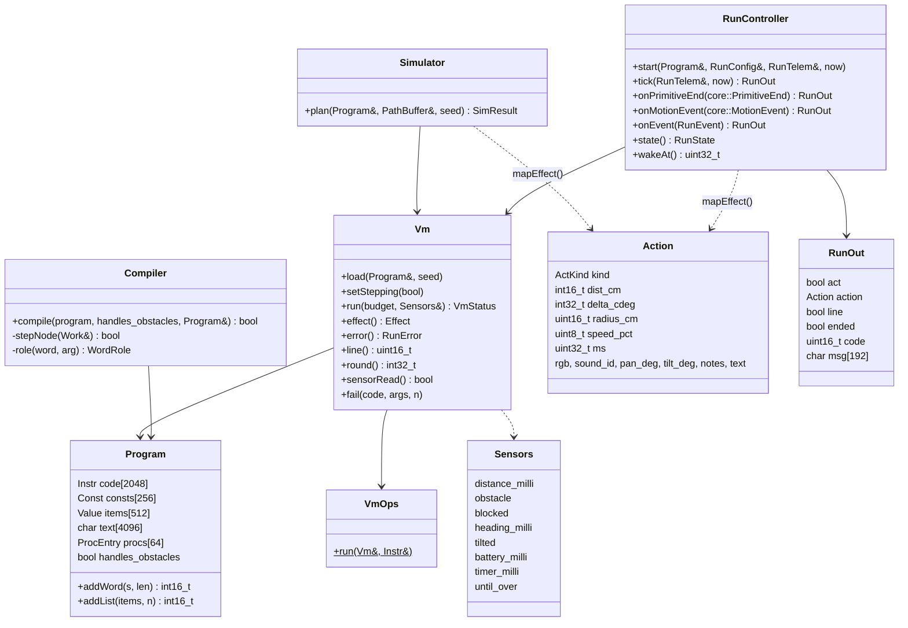
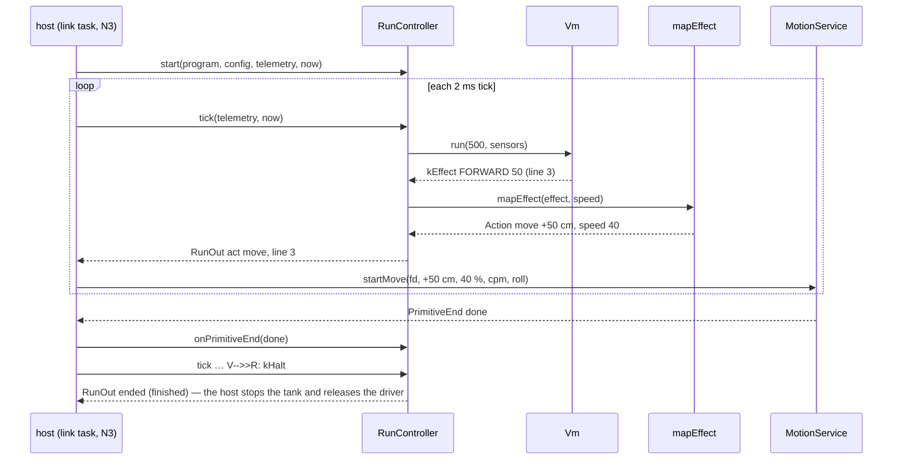
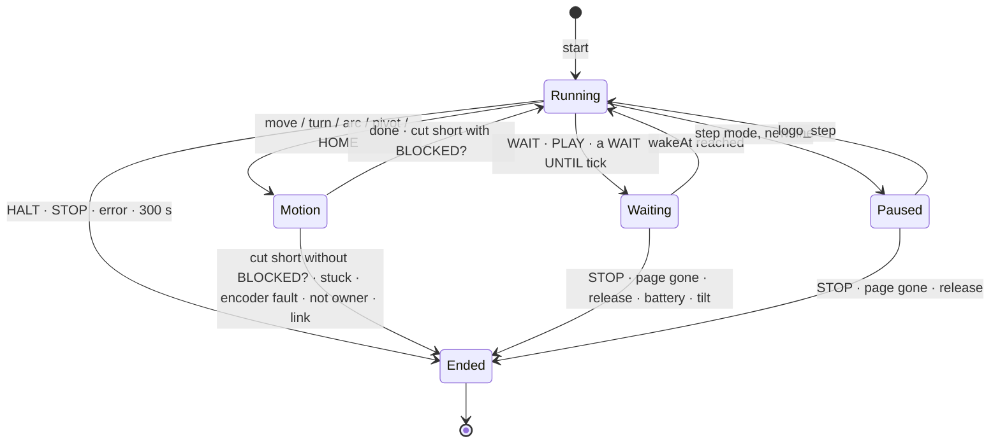

# Tank Logo N2 — the Runner Implementation Plan

> **For agentic workers:** REQUIRED SUB-SKILL: Use superpowers:subagent-driven-development (recommended) or superpowers:executing-plans to implement this plan task-by-task. Steps use checkbox (`- [ ]`) syntax for tracking.

**Goal:** Everything that runs a checked Tank Logo program and can be tested on the laptop — compiler, Vm, effect mapping, RunController with every ending, planned-path simulator — plus `running.yaml` run tests that any later runner must pass.

**Architecture:** Pure C++17 in `firmware/esp32/src/logo/` next to the N1 reader, host-tested in `env:native`, compiled into the bridge but not called yet (Plan N3 wires it into the link task). The compiler and the Vm are iterative (explicit stacks, one handler per instruction in a table). The RunController takes the bridge's real `core::PrimitiveEnd` / `core::MotionEvent` and gives actions in the motion service's own units, so N3 is wiring only.

**Tech Stack:** C++17 (gnu++17), PlatformIO `env:native` + Unity, `logogen` (Python 3.12 via uv, pytest, ruff, pyright strict).

**Spec:** `docs/lld/tank-logo-lld.md` §1, §3, §7–§11, §16–§17; `logo/spec/grammar.md` §5–§8, §11; `logo/spec/words.yaml`; `logo/spec/tests/README.md`; `docs/superpowers/specs/2026-10-11-05-tank-logo-design.md`; design-notes §82–§88, §92, §100.

**Branch:** `plan-n2` from `main` (after `git config core.hooksPath .githooks`). No hardware in this plan.

## Global Constraints

- Coding standards §2.3 / §3: **no recursion, no heap after start-up, no `virtual`, no exceptions**, fixed capacities; every capacity that runs out gives a code (7010 / 7011 / 7014), never an overrun.
- Size check (pre-commit, `scripts/size_check.py`): file ≤ 400 lines, function ≤ 40 NLOC, CCN ≤ 10. The plan's code passes it; keep it that way.
- **Generated files are never edited by hand**: `firmware/esp32/src/logo/generated/`, `firmware/esp32/web/generated/`, `firmware/esp32/test/test_logo_conformance/cases.h`, `firmware/esp32/test/test_logo_running/cases.h`. Change `logo/spec/*` or `logo/generator/*`, then `cd logo && uv run logogen write`.
- Every refusal has exactly one code in `words.yaml` `errors` (grammar.md §11). Messages are plain sentences for children.
- Python: type hints everywhere, `uv run ruff check .`, `uv run ruff format --check .`, `uv run pyright` (strict) clean.
- Commits: Conventional Commits, one task each, ending with `Co-Authored-By: Claude Opus 5.5 <noreply@anthropic.com>`.
- Run `pio test` with explicit `-f` lists (a `test_logo_*` pattern matches a suite whose folder holds only a generated `cases.h`).

## Rules this plan decides (owner confirms at plan review; written to design-notes §101 in Task 9)

1. `REPCOUNT` = the round of the innermost running REPEAT / FOREVER, also from inside a word it calls; 0 outside any loop.
2. `BLOCKED?` is true after a move cut short by the obstacle brake, until the next motion ends.
3. `REPEAT 2.5` runs 2 rounds (the whole part); a negative count is 7025.
4. Moves are whole centimetres (`FD 2.5` → 3 cm); turns keep 0.01°.
5. `=` compares words without regard to case, lists by their items.
6. New codes: **7033** a number past ±1 000 000 while running; **7034** the tank's body stopped answering (link lost, deadman, OTA, body offline). A move that times out or diverges ends with 7044 (stuck).
7. LED colours and LOOK angles live in `words.yaml` (`colour_rgb`, `look_deg`): LEFT −60°, RIGHT 60°, UP 30°, DOWN −30°.
8. Notes C4–B6, lengths 0.25–16 quarter beats (1 = 250 ms), ≤ 64 notes; a `PLAY` list is checked before anything moves (7029 / 7025).
9. `LED BEEP SOUND LOOK SAY` do not wait; `WAIT`, `PLAY` and every motion do. `HOME` turns back to the start heading.
10. Reader fixes: 7025 messages for words without a unit were empty (new optional placeholder `{unit?}`); IFELSE's inputs were read as `True` / `False` (now quoted `"yes"` / `"no"`); `Node::count` 16-bit; the same input name twice is 7032 (§100).

## Review Focus

1. **Loops that do nothing** (`FOREVER [ ]`, `WHILE NOT OBSTACLE? [ ]`) → each tick runs at most 500 instructions and returns; the simulator stops at 200 000 — tests `test_vm_empty_forever_yields_at_the_budget` (Task 2), `test_empty_forever_never_hangs_a_tick` (Task 6), `test_limits_cut_the_path_short` (Task 8).
2. **Fixed-point arithmetic**: milli × milli in 64 bits, division and rounding of negatives (`REMAINDER -7 2` = −1, `ROUND -3.5` = −4), `/ 0` → 7013, past ±1 000 000 → 7033, each with its line — `test_vm_division_rounding_and_negatives`, `test_vm_divide_by_zero_and_too_big_have_the_line` (Task 2); `running.yaml` "a number that grows too big" (Task 7).
3. **Tail calls between words with different input counts** (`PING :n` ↔ `PONG :n :k`) run in one frame; deep non-tail calls give 7011, never a crash — `test_tail_calls_run_in_one_frame` (Task 4), `test_deep_calls_end_with_7011` (Task 3).
4. **A range known only while running** (`TO F :n FD :n END F 600`) → 7025 with the line of the `FD` — `test_run_time_refusal_ends_with_its_line_and_speed_applies` (Task 6); `running.yaml` "a range known only while running" (Task 7).
5. **An ending during a wait, a pause or a motion** stops the program for good; a second end reason afterwards is ignored — `test_events_while_waiting_and_a_second_ending_is_ignored`, `test_end_reasons_of_a_motion` (Task 6).

## File map

| Task | Creates | Changes |
|---|---|---|
| 1 Reader fixes | `src/logo/notes.h/.cpp`, `test/test_logo_notes` | `logo/spec/words.yaml`, `logo/spec/tests/errors.yaml`, `logo/generator/logogen/{model,emit}.py`, `logo/tests/test_logogen.py`, `src/logo/{ast.h, parser.h, parser.cpp, checker.h, checker.cpp, diag.cpp}`, tests of parser / checker / diag |
| 2 Program + Vm | `src/logo/{program,vm,vm_ops,vm_calc}.h/.cpp`, `test/test_logo_vm` | — |
| 3 Compiler: values, effects, your words | `src/logo/compiler.h`, `compiler.cpp`, `compiler_expr.cpp`, `compiler_stmt.cpp`, `test/test_logo_compiler` | — |
| 4 Compiler: control words | — | `compiler.h`, `compiler_stmt.cpp`, `test/test_logo_compiler` |
| 5 Effects → actions | `src/logo/effects.h/.cpp`, `effects_text.cpp`, `test/test_logo_effects` | — |
| 6 RunController | `src/logo/run_controller.h/.cpp`, `test/test_logo_run` | — |
| 7 Run tests | `logo/spec/tests/running.yaml`, `test/test_logo_running` | `logo/spec/tests/README.md`, `logo/generator/logogen/{model,emit,cli}.py`, `logo/tests/test_logogen.py` |
| 8 Planned path | `src/logo/simulator.h/.cpp`, `test/test_logo_sim` | — |
| 9 Docs + final checks | — | `docs/lld/tank-logo-lld.md` §19, `docs/design-notes.md` §101, `CLAUDE.md` |

(`src/…` and `test/…` are under `firmware/esp32/`.)


---

### Task 1: Reader fixes before the runner (7032, PLAY notes, `{unit?}`, colour and LOOK tables)

**Files:** see the File map; generated files come from `logogen write` in Step 3.

**Interfaces:**
- Consumes: N1 reader (`lex`, `Parser`, `Checker`, `Diagnostics`, `renderMessage`), `logogen`.
- Produces: `struct Note { uint16_t hz; uint16_t ms; }`; `bool noteHz(const char* text, uint16_t len, uint16_t& hz)`; `class NoteReader { static constexpr uint8_t kMaxNotes = 64; enum class Err { kNone, kNotANote, kLength, kTooMany }; Err word(const char*, uint16_t); Err number(int32_t beats_milli); uint8_t count() const; const Note* notes() const; }`; generated `gen::Rgb kColourRgb[]`, `gen::LookDeg kLookDeg[]` (indexed like `kColours` / `kLooks`), `gen::kRunTimeS`, `gen::kWaitS`, `gen::kNesting`; error texts 7032–7034; `{key?}` placeholders in `renderMessage`; `Node::count` is `uint16_t`.

- [ ] **Step 1: Write the failing tests**

The spec cases go into `logo/spec/tests/errors.yaml`; the C++ and Python tests below.

Change `firmware/esp32/test/test_logo_checker/test_main.cpp` (unified diff against the previous task):
````diff
@@ -102,6 +102,23 @@ void test_check_too_deep_tree_is_7010() {
   TEST_ASSERT_EQUAL(7010, first());
 }
 
+// Plan N2 Task 1: a PLAY list is checked before anything moves.
+void test_check_play_notes() {
+  TEST_ASSERT_TRUE(C("PLAY [ C4 E4 2 G4 R C#5 0.5 ]").ok);
+  C("PLAY [ C4 H4 ]");
+  TEST_ASSERT_EQUAL(7029, first());
+  TEST_ASSERT_EQUAL(11, g_d.first()->col);
+  C("PLAY [ 2 C4 ]");
+  TEST_ASSERT_EQUAL(7029, first());  // a length needs a note before it
+  C("PLAY [ C4 2 3 ]");
+  TEST_ASSERT_EQUAL(7029, first());  // two lengths in a row
+  C("PLAY [ C4 0.1 ]");
+  TEST_ASSERT_EQUAL(7025, first());
+  C("PLAY [ ]");
+  TEST_ASSERT_EQUAL(7025, first());
+  TEST_ASSERT_NOT_NULL(strstr(g_d.first()->msg, "1 to 64 notes"));
+}
+
 int main(int, char**) {
   UNITY_BEGIN();
   RUN_TEST(test_check_scope);
@@ -111,5 +128,6 @@ int main(int, char**) {
   RUN_TEST(test_check_tail_positions);
   RUN_TEST(test_check_long_program_checks_every_statement);
   RUN_TEST(test_check_too_deep_tree_is_7010);
+  RUN_TEST(test_check_play_notes);
   return UNITY_END();
 }
````

Change `firmware/esp32/test/test_logo_diag/test_main.cpp` (unified diff against the previous task):
````diff
@@ -50,6 +50,17 @@ void test_capacity_is_respected() {
   TEST_ASSERT_EQUAL(Diagnostics::kCap, d.count());
 }
 
+// Plan N2 Task 1: {key?} may be empty without dropping its sentence (REPEAT / RANDOM have no unit).
+void test_render_optional_placeholder() {
+  char out[192];
+  const DiagArg a[] = {{"word", "REPEAT"}, {"max", "10000"}, {"unit", ""}};
+  renderMessage("{word} needs at most {max} {unit?}.", a, 3, out, sizeof out);
+  TEST_ASSERT_EQUAL_STRING("REPEAT needs at most 10000.", out);
+  const DiagArg b[] = {{"word", "FORWARD"}, {"max", "500"}, {"unit", "cm"}};
+  renderMessage("{word} needs at most {max} {unit?}.", b, 3, out, sizeof out);
+  TEST_ASSERT_EQUAL_STRING("FORWARD needs at most 500 cm.", out);
+}
+
 int main(int, char**) {
   UNITY_BEGIN();
   RUN_TEST(test_render_fills_placeholders);
@@ -57,5 +68,6 @@ int main(int, char**) {
   RUN_TEST(test_add_renders_from_the_generated_table_and_dedupes);
   RUN_TEST(test_first_is_earliest_error_not_warning);
   RUN_TEST(test_capacity_is_respected);
+  RUN_TEST(test_render_optional_placeholder);
   return UNITY_END();
 }
````

Create `firmware/esp32/test/test_logo_notes/test_main.cpp`:
````cpp
// Plan N2 Task 1: note names, lengths and the 64-note limit (words.yaml presets.notes).
#include <string.h>
#include <unity.h>

#include "logo/notes.h"

using namespace cq::logo;

namespace {
uint16_t hz(const char* s) {
  uint16_t h = 9999;
  return noteHz(s, static_cast<uint16_t>(strlen(s)), h) ? h : 9999;
}
}  // namespace

void setUp() {}
void tearDown() {}

void test_note_frequencies() {
  TEST_ASSERT_EQUAL(262, hz("C4"));
  TEST_ASSERT_EQUAL(440, hz("a4"));
  TEST_ASSERT_EQUAL(277, hz("C#4"));
  TEST_ASSERT_EQUAL(1976, hz("B6"));
  TEST_ASSERT_EQUAL(523, hz("C5"));
  TEST_ASSERT_EQUAL(0, hz("R"));
}

void test_not_notes() {
  TEST_ASSERT_EQUAL(9999, hz("C3"));
  TEST_ASSERT_EQUAL(9999, hz("C7"));
  TEST_ASSERT_EQUAL(9999, hz("H4"));
  TEST_ASSERT_EQUAL(9999, hz("B#4"));
  TEST_ASSERT_EQUAL(9999, hz("Cb4"));
  TEST_ASSERT_EQUAL(9999, hz("RR"));
  TEST_ASSERT_EQUAL(9999, hz("C"));
}

void test_reader_lengths() {
  NoteReader r;
  TEST_ASSERT_EQUAL(NoteReader::Err::kNone, r.word("C4", 2));
  TEST_ASSERT_EQUAL(NoteReader::Err::kNone, r.number(2000));
  TEST_ASSERT_EQUAL(NoteReader::Err::kNotANote, r.number(1000));
  TEST_ASSERT_EQUAL(NoteReader::Err::kNone, r.word("R", 1));
  TEST_ASSERT_EQUAL(NoteReader::Err::kLength, r.number(17000));
  TEST_ASSERT_EQUAL(2, r.count());
  TEST_ASSERT_EQUAL(500, r.notes()[0].ms);
  TEST_ASSERT_EQUAL(250, r.notes()[1].ms);
  TEST_ASSERT_EQUAL(0, r.notes()[1].hz);
}

void test_reader_64_notes_at_most() {
  NoteReader r;
  for (int i = 0; i < 64; ++i) TEST_ASSERT_EQUAL(NoteReader::Err::kNone, r.word("C4", 2));
  TEST_ASSERT_EQUAL(NoteReader::Err::kTooMany, r.word("C4", 2));
  TEST_ASSERT_EQUAL(NoteReader::Err::kNotANote, NoteReader().number(1000));
}

int main(int, char**) {
  UNITY_BEGIN();
  RUN_TEST(test_note_frequencies);
  RUN_TEST(test_not_notes);
  RUN_TEST(test_reader_lengths);
  RUN_TEST(test_reader_64_notes_at_most);
  return UNITY_END();
}
````

Change `firmware/esp32/test/test_logo_parser/test_main.cpp` (unified diff against the previous task):
````diff
@@ -138,6 +138,16 @@ void test_parser_always_terminates_on_garbage() {
   TEST_PASS();
 }
 
+// Plan N2 Task 1: the same input name twice is 7032 at the second one (design-notes §100).
+void test_pass1_same_input_twice_is_7032() {
+  parseText("TO STEP :x :y :X FD :x END");
+  TEST_ASSERT_EQUAL(7032, g_d.first()->code);
+  TEST_ASSERT_EQUAL(15, g_d.first()->col);
+  TEST_ASSERT_NOT_NULL(strstr(g_d.first()->msg, "STEP has two inputs called :X"));
+  parseText("TO STEP :x :y FD :x END");
+  TEST_ASSERT_EQUAL(0, g_d.count());
+}
+
 int main(int, char**) {
   UNITY_BEGIN();
   RUN_TEST(test_pass1_finds_definitions_before_use);
@@ -151,5 +161,6 @@ int main(int, char**) {
   RUN_TEST(test_parser_deep_nesting_is_an_error);
   RUN_TEST(test_parser_node_pool_full);
   RUN_TEST(test_parser_always_terminates_on_garbage);
+  RUN_TEST(test_pass1_same_input_twice_is_7032);
   return UNITY_END();
 }
````

Change `logo/spec/tests/errors.yaml` (unified diff against the previous task):
````diff
@@ -165,3 +165,23 @@
   source: SAY MAP [ ? ? ] [ 1 2 ]
   expect: {error: 7004, line: 1, col: 13}
   version: v1.1
+
+- name: the same input name twice
+  source: TO STEP :x :x FD :x END
+  expect: {error: 7032, line: 1, col: 12}
+  message_has: "two inputs called :x"
+
+- name: a PLAY item that is not a note
+  source: PLAY [ C4 X9 ]
+  expect: {error: 7029, line: 1, col: 11}
+  message_has: "X9"
+
+- name: a PLAY length out of range
+  source: PLAY [ C4 32 ]
+  expect: {error: 7025, line: 1, col: 11}
+  message_has: "0.25 to 16 beats"
+
+- name: a range without a unit still has its message
+  source: REPEAT 20000 [ BEEP ]
+  expect: {error: 7025, line: 1, col: 8}
+  message_has: "from 0 to 10000."
````

Change `logo/tests/test_logogen.py` (unified diff against the previous task):
````diff
@@ -1,5 +1,7 @@
 from pathlib import Path
 
+import pytest
+
 from logogen import emit, model
 
 ROOT = Path(__file__).resolve().parents[2]
@@ -49,3 +51,25 @@ def test_words_h_mentions_every_word_and_error() -> None:
     for w in s.words:
         assert f'"{w.name}"' in text
     assert "7029" in text and "kCases" not in text
+
+
+def test_ifelse_inputs_are_yes_and_no_not_booleans() -> None:
+    ins = spec().word("IFELSE").inputs
+    assert [i.name for i in ins] == ["test", "yes", "no"]
+    assert ins[1].what == "steps in [ ]"
+
+
+def test_colour_rgb_and_look_deg_follow_the_presets() -> None:
+    s = spec()
+    text = emit.render_words_h(s)
+    assert "inline constexpr Rgb kColourRgb[] = {{255, 0, 0}," in text
+    assert "{0, 0, true}" in text  # LOOK HOME
+    assert "kRunTimeS = 300" in text and "kNesting = 100" in text
+
+
+def test_a_colour_without_rgb_is_refused() -> None:
+    s = spec()
+    del s.colour_rgb["RED"]
+    with pytest.raises(ValueError, match="colour_rgb: RED"):
+        model._check_preset_data(s)  # pyright: ignore[reportPrivateUsage]
+
````

- [ ] **Step 2: Run them to see them fail**

Run: `cd firmware/esp32 && ~/.platformio/penv/bin/pio test -e native -f test_logo_notes -f test_logo_parser -f test_logo_checker -f test_logo_diag -f test_logo_conformance -f test_logo_lexer -f test_logo_words`
Expected: FAIL — `fatal error: 'logo/notes.h' file not found` (test_logo_notes); the parser, checker and diag tests fail on 7032, the PLAY checks and `{unit?}`; the 4 new conformance cases fail after `logogen write`; `cd logo && uv run pytest -q` fails (no `kColourRgb`, IFELSE inputs read as `True` / `False`).

- [ ] **Step 3: Implement**

After the changes below run `cd logo && uv run logogen write` (regenerates `words.h`, `words.json` and the conformance `cases.h`), then `uv run ruff format . && uv run ruff check . && uv run pyright && uv run pytest -q` → `9 passed`.

Change `firmware/esp32/src/logo/ast.h` (unified diff against the previous task):
````diff
@@ -23,7 +23,7 @@ struct Node {
   Node* first = nullptr;
   Node* last = nullptr;
   Node* next = nullptr;
-  uint8_t count = 0;
+  uint16_t count = 0;  // a block can hold more than 255 statements
   void add(Node* c) {
     if (first == nullptr) first = c; else last->next = c;
     last = c;
````

Change `firmware/esp32/src/logo/checker.cpp` (unified diff against the previous task):
````diff
@@ -4,6 +4,7 @@
 #include <string.h>
 
 #include "logo/generated/words.h"
+#include "logo/notes.h"
 #include "logo/words.h"
 
 namespace cq {
@@ -91,6 +92,7 @@ void Checker::visitCall(Node* n, int16_t def, const Caps& caps, CheckResult& r)
   needsAndLevel(w, n->tok, caps);
   if (is(w.name, "OUTPUT") && def < 0) error(7026, n->tok);
   if (is(w.name, "BLOCKED?")) r.handles_obstacles = true;
+  if (is(w.name, "PLAY") && n->first != nullptr && n->first->kind == NodeKind::kList) checkNotes(n->first);
   uint8_t i = 0;
   for (const Node* c = n->first; c != nullptr && i < w.n_inputs; c = c->next, ++i) checkRange(n, w, i, c);
 }
@@ -121,6 +123,37 @@ void Checker::arcTooTight(const Node* call, const Node* radius) {
   error(7022, radius->tok, a, 3);
 }
 
+// A PLAY list (words.yaml presets.notes): every item a note or the length of the note before it, 1 to 64 notes.
+void Checker::checkNotes(const Node* list) {
+  NoteReader rd;
+  for (const Node* c = list->first; c != nullptr; c = c->next) {
+    const Token& t = m_toks.t[c->tok];
+    NoteReader::Err e = NoteReader::Err::kNotANote;
+    if (c->kind == NodeKind::kWord) e = rd.word(m_src + t.start, t.len);
+    if (c->kind == NodeKind::kNumber) e = rd.number(c->milli);
+    if (e != NoteReader::Err::kNone) {
+      notesError(static_cast<uint8_t>(e), c);
+      return;
+    }
+  }
+  if (rd.count() == 0) notesError(static_cast<uint8_t>(NoteReader::Err::kTooMany), list);
+}
+
+// 7029 for an item that is not a note; 7025 for a length or a note count out of range.
+void Checker::notesError(uint8_t err, const Node* at) {
+  if (static_cast<NoteReader::Err>(err) == NoteReader::Err::kNotANote) {
+    char given[40];
+    tokenText(m_src, m_toks.t[at->tok], given, sizeof given);
+    const DiagArg a[] = {{"word", "PLAY"}, {"choices", "the notes C4 to B6 (C#4 for a sharp) and R"}, {"given", given}};
+    error(7029, at->tok, a, 3);
+    return;
+  }
+  const bool len = static_cast<NoteReader::Err>(err) == NoteReader::Err::kLength;
+  const DiagArg a[] = {{"word", "PLAY"}, {"what", len ? "a length" : "a tune"}, {"min", len ? "0.25" : "1"},
+                       {"max", len ? "16" : "64"}, {"unit", len ? "beats" : "notes"}};
+  error(7025, at->tok, a, 5);
+}
+
 // 7019 (a warning): a :name inside a list is only a word there.
 void Checker::listWarning(const Node* list) {
   for (const Node* c = list->first; c != nullptr; c = c->next) {
````

Change `firmware/esp32/src/logo/checker.h` (unified diff against the previous task):
````diff
@@ -52,6 +52,8 @@ class Checker {
   void arcTooTight(const Node* call, const Node* radius);
   void visitInput(const Node* n, int16_t def);
   void listWarning(const Node* list);
+  void checkNotes(const Node* list);
+  void notesError(uint8_t err, const Node* at);
   void markTails(Node* body, CheckResult& r);
   void error(uint16_t code, uint16_t tok, const DiagArg* a = nullptr, uint8_t n = 0);
````

Change `firmware/esp32/src/logo/diag.cpp` (unified diff against the previous task):
````diff
@@ -28,12 +28,16 @@ size_t appendText(const char* v, char* out, size_t o, size_t cap) {
   return o;
 }
 
-// The "{key}" at p: its value appended, p moved to the '}', drop set when the value is empty. False: no '}'.
+// The "{key}" at p: its value appended, p moved to the '}', drop set when the value is empty. "{key?}" may be
+// empty: then the space before it goes instead of the sentence ("… to 10000 {unit?}." → "… to 10000."). False: no '}'.
 bool placeholder(const char*& p, const DiagArg* args, uint8_t n, char* out, size_t& o, size_t cap, bool& drop) {
   const char* close = strchr(p, '}');
   if (close == nullptr) return false;
-  const char* v = findArg(args, n, p + 1, static_cast<size_t>(close - p - 1));
-  if (*v == '\0') drop = true;
+  size_t klen = static_cast<size_t>(close - p - 1);
+  const bool optional = klen > 0 && p[klen] == '?';
+  const char* v = findArg(args, n, p + 1, optional ? klen - 1 : klen);
+  if (*v == '\0' && optional) o = cutBack(out, o);
+  if (*v == '\0' && !optional) drop = true;
   o = appendText(v, out, o, cap);
   p = close;
   return true;
````

Create `firmware/esp32/src/logo/notes.cpp`:
````cpp
#include "logo/notes.h"

namespace cq {
namespace logo {
namespace {

// Octave 4 in 0.01 Hz, C to B (equal temperament, A4 = 440 Hz).
constexpr uint32_t kOct4CentiHz[] = {26163, 27718, 29366, 31113, 32963, 34923, 36999, 39200, 41530, 44000, 46616, 49388};
// Semitone of each letter A..G.
constexpr int8_t kLetter[] = {9, 11, 0, 2, 4, 5, 7};

char upper(char c) { return (c >= 'a' && c <= 'z') ? static_cast<char>(c - 32) : c; }

// The semitone (0 = C .. 11 = B) and octave of "C4" / "C#4"; false when it is not one of C4..B6.
bool parseNote(const char* text, uint16_t len, int& semi, int& oct) {
  const char letter = upper(text[0]);
  if (len < 2 || len > 3 || letter < 'A' || letter > 'G') return false;
  const bool sharp = len == 3;
  if (sharp && text[1] != '#') return false;
  oct = text[len - 1] - '0';
  semi = kLetter[letter - 'A'] + (sharp ? 1 : 0);
  return oct >= 4 && oct <= 6 && semi <= 11;  // no B#
}

}  // namespace

bool noteHz(const char* text, uint16_t len, uint16_t& hz) {
  if (len == 1 && upper(text[0]) == 'R') {
    hz = 0;
    return true;
  }
  int semi = 0, oct = 0;
  if (!parseNote(text, len, semi, oct)) return false;
  hz = static_cast<uint16_t>((kOct4CentiHz[semi] * (1u << (oct - 4)) + 50) / 100);
  return true;
}

NoteReader::Err NoteReader::word(const char* text, uint16_t len) {
  uint16_t hz = 0;
  if (!noteHz(text, len, hz)) return Err::kNotANote;
  if (m_count == kMaxNotes) return Err::kTooMany;
  m_notes[m_count++] = Note{hz, 250};
  m_has_len = false;
  return Err::kNone;
}

NoteReader::Err NoteReader::number(int32_t beats_milli) {
  if (m_count == 0 || m_has_len) return Err::kNotANote;
  if (beats_milli < kBeatMinMilli || beats_milli > kBeatMaxMilli) return Err::kLength;
  m_notes[m_count - 1].ms = static_cast<uint16_t>(beats_milli / 4);  // 1000 milli-beats = 250 ms
  m_has_len = true;
  return Err::kNone;
}

}  // namespace logo
}  // namespace cq
````

Create `firmware/esp32/src/logo/notes.h`:
````cpp
// Tank Logo notes (words.yaml presets.notes, Plan N2): C4..B6 with sharps (C#4) and R (rest); a number after a
// note is its length in quarter beats (default 1 = 250 ms, 0.25 to 16). The checker reads a PLAY list with it
// before anything moves; the runner turns it into TONE notes. Pure C++, fixed capacity.
#pragma once

#include <stdint.h>

namespace cq {
namespace logo {

struct Note {
  uint16_t hz = 0;  // 0 = rest
  uint16_t ms = 250;
};

// The frequency of one note name (case-insensitive); false when the text is not a note. R gives 0.
bool noteHz(const char* text, uint16_t len, uint16_t& hz);

class NoteReader {
 public:
  static constexpr uint8_t kMaxNotes = 64;
  static constexpr int32_t kBeatMinMilli = 250;
  static constexpr int32_t kBeatMaxMilli = 16000;
  enum class Err : uint8_t { kNone, kNotANote, kLength, kTooMany };

  Err word(const char* text, uint16_t len);
  Err number(int32_t beats_milli);  // the length of the note before it
  uint8_t count() const { return m_count; }
  const Note* notes() const { return m_notes; }

 private:
  Note m_notes[kMaxNotes];
  uint8_t m_count = 0;
  bool m_has_len = false;
};

}  // namespace logo
}  // namespace cq
````

Change `firmware/esp32/src/logo/parser.cpp` (unified diff against the previous task):
````diff
@@ -71,6 +71,21 @@ uint16_t Parser::scanBody(ProcInfo& p, uint16_t i) {
   return i;
 }
 
+// 7032: an input name the definition already has (TO A :x :x), at the second one.
+void Parser::sameInput(const ProcInfo& p, uint16_t at) {
+  const Token& t = tokAt(at);
+  for (uint8_t k = 0; k < p.n_inputs; ++k) {
+    const Token& o = tokAt(static_cast<uint16_t>(p.first_input_tok + k));
+    if (o.len != t.len || editDistance(m_src + o.start, o.len, m_src + t.start, t.len) != 0) continue;
+    char word[40], name[40];
+    tokenText(m_src, tokAt(p.name_tok), word, sizeof word);
+    tokenText(m_src, t, name, sizeof name);
+    const DiagArg a[] = {{"word", word}, {"name", name + 1}};  // name without its ':'
+    error(7032, at, a, 2);
+    return;
+  }
+}
+
 void Parser::addProc(const ProcInfo& p) {
   if (m_n_procs < kMaxProcs) {
     m_procs[m_n_procs++] = p;
@@ -93,6 +108,7 @@ uint16_t Parser::readDefinition(uint16_t i) {
   p.valid = nameAllowed(i);
   p.first_input_tok = ++i;
   while (tokAt(i).kind == Tok::kInput) {
+    sameInput(p, i);
     ++p.n_inputs;
     ++i;
   }
````

Change `firmware/esp32/src/logo/parser.h` (unified diff against the previous task):
````diff
@@ -61,6 +61,7 @@ class Parser {
   bool nameAllowed(uint16_t at);
   uint16_t scanBody(ProcInfo& p, uint16_t i);
   void addProc(const ProcInfo& p);
+  void sameInput(const ProcInfo& p, uint16_t at);
   // pass 2 statements (parser_stmt.cpp)
   void stepSeq(Frame& f);
   void seqAtEof(const Frame& f);
````

Change `logo/generator/logogen/emit.py` (unified diff against the previous task):
````diff
@@ -118,6 +118,23 @@ def render_words_h(spec: Spec) -> str:
             f"inline constexpr const char* k{cname}[] = {{{', '.join(c_string(v) for v in vals)}}};\n"
         )
         lines.append(f"inline constexpr uint8_t k{cname}Count = {len(vals)};\n")
+    lines.append("\nstruct Rgb { uint8_t r; uint8_t g; uint8_t b; };  // indexed like kColours\n")
+    rgb = [spec.colour_rgb[c] for c in spec.presets["colour"]]
+    lines.append(
+        "inline constexpr Rgb kColourRgb[] = {"
+        + ", ".join(f"{{{r}, {g}, {b}}}" for r, g, b in rgb)
+        + "};\n"
+    )
+    lines.append(
+        "struct LookDeg { int16_t pan; int16_t tilt; bool home; };  // indexed like kLooks; right / up = +\n"
+    )
+    looks = [
+        "{0, 0, true}"
+        if n == "HOME"
+        else f"{{{spec.look_deg[n][0]}, {spec.look_deg[n][1]}, false}}"
+        for n in spec.presets["look"]
+    ]
+    lines.append(f"inline constexpr LookDeg kLookDeg[] = {{{', '.join(looks)}}};\n")
     lines.append(
         f"\ninline constexpr const char* kReserved[] = {{{', '.join(c_string(r) for r in spec.reserved)}}};\n"
     )
@@ -133,6 +150,9 @@ def render_words_h(spec: Spec) -> str:
     lines.append(f"inline constexpr uint8_t kMaxProcs = {lim['words_of_your_own']};\n")
     lines.append(f"inline constexpr uint8_t kNameChars = {lim['name_chars']};\n")
     lines.append(f"inline constexpr int32_t kNumberAbsMaxMilli = {lim['number_abs_max'] * 1000};\n")
+    lines.append(f"inline constexpr uint16_t kRunTimeS = {lim['run_time_s']};\n")
+    lines.append(f"inline constexpr uint8_t kWaitS = {lim['wait_s']};\n")
+    lines.append(f"inline constexpr uint8_t kNesting = {lim['nesting']};\n")
     lines.append("\n}  // namespace gen\n}  // namespace logo\n}  // namespace cq\n")
     return "".join(lines)
 
@@ -174,3 +194,4 @@ def render_cases_h(spec: Spec) -> str:
         "};\n\n#define LOGO_CASES(X) " + " ".join(f"X({i})" for i in range(len(spec.cases))) + "\n"
     )
     return "".join(lines)
+
````

Change `logo/generator/logogen/model.py` (unified diff against the previous task):
````diff
@@ -89,6 +89,10 @@ class Spec:
     errors: dict[int, str]
     limits: dict[str, int]
     cases: list[Case]
+    colour_rgb: dict[str, tuple[int, int, int]] = field(
+        default_factory=dict[str, tuple[int, int, int]]
+    )
+    look_deg: dict[str, tuple[int, int]] = field(default_factory=dict[str, tuple[int, int]])
 
     def word(self, name: str) -> Word:
         return next(w for w in self.words if w.name == name)
@@ -175,6 +179,17 @@ def _load_cases(path: Path) -> list[Case]:
     return out
 
 
+def _check_preset_data(spec: Spec) -> None:
+    """Every colour has its r g b (0-255); every LOOK preset but HOME has its angles."""
+    for name in spec.presets["colour"]:
+        rgb = spec.colour_rgb.get(name)
+        if rgb is None or not all(0 <= x <= 255 for x in rgb):
+            raise ValueError(f"colour_rgb: {name} needs [r, g, b] from 0 to 255")
+    for name in spec.presets["look"]:
+        if name != "HOME" and name not in spec.look_deg:
+            raise ValueError(f"look_deg: {name} needs [pan, tilt]")
+
+
 def load(root: Path) -> Spec:
     spec_dir = root / "logo" / "spec"
     raw = yaml.safe_load((spec_dir / "words.yaml").read_text())
@@ -194,7 +209,12 @@ def load(root: Path) -> Spec:
         errors={int(k): str(v) for k, v in raw["errors"].items()},
         limits={str(k): int(v) for k, v in raw["limits"].items()},
         cases=cases,
+        colour_rgb={
+            str(k): (int(v[0]), int(v[1]), int(v[2])) for k, v in raw["colour_rgb"].items()
+        },
+        look_deg={str(k): (int(v[0]), int(v[1])) for k, v in raw["look_deg"].items()},
     )
+    _check_preset_data(spec)
     for c in spec.cases:
         if not c.expect_ok and c.code not in spec.errors:
             raise ValueError(f"case {c.name}: unknown error code {c.code}")
````

Change `logo/spec/words.yaml` (unified diff against the previous task):
````diff
@@ -35,7 +35,13 @@ presets:
   # the tank's sound catalogue (protocol SoundId 1-24, spec 02 §A9, design-notes §75)
   sound: [STARTUP, READY, SELFTEST_FAIL, CHIRP_UP, CHIRP_DOWN, BLIP, TICK, JINGLE, THINKING, OUCH, ERROR, SUCCESS,
           FANFARE, SAD, SAFETY_CHIRP, ACK_BLIP, FAIL, CONFIRM, QUESTION, OK_CHIRP, GRUMBLE, SCAN, GOODBYE, HORN]
-  notes: "C4..B6 (sharps as C#4), R = rest; each note may be followed by its length in quarter beats (default 1 = 0.25 s)"
+  notes: "C4..B6 (sharps as C#4), R = rest; each note may be followed by its length in quarter beats (default 1 = 0.25 s), 0.25 to 16; at most 64 notes"
+
+# What the presets do (Plan N2, design-notes §101). LED colours as r g b (0-255); LOOK presets as degrees from the
+# centre, pan right = +, tilt up = + (HOME is the camera's own home position).
+colour_rgb: {RED: [255, 0, 0], GREEN: [0, 255, 0], BLUE: [0, 0, 255], YELLOW: [255, 200, 0], PURPLE: [160, 0, 255],
+             WHITE: [255, 255, 255], ORANGE: [255, 100, 0], "OFF": [0, 0, 0]}
+look_deg: {LEFT: [-60, 0], RIGHT: [60, 0], UP: [0, 30], DOWN: [0, -30]}
 
 words:
   # ---------------------------------------------------------------- level 1: Starter
@@ -181,7 +187,7 @@ words:
   - name: IFELSE
     level: 2
     kind: control
-    inputs: [{name: test, type: condition}, {name: yes, type: block}, {name: no, type: block}]
+    inputs: [{name: test, type: condition}, {name: "yes", type: block}, {name: "no", type: block}]  # quoted: YAML 1.1 reads bare yes / no as booleans
     help: do the first steps if the test is true, else the second
     example: IFELSE DISTANCE < 30 [ RT 90 ] [ FD 20 ]
     missing: "two [ ] blocks: one for yes, one for no"
@@ -472,13 +478,16 @@ errors:   # PROGRAM 7000-7999 (Spec 5 §8); {..} are filled in by the checker. E
   7022: "{word} {angle} {radius} is too tight — the smallest circle is 31 cm. Try PIVOT."
   7023: "{word} needs its steps in [ ], like {example}."
   7024: "Something is in the way on line {line}."
-  7025: "{word} needs {what} from {min} to {max} {unit}."
+  7025: "{word} needs {what} from {min} to {max} {unit?}."  # {x?}: may be empty
   7026: "OUTPUT can only be used inside TO ... END."
   7027: "{word} is not in Tank Logo. {hint}"
   7028: "Something is missing between {a} and {b}."
   7029: "{word} knows {choices} — {given} isn't one of them."
   7030: "{word} arrives in a later version."
   7031: "{word} finished without giving back a value."
+  7032: "{word} has two inputs called :{name} — give each its own name."
+  7033: "A number got too big on line {line} (more than 1000000)."
+  7034: "The tank's body stopped answering."
   7040: "Stopped by you."
   7041: "The time limit (5 minutes) is up."
   7042: "The battery is low."
````

- [ ] **Step 4: Run them to see them pass**

Run: `cd firmware/esp32 && ~/.platformio/penv/bin/pio test -e native -f test_logo_notes -f test_logo_parser -f test_logo_checker -f test_logo_diag -f test_logo_conformance -f test_logo_lexer -f test_logo_words`
Expected: `114 test cases: 114 succeeded` (71 conformance cases incl. the 4 new ones).

- [ ] **Step 5: Commit**

```bash
git add logo firmware/esp32/src/logo firmware/esp32/web/generated firmware/esp32/test
git commit -m "feat(logo): reader fixes before the runner - 7032, PLAY notes check, {unit?} messages, colour and LOOK tables

Co-Authored-By: Claude Opus 5.5 <noreply@anthropic.com>"
```


---

### Task 2: Compiled program and the Vm

**Files:** `firmware/esp32/src/logo/{program,vm,vm_ops,vm_calc}.h/.cpp`, `firmware/esp32/test/test_logo_vm/test_main.cpp`.

**Interfaces:**
- Consumes: `gen::*` limits, `Op` (ast.h), `DiagArg` / `renderMessage` / `errorTemplate` (diag.h).
- Produces: `enum class VTag { kNum, kBool, kWord, kList }`; `struct Value { VTag tag; int32_t n; }`; `enum class OpCode` (`kHalt … kFail, kCount`); `enum class Sensor`, `enum class Builtin`, `enum class EffectKind` (`kForward … kTick, kCount`); `const char* effectWord(EffectKind)`; `struct Instr { OpCode op; uint8_t a; int32_t n; }`; `struct Const`, `struct ProcEntry`, `struct Program` (`clear`, `addWord`, `addList`, `wordText`); `formatMilli`, `valueText(p, v, brackets, out, cap)`, `sameValue`; `struct Sensors`; `enum class VmStatus { kYield, kLine, kEffect, kHalt, kStop, kError }`; `struct Effect { EffectKind kind; uint8_t n; Value args[3]; uint16_t line; }`; `struct RunError { uint16_t code; uint16_t line; char msg[192]; }`; `class Vm { load(p, seed); setStepping(bool); VmStatus run(uint16_t budget, const Sensors&); effect(); error(); line(); round(); sensorRead(); executed(); fail(code, const DiagArg*, n); }`. Instruction meanings: the table in Task 9's LLD §19.2.

- [ ] **Step 1: Write the failing tests**


Create `firmware/esp32/test/test_logo_vm/test_main.cpp`:
````cpp
// Plan N2 Task 2: the Vm on hand-built programs - arithmetic, types, jumps, loops, calls and tail calls, budget,
// step mode, run-time errors with their line (LLD §7-§8).
#include <string.h>
#include <unity.h>

#include "logo/vm.h"

using namespace cq::logo;

namespace {
Program g_p;
Vm g_vm;
Sensors g_s;

void reset() {
  g_p.clear();
  g_s = Sensors();
}
void emit(OpCode op, uint8_t a = 0, int32_t n = 0) { g_p.code[g_p.n_code++] = Instr{op, a, n}; }
void opr(Op o) { emit(OpCode::kOp, static_cast<uint8_t>(o)); }
void fx(EffectKind k, int32_t n) { emit(OpCode::kEffect, static_cast<uint8_t>(k), n); }
VmStatus start(uint16_t budget = 500) {
  g_vm.load(g_p, 7);
  return g_vm.run(budget, g_s);
}
int32_t arg0() { return g_vm.effect().args[0].n; }
}  // namespace

void setUp() { reset(); }
void tearDown() {}

void test_vm_arithmetic_and_effect() {
  emit(OpCode::kLine, 0, 3);
  emit(OpCode::kPushN, 0, 2000);
  emit(OpCode::kPushN, 0, 3000);
  emit(OpCode::kPushN, 0, 4500);
  opr(Op::kMul);
  opr(Op::kAdd);
  fx(EffectKind::kForward, 1);
  emit(OpCode::kHalt);
  TEST_ASSERT_EQUAL(VmStatus::kEffect, start());
  TEST_ASSERT_EQUAL(EffectKind::kForward, g_vm.effect().kind);
  TEST_ASSERT_EQUAL(15500, arg0());
  TEST_ASSERT_EQUAL(3, g_vm.effect().line);
  TEST_ASSERT_EQUAL(VmStatus::kHalt, g_vm.run(500, g_s));
  TEST_ASSERT_EQUAL(VmStatus::kHalt, g_vm.run(500, g_s));  // stays finished
}

void test_vm_division_rounding_and_negatives() {
  emit(OpCode::kPushN, 0, -7000);
  emit(OpCode::kPushN, 0, 2000);
  opr(Op::kDiv);  // -3.5
  emit(OpCode::kCallB, static_cast<uint8_t>(Builtin::kRound));  // -4 (halves away from zero)
  emit(OpCode::kPushN, 0, -7000);
  emit(OpCode::kPushN, 0, 2000);
  emit(OpCode::kCallB, static_cast<uint8_t>(Builtin::kRemainder));  // -1
  emit(OpCode::kPushN, 0, 1000);
  emit(OpCode::kPushN, 0, 3000);
  opr(Op::kDiv);  // 0.333
  fx(EffectKind::kArc, 3);
  TEST_ASSERT_EQUAL(VmStatus::kEffect, start());
  TEST_ASSERT_EQUAL(-4000, g_vm.effect().args[0].n);
  TEST_ASSERT_EQUAL(-1000, g_vm.effect().args[1].n);
  TEST_ASSERT_EQUAL(333, g_vm.effect().args[2].n);
}

void test_vm_divide_by_zero_and_too_big_have_the_line() {
  emit(OpCode::kLine, 0, 4);
  emit(OpCode::kPushN, 0, 5000);
  emit(OpCode::kPushN, 0, 0);
  opr(Op::kDiv);
  TEST_ASSERT_EQUAL(VmStatus::kError, start());
  TEST_ASSERT_EQUAL(7013, g_vm.error().code);
  TEST_ASSERT_EQUAL(4, g_vm.error().line);
  TEST_ASSERT_EQUAL_STRING("Can't divide by zero on line 4.", g_vm.error().msg);
  reset();
  emit(OpCode::kLine, 0, 2);
  emit(OpCode::kPushN, 0, 1000000000);
  emit(OpCode::kPushN, 0, 2000);
  opr(Op::kMul);
  TEST_ASSERT_EQUAL(VmStatus::kError, start());
  TEST_ASSERT_EQUAL(7033, g_vm.error().code);
}

void test_vm_type_errors_name_the_word_and_value() {
  const int16_t cat = g_p.addWord("cat", 3);
  emit(OpCode::kPushC, 0, cat);
  emit(OpCode::kPushN, 0, 1000);
  opr(Op::kAdd);
  TEST_ASSERT_EQUAL(VmStatus::kError, start());
  TEST_ASSERT_EQUAL(7012, g_vm.error().code);
  TEST_ASSERT_EQUAL_STRING("+ needs a number, but got cat.", g_vm.error().msg);
  reset();
  emit(OpCode::kPushN, 0, 5000);
  emit(OpCode::kJz, 0, 0);  // IF 5 [ ]
  TEST_ASSERT_EQUAL(VmStatus::kError, start());
  TEST_ASSERT_EQUAL_STRING("IF needs TRUE or FALSE, but got 5.", g_vm.error().msg);
}

void test_vm_equality_of_words_and_lists() {
  const int16_t a = g_p.addWord("Cat", 3), b = g_p.addWord("cAT", 3);
  const Value items[] = {{VTag::kNum, 1000}, {VTag::kWord, a}};
  const int16_t l1 = g_p.addList(items, 2), l2 = g_p.addList(items, 2);
  emit(OpCode::kPushC, 0, a);
  emit(OpCode::kPushC, 0, b);
  opr(Op::kEq);
  emit(OpCode::kPushC, 0, l1);
  emit(OpCode::kPushC, 0, l2);
  opr(Op::kNe);
  emit(OpCode::kPushN, 0, 2000);
  emit(OpCode::kPushN, 0, 3000);
  opr(Op::kLe);
  fx(EffectKind::kArc, 3);
  TEST_ASSERT_EQUAL(VmStatus::kEffect, start());
  TEST_ASSERT_EQUAL(1, g_vm.effect().args[0].n);  // "Cat = "cAT
  TEST_ASSERT_EQUAL(0, g_vm.effect().args[1].n);  // equal lists are not <>
  TEST_ASSERT_EQUAL(1, g_vm.effect().args[2].n);
}

void test_vm_repeat_rounds_and_repcount() {
  emit(OpCode::kPushN, 0, 3500);  // REPEAT 3.5 = 3 rounds
  emit(OpCode::kLoopInit, 0);
  emit(OpCode::kLoopNext, 0, 6);  // pc 2
  emit(OpCode::kCallB, static_cast<uint8_t>(Builtin::kRepcount));
  fx(EffectKind::kForward, 1);
  emit(OpCode::kJmp, 0, 2);
  emit(OpCode::kHalt);  // pc 6
  int32_t seen[4] = {0, 0, 0, 0};
  VmStatus st = start();
  for (int i = 0; i < 4 && st == VmStatus::kEffect; ++i) {
    seen[i] = arg0();
    st = g_vm.run(500, g_s);
  }
  TEST_ASSERT_EQUAL(VmStatus::kHalt, st);
  TEST_ASSERT_EQUAL(1000, seen[0]);
  TEST_ASSERT_EQUAL(3000, seen[2]);
  TEST_ASSERT_EQUAL(0, seen[3]);
  TEST_ASSERT_EQUAL(0, g_vm.round());  // outside any loop
}

void test_vm_repeat_count_out_of_range() {
  emit(OpCode::kPushN, 0, -1000);
  emit(OpCode::kLoopInit, 0);
  TEST_ASSERT_EQUAL(VmStatus::kError, start());
  TEST_ASSERT_EQUAL(7025, g_vm.error().code);
  TEST_ASSERT_EQUAL_STRING("REPEAT needs how many times from 0 to 10000.", g_vm.error().msg);
}

void test_vm_empty_forever_yields_at_the_budget() {
  emit(OpCode::kLoopInit, 1);
  emit(OpCode::kLoopNext, 0, 3);  // pc 1
  emit(OpCode::kJmp, 0, 1);
  emit(OpCode::kHalt);
  TEST_ASSERT_EQUAL(VmStatus::kYield, start(500));
  TEST_ASSERT_EQUAL(500, g_vm.executed());
  TEST_ASSERT_EQUAL(VmStatus::kYield, g_vm.run(500, g_s));
  TEST_ASSERT_EQUAL(1000, g_vm.executed());
}

// TO DOUBLE :x OUTPUT :x * 2 END ; FD DOUBLE 21
void test_vm_call_with_input_and_output() {
  g_p.procs[0] = ProcEntry{5, 1, true, static_cast<uint16_t>(g_p.addWord("DOUBLE", 6))};
  g_p.n_procs = 1;
  emit(OpCode::kPushN, 0, 21000);
  emit(OpCode::kCall, 1, 0);
  fx(EffectKind::kForward, 1);
  emit(OpCode::kHalt);
  emit(OpCode::kHalt);  // pc 4 (unused)
  emit(OpCode::kArg, 0);  // pc 5
  emit(OpCode::kPushN, 0, 2000);
  opr(Op::kMul);
  emit(OpCode::kRetV);
  TEST_ASSERT_EQUAL(VmStatus::kEffect, start());
  TEST_ASSERT_EQUAL(42000, arg0());
}

// TO COUNTDOWN :n IF :n = 0 [ STOP-like HALT ] COUNTDOWN :n - 1 (tail) END ; COUNTDOWN 5000
void test_vm_tail_calls_use_one_frame() {
  g_p.procs[0] = ProcEntry{3, 1, false, static_cast<uint16_t>(g_p.addWord("COUNTDOWN", 9))};
  g_p.n_procs = 1;
  emit(OpCode::kPushN, 0, 5000000);
  emit(OpCode::kCall, 1, 0);
  emit(OpCode::kHalt);
  emit(OpCode::kArg, 0);  // pc 3
  emit(OpCode::kPushN, 0, 0);
  opr(Op::kEq);
  emit(OpCode::kJz, 0, 9);
  emit(OpCode::kRet);
  emit(OpCode::kHalt);  // pc 8 (unused)
  emit(OpCode::kArg, 0);  // pc 9
  emit(OpCode::kPushN, 0, 1000);
  opr(Op::kSub);
  emit(OpCode::kTCall, 1, 0);
  VmStatus st = start(60000);
  while (st == VmStatus::kYield) st = g_vm.run(60000, g_s);
  TEST_ASSERT_EQUAL(VmStatus::kHalt, st);
}

// TO DEEP :n DEEP :n + 1 (not a tail call: BEEP after it) END
void test_vm_deep_calls_are_7011() {
  g_p.procs[0] = ProcEntry{3, 1, false, static_cast<uint16_t>(g_p.addWord("DEEP", 4))};
  g_p.n_procs = 1;
  emit(OpCode::kPushN, 0, 0);
  emit(OpCode::kCall, 1, 0);
  emit(OpCode::kHalt);
  emit(OpCode::kArg, 0);  // pc 3
  emit(OpCode::kCall, 1, 0);
  fx(EffectKind::kBeep, 0);
  emit(OpCode::kRet);
  TEST_ASSERT_EQUAL(VmStatus::kError, start(5000));
  TEST_ASSERT_EQUAL(7011, g_vm.error().code);
}

// OUTPUT from inside a REPEAT leaves the word's loop: the caller's REPCOUNT is its own again.
void test_vm_output_inside_a_loop_pops_the_loop() {
  g_p.procs[0] = ProcEntry{9, 0, true, static_cast<uint16_t>(g_p.addWord("FIRSTROUND", 10))};
  g_p.n_procs = 1;
  emit(OpCode::kPushN, 0, 2000);  // REPEAT 2 [ FD FIRSTROUND + REPCOUNT ]
  emit(OpCode::kLoopInit, 0);
  emit(OpCode::kLoopNext, 0, 8);  // pc 2
  emit(OpCode::kCall, 0, 0);
  emit(OpCode::kCallB, static_cast<uint8_t>(Builtin::kRepcount));
  opr(Op::kAdd);
  fx(EffectKind::kForward, 1);
  emit(OpCode::kJmp, 0, 2);
  emit(OpCode::kHalt);  // pc 8
  emit(OpCode::kPushN, 0, 5000);  // pc 9: REPEAT 5 [ OUTPUT REPCOUNT * 100 ]
  emit(OpCode::kLoopInit, 0);
  emit(OpCode::kLoopNext, 0, 17);  // pc 11
  emit(OpCode::kCallB, static_cast<uint8_t>(Builtin::kRepcount));
  emit(OpCode::kPushN, 0, 100000);
  opr(Op::kMul);
  emit(OpCode::kRetV);
  emit(OpCode::kJmp, 0, 11);
  emit(OpCode::kFail, 0, 7031);  // pc 17
  TEST_ASSERT_EQUAL(VmStatus::kEffect, start());
  TEST_ASSERT_EQUAL(101000, arg0());
  TEST_ASSERT_EQUAL(VmStatus::kEffect, g_vm.run(500, g_s));
  TEST_ASSERT_EQUAL(102000, arg0());
}

void test_vm_reporter_without_output_is_7031() {
  g_p.procs[0] = ProcEntry{2, 0, true, static_cast<uint16_t>(g_p.addWord("SIDE", 4))};
  g_p.n_procs = 1;
  emit(OpCode::kCall, 0, 0);
  emit(OpCode::kHalt);
  emit(OpCode::kFail, 0, 7031);  // pc 2
  TEST_ASSERT_EQUAL(VmStatus::kError, start());
  TEST_ASSERT_EQUAL_STRING("SIDE finished without giving back a value.", g_vm.error().msg);
}

void test_vm_sensors_and_random() {
  g_s.distance_milli = 25000;
  g_s.obstacle = true;
  emit(OpCode::kSensor, static_cast<uint8_t>(Sensor::kDistance));
  emit(OpCode::kSensor, static_cast<uint8_t>(Sensor::kObstacle));
  emit(OpCode::kPushN, 0, 6000);
  emit(OpCode::kCallB, static_cast<uint8_t>(Builtin::kRandom));
  fx(EffectKind::kArc, 3);
  TEST_ASSERT_EQUAL(VmStatus::kEffect, start());
  TEST_ASSERT_EQUAL(25000, g_vm.effect().args[0].n);
  TEST_ASSERT_EQUAL(VTag::kBool, g_vm.effect().args[1].tag);
  const int32_t r = g_vm.effect().args[2].n;
  TEST_ASSERT_TRUE(r >= 0 && r <= 5000 && r % 1000 == 0);
  TEST_ASSERT_TRUE(g_vm.sensorRead());
  start();
  TEST_ASSERT_EQUAL(r, g_vm.effect().args[2].n);  // same seed, same number
}

void test_vm_step_mode_pauses_at_each_new_line() {
  emit(OpCode::kLine, 0, 1);
  emit(OpCode::kLine, 0, 1);
  emit(OpCode::kLine, 0, 2);
  emit(OpCode::kHalt);
  g_vm.load(g_p, 1);
  g_vm.setStepping(true);
  TEST_ASSERT_EQUAL(VmStatus::kLine, g_vm.run(500, g_s));
  TEST_ASSERT_EQUAL(1, g_vm.line());
  TEST_ASSERT_EQUAL(VmStatus::kLine, g_vm.run(500, g_s));
  TEST_ASSERT_EQUAL(2, g_vm.line());
  TEST_ASSERT_EQUAL(VmStatus::kHalt, g_vm.run(500, g_s));
  g_vm.setStepping(false);
}

void test_vm_host_fail_ends_the_run() {
  fx(EffectKind::kForward, 0);
  emit(OpCode::kHalt);
  start();
  const DiagArg a[] = {{"word", "FORWARD"}, {"what", "a distance"}, {"min", "1"}, {"max", "500"}, {"unit", "cm"}};
  g_vm.fail(7025, a, 5);
  TEST_ASSERT_EQUAL(VmStatus::kError, g_vm.run(500, g_s));
  TEST_ASSERT_EQUAL_STRING("FORWARD needs a distance from 1 to 500 cm.", g_vm.error().msg);
}

void test_value_text_nested_lists() {
  const int16_t w = g_p.addWord("well", 4);
  const Value inner[] = {{VTag::kNum, -2500}};
  const int16_t li = g_p.addList(inner, 1);
  const Value outer[] = {{VTag::kWord, w}, {VTag::kList, li}, {VTag::kBool, 1}};
  const int16_t lo = g_p.addList(outer, 3);
  char out[64];
  valueText(g_p, Value{VTag::kList, lo}, true, out, sizeof out);
  TEST_ASSERT_EQUAL_STRING("[well [-2.5] TRUE]", out);
  valueText(g_p, Value{VTag::kList, lo}, false, out, sizeof out);
  TEST_ASSERT_EQUAL_STRING("well [-2.5] TRUE", out);
}

int main(int, char**) {
  UNITY_BEGIN();
  RUN_TEST(test_vm_arithmetic_and_effect);
  RUN_TEST(test_vm_division_rounding_and_negatives);
  RUN_TEST(test_vm_divide_by_zero_and_too_big_have_the_line);
  RUN_TEST(test_vm_type_errors_name_the_word_and_value);
  RUN_TEST(test_vm_equality_of_words_and_lists);
  RUN_TEST(test_vm_repeat_rounds_and_repcount);
  RUN_TEST(test_vm_repeat_count_out_of_range);
  RUN_TEST(test_vm_empty_forever_yields_at_the_budget);
  RUN_TEST(test_vm_call_with_input_and_output);
  RUN_TEST(test_vm_tail_calls_use_one_frame);
  RUN_TEST(test_vm_deep_calls_are_7011);
  RUN_TEST(test_vm_output_inside_a_loop_pops_the_loop);
  RUN_TEST(test_vm_reporter_without_output_is_7031);
  RUN_TEST(test_vm_sensors_and_random);
  RUN_TEST(test_vm_step_mode_pauses_at_each_new_line);
  RUN_TEST(test_vm_host_fail_ends_the_run);
  RUN_TEST(test_value_text_nested_lists);
  return UNITY_END();
}
````

- [ ] **Step 2: Run them to see them fail**

Run: `cd firmware/esp32 && ~/.platformio/penv/bin/pio test -e native -f test_logo_vm`
Expected: FAIL — `fatal error: 'logo/vm.h' file not found`.

- [ ] **Step 3: Implement**


Create `firmware/esp32/src/logo/program.cpp`:
````cpp
#include "logo/program.h"

#include <stdio.h>
#include <string.h>

namespace cq {
namespace logo {
namespace {

constexpr const char* kEffectWords[] = {"FORWARD", "BACK",  "RIGHT", "LEFT", "SPEED", "WAIT",       "LED",       "BEEP",
                                        "SOUND",   "LOOK",  "HOME",  "ARC",  "PIVOT", "PLAY",       "SAY",
                                        "WAIT UNTIL", "WAIT UNTIL"};
static_assert(sizeof kEffectWords / sizeof kEffectWords[0] == static_cast<size_t>(EffectKind::kCount), "one per kind");

constexpr uint8_t kMaxDepth = 64;

char upper(char c) { return (c >= 'a' && c <= 'z') ? static_cast<char>(c - 32) : c; }

class Text {
 public:
  Text(char* out, size_t cap) : m_out(out), m_cap(cap) { m_out[0] = '\0'; }
  void put(const char* s, size_t n) {
    for (size_t i = 0; i < n && m_len + 1 < m_cap; ++i) m_out[m_len++] = s[i];
    m_out[m_len] = '\0';
  }
  void put(const char* s) { put(s, strlen(s)); }
  void space() {
    if (m_len > 0 && m_out[m_len - 1] != '[') put(" ");
  }

 private:
  char* m_out;
  size_t m_cap;
  size_t m_len = 0;
};

void putItem(const Program& p, Value v, Text& t) {
  char buf[16];
  uint16_t len = 0;
  switch (v.tag) {
    case VTag::kNum: formatMilli(v.n, buf, sizeof buf); t.put(buf); return;
    case VTag::kBool: t.put(v.n != 0 ? "TRUE" : "FALSE"); return;
    case VTag::kWord: {
      const char* s = p.wordText(static_cast<uint16_t>(v.n), len);
      t.put(s, len);
      return;
    }
    case VTag::kList: return;  // handled by the caller
  }
}

bool sameWord(const Program& p, int32_t a, int32_t b) {
  uint16_t la = 0, lb = 0;
  const char* sa = p.wordText(static_cast<uint16_t>(a), la);
  const char* sb = p.wordText(static_cast<uint16_t>(b), lb);
  if (la != lb) return false;
  for (uint16_t i = 0; i < la; ++i) {
    if (upper(sa[i]) != upper(sb[i])) return false;
  }
  return true;
}

bool sameScalar(const Program& p, Value a, Value b) {
  if (a.tag != b.tag) return false;
  if (a.tag == VTag::kWord) return sameWord(p, a.n, b.n);
  return a.n == b.n;
}

}  // namespace

const char* effectWord(EffectKind k) { return kEffectWords[static_cast<uint8_t>(k)]; }

void Program::clear() {
  n_code = n_consts = n_items = n_text = 0;
  n_procs = 0;
  handles_obstacles = false;
}

int16_t Program::addWord(const char* s, uint16_t len) {
  if (n_consts >= kMaxConsts || n_text + len > kTextBytes) return -1;
  memcpy(text + n_text, s, len);
  consts[n_consts] = Const{VTag::kWord, n_text, len};
  n_text = static_cast<uint16_t>(n_text + len);
  return static_cast<int16_t>(n_consts++);
}

int16_t Program::addList(const Value* v, uint16_t n) {
  if (n_consts >= kMaxConsts || n_items + n > kMaxItems) return -1;
  memcpy(items + n_items, v, n * sizeof(Value));
  consts[n_consts] = Const{VTag::kList, n_items, n};
  n_items = static_cast<uint16_t>(n_items + n);
  return static_cast<int16_t>(n_consts++);
}

const char* Program::wordText(uint16_t c, uint16_t& len) const {
  len = consts[c].len;
  return text + consts[c].start;
}

void formatMilli(int32_t milli, char* out, size_t cap) {
  const bool neg = milli < 0;
  const int64_t v = neg ? -static_cast<int64_t>(milli) : milli;
  if (v % 1000 == 0) {
    snprintf(out, cap, "%s%lld", neg ? "-" : "", static_cast<long long>(v / 1000));
    return;
  }
  char frac[8];
  snprintf(frac, sizeof frac, "%03lld", static_cast<long long>(v % 1000));
  for (int i = 2; i > 0 && frac[i] == '0'; --i) frac[i] = '\0';
  snprintf(out, cap, "%s%lld.%s", neg ? "-" : "", static_cast<long long>(v / 1000), frac);
}

void valueText(const Program& p, Value v, bool brackets, char* out, size_t cap) {
  Text t(out, cap);
  if (v.tag != VTag::kList) return putItem(p, v, t);
  struct Pos {
    uint16_t list;
    uint16_t i;
  };
  Pos st[kMaxDepth];
  uint8_t ns = 0;
  st[ns++] = {static_cast<uint16_t>(v.n), 0};
  if (brackets) t.put("[");
  while (ns > 0) {
    Pos& top = st[ns - 1];
    const Const& c = p.consts[top.list];
    if (top.i >= c.len) {
      if (ns > 1 || brackets) t.put("]");
      --ns;
      continue;
    }
    const Value item = p.items[c.start + top.i++];
    t.space();
    if (item.tag != VTag::kList) {
      putItem(p, item, t);
    } else if (ns < kMaxDepth) {
      t.put("[");
      st[ns++] = {static_cast<uint16_t>(item.n), 0};
    } else {
      t.put("[...]");
    }
  }
}

bool sameValue(const Program& p, Value a, Value b) {
  if (a.tag != VTag::kList || b.tag != VTag::kList) return sameScalar(p, a, b);
  struct Pair {
    uint16_t a;
    uint16_t b;
    uint16_t i;
  };
  Pair st[kMaxDepth];
  uint8_t ns = 0;
  st[ns++] = {static_cast<uint16_t>(a.n), static_cast<uint16_t>(b.n), 0};
  while (ns > 0) {
    Pair& top = st[ns - 1];
    const Const& ca = p.consts[top.a];
    const Const& cb = p.consts[top.b];
    if (ca.len != cb.len) return false;
    if (top.i >= ca.len) {
      --ns;
      continue;
    }
    const Value x = p.items[ca.start + top.i];
    const Value y = p.items[cb.start + top.i++];
    if (x.tag == VTag::kList && y.tag == VTag::kList && ns < kMaxDepth) {
      st[ns++] = {static_cast<uint16_t>(x.n), static_cast<uint16_t>(y.n), 0};
    } else if (!sameScalar(p, x, y)) {
      return false;
    }
  }
  return true;
}

}  // namespace logo
}  // namespace cq
````

Create `firmware/esp32/src/logo/program.h`:
````cpp
// Tank Logo compiled program (LLD §7): instructions, constants (words and lists), your words. Filled by the
// Compiler, run by the Vm. Fixed capacities; the caller owns the storage (N3 puts it in PSRAM).
#pragma once

#include <stddef.h>
#include <stdint.h>

#include "logo/ast.h"
#include "logo/generated/words.h"

namespace cq {
namespace logo {

enum class VTag : uint8_t { kNum, kBool, kWord, kList };
struct Value {
  VTag tag = VTag::kNum;
  int32_t n = 0;  // kNum: 1/1000; kBool: 0 / 1; kWord / kList: constant index
};

enum class OpCode : uint8_t {
  kHalt, kLine, kPushN, kPushB, kPushC, kArg, kOp, kSensor, kCallB, kJmp, kJz, kJnz,
  kLoopInit, kLoopNext, kCall, kTCall, kRet, kRetV, kEffect, kStop, kFail,
  kCount
};
enum class Sensor : uint8_t { kDistance, kObstacle, kBlocked, kHeading, kTilted, kBattery, kTimer, kUntilOver };
enum class Builtin : uint8_t { kRandom, kRemainder, kAbs, kRound, kRepcount };
enum class EffectKind : uint8_t {
  kForward, kBack, kRight, kLeft, kSpeed, kWait, kLed, kBeep, kSound, kLook, kHome,
  kArc, kPivot, kPlay, kSay, kUntilStart, kTick,
  kCount
};
const char* effectWord(EffectKind k);  // "FORWARD" … ("WAIT UNTIL" for kUntilStart / kTick)

// a: Op / Sensor / Builtin / EffectKind / argument count / 1 = FOREVER; n: number, constant, jump target, line,
// procedure or error code (see compiler.cpp for each instruction's use).
struct Instr {
  OpCode op = OpCode::kHalt;
  uint8_t a = 0;
  int32_t n = 0;
};

struct Const {
  VTag tag = VTag::kWord;
  uint16_t start = 0;  // kWord: text[start..+len); kList: items[start..+len)
  uint16_t len = 0;
};

struct ProcEntry {
  uint16_t entry = 0;
  uint8_t n_inputs = 0;
  bool gives_value = false;
  uint16_t name = 0;  // word constant with the name (messages)
};

struct Program {
  static constexpr uint16_t kMaxCode = 2048;
  static constexpr uint16_t kMaxConsts = 256;
  static constexpr uint16_t kMaxItems = 512;
  static constexpr uint16_t kTextBytes = 4096;

  Instr code[kMaxCode];
  uint16_t n_code = 0;
  Const consts[kMaxConsts];
  uint16_t n_consts = 0;
  Value items[kMaxItems];
  uint16_t n_items = 0;
  char text[kTextBytes];
  uint16_t n_text = 0;
  ProcEntry procs[gen::kMaxProcs];
  uint8_t n_procs = 0;
  bool handles_obstacles = false;

  void clear();
  int16_t addWord(const char* s, uint16_t len);  // -1 when full
  int16_t addList(const Value* items, uint16_t n);  // -1 when full
  const char* wordText(uint16_t c, uint16_t& len) const;
};

// Values as text: numbers like the reads printer (2.5, -30), words as written, lists in [ ] (the outer brackets
// only when `brackets`). Bounded by cap; nested lists deeper than 8 are shown as [...].
void formatMilli(int32_t milli, char* out, size_t cap);
void valueText(const Program& p, Value v, bool brackets, char* out, size_t cap);
bool sameValue(const Program& p, Value a, Value b);  // = (words case-insensitive, lists by contents)

}  // namespace logo
}  // namespace cq
````

Create `firmware/esp32/src/logo/vm.cpp`:
````cpp
#include "logo/vm.h"

#include <stdio.h>

#include "logo/vm_ops.h"

namespace cq {
namespace logo {

void Vm::load(const Program& p, uint32_t seed) {
  m_p = &p;
  m_pc = 0;
  m_line = 0;
  m_sensor_read = false;
  m_rng = seed != 0 ? seed : 1;
  m_executed = 0;
  m_signal = m_done = VmStatus::kYield;
  m_sp = 0;
  m_nl = 0;
  m_nf = 1;
  m_frames[0] = Frame{0, 0, -1, 0};
  m_error = RunError();
}

VmStatus Vm::run(uint16_t budget, const Sensors& s) {
  if (m_done != VmStatus::kYield || m_p == nullptr) return m_done;
  m_sensors = &s;
  for (uint16_t i = 0; i < budget; ++i) {
    const Instr& in = m_p->code[m_pc++];
    ++m_executed;
    VmOps::run(*this, in);
    if (m_signal == VmStatus::kYield) continue;
    const VmStatus out = m_signal;
    m_signal = VmStatus::kYield;
    return out;
  }
  return VmStatus::kYield;
}

int32_t Vm::round() const { return m_nl > 0 ? m_loops[m_nl - 1].round : 0; }

bool Vm::push(Value v) {
  if (m_sp >= kMaxValues) {
    error(7014);
    return false;
  }
  m_stack[m_sp++] = v;
  return true;
}

void Vm::error(uint16_t code, const DiagArg* a, uint8_t n) {
  m_error.code = code;
  m_error.line = m_line;
  renderMessage(errorTemplate(code), a, n, m_error.msg, sizeof m_error.msg);
  m_done = m_signal = VmStatus::kError;
}

void Vm::fail(uint16_t code, const DiagArg* a, uint8_t n) { error(code, a, n); }

// 7012: "{word} needs {type}, but got {value}."
void Vm::typeError(const char* word, const char* type, Value got) {
  char v[48];
  valueText(*m_p, got, true, v, sizeof v);
  const DiagArg a[] = {{"word", word}, {"type", type}, {"value", v}};
  error(7012, a, 3);
}

void Vm::leaveFrame() {
  const Frame& f = m_frames[--m_nf];
  m_sp = f.args_base;
  m_nl = f.loop_base;
  m_pc = f.ret_pc;
}

}  // namespace logo
}  // namespace cq
````

Create `firmware/esp32/src/logo/vm.h`:
````cpp
// Tank Logo runner (LLD §8): runs a compiled Program in slices. It stops at every effect (the host does it and
// calls run() again), at the end of a slice's budget, at a new line in step mode, at the end, at STOP, or at a
// run-time error. It never knows who its host is: the RunController (on the tank) and the Simulator (planned path)
// both drive it. Fixed stacks; no recursion; no heap.
#pragma once

#include <stdint.h>

#include "logo/diag.h"
#include "logo/program.h"

namespace cq {
namespace logo {

// What the program can read, in Logo units (filled by the host before each run()).
struct Sensors {
  int32_t distance_milli = 999000;  // cm; 999 when nothing is seen
  bool obstacle = false;
  bool blocked = false;             // the last move was cut short by the obstacle brake
  int32_t heading_milli = 0;        // degrees since the start, -180..180, right = +
  bool tilted = false;
  int32_t battery_milli = 100000;   // %
  int32_t timer_milli = 0;          // seconds since the start
  bool until_over = false;          // WAIT UNTIL has waited its 60 s
};

enum class VmStatus : uint8_t { kYield, kLine, kEffect, kHalt, kStop, kError };

struct Effect {
  EffectKind kind = EffectKind::kBeep;
  uint8_t n = 0;
  Value args[3];
  uint16_t line = 0;
};

struct RunError {
  uint16_t code = 0;
  uint16_t line = 0;
  char msg[192] = "";
};

class Vm {
 public:
  static constexpr uint8_t kMaxFrames = gen::kNesting + 1;  // the program's own frame + 100 calls (7011)
  static constexpr uint16_t kMaxValues = 256;
  static constexpr uint8_t kMaxLoops = 128;

  void load(const Program& p, uint32_t seed);
  void setStepping(bool on) { m_stepping = on; }
  VmStatus run(uint16_t budget, const Sensors& s);
  const Effect& effect() const { return m_effect; }
  const RunError& error() const { return m_error; }
  uint16_t line() const { return m_line; }
  int32_t round() const;      // REPCOUNT of the innermost running REPEAT / FOREVER, 0 outside any
  bool sensorRead() const { return m_sensor_read; }  // a sensor or RANDOM was read (planned path uncertain)
  uint32_t executed() const { return m_executed; }
  // Run-time errors from the host (an effect refused at run time: ranges, types, arc too tight).
  void fail(uint16_t code, const DiagArg* a, uint8_t n);

 private:
  friend struct VmOps;
  struct Frame {
    uint16_t ret_pc;
    uint16_t args_base;
    int8_t proc;  // -1: the program itself
    uint8_t loop_base;
  };
  struct Loop {
    int32_t count;  // -1: FOREVER
    int32_t round;
  };

  bool push(Value v);
  Value pop() { return m_stack[--m_sp]; }
  void signal(VmStatus s) { m_signal = s; }
  void error(uint16_t code, const DiagArg* a = nullptr, uint8_t n = 0);
  void typeError(const char* word, const char* type, Value got);
  void leaveFrame();

  const Program* m_p = nullptr;
  const Sensors* m_sensors = nullptr;
  uint16_t m_pc = 0;
  uint16_t m_line = 0;
  bool m_stepping = false;
  bool m_sensor_read = false;
  uint32_t m_rng = 1;
  uint32_t m_executed = 0;
  VmStatus m_signal = VmStatus::kYield;
  VmStatus m_done = VmStatus::kYield;  // kHalt / kStop / kError once finished
  Value m_stack[kMaxValues];
  uint16_t m_sp = 0;
  Frame m_frames[kMaxFrames];
  uint8_t m_nf = 0;
  Loop m_loops[kMaxLoops];
  uint8_t m_nl = 0;
  Effect m_effect;
  RunError m_error;
};

}  // namespace logo
}  // namespace cq
````

Create `firmware/esp32/src/logo/vm_calc.cpp`:
````cpp
#include "logo/vm_calc.h"

#include <stddef.h>

#include "logo/generated/words.h"

namespace cq {
namespace logo {
namespace {

constexpr const char* kSymbols[] = {"?", "+", "-", "*", "/", "=", "<>", "<", ">", "<=", ">=", "AND", "OR", "NOT", "-"};
static_assert(sizeof kSymbols / sizeof kSymbols[0] == static_cast<size_t>(Op::kNeg) + 1, "one per Op");

CalcErr fit(int64_t v, int32_t& out) {
  if (v > gen::kNumberAbsMaxMilli || v < -static_cast<int64_t>(gen::kNumberAbsMaxMilli)) return CalcErr::kTooBig;
  out = static_cast<int32_t>(v);
  return CalcErr::kNone;
}

}  // namespace

CalcErr arith(Op op, int32_t a, int32_t b, int32_t& out) {
  const int64_t x = a, y = b;
  switch (op) {
    case Op::kAdd: return fit(x + y, out);
    case Op::kSub: return fit(x - y, out);
    case Op::kMul: return fit(x * y / 1000, out);
    case Op::kDiv: return y == 0 ? CalcErr::kDivZero : fit(x * 1000 / y, out);
    default: return fit(0, out);
  }
}

bool compare(Op op, int32_t a, int32_t b) {
  switch (op) {
    case Op::kLt: return a < b;
    case Op::kGt: return a > b;
    case Op::kLe: return a <= b;
    case Op::kGe: return a >= b;
    case Op::kNe: return a != b;
    default: return a == b;
  }
}

CalcErr remainder(int32_t a, int32_t b, int32_t& out) {
  if (b == 0) return CalcErr::kDivZero;
  out = a % b;
  return CalcErr::kNone;
}

int32_t roundWhole(int32_t x) {
  const int32_t mag = ((x < 0 ? -x : x) + 500) / 1000 * 1000;
  return x < 0 ? -mag : mag;
}

const char* opSymbol(Op op) { return kSymbols[static_cast<uint8_t>(op)]; }

}  // namespace logo
}  // namespace cq
````

Create `firmware/esp32/src/logo/vm_calc.h`:
````cpp
// Tank Logo arithmetic on 1/1000 fixed point (LLD §7), shared by the Vm's operators and built-in reporters.
// Internal to src/logo.
#pragma once

#include <stdint.h>

#include "logo/ast.h"

namespace cq {
namespace logo {

enum class CalcErr : uint8_t { kNone, kDivZero, kTooBig };

CalcErr arith(Op op, int32_t a, int32_t b, int32_t& out);  // + - * / on numbers
bool compare(Op op, int32_t a, int32_t b);                 // < > <= >= = <>
CalcErr remainder(int32_t a, int32_t b, int32_t& out);     // sign of a (REMAINDER -7 2 = -1)
int32_t roundWhole(int32_t x);                             // halves away from zero
const char* opSymbol(Op op);                               // "+" … for messages

}  // namespace logo
}  // namespace cq
````

Create `firmware/esp32/src/logo/vm_ops.cpp`:
````cpp
#include "logo/vm_ops.h"

#include <stdio.h>

#include "logo/vm_calc.h"

namespace cq {
namespace logo {
namespace {

using OpFn = void (*)(Vm&, const Instr&);
constexpr OpFn kOps[] = {VmOps::halt,     VmOps::line,     VmOps::pushN, VmOps::pushB, VmOps::pushC, VmOps::arg,
                         VmOps::op,       VmOps::sensor,   VmOps::callB, VmOps::jmp,   VmOps::jz,    VmOps::jnz,
                         VmOps::loopInit, VmOps::loopNext, VmOps::call,  VmOps::tcall, VmOps::ret,   VmOps::retV,
                         VmOps::effect,   VmOps::stop,     VmOps::fail};
static_assert(sizeof kOps / sizeof kOps[0] == static_cast<size_t>(OpCode::kCount), "one handler per OpCode");

// The word a condition belongs to (Instr::a of kJz / kJnz), for 7012.
constexpr const char* kCondWords[] = {"IF", "IFELSE", "WHILE", "WAIT UNTIL"};

Value num(int32_t n) { return Value{VTag::kNum, n}; }
Value boolean(bool b) { return Value{VTag::kBool, b ? 1 : 0}; }

}  // namespace

void VmOps::run(Vm& vm, const Instr& in) { kOps[static_cast<uint8_t>(in.op)](vm, in); }

void VmOps::halt(Vm& vm, const Instr&) { vm.m_done = vm.m_signal = VmStatus::kHalt; }

void VmOps::line(Vm& vm, const Instr& in) {
  const bool changed = static_cast<uint16_t>(in.n) != vm.m_line;
  vm.m_line = static_cast<uint16_t>(in.n);
  if (vm.m_stepping && changed) vm.signal(VmStatus::kLine);
}

void VmOps::pushN(Vm& vm, const Instr& in) { vm.push(num(in.n)); }
void VmOps::pushB(Vm& vm, const Instr& in) { vm.push(boolean(in.n != 0)); }
void VmOps::pushC(Vm& vm, const Instr& in) { vm.push(Value{vm.m_p->consts[in.n].tag, in.n}); }

void VmOps::arg(Vm& vm, const Instr& in) {
  const Vm::Frame& f = vm.m_frames[vm.m_nf - 1];
  vm.push(vm.m_stack[f.args_base + in.a]);
}

bool VmOps::popNumber(Vm& vm, const char* word, int32_t& out) {
  const Value v = vm.pop();
  if (v.tag != VTag::kNum) {
    vm.typeError(word, "a number", v);
    return false;
  }
  out = v.n;
  return true;
}

bool VmOps::popBool(Vm& vm, const char* word, bool& out) {
  const Value v = vm.pop();
  if (v.tag != VTag::kBool) {
    vm.typeError(word, "TRUE or FALSE", v);
    return false;
  }
  out = v.n != 0;
  return true;
}

void VmOps::calc(Vm& vm, Op o, int32_t a, int32_t b) {
  int32_t r = 0;
  const CalcErr e = arith(o, a, b, r);
  char line[8];
  snprintf(line, sizeof line, "%u", static_cast<unsigned>(vm.m_line));
  const DiagArg la[] = {{"line", line}};
  if (e == CalcErr::kDivZero) return vm.error(7013, la, 1);
  if (e == CalcErr::kTooBig) return vm.error(7033, la, 1);
  vm.push(num(r));
}

void VmOps::binary(Vm& vm, Op o) {
  if (o == Op::kEq || o == Op::kNe) return equality(vm, o);
  if (o == Op::kAnd || o == Op::kOr) return logic(vm, o);
  int32_t a = 0, b = 0;
  if (!popNumber(vm, opSymbol(o), b) || !popNumber(vm, opSymbol(o), a)) return;
  if (o >= Op::kLt && o <= Op::kGe) return (void)vm.push(boolean(compare(o, a, b)));
  calc(vm, o, a, b);
}

// = and <> take any two values (words without regard to case, lists by their items).
void VmOps::equality(Vm& vm, Op o) {
  const Value b = vm.pop(), a = vm.pop();
  const bool same = sameValue(*vm.m_p, a, b);
  vm.push(boolean(o == Op::kEq ? same : !same));
}

void VmOps::logic(Vm& vm, Op o) {
  bool a = false, b = false;
  if (!popBool(vm, opSymbol(o), b) || !popBool(vm, opSymbol(o), a)) return;
  vm.push(boolean(o == Op::kAnd ? (a && b) : (a || b)));
}

void VmOps::unary(Vm& vm, Op o) {
  if (o == Op::kNot) {
    bool b = false;
    if (popBool(vm, "NOT", b)) vm.push(boolean(!b));
    return;
  }
  int32_t x = 0;
  if (popNumber(vm, "-", x)) vm.push(num(-x));
}

void VmOps::op(Vm& vm, const Instr& in) {
  const Op o = static_cast<Op>(in.a);
  if (o == Op::kNot || o == Op::kNeg) return unary(vm, o);
  binary(vm, o);
}

void VmOps::sensor(Vm& vm, const Instr& in) {
  const Sensors& s = *vm.m_sensors;
  const Sensor k = static_cast<Sensor>(in.a);
  if (k != Sensor::kUntilOver) vm.m_sensor_read = true;
  switch (k) {  // VARIANT POINT: sensors (words.yaml level 2 reporters)
    case Sensor::kDistance: vm.push(num(s.distance_milli)); return;
    case Sensor::kObstacle: vm.push(boolean(s.obstacle)); return;
    case Sensor::kBlocked: vm.push(boolean(s.blocked)); return;
    case Sensor::kHeading: vm.push(num(s.heading_milli)); return;
    case Sensor::kTilted: vm.push(boolean(s.tilted)); return;
    case Sensor::kBattery: vm.push(num(s.battery_milli)); return;
    case Sensor::kTimer: vm.push(num(s.timer_milli)); return;
    case Sensor::kUntilOver: vm.push(boolean(s.until_over)); return;
  }
}

// RANDOM n: a whole number from 0 to n - 1 (xorshift32, seeded by the host).
void VmOps::random(Vm& vm) {
  int32_t n = 0;
  if (!popNumber(vm, "RANDOM", n)) return;
  vm.m_sensor_read = true;
  const int32_t whole = n / 1000;
  if (whole < 1 || whole > 1000000) {
    const DiagArg a[] = {{"word", "RANDOM"}, {"what", "a number"}, {"min", "1"}, {"max", "1000000"}, {"unit", ""}};
    return vm.error(7025, a, 5);
  }
  uint32_t x = vm.m_rng;
  x ^= x << 13;
  x ^= x >> 17;
  x ^= x << 5;
  vm.m_rng = x;
  vm.push(num(static_cast<int32_t>(x % static_cast<uint32_t>(whole)) * 1000));
}

void VmOps::builtin1(Vm& vm, Builtin b) {
  int32_t x = 0;
  if (!popNumber(vm, b == Builtin::kAbs ? "ABS" : "ROUND", x)) return;
  vm.push(num(b == Builtin::kAbs ? (x < 0 ? -x : x) : roundWhole(x)));
}

void VmOps::callB(Vm& vm, const Instr& in) {
  const Builtin b = static_cast<Builtin>(in.a);
  switch (b) {  // VARIANT POINT: built-in reporters
    case Builtin::kRandom: return random(vm);
    case Builtin::kRepcount: vm.push(num(vm.round() * 1000)); return;
    case Builtin::kRemainder: {
      int32_t a = 0, d = 0, r = 0;
      if (!popNumber(vm, "REMAINDER", d) || !popNumber(vm, "REMAINDER", a)) return;
      if (remainder(a, d, r) == CalcErr::kNone) return (void)vm.push(num(r));
      char line[8];
      snprintf(line, sizeof line, "%u", static_cast<unsigned>(vm.m_line));
      const DiagArg la[] = {{"line", line}};
      return vm.error(7013, la, 1);
    }
    default: return builtin1(vm, b);
  }
}

void VmOps::jmp(Vm& vm, const Instr& in) { vm.m_pc = static_cast<uint16_t>(in.n); }

void VmOps::jz(Vm& vm, const Instr& in) {
  bool b = false;
  if (popBool(vm, kCondWords[in.a], b) && !b) vm.m_pc = static_cast<uint16_t>(in.n);
}

void VmOps::jnz(Vm& vm, const Instr& in) {
  bool b = false;
  if (popBool(vm, kCondWords[in.a], b) && b) vm.m_pc = static_cast<uint16_t>(in.n);
}

// REPEAT (a = 0: pops the count, whole part, 0..10000) or FOREVER (a = 1).
void VmOps::loopInit(Vm& vm, const Instr& in) {
  int32_t count = -1;
  if (in.a == 0) {
    if (!popNumber(vm, "REPEAT", count)) return;
    if (count < 0 || count > 10000000) {
      const DiagArg a[] = {{"word", "REPEAT"}, {"what", "how many times"}, {"min", "0"}, {"max", "10000"}, {"unit", ""}};
      return vm.error(7025, a, 5);
    }
    count /= 1000;
  }
  if (vm.m_nl >= Vm::kMaxLoops) return vm.error(7014);
  vm.m_loops[vm.m_nl++] = Vm::Loop{count, 0};
}

// The next round of the innermost loop, or past its end (n) when it is done.
void VmOps::loopNext(Vm& vm, const Instr& in) {
  Vm::Loop& l = vm.m_loops[vm.m_nl - 1];
  if (l.count < 0 || l.round < l.count) {
    ++l.round;
    return;
  }
  --vm.m_nl;
  vm.m_pc = static_cast<uint16_t>(in.n);
}

// CALL p (a = number of inputs, already on the stack).
void VmOps::call(Vm& vm, const Instr& in) {
  if (vm.m_nf >= Vm::kMaxFrames) return vm.error(7011);
  vm.m_frames[vm.m_nf++] = Vm::Frame{vm.m_pc, static_cast<uint16_t>(vm.m_sp - in.a), static_cast<int8_t>(in.n), vm.m_nl};
  vm.m_pc = vm.m_p->procs[in.n].entry;
}

// A call in tail position (grammar.md §8): the new inputs replace the current frame's, no new frame.
void VmOps::tcall(Vm& vm, const Instr& in) {
  Vm::Frame& f = vm.m_frames[vm.m_nf - 1];
  const uint16_t from = static_cast<uint16_t>(vm.m_sp - in.a);
  for (uint8_t i = 0; i < in.a; ++i) vm.m_stack[f.args_base + i] = vm.m_stack[from + i];
  vm.m_sp = static_cast<uint16_t>(f.args_base + in.a);
  vm.m_nl = f.loop_base;
  f.proc = static_cast<int8_t>(in.n);
  vm.m_pc = vm.m_p->procs[in.n].entry;
}

void VmOps::ret(Vm& vm, const Instr&) { vm.leaveFrame(); }

void VmOps::retV(Vm& vm, const Instr&) {
  const Value v = vm.pop();
  vm.leaveFrame();
  vm.push(v);
}

// EFFECT (a = EffectKind, n = number of inputs on the stack): the host does it, then calls run() again.
void VmOps::effect(Vm& vm, const Instr& in) {
  Effect& e = vm.m_effect;
  e.kind = static_cast<EffectKind>(in.a);
  e.n = static_cast<uint8_t>(in.n);
  e.line = vm.m_line;
  for (uint8_t i = e.n; i > 0; --i) e.args[i - 1] = vm.pop();
  vm.signal(VmStatus::kEffect);
}

void VmOps::stop(Vm& vm, const Instr&) { vm.m_done = vm.m_signal = VmStatus::kStop; }

// FAIL (n = error code): 7031, a word that gives back a value reached END without OUTPUT.
void VmOps::fail(Vm& vm, const Instr& in) {
  const Vm::Frame& f = vm.m_frames[vm.m_nf - 1];
  uint16_t len = 0;
  const char* name = vm.m_p->wordText(vm.m_p->procs[f.proc].name, len);
  char word[40];
  snprintf(word, sizeof word, "%.*s", static_cast<int>(len), name);
  const DiagArg a[] = {{"word", word}};
  vm.error(static_cast<uint16_t>(in.n), a, 1);
}

}  // namespace logo
}  // namespace cq
````

Create `firmware/esp32/src/logo/vm_ops.h`:
````cpp
// The Vm's instructions, one handler each in a table indexed by OpCode (internal to src/logo).
#pragma once

#include "logo/vm.h"

namespace cq {
namespace logo {

struct VmOps {
  static void run(Vm& vm, const Instr& in);

  static void halt(Vm& vm, const Instr& in);
  static void line(Vm& vm, const Instr& in);
  static void pushN(Vm& vm, const Instr& in);
  static void pushB(Vm& vm, const Instr& in);
  static void pushC(Vm& vm, const Instr& in);
  static void arg(Vm& vm, const Instr& in);
  static void op(Vm& vm, const Instr& in);
  static void sensor(Vm& vm, const Instr& in);
  static void callB(Vm& vm, const Instr& in);
  static void jmp(Vm& vm, const Instr& in);
  static void jz(Vm& vm, const Instr& in);
  static void jnz(Vm& vm, const Instr& in);
  static void loopInit(Vm& vm, const Instr& in);
  static void loopNext(Vm& vm, const Instr& in);
  static void call(Vm& vm, const Instr& in);
  static void tcall(Vm& vm, const Instr& in);
  static void ret(Vm& vm, const Instr& in);
  static void retV(Vm& vm, const Instr& in);
  static void effect(Vm& vm, const Instr& in);
  static void stop(Vm& vm, const Instr& in);
  static void fail(Vm& vm, const Instr& in);

  // helpers
  static bool popNumber(Vm& vm, const char* word, int32_t& out);
  static bool popBool(Vm& vm, const char* word, bool& out);
  static void binary(Vm& vm, Op o);
  static void equality(Vm& vm, Op o);
  static void logic(Vm& vm, Op o);
  static void unary(Vm& vm, Op o);
  static void builtin1(Vm& vm, Builtin b);
  static void calc(Vm& vm, Op o, int32_t a, int32_t b);
  static void random(Vm& vm);
};

}  // namespace logo
}  // namespace cq
````

- [ ] **Step 4: Run them to see them pass**

Run: `cd firmware/esp32 && ~/.platformio/penv/bin/pio test -e native -f test_logo_vm`
Expected: `17 test cases: 17 succeeded`.

- [ ] **Step 5: Commit**

```bash
git add firmware/esp32/src/logo firmware/esp32/test/test_logo_vm
git commit -m "feat(logo): compiled program and the Vm - fixed-point values, loops, calls and tail calls, slices

Co-Authored-By: Claude Opus 5.5 <noreply@anthropic.com>"
```


---

### Task 3: Compiler — values, effects and your words

**Files:** `firmware/esp32/src/logo/compiler.h`, `compiler.cpp`, `compiler_expr.cpp`, `compiler_stmt.cpp`; `firmware/esp32/test/test_logo_compiler/test_main.cpp`.

**Interfaces:**
- Consumes: `Parser` (`procCount`, `proc`), the checked tree (`Node::tail`, `Node::ref`), `Program`, `Vm` (tests).
- Produces: `enum class WordRole`; `class Compiler { Compiler(const Parser&, const char* src, const TokenList&, Diagnostics&); bool compile(const Node* program, bool handles_obstacles, Program& out); }` — false with 7010 when the program does not fit. In this task control words (REPEAT, IF … OUTPUT) are refused with 7010 "a word of a later version"; Task 4 compiles them.

- [ ] **Step 1: Write the failing tests**


Create `firmware/esp32/test/test_logo_compiler/test_main.cpp`:
````cpp
// Plan N2 Tasks 3-4: source → checked tree → instructions → Vm, as a trace of effects (LLD §7-§8, grammar.md §8).
#include <stdio.h>
#include <string.h>
#include <unity.h>

#include "logo/checker.h"
#include "logo/compiler.h"
#include "logo/lexer.h"
#include "logo/parser.h"
#include "logo/vm.h"

using namespace cq::logo;

namespace {
TokenList g_t;
Diagnostics g_d;
Node g_nodes[4096];
Program g_prog;
Vm g_vm;
char g_trace[2048];
VmStatus g_end;
int g_effects;
int g_until_ticks = 3;  // WAIT UNTIL gives up after this many ticks (the host's 60 s)

void record(const Effect& e) {
  if (e.kind == EffectKind::kTick) return;
  char one[128], v[96];
  snprintf(one, sizeof one, "%s%s", g_trace[0] != '\0' ? " | " : "", effectWord(e.kind));
  for (uint8_t i = 0; i < e.n; ++i) {
    valueText(g_prog, e.args[i], true, v, sizeof v);
    strncat(one, " ", sizeof one - strlen(one) - 1);
    strncat(one, v, sizeof one - strlen(one) - 1);
  }
  strncat(g_trace, one, sizeof g_trace - strlen(g_trace) - 1);
  ++g_effects;
}

// The host's side of an effect: FORWARD brings the wall 10 cm closer; WAIT UNTIL ticks count towards its limit.
void host(const Effect& e, Sensors& s, int& ticks) {
  if (e.kind == EffectKind::kForward) s.distance_milli -= 10000;
  if (e.kind == EffectKind::kUntilStart) ticks = 0;
  if (e.kind == EffectKind::kTick) s.until_over = ++ticks >= g_until_ticks;
}

// False when the program was refused before running (Diagnostics has why).
bool run(const char* src, int32_t distance_cm = 999, bool stepping = false) {
  static NodePool pool(g_nodes, 4096);
  static Parser p(pool, g_d);
  g_d.clear();
  pool.reset();
  g_trace[0] = '\0';
  g_effects = 0;
  lex(src, static_cast<uint16_t>(strlen(src)), g_t, g_d);
  Node* prog = p.parse(src, g_t);
  Checker k(p, src, g_t, g_d);
  const CheckResult r = k.check(prog, Caps());
  if (!r.ok || !Compiler(p, src, g_t, g_d).compile(prog, r.handles_obstacles, g_prog)) return false;
  g_vm.load(g_prog, 1);
  g_vm.setStepping(stepping);
  Sensors s;
  s.distance_milli = distance_cm * 1000;
  int ticks = 0;
  for (int guard = 0; guard < 200000; ++guard) {
    g_end = g_vm.run(500, s);
    if (g_end == VmStatus::kEffect) {
      record(g_vm.effect());
      host(g_vm.effect(), s, ticks);
    }
    if (g_end != VmStatus::kEffect && g_end != VmStatus::kYield && g_end != VmStatus::kLine) break;
  }
  return true;
}
uint16_t firstCode() { return g_d.first() != nullptr ? g_d.first()->code : 0; }
}  // namespace

void setUp() {}
void tearDown() {}

// ---------------------------------------------------------------- Task 3: values and effects

void test_effects_in_order_with_their_values() {
  TEST_ASSERT_TRUE(run("FD 50 RT 90 LED GREEN SAY [ well done ] SOUND HORN PLAY [ C4 2 ] BEEP"));
  TEST_ASSERT_EQUAL_STRING("FORWARD 50 | RIGHT 90 | LED GREEN | SAY [well done] | SOUND HORN | PLAY [C4 2] | BEEP",
                           g_trace);
  TEST_ASSERT_EQUAL(VmStatus::kHalt, g_end);
}

void test_precedence_and_negatives() {
  TEST_ASSERT_TRUE(run("FD 2 + 3 * 4 FD (2 + 3) * 4 FD -5 + 10 FD 10 - 2 - 3 FD 7 / 2"));
  TEST_ASSERT_EQUAL_STRING("FORWARD 14 | FORWARD 20 | FORWARD 5 | FORWARD 5 | FORWARD 3.5", g_trace);
}

void test_words_lists_presets_and_inputs() {
  TEST_ASSERT_TRUE(run("SAY \"Done! LOOK [ 30 -10 ] ARC LEFT 90 50 LED [ 255 128 0 ]"));
  TEST_ASSERT_EQUAL_STRING("SAY Done! | LOOK [30 -10] | ARC LEFT 90 50 | LED [255 128 0]", g_trace);
}

void test_sensors_and_reporters() {
  TEST_ASSERT_TRUE(run("FD DISTANCE / 2 FD ABS -3 FD ROUND 2.5 FD REMAINDER 7 3 FD REPCOUNT + 1", 30));
  TEST_ASSERT_EQUAL_STRING("FORWARD 15 | FORWARD 3 | FORWARD 3 | FORWARD 1 | FORWARD 1", g_trace);
}

void test_run_time_error_has_its_line() {
  TEST_ASSERT_TRUE(run("FD 10\nFD 5 / 0"));
  TEST_ASSERT_EQUAL_STRING("FORWARD 10", g_trace);
  TEST_ASSERT_EQUAL(VmStatus::kError, g_end);
  TEST_ASSERT_EQUAL(7013, g_vm.error().code);
  TEST_ASSERT_EQUAL(2, g_vm.error().line);
}

void test_comparisons_give_true_or_false() {
  TEST_ASSERT_TRUE(run("SAY (\"cat = \"CAT) SAY (NOT (1 = 2) AND 3 >= 3) SAY (1 > 2 OR FALSE)"));
  TEST_ASSERT_EQUAL_STRING("SAY TRUE | SAY TRUE | SAY FALSE", g_trace);
}

void test_a_program_too_big_to_compile_is_7010() {
  static char src[6000];
  src[0] = '\0';
  for (int i = 0; i < 1100; ++i) strcat(src, "BEEP ");
  TEST_ASSERT_FALSE(run(src));
  TEST_ASSERT_EQUAL(7010, firstCode());
  TEST_ASSERT_NOT_NULL(strstr(g_d.first()->msg, "too many steps"));
}

void test_your_word_without_loops() {
  TEST_ASSERT_TRUE(run("TO STEP :d FD :d RT 90 END\nSTEP 10 STEP 5 * 4"));
  TEST_ASSERT_EQUAL_STRING("FORWARD 10 | RIGHT 90 | FORWARD 20 | RIGHT 90", g_trace);
}

void test_deep_calls_end_with_7011() {
  TEST_ASSERT_TRUE(run("TO D :n FD 1 D :n + 1 BEEP END D 0"));
  TEST_ASSERT_EQUAL(VmStatus::kError, g_end);
  TEST_ASSERT_EQUAL(7011, g_vm.error().code);
  TEST_ASSERT_EQUAL(100, g_effects);
}

void test_step_mode_stops_at_each_line() {
  TEST_ASSERT_TRUE(run("FD 1\nRT 2\n\nBEEP", 999, true));
  TEST_ASSERT_EQUAL_STRING("FORWARD 1 | RIGHT 2 | BEEP", g_trace);
  TEST_ASSERT_EQUAL(4, g_vm.line());
}

int main(int, char**) {
  UNITY_BEGIN();
  RUN_TEST(test_effects_in_order_with_their_values);
  RUN_TEST(test_precedence_and_negatives);
  RUN_TEST(test_words_lists_presets_and_inputs);
  RUN_TEST(test_sensors_and_reporters);
  RUN_TEST(test_run_time_error_has_its_line);
  RUN_TEST(test_comparisons_give_true_or_false);
  RUN_TEST(test_a_program_too_big_to_compile_is_7010);
  RUN_TEST(test_your_word_without_loops);
  RUN_TEST(test_deep_calls_end_with_7011);
  RUN_TEST(test_step_mode_stops_at_each_line);
  return UNITY_END();
}
````

- [ ] **Step 2: Run them to see them fail**

Run: `cd firmware/esp32 && ~/.platformio/penv/bin/pio test -e native -f test_logo_compiler`
Expected: FAIL — `fatal error: 'logo/compiler.h' file not found`.

- [ ] **Step 3: Implement**


Create `firmware/esp32/src/logo/compiler.cpp`:
````cpp
#include "logo/compiler.h"

#include <string.h>

#include "logo/generated/words.h"

namespace cq {
namespace logo {
namespace {

struct WordUse {
  const char* name;
  WordRole role;
  uint8_t arg;  // EffectKind / Sensor / Builtin
};
constexpr WordUse fx(const char* n, EffectKind k) { return {n, WordRole::kEffect, static_cast<uint8_t>(k)}; }
constexpr WordUse sensor(const char* n, Sensor s) { return {n, WordRole::kSensor, static_cast<uint8_t>(s)}; }
constexpr WordUse builtin(const char* n, Builtin b) { return {n, WordRole::kBuiltin, static_cast<uint8_t>(b)}; }
constexpr WordUse kUses[] = {
    fx("FORWARD", EffectKind::kForward), fx("BACK", EffectKind::kBack), fx("RIGHT", EffectKind::kRight),
    fx("LEFT", EffectKind::kLeft), fx("SPEED", EffectKind::kSpeed), fx("WAIT", EffectKind::kWait),
    fx("LED", EffectKind::kLed), fx("BEEP", EffectKind::kBeep), fx("SOUND", EffectKind::kSound),
    fx("LOOK", EffectKind::kLook), fx("HOME", EffectKind::kHome), fx("ARC", EffectKind::kArc),
    fx("PIVOT", EffectKind::kPivot), fx("PLAY", EffectKind::kPlay), fx("SAY", EffectKind::kSay),
    {"REPEAT", WordRole::kRepeat, 0}, {"FOREVER", WordRole::kForever, 0}, {"IF", WordRole::kIf, 0},
    {"IFELSE", WordRole::kIfElse, 0}, {"WHILE", WordRole::kWhile, 0}, {"WAIT UNTIL", WordRole::kWaitUntil, 0},
    {"STOP", WordRole::kStop, 0}, {"OUTPUT", WordRole::kOutput, 0},
    sensor("DISTANCE", Sensor::kDistance), sensor("OBSTACLE?", Sensor::kObstacle),
    sensor("BLOCKED?", Sensor::kBlocked), sensor("HEADING", Sensor::kHeading), sensor("TILTED?", Sensor::kTilted),
    sensor("BATTERY", Sensor::kBattery), sensor("TIMER", Sensor::kTimer), builtin("RANDOM", Builtin::kRandom),
    builtin("REMAINDER", Builtin::kRemainder), builtin("ABS", Builtin::kAbs), builtin("ROUND", Builtin::kRound),
    builtin("REPCOUNT", Builtin::kRepcount),
};

}  // namespace

bool Compiler::compile(const Node* program, bool handles_obstacles, Program& out) {
  m_out = &out;
  out.clear();
  out.handles_obstacles = handles_obstacles;
  m_failed = false;
  m_ns = 0;
  for (uint8_t i = 0; i < m_parser.procCount(); ++i) {
    const ProcInfo& pi = m_parser.proc(i);
    const int16_t name = wordConst(m_toks.t[pi.name_tok], 0);
    out.procs[i] = ProcEntry{0, pi.n_inputs, pi.gives_value, static_cast<uint16_t>(name < 0 ? 0 : name)};
  }
  out.n_procs = m_parser.procCount();
  pushWork(program, -1);
  while (m_ns > 0 && !m_failed) {
    if (stepNode(m_st[m_ns - 1])) --m_ns;
  }
  return !m_failed;
}

bool Compiler::stepNode(Work& w) {
  switch (w.n->kind) {  // VARIANT POINT: node kinds the compiler knows
    case NodeKind::kProgram: return stepProgram(w);
    case NodeKind::kDef: return stepDef(w);
    case NodeKind::kBlock: return stepBlock(w);
    case NodeKind::kCall: return stepCall(w);
    case NodeKind::kProcCall: return stepProcCall(w);
    case NodeKind::kUnary:
    case NodeKind::kBinary: return stepOperator(w);
    default: return leaf(w);
  }
}

// The statements (definitions skipped), HALT, then each definition.
bool Compiler::stepProgram(Work& w) {
  if (w.step == 0) {
    while (w.next != nullptr && w.next->kind == NodeKind::kDef) w.next = w.next->next;
    if (child(w)) return false;
    emit(OpCode::kHalt);
    w.step = 1;
    w.next = w.n->first;
  }
  while (w.next != nullptr && w.next->kind != NodeKind::kDef) w.next = w.next->next;
  return !child(w);
}

// A word's body; then RET (a command) or FAIL 7031 (a word that should have given back a value).
bool Compiler::stepDef(Work& w) {
  if (w.step == 0) {
    m_out->procs[w.n->ref].entry = m_out->n_code;
    w.step = 1;
    pushWork(w.n->last, w.n->ref);
    return false;
  }
  if (m_out->procs[w.n->ref].gives_value) emit(OpCode::kFail, 0, 7031);
  else emit(OpCode::kRet);
  return true;
}

bool Compiler::stepBlock(Work& w) { return !child(w); }

bool Compiler::child(Work& w) {
  if (w.next == nullptr) return false;
  const Node* c = w.next;
  w.next = c->next;
  pushWork(c, w.n->kind == NodeKind::kDef ? w.n->ref : w.proc);
  if (!m_failed) m_st[m_ns - 1].stmt = w.n->kind == NodeKind::kBlock || w.n->kind == NodeKind::kProgram;
  return true;
}

void Compiler::pushWork(const Node* n, int16_t proc) {
  if (m_ns >= kMaxWork) return full(n, "too deeply nested");
  m_st[m_ns++] = Work{n, n->first, proc, 0, false, 0, 0};
}

uint16_t Compiler::emit(OpCode op, uint8_t a, int32_t n) {
  if (m_out->n_code >= Program::kMaxCode) {
    full(nullptr, "too many steps");
    return 0;
  }
  m_out->code[m_out->n_code] = Instr{op, a, n};
  return m_out->n_code++;
}

void Compiler::patch(uint16_t at) { m_out->code[at].n = m_out->n_code; }

void Compiler::line(const Node* n) { emit(OpCode::kLine, 0, m_toks.t[n->tok].line); }

// 7010: the program does not fit (at the node, or at the start when there is none).
void Compiler::full(const Node* n, const char* what) {
  if (m_failed) return;
  m_failed = true;
  const Token& t = m_toks.t[n != nullptr ? n->tok : 0];
  const DiagArg a[] = {{"what", what}};
  m_d.add(7010, t.line, t.col, a, 1);
}

WordRole Compiler::role(int16_t word, uint8_t& arg) const {
  const char* name = gen::kWords[word].name;
  for (const WordUse& u : kUses) {
    if (strcmp(u.name, name) != 0) continue;
    arg = u.arg;
    return u.role;
  }
  return WordRole::kNone;
}

}  // namespace logo
}  // namespace cq
````

Create `firmware/esp32/src/logo/compiler.h`:
````cpp
// Tank Logo compiler (LLD §7): a checked tree → instructions. Iterative (an explicit work stack: one entry per
// tree level, a step counter and jump-patch slots per entry) - no recursion. Runs only on a tree the Checker passed.
#pragma once

#include <stdint.h>

#include "logo/ast.h"
#include "logo/diag.h"
#include "logo/lexer.h"
#include "logo/parser.h"
#include "logo/program.h"

namespace cq {
namespace logo {

// What a built-in word compiles to.
enum class WordRole : uint8_t {
  kNone, kEffect, kRepeat, kForever, kIf, kIfElse, kWhile, kWaitUntil, kStop, kOutput, kSensor, kBuiltin
};

class Compiler {
 public:
  static constexpr uint16_t kMaxWork = 256;

  Compiler(const Parser& p, const char* src, const TokenList& toks, Diagnostics& d)
      : m_parser(p), m_src(src), m_toks(toks), m_d(d) {}
  // False when the program does not fit (7010) - the reason is in Diagnostics.
  bool compile(const Node* program, bool handles_obstacles, Program& out);

 private:
  struct Work {
    const Node* n;
    const Node* next;  // the next child to compile
    int16_t proc;      // the word being compiled, -1 for the program
    uint8_t step;
    bool stmt;         // a statement (a child of a block or the program), not a value
    uint16_t p1;       // jump to patch / loop start
    uint16_t p2;
  };

  // compiler.cpp
  bool stepNode(Work& w);  // true when the node is done
  bool stepProgram(Work& w);
  bool stepDef(Work& w);
  bool stepBlock(Work& w);
  bool child(Work& w);  // pushes the next child; false when there is none
  void pushWork(const Node* n, int16_t proc);
  uint16_t emit(OpCode op, uint8_t a = 0, int32_t n = 0);
  void patch(uint16_t at);
  void line(const Node* n);
  void full(const Node* n, const char* what);
  WordRole role(int16_t word, uint8_t& arg) const;
  // compiler_expr.cpp
  bool leaf(const Work& w);
  bool stepOperator(Work& w);
  bool stepProcCall(Work& w);
  bool stepReporter(Work& w, WordRole r, uint8_t arg);
  int16_t wordConst(const Token& t, uint16_t skip);
  int16_t listConst(const Node* list);
  bool listItem(const Node* item, Value& out);
  int8_t inputIndex(int16_t proc, const Node* n) const;
  // compiler_stmt.cpp
  bool stepCall(Work& w);
  bool stepEffect(Work& w, uint8_t kind);

  const Parser& m_parser;
  const char* m_src;
  const TokenList& m_toks;
  Diagnostics& m_d;
  Program* m_out = nullptr;
  Work m_st[kMaxWork];
  uint16_t m_ns = 0;
  bool m_failed = false;
};

}  // namespace logo
}  // namespace cq
````

Create `firmware/esp32/src/logo/compiler_expr.cpp`:
````cpp
// Compiler: values (LLD §7) - numbers, words, lists, inputs, operators, reporters, calls of your own words.
#include <string.h>

#include "logo/compiler.h"
#include "logo/words.h"

namespace cq {
namespace logo {

bool Compiler::leaf(const Work& w) {
  const Node* n = w.n;
  const Token& t = m_toks.t[n->tok];
  int16_t c = 0;
  switch (n->kind) {  // VARIANT POINT: value leaves
    case NodeKind::kNumber: emit(OpCode::kPushN, 0, n->milli); return true;
    case NodeKind::kBool: emit(OpCode::kPushB, 0, n->milli); return true;
    case NodeKind::kInput: emit(OpCode::kArg, static_cast<uint8_t>(inputIndex(w.proc, n))); return true;
    case NodeKind::kQuoted: c = wordConst(t, 1); break;  // without its "
    case NodeKind::kPreset: c = wordConst(t, 0); break;
    case NodeKind::kList: c = listConst(n); break;
    default: full(n, "a word of a later version"); return true;  // the checker refuses these first (7030)
  }
  if (c < 0) full(n, "too many words and lists");
  else emit(OpCode::kPushC, 0, c);
  return true;
}

bool Compiler::stepOperator(Work& w) {
  if (child(w)) return false;
  emit(OpCode::kOp, static_cast<uint8_t>(w.n->op));
  return true;
}

// Your word: a statement gets its LINE; the inputs; CALL, or TCALL in tail position (grammar.md §8).
bool Compiler::stepProcCall(Work& w) {
  if (w.step == 0 && w.stmt) line(w.n);
  w.step = 1;
  if (child(w)) return false;
  emit(w.n->tail ? OpCode::kTCall : OpCode::kCall, static_cast<uint8_t>(w.n->count), w.n->ref);
  return true;
}

// A sensor (no inputs) or a built-in reporter (its inputs, then CALLB).
bool Compiler::stepReporter(Work& w, WordRole r, uint8_t arg) {
  if (r == WordRole::kSensor) {
    emit(OpCode::kSensor, arg);
    return true;
  }
  if (child(w)) return false;
  emit(OpCode::kCallB, arg);
  return true;
}

int16_t Compiler::wordConst(const Token& t, uint16_t skip) {
  return m_out->addWord(m_src + t.start + skip, static_cast<uint16_t>(t.len - skip));
}

bool Compiler::listItem(const Node* item, Value& out) {
  if (item->kind == NodeKind::kNumber) {
    out = Value{VTag::kNum, item->milli};
    return true;
  }
  const int16_t c = wordConst(m_toks.t[item->tok], 0);
  out = Value{VTag::kWord, c};
  return c >= 0;
}

// A list written in the program → a list constant (nested lists first). -1 when it does not fit.
int16_t Compiler::listConst(const Node* list) {
  struct Pos {
    const Node* next;
    uint16_t base;
  };
  constexpr uint8_t kDepth = 16;
  constexpr uint16_t kItems = 128;
  Pos st[kDepth];
  Value tmp[kItems];
  uint8_t ns = 0;
  uint16_t nv = 0;
  st[ns++] = Pos{list->first, 0};
  while (ns > 0) {
    Pos& top = st[ns - 1];
    if (top.next == nullptr) {
      const int16_t c = m_out->addList(tmp + top.base, static_cast<uint16_t>(nv - top.base));
      nv = top.base;
      if (--ns == 0 || c < 0) return c;
      tmp[nv++] = Value{VTag::kList, c};
      continue;
    }
    const Node* item = top.next;
    top.next = item->next;
    if (item->kind == NodeKind::kList) {
      if (ns >= kDepth) return -1;
      st[ns++] = Pos{item->first, nv};
    } else if (nv >= kItems || !listItem(item, tmp[nv++])) {
      return -1;
    }
  }
  return -1;
}

int8_t Compiler::inputIndex(int16_t proc, const Node* n) const {
  const Token& t = m_toks.t[n->tok];
  const ProcInfo& p = m_parser.proc(static_cast<uint8_t>(proc));
  for (uint8_t k = 0; k < p.n_inputs; ++k) {
    const Token& in = m_toks.t[p.first_input_tok + k];
    if (in.len == t.len && editDistance(m_src + in.start, in.len, m_src + t.start, t.len) == 0) {
      return static_cast<int8_t>(k);
    }
  }
  return 0;  // the checker refuses an unknown input first (7009)
}

}  // namespace logo
}  // namespace cq
````

Create `firmware/esp32/src/logo/compiler_stmt.cpp`:
````cpp
// Compiler: statements (LLD §7) - effects; each statement starts with LINE (events, step mode, the line of a
// run-time error). Control words (REPEAT, IF … OUTPUT) are compiled from Plan N2 Task 4.
#include "logo/compiler.h"

namespace cq {
namespace logo {

bool Compiler::stepCall(Work& w) {
  uint8_t arg = 0;
  const WordRole r = role(w.n->ref, arg);
  if (r == WordRole::kEffect) return stepEffect(w, arg);
  if (r == WordRole::kSensor || r == WordRole::kBuiltin) return stepReporter(w, r, arg);
  full(w.n, "a word of a later version");
  return true;
}

// LINE, the inputs, EFFECT.
bool Compiler::stepEffect(Work& w, uint8_t kind) {
  if (w.step == 0) line(w.n);
  w.step = 1;
  if (child(w)) return false;
  emit(OpCode::kEffect, kind, w.n->count);
  return true;
}

}  // namespace logo
}  // namespace cq
````

- [ ] **Step 4: Run them to see them pass**

Run: `cd firmware/esp32 && ~/.platformio/penv/bin/pio test -e native -f test_logo_compiler`
Expected: `10 test cases: 10 succeeded`.

- [ ] **Step 5: Commit**

```bash
git add firmware/esp32/src/logo firmware/esp32/test/test_logo_compiler
git commit -m "feat(logo): compiler - values, effects and your words (iterative, jump patches)

Co-Authored-By: Claude Opus 5.5 <noreply@anthropic.com>"
```


---

### Task 4: Compiler — REPEAT, FOREVER, IF, IFELSE, WHILE, WAIT UNTIL, STOP, OUTPUT

**Files:** `firmware/esp32/src/logo/compiler.h`, `compiler_stmt.cpp`; `firmware/esp32/test/test_logo_compiler/test_main.cpp`.

**Interfaces:**
- Consumes: Task 3's `Compiler` (`child`, `emit`, `patch`, `line`, `Work::p1/p2`), Task 2's `OpCode::kLoopInit/kLoopNext/kJz/kJnz/kTCall/kRetV/kStop`.
- Produces: the control words compiled (layouts in each function's comment); `OUTPUT` of a tail call is a `TCALL` only.

- [ ] **Step 1: Write the failing tests**


Change `firmware/esp32/test/test_logo_compiler/test_main.cpp` (unified diff against the previous task):
````diff
@@ -140,6 +140,64 @@ void test_step_mode_stops_at_each_line() {
   TEST_ASSERT_EQUAL(4, g_vm.line());
 }
 
+// ---------------------------------------------------------------- Task 4: control flow and your words
+
+void test_repeat_and_repcount() {
+  TEST_ASSERT_TRUE(run("REPEAT 3 [ FD REPCOUNT * 10 ] REPEAT 0 [ BEEP ] REPEAT 2 [ REPEAT 2 [ FD REPCOUNT ] ]"));
+  TEST_ASSERT_EQUAL_STRING("FORWARD 10 | FORWARD 20 | FORWARD 30 | FORWARD 1 | FORWARD 2 | FORWARD 1 | FORWARD 2",
+                           g_trace);
+}
+
+void test_if_ifelse_while() {
+  TEST_ASSERT_TRUE(run("IFELSE 1 < 2 [ FD 1 ] [ FD 2 ] IF 2 < 1 [ FD 3 ] WHILE DISTANCE > 10 [ FD 10 ] BEEP", 45));  // FD 1 also comes 10 cm closer
+  TEST_ASSERT_EQUAL_STRING("FORWARD 1 | FORWARD 10 | FORWARD 10 | FORWARD 10 | BEEP", g_trace);
+}
+
+void test_wait_until_goes_on_after_its_limit() {
+  TEST_ASSERT_TRUE(run("WAIT UNTIL DISTANCE < 0 FD 1"));
+  TEST_ASSERT_EQUAL_STRING("WAIT UNTIL | FORWARD 1", g_trace);
+  TEST_ASSERT_EQUAL(VmStatus::kHalt, g_end);
+  TEST_ASSERT_TRUE(run("WAIT UNTIL DISTANCE < 50 FD 1", 30));  // already true: no tick
+  TEST_ASSERT_EQUAL_STRING("WAIT UNTIL | FORWARD 1", g_trace);
+}
+
+void test_forever_ends_only_with_stop() {
+  TEST_ASSERT_TRUE(run("FOREVER [ FD 10 IF DISTANCE < 15 [ STOP ] ] BEEP", 40));
+  TEST_ASSERT_EQUAL_STRING("FORWARD 10 | FORWARD 10 | FORWARD 10", g_trace);
+  TEST_ASSERT_EQUAL(VmStatus::kStop, g_end);
+}
+
+void test_your_words_inputs_and_output() {
+  TEST_ASSERT_TRUE(run("TO SQUARE :size REPEAT 4 [ FD :size RT 90 ] END\nTO DOUBLE :x OUTPUT :x * 2 END\n"
+                       "SQUARE DOUBLE 5"));
+  TEST_ASSERT_EQUAL(8, g_effects);
+  TEST_ASSERT_EQUAL(0, strncmp(g_trace, "FORWARD 10 | RIGHT 90", 21));
+}
+
+void test_tail_calls_run_in_one_frame() {
+  TEST_ASSERT_TRUE(run("TO COUNTDOWN :n IFELSE :n = 0 [ BEEP ] [ COUNTDOWN :n - 1 ] END COUNTDOWN 500"));
+  TEST_ASSERT_EQUAL_STRING("BEEP", g_trace);
+  TEST_ASSERT_TRUE(run("TO PING :n IF :n > 0 [ PONG :n - 1 2 ] END\nTO PONG :n :k IF :n > 0 [ PING :n - 1 ] END\n"
+                       "PING 300 BEEP"));
+  TEST_ASSERT_EQUAL_STRING("BEEP", g_trace);
+  TEST_ASSERT_TRUE(run("TO SUM :n :acc IFELSE :n = 0 [ OUTPUT :acc ] [ OUTPUT SUM :n - 1 :acc + :n ] END\n"
+                       "FD (SUM 300 0) / 1000"));
+  TEST_ASSERT_EQUAL_STRING("FORWARD 45.15", g_trace);
+}
+
+void test_reporter_without_output_and_output_inside_loops() {
+  TEST_ASSERT_TRUE(run("TO SIDE IF 1 > 2 [ OUTPUT 5 ] END FD SIDE"));
+  TEST_ASSERT_EQUAL(7031, g_vm.error().code);
+  TEST_ASSERT_TRUE(run("TO F REPEAT 5 [ OUTPUT REPCOUNT * 100 ] END REPEAT 2 [ FD F + REPCOUNT ]"));
+  TEST_ASSERT_EQUAL_STRING("FORWARD 101 | FORWARD 102", g_trace);
+}
+
+void test_stop_inside_a_word_ends_the_program() {
+  TEST_ASSERT_TRUE(run("TO S STOP END REPEAT 3 [ FD 1 S ] FD 9"));
+  TEST_ASSERT_EQUAL_STRING("FORWARD 1", g_trace);
+  TEST_ASSERT_EQUAL(VmStatus::kStop, g_end);
+}
+
 int main(int, char**) {
   UNITY_BEGIN();
   RUN_TEST(test_effects_in_order_with_their_values);
@@ -152,5 +210,13 @@ int main(int, char**) {
   RUN_TEST(test_your_word_without_loops);
   RUN_TEST(test_deep_calls_end_with_7011);
   RUN_TEST(test_step_mode_stops_at_each_line);
+  RUN_TEST(test_repeat_and_repcount);
+  RUN_TEST(test_if_ifelse_while);
+  RUN_TEST(test_wait_until_goes_on_after_its_limit);
+  RUN_TEST(test_forever_ends_only_with_stop);
+  RUN_TEST(test_your_words_inputs_and_output);
+  RUN_TEST(test_tail_calls_run_in_one_frame);
+  RUN_TEST(test_reporter_without_output_and_output_inside_loops);
+  RUN_TEST(test_stop_inside_a_word_ends_the_program);
   return UNITY_END();
 }
````

- [ ] **Step 2: Run them to see them fail**

Run: `cd firmware/esp32 && ~/.platformio/penv/bin/pio test -e native -f test_logo_compiler -f test_logo_vm`
Expected: FAIL — 8 of the 18 compiler tests fail (the control words are still refused: `7010 … a word of a later version`).

- [ ] **Step 3: Implement**


Change `firmware/esp32/src/logo/compiler.h` (unified diff against the previous task):
````diff
@@ -62,6 +62,14 @@ class Compiler {
   // compiler_stmt.cpp
   bool stepCall(Work& w);
   bool stepEffect(Work& w, uint8_t kind);
+  bool stepRepeat(Work& w);
+  bool stepForever(Work& w);
+  bool stepIf(Work& w);
+  bool stepIfElse(Work& w);
+  bool stepWhile(Work& w);
+  bool stepWaitUntil(Work& w);
+  bool stepOutput(Work& w);
+  bool stepStop(Work& w);
 
   const Parser& m_parser;
   const char* m_src;
````

Change `firmware/esp32/src/logo/compiler_stmt.cpp` (unified diff against the previous task):
````diff
@@ -1,17 +1,33 @@
-// Compiler: statements (LLD §7) - effects; each statement starts with LINE (events, step mode, the line of a
-// run-time error). Control words (REPEAT, IF … OUTPUT) are compiled from Plan N2 Task 4.
+// Compiler: statements (LLD §7) - effects, REPEAT / FOREVER / IF / IFELSE / WHILE / WAIT UNTIL, STOP, OUTPUT.
+// Each statement starts with LINE (events, step mode, the line of a run-time error).
 #include "logo/compiler.h"
 
 namespace cq {
 namespace logo {
+namespace {
+
+// Instr::a of kJz / kJnz: the word a condition belongs to (Vm 7012 messages).
+constexpr uint8_t kCondIf = 0, kCondIfElse = 1, kCondWhile = 2, kCondUntil = 3;
+
+}  // namespace
 
 bool Compiler::stepCall(Work& w) {
+  using StepFn = bool (Compiler::*)(Work&);
+  static constexpr StepFn kControl[] = {&Compiler::stepRepeat, &Compiler::stepForever,   &Compiler::stepIf,
+                                        &Compiler::stepIfElse, &Compiler::stepWhile,     &Compiler::stepWaitUntil,
+                                        &Compiler::stepStop,   &Compiler::stepOutput};
+  static_assert(static_cast<uint8_t>(WordRole::kOutput) - static_cast<uint8_t>(WordRole::kRepeat) + 1 ==
+                    sizeof kControl / sizeof kControl[0],
+                "one step per control word");
   uint8_t arg = 0;
   const WordRole r = role(w.n->ref, arg);
   if (r == WordRole::kEffect) return stepEffect(w, arg);
   if (r == WordRole::kSensor || r == WordRole::kBuiltin) return stepReporter(w, r, arg);
-  full(w.n, "a word of a later version");
-  return true;
+  if (r == WordRole::kNone) {
+    full(w.n, "a word of a later version");  // the checker refuses these first (7030)
+    return true;
+  }
+  return (this->*kControl[static_cast<uint8_t>(r) - static_cast<uint8_t>(WordRole::kRepeat)])(w);
 }
 
 // LINE, the inputs, EFFECT.
@@ -23,5 +39,127 @@ bool Compiler::stepEffect(Work& w, uint8_t kind) {
   return true;
 }
 
+// LINE count LOOP_INIT; L: LOOP_NEXT end; body; JMP L; end:
+bool Compiler::stepRepeat(Work& w) {
+  if (w.step == 0) {
+    line(w.n);
+    w.step = 1;
+    return !child(w);
+  }
+  if (w.step == 1) {
+    emit(OpCode::kLoopInit, 0);
+    w.p1 = emit(OpCode::kLoopNext);
+    w.step = 2;
+    return !child(w);
+  }
+  emit(OpCode::kJmp, 0, w.p1);
+  patch(w.p1);
+  return true;
+}
+
+// LINE LOOP_INIT(forever); L: LOOP_NEXT; body; JMP L
+bool Compiler::stepForever(Work& w) {
+  if (w.step == 0) {
+    line(w.n);
+    emit(OpCode::kLoopInit, 1);
+    w.p1 = emit(OpCode::kLoopNext);
+    w.step = 1;
+    return !child(w);
+  }
+  emit(OpCode::kJmp, 0, w.p1);
+  patch(w.p1);
+  return true;
+}
+
+// LINE test JZ end; block; end:
+bool Compiler::stepIf(Work& w) {
+  if (w.step == 0) {
+    line(w.n);
+    w.step = 1;
+    return !child(w);
+  }
+  if (w.step == 1) {
+    w.p1 = emit(OpCode::kJz, kCondIf);
+    w.step = 2;
+    return !child(w);
+  }
+  patch(w.p1);
+  return true;
+}
+
+// LINE test JZ no; yes; JMP end; no: no; end:
+bool Compiler::stepIfElse(Work& w) {
+  switch (w.step) {
+    case 0:
+      line(w.n);
+      break;
+    case 1:
+      w.p1 = emit(OpCode::kJz, kCondIfElse);
+      break;
+    case 2:
+      w.p2 = emit(OpCode::kJmp);
+      patch(w.p1);
+      break;
+    default:
+      patch(w.p2);
+      return true;
+  }
+  ++w.step;
+  return !child(w);
+}
+
+// L: LINE test JZ end; body; JMP L; end:
+bool Compiler::stepWhile(Work& w) {
+  if (w.step == 0) {
+    w.p2 = m_out->n_code;
+    line(w.n);
+    w.step = 1;
+    return !child(w);
+  }
+  if (w.step == 1) {
+    w.p1 = emit(OpCode::kJz, kCondWhile);
+    w.step = 2;
+    return !child(w);
+  }
+  emit(OpCode::kJmp, 0, w.p2);
+  patch(w.p1);
+  return true;
+}
+
+// LINE EFFECT(start, 60 s); L: test JNZ end; EFFECT(tick); SENSOR(over); JZ L; end:
+bool Compiler::stepWaitUntil(Work& w) {
+  if (w.step == 0) {
+    line(w.n);
+    emit(OpCode::kEffect, static_cast<uint8_t>(EffectKind::kUntilStart), 0);
+    w.p2 = m_out->n_code;
+    w.step = 1;
+    return !child(w);
+  }
+  w.p1 = emit(OpCode::kJnz, kCondUntil);
+  emit(OpCode::kEffect, static_cast<uint8_t>(EffectKind::kTick), 0);
+  emit(OpCode::kSensor, static_cast<uint8_t>(Sensor::kUntilOver));
+  emit(OpCode::kJz, kCondUntil, w.p2);
+  patch(w.p1);
+  return true;
+}
+
+bool Compiler::stepStop(Work& w) {
+  line(w.n);
+  emit(OpCode::kStop);
+  return true;
+}
+
+// LINE value RETV - or, for OUTPUT of a call of your word in tail position, that call's TCALL only.
+bool Compiler::stepOutput(Work& w) {
+  if (w.step == 0) {
+    line(w.n);
+    const Node* v = w.n->first;
+    w.step = (v->kind == NodeKind::kProcCall && v->tail) ? 2 : 1;
+    return !child(w);
+  }
+  if (w.step == 1) emit(OpCode::kRetV);
+  return true;
+}
+
 }  // namespace logo
 }  // namespace cq
````

- [ ] **Step 4: Run them to see them pass**

Run: `cd firmware/esp32 && ~/.platformio/penv/bin/pio test -e native -f test_logo_compiler -f test_logo_vm`
Expected: `35 test cases: 35 succeeded`.

- [ ] **Step 5: Commit**

```bash
git add firmware/esp32/src/logo firmware/esp32/test/test_logo_compiler
git commit -m "feat(logo): compiler - REPEAT, FOREVER, IF, IFELSE, WHILE, WAIT UNTIL, STOP, OUTPUT

Co-Authored-By: Claude Opus 5.5 <noreply@anthropic.com>"
```


---

### Task 5: Effects → actions

**Files:** `firmware/esp32/src/logo/effects.h`, `effects.cpp`, `effects_text.cpp`; `firmware/esp32/test/test_logo_effects/test_main.cpp`.

**Interfaces:**
- Consumes: `Effect`, `Program`, `RunError`, `NoteReader`, `gen::kColourRgb` / `kLookDeg` / `kSounds`, `core::arcBand`, `core::arcMinRadiusCm` (`core/arc_limits.h`).
- Produces: `enum class ActKind { kNone, kMove, kTurn, kArc, kPivot, kHome, kSpeed, kWait, kLed, kBeep, kSound, kTone, kLook, kLookHome, kSay, kUntilStart, kTick }`; `struct Action` (dist_cm signed, delta_cdeg + = left, radius_cm, speed_pct, speed_moved, ms, r g b, sound_id, pan_deg / tilt_deg, notes, text); `struct MapState { uint8_t speed_pct = 40; }`; `bool mapEffect(const Effect&, const Program&, const MapState&, Action&, RunError&)`; `void actionText(const Action&, char*, size_t)` (the running.yaml notation).

- [ ] **Step 1: Write the failing tests**


Create `firmware/esp32/test/test_logo_effects/test_main.cpp`:
````cpp
// Plan N2 Task 5: effects → actions - units and signs of the motion service, run-time ranges and types, colours,
// sounds, LOOK, ARC speed band and 7022, notes, and the running.yaml text of each action (LLD §10).
#include <string.h>
#include <unity.h>

#include <initializer_list>

#include "core/arc_limits.h"
#include "logo/effects.h"

using namespace cq::logo;

namespace {
Program g_p;
Action g_a;
RunError g_err;
MapState g_st;

Value num(int32_t milli) { return Value{VTag::kNum, milli}; }
Value word(const char* s) { return Value{VTag::kWord, g_p.addWord(s, static_cast<uint16_t>(strlen(s)))}; }
Value list(std::initializer_list<int32_t> milli) {
  Value items[8];
  uint16_t n = 0;
  for (int32_t m : milli) items[n++] = num(m);
  return Value{VTag::kList, g_p.addList(items, n)};
}
bool map(EffectKind k, std::initializer_list<Value> args) {
  Effect e;
  e.kind = k;
  e.line = 7;
  for (const Value& v : args) e.args[e.n++] = v;
  g_err = RunError();
  return mapEffect(e, g_p, g_st, g_a, g_err);
}
const char* text() {
  static char out[160];
  actionText(g_a, out, sizeof out);
  return out;
}
}  // namespace

void setUp() {
  g_p.clear();
  g_st = MapState();
}
void tearDown() {}

void test_moves_round_to_whole_cm_and_back_is_negative() {
  TEST_ASSERT_TRUE(map(EffectKind::kForward, {num(50000)}));
  TEST_ASSERT_EQUAL(ActKind::kMove, g_a.kind);
  TEST_ASSERT_EQUAL(50, g_a.dist_cm);
  TEST_ASSERT_EQUAL(40, g_a.speed_pct);
  TEST_ASSERT_EQUAL_STRING("FORWARD 50", text());
  TEST_ASSERT_TRUE(map(EffectKind::kBack, {num(2500)}));
  TEST_ASSERT_EQUAL(-3, g_a.dist_cm);
  TEST_ASSERT_EQUAL_STRING("BACK 3", text());
}

void test_run_time_range_and_type_errors_have_the_line() {
  TEST_ASSERT_FALSE(map(EffectKind::kForward, {num(600000)}));
  TEST_ASSERT_EQUAL(7025, g_err.code);
  TEST_ASSERT_EQUAL(7, g_err.line);
  TEST_ASSERT_EQUAL_STRING("FORWARD needs a distance from 1 to 500 cm.", g_err.msg);
  TEST_ASSERT_FALSE(map(EffectKind::kForward, {num(0)}));
  TEST_ASSERT_EQUAL(7025, g_err.code);
  TEST_ASSERT_FALSE(map(EffectKind::kRight, {word("cat")}));
  TEST_ASSERT_EQUAL_STRING("RIGHT needs a number, but got cat.", g_err.msg);
}

void test_turns_right_is_minus_left_is_plus() {
  TEST_ASSERT_TRUE(map(EffectKind::kRight, {num(90000)}));
  TEST_ASSERT_EQUAL(-9000, g_a.delta_cdeg);
  TEST_ASSERT_EQUAL_STRING("RIGHT 90", text());
  TEST_ASSERT_TRUE(map(EffectKind::kLeft, {num(45500)}));
  TEST_ASSERT_EQUAL(4550, g_a.delta_cdeg);
  TEST_ASSERT_EQUAL_STRING("LEFT 45.5", text());
  TEST_ASSERT_TRUE(map(EffectKind::kPivot, {word("left"), num(90000)}));
  TEST_ASSERT_EQUAL(ActKind::kPivot, g_a.kind);
  TEST_ASSERT_EQUAL(9000, g_a.delta_cdeg);
  TEST_ASSERT_EQUAL_STRING("PIVOT LEFT 90", text());
}

void test_arc_speed_band_and_too_tight() {
  const cq::core::ArcBand band = cq::core::arcBand(50);
  g_st.speed_pct = 100;
  TEST_ASSERT_TRUE(map(EffectKind::kArc, {word("RIGHT"), num(90000), num(50000)}));
  TEST_ASSERT_EQUAL(-9000, g_a.delta_cdeg);
  TEST_ASSERT_EQUAL(50, g_a.radius_cm);
  TEST_ASSERT_EQUAL(band.hi, g_a.speed_pct);
  TEST_ASSERT_EQUAL(band.hi != 100, g_a.speed_moved);
  TEST_ASSERT_EQUAL_STRING("ARC RIGHT 90 50", text());
  TEST_ASSERT_FALSE(map(EffectKind::kArc, {word("LEFT"), num(90000), num(20000)}));
  TEST_ASSERT_EQUAL(7022, g_err.code);
  TEST_ASSERT_EQUAL_STRING("ARC LEFT 90 20 is too tight — the smallest circle is 31 cm. Try PIVOT.", g_err.msg);
  TEST_ASSERT_FALSE(map(EffectKind::kArc, {word("UP"), num(90000), num(50000)}));
  TEST_ASSERT_EQUAL(7029, g_err.code);
}

void test_led_colours() {
  TEST_ASSERT_TRUE(map(EffectKind::kLed, {word("green")}));
  TEST_ASSERT_EQUAL_STRING("LED 0 255 0", text());
  TEST_ASSERT_TRUE(map(EffectKind::kLed, {list({255000, 128000, 0})}));
  TEST_ASSERT_EQUAL_STRING("LED 255 128 0", text());
  TEST_ASSERT_FALSE(map(EffectKind::kLed, {list({1000, 2000})}));
  TEST_ASSERT_EQUAL_STRING("LED needs a colour, but got [1 2].", g_err.msg);
  TEST_ASSERT_FALSE(map(EffectKind::kLed, {list({300000, 0, 0})}));
  TEST_ASSERT_EQUAL_STRING("LED needs a colour part from 0 to 255.", g_err.msg);
  TEST_ASSERT_FALSE(map(EffectKind::kLed, {word("PINK")}));
  TEST_ASSERT_EQUAL(7029, g_err.code);
  TEST_ASSERT_NOT_NULL(strstr(g_err.msg, "PINK isn't one of them"));
}

void test_sound_look_beep_home() {
  TEST_ASSERT_TRUE(map(EffectKind::kSound, {word("horn")}));
  TEST_ASSERT_EQUAL(24, g_a.sound_id);
  TEST_ASSERT_EQUAL_STRING("SOUND HORN", text());
  TEST_ASSERT_TRUE(map(EffectKind::kLook, {word("LEFT")}));
  TEST_ASSERT_EQUAL_STRING("LOOK -60 0", text());
  TEST_ASSERT_TRUE(map(EffectKind::kLook, {word("HOME")}));
  TEST_ASSERT_EQUAL(ActKind::kLookHome, g_a.kind);
  TEST_ASSERT_TRUE(map(EffectKind::kLook, {list({30000, -10000})}));
  TEST_ASSERT_EQUAL_STRING("LOOK 30 -10", text());
  TEST_ASSERT_TRUE(map(EffectKind::kBeep, {}));
  TEST_ASSERT_EQUAL_STRING("BEEP", text());
  TEST_ASSERT_TRUE(map(EffectKind::kHome, {}));
  TEST_ASSERT_EQUAL_STRING("HOME", text());
}

void test_play_wait_say_speed() {
  const Value items[] = {word("C4"), num(2000), word("R")};
  TEST_ASSERT_TRUE(map(EffectKind::kPlay, {Value{VTag::kList, g_p.addList(items, 3)}}));
  TEST_ASSERT_EQUAL(ActKind::kTone, g_a.kind);
  TEST_ASSERT_EQUAL(750, g_a.ms);
  TEST_ASSERT_EQUAL_STRING("PLAY 262/500 0/250", text());
  TEST_ASSERT_TRUE(map(EffectKind::kWait, {num(1500)}));
  TEST_ASSERT_EQUAL(1500, g_a.ms);
  TEST_ASSERT_EQUAL_STRING("WAIT 1.5", text());
  const Value say[] = {word("well"), word("done")};
  TEST_ASSERT_TRUE(map(EffectKind::kSay, {Value{VTag::kList, g_p.addList(say, 2)}}));
  TEST_ASSERT_EQUAL_STRING("SAY well done", text());
  TEST_ASSERT_TRUE(map(EffectKind::kSpeed, {num(60000)}));
  TEST_ASSERT_EQUAL_STRING("SPEED 60", text());
  TEST_ASSERT_FALSE(map(EffectKind::kSpeed, {num(5000)}));
  TEST_ASSERT_EQUAL(7025, g_err.code);
}

int main(int, char**) {
  UNITY_BEGIN();
  RUN_TEST(test_moves_round_to_whole_cm_and_back_is_negative);
  RUN_TEST(test_run_time_range_and_type_errors_have_the_line);
  RUN_TEST(test_turns_right_is_minus_left_is_plus);
  RUN_TEST(test_arc_speed_band_and_too_tight);
  RUN_TEST(test_led_colours);
  RUN_TEST(test_sound_look_beep_home);
  RUN_TEST(test_play_wait_say_speed);
  return UNITY_END();
}
````

- [ ] **Step 2: Run them to see them fail**

Run: `cd firmware/esp32 && ~/.platformio/penv/bin/pio test -e native -f test_logo_effects`
Expected: FAIL — `fatal error: 'logo/effects.h' file not found`.

- [ ] **Step 3: Implement**


Create `firmware/esp32/src/logo/effects.cpp`:
````cpp
#include "logo/effects.h"

#include <stdio.h>
#include <string.h>

#include "core/arc_limits.h"
#include "logo/generated/words.h"
#include "logo/words.h"

namespace cq {
namespace logo {
namespace {

char upper(char c) { return (c >= 'a' && c <= 'z') ? static_cast<char>(c - 32) : c; }

bool sameText(const char* a, uint16_t alen, const char* b) {
  if (strlen(b) != alen) return false;
  for (uint16_t i = 0; i < alen; ++i) {
    if (upper(a[i]) != upper(b[i])) return false;
  }
  return true;
}

int32_t whole(int32_t milli) { return (milli < 0 ? milli - 500 : milli + 500) / 1000; }

class Mapper {
 public:
  Mapper(const Effect& e, const Program& p, const MapState& st, Action& out, RunError& err)
      : m_e(e), m_p(p), m_st(st), m_out(out), m_err(err), m_word(wordIndex(effectWord(e.kind))) {}
  bool run();

 private:
  bool move();
  bool turn();
  bool speed();
  bool wait();
  bool led();
  bool simple();  // BEEP, HOME, WAIT UNTIL start / tick
  bool sound();
  bool look();
  bool arc();
  bool tooTight(int32_t sign, int32_t angle);
  bool pivot();
  bool play();
  bool say();
  bool number(uint8_t i, int32_t& milli);
  bool preset(uint8_t i, gen::InType place, const char* const* names, uint8_t n, uint8_t& idx);
  bool numbers(uint8_t i, uint8_t want, const char* type, int32_t* out);
  bool part(int32_t milli, int32_t lo, int32_t hi, const char* what);
  bool side(uint8_t i, int32_t& sign);
  bool fail(uint16_t code, const DiagArg* a, uint8_t n);
  bool typeError(uint8_t i, const char* type);

  const Effect& m_e;
  const Program& m_p;
  const MapState& m_st;
  Action& m_out;
  RunError& m_err;
  int16_t m_word;
};

bool Mapper::run() {
  using Fn = bool (Mapper::*)();
  static constexpr Fn kMap[] = {&Mapper::move,   &Mapper::move,  &Mapper::turn,  &Mapper::turn,   &Mapper::speed,
                                &Mapper::wait,   &Mapper::led,   &Mapper::simple, &Mapper::sound, &Mapper::look,
                                &Mapper::simple, &Mapper::arc,   &Mapper::pivot, &Mapper::play,   &Mapper::say,
                                &Mapper::simple, &Mapper::simple};
  static_assert(sizeof kMap / sizeof kMap[0] == static_cast<size_t>(EffectKind::kCount), "one per EffectKind");
  m_out = Action();
  m_out.line = m_e.line;
  m_out.speed_pct = m_st.speed_pct;
  return (this->*kMap[static_cast<uint8_t>(m_e.kind)])();
}

bool Mapper::fail(uint16_t code, const DiagArg* a, uint8_t n) {
  m_err.code = code;
  m_err.line = m_e.line;
  renderMessage(errorTemplate(code), a, n, m_err.msg, sizeof m_err.msg);
  return false;
}

// 7012: "{word} needs {type}, but got {value}."
bool Mapper::typeError(uint8_t i, const char* type) {
  char v[48];
  valueText(m_p, m_e.args[i], true, v, sizeof v);
  const DiagArg a[] = {{"word", gen::kWords[m_word].name}, {"type", type}, {"value", v}};
  return fail(7012, a, 3);
}

// A number input: its type, then the word's range (words.yaml) - 7012 / 7025.
bool Mapper::number(uint8_t i, int32_t& milli) {
  if (m_e.args[i].tag != VTag::kNum) return typeError(i, "a number");
  milli = m_e.args[i].n;
  const gen::InputSpec& in = gen::kWords[m_word].inputs[i];
  if (!in.has_range || (milli >= in.min_milli && milli <= in.max_milli)) return true;
  char mn[16], mx[16];
  formatMilli(in.min_milli, mn, sizeof mn);
  formatMilli(in.max_milli, mx, sizeof mx);
  const DiagArg a[] = {{"word", gen::kWords[m_word].name}, {"what", in.what}, {"min", mn}, {"max", mx}, {"unit", in.unit}};
  return fail(7025, a, 5);
}

// A preset place given a word: its index in the preset list (7029 when it is not one of them).
bool Mapper::preset(uint8_t i, gen::InType place, const char* const* names, uint8_t n, uint8_t& idx) {
  uint16_t len = 0;
  const char* s = m_p.wordText(static_cast<uint16_t>(m_e.args[i].n), len);
  for (idx = 0; idx < n; ++idx) {
    if (sameText(s, len, names[idx])) return true;
  }
  char given[40], choices[96];
  snprintf(given, sizeof given, "%.*s", static_cast<int>(len), s);
  presetChoices(place, choices, sizeof choices);
  const DiagArg a[] = {{"word", gen::kWords[m_word].name}, {"choices", choices}, {"given", given}};
  return fail(7029, a, 3);
}

// A list of `want` numbers ([r g b], [pan tilt]); 7012 otherwise.
bool Mapper::numbers(uint8_t i, uint8_t want, const char* type, int32_t* out) {
  const Value v = m_e.args[i];
  if (v.tag != VTag::kList || m_p.consts[v.n].len != want) return typeError(i, type);
  const Const& c = m_p.consts[v.n];
  for (uint8_t k = 0; k < want; ++k) {
    const Value item = m_p.items[c.start + k];
    if (item.tag != VTag::kNum) return typeError(i, type);
    out[k] = item.n;
  }
  return true;
}

bool Mapper::part(int32_t milli, int32_t lo, int32_t hi, const char* what) {
  if (milli >= lo * 1000 && milli <= hi * 1000) return true;
  char mn[8], mx[8];
  snprintf(mn, sizeof mn, "%ld", static_cast<long>(lo));
  snprintf(mx, sizeof mx, "%ld", static_cast<long>(hi));
  const DiagArg a[] = {{"word", gen::kWords[m_word].name}, {"what", what}, {"min", mn}, {"max", mx}, {"unit", ""}};
  return fail(7025, a, 5);
}

// LEFT → +1, RIGHT → -1 (the tank's yaw: left = +).
bool Mapper::side(uint8_t i, int32_t& sign) {
  uint8_t idx = 0;
  if (m_e.args[i].tag != VTag::kWord) return typeError(i, "LEFT or RIGHT");
  if (!preset(i, gen::InType::kSide, gen::kSides, gen::kSidesCount, idx)) return false;
  sign = idx == 0 ? 1 : -1;
  return true;
}

bool Mapper::move() {
  int32_t d = 0;
  if (!number(0, d)) return false;
  m_out.kind = ActKind::kMove;
  m_out.dist_cm = static_cast<int16_t>(m_e.kind == EffectKind::kForward ? whole(d) : -whole(d));
  return true;
}

bool Mapper::turn() {
  int32_t a = 0;
  if (!number(0, a)) return false;
  m_out.kind = ActKind::kTurn;
  m_out.delta_cdeg = m_e.kind == EffectKind::kRight ? -a / 10 : a / 10;
  return true;
}

bool Mapper::speed() {
  int32_t p = 0;
  if (!number(0, p)) return false;
  m_out.kind = ActKind::kSpeed;
  m_out.speed_pct = static_cast<uint8_t>(whole(p));
  return true;
}

bool Mapper::wait() {
  int32_t s = 0;
  if (!number(0, s)) return false;
  m_out.kind = ActKind::kWait;
  m_out.ms = static_cast<uint32_t>(s);
  return true;
}

bool Mapper::simple() {
  static constexpr ActKind kSimple[] = {ActKind::kBeep, ActKind::kHome, ActKind::kUntilStart, ActKind::kTick};
  const EffectKind k = m_e.kind;
  const uint8_t i = k == EffectKind::kBeep ? 0 : (k == EffectKind::kHome ? 1 : (k == EffectKind::kUntilStart ? 2 : 3));
  m_out.kind = kSimple[i];
  return true;
}

// LED GREEN (a colour word) or LED [255 128 0].
bool Mapper::led() {
  m_out.kind = ActKind::kLed;
  if (m_e.args[0].tag == VTag::kWord) {
    uint8_t i = 0;
    if (!preset(0, gen::InType::kColour, gen::kColours, gen::kColoursCount, i)) return false;
    m_out.r = gen::kColourRgb[i].r;
    m_out.g = gen::kColourRgb[i].g;
    m_out.b = gen::kColourRgb[i].b;
    return true;
  }
  int32_t c[3];
  if (!numbers(0, 3, "a colour", c)) return false;
  for (int32_t x : c) {
    if (!part(x, 0, 255, "a colour part")) return false;
  }
  m_out.r = static_cast<uint8_t>(whole(c[0]));
  m_out.g = static_cast<uint8_t>(whole(c[1]));
  m_out.b = static_cast<uint8_t>(whole(c[2]));
  return true;
}

bool Mapper::sound() {
  uint8_t i = 0;
  if (m_e.args[0].tag != VTag::kWord) return typeError(0, "a sound");
  if (!preset(0, gen::InType::kSound, gen::kSounds, gen::kSoundsCount, i)) return false;
  m_out.kind = ActKind::kSound;
  m_out.sound_id = static_cast<uint8_t>(i + 1);
  return true;
}

// LOOK LEFT (a preset; HOME = the camera's home) or LOOK [pan tilt] in degrees from the centre.
bool Mapper::look() {
  if (m_e.args[0].tag == VTag::kWord) {
    uint8_t i = 0;
    if (!preset(0, gen::InType::kLook, gen::kLooks, gen::kLooksCount, i)) return false;
    m_out.kind = gen::kLookDeg[i].home ? ActKind::kLookHome : ActKind::kLook;
    m_out.pan_deg = gen::kLookDeg[i].pan;
    m_out.tilt_deg = gen::kLookDeg[i].tilt;
    return true;
  }
  int32_t d[2];
  if (!numbers(0, 2, "where to look", d)) return false;
  m_out.kind = ActKind::kLook;
  m_out.pan_deg = static_cast<int16_t>(whole(d[0]));
  m_out.tilt_deg = static_cast<int16_t>(whole(d[1]));
  return true;
}

// ARC side angle radius: a radius below the smallest circle is 7022; SPEED moves into the radius's band.
bool Mapper::arc() {
  int32_t sign = 0, angle = 0, radius = 0;
  if (!side(0, sign) || !number(1, angle)) return false;
  if (m_e.args[2].tag != VTag::kNum) return typeError(2, "a number");
  const int32_t r = whole(m_e.args[2].n);
  const core::ArcBand band = core::arcBand(static_cast<uint16_t>(r > 0 ? r : 0));
  if (r < core::arcMinRadiusCm() || !band.possible) return tooTight(sign, angle);
  if (!number(2, radius)) return false;
  m_out.kind = ActKind::kArc;
  m_out.delta_cdeg = sign * angle / 10;
  m_out.radius_cm = static_cast<uint16_t>(r);
  const uint8_t sp = m_st.speed_pct;
  m_out.speed_pct = sp < band.lo ? band.lo : (sp > band.hi ? band.hi : sp);
  m_out.speed_moved = m_out.speed_pct != sp;
  return true;
}

// 7022: "ARC RIGHT 90 20 is too tight — the smallest circle is 31 cm. Try PIVOT."
bool Mapper::tooTight(int32_t sign, int32_t angle) {
  char word[16], ang[16], rad[16];
  snprintf(word, sizeof word, "ARC %s", sign > 0 ? "LEFT" : "RIGHT");
  formatMilli(angle, ang, sizeof ang);
  formatMilli(m_e.args[2].n, rad, sizeof rad);
  const DiagArg a[] = {{"word", word}, {"angle", ang}, {"radius", rad}};
  return fail(7022, a, 3);
}

bool Mapper::pivot() {
  int32_t sign = 0, angle = 0;
  if (!side(0, sign) || !number(1, angle)) return false;
  m_out.kind = ActKind::kPivot;
  m_out.delta_cdeg = sign * angle / 10;
  return true;
}

// PLAY [ C4 E4 2 G4 ]: the notes and their lengths (the checker already read the list: errors here are rare).
bool Mapper::play() {
  const Value v = m_e.args[0];
  if (v.tag != VTag::kList) return typeError(0, "notes in [ ]");
  NoteReader rd;
  const Const& c = m_p.consts[v.n];
  for (uint16_t k = 0; k < c.len; ++k) {
    const Value item = m_p.items[c.start + k];
    uint16_t len = 0;
    const char* s = item.tag == VTag::kWord ? m_p.wordText(static_cast<uint16_t>(item.n), len) : "";
    const NoteReader::Err e = item.tag == VTag::kNum ? rd.number(item.n) : rd.word(s, len);
    if (e != NoteReader::Err::kNone) return typeError(0, "notes like C4 E4 2 G4");
  }
  m_out.kind = ActKind::kTone;
  m_out.n_notes = rd.count();
  for (uint8_t k = 0; k < rd.count(); ++k) {
    m_out.notes[k] = rd.notes()[k];
    m_out.ms += rd.notes()[k].ms;
  }
  return true;
}

bool Mapper::say() {
  m_out.kind = ActKind::kSay;
  valueText(m_p, m_e.args[0], false, m_out.text, sizeof m_out.text);
  return true;
}

}  // namespace

bool mapEffect(const Effect& e, const Program& p, const MapState& st, Action& out, RunError& err) {
  return Mapper(e, p, st, out, err).run();
}

}  // namespace logo
}  // namespace cq
````

Create `firmware/esp32/src/logo/effects.h`:
````cpp
// Tank Logo effects → what the tank does (LLD §10): units and signs of the bridge's motion service (cm, 0.01°,
// + = left like the tank's yaw), run-time ranges and types (7012 / 7025 / 7029, ARC too tight 7022), colours,
// sounds, LOOK angles and notes from the generated tables. Pure; the RunController carries the Action out.
#pragma once

#include <stddef.h>
#include <stdint.h>

#include "logo/notes.h"
#include "logo/program.h"
#include "logo/vm.h"

namespace cq {
namespace logo {

enum class ActKind : uint8_t {
  kNone, kMove, kTurn, kArc, kPivot, kHome, kSpeed, kWait, kLed, kBeep, kSound, kTone, kLook, kLookHome, kSay,
  kUntilStart, kTick
};

struct Action {
  ActKind kind = ActKind::kNone;
  uint16_t line = 0;
  int16_t dist_cm = 0;       // kMove: + forward
  int32_t delta_cdeg = 0;    // kTurn / kArc / kPivot: + = left (the tank's yaw convention); Logo's RIGHT is -
  uint16_t radius_cm = 0;    // kArc
  uint8_t speed_pct = 40;    // the motion's speed; kSpeed: the new SPEED
  bool speed_moved = false;  // kArc: SPEED was moved into the radius's band (a note for the page)
  uint32_t ms = 0;           // kWait; kTone: the whole tune
  uint8_t r = 0, g = 0, b = 0;         // kLed
  uint8_t sound_id = 0;                // kSound: protocol SoundId (presets.sound order + 1)
  int16_t pan_deg = 0, tilt_deg = 0;   // kLook: from the centre, right / up = +
  uint8_t n_notes = 0;                 // kTone
  Note notes[NoteReader::kMaxNotes];
  char text[128] = "";                 // kSay
};

struct MapState {
  uint8_t speed_pct = 40;  // SPEED (words.yaml default)
};

// One effect → one Action. False: refused at run time, `err` says why (with the effect's line).
bool mapEffect(const Effect& e, const Program& p, const MapState& st, Action& out, RunError& err);

// The Action in Logo terms, as logo/spec/tests/running.yaml writes it ("FORWARD 50", "RIGHT 90", "LED 0 255 0" …);
// "" for an internal tick.
void actionText(const Action& a, char* out, size_t cap);

}  // namespace logo
}  // namespace cq
````

Create `firmware/esp32/src/logo/effects_text.cpp`:
````cpp
// Actions in Logo terms (logo/spec/tests/running.yaml): what the tank was asked to do, without fd, ids or units.
#include <stdio.h>
#include <string.h>

#include "logo/effects.h"
#include "logo/generated/words.h"

namespace cq {
namespace logo {
namespace {

void deg(int32_t cdeg, char* out, size_t cap) { formatMilli((cdeg < 0 ? -cdeg : cdeg) * 10, out, cap); }
const char* side(int32_t cdeg) { return cdeg < 0 ? "RIGHT" : "LEFT"; }

void tone(const Action& a, char* out, size_t cap) {
  snprintf(out, cap, "PLAY");
  for (uint8_t i = 0; i < a.n_notes; ++i) {
    char one[16];
    snprintf(one, sizeof one, " %u/%u", static_cast<unsigned>(a.notes[i].hz), static_cast<unsigned>(a.notes[i].ms));
    strncat(out, one, cap - strlen(out) - 1);
  }
}

void motion(const Action& a, char* out, size_t cap) {
  char d[16];
  deg(a.delta_cdeg, d, sizeof d);
  if (a.kind == ActKind::kMove) {
    snprintf(out, cap, "%s %d", a.dist_cm < 0 ? "BACK" : "FORWARD", a.dist_cm < 0 ? -a.dist_cm : a.dist_cm);
  } else if (a.kind == ActKind::kTurn) {
    snprintf(out, cap, "%s %s", side(a.delta_cdeg), d);
  } else if (a.kind == ActKind::kArc) {
    snprintf(out, cap, "ARC %s %s %u", side(a.delta_cdeg), d, a.radius_cm);
  } else {
    snprintf(out, cap, "PIVOT %s %s", side(a.delta_cdeg), d);
  }
}

void plain(const char* s, char* out, size_t cap) { snprintf(out, cap, "%s", s); }
void none(const Action&, char* out, size_t cap) { plain("", out, cap); }
void home(const Action&, char* out, size_t cap) { plain("HOME", out, cap); }
void beep(const Action&, char* out, size_t cap) { plain("BEEP", out, cap); }
void lookHome(const Action&, char* out, size_t cap) { plain("LOOK HOME", out, cap); }
void untilStart(const Action&, char* out, size_t cap) { plain("WAIT-UNTIL", out, cap); }
void wait(const Action& a, char* out, size_t cap) {
  char s[16];
  formatMilli(static_cast<int32_t>(a.ms), s, sizeof s);
  snprintf(out, cap, "WAIT %s", s);
}
void speed(const Action& a, char* out, size_t cap) { snprintf(out, cap, "SPEED %u", a.speed_pct); }
void led(const Action& a, char* out, size_t cap) { snprintf(out, cap, "LED %u %u %u", a.r, a.g, a.b); }
void sound(const Action& a, char* out, size_t cap) { snprintf(out, cap, "SOUND %s", gen::kSounds[a.sound_id - 1]); }
void look(const Action& a, char* out, size_t cap) { snprintf(out, cap, "LOOK %d %d", a.pan_deg, a.tilt_deg); }
void say(const Action& a, char* out, size_t cap) { snprintf(out, cap, "SAY %s", a.text); }

using TextFn = void (*)(const Action&, char*, size_t);
constexpr TextFn kText[] = {none, motion, motion, motion, motion, home,     speed, wait,       led,
                            beep, sound,  tone,   look,   lookHome, say,    untilStart, none};
static_assert(sizeof kText / sizeof kText[0] == static_cast<size_t>(ActKind::kTick) + 1, "one per ActKind");

}  // namespace

void actionText(const Action& a, char* out, size_t cap) { kText[static_cast<uint8_t>(a.kind)](a, out, cap); }

}  // namespace logo
}  // namespace cq
````

- [ ] **Step 4: Run them to see them pass**

Run: `cd firmware/esp32 && ~/.platformio/penv/bin/pio test -e native -f test_logo_effects`
Expected: `7 test cases: 7 succeeded`.

- [ ] **Step 5: Commit**

```bash
git add firmware/esp32/src/logo firmware/esp32/test/test_logo_effects
git commit -m "feat(logo): effects to actions - motion units and signs, run-time ranges, colours, sounds, LOOK, notes

Co-Authored-By: Claude Opus 5.5 <noreply@anthropic.com>"
```


---

### Task 6: RunController — states, slices and every ending

**Files:** `firmware/esp32/src/logo/run_controller.h/.cpp`; `firmware/esp32/test/test_logo_run/test_main.cpp`.

**Interfaces:**
- Consumes: `Vm`, `mapEffect`, `core::PrimitiveEnd` / `core::EndReason` (`core/motion_service.h`), `core::MotionEvent` (`core/motion_link.h`), `gen::kRunTimeS` / `kWaitS`.
- Produces: `struct RunTelem { yaw_cdeg; distance_mm; tilted; battery_pct; }`; `struct RunConfig { step; seed; obstacle_mm = 150; budget = 500; }`; `enum class RunState { kIdle, kRunning, kMotion, kWaiting, kPaused, kEnded }`; `enum class RunEvent { kLogoStop, kStep, kBatteryLow, kTilt }`; `struct RunOut { act; Action action; line; line_no; round; ended; code; end_line; msg[192]; }`; `class RunController { explicit RunController(Vm&); start(p, cfg, telem, now); RunOut tick(telem, now); RunOut onPrimitiveEnd(const core::PrimitiveEnd&); RunOut onMotionEvent(core::MotionEvent); RunOut onEvent(RunEvent); state(); wakeAt(); }`. Endings: LLD §19.3 (Task 9).

- [ ] **Step 1: Write the failing tests**


Create `firmware/esp32/test/test_logo_run/test_main.cpp`:
````cpp
// Plan N2 Task 6: the RunController with a fake motion layer - every ending of LLD §9, BLOCKED?, waits, the time
// limit, step mode, HOME, sensors from telemetry, and a second ending ignored.
#include <stdio.h>
#include <string.h>
#include <unity.h>

#include "logo/checker.h"
#include "logo/compiler.h"
#include "logo/lexer.h"
#include "logo/parser.h"
#include "logo/run_controller.h"

using namespace cq::logo;
using cq::core::EndReason;
using cq::core::MotionEvent;
using cq::core::PrimitiveEnd;

namespace {
TokenList g_t;
Diagnostics g_d;
Node g_nodes[4096];
Program g_prog;
Vm g_vm;
RunController g_rc(g_vm);
RunTelem g_tel;
uint32_t g_now;
char g_trace[2048];
RunOut g_last;
// The fake motion layer: how the n-th motion (1-based) ends; kDone for the others.
uint8_t g_motion;
uint8_t g_odd_motion;
EndReason g_odd_reason;

bool load(const char* src, bool step = false) {
  static NodePool pool(g_nodes, 4096);
  static Parser p(pool, g_d);
  g_d.clear();
  pool.reset();
  lex(src, static_cast<uint16_t>(strlen(src)), g_t, g_d);
  Node* prog = p.parse(src, g_t);
  const CheckResult r = Checker(p, src, g_t, g_d).check(prog, Caps());
  if (!r.ok || !Compiler(p, src, g_t, g_d).compile(prog, r.handles_obstacles, g_prog)) return false;
  g_tel = RunTelem();
  g_now = 1000;
  g_trace[0] = '\0';
  g_motion = 0;
  g_odd_motion = 0;
  RunConfig cfg;
  cfg.step = step;
  g_rc.start(g_prog, cfg, g_tel, g_now);
  return true;
}

void note(const RunOut& o) {
  if (!o.act || o.action.kind == ActKind::kUntilStart) return;
  char one[160];
  actionText(o.action, one, sizeof one);
  if (g_trace[0] != '\0') strncat(g_trace, " | ", sizeof g_trace - strlen(g_trace) - 1);
  strncat(g_trace, one, sizeof g_trace - strlen(g_trace) - 1);
}

// A motion the fake layer finishes at once: turns move the yaw, the n-th motion may end oddly.
RunOut finishMotion(const Action& a) {
  if (a.kind == ActKind::kTurn || a.kind == ActKind::kHome || a.kind == ActKind::kPivot || a.kind == ActKind::kArc) {
    g_tel.yaw_cdeg = static_cast<uint16_t>((g_tel.yaw_cdeg + 36000 + a.delta_cdeg % 36000) % 36000);
  }
  PrimitiveEnd e;
  e.reason = ++g_motion == g_odd_motion ? g_odd_reason : EndReason::kDone;
  e.ok = e.reason == EndReason::kDone;
  return g_rc.onPrimitiveEnd(e);
}

// Ticks every 2 ms (jumping over waits) until the program ends or `max_ticks` pass.
void drive(int max_ticks = 400000) {
  for (int i = 0; i < max_ticks; ++i) {
    if (g_rc.state() == RunState::kWaiting && g_rc.wakeAt() > g_now) g_now = g_rc.wakeAt();
    g_last = g_rc.tick(g_tel, g_now);
    note(g_last);
    if (g_rc.state() == RunState::kMotion) g_last = finishMotion(g_last.action);
    if (g_last.ended || g_rc.state() == RunState::kEnded || g_rc.state() == RunState::kPaused) return;
    g_now += 2;
  }
}
}  // namespace

void setUp() {}
void tearDown() {}

void test_square_finishes() {
  TEST_ASSERT_TRUE(load("REPEAT 2 [ FD 50 RT 90 ]"));
  drive();
  TEST_ASSERT_EQUAL_STRING("FORWARD 50 | RIGHT 90 | FORWARD 50 | RIGHT 90", g_trace);
  TEST_ASSERT_TRUE(g_last.ended);
  TEST_ASSERT_EQUAL(0, g_last.code);
  TEST_ASSERT_EQUAL(RunState::kEnded, g_rc.state());
}

void test_stop_word_is_7040() {
  TEST_ASSERT_TRUE(load("FD 10\nSTOP\nFD 20"));
  drive();
  TEST_ASSERT_EQUAL(7040, g_last.code);
  TEST_ASSERT_EQUAL(2, g_last.end_line);
  TEST_ASSERT_EQUAL_STRING("Stopped by you.", g_last.msg);
}

void test_cut_short_without_blocked_ends_7024() {
  TEST_ASSERT_TRUE(load("FD 10\nFD 100\nFD 20"));
  g_odd_motion = 2;
  g_odd_reason = EndReason::kBlocked;
  drive();
  TEST_ASSERT_EQUAL_STRING("FORWARD 10 | FORWARD 100", g_trace);
  TEST_ASSERT_EQUAL(7024, g_last.code);
  TEST_ASSERT_EQUAL_STRING("Something is in the way on line 2.", g_last.msg);
}

void test_cut_short_with_blocked_goes_on() {
  TEST_ASSERT_TRUE(load("FD 100 IF BLOCKED? [ SAY [ oops ] BK 10 ] IF BLOCKED? [ BEEP ] FD 20"));
  g_odd_motion = 1;
  g_odd_reason = EndReason::kBlocked;
  drive();
  TEST_ASSERT_EQUAL_STRING("FORWARD 100 | SAY oops | BACK 10 | FORWARD 20", g_trace);  // BK 10 ended normally
  TEST_ASSERT_EQUAL(0, g_last.code);
}

void test_end_reasons_of_a_motion() {
  const EndReason reasons[] = {EndReason::kStalled, EndReason::kEncoderFault, EndReason::kNotOwner, EndReason::kStop,
                               EndReason::kLink};
  const uint16_t codes[] = {7044, 7021, 7045, 7040, 7034};
  for (int i = 0; i < 5; ++i) {
    TEST_ASSERT_TRUE(load("FD 10 FD 20"));
    g_odd_motion = 1;
    g_odd_reason = reasons[i];
    drive();
    TEST_ASSERT_EQUAL(codes[i], g_last.code);
  }
  TEST_ASSERT_TRUE(load("FD 10"));
  g_odd_motion = 1;
  g_odd_reason = EndReason::kEncoderFault;
  drive();
  TEST_ASSERT_EQUAL_STRING("This tank can't measure distance yet (FORWARD needs encoders).", g_last.msg);
}

void test_events_while_waiting_and_a_second_ending_is_ignored() {
  TEST_ASSERT_TRUE(load("WAIT 10 FD 1"));
  g_last = g_rc.tick(g_tel, g_now);
  TEST_ASSERT_EQUAL(RunState::kWaiting, g_rc.state());
  TEST_ASSERT_EQUAL(g_now + 10000, g_rc.wakeAt());
  const RunOut gone = g_rc.onMotionEvent(MotionEvent::kOwnerClosed);
  TEST_ASSERT_TRUE(gone.ended);
  TEST_ASSERT_EQUAL(7046, gone.code);
  TEST_ASSERT_FALSE(g_rc.onMotionEvent(MotionEvent::kStop).ended);
  TEST_ASSERT_FALSE(g_rc.onEvent(RunEvent::kLogoStop).ended);
  TEST_ASSERT_FALSE(g_rc.tick(g_tel, g_now + 20000).act);
}

void test_page_stop_battery_tilt_and_release() {
  const RunEvent ev[] = {RunEvent::kLogoStop, RunEvent::kBatteryLow, RunEvent::kTilt};
  const uint16_t codes[] = {7040, 7042, 7043};
  for (int i = 0; i < 3; ++i) {
    TEST_ASSERT_TRUE(load("FOREVER [ WAIT 1 ]"));
    TEST_ASSERT_EQUAL(codes[i], g_rc.onEvent(ev[i]).code);
  }
  TEST_ASSERT_TRUE(load("FOREVER [ WAIT 1 ]"));
  TEST_ASSERT_EQUAL(7045, g_rc.onMotionEvent(MotionEvent::kRelease).code);
}

void test_time_limit_is_7041() {
  TEST_ASSERT_TRUE(load("FOREVER [ WAIT 60 ]"));
  drive();
  TEST_ASSERT_EQUAL(7041, g_last.code);
  TEST_ASSERT_TRUE(g_now - 1000 >= 300000);
}

void test_empty_forever_never_hangs_a_tick() {
  TEST_ASSERT_TRUE(load("FOREVER [ ]"));
  for (int i = 0; i < 10; ++i) TEST_ASSERT_FALSE(g_rc.tick(g_tel, g_now += 2).ended);
  TEST_ASSERT_EQUAL(RunState::kRunning, g_rc.state());
}

void test_step_mode() {
  TEST_ASSERT_TRUE(load("FD 1\nRT 2", true));
  g_last = g_rc.tick(g_tel, g_now);
  TEST_ASSERT_TRUE(g_last.line);
  TEST_ASSERT_EQUAL(1, g_last.line_no);
  TEST_ASSERT_EQUAL(RunState::kPaused, g_rc.state());
  TEST_ASSERT_FALSE(g_rc.tick(g_tel, g_now += 2).act);  // stays paused
  g_rc.onEvent(RunEvent::kStep);
  drive();
  TEST_ASSERT_EQUAL_STRING("FORWARD 1", g_trace);
  TEST_ASSERT_EQUAL(RunState::kPaused, g_rc.state());
  g_rc.onEvent(RunEvent::kStep);
  drive();
  TEST_ASSERT_EQUAL_STRING("FORWARD 1 | RIGHT 2", g_trace);
}

void test_home_heading_distance_obstacle() {
  g_tel.yaw_cdeg = 0;
  TEST_ASSERT_TRUE(load("RT 90 FD HEADING HOME FD HEADING + 1"));
  drive();
  TEST_ASSERT_EQUAL_STRING("RIGHT 90 | FORWARD 90 | HOME | FORWARD 1", g_trace);
  TEST_ASSERT_TRUE(load("FD DISTANCE IF OBSTACLE? [ BEEP ]"));
  g_tel.distance_mm = 120;
  drive();
  TEST_ASSERT_EQUAL_STRING("FORWARD 12 | BEEP", g_trace);
}

void test_run_time_refusal_ends_with_its_line_and_speed_applies() {
  TEST_ASSERT_TRUE(load("TO F :n FD :n END\nSPEED 60 F 10\nF 600"));
  drive();
  TEST_ASSERT_EQUAL_STRING("SPEED 60 | FORWARD 10", g_trace);
  TEST_ASSERT_EQUAL(7025, g_last.code);
  TEST_ASSERT_EQUAL(1, g_last.end_line);
}

int main(int, char**) {
  UNITY_BEGIN();
  RUN_TEST(test_square_finishes);
  RUN_TEST(test_stop_word_is_7040);
  RUN_TEST(test_cut_short_without_blocked_ends_7024);
  RUN_TEST(test_cut_short_with_blocked_goes_on);
  RUN_TEST(test_end_reasons_of_a_motion);
  RUN_TEST(test_events_while_waiting_and_a_second_ending_is_ignored);
  RUN_TEST(test_page_stop_battery_tilt_and_release);
  RUN_TEST(test_time_limit_is_7041);
  RUN_TEST(test_empty_forever_never_hangs_a_tick);
  RUN_TEST(test_step_mode);
  RUN_TEST(test_home_heading_distance_obstacle);
  RUN_TEST(test_run_time_refusal_ends_with_its_line_and_speed_applies);
  return UNITY_END();
}
````

- [ ] **Step 2: Run them to see them fail**

Run: `cd firmware/esp32 && ~/.platformio/penv/bin/pio test -e native -f test_logo_run`
Expected: FAIL — `fatal error: 'logo/run_controller.h' file not found`.

- [ ] **Step 3: Implement**


Create `firmware/esp32/src/logo/run_controller.cpp`:
````cpp
#include "logo/run_controller.h"

#include <stdio.h>

#include "logo/generated/words.h"

namespace cq {
namespace logo {
namespace {

// How a primitive's end reason ends the program (0: it goes on; kBlocked depends on BLOCKED?, LLD §9).
constexpr uint16_t kByEndReason[] = {
    0,     // kDone
    7040,  // kCancelled
    7040,  // kStop
    7045,  // kNotOwner
    7044,  // kStalled
    7044,  // kTimeout (no progress)
    7034,  // kLink
    7034,  // kDeadman
    7044,  // kDiverged
    7024,  // kBlocked
    7021,  // kEncoderFault
};
static_assert(sizeof kByEndReason / sizeof kByEndReason[0] == static_cast<size_t>(core::EndReason::kEncoderFault) + 1,
              "one per EndReason");

constexpr uint16_t kByMotionEvent[] = {
    7040,  // kStop
    7045,  // kRelease
    7046,  // kOwnerClosed (a hidden page closes its socket)
    7034,  // kOta
    7034,  // kBodyOffline
    7045,  // kOwnerCommand
    7040,  // kCancel
    7034,  // kTxFull
    7044,  // kBodyStall
    7021,  // kBodyEncoderFault
};
static_assert(sizeof kByMotionEvent / sizeof kByMotionEvent[0] ==
                  static_cast<size_t>(core::MotionEvent::kBodyEncoderFault) + 1,
              "one per MotionEvent");

constexpr uint16_t kByRunEvent[] = {7040, 0, 7042, 7043};  // kLogoStop, kStep, kBatteryLow, kTilt

// The yaw change from `from` to `to`, -18000..18000 (0.01°, + = left).
int32_t yawDelta(uint16_t from, uint16_t to) {
  int32_t d = static_cast<int32_t>(to) - static_cast<int32_t>(from);
  if (d > 18000) d -= 36000;
  if (d < -18000) d += 36000;
  return d;
}

// The actions the motion service carries out (the program waits for their end).
bool isMotion(ActKind k) {
  return k == ActKind::kMove || k == ActKind::kTurn || k == ActKind::kArc || k == ActKind::kPivot ||
         k == ActKind::kHome;
}

// The actions the program waits out by the clock (WAIT, the tune of PLAY, one tick of WAIT UNTIL).
bool waits(ActKind k) { return k == ActKind::kWait || k == ActKind::kTone || k == ActKind::kTick; }

}  // namespace

void RunController::start(const Program& p, const RunConfig& cfg, const RunTelem& t, uint32_t now_ms) {
  m_p = &p;
  m_cfg = cfg;
  m_vm.load(p, cfg.seed);
  m_vm.setStepping(cfg.step);
  m_state = RunState::kRunning;
  m_start = now_ms;
  m_wake = m_until = 0;
  m_start_yaw = t.yaw_cdeg;
  m_speed = 40;
  m_blocked = false;
}

RunOut RunController::tick(const RunTelem& t, uint32_t now_ms) {
  RunOut out;
  if (!active()) return out;
  if (now_ms - m_start >= static_cast<uint32_t>(gen::kRunTimeS) * 1000u) return end(7041);
  if (m_state == RunState::kMotion || m_state == RunState::kPaused) return out;
  if (m_state == RunState::kWaiting) {
    if (static_cast<int32_t>(now_ms - m_wake) < 0) return out;
    m_state = RunState::kRunning;
  }
  step(t, now_ms, out);
  return out;
}

void RunController::step(const RunTelem& t, uint32_t now_ms, RunOut& out) {
  const Sensors s = sensors(t, now_ms);
  switch (m_vm.run(m_cfg.budget, s)) {  // VARIANT POINT: Vm results
    case VmStatus::kYield: return;
    case VmStatus::kLine:
      m_state = RunState::kPaused;
      out.line = true;
      out.line_no = m_vm.line();
      out.round = m_vm.round();
      return;
    case VmStatus::kEffect: return effect(t, now_ms, out);
    case VmStatus::kHalt: out = end(0); return;
    case VmStatus::kStop: out = end(7040); return;
    case VmStatus::kError: out = endWith(m_vm.error().code, m_vm.error().line, m_vm.error().msg); return;
  }
}

void RunController::effect(const RunTelem& t, uint32_t now_ms, RunOut& out) {
  const Effect& e = m_vm.effect();
  m_last = e.kind;
  MapState ms;
  ms.speed_pct = m_speed;
  Action a;
  RunError err;
  if (!mapEffect(e, *m_p, ms, a, err)) {
    out = endWith(err.code, err.line, err.msg);
    return;
  }
  if (a.kind != ActKind::kTick) {
    out.line = true;
    out.line_no = e.line;
    out.round = m_vm.round();
  }
  carry(a, t, now_ms, out);
}

// The new state for an action, and whether the host has to do it.
void RunController::carry(const Action& a, const RunTelem& t, uint32_t now_ms, RunOut& out) {
  out.action = a;
  out.act = a.kind != ActKind::kTick;
  if (isMotion(a.kind)) {
    if (a.kind == ActKind::kHome) out.action.delta_cdeg = yawDelta(t.yaw_cdeg, m_start_yaw);
    m_state = RunState::kMotion;
    return;
  }
  if (a.kind == ActKind::kSpeed) m_speed = a.speed_pct;
  if (a.kind == ActKind::kUntilStart) m_until = now_ms + static_cast<uint32_t>(gen::kWaitS) * 1000u;
  if (waits(a.kind)) {
    m_wake = now_ms + (a.kind == ActKind::kTick ? 1 : a.ms);
    m_state = RunState::kWaiting;
  }
  // LED, BEEP, SOUND, LOOK, SAY: sent, the program goes on
}

Sensors RunController::sensors(const RunTelem& t, uint32_t now_ms) const {
  Sensors s;
  s.distance_milli = t.distance_mm == 0 ? 999000 : static_cast<int32_t>(t.distance_mm) * 100;
  s.obstacle = t.distance_mm != 0 && t.distance_mm < m_cfg.obstacle_mm;
  s.blocked = m_blocked;
  s.heading_milli = -yawDelta(m_start_yaw, t.yaw_cdeg) * 10;  // Logo: right = +
  s.tilted = t.tilted;
  s.battery_milli = static_cast<int32_t>(t.battery_pct) * 1000;
  s.timer_milli = static_cast<int32_t>(now_ms - m_start);
  s.until_over = static_cast<int32_t>(now_ms - m_until) >= 0;
  return s;
}

RunOut RunController::onPrimitiveEnd(const core::PrimitiveEnd& e) {
  if (m_state != RunState::kMotion) return RunOut();
  m_state = RunState::kRunning;
  if (e.reason == core::EndReason::kDone) {
    m_blocked = false;
    return RunOut();
  }
  if (e.reason == core::EndReason::kBlocked && m_p->handles_obstacles) {
    m_blocked = true;  // BLOCKED? is true until the next move ends (design-notes §82 h)
    return RunOut();
  }
  return end(kByEndReason[static_cast<uint8_t>(e.reason)]);
}

RunOut RunController::onMotionEvent(core::MotionEvent e) {
  if (!active()) return RunOut();
  return end(kByMotionEvent[static_cast<uint8_t>(e)]);
}

RunOut RunController::onEvent(RunEvent e) {
  if (!active()) return RunOut();
  if (e != RunEvent::kStep) return end(kByRunEvent[static_cast<uint8_t>(e)]);
  if (m_state == RunState::kPaused) m_state = RunState::kRunning;
  return RunOut();
}

// An ending with its message: {line} = the program's line, {word} = the last effect's word (7021).
RunOut RunController::end(uint16_t code) {
  char line[8], msg[192] = "";
  snprintf(line, sizeof line, "%u", static_cast<unsigned>(m_vm.line()));
  const DiagArg a[] = {{"line", line}, {"word", effectWord(m_last)}};
  if (code != 0) renderMessage(errorTemplate(code), a, 2, msg, sizeof msg);
  return endWith(code, m_vm.line(), msg);
}

RunOut RunController::endWith(uint16_t code, uint16_t line, const char* msg) {
  RunOut out;
  m_state = RunState::kEnded;
  out.ended = true;
  out.code = code;
  out.end_line = line;
  snprintf(out.msg, sizeof out.msg, "%s", msg);
  return out;
}

}  // namespace logo
}  // namespace cq
````

Create `firmware/esp32/src/logo/run_controller.h`:
````cpp
// Tank Logo RunController (LLD §9): one running program on the tank - its states, its slices of the Vm, the
// actions it asks for, and every way it ends. Bound to the bridge's motion layer (core::PrimitiveEnd,
// core::MotionEvent), so Plan N3 only wires it into the link task. Pure; the host carries out each RunOut and stops
// the tank on every ending (motion service STOP, or BodyLink STOP when no primitive runs - LLD §9).
#pragma once

#include <stdint.h>

#include "core/motion_link.h"
#include "core/motion_service.h"
#include "logo/effects.h"
#include "logo/program.h"
#include "logo/vm.h"

namespace cq {
namespace logo {

// What the tank reports, in its own units (from TELEM_FAST / TELEM_SLOW, each tick).
struct RunTelem {
  uint16_t yaw_cdeg = 0;     // 0..35999, + = left
  uint16_t distance_mm = 0;  // ultrasonic ahead; 0 = nothing seen
  bool tilted = false;
  uint8_t battery_pct = 100;
};

struct RunConfig {
  bool step = false;          // step mode: pause at each new line (logo_step goes on)
  uint32_t seed = 1;          // RANDOM
  uint16_t obstacle_mm = 150; // OBSTACLE?: closer than the obstacle-stop distance
  uint16_t budget = 500;      // instructions per tick (LLD §16)
};

enum class RunState : uint8_t { kIdle, kRunning, kMotion, kWaiting, kPaused, kEnded };
enum class RunEvent : uint8_t { kLogoStop, kStep, kBatteryLow, kTilt };

// What the host does now: at most one action, a line event, or the ending.
struct RunOut {
  bool act = false;  // carry out `action` (kSpeed / kUntilStart are for the trace only)
  Action action;
  bool line = false;  // logo_line {line_no, round}
  uint16_t line_no = 0;
  int32_t round = 0;
  bool ended = false;  // logo_ended: stop the tank, release the driver; code 0 = finished
  uint16_t code = 0;
  uint16_t end_line = 0;
  char msg[192] = "";
};

class RunController {
 public:
  explicit RunController(Vm& vm) : m_vm(vm) {}
  void start(const Program& p, const RunConfig& cfg, const RunTelem& t, uint32_t now_ms);
  RunOut tick(const RunTelem& t, uint32_t now_ms);
  RunOut onPrimitiveEnd(const core::PrimitiveEnd& e);  // the move / turn / arc / pivot it asked for ended
  RunOut onMotionEvent(core::MotionEvent e);           // STOP, release, page gone … (also between motions)
  RunOut onEvent(RunEvent e);
  RunState state() const { return m_state; }
  uint32_t wakeAt() const { return m_wake; }  // kWaiting: when WAIT / PLAY / a WAIT UNTIL tick is over

 private:
  void step(const RunTelem& t, uint32_t now_ms, RunOut& out);
  void effect(const RunTelem& t, uint32_t now_ms, RunOut& out);
  void carry(const Action& a, const RunTelem& t, uint32_t now_ms, RunOut& out);
  Sensors sensors(const RunTelem& t, uint32_t now_ms) const;
  RunOut end(uint16_t code);
  RunOut endWith(uint16_t code, uint16_t line, const char* msg);
  bool active() const { return m_state != RunState::kIdle && m_state != RunState::kEnded; }

  Vm& m_vm;
  const Program* m_p = nullptr;
  RunConfig m_cfg;
  RunState m_state = RunState::kIdle;
  uint32_t m_start = 0;
  uint32_t m_wake = 0;
  uint32_t m_until = 0;
  uint16_t m_start_yaw = 0;
  uint8_t m_speed = 40;
  bool m_blocked = false;
  EffectKind m_last = EffectKind::kBeep;  // the last effect (its word for 7021)
};

}  // namespace logo
}  // namespace cq
````

- [ ] **Step 4: Run them to see them pass**

Run: `cd firmware/esp32 && ~/.platformio/penv/bin/pio test -e native -f test_logo_run`
Expected: `12 test cases: 12 succeeded`.

- [ ] **Step 5: Commit**

```bash
git add firmware/esp32/src/logo firmware/esp32/test/test_logo_run
git commit -m "feat(logo): RunController - states, slices, waits, step mode and every ending

Co-Authored-By: Claude Opus 5.5 <noreply@anthropic.com>"
```


---

### Task 7: Run tests — `running.yaml` through `logogen`

**Files:** `logo/spec/tests/running.yaml`, `logo/spec/tests/README.md`, `logo/generator/logogen/{model,emit,cli}.py`, `logo/tests/test_logogen.py`, `firmware/esp32/test/test_logo_running/test_main.cpp` (+ generated `cases.h`).

**Interfaces:**
- Consumes: `RunController`, `actionText`, the reader and compiler.
- Produces: `RunCase` (model.py), `render_running_h` (emit.py), generated `struct RunCase { name; src; does; end_code; end_line; message_has; distance_cm; cut_short; stuck; }` + `kRunCases[]` + `LOGO_RUN_CASES(X)`; the run-test format in `logo/spec/tests/README.md`.

- [ ] **Step 1: Write the failing tests**

The run cases and their format are the tests here; the harness is below.

Create `firmware/esp32/test/test_logo_running/test_main.cpp`:
````cpp
// Plan N2 Task 7: every v1 run case of logo/spec/tests/running.yaml (generated into cases.h) through the reader,
// the compiler and the RunController with a fake world: moves end at once (or cut short / stuck as the case says),
// turns move the heading exactly, the clock jumps over waits.
#include <stdio.h>
#include <string.h>
#include <unity.h>

#include "cases.h"
#include "logo/checker.h"
#include "logo/compiler.h"
#include "logo/lexer.h"
#include "logo/parser.h"
#include "logo/run_controller.h"

using namespace cq::logo;
using cq::core::EndReason;
using cq::core::PrimitiveEnd;

namespace {
TokenList g_t;
Diagnostics g_d;
Node g_nodes[4096];
Program g_prog;
Vm g_vm;

struct World {
  explicit World(const RunCase& rc) : c(rc) {}
  const RunCase& c;
  RunTelem tel;
  uint32_t now = 1000;
  uint8_t motion = 0;
  char trace[2048] = "";
};

void note(World& w, const RunOut& o) {
  if (!o.act) return;
  char one[160];
  actionText(o.action, one, sizeof one);
  if (w.trace[0] != '\0') strncat(w.trace, " | ", sizeof w.trace - strlen(w.trace) - 1);
  strncat(w.trace, one, sizeof w.trace - strlen(w.trace) - 1);
}

RunOut finishMotion(World& w, RunController& rc, const Action& a) {
  if (a.kind != ActKind::kMove) {
    w.tel.yaw_cdeg = static_cast<uint16_t>((w.tel.yaw_cdeg + 36000 + a.delta_cdeg % 36000) % 36000);
  }
  const unsigned long long bit = 1ULL << w.motion++;
  PrimitiveEnd e;
  e.reason = (w.c.cut_short & bit) != 0 ? EndReason::kBlocked
                                        : ((w.c.stuck & bit) != 0 ? EndReason::kStalled : EndReason::kDone);
  e.ok = e.reason == EndReason::kDone;
  return rc.onPrimitiveEnd(e);
}

RunOut runToEnd(World& w, RunController& rc) {
  RunOut out;
  for (int i = 0; i < 500000 && !out.ended; ++i) {
    if (rc.state() == RunState::kWaiting && rc.wakeAt() > w.now) w.now = rc.wakeAt();
    out = rc.tick(w.tel, w.now);
    note(w, out);
    if (rc.state() == RunState::kMotion) out = finishMotion(w, rc, out.action);
    w.now += 2;
  }
  return out;
}

void runCase(const RunCase& c) {
  static NodePool pool(g_nodes, 4096);
  static Parser p(pool, g_d);
  g_d.clear();
  pool.reset();
  lex(c.src, static_cast<uint16_t>(strlen(c.src)), g_t, g_d);
  Node* prog = p.parse(c.src, g_t);
  const CheckResult r = Checker(p, c.src, g_t, g_d).check(prog, Caps());
  const bool built = r.ok && Compiler(p, c.src, g_t, g_d).compile(prog, r.handles_obstacles, g_prog);
  char why[256];
  snprintf(why, sizeof why, "%s: refused before running: %s", c.name, g_d.first() ? g_d.first()->msg : "");
  TEST_ASSERT_TRUE_MESSAGE(built, why);
  World w(c);
  w.tel.distance_mm = static_cast<uint16_t>(c.distance_cm * 10);
  RunController rc(g_vm);
  rc.start(g_prog, RunConfig(), w.tel, w.now);
  const RunOut end = runToEnd(w, rc);
  TEST_ASSERT_TRUE_MESSAGE(end.ended, c.name);
  TEST_ASSERT_EQUAL_STRING_MESSAGE(c.does, w.trace, c.name);
  snprintf(why, sizeof why, "%s: ended %u on line %u: %s", c.name, end.code, end.end_line, end.msg);
  TEST_ASSERT_EQUAL_MESSAGE(c.end_code, end.code, why);
  if (c.end_code != 0) TEST_ASSERT_EQUAL_MESSAGE(c.end_line, end.end_line, why);
  if (c.message_has[0] != '\0') TEST_ASSERT_NOT_NULL_MESSAGE(strstr(end.msg, c.message_has), why);
}
}  // namespace

void setUp() {}
void tearDown() {}

#define DEFINE_CASE(i) \
  void test_run_case_##i() { runCase(kRunCases[i]); }
LOGO_RUN_CASES(DEFINE_CASE)

int main(int, char**) {
  UNITY_BEGIN();
#define RUN_CASE(i) RUN_TEST(test_run_case_##i);
  LOGO_RUN_CASES(RUN_CASE)
  return UNITY_END();
}
````

Change `logo/spec/tests/README.md` (unified diff against the previous task):
````diff
@@ -34,3 +34,42 @@ A program is read as a list of statements; each is written in prefix form inside
 - `WAIT UNTIL` is written `(WAIT-UNTIL …)`.
 
 Whitespace in `reads` does not matter. Words are written in upper case and aliases as their full name (`FD` → `FORWARD`).
+
+## Run tests (`running.yaml`)
+What a program asks the tank to do, in order, and how it ends. Any runner must give the same list.
+
+```yaml
+- name: short description
+  source: |
+    the program text
+  world: {distance: 20, cut_short: [1], stuck: [2]}   # optional, see below
+  does: [FORWARD 50, RIGHT 90]                         # the actions, in order ([] for none)
+  ends: finished                                       # or {error: 7024, line: 1}
+  message_has: "in the way"                            # optional: a piece of the ending's message
+  version: v1.1                                        # optional (default v1)
+```
+
+**The world** the program runs in:
+- `distance` — what the ultrasonic sees ahead, in cm, all the time (default: nothing, so `DISTANCE` is 999 and `OBSTACLE?` is false; `OBSTACLE?` is true below 15 cm).
+- `cut_short` — the motions (1 = the first move, turn, arc, pivot or `HOME`) that the obstacle brake cuts short.
+- `stuck` — the motions that end with a stuck track.
+- Every other motion ends exactly where it should, at once; turns change `HEADING` exactly; waits pass at once (the clock jumps); a `WAIT UNTIL` that never comes true gives up after 60 s and the program goes on. The tank starts with `SPEED 40` and `HEADING` 0. Run tests do not use `RANDOM` (its numbers are each runner's own).
+
+**Actions** (Logo terms: cm, degrees, right = +):
+
+| Action | Written |
+|---|---|
+| move | `FORWARD 50`, `BACK 3` (whole cm) |
+| turn | `RIGHT 90`, `LEFT 45.5` |
+| arc / pivot | `ARC RIGHT 90 50`, `PIVOT LEFT 45` |
+| `HOME` | `HOME` |
+| `SPEED` | `SPEED 60` |
+| `WAIT` | `WAIT 1.5` |
+| `LED` | `LED 0 255 0` (r g b) |
+| `BEEP` / `SOUND` | `BEEP`, `SOUND HORN` |
+| `PLAY` | `PLAY 262/250 330/500 0/250` (Hz/ms per note, 0 = rest) |
+| `LOOK` | `LOOK 0 30` (pan tilt in degrees from the centre, right / up = +), `LOOK HOME` |
+| `SAY` | `SAY well done` |
+| `WAIT UNTIL` | `WAIT-UNTIL` (once, when it starts) |
+
+**Endings:** `finished`, or the code and line of `words.yaml` `errors` (7024 obstacle, 7040 `STOP`, 7041 time limit, 7044 stuck, run-time errors …).
````

Create `logo/spec/tests/running.yaml`:
````yaml
# Tank Logo run tests (Plan N2, design-notes §100): what a program asks the tank to do, in order, and how it ends.
# Every runner (the ESP32 one in v1; the AI engine's later) must pass these. Format: README.md "Run tests".

- name: a square
  source: REPEAT 4 [ FD 50 RT 90 ]
  does: [FORWARD 50, RIGHT 90, FORWARD 50, RIGHT 90, FORWARD 50, RIGHT 90, FORWARD 50, RIGHT 90]
  ends: finished

- name: your own word with an input
  source: |
    TO SQUARE :size
      REPEAT 4 [ FORWARD :size  RIGHT 90 ]
    END
    SQUARE 30
  does: [FORWARD 30, RIGHT 90, FORWARD 30, RIGHT 90, FORWARD 30, RIGHT 90, FORWARD 30, RIGHT 90]
  ends: finished

- name: REPCOUNT and arithmetic in inputs
  source: REPEAT 3 [ FD REPCOUNT * 10 RT 360 / 4 ]  FD 10 - 5  FD (2 + 3) * 4
  does: [FORWARD 10, RIGHT 90, FORWARD 20, RIGHT 90, FORWARD 30, RIGHT 90, FORWARD 5, FORWARD 20]
  ends: finished

- name: a fraction of a REPEAT counts whole rounds
  source: REPEAT 2.5 [ BEEP ]
  does: [BEEP, BEEP]
  ends: finished

- name: IFELSE with a sensor
  source: IFELSE DISTANCE < 30 [ BK 10 LT 90 ] [ FD 20 ]
  world: {distance: 20}
  does: [BACK 10, LEFT 90]
  ends: finished

- name: WHILE stops before it starts
  source: WHILE NOT OBSTACLE? [ FD 10 ]  BEEP
  world: {distance: 10}
  does: [BEEP]
  ends: finished

- name: words are compared without regard to case
  source: IF "cat = "CAT [ BEEP ]
  does: [BEEP]
  ends: finished

- name: a word that gives back a value
  source: |
    TO DOUBLE :x  OUTPUT :x * 2  END
    FD DOUBLE 25
  does: [FORWARD 50]
  ends: finished

- name: tail calls - a countdown of 500 in one frame
  source: TO COUNTDOWN :n IFELSE :n = 0 [ BEEP ] [ COUNTDOWN :n - 1 ] END COUNTDOWN 500
  does: [BEEP]
  ends: finished

- name: tail calls - two words calling each other
  source: |
    TO PING :n  IF :n > 0 [ PONG :n - 1 ]  END
    TO PONG :n  IF :n > 0 [ PING :n - 1 ]  END
    PING 300  BEEP
  does: [BEEP]
  ends: finished

- name: too many words inside each other
  source: |
    TO D :n  OUTPUT 1 + D :n + 1  END
    FD D 0
  does: []
  ends: {error: 7011, line: 1}

- name: STOP ends the program
  source: REPEAT 10 [ FD 10  IF REPCOUNT = 3 [ STOP ] ]
  does: [FORWARD 10, FORWARD 10, FORWARD 10]
  ends: {error: 7040, line: 1}

- name: an obstacle ends a program without BLOCKED?
  source: |
    FD 100
    FD 20
  world: {cut_short: [1]}
  does: [FORWARD 100]
  ends: {error: 7024, line: 1}
  message_has: "in the way on line 1"

- name: a program with BLOCKED? carries on
  source: |
    FD 100
    IF BLOCKED? [ BK 10  RT 90 ]
    FD 20
    IF BLOCKED? [ BEEP ]
  world: {cut_short: [1]}
  does: [FORWARD 100, BACK 10, RIGHT 90, FORWARD 20]
  ends: finished

- name: a stuck track ends the program
  source: FD 50 FD 50
  world: {stuck: [2]}
  does: [FORWARD 50, FORWARD 50]
  ends: {error: 7044, line: 1}

- name: divide by zero has its line
  source: |
    FD 10
    FD 5 / 0
  does: [FORWARD 10]
  ends: {error: 7013, line: 2}

- name: a number that grows too big
  source: FD 1000000 * 2
  does: []
  ends: {error: 7033, line: 1}

- name: a word where a number is needed
  source: SAY "cat + 1
  does: []
  ends: {error: 7012, line: 1}
  message_has: "+ needs a number, but got cat"

- name: a range known only while running
  source: |
    TO F :n  FD :n  END
    F 600
  does: []
  ends: {error: 7025, line: 1}
  message_has: "from 1 to 500 cm"

- name: an arc too tight while running
  source: |
    TO A :r  ARC LEFT 90 :r  END
    A 20
  does: []
  ends: {error: 7022, line: 1}

- name: a word that should give back a value but does not
  source: |
    TO SIDE  IF 1 > 2 [ OUTPUT 5 ]  END
    FD SIDE
  does: []
  ends: {error: 7031, line: 1}

- name: light, sound, camera, tune and speech
  source: LED GREEN  LED [ 255 128 0 ]  SOUND HORN  LOOK UP  LOOK [ 30 -10 ]  PLAY [ C4 E4 2 R ]  SAY [ well done ]
  does: [LED 0 255 0, LED 255 128 0, SOUND HORN, LOOK 0 30, LOOK 30 -10, PLAY 262/250 330/500 0/250, SAY well done]
  ends: finished

- name: speed, wait, arc and pivot
  source: SPEED 60  WAIT 1.5  ARC RIGHT 90 50  PIVOT LEFT 45
  does: [SPEED 60, WAIT 1.5, ARC RIGHT 90 50, PIVOT LEFT 45]
  ends: finished

- name: HEADING and HOME
  source: RT 45  LT 15  FD HEADING  HOME
  does: [RIGHT 45, LEFT 15, FORWARD 30, HOME]
  ends: finished

- name: WAIT UNTIL that is already true
  source: WAIT UNTIL DISTANCE < 20  BEEP
  world: {distance: 10}
  does: [WAIT-UNTIL, BEEP]
  ends: finished

- name: WAIT UNTIL gives up after 60 s and the program goes on
  source: WAIT UNTIL DISTANCE < 5  BEEP
  does: [WAIT-UNTIL, BEEP]
  ends: finished

- name: the time limit
  source: FOREVER [ WAIT 60 ]
  does: [WAIT 60, WAIT 60, WAIT 60, WAIT 60, WAIT 60]
  ends: {error: 7041, line: 1}
````

Change `logo/tests/test_logogen.py` (unified diff against the previous task):
````diff
@@ -73,3 +73,17 @@ def test_a_colour_without_rgb_is_refused() -> None:
     with pytest.raises(ValueError, match="colour_rgb: RED"):
         model._check_preset_data(s)  # pyright: ignore[reportPrivateUsage]
 
+
+def test_run_cases_carry_their_world_and_ending() -> None:
+    runs = spec().run_cases
+    square = next(r for r in runs if r.name == "a square")
+    assert square.does.startswith("FORWARD 50 | RIGHT 90") and square.end_code == 0
+    blocked = next(r for r in runs if r.name == "an obstacle ends a program without BLOCKED?")
+    assert (blocked.cut_short, blocked.end_code, blocked.end_line) == (1, 7024, 1)
+    text = emit.render_running_h(spec())
+    assert "#define LOGO_RUN_CASES(X) X(0)" in text
+
+
+def test_world_motion_numbers_are_checked() -> None:
+    with pytest.raises(ValueError, match="motion 0"):
+        model._bits([0])  # pyright: ignore[reportPrivateUsage]
````

- [ ] **Step 2: Run them to see them fail**

Run: `cd firmware/esp32 && ~/.platformio/penv/bin/pio test -e native -f test_logo_running`
Expected: FAIL — `fatal error: 'cases.h' file not found` (the generator does not write it yet).

- [ ] **Step 3: Implement**

Then `cd logo && uv run logogen write` (writes `firmware/esp32/test/test_logo_running/cases.h`) and `uv run ruff format . && uv run ruff check . && uv run pyright && uv run pytest -q` → `11 passed`.

Change `logo/generator/logogen/cli.py` (unified diff against the previous task):
````diff
@@ -13,6 +13,7 @@ OUTPUTS = {
     ESP / "src" / "logo" / "generated" / "words.h": emit.render_words_h,
     ESP / "web" / "generated" / "words.json": emit.render_words_json,
     ESP / "test" / "test_logo_conformance" / "cases.h": emit.render_cases_h,
+    ESP / "test" / "test_logo_running" / "cases.h": emit.render_running_h,
 }
````

Change `logo/generator/logogen/emit.py` (unified diff against the previous task):
````diff
@@ -195,3 +195,21 @@ def render_cases_h(spec: Spec) -> str:
     )
     return "".join(lines)
 
+
+def render_running_h(spec: Spec) -> str:
+    struct_line = (
+        "struct RunCase { const char* name; const char* src; const char* does; int end_code; int end_line; "
+        "const char* message_has; int distance_cm; unsigned long long cut_short; unsigned long long stuck; };\n\n"
+    )
+    lines = [HEADER, "#pragma once\n\n", struct_line, "static const RunCase kRunCases[] = {\n"]
+    for c in spec.run_cases:
+        lines.append(
+            f"    {{{c_string(c.name)}, {c_string(c.src)}, {c_string(c.does)}, {c.end_code}, {c.end_line}, "
+            f"{c_string(c.message_has)}, {c.distance_cm}, {c.cut_short}ULL, {c.stuck}ULL}},\n"
+        )
+    lines.append(
+        "};\n\n#define LOGO_RUN_CASES(X) "
+        + " ".join(f"X({i})" for i in range(len(spec.run_cases)))
+        + "\n"
+    )
+    return "".join(lines)
````

Change `logo/generator/logogen/model.py` (unified diff against the previous task):
````diff
@@ -81,6 +81,21 @@ class Case:
     tail_calls: str = "-"  # "-" = not checked; "" = no tail calls expected
 
 
+@dataclass
+class RunCase:
+    """A run test (tests/README.md "Run tests"): what the program asks for, in order, and how it ends."""
+
+    name: str
+    src: str
+    does: str  # the actions joined by " | "
+    end_code: int = 0  # 0 = finished
+    end_line: int = 0
+    message_has: str = ""
+    distance_cm: int = 0  # 0 = nothing seen
+    cut_short: int = 0  # bit n-1: the n-th motion is cut short by the obstacle brake
+    stuck: int = 0  # bit n-1: the n-th motion ends with a stuck track
+
+
 @dataclass
 class Spec:
     words: list[Word]
@@ -93,6 +108,7 @@ class Spec:
         default_factory=dict[str, tuple[int, int, int]]
     )
     look_deg: dict[str, tuple[int, int]] = field(default_factory=dict[str, tuple[int, int]])
+    run_cases: list[RunCase] = field(default_factory=list[RunCase])
 
     def word(self, name: str) -> Word:
         return next(w for w in self.words if w.name == name)
@@ -179,6 +195,37 @@ def _load_cases(path: Path) -> list[Case]:
     return out
 
 
+def _bits(motions: list[Any]) -> int:
+    bits = 0
+    for n in motions:
+        if not 1 <= int(n) <= 64:
+            raise ValueError(f"world: motion {n} is not from 1 to 64")
+        bits |= 1 << (int(n) - 1)
+    return bits
+
+
+def _load_run_cases(path: Path) -> list[RunCase]:
+    out: list[RunCase] = []
+    for c in yaml.safe_load(path.read_text()):
+        if str(c.get("version", "v1")) != "v1":
+            continue
+        world: dict[str, Any] = c.get("world", {})
+        ends = c["ends"]
+        case = RunCase(
+            name=str(c["name"]),
+            src=str(c["source"]).rstrip("\n"),
+            does=" | ".join(str(d) for d in c["does"]),
+            message_has=str(c.get("message_has", "")),
+            distance_cm=int(world.get("distance", 0)),
+            cut_short=_bits(world.get("cut_short", [])),
+            stuck=_bits(world.get("stuck", [])),
+        )
+        if ends != "finished":
+            case.end_code, case.end_line = int(ends["error"]), int(ends["line"])
+        out.append(case)
+    return out
+
+
 def _check_preset_data(spec: Spec) -> None:
     """Every colour has its r g b (0-255); every LOOK preset but HOME has its angles."""
     for name in spec.presets["colour"]:
@@ -214,7 +261,11 @@ def load(root: Path) -> Spec:
         },
         look_deg={str(k): (int(v[0]), int(v[1])) for k, v in raw["look_deg"].items()},
     )
+    spec.run_cases = _load_run_cases(spec_dir / "tests" / "running.yaml")
     _check_preset_data(spec)
+    for r in spec.run_cases:
+        if r.end_code and r.end_code not in spec.errors:
+            raise ValueError(f"run case {r.name}: unknown error code {r.end_code}")
     for c in spec.cases:
         if not c.expect_ok and c.code not in spec.errors:
             raise ValueError(f"case {c.name}: unknown error code {c.code}")
````

- [ ] **Step 4: Run them to see them pass**

Run: `cd firmware/esp32 && ~/.platformio/penv/bin/pio test -e native -f test_logo_running`
Expected: `27 test cases: 27 succeeded`. A failure names the case and shows what the runner did instead: fix the runner where it disagrees with grammar.md / words.yaml; if a case contradicts them, fix the case and note it in design-notes §101.

- [ ] **Step 5: Commit**

```bash
git add logo firmware/esp32/test/test_logo_running
git commit -m "test(logo): running.yaml run tests, generated by logogen

Co-Authored-By: Claude Opus 5.5 <noreply@anthropic.com>"
```


---

### Task 8: Planned path simulator

**Files:** `firmware/esp32/src/logo/simulator.h/.cpp`; `firmware/esp32/test/test_logo_sim/test_main.cpp`.

**Interfaces:**
- Consumes: `Vm`, `mapEffect`, `core::motion::kTrackWidthCm`, `kTrackSpeedOffsetCmS`, `kTrackSpeedSlopeCmS` (`core/motion_config.h`).
- Produces: `struct PathPoint { x_mm; y_mm; heading_deg; line; uncertain; }`; `struct PathBuffer { PathPoint* pts; uint16_t cap; uint16_t n; }`; `struct SimResult { cut_short; code; line; msg[192]; sim_ms; }`; `class Simulator { explicit Simulator(Vm&); SimResult plan(const Program&, PathBuffer&, uint32_t seed = 1); }`.

- [ ] **Step 1: Write the failing tests**


Create `firmware/esp32/test/test_logo_sim/test_main.cpp`:
````cpp
// Plan N2 Task 8: the planned path - ideal moves, turns, arcs and pivots, uncertain after a sensor read, limits,
// simulated time and run-time errors (LLD §11).
#include <stdlib.h>
#include <string.h>
#include <unity.h>

#include "logo/checker.h"
#include "logo/compiler.h"
#include "logo/lexer.h"
#include "logo/parser.h"
#include "logo/simulator.h"

using namespace cq::logo;

namespace {
TokenList g_t;
Diagnostics g_d;
Node g_nodes[4096];
Program g_prog;
Vm g_vm;
PathPoint g_pts[2000];
PathBuffer g_path{g_pts, 2000};
SimResult g_r;

void plan(const char* src, uint16_t cap = 2000) {
  static NodePool pool(g_nodes, 4096);
  static Parser p(pool, g_d);
  g_d.clear();
  pool.reset();
  lex(src, static_cast<uint16_t>(strlen(src)), g_t, g_d);
  Node* prog = p.parse(src, g_t);
  const CheckResult r = Checker(p, src, g_t, g_d).check(prog, Caps());
  TEST_ASSERT_TRUE_MESSAGE(r.ok && Compiler(p, src, g_t, g_d).compile(prog, r.handles_obstacles, g_prog), src);
  g_path.cap = cap;
  g_r = Simulator(g_vm).plan(g_prog, g_path);
}
void near(int32_t x, int32_t y, const PathPoint& p) {
  TEST_ASSERT_INT_WITHIN(1, x, p.x_mm);
  TEST_ASSERT_INT_WITHIN(1, y, p.y_mm);
}
const PathPoint& last() { return g_path.pts[g_path.n - 1]; }
}  // namespace

void setUp() {}
void tearDown() {}

void test_square_corners_within_1_mm() {
  plan("REPEAT 4 [ FD 50 RT 90 ]");
  TEST_ASSERT_FALSE(g_r.cut_short);
  TEST_ASSERT_EQUAL(9, g_path.n);  // the start + 4 moves + 4 turns
  near(0, 500, g_path.pts[1]);
  near(500, 500, g_path.pts[3]);
  near(500, 0, g_path.pts[5]);
  near(0, 0, last());
  TEST_ASSERT_EQUAL(0, last().heading_deg);
  TEST_ASSERT_EQUAL(1, last().line);
}

void test_arc_and_pivot() {
  plan("ARC RIGHT 90 50");
  near(500, 500, last());
  TEST_ASSERT_EQUAL(90, last().heading_deg);
  TEST_ASSERT_EQUAL(10, g_path.n);  // the start + a point every 10°
  plan("PIVOT LEFT 90");
  near(-95, 95, last());
  TEST_ASSERT_EQUAL(-90, last().heading_deg);
}

void test_home_turns_back_to_the_start_heading() {
  plan("RT 135 FD 10 HOME");
  TEST_ASSERT_EQUAL(0, last().heading_deg);
}

void test_uncertain_after_a_sensor_read() {
  plan("FD 10\nIF DISTANCE > 5 [ FD 10 ]");
  TEST_ASSERT_EQUAL(3, g_path.n);
  TEST_ASSERT_FALSE(g_path.pts[1].uncertain);
  TEST_ASSERT_TRUE(g_path.pts[2].uncertain);
  TEST_ASSERT_EQUAL(2, g_path.pts[2].line);
}

void test_limits_cut_the_path_short() {
  plan("FOREVER [ ]");
  TEST_ASSERT_TRUE(g_r.cut_short);
  plan("FOREVER [ FD 10 RT 1 ]");
  TEST_ASSERT_TRUE(g_r.cut_short);
  TEST_ASSERT_TRUE(g_r.sim_ms >= 300000 || g_path.n == 2000);
  plan("REPEAT 4 [ FD 50 RT 90 ]", 3);
  TEST_ASSERT_TRUE(g_r.cut_short);
  TEST_ASSERT_EQUAL(3, g_path.n);
}

void test_simulated_time() {
  plan("WAIT 2 SPEED 100 FD 335 WAIT UNTIL DISTANCE < 5");
  TEST_ASSERT_FALSE(g_r.cut_short);
  TEST_ASSERT_INT_WITHIN(150, 2000 + 10000 + 60000, g_r.sim_ms);
}

void test_run_time_error_ends_the_path() {
  plan("FD 10\nFD 5 / 0\nFD 10");
  TEST_ASSERT_EQUAL(7013, g_r.code);
  TEST_ASSERT_EQUAL(2, g_r.line);
  TEST_ASSERT_EQUAL(2, g_path.n);
}

int main(int, char**) {
  UNITY_BEGIN();
  RUN_TEST(test_square_corners_within_1_mm);
  RUN_TEST(test_arc_and_pivot);
  RUN_TEST(test_home_turns_back_to_the_start_heading);
  RUN_TEST(test_uncertain_after_a_sensor_read);
  RUN_TEST(test_limits_cut_the_path_short);
  RUN_TEST(test_simulated_time);
  RUN_TEST(test_run_time_error_ends_the_path);
  return UNITY_END();
}
````

- [ ] **Step 2: Run them to see them fail**

Run: `cd firmware/esp32 && ~/.platformio/penv/bin/pio test -e native -f test_logo_sim`
Expected: FAIL — `fatal error: 'logo/simulator.h' file not found`.

- [ ] **Step 3: Implement**


Create `firmware/esp32/src/logo/simulator.cpp`:
````cpp
#include "logo/simulator.h"

#include <math.h>
#include <stdio.h>

#include "core/motion_config.h"
#include "logo/generated/words.h"

namespace cq {
namespace logo {
namespace {

constexpr double kPi = 3.14159265358979323846;
constexpr double kArcStepDeg = 10.0;  // one path point per 10° of an arc

double rad(double deg) { return deg * kPi / 180.0; }

double wrap180(double deg) {
  while (deg > 180.0) deg -= 360.0;
  while (deg <= -180.0) deg += 360.0;
  return deg;
}

}  // namespace

SimResult Simulator::plan(const Program& p, PathBuffer& out, uint32_t seed) {
  m_p = &p;
  m_out = &out;
  out.n = 0;
  m_pose = Pose();
  m_ms = m_until = 0;
  m_speed = 40;
  m_line = 0;
  m_full = false;
  m_vm.load(p, seed);
  point(0);
  SimResult r;
  while (step(r)) {
  }
  r.sim_ms = m_ms;
  return r;
}

bool Simulator::step(SimResult& r) {
  if (m_vm.executed() >= kMaxInstructions || m_ms >= gen::kRunTimeS * 1000u || m_full) {
    r.cut_short = true;
    return false;
  }
  const Sensors s = sensors();
  switch (m_vm.run(5000, s)) {  // VARIANT POINT: Vm results
    case VmStatus::kYield: case VmStatus::kLine: return true;
    case VmStatus::kEffect: return effect(r);
    case VmStatus::kError:
      r.code = m_vm.error().code;
      r.line = m_vm.error().line;
      snprintf(r.msg, sizeof r.msg, "%s", m_vm.error().msg);
      return false;
    default: return false;  // HALT, STOP: the path ends here
  }
}

bool Simulator::effect(SimResult& r) {
  MapState ms;
  ms.speed_pct = m_speed;
  Action a;
  RunError err;
  if (!mapEffect(m_vm.effect(), *m_p, ms, a, err)) {
    r.code = err.code;
    r.line = err.line;
    snprintf(r.msg, sizeof r.msg, "%s", err.msg);
    return false;
  }
  m_line = a.line;
  apply(a);
  return true;
}

void Simulator::apply(const Action& a) {
  if (moves(a)) return;
  if (a.kind == ActKind::kSpeed) m_speed = a.speed_pct;
  if (a.kind == ActKind::kUntilStart) m_until = m_ms + static_cast<uint32_t>(gen::kWaitS) * 1000u;
  if (a.kind == ActKind::kWait || a.kind == ActKind::kTone) m_ms += a.ms;
  if (a.kind == ActKind::kTick) m_ms += kTickMs;
}

// The actions that move the planned tank. False for the others.
bool Simulator::moves(const Action& a) {
  switch (a.kind) {  // VARIANT POINT: motion actions
    case ActKind::kMove: move(a.dist_cm); return true;
    case ActKind::kTurn: turn(-a.delta_cdeg / 100.0); return true;
    case ActKind::kHome: turn(-wrap180(m_pose.h)); return true;
    case ActKind::kArc: around(a.radius_cm * 10.0, -a.delta_cdeg / 100.0); return true;
    case ActKind::kPivot: around(core::motion::kTrackWidthCm * 5.0, -a.delta_cdeg / 100.0); return true;
    default: return false;
  }
}

void Simulator::move(int32_t cm) {
  m_pose.x += cm * 10.0 * sin(rad(m_pose.h));
  m_pose.y += cm * 10.0 * cos(rad(m_pose.h));
  m_ms += static_cast<uint32_t>(fabs(cm) / cmPerS() * 1000.0);
  point(m_line);
}

void Simulator::turn(double deg) {
  m_pose.h += deg;
  m_ms += static_cast<uint32_t>(fabs(deg) / kTurnDegPerS * 1000.0);
  point(m_line);
}

// Around a centre `radius_mm` to the right (deg > 0, clockwise) or the left (deg < 0), a point every 10°.
void Simulator::around(double radius_mm, double deg) {
  const double side = deg > 0 ? 1.0 : -1.0;
  const double h0 = rad(m_pose.h);
  const double cx = m_pose.x + side * radius_mm * cos(h0);
  const double cy = m_pose.y - side * radius_mm * sin(h0);
  double done = 0;
  while (fabs(done) < fabs(deg) && !m_full) {
    const double stepd = fabs(deg) - fabs(done) < kArcStepDeg ? deg - done : side * kArcStepDeg;
    const double t = rad(stepd);
    const double vx = m_pose.x - cx, vy = m_pose.y - cy;
    m_pose.x = cx + vx * cos(t) + vy * sin(t);
    m_pose.y = cy - vx * sin(t) + vy * cos(t);
    m_pose.h += stepd;
    done += stepd;
    point(m_line);
  }
  m_ms += static_cast<uint32_t>(rad(fabs(deg)) * radius_mm / 10.0 / cmPerS() * 1000.0);
}

void Simulator::point(uint16_t line) {
  if (m_out->n >= m_out->cap) {
    m_full = true;
    return;
  }
  PathPoint& p = m_out->pts[m_out->n++];
  p.x_mm = static_cast<int32_t>(lround(m_pose.x));
  p.y_mm = static_cast<int32_t>(lround(m_pose.y));
  p.heading_deg = static_cast<int16_t>(lround(wrap180(m_pose.h)));
  p.line = line;
  p.uncertain = m_vm.sensorRead();
}

Sensors Simulator::sensors() const {
  Sensors s;
  s.heading_milli = static_cast<int32_t>(lround(wrap180(m_pose.h) * 1000.0));
  s.timer_milli = static_cast<int32_t>(m_ms);
  s.until_over = m_ms >= m_until;
  return s;
}

// The track speed model of the motion service (motion_config.h): v = 15.5 + 0.18 · SPEED cm/s.
double Simulator::cmPerS() const {
  return core::motion::kTrackSpeedOffsetCmS + core::motion::kTrackSpeedSlopeCmS * m_speed;
}

}  // namespace logo
}  // namespace cq
````

Create `firmware/esp32/src/logo/simulator.h`:
````cpp
// Tank Logo planned path (LLD §11): runs the same Vm on a compiled program with ideal motion - moves and turns
// happen exactly, sensors are fixed (DISTANCE 999, OBSTACLE? / BLOCKED? / TILTED? false, BATTERY 100), TIMER is
// the simulated time. Every point after a sensor or RANDOM was read is `uncertain` (drawn dashed). Stops at 300 s
// simulated, 200 000 instructions or a full path buffer ("path cut short"). Pure; the caller owns the buffer.
#pragma once

#include <stdint.h>

#include "logo/effects.h"
#include "logo/program.h"
#include "logo/vm.h"

namespace cq {
namespace logo {

// Start at (0, 0) facing +y; x to the right; heading in degrees, right = +.
struct PathPoint {
  int32_t x_mm = 0;
  int32_t y_mm = 0;
  int16_t heading_deg = 0;
  uint16_t line = 0;
  bool uncertain = false;
};

struct PathBuffer {
  PathPoint* pts;
  uint16_t cap;
  uint16_t n = 0;
};

struct SimResult {
  bool cut_short = false;  // a limit was reached before the program ended
  uint16_t code = 0;       // a run-time error (0: none; STOP ends the path like the end of the program)
  uint16_t line = 0;
  char msg[192] = "";
  uint32_t sim_ms = 0;
};

class Simulator {
 public:
  static constexpr uint32_t kMaxInstructions = 200000;
  static constexpr uint32_t kTickMs = 100;     // one WAIT UNTIL check
  static constexpr double kTurnDegPerS = 90.0;  // spin speed of the model (time only)

  explicit Simulator(Vm& vm) : m_vm(vm) {}
  SimResult plan(const Program& p, PathBuffer& out, uint32_t seed = 1);

 private:
  struct Pose {
    double x = 0, y = 0, h = 0;
  };
  bool step(SimResult& r);  // false when the path is over
  bool effect(SimResult& r);
  void apply(const Action& a);
  bool moves(const Action& a);
  void move(int32_t cm);
  void turn(double deg);
  void around(double radius_mm, double deg);  // along a circle; deg > 0 = right (clockwise)
  void point(uint16_t line);
  Sensors sensors() const;
  double cmPerS() const;

  Vm& m_vm;
  const Program* m_p = nullptr;
  PathBuffer* m_out = nullptr;
  Pose m_pose;
  uint32_t m_ms = 0;
  uint32_t m_until = 0;
  uint8_t m_speed = 40;
  uint16_t m_line = 0;
  bool m_full = false;
};

}  // namespace logo
}  // namespace cq
````

- [ ] **Step 4: Run them to see them pass**

Run: `cd firmware/esp32 && ~/.platformio/penv/bin/pio test -e native -f test_logo_sim`
Expected: `7 test cases: 7 succeeded`.

- [ ] **Step 5: Commit**

```bash
git add firmware/esp32/src/logo firmware/esp32/test/test_logo_sim
git commit -m "feat(logo): planned path simulator - ideal moves, arcs, pivots, uncertain points, limits

Co-Authored-By: Claude Opus 5.5 <noreply@anthropic.com>"
```


---

### Task 9: Docs and the final checks

**Files:** `docs/lld/tank-logo-lld.md` (new §19 after §18), `docs/design-notes.md` (§101 at the end), `CLAUDE.md` (plan list).

**Interfaces:** none (documentation of Tasks 1–8 as built).

- [ ] **Step 1: The LLD revision.** Append this to `docs/lld/tank-logo-lld.md` (after §18), and in §0 change the implementation line to also say `Plan N2 (runner, host-tested) docs/superpowers/plans/2026-10-19-plan-n2-logo-runner.md — §19.`:

````markdown

## 19. Revision N2 — the runner as built (Plan N2, 2026-10-19)
Plan N2 (`docs/superpowers/plans/2026-10-19-plan-n2-logo-runner.md`) built everything that runs a program and can be tested on the laptop (design-notes §100–§101). Where this section and §3 / §7–§11 differ, this section is authoritative. Wiring into the bridge (logo worker task, link task, WebSocket, saved programs, odometry) is Plan N3.

### 19.1 Files (`firmware/esp32/src/logo/`, all pure, host-tested in `env:native`)
| File | Class / function | Job |
|---|---|---|
| `notes.h/.cpp` | `noteHz`, `NoteReader` | note names → Hz, lengths 0.25–16 beats, ≤ 64 notes (checker and runner) |
| `program.h/.cpp` | `Program`, `Instr`, `Value`, `Const`, `ProcEntry`; `valueText`, `sameValue`, `formatMilli` | the compiled program (≈ 26 KB: 2048 instructions × 8 B, 256 constants, 512 list items, 4 KB text) |
| `compiler.h`, `compiler.cpp`, `compiler_expr.cpp`, `compiler_stmt.cpp` | `Compiler`, `WordRole` | checked tree → instructions; iterative (an explicit work stack, one entry per tree level, ≤ 256) |
| `vm.h/.cpp`, `vm_ops.h/.cpp`, `vm_calc.h/.cpp` | `Vm`, `VmOps`, `Sensors`, `Effect`, `RunError` | runs instructions in slices; one handler per instruction in a table |
| `effects.h/.cpp`, `effects_text.cpp` | `mapEffect`, `Action`, `MapState`, `actionText` | an effect → what the tank does (motion service units and signs) + the run-test notation |
| `run_controller.h/.cpp` | `RunController`, `RunTelem`, `RunConfig`, `RunOut` | one running program: states, slices, every ending (§9) |
| `simulator.h/.cpp` | `Simulator`, `PathBuffer`, `PathPoint`, `SimResult` | the planned path (§11) |



### 19.2 Instructions as built (replaces the table of §7)
| Instruction | `a` | `n` | Meaning |
|---|---|---|---|
| `HALT` | | | end of the program |
| `LINE` | | line | current line (events, step mode, errors) |
| `PUSHN` / `PUSHB` / `PUSHC` | | number / 0-1 / constant | a value onto the stack |
| `ARG` | input | | an input of the current word |
| `OP` | `Op` | | `+ - * / = <> < > <= >= AND OR NOT NEG` (7012 types, 7013 `/ 0`, 7033 too big) |
| `SENSOR` | `Sensor` | | `DISTANCE OBSTACLE? BLOCKED? HEADING TILTED? BATTERY TIMER` (+ the WAIT UNTIL limit) |
| `CALLB` | `Builtin` | | `RANDOM REMAINDER ABS ROUND REPCOUNT` |
| `JMP` / `JZ` / `JNZ` | condition's word | target | jumps (`IF IFELSE WHILE WAIT UNTIL`) |
| `LOOP_INIT` / `LOOP_NEXT` | 1 = FOREVER | end | REPEAT / FOREVER with a REPCOUNT record (no `LOOP_END`: `LOOP_NEXT` pops it) |
| `CALL` / `TCALL` | inputs | word | your words; `TCALL` reuses the frame |
| `RET` / `RETV` | | | end of a word / `OUTPUT` (pops the word's loop records) |
| `EFFECT` | `EffectKind` | inputs | ask the host (§10) |
| `STOP` / `FAIL` | | code | `STOP`; `FAIL 7031` at the end of a word that should give back a value |

`WAIT UNTIL test` compiles to `EFFECT(start 60 s); L: test JNZ end; EFFECT(tick); SENSOR(limit) JZ L; end:` — one tick per test, and the program goes on after 60 s.

### 19.3 Running a program



Endings by cause (codes in `words.yaml`): `EndReason` kDone → on; kBlocked → on with `BLOCKED?` true, else 7024; kCancelled / kStop → 7040; kNotOwner → 7045; kStalled / kTimeout / kDiverged → 7044; kLink / kDeadman → 7034; kEncoderFault → 7021. `MotionEvent` kStop / kCancel → 7040; kRelease / kOwnerCommand → 7045; kOwnerClosed → 7046; kOta / kBodyOffline / kTxFull → 7034; kBodyStall → 7044; kBodyEncoderFault → 7021. `RunEvent` kLogoStop → 7040, kBatteryLow → 7042, kTilt → 7043. Once ended, every later end reason is ignored.

### 19.4 Corrections to the earlier sections
- §3 `CheckResult` as built: `ok`, `handles_obstacles`, `tail_callees` (bit per word). §5: the parser's nesting limit gives **7010** "too deeply nested"; **7011** is the run-time limit of 100 nested calls.
- §7 / §8: the sensor word is **`TILTED?`** (the Uno's tilted / lifted alarm), not `TILT`; `Sensors` has no pitch or roll (the Uno Lite has none, design-notes §92). Values are 8 bytes (`VTag` + `int32_t`).
- §11: the simulator turns at 90 °/s and checks a `WAIT UNTIL` every 100 ms (time only); arcs get a point every 10°.
- §16: one compiled program ≈ 26 KB; the Vm's stacks ≈ 4 KB (256 values × 8 B, 101 frames, 128 loop records); the compiler's work stack 256 × 24 B.
````

- [ ] **Step 2: Design-notes §101.** Append to `docs/design-notes.md` (keep the rules list in step with the plan's "Rules this plan decides" if the owner changed any at review):

````markdown

## 101. Plan N2 — the Tank Logo runner (2026-10-19)
- Built on the laptop, nothing on the tank yet (§100): compiler, Vm, effect mapping, RunController, simulator (Tank Logo LLD §19). Run tests in `logo/spec/tests/running.yaml` (count: 27), generated into `test_logo_running`.
- **Rules decided while planning (owner reviewed the plan):**
  - `REPCOUNT` is the round of the innermost REPEAT / FOREVER that is running, also from inside a word it calls; 0 outside any loop.
  - `BLOCKED?` is true after a move cut short by the obstacle brake, until the next move, turn, arc or pivot ends.
  - `REPEAT 2.5` runs 2 rounds (the whole part); a negative count is 7025.
  - Moves are whole centimetres (`FD 2.5` → 3 cm); turns keep 0.01°.
  - `=` compares words without regard to case and lists by their items.
  - New codes: **7033** "A number got too big on line n (more than 1000000)." (any result past ±1 000 000); **7034** "The tank's body stopped answering." (link lost, deadman, OTA, body offline). A move that times out or diverges is 7044 (stuck).
  - LED colours (r g b): RED 255 0 0, GREEN 0 255 0, BLUE 0 0 255, YELLOW 255 200 0, PURPLE 160 0 255, WHITE 255 255 255, ORANGE 255 100 0, OFF 0 0 0. LOOK presets (degrees from the centre, right / up = +): LEFT −60 0, RIGHT 60 0, UP 0 30, DOWN 0 −30; HOME = the camera's home. Both in `words.yaml` (`colour_rgb`, `look_deg`).
  - Notes: C4–B6 (equal temperament, A4 440 Hz), lengths 0.25–16 quarter beats (1 = 250 ms), at most 64 notes; a `PLAY` list is checked before anything moves (7029 / 7025). The runner waits for the whole tune; N3 sends it in TONE frames of up to 10 notes.
  - `LED`, `BEEP`, `SOUND`, `LOOK`, `SAY` do not wait; `WAIT`, `PLAY` and every motion do.
- **Reader fixes found on the way:** 7025 for a word without a unit (`REPEAT 20000`, `RANDOM 0`) gave an empty message — templates now have optional placeholders `{unit?}`; IFELSE's inputs were read by YAML as `True` / `False` (now `"yes"` / `"no"`, so its message says "steps in [ ]"); a block can hold more than 255 statements (`Node::count` 16-bit); the same input name twice is 7032 (§100).
````

- [ ] **Step 3: CLAUDE.md.** In "Plan execution order", item 18: after the Plan N1 sentence add `**Plan N2 — Tank Logo runner** (compiler, Vm, effects, RunController, simulator, running.yaml; Tank Logo LLD §19) — done: all 27 run tests pass (design-notes §101).` and make "Next" read `Tank Logo Plans N3–N4`. Add `firmware/esp32/test/test_logo_running/cases.h` to the generated-files list in "Hard rules for code", and `2026-10-19-plan-n2-logo-runner.md` to the plans row of "Where things are".

- [ ] **Step 4: The whole check.**

Run:
```bash
cd firmware/esp32 && ~/.platformio/penv/bin/pio test -e native > /tmp/n2.log 2>&1; tail -1 /tmp/n2.log
~/.platformio/penv/bin/pio run -e bridge | tail -3
cd ../.. && python3 scripts/size_check.py && cd logo && uv run logogen check && uv run pytest -q && uv run ruff check . && uv run ruff format --check . && uv run pyright
```
Expected: `526 test cases: 526 succeeded` (427 before N2 + 99); `bridge` `[SUCCESS]` with no warnings from `src/logo` (nothing calls the runner yet, so the flash size does not change); the size check and every logo check clean.

- [ ] **Step 5: Commit and push**

```bash
git add docs/lld/tank-logo-lld.md docs/design-notes.md CLAUDE.md
git commit -m "docs: Tank Logo LLD §19 (runner as built), design-notes §101, CLAUDE.md

Co-Authored-By: Claude Opus 5.5 <noreply@anthropic.com>"
git push -u origin plan-n2
```

---

## Self-review notes (writing-plans)

- **Spec coverage:** LLD §7 compiler + instructions → Tasks 2–4 (as built: §19.2); §8 runner, slices, budget → Task 2 (`Vm::run`) and Task 6 (`RunConfig::budget`); §9 states and every ending → Task 6 (tables `kByEndReason`, `kByMotionEvent`, `kByRunEvent`); §10 effects, units, signs, ARC band / 7022, colours, notes, LOOK → Task 5; §11 planned path → Task 8; §17 tests: VM (Task 2), RunController (Task 6), EffectMapper (Task 5), Simulator (Task 8), run conformance (Task 7). Not in N2 by design (§100): logo worker task, link-task wiring, WebSocket `logo_*`, saved programs, odometry, BodyLink `sendTone` / `sendCamSet`, the page — Plans N3 / N4.
- **Verified before hand-over:** every task was replayed in order on a clean branch from `main`: each task's tests fail as Step 2 says and pass as Step 4 says; the size check passes after each task; the final tree passes 526 / 526 native tests, the bridge build and the logogen checks.
- **Types:** `Value`, `Effect`, `RunError`, `Action`, `MapState`, `RunOut`, `PathBuffer` are used with the same fields in Tasks 2–8 (each task's Interfaces block).
- **Review Focus:** each of the five lines has its test (named in the section).
