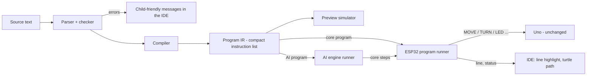

# Tank Logo — Language Design (Spec 5)

Status: **APPROVED** (owner, 2026-10-11; decisions in §12; Revision 3 approved 2026-10-22) · Date: 2026-10-11 · Decision record: `docs/design-notes.md` §20 · Roadmap: `docs/implementation-roadmap.md` "Tank Logo"

> **2026-10-18 (owner, design-notes §79):** no hub — the IDE becomes a page **on the ESP32 bridge**; the core runner stays on the ESP32 as designed, the AI runner in the AI engine.

## Revision 2 (2026-10-19, owner — design-notes §81–§83) — DRAFT for owner review
Where this revision and the sections below differ, **this revision wins**. The exact language now lives in three files:
- **`logo/spec/grammar.md`** — tokens, the full grammar (EBNF), input counting (two passes), precedence, templates, scope, tricky cases (replaces §4);
- **`logo/spec/words.yaml`** — every word with level, inputs (type, unit, range), what the tank does, needs, help and example; presets; limits; error messages (replaces §3, the limits in §7 and the error list in §8);
- **`logo/spec/tests/`** — shared test cases (`reading.yaml`, `errors.yaml`, `level3.yaml`).

What changed:
1. **Three levels, one language:** 1 Starter (moves, `REPEAT`, light, sound, `WAIT`, `LOOK`), 2 Explorer (your own words with inputs, `IF`/`IFELSE`, sensors, `WHILE`, `WAIT UNTIL`, recursion), 3 Expert (`OUTPUT`, lists, `MAP` `FILTER` `REDUCE` `FOREACH`). **v1 = levels 1–2 + `OUTPUT`; the list words come in v1.1.** The editor shows words by level.
2. **Functional core:** no `MAKE` and no global variables — values come in as inputs and go out with `OUTPUT`; lists are values that never change; code is passed to `MAP` etc. as a `?` template or a word's name; no `RUN`, no `FOR`. Tail calls use no stack; other nesting ≤ 100. Lists live in a PSRAM pool (≈ 50 000 cells) with garbage collection (v1.1).
3. **New words:** `WAIT UNTIL`, `OBSTACLE?`, `BLOCKED?`, `TIMER`, `PIVOT LEFT/RIGHT a`, `REMAINDER`, `ABS`, `ROUND`; vision `COUNT` is renamed `HOWMANY` (`COUNT` counts list items).
4. **Changed words:** turning right is positive (`HEADING 90` after `RIGHT 90`); `ARC LEFT/RIGHT a r` (smallest circle 31 cm, speed moved into the radius's band); `LED` takes a colour word or `[r g b]`, `LOOK` a preset or `[pan tilt]` (each one input, so input counting stays simple); `SOUND` uses the tank's 24 real sound names.
5. **Obstacles (§7 changed):** a move cut short by the obstacle brake ends the program **unless the program uses `BLOCKED?`**, in which case it carries on. Stall, tilt, low battery, STOP, another device taking control and the page going away still end it.
6. **Where it runs (§5, §11 changed):** the **ESP32 reads, checks and compiles** the program (C++, host-tested against `logo/spec/tests/`) and draws nothing — it answers the editor with errors and the planned path; the page and the AI engine send program text. No TypeScript or Python copy of the parser. The IR of §5.1 becomes internal to the ESP32 (fixed in the LLD).
7. **Programs are saved on the tank** and a running program stops when its page goes away (§12 items 7–8).

## Revision 3 (2026-10-22, owner — design-notes §118) — `GO` and `HOLD`
Where this revision and the sections below differ, **this revision wins** (Revision 2 still wins over the original sections).

**Why:** every motion word waits until its move is done (§5.1), so a program can only drive in steps. On the floor `avoid_walls` (`FOREVER [ FORWARD 20  IF BLOCKED? [ … ] ]`) stopped and started every 20 cm (design-notes §118). "Drive until …" — until something is close, until the camera sees a ball or a person — needs a motion that keeps going while the program watches.

**New words (level 2 Explorer, group move, kind command, no inputs):**

| Word | What the tank does |
|---|---|
| `GO` | drives **straight forward** at the current `SPEED`, holding its heading with the gyro, and the program **goes on at once** to the next word |
| `HOLD` | stops the tank; the program goes on (`STOP` still ends the whole program). With nothing moving, it does nothing. |

- **`GO` ends when:**
  - the next motion word starts: `FORWARD`, `BACK`, `RIGHT`, `LEFT`, `ARC`, `PIVOT`, `HOME` take over straight from driving;
  - `HOLD` runs;
  - something is in the way (the obstacle brake), exactly like `FORWARD`: with `BLOCKED?` in the program it carries on and `BLOCKED?` is TRUE, otherwise the program ends with 7024;
  - `STOP`, the program ending, the time limit, or any safety ending (§7).
- **`GO` again while going** changes nothing. **`SPEED` while going** applies at once.
- **Forward only** (owner): the distance sensor looks forward; there is no `GO BACK`.
- **Needs the encoders**, like `FORWARD` (owner, 2026-10-22, after the final review of Plan N5). Then a stuck track is always caught by the Uno's own check, and a tank without encoders gets 7021. An earlier draft said "the gyro only".
- **In step mode** a pause on a line holds the GO (the tank stops), and STEP drives on again at the same speed (owner, 2026-10-22).
- **Keeping it safe:** `GO` is a continuous "drive straight at SPEED" command that must be **refreshed at least every 0.3 s, or the tank stops** — the rule for driving by hand and for DRIVE_RATE (bridge LLD R4.4). The tank's runner refreshes it every tick; the AI engine's runner refreshes it about every 0.1 s over WiFi, so a hung laptop, program or WiFi stops the tank within 0.3 s. The obstacle brake, child-play limits, STOP from anywhere, battery / tilt / link-loss stops all stay.
- **Preview:** `GO` has no length, so the planned path draws a dashed 1 m line marked uncertain ("until something"); later steps follow from there.

**"Drive until" — the pattern, today and with the AI:**
```logo
GO  WAIT UNTIL DISTANCE < 30  HOLD  BEEP              ; on the tank
FOREVER [ GO  WAIT UNTIL BLOCKED?  BACK 10  RIGHT 90 ] ; avoid walls without stopping every 20 cm
GO  WAIT UNTIL SEE? "ball  HOLD  SOUND FANFARE        ; AI program (the AI engine runs it)
GO  WAIT UNTIL SEE? "person  HOLD  SAY [ hello ]      ; AI program
```
New AI words stay **questions** (`SEE? "thing`, `HOWMANY "thing`, …) that combine with `GO … WAIT UNTIL … HOLD`; no motion word per thing. A shorter `GO UNTIL cond` may be added later as a shorthand for `GO WAIT UNTIL cond HOLD` (not in this revision).

**Changes to the sections below:**
- **§5.1:** "motion instructions block until done" has one exception: `GO` returns at once (its drive is kept alive by the runner). `HOLD` returns once the tank is told to stop.
- **§6:** an AI program's `GO` is run by the AI engine the same way, refreshing the drive.
- **Out of date since Revision 2:** §3.4 `MAKE` / variables (removed — functional core); §7 "an obstacle always ends the program" (it carries on when the program uses `BLOCKED?`); §3.5 lists `WAIT UNTIL` as a vision word (it is a core level-2 word); §3.5 `COUNT` (renamed `HOWMANY`).

## 1. Goal
A small Logo-like language so that **children, the owner and the AI** can program the tank. Programs are written in a built-in code editor (IDE) in the web app, or generated by the AI engine from speech. Turtle commands map directly onto the tank's existing motion primitives, so the language adds **no new firmware on the Uno** and **no new safety rules** — every step is an ordinary command that passes the Uno safety supervisor.

Non-goals (v1): block editor, event handlers (`WHEN BUMP`), multiple turtles, a pen, keywords in other languages (see §12).

## 2. A first look
```logo
; draw a square, then celebrate
TO SQUARE :size
  REPEAT 4 [ FORWARD :size  RIGHT 90 ]
END

SPEED 40
SQUARE 50
LED GREEN  BEEP
SAY "Done!
```
```logo
; explore: drive until something is close, then turn away
REPEAT 10 [
  IFELSE DISTANCE < 30 [ BACK 10  LEFT 90 ] [ FORWARD 20 ]
]
```

## 3. Words (v1)

### 3.1 Motion (core — run on the ESP32; `LEFT` / `RIGHT` / `HOME` need only the gyro, `FORWARD` / `BACK` / `ARC` need encoders — spec 02 Part E)
| Word | Meaning | Maps to |
|---|---|---|
| `FORWARD n` / `FD n` | drive n cm forward, holding heading | MOVE distance (needs encoders, §9) |
| `BACK n` / `BK n` | drive n cm backward | MOVE −n |
| `RIGHT a` / `RT a`, `LEFT a` / `LT a` | turn a degrees on the spot | TURN by (spin) |
| `ARC a r` | turn a degrees along a circle of radius r cm (positive a = right) | TURN by (arc) |
| `SPEED p` | set speed for following moves, 10–100 % (default 40) | speed field of MOVE/TURN; capped by the child-play envelope |
| `HOME` | turn back to the heading the program started with | TURN to |
| `WAIT s` | pause s seconds (decimals allowed) | timer on the runner |

### 3.2 Look, light, sound, speech (core)
| Word | Meaning |
|---|---|
| `LOOK LEFT` / `RIGHT` / `UP` / `DOWN` / `HOME` | move the camera head to a preset |
| `LOOK pan tilt` | camera head to angles in degrees (0 0 = centre) |
| `LED colour` | `RED GREEN BLUE YELLOW PURPLE WHITE ORANGE OFF` |
| `LED r g b` | any colour, 0–255 each |
| `BEEP` | short beep |
| `PLAY [ C4 E4 G4 ]` | notes (C4–B6, `R` = rest), each 0.25 s; `PLAY [ C4 2 E4 1 ]` gives lengths in quarter-beats |
| `SOUND name` | a catalogue sound (`HAPPY`, `SAD`, `ALARM`, …; list from the sound catalogue) |
| `SAY "text` / `SAY [ two words ]` | the app shows the text and speaks it (text-to-speech on the client); nothing on the tank |

### 3.3 Sensor values (reporters — core)
| Word | Value |
|---|---|
| `DISTANCE` | cm to the nearest obstacle ahead (ultrasonic); `999` when nothing is seen |
| `HEADING` | degrees turned since the program started (−180…180) |
| `TILT` | body tilt in degrees |
| `BATTERY` | battery % |
| `RANDOM n` | whole number 0…n−1 |
| `REPCOUNT` | which round of the innermost `REPEAT` this is (1, 2, …) |

### 3.4 Language
| Form | Meaning |
|---|---|
| `REPEAT n [ … ]` | repeat n times |
| `FOREVER [ … ]` | repeat until STOP — still bound by the program time limit (§7) |
| `WHILE cond [ … ]` | repeat while cond is true |
| `IF cond [ … ]`, `IFELSE cond [ … ] [ … ]` | choose |
| `TO name :a :b … END` | define a procedure with inputs |
| `MAKE "x value`, `:x` | set / read a variable (global; procedure inputs are local) |
| `STOP` | end the **whole program** and stop the tank (child-friendly; differs from classic Logo, where STOP leaves a procedure) |
| `; text` | comment to end of line |
| Arithmetic | `+ - * /`, brackets `( )`; numbers may have decimals |
| Comparison | `< > = <= >= <>` |
| Logic | `AND OR NOT` |

Words are **case-insensitive**. Short forms (`FD BK RT LT`) are accepted.

### 3.5 Vision words (AI programs only — run in the AI engine, §6)
| Word | Meaning |
|---|---|
| `SEE? "thing` | true if the camera currently sees the thing (`ball`, `face`, `cat`, a person's name if face identity is on) |
| `FIND "thing` | turn around looking for the thing; stops facing it, or ends with "not found" |
| `FOLLOW "thing s` | follow the thing for s seconds (keeps safe distance) |
| `WAIT UNTIL cond` | wait until cond becomes true (bound by the time limit) |
| `COUNT "thing` | how many of the thing are visible |

## 4. Grammar (EBNF)
```
program     = { statement | procedure } ;
procedure   = "TO" NAME { ":" NAME } { statement } "END" ;
statement   = command | control | assignment | NAME { expr } ;     (* procedure call *)
command     = WORD { expr | colour | preset | list } ;
control     = "REPEAT" expr block | "FOREVER" block | "WHILE" expr block
            | "IF" expr block | "IFELSE" expr block block | "STOP" ;
assignment  = "MAKE" QUOTED expr ;
block       = "[" { statement } "]" ;
expr        = orexpr ;
orexpr      = andexpr { "OR" andexpr } ;
andexpr     = notexpr { "AND" notexpr } ;
notexpr     = [ "NOT" ] cmp ;
cmp         = sum [ ( "<" | ">" | "=" | "<=" | ">=" | "<>" ) sum ] ;
sum         = term { ( "+" | "-" ) term } ;
term        = factor { ( "*" | "/" ) factor } ;
factor      = NUMBER | ":" NAME | reporter | "(" expr ")" | "-" factor ;
```
Each word has a fixed number of inputs (as in classic Logo), so no brackets are needed around inputs. The full word table with arities lives in `logo/spec/words.yaml` (single source of truth for both parsers and the IDE's autocomplete/help).

## 5. How a program runs (pipeline)


### 5.1 Program IR (what is uploaded)
A flat instruction list for a tiny stack machine, so the ESP32 runner stays small and needs no parser:
- Values: 32-bit fixed point (1/1000), on an expression stack (depth ≤ 16).
- Instructions (illustrative): `LINE n` · `PUSH k` · `LOAD v` · `STORE v` · `SENSOR id` · `OP op` · `JMP a` · `JZ a` · `CALL p` · `RET` · `MOVE` · `TURN` · `ARC` · `SPEED` · `WAIT` · `LOOK` · `LED` · `SOUND` · `PLAY` · `SAY` · `HALT`.
- Motion instructions **block** until the Uno reports the primitive done (or failed).
- Encoding: JSON over the API for v1 (readable, debuggable); a binary form later only if size matters. Exact format is fixed in the LLD.
- The IR carries a `kind` (`core` / `ai`) and the source line table.

### 5.2 Runner behaviour (ESP32 and AI engine share these rules)
- One program at a time per tank; uploading a new one replaces the stopped one.
- Reports `program_started`, `line` (current line), `program_ended {reason}` events — the IDE highlights the line and draws the turtle path from odometry.
- `SAY` is forwarded as an event to clients; the tank does nothing.
- Step mode: the IDE can ask the runner to pause after each `LINE`.

## 6. Two kinds of program
| Kind | Contains | Runs on | Needs |
|---|---|---|---|
| **Core** | only §3.1–3.4 words | ESP32 program runner | tank only (app or hub, no AI) |
| **AI** | any §3.5 vision word | AI engine runner, which sends the core steps to the tank | AI engine running |
The compiler decides the kind. Uploading an AI program with no AI engine gives: *"This program needs the AI helper to see things. Start the AI engine or remove FIND/SEE?/FOLLOW."*

## 7. Safety and limits
- Every motion step is an ordinary MOVE/TURN command: **obstacle brake, child-play envelope, deadman, tilt/lift, battery cut-offs all apply unchanged.** The language can never exceed what the app's manual driving can do.
- **STOP from anywhere** (app button, bench Space, IR remote, `STOP` word) ends the whole program, not just the current step. A higher-priority controller taking over (IR > human > AI) also ends it; the program never resumes.
- If a move is stopped by the obstacle brake, the program ends: *"Something is in the way on line 7."* Programs that want to handle obstacles check `DISTANCE` first.
- Limits (runner-enforced; defaults, admin-adjustable): run time **5 min**; **10 000** executed instructions; procedure depth **16**; **32** variables; program size **4 KB** IR / **1000** instructions; `WAIT` ≤ 60 s; `FORWARD`/`BACK` ≤ 500 cm per step.
- A program runs under its sender's key role (human or ai) and priority. Children's programs from the IDE run as the logged-in human.

## 8. Errors (child-friendly)
- Checked **before** running; nothing moves if there is an error. Each error has a numeric code (new domain **PROGRAM 7000–7999** in the error registry), the line and column, and a plain message:
  - `PROGRAM_7001` unknown word → *"I don't know how to SQAURE. Did you mean SQUARE?"*
  - `PROGRAM_7002` missing input → *"FORWARD needs a number, like FORWARD 50."*
  - `PROGRAM_7003` unclosed bracket → *"The [ on line 3 never closes. Add a ]."*
  - `PROGRAM_7010` limit exceeded, `PROGRAM_7020` needs AI, `PROGRAM_7021` needs encoders, …
- Runtime endings are reported the same way (`blocked`, `stopped by you`, `time limit`, `battery low`, `remote took over`).

## 9. Tank capabilities
- Without encoders (hardware configuration 1) the tank cannot measure distance: `FORWARD`/`BACK`/`ARC` give `PROGRAM_7021` — *"This tank can't measure distance yet."* (Decided §12.3: no timed fallback.)
- Without a camera/AI the vision words are unavailable (§6).

## 10. Preview simulator
- Runs the IR with ideal turtle physics (exact distances and angles) and draws the expected path in the IDE before anything moves.
- Sensor values in the preview: `DISTANCE` = 999, `BATTERY` = 100, `RANDOM` = seeded; branches that depend on sensors are drawn dashed with a note.
- Same simulator (Python) powers a dry run (`--dry`) in whichever client runs Logo programs (the bench tool was retired 2026-10-18, design-notes §74).

## 11. Implementation layout (for the LLDs)
| Part | Where | Language |
|---|---|---|
| Word table, grammar, conformance tests | `logo/spec/` (`words.yaml`, `grammar.md`, `tests/*.yaml`: source → expected IR or error, plus simulator trace) | data |
| Parser, checker, compiler, simulator, runner | `logo/python/conqueror_logo` — used by the AI engine / hub (bench tool retired, design-notes §74) | Python |
| Parser, checker, compiler, simulator | IDE package in the hub web app | TypeScript |
| Program runner (core) | ESP32 gateway firmware | C++ |
| Program API | ESP32 client API (upload / run / step / stop / events) and the hub API | per protocol spec |
Both parsers must pass every conformance test; CI (or the pre-commit hook) runs them.

## 12. Decisions (owner, 2026-10-11)
1. **Keywords: English only** in v1 (other languages possible later as `words.yaml` aliases).
2. **Events** (`WHEN BUMP [ … ]`, `WHEN SEE "cat [ … ]`): **later** (v2).
3. **No encoders:** `FORWARD`/`BACK`/`ARC` give the clear error `PROGRAM_7021` — no timed fallback.
4. **Saved programs on the tank** (9 slots in ESP32 flash, run from IR remote keys 1–9): **yes, in v2**.
5. **`STOP` ends the whole program** and stops the tank (confirmed).
6. Error domain **PROGRAM 7000–7999** — free in `protocol/defs/errors.yaml`; add it when the Logo work starts.
7. **(2026-10-18, design-notes §81) Saved programs on the tank already in v1** (supersedes the "v2" in item 4 for the list itself; running them from the IR remote keys stays v2): the IDE lists, saves, renames and deletes programs stored on the ESP32, shared by every device.
8. **(2026-10-18, design-notes §81) A program stops when its page goes away:** page hidden or disconnected, or another device takes control → the program ends (`program_ended {reason}`) and the tank stops — the same rules as driving by hand (bridge LLD R11 hidden pages, the one-driver rule).
