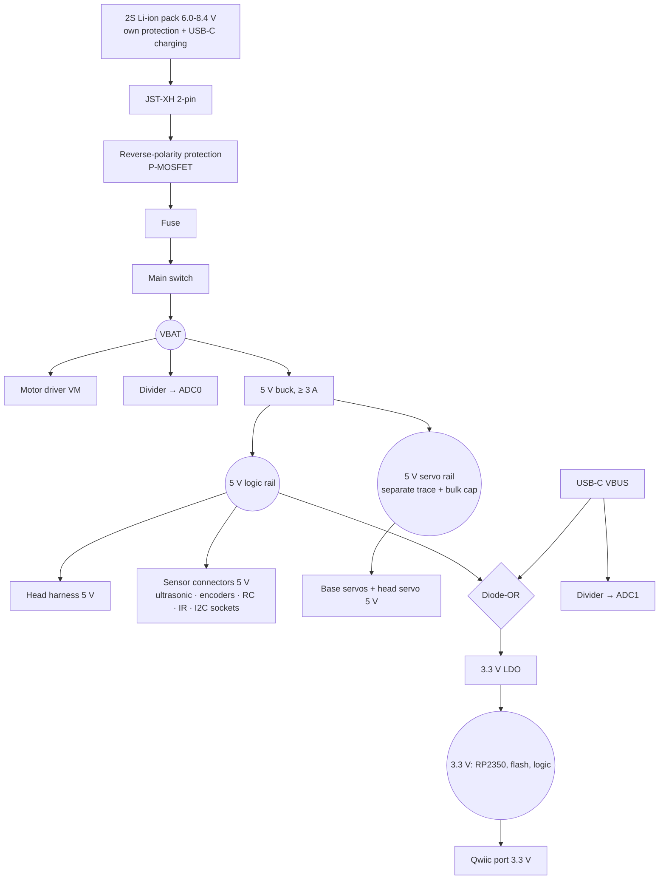

# Spec 06 — Base board (RP2350A) + camera head

Status: **draft for review** (2026-10-14). Requirements agreed with the owner in `docs/design-notes.md` §40 / §40.1; this spec turns them into a hardware design. Next steps after approval: LLD (schematic-level: exact parts, final pin map, layout rules), then a plan.

**Scope:** a new product, separate from the current tank. The current development — Mega 2560 + ELEGOO SmartCar Shield + ESP32-S3 bridge (Plans B/C/D) — continues unchanged. The base board later reuses that firmware's design (protocol, domain logic) with a new driver layer.

---

## 1. Goal

A **good general-purpose robot controller** for tracked and wheeled robots, sold **worldwide**. One board replaces "Uno/Mega + motor shield"; an off-the-shelf ESP32-S3 camera board on the pan-tilt gimbal adds WiFi, video and phone driving. The value is the integration (encoders, IMU, safety, camera head) and the software, not the lowest price.

**Non-goals:** Arduino shield compatibility · battery charging on the board · Python on the board (Tank Logo is the beginner language) · Grove connectors · a custom camera board.

## 2. System overview

```mermaid
flowchart LR
  subgraph HEAD["Camera head (off-the-shelf ESP32-S3 camera board, on the gimbal)"]
    ESP[ESP32-S3 + PSRAM] --- CAM[OV2640/OV3660]
    ESP --- HSV[2x servo out<br/>when servo host = head]
    ESP --- WIFI((WiFi: phone page,<br/>bench, OTA))
  end
  subgraph BASE["Base board (Uno outline, RP2350A)"]
    MCU[RP2350A + QSPI flash]
    MCU --- DRV[Motor driver 2 ch<br/>+ footprint 2nd driver]
    MCU --- ENC[2x encoder A/B]
    MCU --- SRV[2x servo out<br/>when servo host = base]
    MCU --- SENS[Ultrasonic · IR · RC input]
    MCU --- I2C[I2C: gyro socket · compass socket · Qwiic]
    MCU --- OUT[Buzzer · WS2812 · status LEDs]
    MCU --- UI[RESET · MODE · BOOT]
    MCU --- USB[USB-C: programming]
  end
  BAT[2S Li-ion pack<br/>own USB-C charging] --> BASE
  BASE == "6-wire harness:<br/>5V, GND, TX, RX, servo 5V, servo GND" ==> HEAD
  DRV --> M[2 DC motors<br/>(4 in mecanum variant)]
```

Roles (unchanged from the current architecture):
- **Base = body.** Real-time control and **all safety** (deadman, link-loss stop, obstacle brake, tilt/lift, stall, low battery, child-play envelope). A crashed WiFi chip, a sleeping phone or a bad OTA can never leave the robot driving.
- **Head = gateway.** WiFi, camera, phone page, bench passthrough, OTA. Master of **communication only**.
- Link: the existing body-link protocol (binary frames, CRC-8, protocol version 2) over UART.

## 3. Base board requirements

| Group | Requirement |
|---|---|
| Size | Uno outline 68.6 x 53.3 mm, the 4 Uno mounting holes. Not shield-compatible |
| MCU | **RP2350A** (QFN-60, 30 GPIO), **A4 stepping or later** (erratum E9: do not rely on internal pull-downs), external QSPI flash (≥ 2 MB), 12 MHz crystal |
| Motors | **2 channels** standard (TB6612-class, ≥ 1.2 A continuous / 3 A peak per channel, VM up to 8.4 V); PCB footprint for a **2nd driver, unfitted** → 4-channel mecanum variant from the same PCB |
| Encoders | 2 connectors, quadrature A/B, 5 V supply |
| Servos | 2 outputs (3-pin), powered from the servo 5 V rail. A setting picks the **servo host** (base or head) — never both |
| Distance | HC-SR04 connector (5 V, trig, echo) |
| IR | IR receiver at the front edge + a connector for an off-board receiver |
| RC input | 1 connector: 5 V, GND, 2 signal pins — hobby 2.4 GHz receivers (PPM, SBUS) or a toy 27 MHz decoder's on/off outputs |
| IMU | Socket for a **GY-521** breakout (MPU6050 class, 8 pins: VCC GND SCL SDA XDA XCL AD0 INT) |
| Compass (optional) | Socket for a **GY-271** breakout (QMC5883L/HMC5883L, 5 pins: VCC GND SCL SDA DRDY) at the board edge, far from the motor connectors |
| I2C expansion | 1 **Qwiic** (JST-SH 4-pin) port — ToF, newer IMUs, a remote compass |
| Outputs | Passive buzzer · 1 WS2812 RGB LED (buffered data) · GPIO status LEDs |
| Buttons | RESET, MODE (short press; 5 s WiFi reset; 15 s admin reset), BOOT (recovery only, recessed). No extra user buttons |
| Sensing | Battery voltage · USB-VBUS present |
| Head link | 6-wire harness connector (§6) |
| USB | USB-C, programming only (RP2350 native USB) |
| Power | 2S Li-ion pack with its own protection and USB-C charging; battery connector JST-XH 2-pin; reverse-polarity protection; fuse; main switch; 5 V and 3.3 V rails (§5) |

### 3.1 Board-wide rules
1. **5 V-safe connectors.** Users never think about voltage: every connector carries 5 V power; every input tolerates 5 V; every output works with 5 V parts. The only buffered output is the WS2812 data line (74AHCT1G125-class; WS2812 needs ~3.5 V high).
2. **Robot connectors are JST-XH 2.54 mm** (servos on standard 3-pin 2.54 mm male headers). Compact, latching, cheap, easy to crimp, sold everywhere.
3. **Enclosure rule.** Anything the user reaches or must see sits on a board edge, facing out: buttons are right-angle side-press switches. Proposed **service edge**: USB-C, main switch, RESET, MODE (one cut-out in an enclosure). IR receiver and RGB LED at edges or on connectors; status LEDs along an edge or side-view.
4. **USB never drives motors.** If USB VBUS is present while the board runs from the battery, the firmware blocks the motors (no driving off with a cable attached).

## 4. Draft pin plan (RP2350A)

Draft for the LLD — it shows that everything fits; the LLD finalises it against the datasheet (PWM slices, PIO assignment, 5 V tolerance per pin).

| GPIO | Function | Notes |
|---|---|---|
| 0 / 1 | UART0 TX / RX → head | Body link, 250000 baud |
| 2 / 3 | Motor L IN1 / IN2 | PWM slice 1 (A/B), ~20 kHz; IN/IN drive (no separate PWM pin) |
| 4 / 5 | I2C0 SDA / SCL | Gyro socket, compass socket, Qwiic (shared bus) |
| 6 / 7 | Motor R IN1 / IN2 | PWM slice 3, ~20 kHz |
| 8 / 9 | Motor C IN1 / IN2 | Mecanum variant only (slice 4) |
| 10 / 11 | Motor D IN1 / IN2 | Mecanum variant only (slice 5) |
| 12 / 13 | Servo 1 / 2 | PWM slice 6, 50 Hz |
| 14 | Buzzer | PWM slice 7 A (tone frequency) |
| 15 | WS2812 data | PIO, through the 74AHCT1G125 buffer |
| 16 / 17 | Encoder L A / B | PIO quadrature counter |
| 18 / 19 | Encoder R A / B | PIO quadrature counter |
| 20 | Motor driver STBY / enable | Low = all motors coast (also at reset) |
| 21 | Ultrasonic trig | |
| 22 | Ultrasonic echo | PIO or edge capture |
| 23 | IR receiver | PIO NEC capture (no 20 kHz sampling needed) |
| 24 / 25 | RC input 1 / 2 | PIO: PPM, SBUS (inverted UART 100 kbaud) or digital |
| 26 (ADC0) | Battery voltage | Divider from VBAT (ADC pins are **not** 5 V-tolerant — divider only) |
| 27 (ADC1) | USB VBUS sense | Divider |
| 28 | MODE button | External pull-up |
| 29 (ADC3) | Spare | Free for a later need |

Budget: 29 of 30 GPIO used. **Consequence:** the mecanum variant has motor pins but **no encoder pins** for motors C/D. If 4 encoders are wanted, the LLD switches to **RP2350B** (QFN-80, 48 GPIO) — open question O1.

GY-521 INT, XDA/XCL and GY-271 DRDY are not wired to GPIO (the firmware polls; the current firmware already does).

## 5. Power tree



- **No charging on the board** (owner, 2026-10-14). The pack charges itself over USB-C; the main switch should be off while charging.
- **USB powers only the 3.3 V logic** (RP2350, flash) through the diode-OR, so the board can be programmed at any time without a battery. USB never back-feeds the 5 V rail, the motors or the head.
- **Servo current stays off the logic rail:** servos (base and head) get their own 5 V trace from the buck with a bulk capacitor; the head's ESP32 is fed from the logic rail through the harness (servo bursts of 0.5-1 A caused brown-outs on the current tank's ESP32 — design-notes §38).
- **5 V buck ≥ 3 A:** 2 servos (bursts ~1 A each), head ESP32 + camera (~0.5 A peaks), WS2812, sensors. Exact part in the LLD; a second buck dedicated to the servos is an LLD option.
- **Qwiic is a 3.3 V standard** — its connector gets 3.3 V, not 5 V (exception to rule 3.1.1, by standard; Qwiic modules expect 3.3 V).

## 6. Head link — 6-wire harness

| Pin | Signal | Direction |
|---|---|---|
| 1 | 5 V logic | base → head |
| 2 | GND | — |
| 3 | TX (base) → RX (head) | base → head, 3.3 V |
| 4 | RX (base) ← TX (head) | head → base, 3.3 V |
| 5 | Servo 5 V | base → head (head servos) |
| 6 | Servo GND | — |

Connector: JST-XH 6-pin on the base; the head side depends on the chosen camera board (adapter lead or a small carrier board). Pin order final in the LLD.

## 7. Camera head

An **existing ESP32-S3 camera board**, not designed by us. Selection criteria:
- ESP32-S3 with **PSRAM** (8 MB preferred), OV2640/OV3660 camera.
- **2 free GPIOs** for the UART (not used by camera or PSRAM) + **2 more** for servos, a **5 V input** pin.
- **U.FL external antenna** preferred (metal chassis).
- USB-C for recovery; normal updates over WiFi (OTA).

Candidates: Seeed XIAO ESP32S3 Sense (U.FL, small), Freenove ESP32-S3-WROOM CAM. Not recommended: AI-Thinker ESP32-CAM (old ESP32, no USB, few pins).

Head firmware = the current ESP32 bridge (Plan C) with: a servo-host role (camera behaviour moves to the head when the setting says so; protocol unchanged), board pin profiles per camera board.

## 8. Base firmware (what the port needs)

Reuse the current body firmware's design: protocol, domain logic (safety, control, estimation, IR, settings), and tests. New:
- **Board layer for RP2350** (Arduino-Pico core): hardware PWM for motors/servos/buzzer, **PIO** for encoders, WS2812, IR and RC input, hardware I2C (no software I2C), ADC for battery and VBUS.
- **FPU:** the IMU/PID float maths that cost ~2.4 ms per pass on the Mega become cheap.
- **Settings** in flash (EEPROM emulation with wear levelling) instead of AVR EEPROM.
- New behaviour: motors blocked while USB VBUS is present; servo-host setting; RC input mapped like the IR remote (an input source under the arbitrator).
- HELLO reports the board type and fitted options (encoders, compass, 4-channel).

Tank Logo, the phone page, the bench tool and the AI engine work unchanged through the head.

## 9. Validation

To be written when we get there (owner, 2026-10-14). It will cover bring-up order, power and current checks, connector and 5 V-tolerance checks, and a port of the current hardware sign-off (deadman, link loss, obstacle brake, soak).

## 10. Open questions

| # | Question | Notes |
|---|---|---|
| O1 | 4 encoders for the mecanum variant? | Needs RP2350B (48 GPIO); RP2350A has no pins left |
| O2 | Exact parts: motor driver (TB6612 vs DRV8833-class), 5 V buck, LDO, reverse-polarity MOSFET, fuse | LLD |
| O3 | One 5 V buck or a separate servo buck | LLD, after current budget |
| O4 | Status LEDs: which signals, buffered how, placement (edge / side-view) | LLD + layout |
| O5 | Head carrier: adapter lead vs a small carrier board with servo headers | Depends on the chosen camera board |
| O6 | Certification: CE (RED), FCC, UKCA, RoHS; EN 71 / BIS toys if sold for children; Li-ion rules if packs ship | Research task; launch as a 14+ electronics board without cells defers the toy/battery rules (to confirm) |
| O7 | Track/chassis supplier (Conqueror/Devastator style) | design-notes §40 sourcing plan |

## 11. Risks

- **Pin budget is tight** (29/30 on RP2350A) — any new need forces RP2350B or an I/O expander.
- **Power integrity:** motor and servo noise on a small board; needs careful layout (star ground, bulk caps, separate servo trace).
- **Compass accuracy** near motors — the socket is a convenience; reliable heading needs a remote (Qwiic) compass.
- **Cost:** the electronics target (~INR 1,000-1,500 / US$12-18 BOM) has to hold at small volumes; market research suggests a retail of INR 1,999-2,499 for the board (`docs/research/2026-10-14-base-board-market-india.md`).
- **Supply:** RP2350A stepping (A4+) and the camera board must be reliably available.
