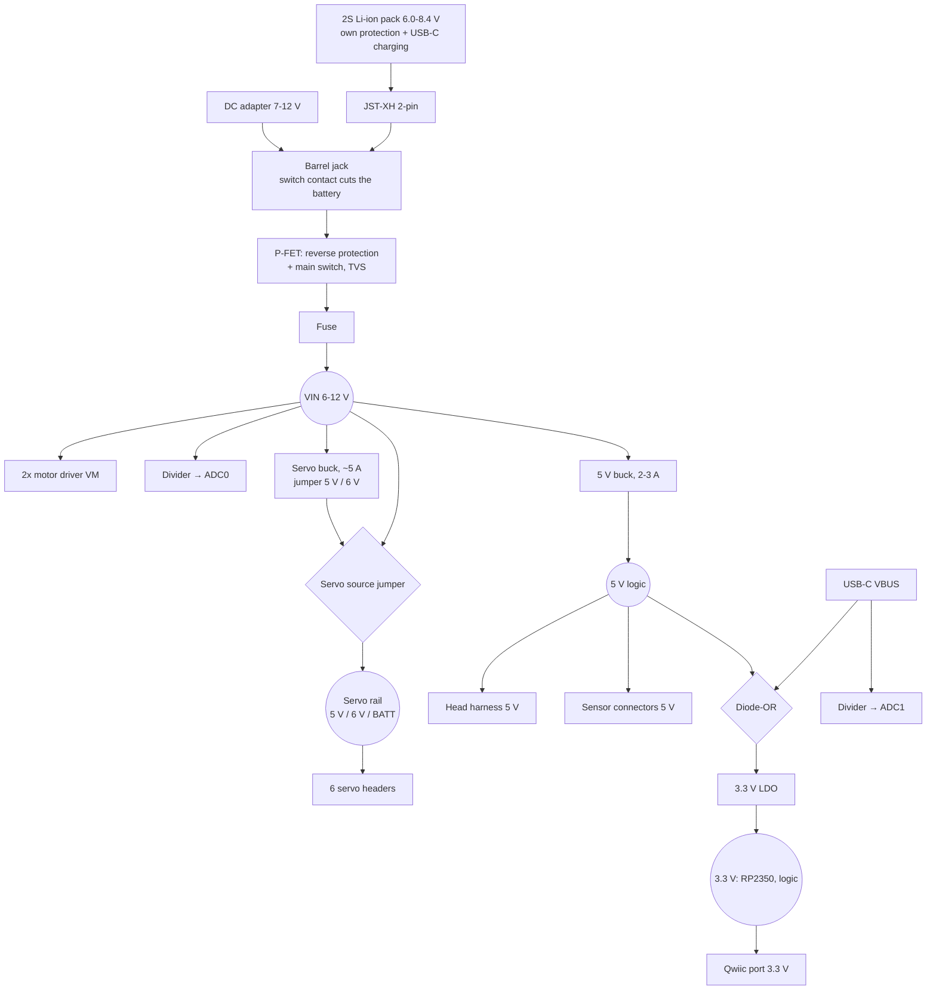

# Spec 06 — Base board (RP2354B) + camera head

Status: **draft for review** (2026-10-14). Requirements agreed with the owner in `docs/design-notes.md` §40 / §40.1; this spec turns them into a hardware design. Next steps after approval: LLD (schematic-level: exact parts, final pin map, layout rules), then a plan.

**Scope:** a new product, separate from the current tank. The current development — Mega 2560 + ELEGOO SmartCar Shield + ESP32-S3 bridge (Plans B/C/D) — continues unchanged. The base board later reuses that firmware's design (protocol, domain logic) with a new driver layer.

---

## 1. Goal

A **good general-purpose robot controller** for tracked and wheeled robots, sold **worldwide**. One board replaces "Uno/Mega + motor shield"; an off-the-shelf ESP32-S3 camera board on the pan-tilt gimbal adds WiFi, video and phone driving. The value is the integration (encoders, IMU, safety, camera head) and the software, not the lowest price.

**Non-goals:** Arduino shield compatibility · battery charging on the board · Python on the board (Tank Logo is the beginner language) · Grove connectors · a custom camera board.

## 2. System overview

```mermaid
flowchart LR
  subgraph HEAD["Camera head (off-the-shelf ESP32-S3 camera board, on the gimbal)"]
    ESP[ESP32-S3 + PSRAM] --- CAM[OV2640/OV3660]
    ESP --- WIFI((WiFi: phone page,<br/>bench, OTA))
  end
  subgraph BASE["Base board (Uno outline, RP2354B)"]
    MCU[RP2354B, 2 MB flash inside]
    MCU --- DRV[2x motor driver, 4 ch<br/>switch: MOTOR C/D or SERVO 3-6]
    MCU --- ENC[4x encoder A/B]
    MCU --- EXP[Expansion header<br/>6 GPIO + 4 ADC]
    MCU --- SRV[2 servo out (pan/tilt)<br/>+ 4 shared with motors C/D]
    MCU --- SENS[Ultrasonic · IR · RC input]
    MCU --- I2C[I2C: gyro socket · compass socket · Qwiic]
    MCU --- OUT[Buzzer · WS2812 · status LEDs]
    MCU --- UI[RESET · MODE · BOOT]
    MCU --- USB[USB-C: programming]
  end
  BAT[2S Li-ion pack<br/>own USB-C charging] --> BASE
  ADP[DC adapter 7-12 V<br/>barrel jack] --> BASE
  BASE == "4-wire harness:<br/>5V, GND, TX, RX" ==> HEAD
  DRV --> M[2 DC motors<br/>(4 in MOTOR position)]
```

Roles (unchanged from the current architecture):
- **Base = body.** Real-time control and **all safety** (deadman, link-loss stop, obstacle brake, tilt/lift, stall, low battery, child-play envelope). A crashed WiFi chip, a sleeping phone or a bad OTA can never leave the robot driving.
- **Head = gateway.** WiFi, camera, phone page, bench passthrough, OTA. Master of **communication only**.
- Link: the existing body-link protocol (binary frames, CRC-8, protocol version 2) over UART.

## 3. Base board requirements

| Group | Requirement |
|---|---|
| Size | Uno outline 68.6 x 53.3 mm, the 4 Uno mounting holes. Not shield-compatible |
| MCU | **RP2354B** (owner, 2026-10-14): RP2350B (QFN-80, **48 GPIO**, 8 ADC) with **2 MB flash inside**, A4 stepping (erratum E9 fixed), 12 MHz crystal. Only US$0.10 more than the A package; LCSC C39843328 in stock (2026-10-14). Fallback: RP2350B + external QSPI flash |
| Motors | **4 channels on every board** (2x TB6612-class, ≥ 1.2 A continuous / 3 A peak per channel, VM up to 12 V). Motors A/B always; motors C/D or servos 3-6 chosen by the **MOTOR C/D ⇄ SERVO 3-6 switch** (owner, 2026-10-14) |
| Encoders | **4 connectors** (one per motor), quadrature A/B, 5 V supply |
| Servos | **2 dedicated** (pan/tilt) **+ 4 shared** with motors C/D (SERVO position) = **6 servos**; more than 6 via a PCA9685 module on Qwiic. Servo power from a **dedicated servo buck** with jumpers **5 V / 6 V / BATT** (BATT = HV servos on a 2S pack only). Servos only on the base (owner, 2026-10-14: servo pins on the head dropped) |
| Distance | HC-SR04 connector (5 V, trig, echo) |
| IR | IR receiver at the front edge + a connector for an off-board receiver |
| RC input | 1 connector: 5 V, GND, 2 signal pins — hobby 2.4 GHz receivers (PPM, SBUS) or a toy 27 MHz decoder's on/off outputs |
| IMU | Socket for a **GY-521** breakout (MPU6050 class, 8 pins: VCC GND SCL SDA XDA XCL AD0 INT) |
| Compass (optional) | Socket for a **GY-271** breakout (QMC5883L/HMC5883L, 5 pins: VCC GND SCL SDA DRDY) at the board edge, far from the motor connectors |
| I2C expansion | 1 **Qwiic** (JST-SH 4-pin) port — ToF, newer IMUs, a remote compass |
| Expansion header | 2.54 mm header with 5 V, 3.3 V, GND, **6 GPIO** (5 V-tolerant; UART1/I2C1/SPI capable) and **4 analog inputs** (3.3 V max, marked) for users' own add-ons |
| Outputs | Passive buzzer · 1 WS2812 RGB LED (buffered data) · GPIO status LEDs |
| Buttons | RESET, MODE (short press; 5 s WiFi reset; 15 s admin reset), BOOT (recovery only, recessed). No extra user buttons |
| Sensing | Battery voltage · USB-VBUS present |
| Head link | 4-wire harness connector (§6) |
| USB | USB-C, programming only (RP2350 native USB) |
| Power | **2S Li-ion pack** (own protection and USB-C charging; JST-XH 2-pin) **or a 7-12 V DC adapter** (barrel jack, owner 2026-10-14; the jack's switch contact disconnects the battery when plugged). Input range 6-12 V; reverse-polarity protection; TVS; fuse; main switch; 5 V logic, 5 V/6 V servo and 3.3 V rails (§5). No charger on the board |

### 3.0 One board, three robots
| Robot | Switch | Motors | Servos |
|---|---|---|---|
| Car / tank | SERVO | 2 (A/B) | up to 6 (pan/tilt + 4) |
| Mecanum / 4-motor tank | MOTOR | 4, each with an encoder | 2 |
| Arm (or arm on a tank) | SERVO | 0-2 | 6 (+ PCA9685 on Qwiic for more) |

Stationary robots (an arm on a desk) can run from a 7-12 V adapter; tracked/wheeled robots use the 2S pack (TT motors run too fast and hot at 12 V).

### 3.1 Board-wide rules
1. **5 V-safe connectors.** Users never think about voltage: every connector carries 5 V power; every input tolerates 5 V; every output works with 5 V parts. The only buffered output is the WS2812 data line (74AHCT1G125-class; WS2812 needs ~3.5 V high).
2. **Robot connectors are JST-XH 2.54 mm** (servos on standard 3-pin 2.54 mm male headers). Compact, latching, cheap, easy to crimp, sold everywhere.
3. **Enclosure rule.** Anything the user reaches or must see sits on a board edge, facing out: buttons are right-angle side-press switches. Proposed **service edge**: USB-C, main switch, RESET, MODE (one cut-out in an enclosure). IR receiver and RGB LED at edges or on connectors; status LEDs along an edge or side-view.
4. **USB never drives motors.** If USB VBUS is present while the board runs from the battery, the firmware blocks the motors (no driving off with a cable attached).

## 4. Draft pin plan (RP2354B)

Draft for the LLD — the LLD finalises it against the datasheet (PWM slices, PIO assignment, 5 V tolerance per pin). On the B package the **ADC inputs are GPIO 40-47**; GPIO 26-39 are digital. **5 V signals only on GPIO 0-39**; GPIO 40-47 are treated as 3.3 V only (to be confirmed in the datasheet before the schematic).

| GPIO | Function | Electrical | Peripheral |
|---|---|---|---|
| 0 / 1 | Head UART TX / RX | 3.3 V (ESP32 is 3.3 V) | UART0 |
| 2 / 3 | Motor A IN1 / IN2 | → TB6612 #1 AIN1/AIN2 | PWM slice 1, 20 kHz |
| 4 / 5 | I2C SDA / SCL | 2.2 kΩ pull-ups to 3.3 V | I2C0, 400 kHz |
| 6 / 7 | Motor B IN1 / IN2 | → TB6612 #1 BIN1/BIN2 | PWM slice 3 |
| 8 / 9 | Motor C IN1 / IN2 **or** servo 3 / 4 | → TB6612 #2 AIN1/AIN2 **and** servo headers 3/4 (100 Ω) | PWM slice 4: 20 kHz (MOTOR) or 50 Hz (SERVO) |
| 10 / 11 | Motor D IN1 / IN2 **or** servo 5 / 6 | → TB6612 #2 BIN1/BIN2 **and** servo headers 5/6 | PWM slice 5 |
| 12 / 13 | Servo 1 (pan) / 2 (tilt) | 100 Ω series | PWM slice 6, 50 Hz |
| 14 | Buzzer | → MOSFET gate | PWM slice 7 A (tone) |
| 15 | WS2812 data | → 74AHCT2G125 A | PIO0 |
| 16 / 17 | Encoder A (left) A / B | 5 V in, 1 kΩ series, 10 kΩ pull-up to 3.3 V | PIO1 quadrature |
| 18 / 19 | Encoder B (right) A / B | same | PIO1 quadrature |
| 20 | Motor STBY | → TB6612 #1 STBY; → TB6612 #2 STBY through switch pole 1 (SERVO: held low). 100 kΩ pull-downs → motors coast at reset | GPIO |
| 21 | Ultrasonic trig | → 74AHCT2G125 B (5 V out) | GPIO |
| 22 | Ultrasonic echo | 5 V in, 1 kΩ series | PIO2 |
| 23 | IR receiver | on-board 3.3 V / off-board via 1 kΩ | PIO2 |
| 24 / 25 | RC input 1 / 2 | 5 V in, 1 kΩ series | PIO2 (PPM, SBUS via pad inversion, digital) |
| 26 / 27 | Encoder C A / B | 5 V in, 1 kΩ series, 10 kΩ pull-up | PIO1 quadrature |
| 28 / 29 | Encoder D A / B | same | PIO1 quadrature |
| 30 | MODE button | 10 kΩ pull-up to 3.3 V, 100 nF, switch to GND | GPIO |
| 31 | MOTOR/SERVO switch sense | switch pole 2 to GND, 10 kΩ pull-up | GPIO |
| 32 / 33 | Expansion (UART1 TX / RX capable) | 5 V-tolerant in, 1 kΩ series | expansion header |
| 34 / 35 | Expansion (I2C1 / SPI capable) | 5 V-tolerant in, 1 kΩ series | expansion header |
| 36 | GY-521 INT | from the socket (optional use) | GPIO |
| 37 | GY-271 DRDY | from the socket (optional use) | GPIO |
| 38 / 39 | Expansion GPIO | 5 V-tolerant in, 1 kΩ series | expansion header |
| 40 (ADC0) | Input voltage (battery/adapter) | divider 100 kΩ / 22 kΩ + 100 nF (12 V → 2.16 V) | ADC |
| 41 (ADC1) | USB VBUS sense | divider 100 kΩ / 100 kΩ | ADC |
| 42-45 (ADC2-5) | Expansion analog inputs | **3.3 V max** (marked on the silkscreen), 1 kΩ series | expansion header |
| 46 / 47 (ADC6/7) | Reserved: motor current sense (future) | test pads | ADC |

Budget: 48 GPIO — 36 used by the board, **6 GPIO + 4 ADC on the expansion header**, 2 ADC reserved for future motor current sensing. All 4 motors have encoders. PIO: 9 of 12 state machines (4 encoders, WS2812, echo, IR, 2 RC).

## 5. Power tree



- **No charging on the board** (owner, 2026-10-14). The pack charges itself over USB-C; the main switch should be off while charging.
- **Battery or adapter, never both:** the barrel jack's switch contact disconnects the battery connector when a plug is inserted. Input range 6-12 V (motor drivers to 13.5 V, bucks to 17 V); TVS on the input.
- **USB powers only the 3.3 V logic** (RP2350, flash) through the diode-OR, so the board can be programmed at any time without a battery. USB never back-feeds the 5 V rail, the motors or the head.
- **Servo power is separate from the logic rail:** a dedicated servo buck (~5 A, 5 V or 6 V by jumper) — up to 6 servos (MG996R-class arm servos peak ~2.5 A each); servo bursts can brown out an ESP32 (design-notes §38). The **BATT** jumper position feeds the servo rail straight from VIN for **HV servos on a 2S pack only** — never with a 12 V adapter (silkscreen warning; no pin is left to detect it).
- **5 V logic buck 2-3 A:** head ESP32 + camera (~0.5 A peaks), sensors, GY-521/GY-271, WS2812, buzzer.
- **Qwiic is a 3.3 V standard** — its connector gets 3.3 V, not 5 V (exception to rule 3.1.1, by standard).

## 6. Head link — 4-wire harness

| Pin | Signal | Direction |
|---|---|---|
| 1 | 5 V logic | base → head |
| 2 | GND | — |
| 3 | TX (base) → RX (head) | base → head, 3.3 V |
| 4 | RX (base) ← TX (head) | head → base, 3.3 V |

Connector: JST-XH 4-pin on the base; the head side depends on the chosen camera board (usually an adapter lead). Pin order final in the LLD. (A 6-wire harness with servo power to the head was considered and dropped with the head servos, owner 2026-10-14.)

## 7. Camera head

An **existing ESP32-S3 camera board**, not designed by us. Selection criteria:
- ESP32-S3 with **PSRAM** (8 MB preferred), OV2640/OV3660 camera.
- **2 free GPIOs** for the UART (not used by camera or PSRAM) and a **5 V input** pin.
- **U.FL external antenna** preferred (metal chassis).
- USB-C for recovery; normal updates over WiFi (OTA).

Candidates: Seeed XIAO ESP32S3 Sense (U.FL, small), Freenove ESP32-S3-WROOM CAM. Not recommended: AI-Thinker ESP32-CAM (old ESP32, no USB, few pins).

Head firmware = the current ESP32 bridge (Plan C) with board pin profiles per camera board. Pan/tilt stays on the base, as today.

## 8. Base firmware (what the port needs)

Reuse the current body firmware's design: protocol, domain logic (safety, control, estimation, IR, settings), and tests. New:
- **Board layer for RP2350** (Arduino-Pico core): hardware PWM for motors/servos/buzzer, **PIO** for encoders, WS2812, IR and RC input, hardware I2C (no software I2C), ADC for battery and VBUS.
- **FPU:** the IMU/PID float maths that cost ~2.4 ms per pass on the Mega become cheap.
- **Settings** in flash (EEPROM emulation with wear levelling) instead of AVR EEPROM.
- New behaviour: motors blocked while USB VBUS is present; GPIO 8-11 set up as motor C/D or servo 3-6 from the MOTOR/SERVO switch at boot (live change → outputs off until reboot); RC input mapped like the IR remote (an input source under the arbitrator).
- HELLO reports the board type and fitted options (encoders, compass, 4-channel).

Tank Logo, the phone page, the bench tool and the AI engine work unchanged through the head.

## 9. Validation

To be written when we get there (owner, 2026-10-14). It will cover bring-up order, power and current checks, connector and 5 V-tolerance checks, and a port of the current hardware sign-off (deadman, link loss, obstacle brake, soak).

## 10. Open questions

| # | Question | Notes |
|---|---|---|
| O1 | ~~Encoders for motors C/D?~~ | **Decided: RP2354B** - 4 encoders + expansion header (owner, 2026-10-14) |
| O2 | Exact parts: motor driver (TB6612 vs DRV8833-class), 5 V buck, LDO, reverse-polarity MOSFET, fuse | LLD |
| O3 | ~~One 5 V buck or a separate servo buck~~ | **Decided: separate servo buck** (6 servos, owner 2026-10-14) |
| O4 | Status LEDs: which signals, buffered how, placement (edge / side-view) | LLD + layout |
| O5 | Head connection: adapter lead to the chosen camera board | Depends on the chosen camera board |
| O6 | Certification: CE (RED), FCC, UKCA, RoHS; EN 71 / BIS toys if sold for children; Li-ion rules if packs ship | Research task; launch as a 14+ electronics board without cells defers the toy/battery rules (to confirm) |
| O7 | Track/chassis supplier (Conqueror/Devastator style) | design-notes §40 sourcing plan |

## 11. Risks

- **Supply:** LCSC stock of RP2350-family chips has dropped sharply before — check before each order; reserve stock or use a Raspberry Pi approved reseller for production.
- **Power integrity:** motor and servo noise on a small board; needs careful layout (star ground, bulk caps, separate servo trace).
- **Compass accuracy** near motors — the socket is a convenience; reliable heading needs a remote (Qwiic) compass.
- **Cost:** the electronics target (~INR 1,000-1,500 / US$12-18 BOM) has to hold at small volumes; market research suggests a retail of INR 1,999-2,499 for the board (`docs/research/2026-10-14-base-board-market-india.md`).
- **Camera board** availability (off-the-shelf) must be checked per batch.
