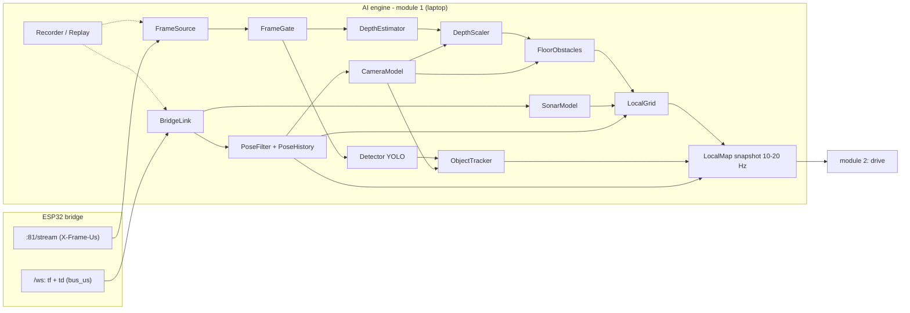

# Conqueror AI Engine — Module 1: Sensor Fusion and the Space Map (Design Spec 7)

Status: DRAFT for owner review · Date: 2026-10-20 · Depends on: Spec 1 (protocol), Spec 2 (tank firmware, bridge), bridge LLD (R4 motion service, R5 debug stream, R15 structure)
Decisions: design-notes §107. Research: `docs/research/2026-10-20-ai-landscape.md`, `docs/research/2026-10-20-module1-mapping.md`.

> **Relation to Spec 4.** The AI engine is reopened (design-notes §107): the tank must **drive smoothly and navigate a room**, not "drive, stop, take a picture, think". The engine is split into three modules — **(1) sensor fusion + space map** (this spec), **(2) drive** (a local planner), **(3) plan** (path, behaviours, exploration; a language model only on top). This spec replaces Spec 4 §2.1–§2.3 (frame ingest, perception, world model) for navigation; the rest of Spec 4 is revisited with modules 2 and 3.

## 1. Purpose and scope
Module 1 answers two questions 10–20 times a second: **where is the tank** (position and heading in the room) and **what is around it** (free floor, obstacles, and named things such as a person or a ball, with their room positions). Its output feeds module 2, which steers.

**In scope:** the AI engine's link to the bridge (read only), the bridge changes for time stamps, the pose filter, the camera model and calibrations, object detection and tracking, depth and free floor, the ultrasonic, the rolling grid, recording and replay, a live view, the measurement test and the acceptance numbers.

**Not in scope:** driving (module 2 — module 1 never sends a motion command), planning and language (module 3), a remembered room map and wall markers (later), a ToF sensor (later; it replaces the ultrasonic, §107).

## 2. Sensors and what each gives

| Sensor | Gives | Rate | Weak spots | Role in module 1 |
|---|---|---|---|---|
| Camera OV3660 (pan / tilt head) | pictures: objects, directions, depth guess | ~10–20 fps MJPEG over WiFi, QVGA–HD | blur when turning, low light, narrow view, blind zone in front of the tracks | objects, free floor, obstacles |
| Ultrasonic (front) | one true distance ahead | 20 Hz, 2–400 cm | wide cone; **no echo from fabric**, slanted surfaces | "blocked at d", cross-check of the depth scale |
| Gyro MPU6050 | heading, turn rate, tilt | 50 Hz | slow drift (bias) | heading in the pose filter; blur gate |
| Encoders (both tracks) | distance per track | 50 Hz | slip in turns; one channel (direction from the command) | distance in the pose filter; standstill detection |

The Uno's safety rules (obstacle brake on the ultrasonic, deadman, tilt / lift, battery, stall) stay as they are and **never depend on module 1**.

## 3. Bridge changes (one clock for pictures and telemetry)
- **Frame stamp:** each MJPEG part carries `X-Frame-Us: <µs>` — the frame's capture time (esp32-camera stamps the frame at VSYNC with the ESP32 timer) — and `X-Frame-Seq: <n>`.
- **Telemetry stamp:** the bridge stamps each Uno telemetry frame **when it arrives on the UART** with the same ESP32 timer and passes it on as `bus_us` in `tf` and `td`. Pictures and telemetry then share one clock; pairing needs no WiFi clock sync. (`tank_ms` stays — it is the Uno's own clock.)
- **Pong:** `pong` also carries `bridge_us`, so the laptop can estimate the clock offset (lowest-round-trip samples) for "how old is this" and latency checks.
- **Telemetry the engine reads:** `tf` (heading, turn rate, pitch / roll, `dist_cm`, `pan` / `tilt`, `spd_cmd`) and the debug stream `td` at 50 Hz (encoder counts and track speeds, bridge LLD R5). The AI engine is the second camera viewer (the stream allows two: phone + AI).
- No change to the Uno, the protocol frames to the Uno, or the safety rules.

## 4. Architecture

**Parts** (pure parts are host-tested without models or a tank):

| Part | Job | Pure |
|---|---|---|
| `BridgeLink` | WebSocket client: `hello`, `debug` 50 Hz, pings; parses `tf` / `td` / `pong`; reconnects; **never sends motion** | no (I/O) |
| `Clock` | bridge µs ↔ laptop time (lowest-round-trip ping pairs) | yes |
| `FrameSource` | MJPEG reader; reads `X-Frame-Us` / `X-Frame-Seq`; newest frame wins (frames are dropped, never queued) | no (I/O) |
| `PoseFilter` | small filter with state x, y, heading, gyro bias; heading from the gyro, distance from the encoder average; encoder difference only a weak heading check (tracks slip); **re-learns the gyro bias whenever both encoders and the motor command are zero for > 0.3 s**; keeps a 2 s pose history and interpolates the pose at any time | yes |
| `CameraModel` | lens (intrinsics, distortion), mount (height, position on the tank), pan / tilt from telemetry → pixel ↔ floor point; the **expected floor depth** for every pixel; the camera's view on the floor (for "seen now") | yes |
| `FrameGate` | pose at **capture time** = `X-Frame-Us` + half the readout time (measured); skips or down-weights frames while the turn rate is above a threshold (blur, rolling shutter) | yes |
| `Detector` | YOLO (CoreML, Neural Engine) → boxes, classes, scores | no (model) |
| `ObjectTracker` | a light image tracker (ByteTrack) for IDs; each box's floor contact → room position (the **floor trick**); a small Kalman filter per object **in room coordinates**; objects stay when they leave the view, grow uncertain, and are dropped after a time or when the camera looks at the spot and does not see them | yes (tracker logic) |
| `DepthEstimator` | Depth Anything V2 Small (CoreML) → relative depth image | no (model) |
| `DepthScaler` | fits scale + shift of the depth image **on floor pixels** against the expected floor depth (the floor is the main scale anchor); the ultrasonic is a cross-check straight ahead | yes |
| `FloorObstacles` | a pixel nearer than the floor should be there (by a margin) is an obstacle; per image column the nearest obstacle inside a height band (≈ 2 cm … tank height) → a "pseudo-scan" of distances and directions | yes |
| `SonarModel` | ultrasonic inverse model: a valid echo → "blocked at d" on an arc, free only in a narrow inner cone; **"no echo" or max range never marks anything free** | yes |
| `LocalGrid` | 3 × 3 m around the tank, 5 cm cells, log-odds; obstacles marked to ~1.5–2 m, free space cleared to ~3 m; **old marks fade only in cells the camera sees now** (the blind zone keeps its memory); moves with the tank | yes |
| `Recorder` / `Replay` | records raw MJPEG and stamped telemetry; replays a session through module 1 exactly; logs to Rerun for viewing | partly |
| `LiveView` | Rerun viewer: camera with boxes and obstacles, depth, the grid, the pose path, objects | no |

**Output to module 2 — `LocalMap`** (10–20 times a second): the grid (with its origin and pose), the tank's pose and speed, tracked objects (class, room position, uncertainty, last seen), the pseudo-scan, the input ages, and a **`stale` flag** — set when the newest frame is older than 0.5 s or telemetry is older than 0.2 s; module 2 must stop driving on a stale map.

## 5. Calibrations (once, stored in a YAML file)
1. **Lens:** photograph a printed checkerboard from ~20 angles (OpenCV) → focal length, centre, distortion — per frame size used.
2. **Mount:** camera height above the floor, its position on the tank, the tilt at the servo's centre; checked by fitting the floor in a picture of an empty floor.
3. **Servos:** servo value → real pan / tilt angle at a few points.
4. **Readout time:** for the half-readout correction (measured in phase 0).
A small calibration tool guides each step and writes the file; the engine refuses to build a map without it.

## 6. Engine and tools
- `ai-engine/` (Python 3.12, uv, ruff, pyright strict, pytest — coding standards); asyncio for I/O, models in worker threads (never on the event loop); domain parts pure (`domain/`), models and I/O behind ports (`ports/`, `adapters/`) as Spec 4 §8.1.
- Models: Ultralytics YOLO (n) exported to CoreML; Depth Anything V2 Small (Apple's CoreML build). AGPL (Ultralytics) accepted for this hobby project.
- Rerun for recording, replay and viewing.

## 7. Numbers it must reach (targets, confirmed or adjusted by phase 0)

| What | Target |
|---|---|
| Map updates | ≥ 10 per second on the M1 with YOLO + depth running together |
| Laptop processing (frame arrives → map out) | ≤ 100 ms; total age of the map ≤ 0.4 s |
| **Obstacles wrongly marked free within 1 m** (camera in view; boxes, walls, furniture ≥ 10 cm tall, people) | **0** in the acceptance runs |
| Chair legs, cables, socks | measured and reported (camera limit; the real fix is the later ToF / line laser) |
| Floor-object distance (floor trick) | ≤ 5 cm up to 1 m, ≤ 15 cm at 2 m |
| Pose drift | ≤ 3 % of the distance over a 5 m lap; heading ≤ 3° per 360° turn (after the standstill bias update; after the road-wheel fix) |
| Object memory | a ball that leaves the view is still listed with its position for ≥ 10 s |

## 8. Testing
- **Host tests** (pytest, no tank, no models): pose filter (straight, turns, slip, bias re-learning), clock offset, camera model (pixel ↔ floor round trips), frame gate, depth scaler (synthetic depth with a known scale), floor obstacles (synthetic scenes), sonar model (never clears on no echo), grid (marking, clearing, fading only in view, moving with the tank), object tracker (leaves view, comes back, expires).
- **Replay tests:** recorded sessions on the owner's floor (wood, rug) with tape-measured obstacles; the numbers of §7 are computed from replays, so every change is measured the same way.
- **On the floor** (owner present, STOP in hand, slow speeds; module 1 only watches — the tank is driven by the phone): acceptance runs past boxes, a chair, a sofa, a ball, a person.

## 9. Phases
0. **Measurement test** (throwaway code; numbers kept): camera delay and frame rate per size; the OV3660 readout time; the Neural Engine budget with YOLO + depth together on the M1; depth error against tape on wood and rug; ultrasonic no-echo rate on fabric; gyro drift; camera height / tilt and the blind-zone length.
1. Bridge time stamps (§3) + `BridgeLink`, `FrameSource`, `Clock`, `Recorder` / `Replay`, live view.
2. Calibration tool and `CameraModel`.
3. `PoseFilter`.
4. `Detector` + `ObjectTracker`.
5. `DepthEstimator` + `DepthScaler` + `FloorObstacles`.
6. `SonarModel` + `LocalGrid` + `LocalMap` output.
7. Acceptance on the floor (§7).
**Experiments** (kept only if replay shows a gain): YOLOE for small named things (cable, sock, shoe); Depth Anything V2 Metric-Hypersim-Small converted to CoreML instead of relative depth + floor fit.

## 10. Open questions
- Exact camera height, tilt and blind-zone length (phase 0).
- Which frame size gives the best detection-versus-delay (QVGA or VGA).
- Whether YOLO + depth together keep ≥ 10 Hz on the base M1 (phase 0); if not, depth every second frame.
- How the AI engine becomes a driver on the bridge (module 2's spec).
