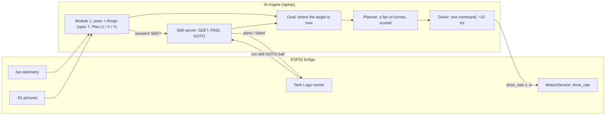
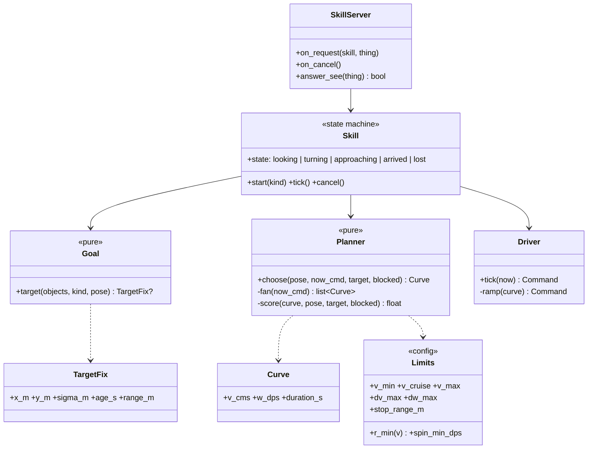
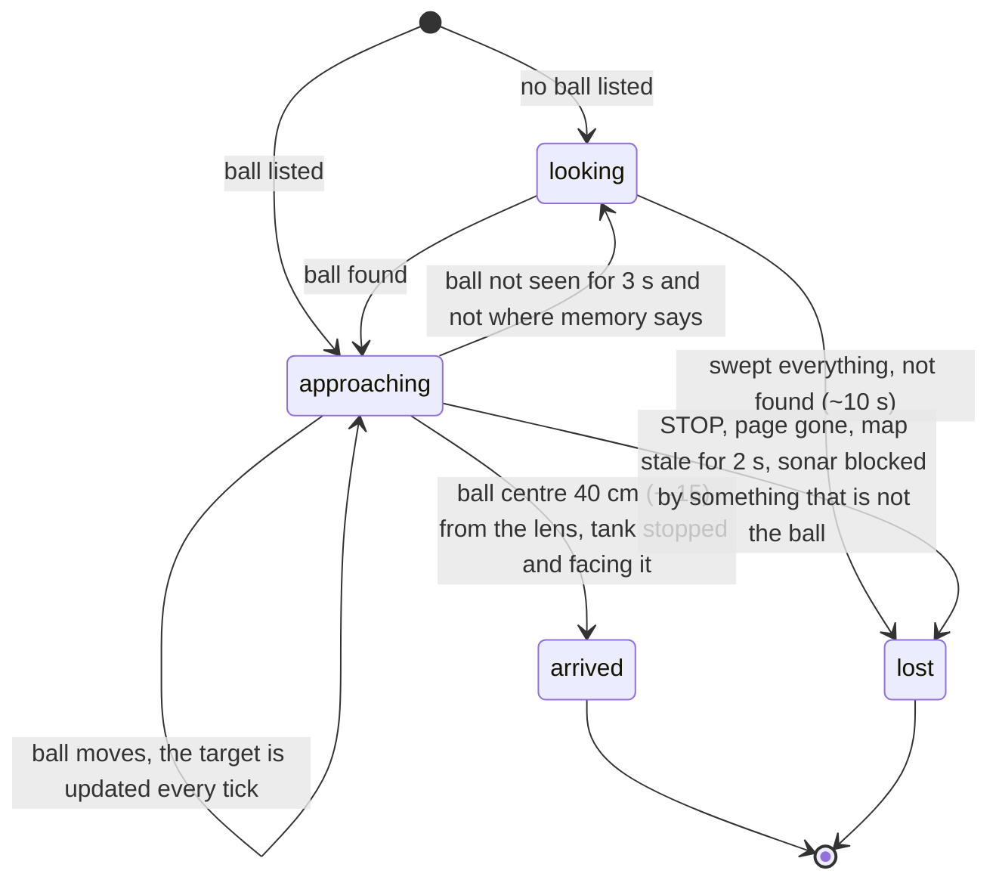

# Drive while thinking: module 2, slice 1 "chase the ball" (Design Spec 8)

Status: **DRAFT for owner review** · Date: 2026-10-25 · Decision record: `docs/design-notes.md` §156 · Guided by spec 0 §1.1 (what the platform is for)

## 1. Goal

**The end goal (owner, 2026-10-25):** the tank must not move like most hobby robots: drive, stop, look, think, drive again.
- While it drives it keeps looking and keeps adjusting its path.
- A toy or an obstacle ahead is passed in **one smooth move**, without stopping.

That is how robot vacuums and self-driving cars move: they think while driving.

**This spec does three things:**
1. It sets the **architecture for module 2 ("drive")**: the AI engine on the laptop becomes a careful driver, using a "drive while thinking" loop. Spec 7 left module 2 open.
2. It specifies **slice 1, "chase the ball"**, end to end:
   - the driver loop;
   - just enough loose naming ("a ball");
   - the first vision words in Tank Logo, so a child can write it.
3. It lists **what later slices add**. Each later slice gets its own spec.

**The slices (owner: thin slices, chase the ball first; design-notes §156):**
1. **Chase the ball:** this spec.
2. **Explore without bumping:** the depth layer, the camera angle estimator (design-notes §155) and the local grid (spec 7 phases 5–6). The same loop then curves around things in the map.
3. **Follow a person.**
4. **Go to a named thing.**

Slices 3 and 4 are the same loop with a different goal.

**Principles that apply here** (spec 0 §1.1):
- **Fun first:** a child writes one word, and the robot moves like a real one.
- **Play tolerances:** about ±15 cm is fine; smooth matters more than exact.
- **General before special:** one loop for every behaviour, not one routine per behaviour.
- **Safety is never traded:** the Uno's brakes, the deadman, STOP and the child-play limits stay exactly as they are.

## 2. What the tank can physically do (measured, design-notes §69–§71, §114)

| What | Value |
|---|---|
| Speed band (straight) | ~18 cm/s (lowest smooth track speed) … ~33 cm/s (full power) |
| Tightest smooth curve | ~31–38 cm radius, depending on speed (spec 02 Part H) |
| Slowest smooth spin in place | ~65 °/s |
| Smooth steering command | bridge `drive_rate`: speed % and turn rate °/s, streamed ≤ 20 Hz, gyro-held on the bridge (bridge LLD R4.4) |
| Deadman | a streamed drive not refreshed for 0.3 s stops the tank |
| Camera | ~82° wide; a blind strip of floor ~25 cm in front at the driving tilt; pan ±90°, tilt −20…+60° |
| Picture age when used | ~80 ms arrival + ~40 ms detection |

The planner works inside these limits. It never asks for a curve, speed or spin the tank cannot do smoothly.

## 3. Architecture: the drive-while-thinking loop



**Each tick, about 10 times a second (on each new picture, at least every 0.2 s):**
1. **Where am I, where is the target?** The pose filter (Plan U) gives the tank's pose now. The object list (Plans V and Y) gives the target's room position, even when it has just left the view or is in the blind strip. The picture's lag is covered: the pose history places what was seen 0.1–0.2 s ago, and the plan starts from the pose now.
2. **Imagine a fan of curves** about 1.5 s ahead, from the current command:
   - straight, plus gentle, medium and tightest arcs to each side (radius ≥ the tightest smooth curve for that speed);
   - each at cruise, slow and stop speed;
   - a smooth spin in place when the target is well off to one side (> 35° off): the tank turns on the spot first, then drives in. (The first draft said > 70°; on the floor the tightest arcs, 30-50 cm, swept past a ball 40° off at 80 cm, design-notes §157.)
3. **Score each curve:**
   - **progress:** how much nearer the target it ends, and how well it ends facing it;
   - **clearance:** distance to anything known in the way. In slice 1 that's the sonar's echo, unless the echo is the target itself. From slice 2 it's the local grid;
   - **smoothness:** how close it is to the current command. Changes in speed and turn rate cost, so the path flows instead of twitching.
4. **Send the winner as one `drive_rate`**: speed plus turn rate. The bridge's gyro loop holds the turn rate between ticks.
5. **Ramps:** speed changes by at most ~10 cm/s per second, turn rate by at most ~60 °/s per second. Whatever the planner picks, the tank never jerks.

**When the way is tight, slow down; stop only if every curve is blocked.**

The Uno's obstacle brake stays the last safety net, unchanged. The planner keeps its own margin so the brake rarely fires: a firing brake is the one jerky moment we accept, because it means something unexpected happened.

**The camera looks into the turn, like a driver's eyes.**
- While driving, the camera's pan follows the target's direction (limited to ±60°), so the target stays in view through a curve, at the driving tilt (15° down).
- The Uno smooths the servo (Plan W). Pictures taken while the pan moves fast are skipped for the map (Plan V's gate), but the pose and memory carry the loop through.

### 3.1 Parts



- **Pure and host-tested:** `Goal`, `Planner`, `Limits` and the ramp in `Driver`. A **simulated tank** (the pose model driving the commanded curves) replays whole runs on the laptop with no tank, so smoothness can be measured in tests.
- **I/O:** `SkillServer` (the WebSocket to the bridge) and the `drive_rate` sender.

## 4. Slice 1: chase the ball

### 4.1 What "the ball" is (just enough loose naming)
- **The kind "ball"** means any `ball:<colour>` thing, or a YOLO-World `ball` or `toy`. This is a small first step of slice-wide loose naming (similar words as one kind).
- **The target** is the nearest confirmed thing of that kind. Once chosen, the tank keeps the same thing (its number) while it's listed. It doesn't hop between two balls.
- **Distance to the ball comes from two clues, the better one winning:**
  - **the floor trick:** good to ~±15 cm at 1 m, but affected by the camera tilt drift (design-notes §153 follow-up) until slice 2's camera angle estimator;
  - **the ball's size in the picture:** `size_cm × fx / (2 r)`, which doesn't depend on the tilt at all. The green ball's size is calibrated (`balls.yaml`).
- **Up close, the sonar:** when the ball is straight ahead and within the sonar's range, a sonar echo at the ball's distance is the ball, not an obstacle.

### 4.2 The behaviour, as a state machine


- **looking:**
  1. The camera sweeps first: pan −90° … +90° at the driving tilt. The tank doesn't move, so finding something already in front costs nothing.
  2. If the ball isn't found, the tank spins slowly (~65 °/s) one full turn while the camera looks straight ahead.
  3. If it's still not found, the result is "not found".
- **approaching:** the drive-while-thinking loop with the ball as the goal.
  - Speed: cruise ~25 cm/s; from ~80 cm, slowing to ~18 cm/s; then a gentle stop at ~40 cm from the lens. That's about 15 cm before the camera's blind strip, so the ball is still in view when the tank stops.
  - A ball that rolls (a child kicks it) is followed: the target is updated every tick, and the curve bends toward where it is now.
- **arrived:** stopped, facing the ball within ~10°.
- **lost:** the tank stops, and the skill reports why: not found, lost from view, blocked, stopped, or the map stayed stale for 2 s. A stale map (no picture for 0.5 s or no telemetry for 0.2 s, spec 7 §4) stops the tank at once; it drives on when the map is fresh again (a short WiFi gap ended floor chase 6 a second before it arrived, design-notes §157.2).
- **Nudging the ball** (driving into it gently) comes later, once the brake behaviour near a ball is understood; slice 1 stops before it.

### 4.3 The words a child writes (Tank Logo, spec 5 §3.5, extended)

| Word | Kind | Meaning |
|---|---|---|
| `SEE? "ball` | question | true if a ball is listed now and was seen in the last 0.5 s |
| `FIND "ball` | action | look around (§4.2 looking); ends facing it, or the program gets "not found" |
| `GOTO "ball` | action | drive to it in one smooth move (§4.2 approaching); ends at it, or "lost" |
| `HOWFAR "ball` | value | the ball's distance from the lens in cm (−1 if not listed) |

- **`GOTO`, not `GO TO`:** `TO` already starts a procedure in Logo, and `GO` already means "drive until" (Revision 3).
- **`HOWFAR`, not `DISTANCE "ball`:** `DISTANCE` is already the sonar's word (no input). `HOWFAR` pairs with `HOWMANY`.
- These are **level 2 (Explorer)** words. `SEE?` and `FIND` move down from level 3, where `words.yaml` had them. They're "AI words": a program using them needs the AI engine running.
- **A program a child might write:**
  ```
  FIND "ball
  GOTO "ball
  SOUND FANFARE
  ```
  Or, with the existing `GO`:
  ```
  GO  WAIT UNTIL SEE? "ball  HOLD
  GOTO "ball
  ```
- **What isn't in slice 1:** `FOLLOW` (slice 3) and `HOWMANY` (later). Words for things other than balls come with slices 3–4; slice 1's words accept only `"ball`.

### 4.4 Where the program runs (a change to spec 5 §6, for owner review)
Spec 5 §6 says AI programs run in an AI-engine runner. Revision 2 then put the only parser and compiler on the ESP32 ("no Python copy of the parser"). Those two don't fit together. **This spec resolves it:**
- **Every program, core or AI, runs on the ESP32's runner.** There is one parser, one runner, one STOP path, and the `/logo` page shows the run the same way.
- **The AI engine is the robot's eyes and its careful driver.** It registers with the bridge as the **skill server**:
  - a question word (`SEE?`, `HOWFAR`) asks the engine and waits briefly (≤ 0.3 s; no answer means "false" / −1);
  - an action word (`FIND`, `GOTO`) hands the engine the skill. The program waits; the engine drives with `drive_rate`; the engine reports `done` or `failed` with a reason.
- **While a skill runs, the runner gives the engine a drive lease.**
  - The bridge accepts the engine's `drive_rate` only during the lease, as part of the program's run.
  - STOP from any device, the page going away, the program ending, or the lease's 0.3 s refresh lapsing all end the lease and stop the tank.
  - The engine never drives otherwise.
- **No AI engine connected:** the word fails with the plain message of spec 5 §6 ("This program needs the AI helper to see things…").
- **For testing without Logo**, the engine also runs a skill from the command line: `cq-drive goto ball`. It takes control the way the phone does, and STOP from any device ends it.

## 5. Safety (unchanged rules, new checks)
- **Nothing on the Uno changes.** The obstacle brake, deadman, link-loss stop, stall, tilt, battery and child-play limits all still apply. Every `drive_rate` passes the Uno's safety supervisor like any other command.
- **New refusals in the engine:**
  - no driving on a stale map;
  - no driving without a pose;
  - a speed cap of 25 cm/s in slice 1;
  - stop when the target is lost for 3 s;
  - stop when the sonar shows something closer than 30 cm that isn't the target.
- **The deadman is the backstop:** if the laptop, the WiFi or the engine hangs, the tank stops within 0.3 s.
- **Floor checks:** only with the owner present and STOP in hand, on open floor, at the slice's capped speed.

## 6. Pass marks (floor checks, play tolerances)
1. **One smooth move:**
   - from start to arrival the tank never stops;
   - the commanded turn rate changes by no more than the ramp (§3);
   - by eye, one flowing curve, no stop-and-go;
   - measured from the recorded `drive_rate` stream and telemetry.
2. **Arrives:** stopped at 40 ± 15 cm from the lens to the ball's centre (tape), facing it within ~10°. Tried from four starting directions: ball straight ahead, 45° left, 90° right, behind.
3. **Ball rolled away mid-approach:** the tank bends toward its new place without stopping.
4. **Finds it:**
   - a ball behind the tank is found (the camera sweep, then the slow spin) and reached;
   - with no ball in the room, the result is "not found" within ~15 s.
5. **Stays safe:** STOP from the phone during a `GOTO` stops it at once, and the program ends. A box placed in the path: the tank slows and stops before it (sonar), or the Uno brake fires. The tank never touches the box. Avoiding it smoothly is slice 2.
6. **The child's program** (`FIND "ball  GOTO "ball  SOUND FANFARE`) runs from the `/logo` page.

## 7. Testing
- **Host tests (no tank, no model):**
  - the planner's fan respects the limits (no curve under the tightest radius, no speed under v_min except stop);
  - the scores pick the obvious curve in drawn scenes;
  - the ramp;
  - the state machine: every transition;
  - the drive lease rules on the bridge, host-tested in C++.
- **Simulated runs:** the simulated tank drives to a ball from the four start directions, so pass marks 1–2 (smoothness, arrival) are checked in tests before the floor.
- **Replay:** recorded floor runs feed the loop offline, to tune scores without the tank.

## 8. What later slices add (each its own spec)
- **Slice 2, explore without bumping:**
  - the depth layer: "something is there", from Depth Anything V2 Small;
  - the camera angle estimator (design-notes §155);
  - the local grid (spec 7 phases 5–6);
  - clearance from the grid, so the same loop curves around a toy;
  - a wander goal.
- **Slice 3, follow a person:** the goal is a person, kept at ~1 m; `FOLLOW "person`.
- **Slice 4, go to a named thing:** loose names for the vocabulary (similar words as one kind); `GOTO "chair`.
- **Later:**
  - nudging the ball;
  - `HOWMANY`;
  - the slow smart look (a vision-language model);
  - lessons: example programs for each level.

## 9. Open questions (to settle in the LLD)
- The speed % ↔ cm/s table for `drive_rate` (the dead-band lift makes it non-linear; measure on the floor).
- The exact score weights, tuned in simulation and replay.
- Whether the camera's pan-follow causes too many "camera moving" skips at 10 Hz. If so, the pan follows in steps only when the target nears the picture's edge.
