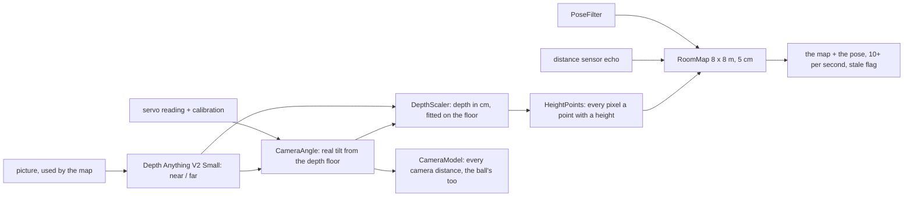

# Explore without bumping: module 2, slice 2 (Design Spec 9)

Status: **DRAFT for owner review** · Date: 2026-10-27 · Decision record: `docs/design-notes.md` §159 · Builds on spec 7 (the map, phases 5–6) and spec 8 (the drive-while-thinking loop) · Guided by spec 0 §1.1 (what the platform is for)

## 1. Goal

**Slice 2 (spec 8 §8):** the tank drives about a room on its own and **never bumps into anything 10 cm or taller**: boxes, walls, furniture, people, and things that hang over the floor such as a bed edge.

**What it does, in the owner's order (design-notes §159):**
1. **Wander:** drive about, turn away from what it meets, until a given time is up or until stopped.
2. **Visit everything:** go where it hasn't seen yet, until nothing unseen is left, then stop.
3. **Find X** comes **for free**: wander or visit everything until the detector confirms X, then hand over to the chase from slice 1.

**And the chase gets better:** a box between the tank and the ball is driven around (slice 1 ended `blocked`), and every distance from the camera, the ball's included, uses the camera's real angle.

**Principles that apply here** (spec 0 §1.1):
- **Fun first:** a child sees the tank roam a room without hitting things, then go and find the ball.
- **Real robotics inside:** depth from one camera, a map that remembers, a global route plus smooth local driving. These are the standard parts of a real mobile robot, and each is visible in the live view.
- **Loose tolerances:** ±15 cm across a room is fine.
- **General before special:** no "bed rule"; anything at the tank's height is an obstacle, standing or hanging.
- **Safety never traded:** every existing stop stays; the map can never overrule the distance sensor.

## 2. Decisions (owner, 2026-10-27, design-notes §159)

| Question | Decision |
|---|---|
| What "explore" means | wander first, then visit everything; find comes for free |
| Where it may go | the whole room, as far as it can see; **no fence for now** (a fence around the start, or drawn on the phone, is decided later) |
| Overhangs (the bed) | marks carry a height; anything **2–20 cm above the floor** is an obstacle; the distance sensor may clear only low marks |
| How wandering ends | after a time if given (e.g. `WANDER 60`), otherwise when stopped |
| The map | **one room-sized map fixed where the tank started**, 8 × 8 m, 5 cm squares; it replaces spec 7's 3 × 3 m grid that moves with the tank |
| Finding the way | **a route on the map, followed by the fan of curves** (approach B); planning the whole smooth path at once (C) is for later |

## 3. Seeing: obstacles and the room map (laptop, module 1)



1. **Depth picture:** Depth Anything V2 Small (CoreML, ~32 ms per picture on the M1's neural chip, design-notes §109) on each picture the map uses. Its output is relative ("nearer or farther").
2. **The camera's real angle** (`CameraAngle`, design-notes §155):
   - the flat floor in the depth picture gives the tilt to about ±0.7°, with the fixed 4.1° correction;
   - it starts from the servo reading + calibration, and is averaged over ~1 s;
   - **every distance from the camera uses it**, the ball's included.
3. **Depth in centimetres** (`DepthScaler`, spec 7): with the camera's height and real tilt, each floor pixel's distance is known; the depth picture's scale and shift are fitted to the floor, picture by picture.
4. **Height of every point** (`HeightPoints`): each pixel becomes a point in the room with a height above the floor:
   - **under 2 cm:** floor, "seen and free";
   - **2–20 cm:** an obstacle, marked **low** (standing on the floor) or **high** (hanging, like a bed edge);
   - **over 20 cm:** passable under, "seen", not an obstacle.
   - Obstacles are trusted out to ~2 m, free floor out to ~3 m.
5. **The distance sensor** (`SonarModel`, spec 7): an echo marks "something low at this distance", and the narrow cone before it free; it **clears only low marks, never high ones**; no echo or the maximum range clears nothing.
6. **The room map** (`RoomMap`):
   - 8 × 8 m, 5 cm squares (~26 000), fixed where the tank started;
   - each square: how sure we are something is there (log-odds), low or high, and "seen";
   - old marks fade **only in squares the camera sees now**; the blind zone keeps its memory;
   - its edge counts as a wall (a soft fence);
   - pose drift (~3 % of the distance, ~15 cm across a 5 m room) is accepted.
7. **Pictures** taken while the camera moves or the tank turns faster than 45 °/s are skipped, as now.
8. **Output to the drive:** the map and the tank's pose, 10 or more times a second, with the **stale flag** (no picture for 0.5 s, no telemetry for 0.2 s); a stale map pauses the drive (spec 8, design-notes §157.2).

## 4. Driving: goals, routes and the fan (laptop, module 2)

```mermaid
sequenceDiagram
  participant G as Goal (wander / explore / chase / find)
  participant R as RoutePlanner
  participant F as Planner (the fan, slice 1)
  participant L as DriveLink
  G->>R: destination on the map
  R-->>F: route; aim point ~50 cm along it
  F-->>L: smooth curve, checked against the map
  Note over G,L: every tick (5-10 per second); route and destination worked out again each time
```

1. **A goal picks a destination:**
   - **wander:** a spot in open floor ~1.5–2 m away, preferring roughly straight ahead; a new one every few seconds or when near; a little random;
   - **visit everything:** the nearest edge between seen floor and unseen space; unseen bits under 30 cm are ignored; none reachable → done;
   - **chase:** the ball (slice 1);
   - **find X:** wander or visit everything until the detector confirms X, then the chase.
2. **A route on the map** (`RoutePlanner`):
   - around every marked square, keeping the tank's centre **~15 cm** from obstacles (half its width + a margin);
   - unseen squares allowed at a higher cost (the camera sees them before the tank arrives);
   - worked out again every tick.
3. **The fan of curves** (slice 1's `Planner`) aims at a point ~50 cm along the route; each curve is checked against the map (this replaces the sonar-only clearance); the sensor's 30 cm hard stop stays.
4. **The camera** pans toward the route's direction at the driving tilt (−15°).
5. **No route:** turn on the spot to look around; still none → wander picks another destination, visit everything ends `done`, the chase ends `blocked`.
6. **Unchanged from slice 1:** the 25 cm/s cap; turning on the spot beyond 35°; the stale-map pause; STOP and Ctrl-C.
7. **How it's run:** `cq-drive wander [seconds]`, `cq-drive explore`, `cq-drive find <thing>`, and `cq-drive goto <thing>` now with routes. The Tank Logo words (`WANDER`, `EXPLORE`, …) join Plan Z2's words later.

## 5. Safety

**Unchanged:** the Uno's 15 cm brake; the bridge's deadman; STOP from the phone; Ctrl-C; pushing but not moving (Plan R3, ~2 s); the 25 cm/s cap.

**New rules:**
1. **The distance sensor has the last word:** an echo under 30 cm that isn't the target stops the tank, whatever the map says.
2. **The map never invents free space:** no echo clears nothing; the sensor can't erase high marks; unseen is never "known free".
3. **A wrong camera angle can't mislead it for long:** if the depth angle moves more than **3°** from the servo reading, the servo reading is used and the tank drives at **18 cm/s** until they agree again.
4. **Depth fails** (no model, too slow): marks from the distance sensor only, 18 cm/s, **visit everything refuses to start**, with a clear message.
5. **Known limits, not promised:** drops (stairs, a step edge), very thin things (chair legs, cables, socks), glass and mirrors. Floor runs: the owner present, STOP in hand.

## 6. Pass marks (floor checks, play tolerances)

1. **Camera angle** within **1°** of the tape-measured truth (the §155 method), in two places.
2. **No obstacle 10 cm or taller wrongly free within 1 m** (spec 7's target), including **an overhang at ~18 cm** (a board across two boxes).
3. **Wander 2 minutes** in a room with boxes, a chair and the bed: **no touches**, smooth driving; a firing of the Uno brake is logged as a near miss.
4. **Visit everything** covers **≥ 80 %** of the reachable floor, then stops.
5. **The chase with a box in the path** ends `done`, around it.
6. **Find the ball** out of sight at the start: `done`.

## 7. Testing (on the laptop, no tank)

- Made-up depth pictures with a known tilt, box and overhang → the right tilt, distances and heights.
- The sensor rules: an echo marks; no echo clears nothing; a high mark is never cleared.
- Fading only in view.
- Routes on drawn maps: around a box, out of a U-shape, no route.
- Goals: wander keeps moving; visit everything finds the nearest unseen place and ends when none is left.
- Simulated drives in a simulated room with boxes: **never closer than 15 cm**.
- Replays of recorded floor runs measure §6's numbers the same way every time.

## 8. Plans (built and floor-checked in order)

| Plan | Builds | Seen when done |
|---|---|---|
| **Z3: seeing** | depth, `CameraAngle`, `DepthScaler`, `HeightPoints` | the live view's depth picture and obstacles by height; better ball distances |
| **Z4: the room map** | `SonarModel`, `RoomMap`, the output with the stale flag | drive by phone and watch the map fill in, the bed edge marked high |
| **Z5: driving on the map** | `RoutePlanner`, the fan on the map, wander / explore / find, the chase around obstacles | `cq-drive wander`, `explore`, `find ball` |

Plan Z2 (the Tank Logo words + the drive lease, spec 8) stays on the list.

## 9. Later (each its own decision)

- **C:** planning the whole smooth path at once.
- **The fence:** a circle around the start, or drawn on the phone.
- **A fast camera mode** for the laptop's moves (design-notes §158).
- **Drops:** a downward sensor or the depth floor's edge.
- **Better thin-object sensing** (spec 7: a ToF / line laser).

## 10. Open questions (to settle in the LLD)

- Depth picture size and rate together with YOLO-World at VGA (phase 0 measured 22–26 maps/s with YOLO26n; YOLO-World is heavier); depth every second picture if needed.
- The tank's highest point: if it is over ~17 cm, the 20 cm limit rises to the top + 3 cm (design-notes §159).
- Log-odds steps, fade rate and the "seen" rule; how the route's cost grows near obstacles and through unseen squares.
- How wander's destination is picked (open-floor score, randomness, how often).
- The route search's speed in Python on a 160 × 160 map (worked out each tick).
