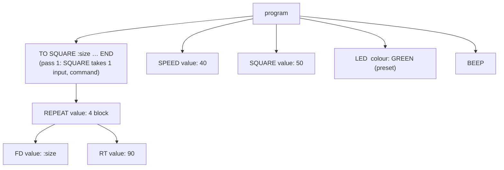
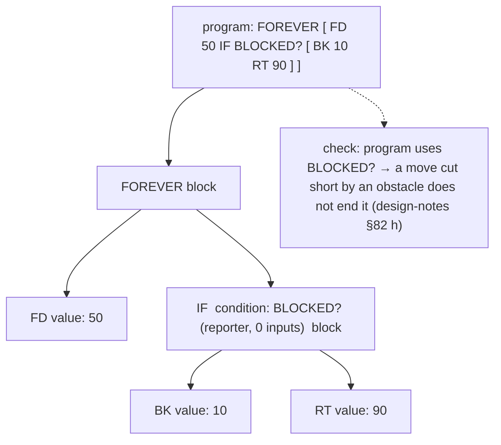

# Tank Logo — grammar (v2)

Status: **DRAFT for owner review** · Date: 2026-10-19 · Decisions: `docs/design-notes.md` §81–§83 · Spec: `docs/superpowers/specs/2026-10-11-05-tank-logo-design.md` Revision 2
Words and their inputs: `logo/spec/words.yaml` (single source of truth). Test cases: `logo/spec/tests/`.

The ESP32 bridge is the only program that reads Tank Logo (design-notes §83): it tokenises, parses, checks and compiles the source text, and answers the editor with errors and the planned path. Everything here is what that reader must do, exactly.

## 1. Levels
One language; every word has a level in `words.yaml` (1 Starter, 2 Explorer, 3 Expert). The level only tells the editor what to show first — the reader accepts every word at every level. **v1 builds levels 1–2 plus `OUTPUT`** (it needs no lists, so your own words can give back values from the start, design-notes §82); the other level-3 words — lists and `MAP` `FILTER` `REDUCE` `FOREACH` — are **reserved** in v1 (using one gives `PROGRAM_7030` "FIRST arrives in a later version") and built in v1.1.

**List literals are in v1.** A list written in the program (`LED [255 128 0]`, `LOOK [30 -10]`, `PLAY [C4 E4]`, `SAY [well done]`, an input to your own word) is a constant: it is stored with the compiled program, can be passed around, given to `LED` `LOOK` `PLAY` `SAY` and compared with `=` — so v1 accepts `[ ]` data lists everywhere the grammar allows them. What waits for v1.1 is **building and taking lists apart** at run time (`FIRST` `LIST` `FPUT` `MAP` …), which is what needs the memory pool and garbage collection. v1 therefore has no list pool and no garbage collector.

## 2. Tokens (lexical rules)
The reader works on the source text as UTF-8; only ASCII is meaningful outside comments and quoted words.

| Token | Rule | Examples |
|---|---|---|
| whitespace | spaces, tabs, line breaks — separate tokens, otherwise meaningless (statements end by input counting, §4) | |
| comment | `;` to the end of the line | `; draw a square` |
| NUMBER | digits, optionally `.` and more digits; a leading digit is required | `50` `2.5` `0.25` (not `.5`) |
| NAME | a letter, then letters, digits, `_` or `#`, optionally ending in `?` | `FORWARD` `side_2` `OBSTACLE?` `C#5` |
| INPUT | `:` immediately followed by a NAME | `:size` |
| QUOTED | `"` immediately followed by characters up to whitespace, `[`, `]`, `(` or `)` | `"cat` `"Done!` `"DOUBLE` |
| `[` `]` `(` `)` | brackets | |
| operators | `+ * / = < > <= >= <>` | |
| MINUS | `-` with **no** whitespace before it, or whitespace on **both** sides | `10-5` `10 - 5` |
| NEG | `-` with whitespace (or `[`, `(`, start of text) before it and **none** after it | `-5` `-:x` |
| `?` `?1` `?2` | a lone `?`, `?1` or `?2` — the item placeholder inside a template (§7) | `[? * 2]` |

- **Case does not matter** for NAMEs and preset words (`forward`, `Forward`, `FORWARD` are the same). QUOTED words keep their case for `SAY`, but compare case-insensitively with `=`.
- Limits: NAME and QUOTED ≤ 32 characters; NUMBER between −1 000 000 and 1 000 000 with at most 3 decimals (values are 1/1000 fixed point on the tank). Longer / larger → `PROGRAM_7015`.
- Any other character → `PROGRAM_7016` "I don't understand the character `@` on line 3."

## 3. Grammar (EBNF)
`{ x }` = zero or more, `[ x ]` = optional, `|` = or. Upper-case quoted words are keywords; WORD(k) means "a word from `words.yaml` with k inputs".

```ebnf
program      = { definition | statement } ;

definition   = "TO" NAME { INPUT } { statement } "END" ;          (* only at the top level *)

statement    = control
             | "OUTPUT" value                                       (* only inside a definition *)
             | "STOP"
             | command ;

command      = WORD(k) input^k                                      (* a built-in command, k from words.yaml *)
             | NAME input^k ;                                       (* a call of your own word, k = its input count *)

control      = "REPEAT" value block
             | "FOREVER" block
             | "WHILE" condition block
             | "IF" condition block
             | "IFELSE" condition block block
             | "WAIT" "UNTIL" condition
             | "FOREACH" value template-block ;                      (* level 3 *)

block        = "[" { statement } "]" ;
template-block = "[" { statement } "]" ;                             (* may use ?, §7 *)

input        = value | preset | literal-list | template ;           (* which one: the word's input type, §5 *)

condition    = or-expr ;
value        = sum ;                                                (* inputs stop below comparisons, §6 *)

or-expr      = and-expr { "OR" and-expr } ;
and-expr     = not-expr { "AND" not-expr } ;
not-expr     = "NOT" not-expr | compare ;
compare      = sum [ ( "=" | "<>" | "<" | ">" | "<=" | ">=" ) sum ] ;
sum          = product { ( "+" | MINUS ) product } ;
product      = unary { ( "*" | "/" ) unary } ;
unary        = NEG unary | atom ;
atom         = NUMBER | QUOTED | INPUT | "TRUE" | "FALSE"
             | placeholder                                          (* ?, ?1, ?2 — only inside a template *)
             | reporter
             | "(" or-expr ")"
             | literal-list ;

reporter     = WORD(k) input^k                                      (* a built-in that gives back a value *)
             | NAME input^k ;                                       (* your own word that OUTPUTs *)

literal-list = "[" { NUMBER | NAME | QUOTED | NEG NUMBER | literal-list } "]" ;   (* data: nothing inside is run or looked up *)
template     = "[" or-expr "]" ;                                    (* a reporter template, §7 *)
placeholder  = "?" | "?1" | "?2" ;
preset       = NAME ;                                               (* LEFT, RED, HORN … — the word's preset set, §5 *)
```

## 4. Counting inputs (why there are no brackets around inputs)
Like classic Logo, every word takes a **fixed number of inputs**, so `FD 50 RT 90` is two statements: `FD` takes one input (`50`), then `RT` starts a new statement. A plain context-free grammar cannot say this on its own, because the number of inputs of **your own words** is only known from their `TO` line. The reader therefore works in **two passes**:

1. **Pass 1 — find the definitions.** Scan the tokens for every `TO NAME :a :b …` at the top level and record the name and its input count (and later, in the checks, whether its body uses `OUTPUT`). This is why a word may be used **before** its `TO` (`SQUARE 50` on line 1, `TO SQUARE :size` on line 5 is fine).
2. **Pass 2 — parse** with the grammar above, taking k for each word from `words.yaml` (built-ins) or from pass 1 (your words).

Pass-1 errors: the same name defined twice → `PROGRAM_7007`; a name that is a built-in word or a preset word → `PROGRAM_7008` "FORWARD is already a word of the tank — pick another name"; `TO` inside a definition or a block → `PROGRAM_7017`; `TO` without `END` → `PROGRAM_7003`.

## 5. Input types (from `words.yaml`)
| Type | What the reader accepts at that place | Example |
|---|---|---|
| `number` | a `value` (§6); checked to be a number when known, else at run time | `FD 50`, `FD :n * 2` |
| `condition` | a full `condition` (comparisons, `AND OR NOT`) | `IF DISTANCE < 30 [ … ]` |
| `any` | a `value` | `SAY :name` |
| `side` | preset `LEFT` / `RIGHT` | `ARC LEFT 90 50` |
| `colour` | a preset colour **or** a value giving a word or a list `[r g b]` | `LED GREEN`, `LED [255 128 0]` |
| `look` | a preset `LEFT RIGHT UP DOWN HOME` **or** a value giving a list `[pan tilt]` | `LOOK UP`, `LOOK [30 -10]` |
| `sound` | a preset sound name **or** a value giving a word | `SOUND HORN`, `SOUND "FANFARE` |
| `notes` | a `literal-list` of notes `C4`…`B6`, `R` (rest), each optionally followed by a length in quarter beats | `PLAY [ C4 E4 2 G4 ]` |
| `text` | a value giving a word or a list (spoken / shown as text) | `SAY "Done!`, `SAY [well done]` |
| `list` | a value giving a list | `FIRST [1 2 3]` |
| `block` | a `block` | `REPEAT 4 [ … ]` |
| `template` | a `template` (`[? * 2]`) or a value giving a word that names a one-input word that OUTPUTs (`"DOUBLE`) | `MAP [? * 2] :xs` |
| `template-block` | a `template-block` (`[ FD ? ]`) or a quoted name of a one-input command | `FOREACH :xs [ FD ? ]` |

**Preset rule.** At a `side`, `colour`, `look` or `sound` place, a bare NAME that is in that preset set is the preset (`LEFT` after `ARC` is the side, not the `LEFT` command). Any other token starts a value. Preset words cannot be used as names of your own words (§4, `PROGRAM_7008`).

## 6. Precedence — and the one rule to remember
From tightest to loosest:

| Level | Operators | Notes |
|---|---|---|
| 1 | `NEG` (`-5`, `-:x`), `( … )` | |
| 2 | `*` `/` | left to right |
| 3 | `+` `-` | left to right |
| 4 | `=` `<>` `<` `>` `<=` `>=` | not chained (`1 < :x < 5` → `PROGRAM_7018`, use `AND`) |
| 5 | `NOT` | |
| 6 | `AND` | |
| 7 | `OR` | |

**Inputs of words are arithmetic.** An input of a word (a `value`) takes `+ - * /` but stops before comparisons and `AND/OR`, so:
- `FD :n + 5` is `FD (:n + 5)` (as in classic Logo);
- `IF RANDOM 2 = 1 [ … ]` is `IF (RANDOM 2) = 1 [ … ]` — **different from classic Logo**, where it would be `RANDOM (2 = 1)` and fail; children write it this way, so the tank reads it this way;
- only `condition` inputs (`IF`, `IFELSE`, `WHILE`, `WAIT UNTIL`) take the full comparison / `AND` / `OR` expression;
- to give a true/false value to your own word, use brackets: `PLAYGAME (:score > 10)`.

## 7. Templates and `?`
- A **template** is code given to `MAP`, `FILTER`, `REDUCE` (reporter templates `[ … ]` giving a value) or `FOREACH` (a block template `[ … ]` of statements).
- Inside it, `?` is the current item; `REDUCE` uses `?1` (the result so far) and `?2` (the next item).
- A template can use the inputs of the word it is written in (`TO GROW :k OUTPUT MAP [? * :k] [1 2 3] END`).
- A nested template's `?` is its own item; the outer item is not reachable from inside (v1 rule; name it with a helper word if needed).
- `?` anywhere else → `PROGRAM_7006` "? only means something inside MAP, FILTER, REDUCE or FOREACH".
- A template is not a value: it cannot be stored in a list or passed to your own word (no `RUN`, design-notes §83).

## 8. Values, words that give back a value, and scope
- Values: number, `TRUE`/`FALSE`, word (`"cat`), list (`[1 [2 3] cat]`). Lists never change; list words build new ones.
- **Inside `[ ]` used as data nothing is looked up:** `[ :a :b ]` is a list of the two words `:a` and `:b`. The checker warns (`PROGRAM_7019`, a hint, not an error): "inside [ ] values are not looked up — use LIST :a :b".
- **Your words** are commands (no `OUTPUT` in their body) or reporters (an `OUTPUT` somewhere in their body). A reporter used as a statement → `PROGRAM_7004` "You didn't say what to do with the value of SIDE". A command used where a value is needed → `PROGRAM_7005` "SQUARE doesn't give back a value". A reporter that reaches `END` without `OUTPUT` → run-time `PROGRAM_7031`.
- **Scope:** a word's inputs (`:size`) exist only inside its own `TO … END` (and its templates). There are no global variables and no `MAKE`. `:x` that is not an input of the surrounding word → `PROGRAM_7009` "There is no :x here — did you mean :size?".
- `OUTPUT` ends the word and gives back the value. `STOP` ends the **whole program** and stops the tank (Spec 5 §12.5).
- **Tail calls** use no extra stack, so a word can repeat itself — or two words can call each other — for as long as the program runs. **Tail position** is defined like this:
  1. the last statement of a word's body (just before `END`) is in tail position;
  2. if an `IF` or `IFELSE` is in tail position, the last statement of **each** of its blocks is in tail position (for `IF` the "no" case simply returns);
  3. `OUTPUT` followed by a single call of a word that gives back a value (`OUTPUT COUNTDOWN :n - 1`) is a tail call of that word;
  4. **nothing inside `REPEAT`, `WHILE`, `FOREVER`, `FOREACH` or a template is ever in tail position** — after its last statement the loop goes round again.
  A call of **any** of your words (not only the word itself) in tail position reuses the caller's frame. All other nesting is limited to 100 levels (`PROGRAM_7011`).

## 9. Tricky cases — the rules
| Source | Read as | Why |
|---|---|---|
| `FD 10 -5` | `FD 10`, then `-5` is left over → `PROGRAM_7004` with the minus hint (§9.1) | `-5` with a space before and none after is a negative number (§2) |
| `(10 -5)` | a value followed by a value inside `( )` → `PROGRAM_7028` "Something is missing between 10 and -5 — to subtract, write 10 - 5" | §9.1 |
| `REPEAT 10 -5 [ … ]` | `PROGRAM_7023` **with** the minus hint, not only "REPEAT needs its steps in [ ]" | §9.1 |
| `[ 10 -5 ]` (a data list) | two numbers, `10` and `-5` | inside a data list there is nothing to subtract |
| `LED PINK` | `PROGRAM_7029` "LED knows RED GREEN BLUE YELLOW PURPLE WHITE ORANGE OFF — PINK isn't one of them" | a bare NAME at a preset place that is neither a preset nor a word that gives back a value |
| `MAP [ FD 50 ] :xs` | `PROGRAM_7005` "FD doesn't give back a value" | a reporter template must give a value (§7) |
| `MAP [ ? ? ] :xs` | `PROGRAM_7004` "You didn't say what to do with ?" | a reporter template holds one value |
| `FD 10 - 5`, `FD 10-5` | `FD 5` | binary minus |
| `FD -5` | `FD -5` → run-time "FORWARD needs a distance from 1 to 500 cm" | range |
| `RT 90 LT 90` | two statements | input counting |
| `SQUARE 50` before `TO SQUARE` | fine | pass 1 |
| `IF OBSTACLE? [ BK 10 ] FD 20` | `IF` with one block, then `FD 20` | `IF` takes condition + 1 block |
| `IFELSE :n > 0 [ FD :n ]` (one block) | `PROGRAM_7002` "IFELSE needs two [ ] blocks: one for yes, one for no" | |
| `REPEAT 4 FD 50` | `PROGRAM_7023` "REPEAT needs its steps in [ ]: REPEAT 4 [ FD 50 ]" | block expected |
| `ARC LEFT 90 50` | ARC with side LEFT, angle 90, radius 50 | preset rule |
| `LEFT 90` (a statement) | the LEFT command | a statement place has no preset |
| `LED GREEN BEEP` | `LED GREEN`, then `BEEP` | |
| `SAY "Done!` | the word `Done!` | QUOTED ends at whitespace |
| `IF RANDOM 2 = 1 [ … ]` | `IF (RANDOM 2) = 1 [ … ]` | §6 |
| `[ FD 50 ]` as a statement | `PROGRAM_7004` "You didn't say what to do with the list [FD 50]" | a list is a value |
| `WAIT UNTIL DISTANCE < 20` | wait for the condition (≤ 60 s) | two-word keyword |
| `WAIT 2 UNTIL …` | `WAIT 2`, then `UNTIL` → `PROGRAM_7001` | `UNTIL` only right after `WAIT` |

### 9.1 The minus hint
Whenever a value is complete and the next token is a NEG (`-` with a space before it and none after) at a place where the reader expected something else — a closing `)`, a block, the next statement, an operator — the error the reader gives (whatever its code: 7004, 7023, 7028, 7002 …) **always** ends with the hint "to subtract, put a space after the minus: 10 - 5". In a data list the same text is simply two numbers.

## 10. How two programs are read



## 11. What is checked before anything moves
**Every refusal has exactly one code** in `words.yaml` (`errors`), with its line and column; the reader never gives a generic "syntax error". A new kind of mistake gets a new code (and a test) before the reader may refuse it.

The tank answers "check" with every error at once (line, column, code, message) and moves nothing while any error remains: unknown words (with "did you mean"), wrong number or type of inputs where known, unclosed `[ ( TO`, `?` outside templates, unknown `:inputs`, reporter/command misuse (§8), level-3 words in v1, needs not met (`FORWARD` without encoders → `PROGRAM_7021`; vision words without the AI → `PROGRAM_7020`), limits (`program size`, numbers, names). Run-time checks (values only known while running: ranges, types, division by zero, arc too tight, memory) end the program with the same kind of message and the line.
